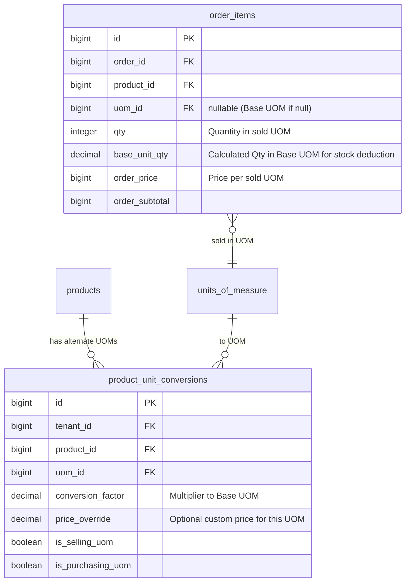

# Apeiron Systems — Hierarchical Multi-UOM Conversion & Pricing Specification
## Canonical Domain: Modul 02 (MDM), Modul 03 (CAT), Modul 05 (POS), Modul 06 (SLS)
### Benchmark: SAP S/4HANA Alternate Units of Measure & Odoo 18 Multi-UOM Architecture

---

## 1. Executive Summary & Core Engineering Principles

Dalam bisnis ritel grosir (FMCG, bahan bangunan, obat-obatan, supermarket) dan pengadaan F&B, suatu produk fisik dapat dibeli, disimpan, dan dijual dalam berbagai satuan kuantitas yang berbeda:
- **Base Unit of Measure (Base UOM):** Satuan persediaan terkecil yang disimpan pada buku besar stok (misalnya: `PCS`, `GRAM`, `ML`).
- **Secondary / Alternate UOM:** Satuan kemasan agregat untuk transaksi penjualan atau pengadaan (misalnya: `KARTON`, `DUS`, `LUSIN`, `BAL`, `PACK`).

Spesifikasi ini mendefinisikan mekanisme konversi hierarkis rasio tetap, resolusi harga bertingkat, dan normalisasi pemotongan inventori ke Base UOM.

---

## 2. Arsitektur Data & Model Konversi

---

## 3. Aturan Konversi & Presisi Perhitungan Finansial

### 3.1 Formula Pemotongan Inventori Buku Besar
Ketika kasir POS atau Sales Order menjual item dalam satuan alternatif:
$$\text{BaseUnitQty} = \text{bcmul}(\text{SoldQty}, \text{ConversionFactor}, 4)$$
Buku besar persediaan (`product_stock_balances` / `stock_movements`) **SELALU** memotong saldo stok sebesar $\text{BaseUnitQty}$.
*Contoh:*
- 1 Karton = 24 Pcs (Faktor Konversi: `24.0000`).
- Kasir menjual 2 Karton di POS.
- Sistem memotong $2 \times 24.0000 = 48.0000\text{ Pcs}$ dari `product_stock_balances`.

### 3.2 Resolusi Harga Jual UOM
Harga satuan per baris transaksi ditentukan dengan urutan prioritas:
1. **Harga Khusus UOM (`product_unit_conversions.price_override`):** Jika pemilik toko menetapkan diskon paket grosir (misal 1 Pcs = Rp 10.000, tapi 1 Karton isi 24 = Rp 220.000, bukan Rp 240.000).
2. **Proporsional Base Price:** Jika tidak ada harga khusus, harga dihitung otomatis:
   $$\text{PricePerUom} = \text{bcmul}(\text{ProductBasePrice}, \text{ConversionFactor}, 2)$$

---

## 4. Validasi Antar-Lapis (5-Layer Parity Integrity)

- **Layer 1 (Schema):** Tabel `product_unit_conversions` berindeks komposit `(tenant_id, product_id, uom_id)`.
- **Layer 2 (Model):** Relasi `conversions()` pada `Product`, `BelongsTo(UnitOfMeasure::class)`, serta model kanonikal [`ProductUnitConversion`](file:///home/ilhamspryd/Projects/apeironSystem/point-of-Sales/app/Modules/Catalog/Models/ProductUnitConversion.php).
- **Layer 3 (Service):** [`UnitConversionService::convertToBaseQuantity()`](file:///home/ilhamspryd/Projects/apeironSystem/point-of-Sales/app/Modules/Catalog/Services/UnitConversionService.php) dan [`CatalogPriceResolverService`](file:///home/ilhamspryd/Projects/apeironSystem/point-of-Sales/app/Modules/Pricing/Services/CatalogPriceResolverService.php).
- **Layer 4 (Livewire / Controller):** Kasir POS [`CreateOrder`](file:///home/ilhamspryd/Projects/apeironSystem/point-of-Sales/app/Livewire/Kasir/CreateOrder.php) dan [`SalesOrderManager`](file:///home/ilhamspryd/Projects/apeironSystem/point-of-Sales/app/Livewire/Sales/SalesOrderManager.php).
- **Layer 5 (Blade View):** Dropdown pilihan satuan di keranjang belanja dengan label satuan dan konversi eksplisit.
