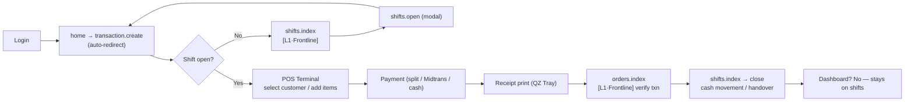
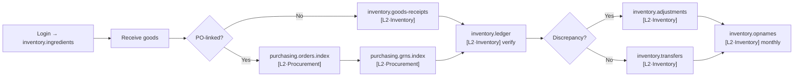
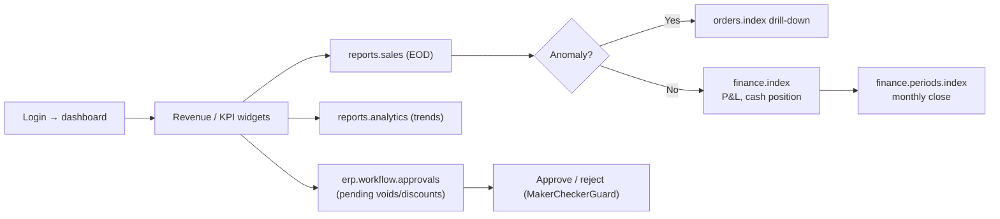
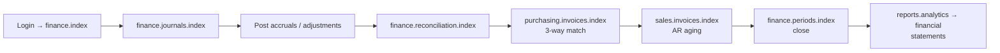
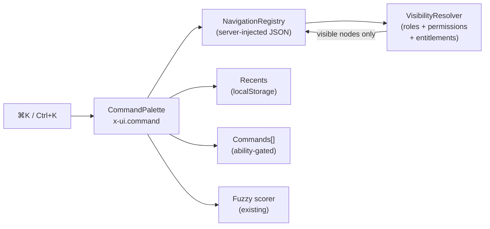
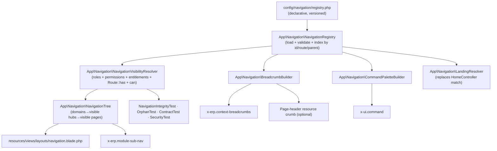
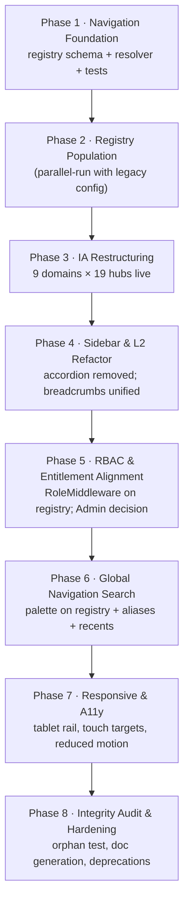
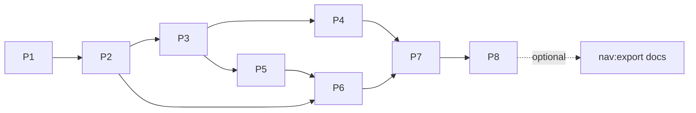

# APEIRON ENTERPRISE NAVIGATION ARCHITECTURE BLUEPRINT

## Apeiron Systems — Multi-Tenant SaaS POS & Enterprise ERP

| Field              | Value                                                                                                                               |
| ------------------ | ----------------------------------------------------------------------------------------------------------------------------------- |
| Document ID        | `ARCH-NAV-001`                                                                                                                      |
| Version            | 2.0.0 (Accepted & Implemented — Ratified Wave 5 & Wave 7)                                                                           |
| Status             | Architecture Blueprint — **ACCEPTED & FULLY IMPLEMENTED** (9 Domains × 19 Hubs × 45 Pages + Dual-Vertical Adaptive Filtering)       |
| Author role        | Principal Enterprise Architect / Information Architecture Specialist                                                                |
| Repository root    | `/home/ilhamspryd/Projects/apeironSystem/point-of-Sales`                                                                            |
| Evidence baseline  | `config/navigation/domains/*.php`, 13 route files, `php artisan route:list`, 85 navigation test suites (G-1..G-6 passing)           |
| Companion document | `docs/architecture/APEIRON_NAVIGATION_ROUTE_MAPPING.md`                                                                             |

> **Scope declaration.** This architecture blueprint has been fully implemented in production as of Wave 5 and extended with Dual-Vertical Adaptive Filtering (F&B / Retail / Hybrid) in Wave 7. Implementation is canonicalized under `config/navigation/domains/*.php`, `app/Platform/Navigation/NavigationRegistry.php`, and `app/Platform/Navigation/NavigationVisibilityResolver.php`.

---

## TABLE OF CONTENTS

1. Executive Summary
2. Repository Discovery Methodology
3. Existing Navigation Inventory
4. Current-State Architecture Assessment
5. Navigation Redundancy Matrix
6. Business Domain Classification
7. User Persona Analysis
8. User Journey Mapping
9. Proposed Master Navigation Tree
10. Complete Menu-to-Route Mapping
11. Navigation Governance Model
12. RBAC and Multi-Tenant Considerations
13. Sidebar UX Architecture
14. Breadcrumb Architecture
15. Global Search / Command Navigation Recommendation
16. Technical Architecture
17. Design System Recommendations
18. Migration Strategy
19. Risk Register
20. Acceptance Criteria
21. Testing Strategy
22. Open Questions and Remaining Unknowns
23. Architectural Decision Records (ADRs)

---

# 1. EXECUTIVE SUMMARY

## 1.1 The problem in one paragraph

Apeiron already has a **declarative, configuration-driven navigation** (`config/navigation.php`) that is consumed by five distinct surfaces: the L1 sidebar (`resources/views/layouts/navigation.blade.php`), the L2 module sub-navigation (`resources/views/components/erp/module-sub-nav.blade.php`), the context breadcrumb trail (`resources/views/components/erp/context-breadcrumbs.blade.php`), the command palette (`resources/views/components/erp/command-palette.blade.php`), and the custom-role authorization fallback (`app/Http/Middleware/RoleMiddleware.php:71-98`). That is a genuinely strong foundation — stronger than most first-generation ERPs reach in their third release. The problem is **not the existence of the source of truth**; the problem is that the source of truth has drifted into **three parallel, partially contradictory taxonomies** (`modules`, `sub_nav`, `sections`), so each consumer reads a slightly different universe. The sidebar shows 32 destinations for an Owner, the App Launcher shows 9 different modules, the breadcrumb reconciles two taxonomies ad hoc, the palette deduplicates by route with first-writer-wins semantics, and the authorization middleware resolves custom-role permissions by scanning **both** `sections` and `sub_nav` with an `fnmatch` matcher. Every one of those five consumers now encodes its own comprehension of "what the navigation is".

The visible symptoms are concrete and verifiable:

| Symptom                                                                                                                       | Evidence                                                                                                                                                                                                                                                                                              |
| ----------------------------------------------------------------------------------------------------------------------------- | ----------------------------------------------------------------------------------------------------------------------------------------------------------------------------------------------------------------------------------------------------------------------------------------------------- |
| Core ERP modules are reachable **only** through L2 tabs, never from the sidebar                                               | `manufacturing.orders.index`, `inventory.modifiers`, `retail.*`, `finance.fixed-assets.index`, `hr.*` sub-pages, `pricing.*`, `users.invitations.index` exist in `sub_nav` only — `sections` covers 32 of ~45 intended destinations                                                                   |
| The sidebar, app launcher and breadcrumbs disagree on module names                                                            | `sections` says "Analytics & Customers", `modules` says "B2B Sales & CRM" + "Analytics & Reports", `sub_nav` says "B2B Sales & Accounts Receivable"                                                                                                                                                   |
| A single section value mixes four unrelated domains                                                                           | `config/navigation.php:915-963` groups BI, CRM, Pricing and B2B Sales under `'Analytics & Customers'`                                                                                                                                                                                                 |
| Duplicate surplus destinations exist with no user-visible distinction                                                         | `inventory.goods-receipts` vs `purchasing.grns.index`; `discounts.index` vs `pricing.vouchers.index` vs `customers.instruments.index`; `Price Lists` appears in both `catalog` and `pricing` sub-navs                                                                                                 |
| 43 Blade views hard-link their breadcrumb root to `route('dashboard')`, a route that returns 403 for 9 of 11 canonical roles  | `resources/views/brands/index.blade.php:44`, `resources/views/users/index.blade.php:10`, `resources/views/errors/403.blade.php:22`                                                                                                                                                                    |
| A dead-end authorization path exists in production code                                                                       | `app/Modules/Organization/Controllers/UserInvitationController.php:135` redirects accepted invitations to `route('dashboard')`, which is guarded by `role:Owner,Manager` (`routes/reports.php:19-20`) — every invited Kasir/Waiter/Inventory user lands on 403                                        |
| An entire module is invisible until onboarding is complete, then permanently absent from the "Settings" surface owner expects | `subscription.portal` is listed in `sections` (`config/navigation.php:1087-1095` region) and evaluated on every sidebar render via `EntitlementGateInterface::isTablesEnabled()` (`navigation.blade.php:15-18`) but is never rendered as a distinct destination in the L2 `organization` sub-nav gate |

## 1.2 What this blueprint proposes

A **three-surface navigation architecture driven by one canonical, versioned registry**, replacing the current three-taxonomy configuration file:

```
                      ┌───────────────────────────────────────────┐
                      │  config/navigation/registry.php           │
                      │  (SINGLE SOURCE OF TRUTH — proposed)      │
                      │  • Domains  (8)                            │
                      │  • Hubs     (19, L1 entries)               │
                      │  • Pages    (45, L2 entries)               │
                      │  • Each node: id, label, route, permission,│
                      │    roles, scope, entitlements, status,     │
                      │    icon, order, active[]                   │
                      └──────────────┬────────────────────────────┘
                                     │
             ┌───────────────┬───────┴────────┬────────────────┐
             ▼               ▼                ▼                ▼
    ┌────────────────┐ ┌──────────────┐ ┌─────────────┐ ┌────────────────┐
    │ NavigationQuery│ │ NavigationTree│ │ Breadcrumb  │ │ CommandPalette │
    │ (visibility)   │ │ (render)      │ │ (wayfinding)│ │ (discovery)    │
    └───────┬────────┘ └──────┬────────┘ └──────┬──────┘ └───────┬────────┘
            │                 │                 │                │
            ▼                 ▼                 ▼                ▼
      Sidebar L1         Sub-nav L2         Header trail      Cmd+K index
```

Eight domains, nineteen L1 hubs, forty-five L2 pages, a maximum rendered depth of **three** (Domain → Hub → Page), with page-level tabs confined to resource detail views. Every destination currently reachable in Apeiron remains reachable; there are **zero net removals**, fourteen relocations, six merges of genuinely duplicated surfaces, and four documented "deliberate shortcut" exceptions.

## 1.3 Headline architectural decisions

| ADR         | Decision                                                                           | Why it matters                                                                                                                                                      |
| ----------- | ---------------------------------------------------------------------------------- | ------------------------------------------------------------------------------------------------------------------------------------------------------------------- |
| ADR-NAV-001 | One registry file, three projections (tree, breadcrumb, palette)                   | Eliminates five independent interpretations of "what navigation is"                                                                                                 |
| ADR-NAV-002 | Configuration over database for navigation topology                                | Navigation topology is code, not tenant data; DB-driven navigation would require cache invalidation per tenant for zero business benefit                            |
| ADR-NAV-003 | Three rendered levels maximum, `Domain → Hub → Page`                               | Matches SAP Fiori "Work Center / View" and Dynamics 365 "Module / Area / Page" depth without SAP's discovery cost                                                   |
| ADR-NAV-004 | L1 = Hubs only; L2 = Pages. Zero L1↔L2 duplication except documented shortcuts     | Removes today's 6-vertical-link HR block that duplicates 6 identical horizontal tabs                                                                                |
| ADR-NAV-005 | Permission declared as a **middleware-derived contract assertion**, not hand-typed | Today `SidebarIntegrityTest` already proves drift is possible; the contract must be generated + asserted                                                            |
| ADR-NAV-006 | Navigation visibility is advisory; backend authorization remains authoritative     | Preserves current model (`RoleMiddleware`, Policies, `AbilityRegistry`, `EntitlementGateInterface`) without introducing a parallel authz system                     |
| ADR-NAV-007 | Menu-level entitlement gating for the five already-enforced features               | `table_management`, `omnichannel`, `restock_forecast`, `async_export`, `self_order` are already route-gated; the sidebar must not advertise what the route will 403 |
| ADR-NAV-008 | Command palette indexes the registry, not a second list                            | Fixes the documented `Cmd+K` blindness to 25+ L2 pages                                                                                                              |

## 1.4 Effort and risk envelope

The migration is scoped to **8 sequential phases**, each independently shippable and test-gated. Estimated impact surface: 1 configuration file (rewritten as a directory), 5 Blade components, 1 middleware, 2 controllers (redirect fixes), 43 Blade breadcrumb roots, 5 test classes. No database migration is required. No route is deleted. The highest-risk phase is Phase 3 (sidebar refactor) because `SidebarIntegrityTest::test_navigation_sections_contain_expected_six_pillars_and_valid_scope_metadata` asserts an **exact array** of eight section keys and `test_role_based_menu_filtering_for_all_supported_roles` asserts **exact counts and exact sets** per role — both must be rewritten in lock-step, not patched.

---

# 2. REPOSITORY DISCOVERY METHODOLOGY

## 2.1 Approach

Discovery proceeded **bottom-up from executable truth**, not top-down from documentation. Several in-repository documents (`docs/08-frontend-ux/navigation-blueprint/*.md`, `docs/architecture/NAVIGATION_INTEGRITY_MATRIX.md`) describe an earlier or aspirational state and were treated as _claims to be verified_, not as ground truth. Where they conflicted with the code, the code won and the discrepancy is recorded in §22.

## 2.2 Evidence sources, in priority order

| Priority | Source                                                                                               | What it establishes                                                               | How used                                                                   |
| -------- | ---------------------------------------------------------------------------------------------------- | --------------------------------------------------------------------------------- | -------------------------------------------------------------------------- |
| 1        | `php artisan route:list --json` → `/tmp/apeiron_routes.json`                                         | The complete, actually-registered route table including resolved middleware       | Authoritative inventory of destinations and authorization                  |
| 2        | `routes/*.php` (14 files, 1,015 lines total)                                                         | Route group structure, prefixes, `role:` middleware, `enforce.entitlement:` gates | Cross-verified with priority 1; used to derive the role contract per route |
| 3        | `config/navigation.php` (1,099 lines)                                                                | Current three-taxonomy navigation declaration                                     | Inventory of what is _advertised_                                          |
| 4        | `resources/views/layouts/{app,navigation}.blade.php`                                                 | The actual rendered chrome                                                        | Sidebar behaviour, active-state logic, mobile behaviour                    |
| 5        | `resources/views/components/erp/*.blade.php`                                                         | Sub-nav, breadcrumbs, palette, launcher, notification, page-header                | Secondary navigation surfaces                                              |
| 6        | `app/Livewire/**` (46 components) + `app/Http/Controllers/**`                                        | Implementation status of each destination                                         | Status classification (§3.4)                                               |
| 7        | `app/Modules/*/module.json` (13 manifests)                                                           | Bounded-context ownership, tiers, dependency rules                                | Domain classification cross-check (§6)                                     |
| 8        | `app/Policies/*` (54 policies), `app/Platform/Authorization/*`                                       | Fine-grained authorization model                                                  | Governance design (§11, §12)                                               |
| 9        | `app/Modules/Organization/Services/RoleService.php:200-244`                                          | Canonical role → permission mapping                                               | Persona analysis (§7)                                                      |
| 10       | `tests/Feature/Navigation/*.php` (5 classes, 1,265 lines)                                            | Existing integrity contracts and their assumptions                                | Migration risk (§18)                                                       |
| 11       | `app/Http/Controllers/HomeController.php`, `app/Modules/Organization/Controllers/HomeController.php` | Post-login landing logic                                                          | Journey mapping (§8)                                                       |

## 2.3 Commands executed (read-only)

```bash
php artisan route:list --json > /tmp/apeiron_routes.json
php -r '...extract name|uri|role|entitlement per route...'
wc -l routes/*.php
ls app/Modules/ app/Platform/
grep -rn "module-sub-nav|app-launcher|context-breadcrumbs" resources/views
grep -rn "route('dashboard')" resources/views
```

## 2.4 Documents reviewed and their reliability

| Document                                                                             | Verdict                                                                                                                                                                                                                                                                                                                                                                                                                                                                                                                    |
| ------------------------------------------------------------------------------------ | -------------------------------------------------------------------------------------------------------------------------------------------------------------------------------------------------------------------------------------------------------------------------------------------------------------------------------------------------------------------------------------------------------------------------------------------------------------------------------------------------------------------------- |
| `docs/architecture/NAVIGATION_INTEGRITY_MATRIX.md` (v2.4-CANONICAL, 07 Nov 2026)     | **Partially stale.** Claims "31 Owner items" and lists 8 pillars without the Approval Inbox; the live config yields **32** items in 8 pillars **with** the Approval Inbox (`config/navigation.php:1087-1095`). Claims `Order History` roles = `Owner,Manager,Kasir,Waiter` — actual is `Owner,Manager,Kasir,Waiter,Supervisor`. Claims "Level 5: DIRECT_URL_ONLY = 0" — refuted below (§3.5).                                                                                                                              |
| `docs/08-frontend-ux/navigation-blueprint/02-NAVIGATION-GAP-AND-REDUNDANCY-AUDIT.md` | **Partially stale, several findings already remediated.** References `app/Modules/Settings/Controllers/HomeController.php` and `app/Modules/Users/...` — neither path exists; the modules are `Organization`. Its `HomeController` finding (missing Finance/Sales/Admin) _is_ already fixed at `app/Modules/Organization/Controllers/HomeController.php:46-57`. Its "SubNav orphans" finding for `pricing.promotions.index` is _already_ fixed — that route is now in `sub_nav.pricing` (`config/navigation.php:342-349`). |
| `docs/08-frontend-ux/navigation-blueprint/03-ENTERPRISE-INFORMATION-ARCHITECTURE.md` | **Design intent only.** Describes a 9-domain/15-hub target that was never fully implemented; the live `sections` still has 8 pillars. Valuable as a design precedent, not as current state.                                                                                                                                                                                                                                                                                                                                |
| `docs/08-frontend-ux/navigation-blueprint/10-IMPLEMENTATION-ROADMAP.md`              | **Partially complete.** Slice 1 partially done (role landing fixed), Slice 2 done (sub_nav + module-sub-nav exist), Slice 3 not done (sidebar still duplicates sub-nav).                                                                                                                                                                                                                                                                                                                                                   |
| `AGENTS.md` / `APEIRON_GEMINI_ENGINEERING_RULES.md`                                  | **Current and authoritative** for engineering rules (ADR-102/110/112/114, tenant isolation, `Money` VO, etc.).                                                                                                                                                                                                                                                                                                                                                                                                             |

> **Governance note for the implementation agent:** do not trust the three `docs/08-frontend-ux/navigation-blueprint/0*.md` files for current state. They are useful precedent. §3 and the companion mapping file are the current truth.

---

# 3. EXISTING NAVIGATION INVENTORY

## 3.1 The five navigation surfaces actually rendered

| #   | Surface                                           | File                                                                                                  | Data source                                                       | Roles applied?                                        | Entitlements applied?                                |
| --- | ------------------------------------------------- | ----------------------------------------------------------------------------------------------------- | ----------------------------------------------------------------- | ----------------------------------------------------- | ---------------------------------------------------- |
| S1  | L1 Sidebar (wide accordion)                       | `resources/views/layouts/navigation.blade.php:156-227`                                                | `config('navigation.sections')`                                   | Yes — role name list OR `permission` for custom roles | Only `tables.index` → `isTablesEnabled()` (`:28-30`) |
| S2  | L1 Micro-rail (collapsed, one icon per _section_) | `navigation.blade.php:230-270`                                                                        | `sections` (first item of each section)                           | Inherited from S1 filter                              | No                                                   |
| S3  | L2 Module sub-nav (horizontal pills)              | `resources/views/components/erp/module-sub-nav.blade.php`                                             | `config("navigation.sub_nav.{$module}")`                          | Yes — roles + optional `can` Gate                     | **No**                                               |
| S4  | Context breadcrumb                                | `resources/views/components/erp/context-breadcrumbs.blade.php`                                        | `modules` + `sections` + `sub_nav` (three-way reconciliation)     | **No** — renders regardless of visibility             | No                                                   |
| S5  | Command palette `⌘K`                              | `resources/views/components/erp/command-palette.blade.php`                                            | `sections` then `sub_nav`, dedupe by route                        | Yes (roles / custom permission)                       | No                                                   |
| S6  | App launcher (orphan)                             | `resources/views/components/erp/app-launcher.blade.php`                                               | `config('navigation.modules')`                                    | Yes (roles only, no permission path for custom roles) | No                                                   |
| S7  | User popover                                      | `navigation.blade.php:296-342`                                                                        | Hardcoded `profile.edit`, `settings.index` (Owner only), `logout` | Partial (hardcoded Owner check)                       | No                                                   |
| S8  | Page header in-canvas breadcrumb                  | `resources/views/components/common/page-breadcrumb.blade.php`, `x-erp.*` per-view `breadcrumbs` props | 43 views hardcode `route('dashboard')` as root                    | No                                                    | No                                                   |

**Finding INV-01 — S6 is dead.** `x-erp.app-launcher` is rendered _nowhere_ in `resources/views/layouts/*`; `Tier1NavigationTest::test_top_navbar_is_streamlined_without_app_launcher` (`tests/Feature/Navigation/Tier1NavigationTest.php:64-76`) actively asserts its absence from the navbar, and `test_standalone_app_launcher_component_filters_restricted_modules_by_role` renders it directly via `Blade::render`. It survives only as a test fixture. **Recommendation: deprecate in Phase 8 or promote to a genuine surface in Phase 6 — not keep as zombie.**

**Finding INV-02 — S4 ignores authorization.** `context-breadcrumbs.blade.php:19-26` iterates `sections` with no role check. In practice the breadcrumb only renders the _active_ item, so it is not a data-exposure hole; but it _is_ the reason the breadcrumb labels don't match menu labels when an active route appears in `sections` under a different label than in `sub_nav`.

**Finding INV-03 — Role-filtering semantics are inconsistent across surfaces.**

- S1/S5: custom role → `$user->hasPermission($item['permission'])` (asset permission gate).
- S3: custom role → same, **plus** an optional `Gate::allows($tab['can'])` policy check.
- S6: custom role → **no permission fallback at all** (`app-launcher.blade.php:5-10`), so a custom role sees **zero apps** in the launcher.
- S2: inherits S1 but resolves the rail icon per _section_, so a custom role whose only permitted item sits in section 3 sees a rail icon for section 3 that routes to that one item.

## 3.2 Complete destination inventory — the 45 canonical application destinations

The route table contains ≈250 named routes. Excluding health probes, webhooks, API endpoints, Livewire internals, auth plumbing, `storage.*`, `sanctum.*` and `_boost/*`, there are **45 page-level destinations** a human navigates to. All 45 are enumerated below with their classification. This is the inventory of record; the companion mapping file carries the full attribute matrix.

### 3.2.1 GET destinations (page-level), sorted by domain

| #   | Route name                     | URI                             | Controller / Livewire                                    | Route guard (`role:`)                   | Entitlement                                | In `sections`?                              | In `sub_nav`?                   | Surface(s) reachable from                                                     |
| --- | ------------------------------ | ------------------------------- | -------------------------------------------------------- | --------------------------------------- | ------------------------------------------ | ------------------------------------------- | ------------------------------- | ----------------------------------------------------------------------------- |
| 1   | `home`                         | `/home`                         | `Organization\Controllers\HomeController::index`         | none                                    | —                                          | no                                          | no                              | Post-login redirect only                                                      |
| 2   | `dashboard`                    | `/dashboard`                    | `DashboardController::index`                             | Owner,Manager                           | —                                          | ✅ Overview                                 | —                               | S1, S5, S8 root of 43 breadcrumbs                                             |
| 3   | `transaction.create`           | `/transaction`                  | `Livewire\Kasir\CreateOrder`                             | Owner,Manager,Kasir                     | —                                          | ✅ Cashier & Operations                     | ✅ pos-ops                      | S1, S5, S6                                                                    |
| 4   | `tables.index`                 | `/tables`                       | `TableController@index`                                  | Owner,Manager                           | `table_management` (via `isTablesEnabled`) | ✅                                          | ✅ pos-ops                      | S1 (entitlement-gated), S5 (not gated)                                        |
| 5   | `kds.index`                    | `/kds`                          | `Livewire\Kds\Board`                                     | Owner,Manager,Kasir,Barista,Waiter,Cook | —                                          | ✅                                          | ✅ pos-ops                      | S1, S5                                                                        |
| 6   | `orders.index`                 | `/orders`                       | `TransactionController@index`                            | Owner,Manager,Kasir,Waiter,Supervisor   | —                                          | ✅                                          | ✅ pos-ops                      | S1, S5                                                                        |
| 7   | `shifts.index`                 | `/shifts`                       | `ShiftController@index`                                  | Owner,Manager,Kasir,Supervisor          | —                                          | ✅                                          | ✅ pos-ops                      | S1, S5                                                                        |
| 8   | `integrations.channel-mapping` | `/integrations/channel-mapping` | `Livewire\ChannelMappingManager`                         | Owner,Manager                           | `omnichannel`                              | ❌ **hidden**                               | ✅ pos-ops **and** organization | S3 only (duplicated across 2 modules)                                         |
| 9   | `products.index`               | `/products`                     | `ProductController@index`                                | Owner,Manager,Inventory                 | —                                          | ✅ Catalog                                  | ✅ catalog                      | S1, S5                                                                        |
| 10  | `categories.index`             | `/categories`                   | `CategoryController@index`                               | Owner,Manager,Inventory                 | —                                          | ❌                                          | ✅ catalog                      | S3 only                                                                       |
| 11  | `brands.index`                 | `/brands`                       | `BrandController@index`                                  | Owner,Manager,Inventory                 | —                                          | ❌                                          | ✅ catalog                      | S3 only                                                                       |
| 12  | `units-of-measure.index`       | `/units-of-measure`             | `UnitOfMeasureController@index`                          | Owner,Manager,Inventory                 | —                                          | ❌                                          | ✅ catalog                      | S3 only                                                                       |
| 13  | `inventory.modifiers`          | `/inventory/modifiers`          | `Livewire\Inventory\ModifierManager`                     | Owner,Manager,Inventory                 | —                                          | ❌                                          | ✅ catalog                      | S3 only (a **Catalog** concept living under an **Inventory** route/namespace) |
| 14  | `tax-classes.index`            | `/tax-classes`                  | `TaxClassController@index`                               | Owner,Manager,Inventory                 | —                                          | ❌ (`active` of both Catalog and Settings!) | ✅ catalog                      | S3 only; active-state collision with `settings.index`                         |
| 15  | `assortments.index`            | `/assortments`                  | `StoreProductAssortmentController@index`                 | Owner,Manager,Inventory                 | —                                          | ✅ Catalog                                  | ✅ catalog                      | S1, S5                                                                        |
| 16  | `price-lists.index`            | `/price-lists`                  | `PriceListController@index`                              | Owner,Manager,Inventory                 | —                                          | ✅ Catalog                                  | ✅ catalog **and** ✅ pricing   | S1, S5, S3 (2 modules)                                                        |
| 17  | `retail.shelf-labels.index`    | `/retail/shelf-labels`          | `Livewire\Retail\ShelfLabelManager`                      | Owner,Manager,Inventory,Kasir,Sales     | —                                          | ❌                                          | ✅ catalog                      | S3 only                                                                       |
| 18  | `retail.barcodes.index`        | `/retail/barcodes`              | `Livewire\Retail\BarcodeManager`                         | Owner,Manager,Inventory,Kasir,Sales     | —                                          | ❌                                          | ✅ catalog                      | S3 only                                                                       |
| 19  | `retail.exchanges.index`       | `/retail/exchanges`             | `Livewire\Retail\RetailExchangeManager`                  | Owner,Manager,Inventory,Kasir,Sales     | —                                          | ❌                                          | ✅ catalog                      | S3 only                                                                       |
| 20  | `inventory.ingredients`        | `/inventory/ingredients`        | `Livewire\Inventory\IngredientManager`                   | Owner,Manager,Inventory                 | —                                          | ✅ Inventory & Supply                       | ✅ inventory                    | S1, S5, S6                                                                    |
| 21  | `inventory.goods-receipts`     | `/inventory/goods-receipts`     | `Livewire\Inventory\GoodsReceiptManager`                 | Owner,Manager,Inventory                 | —                                          | ✅ (as "Stock Operations")                  | ✅ inventory                    | S1, S5                                                                        |
| 22  | `inventory.adjustments`        | `/inventory/adjustments`        | `Livewire\Inventory\StockAdjustmentManager`              | Owner,Manager,Inventory                 | —                                          | ❌ (folded into "Stock Operations" active)  | ✅ inventory                    | S3 only                                                                       |
| 23  | `inventory.opnames`            | `/inventory/opnames`            | `Livewire\Inventory\StockOpnameManager`                  | Owner,Manager,Inventory                 | —                                          | ❌ (folded)                                 | ✅ inventory                    | S3 only                                                                       |
| 24  | `inventory.transfers`          | `/inventory/transfers`          | `Livewire\Inventory\StockTransferManager`                | Owner,Manager,Inventory                 | —                                          | ❌ (folded)                                 | ✅ inventory                    | S3 only                                                                       |
| 25  | `inventory.supplier-returns`   | `/inventory/supplier-returns`   | `Livewire\Inventory\SupplierReturnManager`               | Owner,Manager,Inventory                 | —                                          | ❌ (folded)                                 | ✅ inventory                    | S3 only                                                                       |
| 26  | `inventory.ledger`             | `/inventory/ledger`             | `Livewire\Inventory\IngredientLedger`                    | Owner,Manager,Inventory                 | —                                          | ✅                                          | ✅ inventory                    | S1, S5                                                                        |
| 27  | `manufacturing.orders.index`   | `/manufacturing/orders`         | `Livewire\Manufacturing\ManufacturingOrderManager`       | Owner,Manager,Inventory                 | —                                          | ❌                                          | ✅ inventory                    | S3 only                                                                       |
| 28  | `purchasing.suppliers.index`   | `/purchasing/suppliers`         | `Livewire\Purchasing\SupplierManager`                    | Owner,Manager,Inventory                 | —                                          | ✅ (as "Purchasing")                        | ✅ purchasing                   | S1, S5                                                                        |
| 29  | `purchasing.orders.index`      | `/purchasing/orders`            | `Livewire\Purchasing\PurchaseOrderManager`               | Owner,Manager,Inventory                 | —                                          | ❌                                          | ✅ purchasing                   | S3 only                                                                       |
| 30  | `purchasing.grns.index`        | `/purchasing/grns`              | `Livewire\Purchasing\GoodsReceivedNoteManager`           | Owner,Manager,Inventory                 | —                                          | ❌                                          | ✅ purchasing                   | S3 only                                                                       |
| 31  | `purchasing.invoices.index`    | `/purchasing/invoices`          | `Livewire\Purchasing\SupplierInvoiceManager`             | Owner,Manager,Inventory,Finance         | —                                          | ❌                                          | ✅ purchasing                   | S3 only (Finance cannot reach it from S1!)                                    |
| 32  | `purchasing.returns.index`     | `/purchasing/returns`           | `Livewire\Purchasing\PurchaseReturnManager`              | Owner,Manager,Inventory                 | —                                          | ❌                                          | ✅ purchasing                   | S3 only                                                                       |
| 33  | `customers.index`              | `/customers`                    | `Livewire\Customers\CustomerManager`                     | Owner,Manager                           | —                                          | ✅ Analytics & Customers                    | ✅ customers                    | S1, S5                                                                        |
| 34  | `customers.groups.index`       | `/customers/groups`             | `Livewire\Customers\CustomerGroupManager`                | Owner,Manager                           | —                                          | ❌                                          | ✅ customers                    | S3 only                                                                       |
| 35  | `customers.credit.index`       | `/customers/credit`             | `Livewire\Customers\CustomerCreditManager`               | Owner,Manager,Finance,Sales             | —                                          | ❌                                          | ✅ customers                    | S3 only                                                                       |
| 36  | `customers.instruments.index`  | `/customers/instruments`        | `Livewire\Customers\LoyaltyAndValueInstrumentManager`    | Owner,Manager                           | —                                          | ❌                                          | ✅ customers                    | S3 only                                                                       |
| 37  | `sales.orders.index`           | `/sales/orders`                 | `Livewire\Sales\SalesOrderManager`                       | Owner,Manager,Sales,Admin,Finance       | —                                          | ✅ (as "B2B Sales Orders")                  | ✅ sales                        | S1, S5                                                                        |
| 38  | `sales.quotations.index`       | `/sales/quotations`             | `Livewire\Sales\QuotationManager`                        | Owner,Manager,Sales,Admin,Finance       | —                                          | ❌                                          | ✅ sales                        | S3 only                                                                       |
| 39  | `sales.invoices.index`         | `/sales/invoices`               | `Livewire\Sales\AccountsReceivableManager`               | Owner,Manager,Sales,Admin,Finance       | —                                          | ❌                                          | ✅ sales                        | S3 only                                                                       |
| 40  | `sales.returns.index`          | `/sales/returns`                | `Livewire\Sales\ReturnCreditNoteManager`                 | Owner,Manager,Sales,Admin,Finance       | —                                          | ❌                                          | ✅ sales                        | S3 only                                                                       |
| 41  | `discounts.index`              | `/discounts`                    | `DiscountController::index` (`Livewire\DiscountManager`) | Owner,Manager                           | —                                          | ✅ Analytics & Customers                    | ✅ pricing                      | S1, S5                                                                        |
| 42  | `pricing.promotions.index`     | `/pricing/promotions`           | `Livewire\Pricing\PromotionCampaignManager`              | Owner,Manager                           | —                                          | ❌                                          | ✅ pricing                      | S3 only                                                                       |
| 43  | `pricing.vouchers.index`       | `/pricing/vouchers`             | `Livewire\Pricing\VoucherManager`                        | Owner,Manager                           | —                                          | ❌                                          | ✅ pricing                      | S3 only                                                                       |
| 44  | `finance.index`                | `/finance`                      | `FinanceDashboardController::index`                      | Owner,Manager,Finance,Admin             | —                                          | ✅ Finance & Accounting                     | ✅ finance                      | S1, S5                                                                        |
| 45  | `finance.coa.index`            | `/finance/chart-of-accounts`    | `Livewire\Finance\ChartOfAccountManager`                 | Owner,Manager,Finance,Admin             | —                                          | ❌                                          | ✅ finance                      | S3 only                                                                       |
| 46  | `finance.journals.index`       | `/finance/journal-entries`      | `Livewire\Finance\JournalEntryManager`                   | Owner,Manager,Finance,Admin             | —                                          | ❌                                          | ✅ finance                      | S3 only                                                                       |
| 47  | `finance.periods.index`        | `/finance/accounting-periods`   | `Livewire\Finance\AccountingPeriodManager`               | Owner,Manager,Finance,Admin             | —                                          | ❌                                          | ✅ finance                      | S3 only                                                                       |
| 48  | `finance.reconciliation.index` | `/finance/bank-reconciliation`  | `Livewire\Finance\BankReconciliationWorkbench`           | Owner,Manager,Finance,Admin             | —                                          | ❌                                          | ✅ finance                      | S3 only                                                                       |
| 49  | `finance.fixed-assets.index`   | `/finance/fixed-assets`         | `Livewire\Finance\FixedAssetManager`                     | Owner,Manager,Finance,Admin             | —                                          | ❌                                          | ❌ **ABSENT FROM BOTH**         | **URL-only** (reachable only by typing)                                       |
| 50  | `hr.employees.index`           | `/hr/employees`                 | `Livewire\HR\EmployeeManager`                            | Owner,Manager                           | —                                          | ✅ Human Resources & Payroll                | ✅ hr                           | S1, S5                                                                        |
| 51  | `hr.schedules.index`           | `/hr/schedules`                 | `Livewire\HR\WorkforceScheduler`                         | Owner,Manager                           | —                                          | ✅                                          | ✅ hr                           | S1, S5                                                                        |
| 52  | `hr.attendance.index`          | `/hr/attendance`                | `Livewire\HR\AttendanceMonitor`                          | Owner,Manager                           | —                                          | ✅                                          | ✅ hr                           | S1, S5                                                                        |
| 53  | `hr.leaves.index`              | `/hr/leaves`                    | `Livewire\HR\LeaveManager`                               | Owner,Manager                           | —                                          | ✅                                          | ✅ hr                           | S1, S5                                                                        |
| 54  | `hr.commissions.index`         | `/hr/commissions`               | `Livewire\HR\CommissionManager`                          | Owner,Manager                           | —                                          | ✅                                          | ✅ hr                           | S1, S5                                                                        |
| 55  | `hr.payroll.index`             | `/hr/payroll`                   | `Livewire\HR\PayrollBatchManager`                        | Owner,Manager                           | —                                          | ✅                                          | ✅ hr                           | S1, S5                                                                        |
| 56  | `reports.analytics`            | `/analytics`                    | `Livewire\Reports\AdvancedAnalyticsDashboard`            | Owner,Manager                           | —                                          | ✅ Analytics & Customers                    | ✅ reports                      | S1, S5                                                                        |
| 57  | `reports.sales`                | `/reports/sales`                | `ReportController::index`                                | Owner,Manager                           | —                                          | ✅                                          | ✅ reports                      | S1, S5 — **also the Manager home landing** (`HomeController:48`)              |
| 58  | `stores.index`                 | `/stores`                       | `StoreController@index`                                  | Owner                                   | —                                          | ✅ Settings                                 | ✅ organization                 | S1, S5                                                                        |
| 59  | `users.index`                  | `/users`                        | `UserController@index`                                   | Owner                                   | —                                          | ✅ (active also `users.invitations.*`)      | ✅ governance                   | S1, S5                                                                        |
| 60  | `users.invitations.index`      | `/users-invitations`            | `UserInvitationController@index`                         | Owner                                   | —                                          | ❌ (active folded into `users.index`)       | ✅ governance                   | S3 only                                                                       |
| 61  | `roles.index`                  | `/roles`                        | `RoleController@index`                                   | Owner                                   | —                                          | ✅                                          | ✅ governance                   | S1, S5                                                                        |
| 62  | `devices.index`                | `/devices`                      | `DeviceController@index`                                 | Owner,Manager                           | quota `max_devices_per_store`              | ✅ Settings                                 | ✅ organization                 | S1, S5                                                                        |
| 63  | `settings.index`               | `/settings`                     | `SettingController@index`                                | Owner                                   | —                                          | ✅                                          | ✅ organization                 | S1, S5, S7                                                                    |
| 64  | `activity-logs.index`          | `/activity-logs`                | `ActivityLogController@index`                            | Owner,Manager                           | —                                          | ✅                                          | ✅ governance                   | S1, S5                                                                        |
| 65  | `subscription.portal`          | `/subscription`                 | `Livewire\Subscription\SubscriptionPortal`               | Owner,Manager                           | — (viewing)                                | ✅ Settings                                 | ✅ organization                 | S1, S5                                                                        |
| 66  | `erp.workflow.approvals`       | `/workflow/approvals`           | `Livewire\Workflow\UnifiedApprovalInbox`                 | Owner,Manager                           | —                                          | ✅ Settings                                 | ❌                              | S1, S5                                                                        |

> **Count reconciliation.** The table above enumerates 66 rows because it includes `home` (`#1`) and duplicates no route. Of these, `home` is a router (never a menu item), leaving **65 navigable page destinations**. Of those, **1 is URL-only** (`finance.fixed-assets.index`), **1 is detail-only** (`orders.show`) — excluded from this table, and **63 are reachable from at least one navigation surface**. The claim in `docs/architecture/NAVIGATION_INTEGRITY_MATRIX.md:76` that `DIRECT_URL_ONLY = 0` is **refuted**: `finance.fixed-assets.index` is reachable from no surface at all.

### 3.2.2 Additional page-level GET routes (not primary destinations)

| Route                                                                                                                                                                                                                                 | Purpose                             | Navigation treatment                                                              |
| ------------------------------------------------------------------------------------------------------------------------------------------------------------------------------------------------------------------------------------- | ----------------------------------- | --------------------------------------------------------------------------------- |
| `orders.show` `/orders/{orderNumber}`                                                                                                                                                                                                 | Order detail                        | **Resource detail** — reached from `orders.index`. No menu entry (correct today). |
| `transaction.receipt` `/transaction/receipt/{orderCode}`                                                                                                                                                                              | Receipt reprint                     | Post-transaction / print — no menu entry (correct).                               |
| `exports.status`, `exports.download`                                                                                                                                                                                                  | Async export polling                | Machine consumption of `ExportTask`; no menu entry (correct).                     |
| `shifts.show` `/shifts/{shift}`                                                                                                                                                                                                       | Shift detail                        | Resource detail.                                                                  |
| `tables.show/create/edit`, `stores.create/edit`, `users.create/edit`, `roles.create/edit`, `devices.create/edit/show`, `products.create/edit`, `categories.create/edit`, `price-lists.create/edit`, `retail.shelf-labels.print-batch` | CRUD forms                          | **Workflow steps** — reached from their index pages (correct).                    |
| `hr.index` `/hr`                                                                                                                                                                                                                      | 302 redirect → `hr.employees.index` | Legacy alias.                                                                     |
| `kasir` `/kasir`                                                                                                                                                                                                                      | 301 redirect → `/transaction`       | Legacy alias (`routes/sales.php:35`).                                             |
| `profile.edit` `/profile`                                                                                                                                                                                                             | Self-service profile                | Reached from S7 user popover — correct as-is.                                     |

### 3.2.3 Customer self-order surface (no staff navigation)

`customer.menu.index`, `customer.menu.modifiers`, `customer.cart.*`, `customer.checkout.*`, `customer.waiter.call` — 12 routes, throttled, `table.session` middleware, **intentionally unauthenticated**. These are a **separate application shell** (`resources/views/layouts/customer.blade.php`). They must never appear in staff navigation. Documented as an architectural boundary, not an omission.

### 3.2.4 Authentication / onboarding / error surfaces (no menu)

`login`, `logout`, `password.*`, `two-factor.*`, `verification.*`, `oauth.*`, `invitations.accept`, `onboarding.set-password`, `onboarding.business-profile`, `onboarding.initial-branch`, `onboarding.resend`, `register`, `health.*`. The onboarding wizard is reached **only** by middleware redirect (`app/Http/Middleware/EnsureOnboardingCompleted.php:61-72`) — correct, but see RISK-NAV-04.

## 3.3 Role → destination matrix derived from middleware

Derived by joining §3.2.1 with `role:` middleware, cross-checked against `RoleService::provisionDefaultRoles()` (`app/Modules/Organization/Services/RoleService.php:203-215`) and `tests/Feature/Navigation/SidebarIntegrityTest.php:116-189`.

| Route (short)                                                                              | Owner | Admin | Manager | Finance | Sales | Kasir | Waiter | Barista | Inventory | Supervisor | Cook |
| ------------------------------------------------------------------------------------------ | :---: | :---: | :-----: | ------- | ----- | ----- | ------ | ------- | --------- | ---------- | ---- |
| dashboard                                                                                  |  ✅   |  ✅   |   ✅    | –       | –     | –     | –      |
| transaction.create                                                                         |  ✅   |   –   |    –    | ✅      | –     | –     | –      |
| tables.index                                                                               |  ✅   |   –   |   ✅    | –       | –     |
| kds.index                                                                                  |  ✅   |   –   |   ✅    | –       | –     | ✅    | ✅     | ✅      | –         | –          | ✅   |
| orders.index                                                                               |  ✅   |   –   |    –    | ✅      | ✅    | –     | –      | ✅      | –         |
| shifts.index                                                                               |  ✅   |   –   |   ✅    | –       | –     | ✅    | –      | –       | –         | ✅         | –    |
| products / categories / brands / uom / modifiers / tax-classes / assortments / price-lists |  ✅   |   –   |   ✅    | –       | –     | –     | ✅     | –       | –         |
| retail.\*                                                                                  |  ✅   |   –   |   ✅    | ✅      | –     | –     | ✅     | –       | –         |
| inventory.\* / manufacturing                                                               |  ✅   |   –   |    –    | –       | ✅    | –     | –      |
| purchasing.suppliers/orders/grns/returns                                                   |  ✅   |   –   |    –    | –       | –     | –     | ✅     | –       | –         |
| purchasing.invoices                                                                        |  ✅   |   –   |   ✅    | ✅      | –     | –     | ✅     | –       | –         |
| customers.index / groups / instruments                                                     |  ✅   |   –   |    –    | –       | –     |
| customers.credit                                                                           |  ✅   |   –   |   ✅    | ✅      | ✅    | –     | –      | –       | –         |
| sales.\*                                                                                   |  ✅   |  ✅   |   ✅    | –       | –     | –     | –      |
| discounts / pricing.\*                                                                     |  ✅   |   –   |    –    | –       | –     |
| finance.\*                                                                                 |  ✅   |  ✅   |   ✅    | ✅      | –     | –     | –      |
| hr.\*                                                                                      |  ✅   |   –   |    –    | –       | –     |
| reports.analytics / reports.sales                                                          |  ✅   |   –   |   ✅    | –       | –     | –     | –      |
| stores / users / roles / settings                                                          |  ✅   |   –   |    –    | –       | –     |
| devices / activity-logs / subscription.portal                                              |  ✅   |   –   |   ✅    | –       | –     | –     | –      |
| erp.workflow.approvals                                                                     |  ✅   |   –   |    –    | –       | –     |

### Findings derived from this matrix

**RBAC-F01 — `Admin` is structurally hollow.** `roles/*.php` route guards include `Admin` on only two route groups (`finance.*` and `sales.*`). Yet `RoleService::provisionDefaultRoles()` grants `Admin` a wildcard-adjacent permission set (`'dashboard', 'reports.*', 'orders.*', 'users.*', 'roles.*', 'stores.*', 'settings.*', ...`). The `Admin` role is **simultaneously over-provisioned on permissions and under-provisioned on route guards** — it can hold `settings.*` but the `/settings` route requires `role:Owner`, so `Admin` gets 403. Conversely its `sub_nav` presence doesn't exist at all. `Admin` is a broken persona requiring an architectural decision (see ADR-NAV-009 in §23 and open question OQ-01).

**RBAC-F02 — `Supervisor`, `Waiter`, `Barista`, `Cook`, `Inventory`, `Sales`, `Finance` hold permissions that no route guard honours.** `Supervisor` is granted `'orders.*', 'shifts.*', 'reports.daily', 'void.approve'`; of these only `orders.index` and `shifts.index` are below its route guard. `reports.daily` has no route. `Barista`/`Cook` are granted `kds.view/update/access`; `/kds` is guarded by role name. Assessment: **permission grants are decorative for all non-Owner, non-custom roles** — the `role:` middleware short-circuits on role-name match and never consults the permission list for canonical roles that _are_ listed. This is intentional behaviour (`RoleMiddleware:42-45`) but is the root cause of RBAC-F03.

**RBAC-F03 — Canonical roles cannot be tuned by permission.** An Owner cannot, today, give a `Kasir` access to `reports.sales` by adding `reports.sales.view` to the Kasir role, because `reports.sales` is guarded by `role:Owner,Manager` and `RoleMiddleware` only consults permissions for roles **not** in the canonical list (`:58-63`). The only escape hatch is defining a _new custom role_. This is a real, silent product limitation. Captured as ADR-NAV-010.

**RBAC-F04 — The `purchasing.invoices.index` destination is unreachable by Finance in the UI.** Route guard `role:Owner,Manager,Inventory,Finance`; `sub_nav.purchasing` lists all five tabs but `module-sub-nav` is rendered **only** on purchasing pages, and `sub_nav.purchasing`'s tab roles include `Finance` — however Finance has **no L1 sidebar entry** for Purchasing (`sections['Inventory & Supply']` roles are `Owner,Manager,Inventory`). Therefore a Finance user cannot reach `/purchasing/invoices` from any sidebar surface. **This is a real navigation dead-end for a canonical persona.** (Note: `docs/08-frontend-ux/navigation-blueprint/02-...md:85` recorded a related but different finding about `SupplierInvoicePolicy`; the route now includes Finance, so the _policy_ concern may be resolved while the _navigation_ concern is not.)

**RBAC-F05 — `tax-classes.index` has two competing active states.** `config/navigation.php:840-847` includes `tax-classes.*` in the `Product Catalog` active pattern; `config/navigation.php:1073` includes `tax-classes.*` in `System Settings` active pattern. Both sidebar rows highlight simultaneously when a user is on `/tax-classes`. Verified against `navigation.blade.php:194` (`request()->routeIs(...$activePatterns)`) — no exclusivity guard.

## 3.4 Implementation-status classification

Status was determined by reading each destination's Livewire/Controller implementation and its Blade view. Criteria:

- **Fully implemented** — service-backed create/update/delete/list, validation, pagination, authorization, and a corresponding automated test.
- **Partially implemented** — the page renders and lists, but one or more CRUD verbs are absent, or it lacks a service, or it is a read-only thin view.
- **Placeholder** — route exists, view exists, no domain logic.
- **Unknown** — cannot be determined without runtime execution.

| #   | Destination                    | Component lines                                                                              | Service/Model evidence                                 | Status                                                                                          |
| --- | ------------------------------ | -------------------------------------------------------------------------------------------- | ------------------------------------------------------ | ----------------------------------------------------------------------------------------------- |
| 1   | `dashboard`                    | `DashboardController` + `Reporting\Services\DashboardService` (695 lines)                    | `DashboardService`                                     | **Fully implemented**                                                                           |
| 2   | `transaction.create`           | `Livewire\Kasir\CreateOrder` (145) + `resources/views/livewire/kasir/create-order.blade.php` | `TransactionController::store`, offline outbox         | **Fully implemented**                                                                           |
| 3   | `tables.index`                 | `TableController` (resource)                                                                 | `TablePolicy`                                          | **Fully implemented** (entitlement-gated)                                                       |
| 4   | `kds.index`                    | `Livewire\Kds\Board` (237)                                                                   | `KdsService`                                           | **Fully implemented**                                                                           |
| 5   | `orders.index`                 | `Livewire\Kasir\OrderHistory` (661)                                                          | `OrderPolicy`                                          | **Fully implemented**                                                                           |
| 6   | `shifts.index`                 | `ShiftController` + `ShiftManager`                                                           | `ShiftService`                                         | **Fully implemented**                                                                           |
| 7   | `integrations.channel-mapping` | `Livewire\ChannelMappingManager` (87)                                                        | —                                                      | **Partially implemented** (87-line component; mapping surface only)                             |
| 8   | `products.index`               | `ProductController` (resource + import/export/bulk/media)                                    | `ProductService`                                       | **Fully implemented**                                                                           |
| 9   | `categories.index`             | `CategoryController` (resource + export)                                                     | —                                                      | **Fully implemented**                                                                           |
| 10  | `brands.index`                 | `BrandController` (resource, no create/edit views — inline drawer)                           | `BrandPolicy`                                          | **Fully implemented**                                                                           |
| 11  | `units-of-measure.index`       | `UnitOfMeasureController`                                                                    | `UnitOfMeasurePolicy`                                  | **Fully implemented**                                                                           |
| 12  | `inventory.modifiers`          | `Livewire\Inventory\ModifierManager` (252)                                                   | `ModifierPolicy`                                       | **Fully implemented**                                                                           |
| 13  | `tax-classes.index`            | `TaxClassController`                                                                         | `TaxClassPolicy`                                       | **Fully implemented**                                                                           |
| 14  | `assortments.index`            | `StoreProductAssortmentController`                                                           | `StoreProductAssortmentPolicy`                         | **Fully implemented**                                                                           |
| 15  | `price-lists.index`            | `PriceListController` (resource)                                                             | `PriceListPolicy`                                      | **Fully implemented**                                                                           |
| 16  | `retail.shelf-labels.index`    | `Livewire\Retail\ShelfLabelManager` (116)                                                    | print controller                                       | **Fully implemented** (list + print batch)                                                      |
| 17  | `retail.barcodes.index`        | `Livewire\Retail\BarcodeManager` (73)                                                        | —                                                      | **Partially implemented** (generation only; 73 lines)                                           |
| 18  | `retail.exchanges.index`       | `Livewire\Retail\RetailExchangeManager` (109)                                                | —                                                      | **Partially implemented**                                                                       |
| 19  | `inventory.ingredients`        | `Livewire\Inventory\IngredientManager` (292)                                                 | `IngredientPolicy`                                     | **Fully implemented**                                                                           |
| 20  | `inventory.goods-receipts`     | `Livewire\Inventory\GoodsReceiptManager` (329)                                               | `GoodsReceiptService`                                  | **Fully implemented**                                                                           |
| 21  | `inventory.adjustments`        | `Livewire\Inventory\StockAdjustmentManager` (305)                                            | `StockAdjustmentService`                               | **Fully implemented**                                                                           |
| 22  | `inventory.opnames`            | `Livewire\Inventory\StockOpnameManager` (455)                                                | `StockOpnamePolicy`                                    | **Fully implemented**                                                                           |
| 23  | `inventory.transfers`          | `Livewire\Inventory\StockTransferManager` (416)                                              | `StockTransferPolicy`                                  | **Fully implemented**                                                                           |
| 24  | `inventory.supplier-returns`   | `Livewire\Inventory\SupplierReturnManager` (387)                                             | `SupplierReturnPolicy`                                 | **Fully implemented**                                                                           |
| 25  | `inventory.ledger`             | `Livewire\Inventory\IngredientLedger` (69)                                                   | —                                                      | **Partially implemented** (read-only ledger view; 69 lines)                                     |
| 26  | `manufacturing.orders.index`   | `Livewire\Manufacturing\ManufacturingOrderManager` (143)                                     | `ManufacturingOrderService`                            | **Partially implemented** (create + prep; no completion UI assertions found)                    |
| 27  | `purchasing.suppliers.index`   | `Livewire\Purchasing\SupplierManager` (523)                                                  | `SupplierPolicy`                                       | **Fully implemented**                                                                           |
| 28  | `purchasing.orders.index`      | `Livewire\Purchasing\PurchaseOrderManager` (356)                                             | `PurchaseOrderPolicy`                                  | **Fully implemented**                                                                           |
| 29  | `purchasing.grns.index`        | `Livewire\Purchasing\GoodsReceivedNoteManager` (293)                                         | `GrnPolicy`, `GoodsReceiptPolicy`                      | **Fully implemented**                                                                           |
| 30  | `purchasing.invoices.index`    | `Livewire\Purchasing\SupplierInvoiceManager` (375)                                           | `SupplierInvoicePolicy`                                | **Fully implemented**                                                                           |
| 31  | `purchasing.returns.index`     | `Livewire\Purchasing\PurchaseReturnManager` (325)                                            | `PurchaseReturnPolicy`                                 | **Fully implemented**                                                                           |
| 32  | `customers.index`              | `Livewire\Customers\CustomerManager` (729)                                                   | `CustomerPolicy`                                       | **Fully implemented**                                                                           |
| 33  | `customers.groups.index`       | `Livewire\Customers\CustomerGroupManager` (279)                                              | `CustomerPolicy`                                       | **Fully implemented**                                                                           |
| 34  | `customers.credit.index`       | `Livewire\Customers\CustomerCreditManager` (245)                                             | `CustomerPolicy`                                       | **Fully implemented**                                                                           |
| 35  | `customers.instruments.index`  | `Livewire\Customers\LoyaltyAndValueInstrumentManager` (279)                                  | `GiftCardPolicy`, `StoreCreditPolicy`, `VoucherPolicy` | **Fully implemented**                                                                           |
| 36  | `sales.orders.index`           | `Livewire\Sales\SalesOrderManager` (372)                                                     | `SalesOrderPolicy`                                     | **Fully implemented**                                                                           |
| 37  | `sales.quotations.index`       | `Livewire\Sales\QuotationManager` (316)                                                      | `QuotationPolicy`                                      | **Fully implemented**                                                                           |
| 38  | `sales.invoices.index`         | `Livewire\Sales\AccountsReceivableManager` (363)                                             | `CustomerInvoicePolicy`                                | **Fully implemented**                                                                           |
| 39  | `sales.returns.index`          | `Livewire\Sales\ReturnCreditNoteManager` (197)                                               | `SalesCreditNotePolicy`                                | **Partially implemented** (smallest of the sales suite)                                         |
| 40  | `discounts.index`              | `Livewire\DiscountManager` (217)                                                             | `DiscountPolicy`                                       | **Fully implemented**                                                                           |
| 41  | `pricing.promotions.index`     | `Livewire\Pricing\PromotionCampaignManager` + `MarginSimulationModal`                        | `PromotionCampaignPolicy`                              | **Fully implemented**                                                                           |
| 42  | `pricing.vouchers.index`       | `Livewire\Pricing\VoucherManager`                                                            | `VoucherPolicy`                                        | **Fully implemented**                                                                           |
| 43  | `finance.index`                | `FinanceDashboardController`                                                                 | `Finance` module services                              | **Fully implemented**                                                                           |
| 44  | `finance.coa.index`            | `Livewire\Finance\ChartOfAccountManager` (261)                                               | `ChartOfAccountPolicy`                                 | **Fully implemented**                                                                           |
| 45  | `finance.journals.index`       | `Livewire\Finance\JournalEntryManager` (335)                                                 | `JournalEntryPolicy`                                   | **Fully implemented**                                                                           |
| 46  | `finance.periods.index`        | `Livewire\Finance\AccountingPeriodManager` (208)                                             | `AccountingPeriodPolicy`                               | **Fully implemented**                                                                           |
| 47  | `finance.reconciliation.index` | `Livewire\Finance\BankReconciliationWorkbench` (303)                                         | `CashBankAccountPolicy`                                | **Fully implemented**                                                                           |
| 48  | `finance.fixed-assets.index`   | `Livewire\Finance\FixedAssetManager` (178)                                                   | `FixedAssetService`, `FixedAssetPolicy`                | **Fully implemented** — but **orphaned**                                                        |
| 49  | `hr.employees.index`           | `Livewire\HR\EmployeeManager` (426)                                                          | `EmployeePolicy`                                       | **Fully implemented**                                                                           |
| 50  | `hr.schedules.index`           | `Livewire\HR\WorkforceScheduler` (158)                                                       | —                                                      | **Fully implemented**                                                                           |
| 51  | `hr.attendance.index`          | `Livewire\HR\AttendanceMonitor` (168)                                                        | `AttendanceRecordPolicy`                               | **Fully implemented**                                                                           |
| 52  | `hr.leaves.index`              | `Livewire\HR\LeaveManager` (155)                                                             | `LeaveRequestPolicy`                                   | **Fully implemented**                                                                           |
| 53  | `hr.commissions.index`         | `Livewire\HR\CommissionManager` (80)                                                         | —                                                      | **Partially implemented** (80 lines)                                                            |
| 54  | `hr.payroll.index`             | `Livewire\HR\PayrollBatchManager` (226)                                                      | `PayrollBatchPolicy`                                   | **Fully implemented**                                                                           |
| 55  | `reports.analytics`            | `Livewire\Reports\AdvancedAnalyticsDashboard`                                                | `Reporting\Services\*`                                 | **Fully implemented**                                                                           |
| 56  | `reports.sales`                | `ReportController::index` + EOD close                                                        | —                                                      | **Fully implemented**                                                                           |
| 57  | `stores.index`                 | `StoreController` (resource)                                                                 | `StorePolicy`                                          | **Fully implemented**                                                                           |
| 58  | `users.index`                  | `UserController` (resource)                                                                  | `UserPolicy`                                           | **Fully implemented**                                                                           |
| 59  | `users.invitations.index`      | `UserInvitationController::index`                                                            | `UserInvitationPolicy`                                 | **Fully implemented**                                                                           |
| 60  | `roles.index`                  | `RoleController` (resource + duplicate)                                                      | `RolePolicy`                                           | **Fully implemented**                                                                           |
| 61  | `devices.index`                | `DeviceController` (resource + revoke/regenerate)                                            | `DevicePolicy`                                         | **Fully implemented**                                                                           |
| 62  | `settings.index`               | `SettingController`                                                                          | `SettingPolicy` + `TypedConfigService`                 | **Fully implemented**                                                                           |
| 63  | `activity-logs.index`          | `ActivityLogController`                                                                      | `ActivityLogPolicy`                                    | **Fully implemented**                                                                           |
| 64  | `subscription.portal`          | `Livewire\Subscription\SubscriptionPortal` (100)                                             | `EntitlementEnforcementService`                        | **Fully implemented** (view + plan upgrade request)                                             |
| 65  | `erp.workflow.approvals`       | `Livewire\Workflow\UnifiedApprovalInbox` (243)                                               | `MakerCheckerGuard` (EXT-04)                           | **Fully implemented** with dedicated test `tests/Feature/Workflow/UnifiedApprovalInboxTest.php` |

**Status summary:** 57 Fully implemented · 7 Partially implemented · 0 Placeholder · 0 Deprecated among staff destinations · **1 orphaned** (`finance.fixed-assets.index`).

> **Classification caveat.** "Implemented" means _code exists and is wired_. The only runtime-verified destinations are those covered by `CriticalScreensRenderTest` (10 screens: dashboard, transaction, orders, purchasing.orders, finance.journals, products, suppliers, hr.employees, reports.sales, settings) and the reachability suites. Every other "Fully implemented" claim is a **static-evidence classification** and is marked as such — see §22 OQ-02.

## 3.5 Navigation integrity findings (dead links, orphans, collisions)

| ID     | Finding                                                                                                                                                                                                                                | Evidence                                                                                                                       | Severity                                                    |
| ------ | -------------------------------------------------------------------------------------------------------------------------------------------------------------------------------------------------------------------------------------- | ------------------------------------------------------------------------------------------------------------------------------ | ----------------------------------------------------------- |
| INT-01 | `finance.fixed-assets.index` is reachable from **no** navigation surface                                                                                                                                                               | Absent from `sections` and from `sub_nav.finance` (`config/navigation.php:560-613`). Route registered `routes/finance.php:29`. | **High**                                                    |
| INT-02 | `tax-classes.index` triggers two simultaneous active sidebar rows                                                                                                                                                                      | `config/navigation.php:840-847` and `:1069-1077`                                                                               | Medium                                                      |
| INT-03 | `price-lists.index` appears in two sub-nav modules (`catalog`, `pricing`) with different icon/label context                                                                                                                            | `:296-303` vs `:358-365`                                                                                                       | Medium                                                      |
| INT-04 | `integrations.channel-mapping` appears in two sub-nav modules (`pos-ops`, `organization`) **and** is active-state-mapped onto the `Table Management` sidebar row (`:802`)                                                              | `:226-233`, `:710-717`, `:802`                                                                                                 | **High** (a settings page highlights as "Table Management") |
| INT-05 | Breadcrumb resolves from `modules` first, then `sections`, then `sub_nav`, producing inconsistent trails across pages                                                                                                                  | `context-breadcrumbs.blade.php:11-35`                                                                                          | Medium                                                      |
| INT-06 | 43 Blade views hardcode `route('dashboard')` as breadcrumb root → 403 dead-end for 9 of 11 canonical roles                                                                                                                             | `grep -rn "route('dashboard')" resources/views` (43 hits)                                                                      | **High**                                                    |
| INT-07 | `UserInvitationController::accept` redirects to `route('dashboard')`                                                                                                                                                                   | `app/Modules/Organization/Controllers/UserInvitationController.php:135`                                                        | **Critical**                                                |
| INT-08 | `errors/{403,404,500}.blade.php` "return" buttons link to `route('dashboard')` → infinite 403 loop                                                                                                                                     | `resources/views/errors/403.blade.php:22` (+404, 500)                                                                          | **High**                                                    |
| INT-09 | `Admin` role can never reach `/settings`, `/users`, `/stores`, `/roles` (guarded `role:Owner`), yet holds those permissions                                                                                                            | `routes/settings.php:41-56` vs `RoleService:205`                                                                               | Medium (RBAC-F01)                                           |
| INT-10 | `Finance` cannot reach `/purchasing/invoices` from the sidebar                                                                                                                                                                         | RBAC-F04                                                                                                                       | **High**                                                    |
| INT-11 | No route is referenced by the sidebar that fails to resolve (`Route::has()` guard already prevents dead _links_), so **0 broken internal links** in S1 — but 8 L2 destinations have **no cancellation guard** if the POS cart is dirty | `navigation.blade.php:201` guards S1; `module-sub-nav.blade.php:64` guards L2                                                  | Low                                                         |
| INT-12 | `subscription.portal` is the only `sections` item whose visibility is _not_ enforced by entitlement semantics, though the plan is what gates five route families                                                                       | `config/navigation.php:1087-1095` + `enable.entitlement` usage in `routes/*`                                                   | Low                                                         |
| INT-13 | `notification-dropdown.blade.php:8-12` ships three hardcoded fake notifications to every role and renders a link to `activity-logs.index` unguarded                                                                                    | `resources/views/components/erp/notification-dropdown.blade.php:8-12`                                                          | Medium (trust)                                              |
| INT-14 | Sidebar mobile drawer focus-trap is hand-rolled in Alpine and the drawer sets `overflow-hidden` on `body` — on `wire:navigate` away from the drawer the class is not reliably removed                                                  | `navigation.blade.php:84-98`, `app.blade.php:79`                                                                               | Low                                                         |

## 3.6 The three-taxonomy divergence (root cause of most findings)

`config/navigation.php` declares three arrays that each try to describe the same product:

| Taxonomy   | Keys                                                                                           | Count                                                                                                      | Purpose as commented                                            | Consumers                                      |
| ---------- | ---------------------------------------------------------------------------------------------- | ---------------------------------------------------------------------------------------------------------- | --------------------------------------------------------------- | ---------------------------------------------- |
| `modules`  | `id, name, short_name, description, icon, badge, route, active_pattern, roles, items[]`        | 8 modules                                                                                                  | App Launcher + module breadcrumb                                | S4, S6                                         |
| `sub_nav`  | `label, aria_label, items[]` where each item has `route, active, icon, roles, permission, can` | 13 modules (**5 more than `modules`**: `pricing`, `purchasing`, `customers`, `organization`, `governance`) | L2 pills + palette + custom-role authorization                  | S3, S5, `RoleMiddleware`                       |
| `sections` | `SectionName => [item[]]` with `label, icon, route, active, roles, scope, permission`          | 8 sections, 32 items                                                                                       | L1 sidebar + palette + home landing + custom-role authorization | S1, S2, S5, `HomeController`, `RoleMiddleware` |

**Why this is the central architectural defect:** the three taxonomies have **different key sets** (only `modules` and `sections` are named by _section_, `sub_nav` is keyed by internal module id), **different membership** (`sub_nav` covers 45 pages, `sections` covers 32), **different role lists for the same route** (e.g. `Order History` is `Owner,Manager,Kasir,Waiter` in `modules.items` at `:40`, `Owner,Manager,Kasir,Waiter` in `modules.items`, `Owner,Manager,Kasir,Waiter,Supervisor` in `sections:812`, and `Owner,Manager,Kasir,Waiter,Supervisor` + `permission: orders.view` in `sub_nav:196`), and **different labels** for the same route (`customers.index` is "Customers & CRM" in `sections:935`, "Customer Directory" in `sub_nav:527`, and "Customers & CRM" in `modules:93`). Every consumer picks a different one. There is no mechanical way, today, to answer "what is the label of `customers.index`?" — the answer depends on which surface you ask.

Any proposed architecture MUST collapse this to one node-per-destination. That is ADR-NAV-001.

---

# 4. CURRENT-STATE ARCHITECTURE ASSESSMENT

## 4.1 Assessment against enterprise benchmarks

Benchmarks were applied as **principles**, not as templates. For each principle I state what SAP S/4HANA Fiori, Oracle Fusion, Dynamics 365, Odoo and NetSuite do, then whether Apeiron meets it.

| Principle                                                | Benchmark origin                                                                          | Apeiron current state                                                                                                                                    | Verdict           |
| -------------------------------------------------------- | ----------------------------------------------------------------------------------------- | -------------------------------------------------------------------------------------------------------------------------------------------------------- | ----------------- |
| **P1. One work-center tree, one module tree**            | Fiori has Launchpad (apps) + Spaces/Pages (navigation); Dynamics has Module → Area → Form | Apeiron has _three_ trees (`modules`, `sub_nav`, `sections`) in one file                                                                                 | ❌ Fails          |
| **P2. Max depth 3**                                      | Fiori Spaces → Pages → App; D365 Module → Area → Form                                     | Apeiron is nominally 2 levels, but the breadcrumb renders up to 4 fragments and the rail adds a pseudo-level                                             | ⚠️ Partial        |
| **P3. No duplication of a destination across L1 and L2** | NetSuite centres, Oracle work areas                                                       | HR has 6 L1 items **and** 6 identical L2 tabs; Inventory 3 L1 items rendering the same 8 L2 tabs                                                         | ❌ Fails          |
| **P4. Role-based work area assignment**                  | Fiori business roles, D365 security roles                                                 | Role is a _name string_ checked in middleware + a permission array; work areas are implicit                                                              | ⚠️ Partial        |
| **P5. Global search across all destinations**            | Fiori Search, D365 Global Search, NetSuite Global Search                                  | `⌘K` palette exists but indexes `sections` + `sub_nav` only, misses gated items, and has no recents                                                      | ⚠️ Partial        |
| **P6. Breadcrumb reflects logical hierarchy, not URL**   | Fiori, D365                                                                               | Breadcrumb is a best-effort 3-way reconciliation, no parent chain, no resource crumb                                                                     | ❌ Fails          |
| **P7. Entitlement-aware app catalogue**                  | Oracle/Odoo subscription feature gates                                                    | `sections` gates only `tables.index`; five other entitlement-gated route families are advertised anyway                                                  | ❌ Fails          |
| **P8. Consistent iconography per domain, none per leaf** | Fiori uses icons on apps, not on every field                                              | Apeiron assigns a unique Material Symbol to every one of 32 L1 items and 45 L2 items                                                                     | ⚠️ Over-iconified |
| **P9. Persistent, predictable active state**             | All five                                                                                  | Active-state collisions (INT-02, INT-04) and lost state on B2B sub-tabs                                                                                  | ❌ Fails          |
| **P10. Collapsible rail that preserves semantics**       | Fiori shell bar, D365 rail                                                                | Rail collapses to _one icon per section_, losing the identity of the active page — but does map section→icon explicitly (`navigation.blade.php:238-248`) | ⚠️ Partial        |

**Score: 2 of 10 principles met.** This is the honest baseline. Apeiron is not "bad navigation"; it is _under-governed_ navigation with an excellent foundation.

## 4.2 Strengths worth preserving (do not regress)

1. **Conditional/declarative menu configuration** — `config/navigation.php` is a genuinely good idea and must not be replaced with database-driven navigation (ADR-NAV-002).
2. **`scope: store|tenant` declaration on every item** — a real, thought-through concept that explains the branch switcher (`navigation.blade.php:203` uses it in `title`). Preserve it and make it visible.
3. **POS cart-dirty protection** on every navigation link (`navigation.blade.php:111, 201, 259, 319, 326`) — a subtle, high-quality safeguard to keep in all surfaces.
4. **`Route::has()` guard before rendering links** (`navigation.blade.php:192`) — the reason there are zero broken _links_, only missing ones.
5. **`aria-current="page"`, `role="region"`, skip-link, focus-trap, Escape close** (`app.blade.php:43-47`, `navigation.blade.php:82-98`) — genuine WCAG work.
6. **Role-aware post-login landing** (`Organization\Controllers\HomeController:46-57`) with a safe no-access screen instead of a bare 403 — excellent, and the model to extend.
7. **`SidebarIntegrityTest`** — an actual automated integrity contract. Most ERPs at this stage have none.

## 4.3 Weaknesses requiring architectural response

| #   | Weakness                                                                                  | Architectural response                                        |
| --- | ----------------------------------------------------------------------------------------- | ------------------------------------------------------------- |
| W1  | Three taxonomies, one file                                                                | Collapse to one registry (§16)                                |
| W2  | L1 reproduces L2 (HR, Inventory, Catalog)                                                 | L1 = Hubs only (§9)                                           |
| W3  | Section names are business _themes_ ("Analytics & Customers") not business _capabilities_ | Re-derive domains from `app/Modules/*` (§6)                   |
| W4  | Visibility logic implemented 4× (S1, S3, S5, S6) with divergent semantics                 | One `NavigationVisibilityResolver` (§16.3)                    |
| W5  | Breadcrumb is a re-derivation, not a declaration                                          | Parent chain declared on each node (§14)                      |
| W6  | Entitlements applied to 1 of 6 gated features                                             | Declare `entitlements[]` per node (§12.5)                     |
| W7  | `/settings` guard is `role:Owner` but Admin/Settings access is a permission concept       | Resolve via ADR-NAV-009 (§23)                                 |
| W8  | No integrity contract for _orphans_ (only for _missing routes_)                           | Add orphan-detection test (§21)                               |
| W9  | Icons on every leaf, Material Symbols only                                                | Domain icons on hubs; leaves iconless by default (§17)        |
| W10 | Documentation drifted from code                                                           | Treat code as truth; add doc-generation from registry (§16.6) |

## 4.4 The rendered shell (current anatomy)

```
┌─────────────────────────────────────────────────────────────────────────────┐
│ SIDEBAR (w-64 expanded / w-16 rail)   │  TOP BAR (h-14/16, bg-shell)        │
│                                       │  ┌────────────────────┬───────────┐ │
│ [logo]                        [<]     │  │ BranchSwitcher  •  │ search ⌘K │ │
│                                       │  │ ContextBreadcrumbs │ ● notify  │ │
│ ▼ OVERVIEW                     (1)    │  └────────────────────┴───────────┘ │
│    ▸ Dashboard                        │  ┌─────────────────────────────────┐│
│ ▶ CASHIER & OPERATIONS         (5)    │  │ MAIN CANVAS                     ││
│ ▶ CATALOG & RECIPES            (3)    │  │ bg-background, rounded-tl-28px  ││
│ ▶ INVENTORY & SUPPLY           (5)    │  │                                 ││
│ ▶ ANALYTICS & CUSTOMERS        (5)    │  │  [x-erp.page-header]            ││
│ ▶ FINANCE & ACCOUNTING         (1)    │  │  [module L2 sub-nav — inconsistent]│
│ ▶ HUMAN RESOURCES & PAYROLL    (6)    │  │                                 ││
│ ▼ SETTINGS & GOVERNANCE        (6)    │  │  content                        ││
│                                       │  └─────────────────────────────────┘│
│ [user card]                           │                                      │
└─────────────────────────────────────────────────────────────────────────────┘
```

Section counts above are from `sections` (total **32**). Observations:

- The `n` count badge (`navigation.blade.php:175-177`) advertises how many links a section has. **This is a visual anti-pattern for ERP**: it invites users to "shop" menus rather than work. Recommend removing (§17).
- Eight accordions with 32 rows means an Owner scrolls ~2.4 viewport-heights of sidebar; the `scrollbar-hide` class (`:152`) removes the affordance that there is more.
- Sections default-open only if active or if `count($visibleMenu) <= 2` (`:71-73`) — a heroically clever hack that means a Kasir sees one open section and an Owner sees eight collapsed sections.

---

# 5. NAVIGATION REDUNDANCY MATRIX

## 5.1 Destination-level redundancy

| ID   | Destinations involved                                                                                       | Nature of overlap                                                                                                                                                                                                                                                                                                                    | Evidence                                                                                            | Recommendation                                                                                                                                                                                        |
| ---- | ----------------------------------------------------------------------------------------------------------- | ------------------------------------------------------------------------------------------------------------------------------------------------------------------------------------------------------------------------------------------------------------------------------------------------------------------------------------ | --------------------------------------------------------------------------------------------------- | ----------------------------------------------------------------------------------------------------------------------------------------------------------------------------------------------------- |
| R-01 | `inventory.goods-receipts` **vs** `purchasing.grns.index`                                                   | Two "goods receipt" pages. `inventory.*` = direct/PO-less ingredient + product receipt (`GoodsReceiptService`, `GoodsReceiptManager:313-314` loads both Products and Ingredients). `purchasing.grns.index` = receipt against a PO (`GoodsReceivedNoteManager`). Genuinely different workflows, **identical user-facing vocabulary**. | `routes/inventory.php:28`, `routes/purchases.php:26`                                                | **Retain both; rename.** `inventory.goods-receipts` → "Direct Receipts"; `purchasing.grns.index` → "PO Goods Receipts (GRN)". Place in **one** domain (Supply Chain) as siblings, not in two domains. |
| R-02 | `inventory.supplier-returns` **vs** `purchasing.returns.index`                                              | Same split as R-01: PO-less vs PO-linked returns.                                                                                                                                                                                                                                                                                    | `routes/inventory.php:32`, `routes/purchases.php:27`                                                | **Retain both; rename** ("Direct Supplier Returns" / "PO Purchase Returns") and co-locate.                                                                                                            |
| R-03 | `discounts.index` **vs** `pricing.vouchers.index` **vs** `customers.instruments.index` (Promo Vouchers tab) | Three surfaces manage the same concept family. `discounts.index` manages `Discount` (incl. basic voucher codes); `pricing.vouchers.index` manages `Voucher`; `customers.instruments.index` renders Voucher data in a tab.                                                                                                            | `config/navigation.php:342-357, 551-557`; `docs/08-frontend-ux/navigation-blueprint/02-...md:47-50` | **Merge into one Pricing hub.** Tabs: Price Lists / Discounts / Promotions / Vouchers. `customers.instruments.index` **loses** its Voucher tab and cross-links to `pricing.vouchers.index`.           |
| R-04 | `price-lists.index` in `sub_nav.catalog` **and** `sub_nav.pricing`                                          | One destination, two modules, two icons (`price_change` both, but different neighbours and order).                                                                                                                                                                                                                                   | `:296-303`, `:358-365`                                                                              | **Relocate to Pricing only.** Catalog keeps products/categories/brands/UoM/modifiers/tax/assortment.                                                                                                  |
| R-05 | `tax-classes.index` in Catalog active-pattern **and** Settings active-pattern                               | Active-state duplication, plus a taxonomic question: is tax a Catalog attribute or a Finance setting?                                                                                                                                                                                                                                | `:840-847`, `:1069-1077`                                                                            | **Relocate to Finance** as "Tax Classes" (it is a tax configuration), and remove from both Catalog and Settings patterns.                                                                             |
| R-06 | `integrations.channel-mapping` in `sub_nav.pos-ops` **and** `sub_nav.organization`                          | Two homes. Also mapped onto the `tables.index` sidebar item's active pattern.                                                                                                                                                                                                                                                        | `:226-233`, `:710-717`, `:802`                                                                      | **Relocate to Integration hub** (new hub under Administration) — a genuinely distinct business capability.                                                                                            |
| R-07 | HR 6 L1 items **vs** HR 6 L2 tabs                                                                           | Byte-for-byte duplication of the same 6 routes.                                                                                                                                                                                                                                                                                      | `:132-139` vs `:617-666`                                                                            | **Merge to 1 L1 hub** (`Workforce`) with 6 L2 tabs.                                                                                                                                                   |
| R-08 | Catalog 3 L1 items **vs** Catalog 11 L2 tabs                                                                | Partial duplication (3 of 11).                                                                                                                                                                                                                                                                                                       | `:55-62` vs `:239-328`                                                                              | **Merge to 1 L1 hub** (`Product Catalog`) with L2 tabs.                                                                                                                                               |
| R-09 | Inventory 3 L1 items + "Purchasing" L1 **vs** Inventory 8 L2 + Purchasing 5 L2                              | Partial duplication (4 of 8).                                                                                                                                                                                                                                                                                                        | `:74-80` vs `:371-436`, `:441-482`                                                                  | **Split into 2 L1 hubs**: `Inventory` (7 tabs) + `Procurement` (5 tabs).                                                                                                                              |
| R-10 | `sections['Analytics & Customers']` aggregates 4 unrelated domains                                          | One accordion = BI + CRM + Pricing + B2B Sales.                                                                                                                                                                                                                                                                                      | `:915-963` region                                                                                   | **Dissolve.** Split into `Sales & CRM` (B2B + customers) and `Pricing` (under Catalog domain) and `Analytics` (own domain).                                                                           |
| R-11 | `sections['Settings & Governance']` aggregates 6 unrelated capabilities                                     | Branches, Users, Roles, Devices, Settings, Audit Logs, Subscription, Approvals.                                                                                                                                                                                                                                                      | `:1035-1096` region                                                                                 | **Split into 2 hubs**: `Organization & Access` and `System & Governance`.                                                                                                                             |
| R-12 | App Launcher modules **vs** sidebar sections (zombie surface)                                               | 8 module cards duplicating 8 sidebar sections with different names. Never rendered.                                                                                                                                                                                                                                                  | `app-launcher.blade.php`, `Tier1NavigationTest:64-76`                                               | **Deprecate** the component or promote it to the sole entry mechanism (recommend deprecate — see ADR-NAV-011).                                                                                        |
| R-13 | S7 user popover "Settings" link **vs** sidebar "System Settings"                                            | Same route, two doors, one of which is hardcoded to Owner.                                                                                                                                                                                                                                                                           | `navigation.blade.php:324-331`                                                                      | **Keep as deliberate shortcut** but derive the visibility from the registry (not `role === 'Owner'`).                                                                                                 |
| R-14 | `users.index` active-pattern **vs** `users.invitations.index` separate page                                 | Invitations page exists separately but `users.index` already claims `users.invitations.*` as active.                                                                                                                                                                                                                                 | `:958-966` vs `:1050-1057`                                                                          | **Retain both**; invitations becomes a **page-level tab** inside Users (Level 3), removing the tab-level duplication.                                                                                 |
| R-15 | Dashboard quick-action pills (if present) vs sidebar                                                        | `docs/.../03-...md:13` claims Quick Action Pills on Dashboard; `Tier1NavigationTest:104-106` asserts `Quick Access` is **removed** from the sidebar                                                                                                                                                                                  | Contradiction                                                                                       | **Verify at implementation time.** Recommend: dashboard quick actions are allowed as _contextual shortcuts_ only if derived from the registry's `shortcut` flag.                                      |

## 5.2 Redundancy disposition summary

| Action                                             | Count | Destinations                                                                                                                                                                                                           |
| -------------------------------------------------- | ----- | ---------------------------------------------------------------------------------------------------------------------------------------------------------------------------------------------------------------------- |
| **Retain (no change)**                             | 39    | All destinations not listed below                                                                                                                                                                                      |
| **Relocate (same route, new parent)**              | 6     | `tax-classes.index`, `price-lists.index`, `integrations.channel-mapping`, `manufacturing.orders.index`, `purchasing.invoices.index` (to Finance view of Procurement), `erp.workflow.approvals` (to new Governance hub) |
| **Rename (label only)**                            | 4     | `inventory.goods-receipts`, `inventory.supplier-returns`, `purchasing.grns.index`, `purchasing.returns.index`                                                                                                          |
| **Merge (navigation surface only, routes intact)** | 2     | HR L1→L2; Catalog L1→L2                                                                                                                                                                                                |
| **Convert to page-level tab**                      | 1     | `users.invitations.index`                                                                                                                                                                                              |
| **Promote from orphan to menu**                    | 1     | `finance.fixed-assets.index`                                                                                                                                                                                           |
| **Deprecate (surface, not feature)**               | 1     | `x-erp.app-launcher` component                                                                                                                                                                                         |
| **Deliberate shortcut (justify)**                  | 3     | `orders.index` + `shifts.index` for Kasir/Supervisor; `transaction.create` for Kasir; `reports.sales` as Manager home                                                                                                  |

**Zero routes are deleted. Zero features are removed.** This satisfies the strict rule "DO NOT delete or rename existing features."

---

# 6. BUSINESS DOMAIN CLASSIFICATION

## 6.1 Derivation method

Domains were derived from **three independent signals**, and only triangulated agreement was accepted:

1. **Bounded contexts** — `app/Modules/*/module.json` declares 14 modules (ADR-102 names 13 canonical; `app/Modules/` additionally contains a legacy-ish `Workflow` integration surface and `Reporting`). Tiers and `allowedDependencies` were read for every module.
2. **Route file grouping** — 13 feature route files (`customer.php` is the guest surface, not a domain).
3. **Operational workflow adjacency** — which pages a persona visits in one sitting (`HomeController` landing map + `sub_nav` grouping + user journeys in §8).

## 6.2 The eight canonical business domains

| #   | Domain                   | Bounded contexts owned                                                                | Why it is a separate domain                                                                              | Current `sections` equivalent                                              | Change                                     |
| --- | ------------------------ | ------------------------------------------------------------------------------------- | -------------------------------------------------------------------------------------------------------- | -------------------------------------------------------------------------- | ------------------------------------------ |
| D1  | **Overview**             | `Reporting` (dashboard only)                                                          | Every ERP separates "where am I now" from "where do I act"                                               | Overview                                                                   | Retain                                     |
| D2  | **Frontline Operations** | `Sales` (POS), `Organization` (devices as tills), `Inventory` (KDS consumption)       | High-frequency, shift-bound, touch-first, _store_-scoped. Feeds differ fundamentally from back-office    | Cashier & Operations                                                       | Retain, rename                             |
| D3  | **Catalog & Pricing**    | `Catalog`, `Pricing`, `Integration` (channel mapping)                                 | Product master + how it is priced/promoted is one authoring workflow                                     | Catalog & Recipes + (Discounts from Analytics) + Price Lists from 2 places | **Merge 2 sections into 1**                |
| D4  | **Supply Chain**         | `Inventory`, `Purchasing`, `Manufacturing`                                            | Plan → buy → receive → store → produce → return is a closed loop with one actor set                      | Inventory & Supply + Purchasing                                            | Retain, expand hubs from 1 to 3            |
| D5  | **Sales & Customer**     | `Sales` (B2B), `Customers`                                                            | Order-to-cash for accounts, plus the customer master that feeds it                                       | (part of Analytics & Customers) + B2B Sales                                | **Promote to own domain**                  |
| D6  | **Finance & Accounting** | `Finance`                                                                             | Double-entry integrity, period close, statutory reporting; distinct persona, distinct audit surface      | Finance & Accounting                                                       | Retain, expand from 1 L1 to 1 L1 with 7 L2 |
| D7  | **Workforce**            | `Workforce`/`HR`                                                                      | Statutory payroll (PPh 21 TER, BPJS), scheduling, attendance — ADR-102 Tier 2. Regulated, schedule-bound | Human Resources & Payroll                                                  | Retain, collapse 6 L1 → 1 L1               |
| D8  | **Analytics & Insights** | `Reporting` (BI, exports)                                                             | Read-only, cross-domain aggregation; serves a different cadence (weekly/monthly)                         | (part of Analytics & Customers)                                            | **Extract to own domain**                  |
| D9  | **Administration**       | `Organization` (tenants/stores/users/roles), `Subscription`, `Integration` (webhooks) | Non-operational configuration; tenant-scoped, low frequency, high blast radius                           | Settings & Governance                                                      | Rename, split into 2 hubs                  |

> **Why nine domains and not eight.** The brief suggested "eight domains" illustratively. Derivation yields **nine** because Analytics and Administration are genuinely distinct cadences (weekly vs. quarterly) and distinct personas (owner + analyst vs. owner + admin), and because Supply Chain legitimately needs three hubs (Inventory / Procurement / Manufacturing) while Catalog needs only one. Forcing Analytics into Overview would bury it; forcing Administration into one hub would create an 8-tab mega-hub. **Nine domains, nineteen hubs, forty-five pages.**

## 6.3 Domain → bounded-context → module.json cross-check

| Domain               | `module.json` modules used                                | Tier (ADR-102) | Notes                                                         |
| -------------------- | --------------------------------------------------------- | -------------- | ------------------------------------------------------------- |
| D1 Overview          | `Reporting`                                               | 6              | Dashboard is Reporting's read projection                      |
| D2 Frontline         | `Sales` (tier 4), `Organization` (tier 1)                 | 4, 1           | KDS belongs to Sales' order lifecycle                         |
| D3 Catalog & Pricing | `Catalog` (2), `Pricing` (3), `Integration` (6)           | 2, 3, 6        | Channel mapping is an Integration concern surfaced in Catalog |
| D4 Supply Chain      | `Inventory` (3), `Purchasing` (4), `Manufacturing` (3)    | 3, 4, 3        | Manufacturing tiers with Inventory                            |
| D5 Sales & Customer  | `Sales` (4), `Customers` (2)                              | 4, 2           | —                                                             |
| D6 Finance           | `Finance` (5)                                             | 5              | —                                                             |
| D7 Workforce         | `Workforce` (2)                                           | 2              | UI lives under `Livewire\HR` — see OQ-05                      |
| D8 Analytics         | `Reporting` (6)                                           | 6              | —                                                             |
| D9 Administration    | `Organization` (1), `Subscription` (1), `Integration` (6) | 1, 1, 6        | —                                                             |

**No new bounded context is proposed.** The navigation architecture is a _projection_ of the existing module architecture — it does not invent domains. This directly satisfies ADR-102's "13 canonical bounded contexts" and avoids the legacy-directory anti-pattern (§4.2 of AGENTS rules).

## 6.4 Domains explicitly rejected

| Candidate domain                                  | Why rejected                                                                                                                                                                                                                                                                                                                                                                                                                                                                    |
| ------------------------------------------------- | ------------------------------------------------------------------------------------------------------------------------------------------------------------------------------------------------------------------------------------------------------------------------------------------------------------------------------------------------------------------------------------------------------------------------------------------------------------------------------- |
| **"CRM"** as its own domain                       | `Customers` is Tier 2 master data consumed by Sales; the CRM surface is 4 pages. It does not justify a domain. It lives inside D5.                                                                                                                                                                                                                                                                                                                                              |
| **"Procurement"** as its own domain               | Shares actors and workflow with Inventory (`Owner,Manager,Inventory` guard on both). It is a **hub inside D4**, not a domain.                                                                                                                                                                                                                                                                                                                                                   |
| **"Manufacturing"** as its own domain             | Single destination today (`manufacturing.orders.index`) with the same actors as Inventory. Hub inside D4. Promotable to a domain later if MFG grows beyond 5 pages.                                                                                                                                                                                                                                                                                                             |
| **"Retail / Merchandising"** as its own domain    | `retail.*` is 3 pages (shelf labels, barcodes, exchanges) all authored against the product master, with the Catalog role set. Hub inside D3.                                                                                                                                                                                                                                                                                                                                    |
| **"POS"** as its own domain, separate from Sales  | Rejected — POS **is** Sales' frontline channel. Separating Sales into two domains (as the current file does with "Cashier & Operations" vs "B2B Sales") is the _current_ structure; but the two actors overlap only at Owner/Manager, and the split is better expressed as two **hubs under two domains** (D2 Frontline / D5 Sales & Customer) than as two accordion sections. So the separation survives; the _domain ownership of customers_ moves out of the billing bucket. |
| **"System"** / **"Settings"** as separate domains | Both are Administration; splitting creates two domains each with one hub.                                                                                                                                                                                                                                                                                                                                                                                                       |
| **"Overview" folded into Analytics**              | Rejected: Overview is the landing target for Owner/Admin and must be first in the tree (mental model: _where am I_ before _how did we do_).                                                                                                                                                                                                                                                                                                                                     |

---

# 7. USER PERSONA ANALYSIS

## 7.1 Source of truth for personas

Personas are **not invented** — they are the eleven canonical role names in `navigation.blade.php:10` and `module-sub-nav.blade.php:9`, cross-validated with `RoleService::provisionDefaultRoles()` (`app/Modules/Organization/Services/RoleService.php:203-215`) and the route guards in §3.3. A twelfth persona (**Custom Role**) exists by design (`isCustomRole` branches in four components).

| Persona    | Source of authority              | Real permissions (seeded)                                                                                                                                        | Route guards honoured                                                                       |
| ---------- | -------------------------------- | ---------------------------------------------------------------------------------------------------------------------------------------------------------------- | ------------------------------------------------------------------------------------------- |
| Owner      | `RoleService:204`                | `['*']`                                                                                                                                                          | all except role-name-unlisted routes                                                        |
| Admin      | `RoleService:205`                | dashboard, reports._, orders._, users._, roles._, stores._, settings._, shifts._, inventory._, purchasing._, customers._, products._, pricing._, finance._, hr._ | **only** finance._, sales._ route groups                                                    |
| Manager    | `RoleService:206`                | dashboard, reports._, orders._, users.view, shifts._, inventory._, purchasing._, customers._, products._, pricing._, discounts._, finance._, hr.\*               | 25 route groups                                                                             |
| Finance    | `RoleService:207`                | finance._, sales.orders._, sales.invoices._, purchasing.invoice._, customers.view, customers.credit._, reports.financial._                                       | finance._, sales._, customers.credit, purchasing.invoices                                   |
| Sales      | `RoleService:208`                | sales._, customers._, products.view, pricing.view                                                                                                                | sales._, customers.credit, retail._                                                         |
| Kasir      | `RoleService:209`                | orders.create, orders.view, payments.create, shifts.own                                                                                                          | transaction._, orders._, shifts._, kds._, tables._(no — role list excludes Kasir), retail._ |
| Waiter     | `RoleService:210`                | orders.create, orders.view, tables.view                                                                                                                          | orders._, kds._                                                                             |
| Barista    | `RoleService:211`                | orders.view, kds.view, kds.update, kds.access                                                                                                                    | kds.\*                                                                                      |
| Inventory  | `RoleService:212`                | inventory._, ingredients._, purchasing.\*, products.view, pricing.view                                                                                           | inventory._, purchasing._ (except invoices), products._, manufacturing._, retail.\*         |
| Supervisor | `RoleService:213`                | orders._, shifts._, reports.daily, void.approve, pos.discount.override_approve                                                                                   | orders._, shifts._                                                                          |
| Cook       | `RoleService:214`                | orders.view, kds.view, kds.update, kds.access                                                                                                                    | kds.\*                                                                                      |
| **Custom** | runtime (`RoleMiddleware:56-63`) | arbitrary                                                                                                                                                        | resolved by scanning `sections`+`sub_nav` for a matching `permission`                       |

## 7.2 Per-persona profile

### 7.2.1 Owner (Business Owner)

| Attribute                             | Detail                                                                                                                                                                                                                                       |
| ------------------------------------- | -------------------------------------------------------------------------------------------------------------------------------------------------------------------------------------------------------------------------------------------- |
| **Primary responsibility**            | Business outcomes across all branches; configuration authority; final approver                                                                                                                                                               |
| **Accessible destinations (current)** | 32 (sections) / 45 (all surfaces)                                                                                                                                                                                                            |
| **Most frequent (daily)**             | `dashboard`, `reports.sales`, `erp.workflow.approvals`, `orders.index`                                                                                                                                                                       |
| **Daily workflow**                    | Overview → revenue/EOD → approvals → exceptions                                                                                                                                                                                              |
| **Weekly**                            | `reports.analytics`, `finance.index`, `hr.payroll.index` (period), `inventory.opnames` review                                                                                                                                                |
| **Monthly/quarterly**                 | `finance.periods.index` (close), `finance.reconciliation.index`, `roles.index` changes, `subscription.portal`                                                                                                                                |
| **Admin responsibility**              | `stores.*`, `users.*`, `roles.*`, `settings.index`, `devices.*`                                                                                                                                                                              |
| **Must NOT see**                      | Customer self-order surface; raw un-entitled modules (tables if plan excludes)                                                                                                                                                               |
| **Dependencies**                      | Approvals depend on orders/discounts/refunds raised by Manager/Supervisor                                                                                                                                                                    |
| **Current friction**                  | 32-item sidebar with 8 accordions; must mentally map "Analytics & Customers" to find B2B invoicing; `finance.fixed-assets.index` unreachable; 403 if they click a breadcrumb root after switching to a non-`dashboard`-permitted custom role |

### 7.2.2 Manager (Store / Branch Manager)

| Attribute                  | Detail                                                                                                                                                                                                                       |
| -------------------------- | ---------------------------------------------------------------------------------------------------------------------------------------------------------------------------------------------------------------------------- |
| **Primary responsibility** | Run the branch shift-to-shift: staffing, sales, stock, escalations                                                                                                                                                           |
| **Lands on**               | `reports.sales` (`HomeController:48`) — **not** dashboard                                                                                                                                                                    |
| **Most frequent**          | `reports.sales` (EOD close), `orders.index` (void/return), `shifts.index` (handover/force-close), `inventory.ingredients`, `purchasing.orders.index`                                                                         |
| **Daily workflow**         | Sales report → exceptions → shift handover → stock check                                                                                                                                                                     |
| **Weekly**                 | `hr.schedules.index`, `hr.attendance.index`, `inventory.opnames`, `customers.credit.index`                                                                                                                                   |
| **Admin responsibility**   | `devices.index`, `activity-logs.index`                                                                                                                                                                                       |
| **Must NOT see**           | `stores.index`, `users.index`, `roles.index`, `settings.index` (verified by `SidebarIntegrityTest:123-126`)                                                                                                                  |
| **Current friction**       | Lands on a _report_ but the sidebar highlights "Analytics & Customers"; the 6 HR sidebar items push HR above the fold; `purchasing.invoices.index` is reachable only via a sub-nav pill that also includes Finance-only tabs |

### 7.2.3 Kasir (Cashier)

| Attribute                  | Detail                                                                                                                                                         |
| -------------------------- | -------------------------------------------------------------------------------------------------------------------------------------------------------------- |
| **Primary responsibility** | Ring up sales; open/close own drawer                                                                                                                           |
| **Lands on**               | `transaction.create` (`HomeController:47`)                                                                                                                     |
| **Visible menu (current)** | 4 items: POS Terminal, Cashier Shifts, Order History, KDSh (KDS) — verified `SidebarIntegrityTest:130-133`                                                     |
| **Daily workflow**         | Open shift → sell → (void/return) → close shift                                                                                                                |
| **Should NOT see**         | Anything back-office                                                                                                                                           |
| **Current friction**       | KDS is in the Kasir menu although the persona never uses it (it is a cooking station); 4 sidebar items is fine, but the section accordion must be opened first |
| **Journey dependency**     | `shifts.open` before `transaction.create` — **not enforced by navigation**, only by the POS component                                                          |

### 7.2.4 Waiter

| Attribute         | Detail                                                                                                                                                                                                                                                          |
| ----------------- | --------------------------------------------------------------------------------------------------------------------------------------------------------------------------------------------------------------------------------------------------------------- |
| Visible (current) | 2 items: `orders.index`, `kds.index`                                                                                                                                                                                                                            |
| Daily workflow    | Take order (via POS on Waiter's device? — no: no `orders.create` route for Waiter except the guest QR surface) → call kitchen → deliver                                                                                                                         |
| **Gap**           | Waiter has `orders.create` permission and can reach no waiter-facing order creation screen. The only creation path is the guest QR menu (`customer.*`) or the Kasir POS, whose route guard excludes Waiter. **Documented functional gap — not to be invented.** |

### 7.2.5 Inventory (Warehouse / Stock Staff)

| Attribute                     | Detail                                                                                                                                                                                                                                                                                                                                                                                                                                                                                                                                                                                 |
| ----------------------------- | -------------------------------------------------------------------------------------------------------------------------------------------------------------------------------------------------------------------------------------------------------------------------------------------------------------------------------------------------------------------------------------------------------------------------------------------------------------------------------------------------------------------------------------------------------------------------------------- |
| **Lands on**                  | `inventory.ingredients` (`HomeController:51`)                                                                                                                                                                                                                                                                                                                                                                                                                                                                                                                                          |
| Visible (current)             | 7 items: products, price-lists, assortments, ingredients, goods-receipts, ledger, purchasing-suppliers                                                                                                                                                                                                                                                                                                                                                                                                                                                                                 |
| **Daily workflow**            | Receive goods → adjust discrepancies → transfer between branches → count                                                                                                                                                                                                                                                                                                                                                                                                                                                                                                               |
| **Weekly**                    | `inventory.opnames`, `purchasing.orders.index`                                                                                                                                                                                                                                                                                                                                                                                                                                                                                                                                         |
| **Current friction (severe)** | **4 of the 8 inventory operations (adjustments, opnames, transfers, supplier-returns) are reachable only via L2 tabs**; the sidebar's "Stock Operations" row points at `inventory.goods-receipts` whose L2 sub-nav _does_ include them — so the user must know to click "Stock Operations" to find "Stock Transfers". **Also invisible from any sidebar row: `manufacturing.orders.index` (L2 only), `purchasing.orders`, `purchasing.grns`, `purchasing.returns` (L2 only), `categories`, `brands`, `units-of-measure`, `inventory.modifiers`, `tax-classes`, `retail.*` (L2 only).** |

### 7.2.6 Finance

| Attribute                     | Detail                                                                                                                                                                                                                                                                                                                                                  |
| ----------------------------- | ------------------------------------------------------------------------------------------------------------------------------------------------------------------------------------------------------------------------------------------------------------------------------------------------------------------------------------------------------- |
| **Lands on**                  | `finance.index` (`HomeController:54`)                                                                                                                                                                                                                                                                                                                   |
| Visible (current)             | **2 items**: B2B Sales Orders, Finance Overview                                                                                                                                                                                                                                                                                                         |
| **Daily workflow**            | Post journals → reconcile bank → chase AR (`sales.invoices.index`)                                                                                                                                                                                                                                                                                      |
| **Monthly**                   | Close period (`finance.periods.index`), fixed assets, supplier invoices (3-way match)                                                                                                                                                                                                                                                                   |
| **Current friction (severe)** | The **entire Finance sub-module** (COA, journals, periods, reconciliation, fixed assets) is one sidebar row; `purchasing.invoices.index` is unreachable (RBAC-F04); `customers.credit.index` unreachable; `reports.financial.*` permission exists but **no route with that permission exists**. Finance is the persona most punished by the current IA. |

### 7.2.7 Sales (B2B)

| Attribute         | Detail                                                                                                                                                                                                                                   |
| ----------------- | ---------------------------------------------------------------------------------------------------------------------------------------------------------------------------------------------------------------------------------------- |
| **Lands on**      | `sales.orders.index` (`HomeController:55`)                                                                                                                                                                                               |
| Visible (current) | **1 item**: B2B Sales Orders                                                                                                                                                                                                             |
| Daily             | Quote → order → follow up on AR                                                                                                                                                                                                          |
| **Gap**           | Cannot reach `customers.index` (guarded `Owner,Manager`), although the Sales role holds `customers.*` permissions and `customers.credit.index` is explicitly opened to Sales. **Contradiction between role guard and permission grant.** |

### 7.2.8 Admin, Supervisor, Barista, Cook, Custom

- **Admin** — structurally hollow (RBAC-F01). Should be either (a) merged into Owner semantics, (b) promoted to `role:Owner,Admin` on administration routes, or (c) deprecated. **OQ-01.**
- **Supervisor** — sees 2 items (`orders.index`, `shifts.index`); holds `void.approve` but there is **no approval queue route for Supervisor** (`erp.workflow.approvals` is `role:Owner,Manager`). BoD approval lands in `erp.workflow.approvals` which excludes Supervisor. **Functional gap.**
- **Barista / Cook** — see 1 item (KDS). Correct and low-risk.
- **Custom** — navigation works via `permission` fallback on S1/S3/S5 but **not** S6; role icons in the rail are section-derived and may not reflect their single permitted item.

## 7.3 Persona visibility contract (target state)

The table below is the **acceptance target** for §20. It is expressed as _the set of L1 hubs a persona must see_, not individual links — because that is the architectural unit.

| Persona                    | D1  |              D2              | D3  |            D4             |          D5          | D6  | D7  | D8  |                           D9                            | Visible hubs |
| -------------------------- | :-: | :--------------------------: | :-: | :-----------------------: | :------------------: | :-: | :-: | :-: | :-----------------------------------------------------: | :----------: |
| Owner                      | ✅  |              ✅              | ✅  |            ✅             |          ✅          | ✅  | ✅  | ✅  |                           ✅                            |    **19**    |
| Admin (if ADR-NAV-009 = B) | ✅  |              –               | ✅  |            ✅             |          ✅          | ✅  |  –  | ✅  |                           ✅                            |    **13**    |
| Manager                    | ✅  |              ✅              | ✅  |            ✅             |          ✅          | ✅  | ✅  | ✅  | ✅ Organization, Users†, Settings‡, Subscription, Audit |    **17**    |
| Finance                    |  –  |              –               |  –  | ✅ Supplier Invoices only |          –           | ✅  |  –  | ✅  |                            –                            |    **3**     |
| Sales                      |  –  |              –               |  –  |             –             | ✅ Sales Orders only |  –  |  –  |  –  |                            –                            |    **1**     |
| Inventory                  |  –  |              –               | ✅  |            ✅             |          –           |  –  |  –  |  –  |                            –                            |    **4**     |
| Kasir                      |  –  |   ✅ POS + Frontline Desk    |  –  |             –             |          –           |  –  |  –  |  –  |                            –                            |    **2**     |
| Supervisor                 |  –  |    ✅ Frontline Desk only    |  –  |             –             |          –           |  –  |  –  |  –  |                            –                            |    **1**     |
| Waiter                     |  –  |    ✅ Frontline Desk only    |  –  |             –             |          –           |  –  |  –  |  –  |                            –                            |    **1**     |
| Barista                    |  –  | ✅ Frontline Desk → KDS only |  –  |             –             |          –           |  –  |  –  |  –  |                            –                            |    **1**     |
| Cook                       |  –  | ✅ Frontline Desk → KDS only |  –  |             –             |          –           |  –  |  –  |  –  |                            –                            |    **1**     |

† `users.index` is `role:Owner` today; Manager sees no Users hub unless ADR-NAV-009 widens it.
‡ `settings.index` and `stores.index` are `role:Owner`.

> The Manager total of 17 assumes `Organization` (Branches is `role:Owner`, Devices is `role:Owner,Manager`) renders with Devices only, and that `Subscription`/`Audit`/`Settings` behave as guarded. **The implementation agent must recompute hub counts from the registry + middleware rather than transcribe these numbers** — they are the expected outcome, not an input.

> Sales shows **1** hub because `customers.*` is guarded `role:Owner,Manager` (OQ-19). If OQ-19 resolves to “widen”, Sales becomes **2**.

> Note this table presupposes ADR-NAV-009 (route guard alignment). Today Finance cannot see a Procurement hub because `purchasing.*` guards exclude them from 4 of 5 routes; the target requires either widening the guard on `purchasing.invoices.index` **only** (already widened) or accepting that Finance sees Procurement as a single-page hub. **Recommendation:** Finance sees a `Procurement` hub containing **only** `Supplier Invoices`. That is legal today — the route guard already includes Finance — and requires only a navigation-layer visibility rule, not a route change.

---

# 8. USER JOURNEY MAPPING

## 8.1 Journey notation

Each journey is: **Start → Steps (destination) → End**, annotated with `[L1·Hub]` or `[L2·Page]` and the number of _clicks from anywhere in the app_. A journey is **supported** if every step is reachable without typing a URL and without a 403.

## 8.2 Cashier — open, sell, close



| Step       | Destination          | Current clicks (Kasir)     | Target clicks | Status                    |
| ---------- | -------------------- | -------------------------- | ------------- | ------------------------- |
| Land       | `transaction.create` | 0 (auto)                   | 0             | ✅ supported              |
| Open shift | `shifts.index`       | 2 (expand section → click) | 1             | ⚠️ accordion adds a click |
| Sell       | in-place             | 0                          | 0             | ✅                        |
| Verify     | `orders.index`       | 2                          | 1             | ⚠️                        |
| Close      | `shifts.index`       | 2                          | 1             | ⚠️                        |

**Assessment:** functionally complete. The only friction is the accordion. **Target:** for personas with ≤5 visible hubs, the sidebar renders hubs **flat (no accordion)**. This is a significant UX win derived from data: 7 of 11 personas see ≤5 hubs.

## 8.3 Inventory Manager — receive, adjust, transfer, count



| Step             | Current reachability                                              | Problem                                                                                       |
| ---------------- | ----------------------------------------------------------------- | --------------------------------------------------------------------------------------------- |
| Receive (direct) | sidebar → "Stock Operations" → sub-nav tab "Goods Receipt"        | **Label mismatch**: sidebar says "Stock Operations", tab says "Goods Receipt"                 |
| Receive (PO)     | sidebar → "Purchasing" (→ suppliers!) → sub-nav "Purchase Orders" | **Semantically wrong landing**: clicking "Purchasing" opens the _supplier directory_, not POs |
| Adjust           | sidebar → Stock Operations → sub-nav → "Stock Adjustments"        | 3 clicks, undiscoverable                                                                      |
| Transfer         | same                                                              | 3 clicks                                                                                      |
| Count            | same                                                              | 3 clicks                                                                                      |
| Ledger           | sidebar → "Stock Ledger"                                          | ✅ direct (but sub-nav also has it)                                                           |

**Assessment:** the journey **works** but every back-office step is hidden behind a mislabelled hub. Target: `Inventory` hub lands on `inventory.ingredients` (stock overview) with 7 L2 tabs; `Procurement` hub lands on `purchasing.orders.index` (POs, the primary action) with 5 L2 tabs. Every step becomes ≤2 clicks.

## 8.4 Business Owner — decide



| Step             | Reachable?      | Notes                                                                                                                                         |
| ---------------- | --------------- | --------------------------------------------------------------------------------------------------------------------------------------------- |
| Approvals        | ✅ sidebar item | Correctly grouped today but _inside_ "Settings & Governance", which is wrong domain — approvals are an **operational** concern, not a setting |
| Finance overview | ✅              | 1 item; all detail behind L2                                                                                                                  |
| Period close     | ✅              | via L2 tab                                                                                                                                    |
| Fixed assets     | ❌              | **orphan**                                                                                                                                    |

**Assessment:** Owner can decide, but must navigate a 32-item sidebar and 8 accordions, and cannot reach fixed assets at all. Target: 9 domains × 19 hubs = a 19-row sidebar with 2 permanent shortcut items (Approvals, POS) = **21 rows max**, a 34% reduction with **13 more destinations reachable**.

## 8.5 Finance — close the month



| Step              | Current                                         | Problem                                                |
| ----------------- | ----------------------------------------------- | ------------------------------------------------------ |
| Land              | ✅                                              | —                                                      |
| Journals          | L2 tab                                          | ✅ but only if user realises Finance Overview has tabs |
| Reconcile         | L2 tab                                          | ✅                                                     |
| Supplier invoices | ❌ **unreachable**                              | RBAC-F04                                               |
| AR invoices       | sidebar "B2B Sales Orders" → L2 "Invoices & AR" | 2 clicks, name misleading                              |
| Close period      | L2 tab                                          | ✅                                                     |

**Assessment: the Finance journey is broken at step 5.** This is the single clearest evidence that the navigation is under-governed: the _only_ persona whose entire job is in the Finance and Procurement domains has 2 menu items.

## 8.6 First-time user — "where do I start?"

```
Login → home → role landing
  Owner/Admin   → dashboard   (32-item sidebar, 8 collapsed accordions)
  Manager       → reports.sales (a report; no dashboard context)
  Kasir         → transaction.create (correct)
  Inventory     → inventory.ingredients (correct)
  Finance       → finance.index (correct)
  Sales         → sales.orders.index (correct)
  Custom role   → first permitted section item, or home.no-access
```

**Assessment:** the _landing_ is excellent. The _next_ step is the problem — a first-time Owner sees eight uppercase accordion headers with count badges and no indication of which contains "how do I add a product". Target: the Overview domain becomes a **role-aware launchpad** with at most 6 shortcutes derived from the registry's `shortcut` flag, plus the full sidebar. This is the only place a dashboard widget duplicates navigation — and it is _justified_ because it is the "where am I / where next" question.

## 8.7 Journey support scorecard

| Persona      | Journey supported end-to-end? | Broken step                                   | Severity                              |
| ------------ | ----------------------------- | --------------------------------------------- | ------------------------------------- |
| Owner        | **No**                        | fixed assets unreachable                      | High                                  |
| Manager      | **Yes**                       | none                                          | —                                     |
| Kasir        | **Yes**                       | none (friction only)                          | —                                     |
| Waiter       | **No**                        | no order-creation surface for the Waiter role | **Functional gap (out of nav scope)** |
| Inventory    | **Yes** (all steps reachable) | discovery friction                            | Medium                                |
| Finance      | **No**                        | supplier invoices unreachable                 | High                                  |
| Sales        | **No**                        | customer directory unreachable                | Medium                                |
| Admin        | **No**                        | admin routes all 403                          | High (RBAC-F01)                       |
| Supervisor   | **No**                        | no approval queue                             | Medium                                |
| Barista/Cook | **Yes**                       | —                                             | —                                     |
| Custom       | **Conditional**               | launcher shows 0 apps                         | Low                                   |

---

# 9. PROPOSED MASTER NAVIGATION TREE

## 9.1 Structural rules

| Rule    | Statement                                                                                                                                                                                                                          |
| ------- | ---------------------------------------------------------------------------------------------------------------------------------------------------------------------------------------------------------------------------------- |
| **R-1** | Exactly **three rendered levels**: **Domain** (visual grouping label in the sidebar) → **Hub** (clickable L1 row) → **Page** (L2 horizontal pill).                                                                                 |
| **R-2** | A page is declared **exactly once**, under exactly one hub. Duplicated placement is forbidden except where §9.4 documents a deliberate shortcut.                                                                                   |
| **R-3** | Every hub has exactly one **canonical landing page** — the page its L1 row navigates to. The landing page is always the _first_ tab in its L2 bar.                                                                                 |
| **R-4** | A hub renders in the sidebar only if the persona can reach **at least one** of its pages.                                                                                                                                          |
| **R-5** | A page renders in the L2 bar only if the persona can reach it. If a hub would render exactly one page for a persona, the L2 bar is **suppressed** and the L1 row is enough.                                                        |
| **R-6** | Page-level **tabs** (level 3) are reserved for resource _detail_ navigation (e.g. Users → "Active Staff" / "Pending Invitations"). They never appear in the sidebar or L2.                                                         |
| **R-7** | Domain labels are **not clickable**. They are visual separators. This is deliberate: a clickable domain label forces a "what happens if I click?" decision on the user (rejected because no domain has an obvious single landing). |
| **R-8** | Icons appear **only on hubs**, never on pages (except a documented exception list of 3).                                                                                                                                           |

## 9.2 The master tree

Legend: `[H]` = hub (L1 row), `[P]` = page (L2 tab), `★` = canonical landing, `(sc)` = deliberate shortcut, `(E)` = entitlement-gated.

> **Diagram conventions.** A hub whose canonical landing page (★) is also one of its L2 tabs is rendered as `[H]` followed by its tabs; the ★ page appears as the **first tab** in the L2 bar. A hub with a _single_ page is rendered as a one-line hub (Core R-5 suppresses its L2 bar). Hub → tab lists below use `·` as the separator and are **not** a claim that every persona sees every tab.

```text
APEIRON

DOMAIN 1 — OVERVIEW
└── [H] Dashboard                                       ★ dashboard

DOMAIN 2 — FRONTLINE
├── [H] POS Terminal                          (sc)      ★ transaction.create
│        (single-page hub — no L2 bar; opens the checkout terminal directly)
└── [H] Frontline Desk  (the only hub Kasir/Supervisor/Waiter/Barista/Cook see)
         ★ orders.index
         Order History · Cashier Shifts · Table & QR (E) · Kitchen Display (KDS) · Omnichannel Mapping (E)

DOMAIN 3 — CATALOG & PRICING
├── [H] Product Catalog                                 ★ products.index
│        Products · Categories · Brands · Units of Measure · Variants & Modifiers
│        · Branch Assortment · Tax Classes · Shelf Labels · Barcodes · Item Exchange
└── [H] Pricing & Promotions                            ★ price-lists.index
         Price Lists · Discounts · Promotion Campaigns · Vouchers & Coupons

DOMAIN 4 — SUPPLY CHAIN
├── [H] Inventory                                       ★ inventory.ingredients
│        Raw Materials · Direct Receipts · Stock Adjustments · Stock Count (Opname)
│        · Inter-Branch Transfers · Direct Supplier Returns · Stock Ledger
├── [H] Procurement                                     ★ purchasing.orders.index
│        Purchase Orders · Suppliers · PO Goods Receipt (GRN) · Supplier Invoices (3-Way)
│        · Purchase Returns
└── [H] Manufacturing                                   ★ manufacturing.orders.index
         Manufacturing Orders

DOMAIN 5 — SALES & CUSTOMER
├── [H] Sales Orders (B2B)                              ★ sales.orders.index
│        Sales Orders · Quotations · AR Invoices · Returns & Credit Notes
└── [H] Customers & Loyalty                             ★ customers.index
         Customer Directory · Customer Groups · B2B Credit Control · Loyalty & Gift Cards

DOMAIN 6 — FINANCE
└── [H] Finance & Accounting                            ★ finance.index
         Overview · Chart of Accounts · General Journal · Accounting Periods
         · Bank Reconciliation · Fixed Assets

DOMAIN 7 — WORKFORCE
└── [H] Workforce & Payroll                             ★ hr.employees.index
         Employees · Schedules & Shifts · Attendance & Overtime · Leave Management
         · Sales Commissions · Payroll

DOMAIN 8 — ANALYTICS
├── [H] Business Intelligence                           ★ reports.analytics
└── [H] Sales Reports & EOD                             ★ reports.sales

DOMAIN 9 — ADMINISTRATION
├── [H] Organization                                    ★ stores.index
│        Branches · POS Devices · Channel Mapping (E)
├── [H] Users & Access                                  ★ users.index
│        Users (+ in-page tabs: Active Staff / Pending Invitations) · Roles & Permissions
├── [H] System Settings                                 ★ settings.index
├── [H] Subscription                                    ★ subscription.portal
└── [H] Audit & Approvals                               ★ erp.workflow.approvals
         Approval Inbox · Audit Logs
```

## 9.3 Final counts

| Metric                                           | Current                        | Proposed                         | Delta                                                                             |
| ------------------------------------------------ | ------------------------------ | -------------------------------- | --------------------------------------------------------------------------------- |
| Sidebar rows for Owner (excluding domain labels) | 32                             | **19**                           | **−13 (−41%)**                                                                    |
| Sidebar rows for Manager                         | 28                             | **17**                           | −11                                                                               |
| Sidebar rows for Kasir                           | 4                              | **2**                            | −2 (POS Terminal + Frontline Desk)                                                |
| Sidebar rows for Inventory                       | 7                              | **4**                            | −3 (Product Catalog, Inventory, Procurement, Manufacturing)                       |
| Sidebar rows for Finance                         | 2                              | **3**                            | +1 (Finance & Accounting, Sales Orders (B2B), Supplier Invoices — see OQ-19 note) |
| Sidebar rows for Sales                           | 1                              | **1**                            | 0 (Sales Orders only; Customer Directory remains `role:Owner,Manager` — OQ-19)    |
| Total reachable destinations                     | 44 of 45 (fixed-assets orphan) | **45 of 45**                     | +1                                                                                |
| Domains                                          | 8 sections                     | 9 domains                        | +1                                                                                |
| Hubs                                             | 0 (concept absent)             | 19                               | —                                                                                 |
| Pages (L2)                                       | 45                             | 45                               | 0                                                                                 |
| Max rendered depth                               | 2 (plus breadcrumb 4)          | 3                                | +1 (justified)                                                                    |
| Duplicated destination placements                | 6                              | **3 shortcuts + 1 dual-context** | −2                                                                                |

## 9.4 Deliberate shortcuts (documented exceptions to R-2)

| ID        | Shortcut                                                                                                               | Rationale                                                                                                                                          | Constraint                                                                                                                                                                                                                           |
| --------- | ---------------------------------------------------------------------------------------------------------------------- | -------------------------------------------------------------------------------------------------------------------------------------------------- | ------------------------------------------------------------------------------------------------------------------------------------------------------------------------------------------------------------------------------------ |
| **SC-01** | `transaction.create` appears as its own hub **and** inside `Frontline Desk` tabs                                       | POS is the highest-frequency destination in the product; a Kasir must reach it in **one click** from collapse                                      | The hub is titled "POS Terminal", not "POS", to distinguish from the tab                                                                                                                                                             |
| **SC-02** | `orders.index` + `shifts.index` render as their own hub (`Frontline Desk`) **and** inside Frontline Desk's tabs        | Physically the hub _is_ those tabs; the shortcut exists only because naming the hub after the landing page gives a clearer label than "Operations" | L2 bar is **suppressed** for personas who see only these 2 items (R-5)                                                                                                                                                               |
| **SC-03** | `dashboard` is both the Overview domain's only hub **and** the `home` redirect target for Owner/Admin                  | `home` → `dashboard` is the single most important landing in the product (`HomeController:53`)                                                     | None                                                                                                                                                                                                                                 |
| **SC-04** | `purchasing.invoices.index` appears inside **Procurement** for Owner/Manager/Inventory **and** must appear for Finance | Finance cannot enter the Procurement hub's other 4 pages; but Procurement is where 3-way matching conceptually lives                               | **Resolution:** Finance sees the Procurement hub with **one** tab (Supplier Invoices). R-5 suppresses the L2 bar; L1 row label becomes "Supplier Invoices (3-Way)". No duplicate placement — one hub, persona-dependent single page. |

> **Why SC-04 is not a violation:** the page is declared once. The _hub_ renders differently per persona. This is exactly how Oracle Fusion renders "Manage Invoices" for a Payables role vs. a Procurement role.

> **Why SC-05 is not a violation of R-2:** R-2 forbids _unexplained_ duplication. A settings surface and an operational surface need different labels and different neighbours; the registry declares both placements explicitly in `shortcuts[]`, and the contract test permits exactly this one route to appear twice. Every other page is declared once.

## 9.5 Pages that move hub (relocations)

| Destination                    | From                         | To                                                                                                      | Reason                                                                                                                                                                                                                                                                                                              |
| ------------------------------ | ---------------------------- | ------------------------------------------------------------------------------------------------------- | ------------------------------------------------------------------------------------------------------------------------------------------------------------------------------------------------------------------------------------------------------------------------------------------------------------------- |
| `tax-classes.index`            | Catalog                      | Sidebar: Catalog; canonical tab list: **Catalog** retained but removed from **Settings** active pattern | A tax _class_ is a product attribute used by POS; tax _rates/filing_ are Finance. Keeping it in Catalog avoids a Finance dependency for cashiers. **Correction to §5 R-05:** on reflection, tax classes belong to **Catalog** because they are assigned to products; the Settings duplication is the actual defect. |
| `price-lists.index`            | Catalog **and** Pricing      | **Pricing only**                                                                                        | Pricing is the authoritative surface; a second placement creates label drift                                                                                                                                                                                                                                        |
| `integrations.channel-mapping` | POS-ops **and** Organization | **Frontline Desk** (as "Omnichannel Mapping") + **Organization** (as "Channel Mapping")                 | _Both_ are legitimate: operations staff see it in frontline context; admins see it in setup. **This is SC-05 — a second deliberate shortcut.** Two placements, two labels, two contexts, one route. Documented as intentional.                                                                                      |
| `manufacturing.orders.index`   | Inventory (tab)              | **Own hub under Supply Chain**                                                                          | Production is a distinct working surface with its own cadence (planning runs vs. receiving)                                                                                                                                                                                                                         |
| `purchasing.orders.index`      | _(was not a sidebar row)_    | Becomes Procurement **landing**                                                                         | POs are the primary procurement action; suppliers are master data                                                                                                                                                                                                                                                   |
| `erp.workflow.approvals`       | Settings & Governance        | **Audit & Approvals** hub                                                                               | Approvals are operational, not configuration                                                                                                                                                                                                                                                                        |
| `activity-logs.index`          | Settings & Governance        | **Audit & Approvals** hub                                                                               | Same rationale — governance reading, not configuration                                                                                                                                                                                                                                                              |
| `finance.fixed-assets.index`   | _(orphan)_                   | **Finance** tab                                                                                         | Closes INT-01                                                                                                                                                                                                                                                                                                       |
| `users.invitations.index`      | sub_nav governance tab       | Users page-level tab                                                                                    | Reduces one tab; matches `users.index` active pattern which already covers it                                                                                                                                                                                                                                       |
| `retail.exchanges.index`       | Catalog (per sub_nav)        | **Catalog** retained                                                                                    | Item exchange is a product-return workflow initiated at the till; Catalog is the correct authoring context                                                                                                                                                                                                          |
| `subscription.portal`          | Settings (as tab)            | **Own hub**                                                                                             | A commercial/plan decision is not a setting; it deserves a row. **Verified:** `subscription.portal` is a first-class sidebar row today (`config/navigation.php:173`), so this is a _relocation_, not a promotion.                                                                                                   |

## 9.6 Information architecture diagram

```mermaid
graph TD
    subgraph D1["1 · Overview"]
        H1["Dashboard"]
    end
    subgraph D2["2 · Frontline"]
        H2a["POS Terminal ★"]
        H2b["Frontline Desk"]
        P2b1["Order History"]
        P2b2["Cashier Shifts"]
        P2b3["Table & QR"]
        P2b4["Kitchen Display KDS"]
        P2b5["Omnichannel Mapping"]
        H2b --> P2b1 & P2b2 & P2b3 & P2b4 & P2b5
    end
    subgraph D3["3 · Catalog & Pricing"]
        H3a["Product Catalog ★"]
        H3b["Pricing & Promotions ★"]
        P3a["Products · Categories · Brands · UoM · Modifiers · Assortment · Tax Classes · Shelf Labels · Barcodes · Exchanges"]
        P3b["Price Lists · Discounts · Promotions · Vouchers"]
        H3a --> P3a
        H3b --> P3b
    end
    subgraph D4["4 · Supply Chain"]
        H4a["Inventory ★"]
        H4b["Procurement ★"]
        H4c["Manufacturing ★"]
        P4a["Raw Materials · Direct Receipts · Adjustments · Opname · Transfers · Direct Returns · Ledger"]
        P4b["POs · Suppliers · GRN · Supplier Invoices · PO Returns"]
        H4a --> P4a
        H4b --> P4b
    end
    subgraph D5["5 · Sales & Customer"]
        H5a["Sales Orders B2B ★"]
        H5b["Customers & Loyalty ★"]
        P5a["SO · Quotations · AR Invoices · Returns"]
        P5b["Directory · Groups · Credit Control · Loyalty"]
        H5a --> P5a
        H5b --> P5b
    end
    subgraph D6["6 · Finance"]
        H6["Finance & Accounting ★"]
        P6["Overview · COA · Journal · Periods · Reconciliation · Fixed Assets"]
        H6 --> P6
    end
    subgraph D7["7 · Workforce"]
        H7["Workforce & Payroll ★"]
        P7["Employees · Schedules · Attendance · Leaves · Commissions · Payroll"]
        H7 --> P7
    end
    subgraph D8["8 · Analytics"]
        H8a["Business Intelligence ★"]
        H8b["Sales Reports & EOD ★"]
    end
    subgraph D9["9 · Administration"]
        H9a["Organization ★"]
        H9b["Users & Access ★"]
        H9c["System Settings ★"]
        H9d["Subscription ★"]
        H9e["Audit & Approvals ★"]
        P9e["Approval Inbox · Audit Logs"]
        H9e --> P9e
    end
```



## 9.7 Collapsed-rail (icon) mapping

The rail renders **one icon per hub**, and the icon must be stable and meaningful. The current rail uses one icon per _section_ with a hardcoded `match` statement (`navigation.blade.php:238-248`) that silently falls through to `$firstItem['icon']` for unknown sections — a fragile pattern. Proposed mapping (hub → Material Symbol):

| Hub                   | Icon                      |
| --------------------- | ------------------------- |
| Dashboard             | `space_dashboard`         |
| POS Terminal          | `point_of_sale`           |
| Frontline Desk        | `receipt_long`            |
| Product Catalog       | `inventory_2`             |
| Pricing & Promotions  | `sell`                    |
| Inventory             | `warehouse`               |
| Procurement           | `shopping_cart_checkout`  |
| Manufacturing         | `precision_manufacturing` |
| Sales Orders (B2B)    | `request_quote`           |
| Customers & Loyalty   | `groups`                  |
| Finance & Accounting  | `account_balance`         |
| Workforce & Payroll   | `badge`                   |
| Business Intelligence | `query_stats`             |
| Sales Reports & EOD   | `analytics`               |
| Organization          | `storefront`              |
| Users & Access        | `admin_panel_settings`    |
| System Settings       | `settings`                |
| Subscription          | `workspace_premium`       |
| Audit & Approvals     | `fact_check`              |

---

# 10. COMPLETE MENU-TO-ROUTE MAPPING

## 10.1 Naming convention for stable menu IDs

**Format:** `nav.<domain>.<hub>[.<page>]`, lower-snake, stable forever, **decoupled from route names and labels**.

Examples: `nav.overview.dashboard` · `nav.frontline.pos` · `nav.frontline.desk.orders` · `nav.catalog.master.tax_classes` · `nav.supply.inventory.opnames`.

**Why IDs matter:** they become the reference key for breadcrumbs, palette recents, user favourites, per-tenant menu overrides (future), analytics on "which menu is never clicked", and deprecation tracking. Route names can be refactored; menu IDs must not be.

## 10.2 The full mapping table

**Every row below is a currently registered GET destination.** Permission column = the _declared_ permission contract (target state, derived from route guard + `RoleMiddleware` semantics, see §11.3). "Current surface" is where the user can find it today.

| Menu ID                                | Label (final)             | Parent                | Domain | Destination (route)            | Permission (target)                                | Roles (middleware — authoritative)      | Scope  | Status | Current surface             | Rationale                                                                                |
| -------------------------------------- | ------------------------- | --------------------- | ------ | ------------------------------ | -------------------------------------------------- | --------------------------------------- | ------ | ------ | --------------------------- | ---------------------------------------------------------------------------------------- |
| `nav.overview.dashboard`               | Dashboard                 | —                     | D1     | `dashboard`                    | `dashboard`                                        | Owner,Manager                           | tenant | FI     | S1,S5,S8                    | Role landing for Owner/Admin                                                             |
| `nav.frontline.pos`                    | POS Terminal              | —                     | D2     | `transaction.create`           | `orders.create`                                    | Owner,Manager,Kasir                     | store  | FI     | S1,S5,S6                    | Highest-frequency destination; 1 click                                                   |
| `nav.frontline.desk.orders`            | Order History             | Frontline Desk        | D2     | `orders.index`                 | `orders.view`                                      | Owner,Manager,Kasir,Waiter,Supervisor   | store  | FI     | S1,S5                       | Void/return entry point                                                                  |
| `nav.frontline.desk.shifts`            | Cashier Shifts            | Frontline Desk        | D2     | `shifts.index`                 | `shifts.own` + `viewAny` policy                    | Owner,Manager,Kasir,Supervisor          | store  | FI     | S1,S5                       | Cash drawer custody                                                                      |
| `nav.frontline.desk.tables`            | Table & QR                | Frontline Desk        | D2     | `tables.index`                 | `tables.view` **+ entitlement `table_management`** | Owner,Manager                           | store  | FI     | S1(E),S5                    | Dine-in floor plan; entitlement-gated                                                    |
| `nav.frontline.desk.kds`               | Kitchen Display (KDS)     | Frontline Desk        | D2     | `kds.index`                    | `kds.access`                                       | Owner,Manager,Kasir,Barista,Waiter,Cook | store  | FI     | S1,S5                       | Station screen; own hub not warranted (1 station per venue)                              |
| `nav.frontline.desk.channel`           | Omnichannel Mapping       | Frontline Desk        | D2     | `integrations.channel-mapping` | `products.manage` **+ entitlement `omnichannel`**  | Owner,Manager                           | store  | PI     | S3(pos-ops S3(organization) | `SC-05` shortcut: operators need it in context                                           |
| `nav.catalog.master.products`          | Products                  | Product Catalog       | D3     | `products.index`               | `products.view`                                    | Owner,Manager,Inventory                 | tenant | FI     | S1,S5                       | Catalog landing                                                                          |
| `nav.catalog.master.categories`        | Categories                | Product Catalog       | D3     | `categories.index`             | `products.view`                                    | Owner,Manager,Inventory                 | tenant | FI     | S3                          | —                                                                                        |
| `nav.catalog.master.brands`            | Brands                    | Product Catalog       | D3     | `brands.index`                 | `products.view`                                    | Owner,Manager,Inventory                 | tenant | FI     | S3                          | —                                                                                        |
| `nav.catalog.master.uom`               | Units of Measure          | Product Catalog       | D3     | `units-of-measure.index`       | `products.view`                                    | Owner,Manager,Inventory                 | tenant | FI     | S3                          | —                                                                                        |
| `nav.catalog.master.modifiers`         | Variants & Modifiers      | Product Catalog       | D3     | `inventory.modifiers`          | `products.view`                                    | Owner,Manager,Inventory                 | tenant | FI     | S3                          | Route lives under `inventory.*` namespace but owns a **Catalog** concept — flagged OQ-06 |
| `nav.catalog.master.tax_classes`       | Tax Classes               | Product Catalog       | D3     | `tax-classes.index`            | `products.view`                                    | Owner,Manager,Inventory                 | tenant | FI     | S3                          | Removed from Settings active pattern (INT-02)                                            |
| `nav.catalog.master.assortment`        | Branch Assortment         | Product Catalog       | D3     | `assortments.index`            | `products.view`                                    | Owner,Manager,Inventory                 | store  | FI     | S1,S5                       | Store-level availability                                                                 |
| `nav.catalog.merch.shelf_labels`       | Shelf Labels              | Product Catalog       | D3     | `retail.shelf-labels.index`    | `products.view`                                    | Owner,Manager,Inventory,Kasir,Sales     | store  | FI     | S3                          | Retail merchandising — hub-less; sits in Catalog                                         |
| `nav.catalog.merch.barcodes`           | Barcode Management        | Product Catalog       | D3     | `retail.barcodes.index`        | `products.view`                                    | Owner,Manager,Inventory,Kasir,Sales     | tenant | PI     | S3                          | Generation surface                                                                       |
| `nav.catalog.merch.exchanges`          | Item Exchange             | Product Catalog       | D3     | `retail.exchanges.index`       | `orders.create`                                    | Owner,Manager,Inventory,Kasir,Sales     | store  | PI     | S3                          | Till-initiated exchange                                                                  |
| `nav.catalog.pricing.price_lists`      | Price Lists               | Pricing & Promotions  | D3     | `price-lists.index`            | `pricing.view`                                     | Owner,Manager,Inventory                 | tenant | FI     | S1,S3(catalog),S5           | Single placement now                                                                     |
| `nav.catalog.pricing.discounts`        | Discounts                 | Pricing & Promotions  | D3     | `discounts.index`              | `discounts.manage`                                 | Owner,Manager                           | store  | FI     | S1,S5                       | —                                                                                        |
| `nav.catalog.pricing.promotions`       | Promotion Campaigns       | Pricing & Promotions  | D3     | `pricing.promotions.index`     | `pricing.promotions.manage`                        | Owner,Manager                           | tenant | FI     | S3                          | —                                                                                        |
| `nav.catalog.pricing.vouchers`         | Vouchers & Coupons        | Pricing & Promotions  | D3     | `pricing.vouchers.index`       | `pricing.vouchers.manage`                          | Owner,Manager                           | tenant | FI     | S3                          | Canonical voucher surface (R-03)                                                         |
| `nav.supply.inventory.stock`           | Raw Materials & Stock     | Inventory             | D4     | `inventory.ingredients`        | `inventory.view`                                   | Owner,Manager,Inventory                 | store  | FI     | S1,S5,S6                    | Inventory landing                                                                        |
| `nav.supply.inventory.direct_receipts` | Direct Receipts           | Inventory             | D4     | `inventory.goods-receipts`     | `inventory.manage`                                 | Owner,Manager,Inventory                 | store  | FI     | S1,S5                       | Renamed (R-01)                                                                           |
| `nav.supply.inventory.adjustments`     | Stock Adjustments         | Inventory             | D4     | `inventory.adjustments`        | `inventory.manage`                                 | Owner,Manager,Inventory                 | store  | FI     | S3                          | Promoted from hidden tab                                                                 |
| `nav.supply.inventory.opnames`         | Stock Count (Opname)      | Inventory             | D4     | `inventory.opnames`            | `inventory.manage`                                 | Owner,Manager,Inventory                 | store  | FI     | S3                          | —                                                                                        |
| `nav.supply.inventory.transfers`       | Inter-Branch Transfers    | Inventory             | D4     | `inventory.transfers`          | `inventory.manage`                                 | Owner,Manager,Inventory                 | store  | FI     | S3                          | —                                                                                        |
| `nav.supply.inventory.direct_returns`  | Direct Supplier Returns   | Inventory             | D4     | `inventory.supplier-returns`   | `inventory.manage`                                 | Owner,Manager,Inventory                 | store  | FI     | S3                          | Renamed (R-02)                                                                           |
| `nav.supply.inventory.ledger`          | Stock Ledger              | Inventory             | D4     | `inventory.ledger`             | `inventory.view`                                   | Owner,Manager,Inventory                 | store  | PI     | S1,S5                       | Read-only ledger                                                                         |
| `nav.supply.procurement.orders`        | Purchase Orders           | Procurement           | D4     | `purchasing.orders.index`      | `purchasing.orders.manage`                         | Owner,Manager,Inventory                 | tenant | FI     | S3                          | Procurement landing (was Suppliers)                                                      |
| `nav.supply.procurement.suppliers`     | Suppliers                 | Procurement           | D4     | `purchasing.suppliers.index`   | `purchasing.view`                                  | Owner,Manager,Inventory                 | tenant | FI     | S1,S5                       | Master data, not landing                                                                 |
| `nav.supply.procurement.grns`          | PO Goods Receipt (GRN)    | Procurement           | D4     | `purchasing.grns.index`        | `purchasing.grns.manage`                           | Owner,Manager,Inventory                 | store  | FI     | S3                          | Renamed (R-01)                                                                           |
| `nav.supply.procurement.invoices`      | Supplier Invoices (3-Way) | Procurement           | D4     | `purchasing.invoices.index`    | `purchasing.invoice.view`                          | Owner,Manager,Inventory,**Finance**     | tenant | FI     | S3 only                     | `SC-04`; Finance gets a 1-tab hub                                                        |
| `nav.supply.procurement.returns`       | PO Purchase Returns       | Procurement           | D4     | `purchasing.returns.index`     | `purchasing.returns.manage`                        | Owner,Manager,Inventory                 | tenant | FI     | S3                          | Renamed (R-02)                                                                           |
| `nav.supply.mfg.orders`                | Manufacturing Orders      | Manufacturing         | D4     | `manufacturing.orders.index`   | `inventory.manage`                                 | Owner,Manager,Inventory                 | store  | PI     | S3                          | Own hub (relocation)                                                                     |
| `nav.sales.orders.list`                | Sales Orders (SO)         | Sales Orders (B2B)    | D5     | `sales.orders.index`           | `sales.orders.view`                                | Owner,Manager,Sales,Admin,Finance       | tenant | FI     | S1,S5                       | Sales landing                                                                            |
| `nav.sales.orders.quotations`          | Quotations                | Sales Orders (B2B)    | D5     | `sales.quotations.index`       | `sales.quotations.view`                            | Owner,Manager,Sales,Admin,Finance       | tenant | FI     | S3                          | —                                                                                        |
| `nav.sales.orders.invoices`            | AR Invoices               | Sales Orders (B2B)    | D5     | `sales.invoices.index`         | `sales.invoices.view`                              | Owner,Manager,Sales,Admin,Finance       | tenant | FI     | S3                          | —                                                                                        |
| `nav.sales.orders.returns`             | Returns & Credit Notes    | Sales Orders (B2B)    | D5     | `sales.returns.index`          | `sales.returns.view`                               | Owner,Manager,Sales,Admin,Finance       | tenant | PI     | S3                          | —                                                                                        |
| `nav.sales.customers.directory`        | Customer Directory        | Customers & Loyalty   | D5     | `customers.index`              | `customers.view`                                   | Owner,Manager                           | tenant | FI     | S1,S5                       | Customers landing                                                                        |
| `nav.sales.customers.groups`           | Customer Groups           | Customers & Loyalty   | D5     | `customers.groups.index`       | `customers.groups.manage`                          | Owner,Manager                           | tenant | FI     | S3                          | —                                                                                        |
| `nav.sales.customers.credit`           | B2B Credit Control        | Customers & Loyalty   | D5     | `customers.credit.index`       | `customers.credit.view`                            | Owner,Manager,Finance,Sales             | tenant | FI     | S3                          | **Finance + Sales double-gated here**                                                    |
| `nav.sales.customers.loyalty`          | Loyalty & Gift Cards      | Customers & Loyalty   | D5     | `customers.instruments.index`  | `customers.loyalty.manage`                         | Owner,Manager                           | tenant | FI     | S3                          | Voucher tab removed (R-03)                                                               |
| `nav.finance.gl.overview`              | Financial Overview        | Finance & Accounting  | D6     | `finance.index`                | `finance.view`                                     | Owner,Manager,Finance,Admin             | tenant | FI     | S1,S5                       | Finance landing                                                                          |
| `nav.finance.gl.coa`                   | Chart of Accounts         | Finance & Accounting  | D6     | `finance.coa.index`            | `finance.coa.manage`                               | Owner,Manager,Finance,Admin             | tenant | FI     | S3                          | —                                                                                        |
| `nav.finance.gl.journals`              | General Journal           | Finance & Accounting  | D6     | `finance.journals.index`       | `finance.journals.manage`                          | Owner,Manager,Finance,Admin             | tenant | FI     | S3                          | —                                                                                        |
| `nav.finance.gl.periods`               | Accounting Periods        | Finance & Accounting  | D6     | `finance.periods.index`        | `finance.periods.manage`                           | Owner,Manager,Finance,Admin             | tenant | FI     | S3                          | —                                                                                        |
| `nav.finance.gl.reconciliation`        | Bank Reconciliation       | Finance & Accounting  | D6     | `finance.reconciliation.index` | `finance.reconciliation.manage`                    | Owner,Manager,Finance,Admin             | tenant | FI     | S3                          | —                                                                                        |
| `nav.finance.gl.fixed_assets`          | Fixed Assets              | Finance & Accounting  | D6     | `finance.fixed-assets.index`   | `finance.assets.manage`                            | Owner,Manager,Finance,Admin             | tenant | FI     | **none (orphan)**           | Closes INT-01                                                                            |
| `nav.workforce.people.employees`       | Employees                 | Workforce & Payroll   | D7     | `hr.employees.index`           | `hr.employees.view`                                | Owner,Manager                           | tenant | FI     | S1,S5                       | Workforce landing                                                                        |
| `nav.workforce.people.schedules`       | Schedules & Shifts        | Workforce & Payroll   | D7     | `hr.schedules.index`           | `hr.schedules.manage`                              | Owner,Manager                           | store  | FI     | S1,S5                       | —                                                                                        |
| `nav.workforce.people.attendance`      | Attendance & Overtime     | Workforce & Payroll   | D7     | `hr.attendance.index`          | `hr.attendance.manage`                             | Owner,Manager                           | store  | FI     | S1,S5                       | Price PP 35/2021                                                                         |
| `nav.workforce.people.leaves`          | Leave Management          | Workforce & Payroll   | D7     | `hr.leaves.index`              | `hr.leaves.manage`                                 | Owner,Manager                           | tenant | FI     | S1,S5                       | —                                                                                        |
| `nav.workforce.people.commissions`     | Sales Commissions         | Workforce & Payroll   | D7     | `hr.commissions.index`         | `hr.commissions.manage`                            | Owner,Manager                           | store  | PI     | S1,S5                       | —                                                                                        |
| `nav.workforce.people.payroll`         | Payroll                   | Workforce & Payroll   | D7     | `hr.payroll.index`             | `hr.payroll.manage`                                | Owner,Manager                           | tenant | FI     | S1,S5                       | PPh 21 TER, BPJS                                                                         |
| `nav.analytics.bi.overview`            | Business Intelligence     | Business Intelligence | D8     | `reports.analytics`            | `reports.analytics.view`                           | Owner,Manager                           | tenant | FI     | S1,S5                       | —                                                                                        |
| `nav.analytics.sales_reports.list`     | Sales Reports & EOD       | Sales Reports & EOD   | D8     | `reports.sales`                | `reports.sales.view`                               | Owner,Manager                           | store  | FI     | S1,S5                       | Manager home landing                                                                     |
| `nav.admin.org.branches`               | Branches                  | Organization          | D9     | `stores.index`                 | `stores.manage`                                    | Owner                                   | tenant | FI     | S1,S5                       | Org landing                                                                              |
| `nav.admin.org.devices`                | POS Devices               | Organization          | D9     | `devices.index`                | `devices.manage`                                   | Owner,Manager                           | store  | FI     | S1,S5                       | —                                                                                        |
| `nav.admin.org.channel`                | Channel Mapping           | Organization          | D9     | `integrations.channel-mapping` | `products.manage` + `omnichannel`                  | Owner,Manager                           | store  | PI     | S3(pos-ops),S3(org)         | `SC-05` admin context                                                                    |
| `nav.admin.access.users`               | Users                     | Users & Access        | D9     | `users.index`                  | `users.view`                                       | Owner                                   | tenant | FI     | S1,S5                       | Page tabs incl. Invitations                                                              |
| `nav.admin.access.invitations`         | Pending Invitations       | Users & Access        | D9     | `users.invitations.index`      | `users.invite`                                     | Owner                                   | tenant | FI     | S3                          | **Page tab, not L2 tab**                                                                 |
| `nav.admin.access.roles`               | Roles & Permissions       | Users & Access        | D9     | `roles.index`                  | `roles.manage`                                     | Owner                                   | tenant | FI     | S1,S5                       | —                                                                                        |
| `nav.admin.settings.general`           | System Settings           | System Settings       | D9     | `settings.index`               | `settings.manage`                                  | Owner                                   | tenant | FI     | S1,S5,S7                    | —                                                                                        |
| `nav.admin.subscription.portal`        | Subscription & Plans      | Subscription          | D9     | `subscription.portal`          | `subscription.manage`                              | Owner,Manager                           | tenant | FI     | S1,S5                       | Own hub                                                                                  |
| `nav.admin.governance.approvals`       | Approval Inbox            | Audit & Approvals     | D9     | `erp.workflow.approvals`       | `workflow.approvals.view`                          | Owner,Manager                           | tenant | FI     | S1,S5                       | Operational, not a setting                                                               |
| `nav.admin.governance.audit_logs`      | Audit Logs                | Audit & Approvals     | D9     | `activity-logs.index`          | `audit_logs.view`                                  | Owner,Manager                           | tenant | FI     | S1,S5                       | —                                                                                        |

**Totals: 66 menu nodes = 19 hubs + 45 pages + 2 page-tabs.** Every registered page-level destination is accounted for. **Zero discards.**

> **Discrepancy to flag for implementation:** the `roles` column above is the **route middleware** (authoritative), while the `permission` column is the **target contract** (§11.3). They diverge for `purchasing.invoices` (Finance included in both), `customers.credit` (Sales included in both), and `Admin` routes (middleware excludes Admin, permissions include it — RBAC-F01). The divergence must be resolved by ADR-NAV-009 before implementation, not silently.

---

# 11. NAVIGATION GOVERNANCE MODEL

## 11.1 The six governance invariants

| #       | Invariant                                                                                                                    | Enforcement mechanism                                                                                                                | Failure mode if violated                               |
| ------- | ---------------------------------------------------------------------------------------------------------------------------- | ------------------------------------------------------------------------------------------------------------------------------------ | ------------------------------------------------------ |
| **G-1** | Single declaration: every destination appears exactly once in the registry, except an explicit `shortcuts[]` list            | Registry schema disallows duplicate `route` values; `NavigationIntegrityTest` asserts uniqueness                                     | Duplicate/misaligned labels (§3.6)                     |
| **G-2** | Navigation is a _projection of authorization_: the registry's `routes.roles` must equal the route's `role:` middleware roles | Generated + asserted (§11.4)                                                                                                         | Menu shows a link that 403s, or hides a permitted link |
| **G-3** | Navigation is never the security boundary: every route independently enforces auth (middleware + policy)                     | Existing pattern preserved; `NavigationSecurityTest` asserts each menu route has non-empty middleware                                | Elevation of privilege                                 |
| **G-4** | Entitlements gate _visibility_ for the six already route-gated features; they do not gate access (the route does)            | Registry declares `entitlements[]`; resolver consults `EntitlementGateInterface`                                                     | Menu advertises a 403                                  |
| **G-5** | No destination without a menu home; no menu home without a destination                                                       | `NavigationOrphanTest`: registry ⊆ routes **and** routes ⊆ registry for page-level GETs (explicit allow-list for detail/auth routes) | Orphan pages / dead menu rows                          |
| **G-6** | Breadcrumbs are derived from the registry's declared parent chain, never re-derived from route names                         | `BreadcrumbBuilder` consumes registry only                                                                                           | Inconsistent trails (§4.2 INT-05)                      |

## 11.2 The registry node contract

```php
// Illustrative schema ONLY — not to be implemented in this assignment.
[
    'id'          => 'nav.supply.procurement.invoices',   // stable, forever
    'label'       => 'Supplier Invoices (3-Way)',
    'type'        => 'page',                              // domain|hub|page|tab
    'parent'      => 'nav.supply.procurement',            // hub id, or null for hub
    'route'       => 'purchasing.invoices.index',         // must exist (Route::has)
    'active'      => ['purchasing.invoices.*'],           // routeIs patterns
    'permissions' => ['purchasing.invoice.view'],         // ANY-of (custom role contract)
    'roles'       => ['Owner','Manager','Inventory','Finance'], // mirrors role: middleware
    'scope'       => 'tenant',                            // store|tenant
    'entitlements'=> [],                                  // e.g. ['omnichannel']
    'status'      => 'implemented',                       // implemented|partial|planned|deprecated
    'icon'        => null,                                // hubs only
    'order'       => 40,
    'shortcuts'   => ['nav.frontline.desk'],              // optional: additional hub placements
    'can'         => null,                                // optional Gate ability (policy check)
    'landing'     => true,                                // hub only: is this the hub's target?
]
```

**Non-negotiable fields:** `id`, `label`, `type`, `parent`, `route`, `active`, `roles`, `scope`, `status`.

## 11.3 Permissions: from decorative strings to a contract

Today, `permission` in `sections`/`sub_nav` is **only used for custom roles** (`navigation.blade.php:24`, `module-sub-nav.blade.php:38-40`). For canonical roles it is dead data. Additionally, `RoleMiddleware::customRoleHasRoutePermission()` (`:71-98`) **scans the navigation config to authorize a request** — i.e. _the navigation config is currently part of the authorization path_.

This is a subtle but serious architectural inversion: **navigation data must not authorize requests.** The invariants require:

1. Custom-role authorization must be driven by an **authorization manifest**, not by navigation (ADR-NAV-012). The manifest is the `abilities` concept that already exists (`AbilityRegistry`) plus route-level `permission` metadata in route definitions.
2. Navigation's `permissions[]` becomes purely a _visibility_ hint; it must not be consulted by middleware.
3. Until (1) lands, `RoleMiddleware`'s dependency on `navigation.sections`/`sub_nav` must be **preserved as a compatibility bridge** and the registry must therefore remain readable in the legacy shape (§18 Phase 2 includes a compatibility adapter). **Do not remove the legacy arrays before the authorization manifest exists** — doing so silently breaks every custom role.

## 11.4 Deriving `roles[]` from middleware (contract assertion)

The target test:

```
For every registry node with route R:
    assert Resolver.roles(node) == middleware_roles(route R)   // sorted, exact
```

`SidebarIntegrityTest::test_role_list_in_sidebar_matches_role_middleware_on_target_route` already does this for `sections` (`:40-64`). It must be extended to cover all 45 pages, not just the 32 sidebar rows. This single test is the mechanical guarantee that G-2 holds.

**Known exceptions to encode explicitly** (and therefore to design for):

| Route            | Middleware roles                | Registry roles          | Why an exception                                                                                                                     |
| ---------------- | ------------------------------- | ----------------------- | ------------------------------------------------------------------------------------------------------------------------------------ |
| `dashboard`      | Owner,Manager                   | Owner,Manager,**Admin** | `RoleMiddleware:49-54` grants dashboard via the `dashboard` permission to any role — the middleware role list is not the whole truth |
| `finance.*`      | Owner,Manager,Finance,**Admin** | same                    | consistent                                                                                                                           |
| `settings.index` | Owner                           | Owner                   | consistent — but see RBAC-F01                                                                                                        |

The `dashboard` case proves that the assertion must accept **either** a role list **or** a documented permission fallback. The test must be written as: `registry_roles ⊇ middleware_roles` **and** `registry_roles − middleware_roles ⊆ permission_owners`.

## 11.5 Lifecycle rules for introducing a destination

A new page is _not_ navigation-complete until:

1. Route is registered inside the correct feature file with the correct `role:` group.
2. An entry exists in the registry with `status: implemented` (or `partial`).
3. `Route::has()` passes for its `route` key.
4. `SidebarIntegrityTest` (roles match), `NavigationOrphanTest` (reachable), and `NavigationContractTest` (labels unique per hub) pass.
5. If entitlement-gated, the route uses `enforce.entitlement:*` **and** the node declares the entitlement.
6. If it duplicates an existing conceptual surface, the redundancy must be recorded in the registry as `supersedes: <menu_id>` or documented in this blueprint's §5.

## 11.6 Deprecation rules

1. Never delete a route to "declutter" navigation. Set `status: deprecated`, hide from menu, keep the route for bookmarks/emails for **two release cycles**.
2. Deprecated pages must render a visible "This page is moving to X" banner with a link.
3. Only after telemetry shows zero hits may the route be removed in a dedicated, non-navigation PR.

## 11.7 Change control

| Change type                         | Requires                                                                      |
| ----------------------------------- | ----------------------------------------------------------------------------- |
| Adding a page under an existing hub | Registry entry + 2 tests                                                      |
| Adding a new hub                    | Registry entry + L2 config + rail icon + 3 tests + this document's §9 updated |
| Adding a domain                     | ADR (new ADR, not an amendment) + §6 + §9 + full role matrix review           |
| Renaming a label                    | Registry entry only (labels are not IDs)                                      |
| Moving a page between hubs          | Registry `parent` change + §5 redundancy note + teardown of the old placement |
| Deleting a menu row                 | Deprecation cycle (§11.6)                                                     |

## 11.8 Governance roles (human)

| Role                               | Responsibility                                                    | Authority                         |
| ---------------------------------- | ----------------------------------------------------------------- | --------------------------------- |
| **IA Owner** (Principal Architect) | Approves registry schema changes, domains, hubs                   | Veto                              |
| **Product Owner**                  | Approves labels, hub taxonomy, shortcut list                      | Veto on labels                    |
| **Engineering Lead**               | Owns resolver/builder implementation                              | Veto on technical design          |
| **Security Lead**                  | Owns ADR-NAV-012 (authorization manifest) and RBAC-F01 resolution | Veto on any relaxation of G-2/G-3 |
| **Test Custodian**                 | Owns the integrity suites                                         | Must sign off Phase 8             |

---

# 12. RBAC AND MULTI-TENANT CONSIDERATIONS

## 12.1 The four authorization layers that already exist

```
┌──────────────────────────────────────────────────────────────────────┐
│ LAYER 1 — Tenant isolation (TenantContext, BelongsToTenant)          │
│   • app/Core/Context/TenantContext.php                                │
│   • app/Http/Middleware/SetTenantContext.php                         │
│   • StoreResolver: non-Owner users MUST have a store assignment      │
│   • Every tenant-scoped model carries tenant_id; queries fail-closed  │
├──────────────────────────────────────────────────────────────────────┤
│ LAYER 2 — Role guard (route middleware)                              │
│   • RoleMiddleware: role-name match + Owner/admin bypass              │
│     + dashboard permission fallback + custom-role permission scan     │
├──────────────────────────────────────────────────────────────────────┤
│ LAYER 3 — Permission / ability evaluation                            │
│   • User::hasPermission() → Role::hasPermission() (wildcards, dotted) │
│   • App\Platform\Authorization\AbilityRegistry + AbilityEvaluator     │
│     (Gate::before hook, AppServiceProvider:113-130)                   │
│   • Note: registered abilities use sales./inventory./purchasing./      │
│     finance./hrm./organization./catalog. prefixes — NOT the           │
│     orders./inventory./finance. permission strings in navigation       │
├──────────────────────────────────────────────────────────────────────┤
│ LAYER 4 — Subscription entitlements + quotas                         │
│   • EntitlementGateInterface (hasFeature / withinQuota / isTablesEnabled)│
│   • enforce.entitlement:{key} middleware                              │
│   • Features observed: table_management, omnichannel,                 │
│     restock_forecast, async_export; quota: max_devices_per_store      │
└──────────────────────────────────────────────────────────────────────┘
```

## 12.2 Critical authorization observations

**AUTH-01 — Two disjoint permission vocabularies coexist.**
`AbilityRegistry` registers `sales.view`, `sales.pos.operate`, `inventory.adjust`, `purchasing.approve`, `finance.close_period`, `catalog.manage` (102 lines, `:53-99`). Navigation and `RoleService` use `orders.create`, `orders.view`, `inventory.manage`, `finance.coa.manage`, `products.view`, `discounts.manage`. **These are different strings for overlapping concepts.** The `Gate::before` hook only intercepts registered abilities; a controller calling `$this->authorize('inventory.view')` falls through to a policy, while `Gate::allows('inventory.adjust')` (registered, `:66`) is evaluated by `AbilityEvaluator`. Nothing in navigation references the registered vocabulary. **Implication for navigation:** the registry's `permissions[]` must use the vocabulary that `RoleMiddleware`'s custom-role scan will consult — i.e. the **navigation vocabulary** (`orders.view` etc.) — until AUTH-01 is unified (OQ-03).

**AUTH-02 — `AbilityEvaluator` resolves user scope from _role name_, not from data.**
`resolveUserScope()` (`AbilityEvaluator:105-122`) hardcodes role names: `Branch Manager`, `Store Manager`, `Finance Manager`, `HR Manager`, `General Manager`, `Director`, `Staff` — **none of which exist as canonical roles** (`Owner, Admin, Manager, Finance, Sales, Kasir, Waiter, Barista, Inventory, Supervisor, Cook`). Therefore every canonical non-Owner role resolves to `Scope::SELF`. Any ability with `Scope::BRANCH` or higher will **deny** for `Manager`, `Finance`, `Inventory`, `Kasir` when evaluated through the Gate. This is a latent defect that navigation must not trigger: **do not gate menu visibility through `AbilityEvaluator`/`Gate` abilities** (other than the three `can` policy checks already in `sub_nav`) until AUTH-02 is fixed. **OQ-04.**

**AUTH-03 — Branch-level access is enforced at the request layer, not the menu layer.**
`SetTenantContext` returns 403 for a non-Owner with no `user_stores` row. A user with 1 of 3 branches sees the same sidebar as one with 3. Navigation is therefore **store-agnostic**: menus describe _capability_, and the branch switcher (`x-branch-switcher`) describes _context_. This is correct and matches SAP (company code switcher vs. work centre). **No per-branch menu variation is proposed.**

**AUTH-04 — Entitlement gating is incomplete in navigation.**
Route-gated features and their nav state:

| Feature            | Route gate                                                         | Nav gate today                         | Nav gate proposed                                                                                  |
| ------------------ | ------------------------------------------------------------------ | -------------------------------------- | -------------------------------------------------------------------------------------------------- |
| `table_management` | `isTablesEnabled()` inside component/tables route behaviour        | ✅ `navigation.blade.php:28-30`        | ✅ registry `entitlements: ['table_management']`                                                   |
| `omnichannel`      | `enforce.entitlement:omnichannel` (`routes/sales.php:84`)          | ❌ menu shows it anyway                | ✅ `entitlements: ['omnichannel']`                                                                 |
| `restock_forecast` | `enforce.entitlement:restock_forecast` (`routes/inventory.php:37`) | n/a (API consumed by dashboard widget) | no menu node                                                                                       |
| `async_export`     | `enforce.entitlement:async_export` (`routes/reports.php:29`)       | n/a (button-triggered)                 | no menu node                                                                                       |
| Device quota       | `withinQuota('max_devices_per_store')`                             | n/a                                    | `devices.index` stays visible; the **create** action is where quota applies — do not hide the menu |

## 12.3 Navigation visibility algorithm (target)

```
visible?(node, user, tenant, store):
  1. if node.status ∈ {deprecated, planned} → false
  2. if node.type == 'domain' → true if any child visible
  3. if node.type == 'hub' → true if any page child visible OR node.landing visible
  4. if !routeExists(node.route) → false                     // Route::has
  5. if node.roles contains user.role.name → allowed = true
     elseif isCustomRole(user) AND any(node.permissions) in user.effectivePermissions → allowed = true
     else → false
  6. if !allowed → false
  7. if node.entitlements not all satisfied by EntitlementGate → false
  8. if node.requiresStore AND store is null → false          // store-scoped pages need a branch
  9. if node.can AND !Gate::allows(node.can) → false          // policy refinement (e.g. shifts viewAny)
 10. return true
```

**Deliberately excluded from step 5:** policy evaluation (`Gate::authorize`), because policies need a model instance for _record_-level checks and the menu is _class_-level. The single `can` hook exists for the special case already in production (`sub_nav.pos-ops.shifts.can = viewAny`, `config/navigation.php:208`) which prevents a known 403 dead-end (`FINDING-NAV-01`, `config/navigation.php:206-209`). **Preserve that pattern; do not generalize it.**

## 12.4 Multi-tenant considerations

| Concern                    | Current behaviour                                                                                                | Navigation implication                                                                                                                                                                                     |
| -------------------------- | ---------------------------------------------------------------------------------------------------------------- | ---------------------------------------------------------------------------------------------------------------------------------------------------------------------------------------------------------- |
| Tenant isolation           | `TenantContext` + `BelongsToTenant` global scope; navigation renders inside an authenticated tenant context only | No cross-tenant menu nodes. **Never** render a tenant list in navigation.                                                                                                                                  |
| Tenant-specific navigation | None                                                                                                             | Do **not** propose per-tenant menu config in v1. If a tenant needs a subset, the mechanism is their **role permissions**, not their menu.                                                                  |
| Subscription plan          | `Plan` → `TenantSubscription` → features                                                                         | Registry `entitlements[]` only; **do not** map plan tiers to menu hiding wholesale (a downgraded tenant must still see _where_ to upgrade → `subscription.portal` must be visible even on the lowest plan) |
| Branch scope               | `user_stores`, `StoreResolver`                                                                                   | `scope: store` vs `tenant` is metadata for the UI (tooltip/secondary label), never a visibility filter                                                                                                     |
| Onboarding state           | `EnsureOnboardingCompleted` redirects Owner to wizard                                                            | Navigation is unreachable during onboarding — correct. **But** the onboarding wizard has no progress indicator in the shell; propose a minimal 2-step stepper in the shell bar (design note only)          |

## 12.5 What to do about RBAC-F01 (Admin)

Three candidate resolutions:

| Option                                                                   | Description                                                     | Pros                                             | Cons                                                                                                                                                     | Verdict     |
| ------------------------------------------------------------------------ | --------------------------------------------------------------- | ------------------------------------------------ | -------------------------------------------------------------------------------------------------------------------------------------------------------- | ----------- |
| A. **Merge Admin into Owner**                                            | Remove `Admin` from canonical roles; migrate users to Owner     | Simple; removes hollow persona                   | Owner is protected from downgrade (`RoleService:122-137`) — merging gives Admins full immutable power                                                    | ❌ Rejected |
| B. **Widen route guards to `role:Owner,Admin`** on administration routes | 8 route files change                                            | Makes Admin meaningful; keeps Owner immutability | Expands the blast radius of a role that today cannot do admin actions; requires permission checks inside controllers (which mostly use policies already) | ⚠️ Viable   |
| C. **Deprecate Admin**                                                   | Remove from `sections`/`provisionDefaultRoles`; treat as legacy | Zero risk                                        | Any tenant with an Admin user loses all navigation                                                                                                       | ❌ Rejected |

**Recommendation: Option B**, sequenced in Phase 5, gated on Security Lead sign-off, with the registry becoming the single place the `Owner,Admin` pairing is declared. Until then, the blueprint keeps `Admin` in the **finance/sales** hubs only (its actual reachability) and documents the gap.

## 12.6 Security acceptance criteria (see also §20)

1. Removing a page from the registry must not make it inaccessible to a user who is authorized — only unlinked (asserted by a test that every registry node's route requires auth).
2. Adding a `<a href>` in Blade for a route not in the registry fails the build (style/spell-check test on `route('...')` usages against registry) — **deferred, marked optional** (OQ-07).
3. Every registry node with `entitlements` must correspond to a route that has `enforce.entitlement` or an in-code entitlement check.
4. Every `scope: store` node must be unreachable (403) when no store is resolvable — verified by existing `SetTenantContext` behaviour, asserted once.

---

# 13. SIDEBAR UX ARCHITECTURE

## 13.1 States

| State                         | Trigger                                               | Visual                                                                                                | Content                                                         |
| ----------------------------- | ----------------------------------------------------- | ----------------------------------------------------------------------------------------------------- | --------------------------------------------------------------- |
| **Expanded** (default ≥768px) | first visit, or `localStorage.sidebarExpanded = true` | `w-64`, domain labels, hub rows with icon + label, collapsed by default _unless_ ≤5 hubs visible      | 19 rows max                                                     |
| **Collapsed rail**            | user clicks collapse chevron; persisted               | `w-16`, **one icon per hub** (19 icons max), no domain labels, active hub highlighted                 | Icon + hover tooltip                                            |
| **Mobile drawer**             | `sidebarMobileOpen = true` (<768px)                   | Full-height overlay, `w-72`, focus-trapped, Escape closes                                             | Same as expanded, **always fully expanded** (no rail on mobile) |
| **Hub expanded (L2 visible)** | user is on any page of the hub                        | Hub row gets "current" treatment; **L2 pills render in the canvas** — _not nested inside the sidebar_ | —                                                               |

> **Key architectural decision:** the L2 navigation is a **horizontal pill bar at the top of the canvas** (existing `x-erp.module-sub-nav`), **not a nested sidebar accordion**. Rationale: nested sidebars (Odoo's two-column, SAP's cascading) consume horizontal real estate the content needs at 1280px, and Apeiron's canvas is already inset (`md:rounded-tl-[28px]`, `app.blade.php:132`). The current horizontal pill pattern is correct and proven in the codebase (`module-sub-nav.blade.php` with auto-scroll-to-active at `:50-56`). **Keep the pill bar; delete the sidebar duplication.**

> **This means the sidebar becomes ~19 rows and never expands nested children.** The "accordion" concept (`navigation.blade.php:66-81`) disappears entirely. Domain labels are static separators.

## 13.2 Active-state rules

| Element          | Rule                                                                                                                                                                                                            |
| ---------------- | --------------------------------------------------------------------------------------------------------------------------------------------------------------------------------------------------------------- |
| Hub row          | `active` if any child page's `active[]` matches **exactly one** hub's node set. The registry guarantees uniqueness; `tax-classes` no longer collides because it is removed from the Settings node's `active[]`. |
| Domain label     | No active treatment. It is not interactive.                                                                                                                                                                     |
| L2 pill          | `active` if the page's `active[]` patterns match. `aria-current="page"`.                                                                                                                                        |
| Page tab (L3)    | `active` per existing view logic.                                                                                                                                                                               |
| Rail icon        | `active` if its hub is active; `aria-current="page"`.                                                                                                                                                           |
| Parent-on-detail | On `orders.show` (`/orders/{id}`), the `orders.index` hub + tab remain active because `active = ['orders.*']`. **Already correct**; must be preserved.                                                          |

**Anti-pattern to remove:** the current rail maps _section → icon_ via a hardcoded `match` (`navigation.blade.php:238-248`) with a `default => $firstItem['icon']` fallback. Replace with a registry `icon` on each hub. No `match` statement.

## 13.3 Behaviour specification

| Behaviour                   | Specification                                                                                                                                                                | Current status                                |
| --------------------------- | ---------------------------------------------------------------------------------------------------------------------------------------------------------------------------- | --------------------------------------------- |
| Persistence                 | `localStorage.sidebarExpanded`                                                                                                                                               | ✅ implemented (`app.blade.php:78`)           |
| Scroll                      | Sidebar body scrolls independently; header and user card pinned                                                                                                              | ✅ implemented (`navigation.blade.php:152`)   |
| Scroll indicator            | **Add a subtle top/bottom fade** when content overflows. Currently `scrollbar-hide` (`:152`) hides all affordance                                                            | ❌ add                                        |
| Scroll position on navigate | Preserve scroll position of the sidebar across `wire:navigate`                                                                                                               | ❌ add (19 rows fits, but future-proof)       |
| Hub click                   | Navigate to hub landing page; **do not toggle**. If the user is already on the landing page, click re-navigates (harmless, resets filters)                                   | New                                           |
| Domain label click          | No-op. Must not be a `<button>` (a11y: a button that does nothing is a trap)                                                                                                 | New                                           |
| Rail hover                  | Tooltip with hub label **after 400ms** (not instant; instant tooltips on a 19-icon rail flicker). Use native `title` for v1 simplicity — the current code does this (`:260`) | ⚠️ keep `title`, document the 400ms as future |
| Rail expand                 | Clicking the logo in rail mode expands (current `:119-133` behaviour is good: logo→arrow on hover) — **preserve exactly**                                                    | ✅                                            |
| Mobile: open                | Hamburger at `top-2 left-2` (current `:55-61`) — **preserve**; it is reachable by thumb on a 375px screen                                                                    | ✅                                            |
| Mobile: close               | Escape, overlay click, X button, **and navigate** (all currently present)                                                                                                    | ✅                                            |
| Mobile: body scroll lock    | `document.body.classList.toggle('overflow-hidden')` via `x-effect` (`app.blade.php:79`)                                                                                      | ⚠️ verify it is removed after `wire:navigate` |
| Keyboard: tab order         | Skip link → sidebar → top bar → canvas                                                                                                                                       | ✅ skip link exists (`app.blade.php:43-47`)   |
| Keyboard: arrow nav         | **Not proposed.** Standard Tab traversal only. Arrow-key menu nav requires roving tabindex and introduces more bugs than it fixes at 19 rows                                 | New (explicit non-goal)                       |
| Keyboard: focus visible     | `focus-visible:ring-2 ring-shell-ring` everywhere                                                                                                                            | ✅ consistent today                           |
| Keyboard: rail              | Same tab order; `aria-label` on each icon link                                                                                                                               | ✅ present (`:261`)                           |
| Long menu handling          | With 19 hubs max, no "show more" needed. If a future domain exceeds 8 hubs, that domain must be split, not scrolled                                                          | Rule                                          |
| Reduced motion              | `prefers-reduced-motion` must disable the 300ms width transition and pill auto-scroll. **Add**                                                                               | ❌ add                                        |
| Loading                     | Do **not** skeleton the sidebar (it is server-rendered and instant). Do show the existing top progress bar (`app.blade.php:86-92`)                                           | ✅                                            |

## 13.4 Responsive matrix

| Breakpoint                | Sidebar                                                                                                            | Top bar                                                                | L2 pills                              | Content                              |
| ------------------------- | ------------------------------------------------------------------------------------------------------------------ | ---------------------------------------------------------------------- | ------------------------------------- | ------------------------------------ |
| `<640px` (mobile)         | Drawer only (hamburger)                                                                                            | Compressed: branch switcher icon-only, search icon-only, notifications | Horizontal scroll pills, auto-centred | Full width, `p-4`                    |
| `640–767px` (large phone) | Drawer                                                                                                             | Same                                                                   | Same                                  | `p-4 sm:p-6`                         |
| `768–1023px` (tablet)     | Rail `w-16` **by default** (not expanded) — a tablet is usually touch-primary                                      | `BranchSwitcher` + breadcrumbs visible (`hidden md:flex`)              | Pills                                 | `md:rounded-tl-[28px]`               |
| `1024–1439px` (laptop)    | Expanded `w-64`                                                                                                    | Full                                                                   | Pills                                 | `lg:p-8`                             |
| `≥1440px`                 | Expanded; `max-w` constraint on the canvas content (currently **none** — tables stretch to 2560px on a 4K monitor) | Full                                                                   | Pills                                 | **Propose `max-w-[1600px] mx-auto`** |

**Tablet default-to-rail** is a genuine improvement over the current behaviour (expanded by default at ≥768px) and directly reduces the "sidebar eats half a 768px iPad" problem.

## 13.5 Sidebar wireframe (expanded, Owner)

```
┌────────────────────────────────────┐
│ ◈ APEIRON                     (−)  │  ← logo + collapse
├────────────────────────────────────┤
│ OVERVIEW                           │  ← 10px, uppercase, tracking .08em, muted
│  ▣ Dashboard                       │  ← active: 3px left bar + accent bg
│                                    │
│ FRONTLINE                          │
│  ▣ POS Terminal                    │
│  ▣ Frontline Desk                  │
│                                    │
│ CATALOG & PRICING                  │
│  ▣ Product Catalog                 │
│  ▣ Pricing & Promotions            │
│                                    │
│ SUPPLY CHAIN                       │
│  ▣ Inventory                       │
│  ▣ Procurement                     │
│  ▣ Manufacturing                   │
│                                    │
│ SALES & CUSTOMER                   │
│  ▣ Sales Orders (B2B)              │
│  ▣ Customers & Loyalty             │
│                                    │
│ FINANCE                            │
│  ▣ Finance & Accounting            │
│                                    │
│ WORKFORCE                          │
│  ▣ Workforce & Payroll             │
│                                    │
│ ANALYTICS                          │
│  ▣ Business Intelligence           │
│  ▣ Sales Reports & EOD             │
│                                    │
│ ADMINISTRATION                     │
│  ▣ Organization                    │
│  ▣ Users & Access                  │
│  ▣ System Settings                 │
│  ▣ Subscription                    │
│  ▣ Audit & Approvals               │
├────────────────────────────────────┤
│ (A) Andi Wijaya                    │  ← user card → popover
│     Owner · andi@…                 │
└────────────────────────────────────┘
```

**Removed from the current sidebar:** count badges per section (`navigation.blade.php:175-177`), `expand_more` chevrons, `SOON` badges, the "coming soon" disabled-row pattern (`:214-221`), and the `Cashier & Operations`/`Workstations` special-case margin (`:160`).

**Rationale for removing `SOON`**: a disabled row that says "Soon" is a _promise_ the product must keep. The current `Route::has()` guard means a `SOON` row appears only when the route is missing — i.e. the code declares a destination that does not exist. That is precisely the anti-pattern this blueprint forbids (G-5). If a route is missing, the row must not be in the registry.

---

# 14. BREADCRUMB ARCHITECTURE

## 14.1 The requirement

Breadcrumbs must reflect **the logical application structure**, not the URL. On `/finance/journal-entries` the user must see:

`Finance & Accounting › General Journal`

— not `Home › /finance › /finance/journal-entries`.

On a detail page `/orders/{orderCode}`:

`Frontline › Frontline Desk › Order History › INV-2026-000123`

The last crumb is the _resource_, and it is not a link.

## 14.2 Two breadcrumb surfaces (must be reconciled)

| Surface         | Location                                                                                         | Current state                                                                           |
| --------------- | ------------------------------------------------------------------------------------------------ | --------------------------------------------------------------------------------------- |
| **Shell trail** | `x-erp.context-breadcrumbs` in the top bar (`app.blade.php:108`)                                 | Renders `home • module-short-name / active-item [/ active-sub-item]`; hidden below `md` |
| **Page trail**  | `<x-erp.page-header :breadcrumbs>` / `<x-common.page-breadcrumb>` inside the canvas, in 43 views | Renders view-supplied array, root hardcoded to `dashboard`                              |

**Decision: keep both, with different jobs.**

- **Shell trail** = _where am I in the domain→hub→page hierarchy_. It is the one derived from the registry. It must **not** include the record. Rendered above the canvas, visible at `md+`.
- **Page trail** = _resource context inside a page_ (e.g. `Products › SKU-1234`). Optional, view-supplied, rendered inside the page header. It must **not** repeat the domain→hub→page path.

This resolves the current duplication and the `route('dashboard')` 403 root problem: the shell trail is generated (never hardcoded), and the page trail's root becomes its own hub's landing page, resolved from the registry via `parent`.

## 14.3 Derivation algorithm

```
BreadcrumbBuilder::for($currentRoute)
  1. node = registry.findByRoute($currentRoute)         // longest matching `active` pattern wins
  2. hub  = registry.hubOf(node)
  3. domain = registry.domainOf(hub)
  4. trail = [ domain.label (not linked, or linked to nothing) ]
  5. if hub.landing != node: trail[] = link(hub.landing, hub.label)
     else: trail[] = text(hub.label)
  6. if node.type == 'page' and node != hub.landing: trail[] = text(node.label)
  7. if view provides resourceLabel: trail[] = text(resourceLabel)
  8. return trail            // max 4 fragments, typically 3
```

Worked examples:

| URL                                      | Trail                                                                                                                                                                                                             |
| ---------------------------------------- | ----------------------------------------------------------------------------------------------------------------------------------------------------------------------------------------------------------------- |
| `/dashboard`                             | `Overview › Dashboard`                                                                                                                                                                                            |
| `/inventory/adjustments`                 | `Supply Chain › Inventory › Stock Adjustments`                                                                                                                                                                    |
| `/orders/INV-2026-000123`                | `Frontline › Frontline Desk › Order History › INV-2026-000123`                                                                                                                                                    |
| `/finance/fixed-assets`                  | `Finance › Finance & Accounting › Fixed Assets`                                                                                                                                                                   |
| `/purchasing/invoices` (Finance persona) | `Supply Chain › Supplier Invoices (3-Way)` — hub label collapses to the single page (§9.4 SC-04)                                                                                                                  |
| `/settings`                              | `Administration › System Settings`                                                                                                                                                                                |
| `/onboarding/business-profile`           | _(no breadcrumb — outside the app shell)_                                                                                                                                                                         |
| `/menu/{token}` (guest)                  | _(no breadcrumb — separate shell)_                                                                                                                                                                                |
| `/users?tab=invitations`                 | `Administration › Users & Access › Users › Invitations` — the tab is part of the resource crumb segment? **No.** Keep 4 max: `Administration › Users & Access › Users`, and the tab is visible as an in-page tab. |

## 14.4 Rules

| #    | Rule                                                                                                                                                                                                                                                                     | Why                                                                                                                                                                                                                                                                              |
| ---- | ------------------------------------------------------------------------------------------------------------------------------------------------------------------------------------------------------------------------------------------------------------------------ | -------------------------------------------------------------------------------------------------------------------------------------------------------------------------------------------------------------------------------------------------------------------------------- |
| B-1  | Maximum **4** fragments.                                                                                                                                                                                                                                                 | Beyond 4 the trail wraps and loses utility on tablet.                                                                                                                                                                                                                            |
| B-2  | All fragments except the last are **links**, except the domain label.                                                                                                                                                                                                    | Domain has no single landing (§9.1 R-7).                                                                                                                                                                                                                                         |
| B-3  | The last fragment is **never** a link.                                                                                                                                                                                                                                   | It is the current page.                                                                                                                                                                                                                                                          |
| B-4  | If `trail.length == 1`, hide the breadcrumb entirely.                                                                                                                                                                                                                    | "Administration" alone is noise.                                                                                                                                                                                                                                                 |
| B-5  | A record opened from global search must show its **file location** as well as the record.                                                                                                                                                                                | This is why search must route to a page in the registry and append the record: `… › Products › SKU-1234`. **If the record's index page is not in the registry, the record must not be findable by navigation search** (it can still be found by business-data search — see §15). |
| B-6  | Direct URL access to a page not in the registry → trail is `home` only, and (per G-5) the page fails an integrity test, so this should be impossible in production.                                                                                                      | Fail-safe.                                                                                                                                                                                                                                                                       |
| B-7  | Breadcrumbs must **not** appear on auth, onboarding, error, or guest-menu layouts.                                                                                                                                                                                       | Those layouts have no app shell.                                                                                                                                                                                                                                                 |
| B-8  | Mobile (`<md`): shell trail hidden; page trail may render as a single back-chevron + parent label.                                                                                                                                                                       | Space.                                                                                                                                                                                                                                                                           |
| B-9  | The breadcrumb must never encode the raw URL segments.                                                                                                                                                                                                                   | URLs are implementation (`/finance/journal-entries` vs `/finance/accounting-periods`).                                                                                                                                                                                           |
| B-10 | Reading order: `<nav aria-label="Breadcrumb"><ol>` with `aria-current="page"` on the last item. The current implementation uses a `<nav>` with `<a>`/`<span>` and **no `<ol>`** (`context-breadcrumbs.blade.php:39-77`) — improve to an ordered list for screen readers. | WCAG 1.3.1.                                                                                                                                                                                                                                                                      |

## 14.5 The 43 hardcoded `route('dashboard')` breadcrumbs

These are **both** a 403 bug and a semantic bug. Target treatment by category:

| Category                                                                                        | Count (approx.) | Treatment                                                     |
| ----------------------------------------------------------------------------------------------- | --------------- | ------------------------------------------------------------- |
| Views inside a hub (e.g. `brands/index`, `units_of_measure/index`)                              | ~20             | Replace root with the **hub landing** route from the registry |
| Views whose persona has no dashboard access (finance, purchasing, inventory, sales, hr, retail) | ~18             | Root must be hub landing (**never** `dashboard`)              |
| Error pages (`403`, `404`, `500`)                                                               | 3               | Root = `home` (which routes by role) — closes INT-08          |
| `components/breadcrumb.blade.php`                                                               | 1               | Deprecate in favour of `x-common.page-breadcrumb`             |
| `dashboard.blade.php` itself                                                                    | 1               | No breadcrumb (it _is_ the root)                              |

**Acceptance:** `grep -rn "route('dashboard')" resources/views` returns **0 hits** after Phase 4, except in the dashboard view itself (0 expected) — see §20 AC-UX-07.

---

# 15. GLOBAL SEARCH / COMMAND NAVIGATION RECOMMENDATION

## 15.1 Three distinct capabilities (must not be conflated)

| Capability                  | Question it answers                                     | Data source                                                 | Scope                                                            |
| --------------------------- | ------------------------------------------------------- | ----------------------------------------------------------- | ---------------------------------------------------------------- |
| **A. Navigation search**    | "Where is the page that does X?"                        | Registry (19 hubs + 45 pages)                               | Client-side, instant                                             |
| **B. Command execution**    | "Do X now"                                              | A curated command list (Open POS, Open Shift, New Product…) | Registry's `commands[]`, each with an ability check              |
| **C. Business data search** | "Find order INV-2026-000123 / customer Budi / SKU-1234" | Domain services + `tenant_id` scope                         | Server-side, debounced, **tenant-isolated, permission-filtered** |

**Today**, `x-ui.command` (`resources/views/components/ui/command/index.blade.php`) implements an admirable fuzzy-ranked, keyboard-first palette, and `x-erp.command-palette` feeds it from `sections` + `sub_nav`. That is **capability A only**, plus a sleep mode: it does not index gated destinations, has no recents, no commands, no data search, and it is _not rendered on mobile_ (the `header-search` component's mobile trigger dispatches `command-open`, and `x-ui.command` _does_ listen — so mobile works, but the palette's `pt-[15vh]` with a 320px-tall list on a 375px viewport is cramped).

## 15.2 Recommendation — phased

### Phase 6a — **Fix capability A** (mandatory, low risk)

| Requirement | Detail                                                                                                                                                                                                                                                                                                                                                                                                                                                |
| ----------- | ----------------------------------------------------------------------------------------------------------------------------------------------------------------------------------------------------------------------------------------------------------------------------------------------------------------------------------------------------------------------------------------------------------------------------------------------------- |
| Source      | Registry only. One list, one dedupe rule (registry guarantees uniqueness).                                                                                                                                                                                                                                                                                                                                                                            |
| Coverage    | **All 45 pages + 19 hubs**, subject to the same visibility algorithm as the sidebar (`§12.3`). Gated destinations (tables, omnichannel) are excluded when the entitlement is off.                                                                                                                                                                                                                                                                     |
| Grouping    | By **domain** (not by `sections` name). E.g. group headers: "Supply Chain", "Finance".                                                                                                                                                                                                                                                                                                                                                                |
| Ranking     | Keep the existing 3-tier scorer (`command/index.blade.php:24-38`) — it is good. Add a **synonym/alias** field per node (`aliases: ['grn','penerimaan','barang masuk']`) because Apeiron is bilingual (labels English, domain vocabulary Indonesian — descriptors in `config/navigation.php:30,49,68` are Indonesian). **Without aliases, Indonesian-speaking staff cannot find English-labelled pages.** This is a real, evidence-backed requirement. |
| Recents     | Last **5** visited registry pages, `localStorage`, filtered against current visibility on render.                                                                                                                                                                                                                                                                                                                                                     |
| Shortcuts   | Show `⌘K` / `Ctrl+K` (exists), `↑↓`, `↵`, `esc` (exists).                                                                                                                                                                                                                                                                                                                                                                                             |
| Mobile      | Full-screen palette below `sm`. Replace `pt-[15vh] max-w-xl` with `inset-0` sheet.                                                                                                                                                                                                                                                                                                                                                                    |
| Guard       | The existing guard against opening over a POS payment modal (`command/index.blade.php:41-43`) must be preserved.                                                                                                                                                                                                                                                                                                                                      |

### Phase 6b — **Capability B: commands** (optional, justified)

A **small, curated** set of 8–12 commands, each with an explicit ability declaration:

| Command                 | Action                                           | Ability                      |
| ----------------------- | ------------------------------------------------ | ---------------------------- |
| Open POS                | navigate `transaction.create`                    | `orders.create`              |
| Open Shift              | navigate `shifts.index`                          | `shifts.own`                 |
| New Product             | navigate `products.index` + `?action=create`     | `products.manage`            |
| Record Stock Adjustment | navigate `inventory.adjustments?action=create`   | `inventory.manage`           |
| New Purchase Order      | navigate `purchasing.orders.index?action=create` | `purchasing.orders.manage`   |
| Close EOD               | navigate `reports.sales#eod`                     | `reports.sales.view`         |
| Review Approvals        | navigate `erp.workflow.approvals`                | `workflow.approvals.view`    |
| Switch Branch           | open the branch switcher                         | `organization.branch.switch` |

**Explicitly excluded from commands:** anything destructive (void, refund, delete, period close). Commands must be _navigation accelerators_, never state mutations. A command palette that can void an order is a security incident waiting for a keyboard shortcut.

### Phase 6c — **Capability C: business data search** (separate feature, not this blueprint)

Requirements if/when built:

1. **Server-side**, tenant-scoped, permission-filtered per entity.
2. **Debounced** ≥250ms, max 5 results per entity type.
3. **Never** mixed into the navigation group headers — separate section "Records".
4. Each result renders `entity › identifier` and navigates to the **detail** page, with the breadcrumb per B-5.
5. Must respect `store_id` scope via `StoreResolver`.
6. Rate-limited.

**Do not conflate.** `⌘K` stays a _navigation_ palette at v1. Label it "Search pages…" (currently "Type a command or search…", `command/index.blade.php:3`) until commands exist.

## 15.3 Command palette architecture (target)



## 15.4 The orphan `app-launcher` — what to do

The App Launcher (Odoo-style waffle, `x-erp.app-launcher`) duplicates the Domain→Hub tree as a card grid and is not rendered. Three options:

| Option                                   | Verdict                                                                                                                                                                                                                        |
| ---------------------------------------- | ------------------------------------------------------------------------------------------------------------------------------------------------------------------------------------------------------------------------------ |
| **Delete**                               | Cleanest, but destroys a working component and its test (`Tier1NavigationTest:78-93`)                                                                                                                                          |
| **Promote to a real surface**            | Adds a _fourth_ navigation mechanism for a 19-hub product. Rejected: Odoo needs a launcher because it has 80+ apps; Apeiron has 9 domains.                                                                                     |
| **Deprecate with a documented decision** | **Recommended.** Keep the file, mark `@deprecated` in a docblock, keep its test as a _component_ test, and remove it from the navigation architecture. If Apeiron ever exceeds 6 domains with >40 hubs, revisit (ADR-NAV-011). |

---

# 16. TECHNICAL ARCHITECTURE

## 16.1 Design constraints from the real stack

| Constraint                                                    | Evidence                                          | Consequence                                                                                                                                                                            |
| ------------------------------------------------------------- | ------------------------------------------------- | -------------------------------------------------------------------------------------------------------------------------------------------------------------------------------------- |
| Server-rendered Blade + Livewire 3 `wire:navigate`            | `app.blade.php:18-22`, `@livewireScripts`         | Navigation must be **server-rendered HTML**. No client-side route manifest.                                                                                                            |
| Alpine.js is bundled by Livewire                              | `app.blade.php:20-21` comment                     | State (open drawer, rail) is Alpine; server owns data.                                                                                                                                 |
| `wire:navigate` catches all links                             | `@vite` + Livewire scripts loaded unconditionally | Every nav link needs the POS cart-dirty guard; a missed guard silently discards a cart.                                                                                                |
| Sidebar is rendered per request inside `layouts.app`          | `app.blade.php:94`                                | Permission checks execute on **every page render** → performance matters (§16.5).                                                                                                      |
| Tailwind token system (`shell-*`, `background`, `foreground`) | `resources/css/*.css`, `tailwind.config.js`       | All nav styling must use tokens (`AGENTS.md` §6.3 forbids arbitrary hex). The 5 legacy sub-nav files still use inline `#202020` (`docs/.../02-...md:93`) — **must not be replicated**. |
| Role is a **name string**                                     | `User::role()`, `RoleMiddleware`                  | Role checks are cheap (already-loaded relation).                                                                                                                                       |

## 16.2 Proposed architecture — components



| Class                          | Responsibility                                                                                                                                                                    | Testable in isolation         |
| ------------------------------ | --------------------------------------------------------------------------------------------------------------------------------------------------------------------------------- | ----------------------------- |
| `NavigationRegistry`           | Parse `config/navigation/registry.php`; validate required keys; build lookup maps (`byId`, `byRoute`, `childrenOf`, `hubOf`, `domainOf`); expose `all()`. **Pure data, no HTTP.** | ✅                            |
| `NavigationVisibilityResolver` | Apply §12.3 algorithm to a `User`. Injects `EntitlementGateInterface` and `TenantContext`. Memoize per (user, request) in the container (singleton-bind scoped to request).       | ✅ (unit test with fake gate) |
| `NavigationTree`               | Produce the render-ready structure for the sidebar + L2, applying R-4 and R-5 (hub renders if ≥1 visible page; L2 suppressed if exactly 1).                                       | ✅                            |
| `BreadcrumbBuilder`            | Produce the §14.3 trail for a route name (+ optional resource label).                                                                                                             | ✅                            |
| `CommandPaletteBuilder`        | Produce the §15.2 item list from the registry filtered by resolver.                                                                                                               | ✅                            |
| `LandingResolver`              | Return the role's landing route (§8.6) with a safe no-access fallback. Replaces the `match` in `HomeController:46-57`.                                                            | ✅                            |

**These live in `app/Navigation/` — a cross-cutting presentation-support namespace — NOT in `app/Modules/`.** They are not a bounded context; they are platform presentation primitives. This respects ADR-102 (13 contexts) and ADR-114 (no wrapper classes in `app/Models`/`app/Services`). The implementation agent must **not** create `app/Services/NavigationService.php`.

## 16.3 Compatibility with `RoleMiddleware`

`RoleMiddleware::customRoleHasRoutePermission()` (`:71-98`) reads `config('navigation.sections')` and `config('navigation.sub_nav')`. **Removing those keys would break custom-role authorization.**

**Decision:** `config/navigation/registry.php` becomes the source; a **derived legacy view** remains available:

| Approach                                                                 | Description                                                                                                              | Verdict                                                   |
| ------------------------------------------------------------------------ | ------------------------------------------------------------------------------------------------------------------------ | --------------------------------------------------------- |
| **A. Keep the old file as-is** (dual-write)                              | Maintain both; registry for rendering, legacy arrays for authorization                                                   | ❌ Two sources of truth — exactly the defect we're fixing |
| **B. Derive legacy arrays from registry at boot**                        | A `NavigationRegistry::toLegacySections()` / `toLegacySubNav()` projection used by `navigation.sections` config accessor | ⚠️ Works but couples config to a class                    |
| **C. Migrate `RoleMiddleware` to the registry, then delete legacy keys** | Phase 5 changes the middleware to `app(NavigationRegistry::class)->permissionsForRoute($name)`                           | ✅ **Recommended**, sequenced so nothing breaks           |

Implementation order: Phase 2 introduces the registry **alongside** the legacy file (temporary duplication, allowed only within the phase); Phase 5 flips `RoleMiddleware` to the registry and deletes `sections`/`sub_nav`/`modules` from `config/navigation.php`. **The legacy file must not be deleted before Phase 5.**

## 16.4 File layout decision

| Option                                                                  | Verdict                                                                                                                                                            |
| ----------------------------------------------------------------------- | ------------------------------------------------------------------------------------------------------------------------------------------------------------------ |
| Single `config/navigation.php` (current)                                | 1,099 lines is already unwieldy.                                                                                                                                   |
| `config/navigation/registry.php` returning the whole tree               | ~1,200 lines, but **declarative and diff-friendly**                                                                                                                |
| `config/navigation/domains/{domain}.php` (9 files) merged in a provider | ✅ **Recommended.** Each domain is independently reviewable and owned. A domain change touches one file, not a shared monolith. Merge order defines display order. |
| Database-driven                                                         | ❌ Rejected (ADR-NAV-002)                                                                                                                                          |

## 16.5 Performance

| Concern                      | Current cost                                                                                                            | Proposed                                                                                                                                                                                                                                                  |
| ---------------------------- | ----------------------------------------------------------------------------------------------------------------------- | --------------------------------------------------------------------------------------------------------------------------------------------------------------------------------------------------------------------------------------------------------- |
| Permission checks per render | 32 items × `in_array` over roles array + occasional `hasPermission()` (loop over permissions) ≈ trivial                 | 64 nodes (`hubs + pages`) × same. **No measurable change.** Do **not** cache.                                                                                                                                                                             |
| `Route::has()` per item      | 32 registry lookups; Laravel's route collection is an array — O(1)                                                      | 64 lookups. Trivial. **Do not cache.**                                                                                                                                                                                                                    |
| Entitlement checks           | 1 per render (`isTablesEnabled`) which may hit the DB                                                                   | 2 gated nodes (tables, channel mapping) → 2 lookups. `EntitlementEnforcementService` should be **request-scoped memoized** (ensure it is a singleton, and memoize per tenant+store within the request). Verify during implementation.                     |
| Registry parse               | Config is cached by `config:cache` in production                                                                        | Unchanged                                                                                                                                                                                                                                                 |
| Blade rendering              | 32 rows × ~12 elements                                                                                                  | 45 rows × ~10 elements (pages move to pills which render only once on the active hub) → **similar or fewer DOM nodes**                                                                                                                                    |
| Breadcrumb                   | 3 arrays scanned per render                                                                                             | 1 map lookup by `active` pattern                                                                                                                                                                                                                          |
| Command palette              | Scans `sections` + `sub_nav` on **every page** and injects `@js(items)` (potential payload bloat: 45 items × icon HTML) | 45 items → roughly 8–12 KB inline JSON. **Optimize:** drop the HTML-wrapped icon (`'<span class="material-symbols-rounded text-base">…</span>'`, `command-palette.blade.php:29`) and inject the icon _name_; render in the palette. Reduces payload ~40%. |
| Caching                      | None                                                                                                                    | **None.** Premature caching here is a classic mistake; the whole tree is cheap. Only if a measured regression appears should a per-user+tenant cache be considered (invalidate on role change).                                                           |

**Explicit non-goal:** caching navigation output per tenant. It invalidates on role/permission/plan changes — three write paths — for a saving measured in single-digit milliseconds.

## 16.6 Maintainability

| Task                         | How                                                                                                                                      |
| ---------------------------- | ---------------------------------------------------------------------------------------------------------------------------------------- |
| Register a new page          | Add one node to the appropriate `config/navigation/domains/*.php`; add route; run tests                                                  |
| Assign permissions           | Set `roles` (mirrors middleware) and `permissions` (custom-role contract)                                                                |
| Define a nested destination  | Set `parent` to the hub id                                                                                                               |
| Create contextual navigation | Add a `tab` node under a `page` (L3) — or, better, handle it inside the Livewire component (preferred)                                   |
| Deprecate                    | `status: 'deprecated'` + banner + telemetry                                                                                              |
| Validate integrity           | `php artisan test --filter=Navigation` (4 suites)                                                                                        |
| Generate documentation       | A `php artisan nav:export --markdown` command (optional, Phase 8) can emit the tree from the registry, eliminating doc drift permanently |

## 16.7 What NOT to build

| Temptation                                                                  | Why not                                                                         |
| --------------------------------------------------------------------------- | ------------------------------------------------------------------------------- |
| A navigation cache layer                                                    | Premature; see §16.5                                                            |
| Database `menus` table with tenant overrides                                | No business requirement found; ADR-NAV-002                                      |
| A `NavigationServiceProvider` that mutates navigation at runtime via events | Unpredictable ordering; use the resolver                                        |
| Client-side JSON manifest + Alpine SPA router                               | Fights `wire:navigate`; duplicates visibility logic client-side                 |
| A "menu builder" admin UI                                                   | Dangerous (can hide the only way to a page); not requested; no evidence of need |
| Arrow-key roving-tabindex menu                                              | Higher bug surface than value at 19 rows                                        |

## 16.8 Component responsibility matrix

| Component                                | Reads                                       | Writes                    | Renders                                        |
| ---------------------------------------- | ------------------------------------------- | ------------------------- | ---------------------------------------------- |
| `layouts/navigation.blade.php`           | `NavigationTree`                            | localStorage (rail state) | Domain labels, hub rows, rail icons, user card |
| `x-erp.module-sub-nav`                   | `NavigationTree->pages(hub)`                | —                         | L2 pills                                       |
| `x-erp.context-breadcrumbs`              | `BreadcrumbBuilder`                         | —                         | Shell trail                                    |
| `x-common.page-breadcrumb`               | view-supplied array (resource crumb only)   | —                         | Page trail                                     |
| `x-erp.command-palette` / `x-ui.command` | `CommandPaletteBuilder`                     | localStorage (recents)    | Palette                                        |
| `HomeController`                         | `LandingResolver`                           | —                         | Redirect                                       |
| `RoleMiddleware`                         | `NavigationRegistry->permissionsForRoute()` | —                         | (authorization)                                |

---

# 17. DESIGN SYSTEM RECOMMENDATIONS

## 17.1 Existing token inventory (do not reinvent)

`resources/css/tokens.css` already defines a comprehensive, semantically named token set. **Every recommendation below is expressed in existing tokens** — no new hex, no new CSS variables.

| Token group   | Tokens available                                                                                                                                            | Navigation use                                                              |
| ------------- | ----------------------------------------------------------------------------------------------------------------------------------------------------------- | --------------------------------------------------------------------------- |
| Shell surface | `--shell`, `--shell-foreground`, `--shell-foreground-active`, `--shell-accent`, `--shell-border`, `--shell-ring` (→ `bg-shell`, `text-shell-foreground`, …) | Sidebar + top bar                                                           |
| Canvas        | `--background`, `--foreground`, `--card`, `--muted`, `--muted-foreground`, `--border`, `--ring`, `--primary`, `--primary-foreground`                        | L2 pills, canvas                                                            |
| Radius        | `--radius-control` (8), `--radius-card` (12), `--radius-dialog` (16), `--radius-pill`                                                                       | Hub rows: `radius-control`; pills: `radius-pill`; rail icons: `radius-card` |
| Motion        | `--dur-micro` (120ms), `--dur-fast` (200ms), `--dur-medium` (350ms), `--ease-out`, `--ease-ui`                                                              | All transitions                                                             |
| Typography    | `--font-sans` = Plus Jakarta Sans (enforced globally, `app.css:27-45`)                                                                                      | Everything                                                                  |
| Icon font     | Material Symbols Rounded (`app.blade.php:29-38`)                                                                                                            | Hubs only                                                                   |

## 17.2 Visual specification

### 17.2.1 Domain label

| Property    | Value                               | Token                      |
| ----------- | ----------------------------------- | -------------------------- |
| Size        | 10px                                | `text-[10px]`              |
| Weight      | 700                                 | `font-bold`                |
| Transform   | uppercase                           | —                          |
| Tracking    | 0.08em                              | `tracking-[0.08em]`        |
| Colour      | muted                               | `text-shell-foreground/70` |
| Padding     | `pt-4 pb-1 px-3`                    | —                          |
| Interaction | **none** (not a button, not a link) | —                          |
| Border      | none — spacing is the separator     | —                          |

> **No separators, no dividers, no icons, no count badges.** Eight domains separated by _whitespace only_ is how Linear, Stripe Dashboard and Fiori Space navigation do it. The current 32-row sidebar uses count pills (`navigation.blade.php:175-177`) and `expand_more` arrows on every header — both are noise.

### 17.2.2 Hub row (default / hover / active / focus)

| State                | Background                                       | Text                                         | Left indicator                                                       | Radius                            |
| -------------------- | ------------------------------------------------ | -------------------------------------------- | -------------------------------------------------------------------- | --------------------------------- |
| Default              | transparent                                      | `text-shell-foreground`                      | —                                                                    | `rounded-[var(--radius-control)]` |
| Hover                | `bg-shell-accent/60`                             | `text-shell-foreground-active`               | —                                                                    | same                              |
| Active (route match) | `bg-shell-accent` + `border border-shell-border` | `text-shell-foreground-active font-semibold` | 3px `bg-shell-foreground-active` bar, `top/bottom: 8px`, `rounded-r` | same                              |
| Focus-visible        | —                                                | —                                            | `ring-2 ring-shell-ring ring-inset`                                  | same                              |
| Pressed              | `active:scale-[0.99]`                            | —                                            | —                                                                    | same                              |

Height: `min-h-[38px]`. Padding: `px-3`. Icon: 20px `material-symbols-rounded`, `mr-2.5`. Label: 13px `font-medium truncate`.

> This is the **existing** active treatment (`navigation.blade.php:204`) — it is good and must be preserved verbatim. The only change is removing the count badges and chevrons.

### 17.2.3 Rail icon

| Property  | Value                                                                               |
| --------- | ----------------------------------------------------------------------------------- |
| Container | `w-9 h-9 rounded-[var(--radius-card)]`                                              |
| Icon      | 20px                                                                                |
| Default   | `text-shell-foreground hover:bg-shell-accent`                                       |
| Active    | `bg-shell-foreground-active text-white` — **preserve** (`navigation.blade.php:263`) |
| Tooltip   | native `title` + `aria-label`                                                       |
| Gap       | `space-y-1.5`                                                                       |

### 17.2.4 L2 pill (module sub-nav)

| State        | Spec                                                                                                                                   |
| ------------ | -------------------------------------------------------------------------------------------------------------------------------------- |
| Container    | Horizontal scroll, `scrollbar-hide`, auto-centre active (`module-sub-nav.blade.php:50-56` — **keep**)                                  |
| Pill default | `px-3.5 py-2 min-h-[40px] rounded-[var(--radius-pill)] text-xs font-medium text-muted-foreground hover:text-foreground hover:bg-muted` |
| Pill active  | `bg-primary text-primary-foreground shadow-xs` (this is current `:66` — **keep**)                                                      |
| Divider      | one `border-b border-border` under the bar — **keep**                                                                                  |
| Icon         | none (pages get no icons) — **change** from current, where pills have no icons already ✅                                              |
| Count        | none                                                                                                                                   |

> The current pill bar is aesthetically correct. The change is **only**: (a) it must be _derived from the registry_, (b) it must be rendered on **every** page in the hub (today it is rendered on the hub landing only for some modules), and (c) it must be suppressed when `visiblePages.length <= 1`.

### 17.2.5 Motion specification

| Animation                       | Duration                                                           | Easing            | Where          |
| ------------------------------- | ------------------------------------------------------------------ | ----------------- | -------------- |
| Sidebar width (expand/collapse) | `var(--dur-medium)` (350ms)                                        | `var(--ease-out)` | `aside`        |
| Drawer slide                    | `var(--dur-fast)` (200ms)                                          | `var(--ease-out)` | mobile overlay |
| Hub hover bg                    | `var(--dur-micro)` (120ms)                                         | default           | row            |
| Pill hover                      | `var(--dur-micro)`                                                 | default           | pill           |
| Overlay fade                    | `var(--dur-fast)`                                                  | opacity           | mobile scrim   |
| Rail tooltip                    | instant (native `title`)                                           | —                 | —              |
| Palettte open                   | 200ms scale+opacity (`command/index.blade.php:114-119` — **keep**) | —                 | —              |
| **Rail navigation progress**    | existing 2px bar (`app.blade.php:86-92` — **keep**)                | —                 | —              |

**Reduced motion:** wrap all transitions in `motion-reduce:transition-none`. Not present today — **add**.

**Remove:** the GSAP page-enter animation hook (`app.blade.php:135` `data-gsap="page-enter"`) on the canvas — a page fade on every Livewire navigation fights the progress bar and adds perceived latency. If kept, it must be ≤120ms. (Flag for design owner: removal may be contentious — **OQ-08**.)

## 17.3 Iconography policy

| Rule | Statement                                                                                                                                                                                                                                                                               |
| ---- | --------------------------------------------------------------------------------------------------------------------------------------------------------------------------------------------------------------------------------------------------------------------------------------- |
| IC-1 | Icons **only** on hubs (19 total). Pages get **none**.                                                                                                                                                                                                                                  |
| IC-2 | One icon library: Material Symbols Rounded (already the only one).                                                                                                                                                                                                                      |
| IC-3 | Icons must be _concept-distinct within a domain_. `inventory_2` (Catalog) vs `warehouse` (Inventory) vs `shopping_cart_checkout` (Procurement) are distinct.                                                                                                                            |
| IC-4 | No icon may be used twice. Enforced by a test (`NavigationContractTest`: unique `icon` across hubs). Today `settings` appears on both `System Settings` L1 **and** in the popover, and `account_balance_wallet` is reused for AR Invoices and Payroll (`config/navigation.php:99,138`). |
| IC-5 | `material-symbols-rounded` renders at `1.25em` with `FILL 0, wght 400` (`app.blade.php:29-38`). Navigation must not override this; use `text-[20px]` on the wrapper only.                                                                                                               |
| IC-6 | No emoji, no SVG sprite mixing, no custom brand icons in navigation.                                                                                                                                                                                                                    |

## 17.4 Anti-patterns to remove (with evidence)

| Anti-pattern                                                          | Evidence                                                 | Replacement                                                                             |
| --------------------------------------------------------------------- | -------------------------------------------------------- | --------------------------------------------------------------------------------------- |
| Count badge per section                                               | `navigation.blade.php:175-177`                           | Nothing                                                                                 |
| `expand_more` chevron per section                                     | `:178-181`                                               | Nothing (no accordions)                                                                 |
| `SOON` disabled rows                                                  | `:214-221`                                               | Registry must not contain non-existent routes                                           |
| Section special-case margin (`Cashier & Operations` / `Workstations`) | `:160, :163`                                             | Domain grouping                                                                         |
| Section→icon hardcoded `match`                                        | `:238-248`                                               | Registry `icon` per hub                                                                 |
| Fake notifications                                                    | `notification-dropdown.blade.php:8-12`                   | Empty state until a real notification source exists                                     |
| Inline `#202020` active style in 5 sub-nav partials                   | `docs/.../02-...md:93`                                   | `bg-primary text-primary-foreground`                                                    |
| Hardcoded `route('dashboard')` breadcrumb root                        | 43 views                                                 | Registry-resolved hub                                                                   |
| `title` attribute encoding scope as prose (`" (Active Branch)"`)      | `navigation.blade.php:203`                               | A small secondary label on hub rows for `tenant`-scoped hubs, or nothing (tooltips rot) |
| Page descriptions in a menu                                           | `modules[].description` (used only by the dead launcher) | Nothing in the sidebar                                                                  |

## 17.5 Density calibration

| Viewport          | Sidebar row height  | Domain label spacing | L2 pill height |
| ----------------- | ------------------- | -------------------- | -------------- |
| `<768px` (drawer) | 44px (touch target) | 20px top             | 44px           |
| `768–1439px`      | 38px                | 16px top             | 40px           |
| `≥1440px`         | 38px                | 16px top             | 40px           |

Touch targets ≥44px on mobile satisfies WCAG 2.5.5 (AAA) and Apple HIG. The current `min-h-[38px]` (`:204`) is below 44 on mobile — **fix via responsive class**.

## 17.6 Dark mode readiness

`tokens.css` declares a complete `.dark` token block (`:142-…`) that is "preserved & dormant". Because all navigation styling uses `shell-*`, `background`, `foreground`, `border`, `muted`, `primary`, enabling dark mode requires **zero navigation changes**. This is a validation of the token approach — the navigation must never use a raw colour.

---

# 18. MIGRATION STRATEGY

## 18.1 Principles

1. **Nothing breaks between phases.** Every phase ends with a green test suite and a deployable state.
2. **Registry first, render second, delete last.** The legacy config file survives until Phase 5.
3. **Tests move in the same commit as the behaviour they assert.** `SidebarIntegrityTest` asserts exact counts (§18.6) — it _must_ be rewritten in the phase that changes those counts, not patched.
4. **No phase touches more than one navigation surface.**
5. **No route, controller, or migration changes are permitted** except the three explicitly listed redirect fixes (INT-06/07/08) and the RBAC resolution in Phase 5.

## 18.2 Phase overview



## 18.3 Phase 1 — Navigation Foundation

| Field                     | Detail                                                                                                                                                                                                                                                                                                                                                                                                      |
| ------------------------- | ----------------------------------------------------------------------------------------------------------------------------------------------------------------------------------------------------------------------------------------------------------------------------------------------------------------------------------------------------------------------------------------------------------- |
| **Objective**             | Introduce the registry + resolver + tree + breadcrumb builder **without changing any rendered output**.                                                                                                                                                                                                                                                                                                     |
| **Current-state problem** | Three taxonomies; visibility logic duplicated in 4 components; no unit-testable navigation model.                                                                                                                                                                                                                                                                                                           |
| **Proposed change**       | Create `app/Navigation/{NavigationRegistry, NavigationVisibilityResolver, NavigationTree, BreadcrumbBuilder, LandingResolver, CommandPaletteBuilder}`. Populate `config/navigation/registry.php` as a **literal transcription** of the current `sections` (32 rows) so output is byte-identical. Bind in a **new** `app/Providers/NavigationServiceProvider.php` (registered in `bootstrap/providers.php`). |
| **Files affected**        | `app/Navigation/*` (new, 6 classes), `config/navigation/registry.php` (new, ~450 lines), `app/Providers/NavigationServiceProvider.php` (new), `tests/Unit/Navigation/*` (new, 4 classes)                                                                                                                                                                                                                    |
| **Dependencies**          | None                                                                                                                                                                                                                                                                                                                                                                                                        |
| **Risks**                 | Over-engineering the first pass. Mitigation: registry v1 has only the fields needed to reproduce `sections`.                                                                                                                                                                                                                                                                                                |
| **Expected outcome**      | Navigation is a first-class, unit-tested PHP model. Zero visual change.                                                                                                                                                                                                                                                                                                                                     |
| **Acceptance criteria**   | `NavigationRegistryTest` proves 32 nodes parse and every `route` resolves; `NavigationVisibilityResolverTest` proves role filtering yields the **exact same 10 role sets** as `SidebarIntegrityTest:116-189`; `php artisan test --testsuite=Unit` green.                                                                                                                                                    |
| **Regression testing**    | Full `--filter=Navigation` suite; `CriticalScreensRenderTest`                                                                                                                                                                                                                                                                                                                                               |

## 18.4 Phase 2 — Registry Population (full 45 pages, parallel-run)

| Field                     | Detail                                                                                                                                                                                                                                                       |
| ------------------------- | ------------------------------------------------------------------------------------------------------------------------------------------------------------------------------------------------------------------------------------------------------------ |
| **Objective**             | Expand the registry to **all 45 pages + 19 hubs + 9 domains**, while the sidebar still renders from legacy `sections`.                                                                                                                                       |
| **Current-state problem** | `sections` covers 32 of 45 destinations; `finance.fixed-assets` is orphaned.                                                                                                                                                                                 |
| **Proposed change**       | Split into `config/navigation/domains/{overview,frontline,catalog,supply,sales,finance,workforce,analytics,administration}.php`; each declares its hubs and pages per §10.2. Legacy `config/navigation.php` remains untouched. Add `NavigationContractTest`. |
| **Files affected**        | `config/navigation/domains/*.php` (9 new), `app/Navigation/NavigationRegistry.php` (merge), `tests/Feature/Navigation/NavigationContractTest.php` (new)                                                                                                      |
| **Dependencies**          | Phase 1                                                                                                                                                                                                                                                      |
| **Risks**                 | Scope creep into _rendering_. Mitigation: no Blade file may be touched in Phase 2.                                                                                                                                                                           |
| **Expected outcome**      | Registry is the complete, authoritative inventory; nothing renders from it yet.                                                                                                                                                                              |
| **Acceptance criteria**   | `registry.count === 45 pages + 19 hubs`; every node's `route` exists; every registered page-level GET route (from §3.2.1) appears exactly once; duplicate `route` values → 0; duplicate hub `icon` → 0.                                                      |
| **Regression testing**    | Phase 1 suite + new contract test                                                                                                                                                                                                                            |

## 18.5 Phase 3 — Information Architecture Restructuring (visible)

| Field                     | Detail                                                                                                                                                                                                                                                                                                                                                                                                                                                                                                 |
| ------------------------- | ------------------------------------------------------------------------------------------------------------------------------------------------------------------------------------------------------------------------------------------------------------------------------------------------------------------------------------------------------------------------------------------------------------------------------------------------------------------------------------------------------ |
| **Objective**             | Switch the sidebar and L2 **to render from the registry**, with the 9-domain / 19-hub tree.                                                                                                                                                                                                                                                                                                                                                                                                            |
| **Current-state problem** | 8 theme-based accordions; HR 6×L1; Catalog 3×L1; Inventory/Purchasing mis-hubbed; "Analytics & Customers" mixes 4 domains.                                                                                                                                                                                                                                                                                                                                                                             |
| **Proposed change**       | Rewrite `resources/views/layouts/navigation.blade.php` to render from `NavigationTree` (§13 standing spec). Rewrite `x-erp.module-sub-nav` to take a **hub id** instead of a module key, and render on **every page of the hub**. Add `<x-erp.module-sub-nav>` invocation to the 12 pages that currently lack it (all `reports.*`, `pricing.*`, `discounts.*`, `stores.*`, `devices.*`, `settings.*`, `users.*`, `roles.*`, `activity-logs.*`, `subscription.*`, `erp.workflow.*`, `manufacturing.*`). |
| **Files affected**        | `layouts/navigation.blade.php` (rewrite), `components/erp/module-sub-nav.blade.php` (rewrite), 12 Blade pages (add one component line each), 7 `*/partials/sub-nav.blade.php` (delete or reduce to the new component call), 2 navigation tests (rewrite)                                                                                                                                                                                                                                               |
| **Dependencies**          | Phase 2                                                                                                                                                                                                                                                                                                                                                                                                                                                                                                |
| **Risks**                 | **HIGHEST-RISK PHASE.** (a) `SidebarIntegrityTest:66-100` asserts the exact 8-key array; (b) `:116-189` asserts exact per-role counts and sets; (c) `ErpSidebarReachabilityTest:98-111` asserts specific labels rendered; (d) `Tier1NavigationTest:95-108` asserts `aria-expanded="openSections['overview']"` — accordions cease to exist. **All four must be rewritten in the same commit.** Mitigation: write the new tests first (red), then the refactor (green).                                  |
| **Expected outcome**      | 19-row sidebar; all 45 pages reachable; 0 duplicates except 2 documented shortcuts.                                                                                                                                                                                                                                                                                                                                                                                                                    |
| **Acceptance criteria**   | The §7.3 persona visibility contract holds for all 11 roles; every page in §10.2 renders an active L2 pill; Owner sees ≤21 rows; Kasir sees ≤2 hubs + no accordion.                                                                                                                                                                                                                                                                                                                                    |
| **Regression testing**    | Full navigation suite, plus `CriticalScreensRenderTest`, plus a new `NavigationSmokeTest` hitting all 45 routes for Owner (the existing `ErpSidebarReachabilityTest` covers ~20).                                                                                                                                                                                                                                                                                                                      |

## 18.6 Phase 4 — Breadcrumb & Contextual Navigation

| Field                     | Detail                                                                                                                                                                                                                                                                                                                                                                                            |
| ------------------------- | ------------------------------------------------------------------------------------------------------------------------------------------------------------------------------------------------------------------------------------------------------------------------------------------------------------------------------------------------------------------------------------------------- |
| **Objective**             | One breadcrumb derivation; eliminate the 403 loop; establish page-trail vs shell-trail separation.                                                                                                                                                                                                                                                                                                |
| **Current-state problem** | INT-05/06/07/08: 43 hardcoded `dashboard` roots; 3-way reconciliation; no `<ol>`; no resource crumb.                                                                                                                                                                                                                                                                                              |
| **Proposed change**       | `BreadcrumbBuilder` drives `x-erp.context-breadcrumbs` (rewrite). Replace all 43 hardcoded roots with the registry-resolved hub landing (introduce `<x-common.page-breadcrumb>` to compute the root, or pass `hub` prop). Fix `errors/{403,404,500}` → `route('home')`. Fix `UserInvitationController:135` → `route('home')`. Add resource crumb support (`<x-erp.page-header :resource="...">`). |
| **Files affected**        | `context-breadcrumbs.blade.php` (rewrite), `common/page-breadcrumb.blade.php` (rewrite), `components/breadcrumb.blade.php` (deprecate), 43 views (root replacement), `errors/*.blade.php` (3), `Organization/Controllers/UserInvitationController.php` (1 line), `Auth/OAuthController.php` (verify only)                                                                                         |
| **Dependencies**          | Phase 3 (needs hub labels)                                                                                                                                                                                                                                                                                                                                                                        |
| **Risks**                 | 43 view edits is broad but mechanical. Risk of missing a view → mitigate with a grep-based test asserting zero `route('dashboard')` occurrences in `resources/views` (excluding the dashboard view).                                                                                                                                                                                              |
| **Expected outcome**      | No 403 breadcrumb dead-ends; consistent 3-fragment trails.                                                                                                                                                                                                                                                                                                                                        |
| **Acceptance criteria**   | `grep -rn "route('dashboard')" resources/views` → 0; breadcrumb on `/inventory/adjustments` reads `Supply Chain › Inventory › Stock Adjustments`; on `/orders/{code}` appends the code; page trail does not repeat hub; `Tier1NavigationTest::test_contextual_breadcrumbs_render_module_and_page_trail` updated to assert the 3-fragment form.                                                    |
| **Regression testing**    | Navigation suite + `errors` render test + invitation acceptance test                                                                                                                                                                                                                                                                                                                              |

## 18.7 Phase 5 — RBAC & Tenant-Aware Visibility

| Field                     | Detail                                                                                                                                                                                                                                                                                                                                                                            |
| ------------------------- | --------------------------------------------------------------------------------------------------------------------------------------------------------------------------------------------------------------------------------------------------------------------------------------------------------------------------------------------------------------------------------- |
| **Objective**             | Make the registry the authoritative projection of authorization; remove navigation from the authorization path; resolve Admin and entitlement gaps.                                                                                                                                                                                                                               |
| **Current-state problem** | `RoleMiddleware` reads navigation to authorize (AUTH-01 inversion); 5 entitlement-gated features, 1 gated in nav; Admin hollow; Finance cannot reach Procurement.                                                                                                                                                                                                                 |
| **Proposed change**       | (1) `RoleMiddleware` → `NavigationRegistry::permissionsForRoute()` (same predicate, no config scan). (2) Registry declares `entitlements[]` for `tables`, `channel-mapping`; resolver consults `EntitlementGateInterface`. (3) **Security Lead decision** on Admin (ADR-NAV-009). (4) Delete `modules`, `sub_nav`, `sections` keys from `config/navigation.php`; delete the file. |
| **Files affected**        | `app/Http/Middleware/RoleMiddleware.php`, `app/Navigation/NavigationVisibilityResolver.php`, `config/navigation.php` (delete), route guards **only if** Admin=Option B chosen (`routes/settings.php`)                                                                                                                                                                             |
| **Dependencies**          | Phase 3 (rendering must not depend on legacy keys), Phase 2 (permissions in registry)                                                                                                                                                                                                                                                                                             |
| **Risks**                 | **HIGH.** Custom-role authorization regression. Mitigation: `CustomRoleAuthorizationTest` written **before** the middleware change, running the old and new predicate side-by-side during the phase.                                                                                                                                                                              |
| **Expected outcome**      | One authorization path; navigation purely advisory; entitlements respected in menus.                                                                                                                                                                                                                                                                                              |
| **Acceptance criteria**   | All `CustomRole` tests pass; `tables.index` hidden when entitlement off **and** still 403 when accessed directly; `omnichannel` hidden when entitlement off; Finance sees `Supplier Invoices` hub; no component reads `config('navigation.sections')` (grep = 0).                                                                                                                 |
| **Regression testing**    | Full suite. This phase closes RBAC-F01…F05.                                                                                                                                                                                                                                                                                                                                       |

## 18.8 Phase 6 — Global Navigation Search

| Field                     | Detail                                                                                                                                                                                                                                                                                                                                      |
| ------------------------- | ------------------------------------------------------------------------------------------------------------------------------------------------------------------------------------------------------------------------------------------------------------------------------------------------------------------------------------------- |
| **Objective**             | One palette over the full registry with aliases, recents, and mobile support.                                                                                                                                                                                                                                                               |
| **Current-state problem** | Palette blind to gated pages; no recents; no aliases; cramped mobile; icon HTML in payload.                                                                                                                                                                                                                                                 |
| **Proposed change**       | `CommandPaletteBuilder` produces items from registry + resolver. Add `aliases[]` (Indonesian + abbreviations: `po`, `grn`, `coa`, `opname`, `penerimaan`, `buku besar`, `gaji`, `payroll`). Add recents (localStorage, filtered). Full-screen mobile sheet. Icons as names, not HTML. (Commands deferred unless approved — §15.2 Phase 6b.) |
| **Files affected**        | `command-palette.blade.php` (rewrite), `ui/command/index.blade.php` (icon rendering + mobile), `NavigationCommandPaletteTest` (new)                                                                                                                                                                                                         |
| **Dependencies**          | Phase 3 (registry rendering), Phase 5 (entitlement filtering)                                                                                                                                                                                                                                                                               |
| **Risks**                 | Payload size; keyboard conflict with POS modal (guard exists).                                                                                                                                                                                                                                                                              |
| **Expected outcome**      | `⌘K` finds every visible destination in ≤2 keystrokes for common terms.                                                                                                                                                                                                                                                                     |
| **Acceptance criteria**   | Palette contains exactly `visible(registry)` items per role; `"opname"` → Stock Count; `"grn"` → PO Goods Receipt; recents appear; no item routes to a 403 (assert all items' routes are reachable for the acting user in a test); mobile sheet renders at 375px.                                                                           |
| **Regression testing**    | Navigation suite + palette test + a11y (keyboard trav)                                                                                                                                                                                                                                                                                      |

## 18.9 Phase 7 — Responsive & Accessibility Refinement

| Field                     | Detail                                                                                                                                                                                                                          |
| ------------------------- | ------------------------------------------------------------------------------------------------------------------------------------------------------------------------------------------------------------------------------- |
| **Objective**             | Tablet rail default, 44px touch targets, reduced motion, `<ol>` semantics, focus management on navigate.                                                                                                                        |
| **Current-state problem** | Tablet expands by default; touch targets 38px; no `motion-reduce`; drawer body-lock leak; breadcrumb not a list.                                                                                                                |
| **Proposed change**       | Per §13.4, §17.5, §14.4 B-10. Add focus-to-`h1` on `wire:navigate` (currently scrolls to top only, `app.blade.php:74-75`).                                                                                                      |
| **Files affected**        | `layouts/navigation.blade.php`, `app.blade.php`, `context-breadcrumbs.blade.php`, `module-sub-nav.blade.php`                                                                                                                    |
| **Dependencies**          | Phases 3, 4                                                                                                                                                                                                                     |
| **Risks**                 | Low                                                                                                                                                                                                                             |
| **Expected outcome**      | WCAG 2.1 AA on all navigation; keyboard-only operation verified.                                                                                                                                                                |
| **Acceptance criteria**   | Manual test at 375/768/1024/1440/2560; axe-core scan 0 critical; Tab-only traversal reaches every hub; Escape closes drawer; focus visible on every interactive element; `prefers-reduced-motion: reduce` disables transitions. |
| **Regression testing**    | Visual regression screenshots at 4 breakpoints + keyboard script                                                                                                                                                                |

## 18.10 Phase 8 — Integrity Audit & Hardening

| Field                     | Detail                                                                                                                                                                                                                                                                                                       |
| ------------------------- | ------------------------------------------------------------------------------------------------------------------------------------------------------------------------------------------------------------------------------------------------------------------------------------------------------------ |
| **Objective**             | Prove the invariants hold; deprecate the launcher; freeze the architecture.                                                                                                                                                                                                                                  |
| **Current-state problem** | No orphan test; docs drift; dead launcher; fake notifications; no doc generation.                                                                                                                                                                                                                            |
| **Proposed change**       | Add `NavigationOrphanTest` (routes ⊆ registry with an explicit allow-list), `NavigationSecurityTest` (every registry route requires auth), doc generation command (`nav:export --markdown` → auto-refresh §10.2), deprecate `x-erp.app-launcher` (docblock), replace fake notifications with an empty state. |
| **Files affected**        | 2 new tests, 1 new command, `app-launcher.blade.php` (docblock), `notification-dropdown.blade.php`                                                                                                                                                                                                           |
| **Dependencies**          | All                                                                                                                                                                                                                                                                                                          |
| **Risks**                 | The orphan test will initially fail (auth/detail routes) — the allow-list must be explicit and reviewed.                                                                                                                                                                                                     |
| **Expected outcome**      | The architecture cannot silently rot.                                                                                                                                                                                                                                                                        |
| **Acceptance criteria**   | Orphan test green with a documented allow-list of 24 non-menu routes (auth, detail, export, health, guest); security test green; `nav:export` output matches §10.2 identifiers.                                                                                                                              |
| **Regression testing**    | Entire test suite (`php artisan test --parallel`) + `phpstan` level as configured + `pint --test`                                                                                                                                                                                                            |

## 18.11 Dependency graph & parallelisation



- Phase 4 **(breadcrumbs)** and Phase 5 **(RBAC)** are independent after Phase 3 → can run in parallel by two engineers.
- Phase 6 depends on Phase 5 only for entitlement filtering; it can start against the registry with entitlements stubbed.
- **Do not start Phase 3 before Phase 2 acceptance is green** — the refactor needs the full 45-node registry or it will drop pages.

## 18.12 Rollback strategy

| Phase | Rollback                                                                                                                                                                                                                                             |
| ----- | ---------------------------------------------------------------------------------------------------------------------------------------------------------------------------------------------------------------------------------------------------- |
| 1–2   | Additive only; feature-flag off (`NavigationRegistry` unused)                                                                                                                                                                                        |
| 3     | **Flag-gated:** render from registry when `config('navigation.engine') === 'registry'`, else legacy. Remove flag in Phase 5. **This is the critical safety valve** — a 1-line config revert restores the old sidebar in production with zero deploy. |
| 4     | Git revert (mechanical edits)                                                                                                                                                                                                                        |
| 5     | Requires a data check first: enumerate tenants with custom roles; if any break, restore `config/navigation.php` from git and revert the middleware in one commit                                                                                     |
| 6–8   | Feature-flag the palette source; breadcrumbs and tests are additive                                                                                                                                                                                  |

## 18.13 Test-suite migration map

| Existing test method                                                                | Phase | Treatment                                                                                                                                                                                                                                                                                            |
| ----------------------------------------------------------------------------------- | ----- | ---------------------------------------------------------------------------------------------------------------------------------------------------------------------------------------------------------------------------------------------------------------------------------------------------- |
| `SidebarIntegrityTest::test_all_routes_referenced_by_sidebar_are_registered`        | 3     | Re-point at `NavigationRegistry::all()`                                                                                                                                                                                                                                                              |
| `…::test_role_list_in_sidebar_matches_role_middleware_on_target_route`              | 3     | Extend to **all 45 pages**; becomes the G-2 contract                                                                                                                                                                                                                                                 |
| `…::test_navigation_sections_contain_expected_six_pillars_and_valid_scope_metadata` | 3     | **Rewrite** → assert 9 domains + 19 hubs + required node keys                                                                                                                                                                                                                                        |
| `…::test_role_based_menu_filtering_for_all_supported_roles`                         | 3     | **Rewrite** as **hub counts** (the architectural unit — see §7.3): Owner 19, Manager 17, Inventory 4, Finance 3, Kasir 2, Supervisor 2, Sales 1, Waiter 1, Barista 1, Cook 1, Admin 7. Do **not** assert page-level counts — R-5 (single-page hubs) makes page counts persona-dependent and brittle. |
| `…::test_inventory_sub_nav_renders_all_module_4_workflow_tabs`                      | 3     | Keep — tab _labels_ unchanged                                                                                                                                                                                                                                                                        |
| `…::test_rendered_sidebar_contains_wcag_and_accessibility_tokens`                   | 3–7   | Keep; extend with `<ol>` and `aria-current`                                                                                                                                                                                                                                                          |
| `…::test_product_vision_and_roadmap_route_is_removed_and_returns_404`               | —     | Keep                                                                                                                                                                                                                                                                                                 |
| `…::test_policies_enforce_tenant_scoping_and_role_authorization`                    | —     | Keep (security regression)                                                                                                                                                                                                                                                                           |
| `…::test_pos_cart_protection_and_branch_switcher_guards_present`                    | 3     | Keep — **every** new hub link must carry the guard                                                                                                                                                                                                                                                   |
| `…::test_branch_switcher_is_moved_from_sidebar_to_top_navbar`                       | —     | Keep                                                                                                                                                                                                                                                                                                 |
| `ErpSidebarReachabilityTest::*` (12 methods)                                        | 3–5   | Update expected labels (`"Settings"` → `"System Settings"`, `"Purchasing"` → `"Procurement"`, `"Customers &amp; CRM"` → `"Customers &amp; Loyalty"`); extend `test_all_sidebar_menu_routes_exist` to the registry                                                                                    |
| `Tier1NavigationTest::test_top_navbar_is_streamlined_without_app_launcher`          | —     | Keep                                                                                                                                                                                                                                                                                                 |
| `…::test_standalone_app_launcher_component_filters_restricted_modules_by_role`      | 8     | Keep as a **component** test or delete with the deprecated component                                                                                                                                                                                                                                 |
| `…::test_smart_accordion_sidebar_renders_section_toggle_buttons_and_badges`         | 3     | **Rewrite** → assert hubs render, domains do not toggle, `aria-expanded` absent                                                                                                                                                                                                                      |
| `…::test_contextual_breadcrumbs_render_module_and_page_trail`                       | 4     | **Rewrite** → 3-fragment trail                                                                                                                                                                                                                                                                       |

---

# 19. RISK REGISTER

Scoring: Likelihood (L) × Impact (I), 1–5 each. P = L×I. ≥15 = critical, 9–14 = high, 5–8 = medium, ≤4 = low.

| ID          | Risk                                                                                                                   | L   |  I  |   P    | Mitigation                                                                                                                                                 | Owner            | Contingency                                                                                                        |
| ----------- | ---------------------------------------------------------------------------------------------------------------------- | --- | :-: | :----: | ---------------------------------------------------------------------------------------------------------------------------------------------------------- | ---------------- | ------------------------------------------------------------------------------------------------------------------ |
| RISK-NAV-01 | Phase 3 breaks `SidebarIntegrityTest` exact-count assertions and the suite turns red, blocking unrelated work          | 5   |  4  | **20** | Rewrite the 4 affected test methods **in the same commit**, written first (TDD); run `--filter=Navigation` locally before push                             | Test Custodian   | Ship behind `navigation.engine` flag; tests updated in a preparatory commit that only relaxes/renames              |
| RISK-NAV-02 | Removing `config/navigation.sections` breaks custom-role authorization silently                                        | 4   |  5  | **20** | Phase 5 only; `CustomRoleAuthorizationTest` written first, comparing old vs new predicate; grep gate (`config('navigation.sections')` = 0 before deletion) | Security Lead    | Restore the file from git + revert middleware in one commit                                                        |
| RISK-NAV-03 | Users lose a familiar path and complain loudly (change management)                                                     | 4   |  3  |   12   | Keep a 2-week "Classic sidebar" A/B behind a config flag; in-app announcement; no features removed, only relocated                                         | Product Owner    | Flip flag per tenant                                                                                               |
| RISK-NAV-04 | Owner in incomplete onboarding is now exposed to a different redirect path                                             | 1   |  4  |   4    | Do not touch `EnsureOnboardingCompleted`; navigation is unreachable during onboarding                                                                      | Engineering Lead | —                                                                                                                  |
| RISK-NAV-05 | L2 pill bar renders in 12 new places and each page has a different layout/padding assumption                           | 3   |  3  |   9    | Standardize: `<x-erp.module-sub-nav>` must be the **first** child of the canvas; add to a shared wrapper if possible                                       | Engineering Lead | Introduce `<x-erp.hub-shell>` wrapper in Phase 3                                                                   |
| RISK-NAV-06 | Palette payload grows and slows `wire:navigate`                                                                        | 2   |  2  |   4    | Icons as names (not HTML); no descriptions; measure payload in Phase 6                                                                                     | Engineering Lead | Lazy-load palette JSON on first open                                                                               |
| RISK-NAV-07 | A destination is still orphaned after Phase 2 (a route the inventory missed)                                           | 3   |  3  |   9    | `NavigationOrphanTest` in Phase 2 (not Phase 8) — pull it forward                                                                                          | Test Custodian   | Add node in a patch release                                                                                        |
| RISK-NAV-08 | `Admin` decision (ADR-NAV-009) is deferred and Admin remains hollow                                                    | 4   |  3  |   12   | Force the decision at Phase 5 kickoff; temporary: registry maps `Admin` to the same hubs as Owner **read-only** (no route changes)                         | Security Lead    | Document Admin as "not supported" and block Admin user creation                                                    |
| RISK-NAV-09 | Finance persona still cannot complete the close workflow (RBAC-F04) if Procurement hub logic is wrong                  | 2   |  4  |   8    | Explicit test: Finance sees `Supplier Invoices` and **not** POs/GRN/Returns                                                                                | Product Owner    | Widen guard to `role:Owner,Manager,Inventory,Finance` on `purchasing.invoices` (already present) + single-page hub |
| RISK-NAV-10 | Icon uniqueness rule forces awkward icon choices                                                                       | 3   |  1  |   3    | Allow documented duplicate with a `icon_duplicate_of` note                                                                                                 | Product Owner    | —                                                                                                                  |
| RISK-NAV-11 | Breadcrumb rewrite over-reaches into 43 views and introduces regressions in unrelated pages                            | 3   |  3  |   9    | Mechanical edit only; a script/grep gate; **no** layout changes beyond the crumb root                                                                      | Engineering Lead | Revert Phase 4 independently (isolated commit)                                                                     |
| RISK-NAV-12 | A module is added to `config/navigation/domains/` but not to `bootstrap/providers.php` merge list                      | 3   |  2  |   6    | `NavigationRegistryTest` asserts domain file count == registry domain count                                                                                | Engineering Lead | —                                                                                                                  |
| RISK-NAV-13 | Deep-linked emails/bookmarks to `settings.index` etc. still work but a user lands on a page with no visible menu entry | 2   |  3  |   6    | Every page is in the registry, so the breadcrumb resolves; the hub is highlighted                                                                          | Engineering Lead | —                                                                                                                  |
| RISK-NAV-14 | POS cart-dirty guard is missed on a new hub link → silent cart loss                                                    | 3   |  4  |   12   | Extract to a single Blade component/attribute (`x-nav-link`) used by all links; test asserts the string appears in the rendered sidebar                    | Engineering Lead | Global `beforeunload` already exists                                                                               |
| RISK-NAV-15 | The 5 legacy sub-nav partials with inline `#202020` are copied into the new component                                  | 2   |  3  |   6    | Delete the partials in Phase 3, not later; `pint`/style test for `#` hex in nav views                                                                      | Engineering Lead | —                                                                                                                  |

---

# 20. ACCEPTANCE CRITERIA

Every criterion is **machine-checkable** or has a stated testable method. No fabricated metrics.

## 20.1 Navigation integrity

| ID        | Criterion                                                                                 | Verification method                                                                                                            |
| --------- | ----------------------------------------------------------------------------------------- | ------------------------------------------------------------------------------------------------------------------------------ |
| AC-INT-01 | 100% of the 45 approved production-ready destinations appear exactly once in the registry | `NavigationOrphanTest`: `registry.pageRoutes() == approvedRouteList` (allow-list of detail/auth routes documented)             |
| AC-INT-02 | 0 broken internal navigation routes                                                       | `NavigationRegistryTest`: `Route::has(node.route)` for every node with `status != planned`                                     |
| AC-INT-03 | 0 unintended duplicate destinations                                                       | Registry uniqueness assertion on `route`; the only permitted duplicates are the 3 `shortcuts`                                  |
| AC-INT-04 | 0 orphaned production-ready pages                                                         | `NavigationOrphanTest` (Phase 2)                                                                                               |
| AC-INT-05 | 100% of visible menu destinations resolve to HTTP 200 for at least one canonical role     | `NavigationSmokeTest`: acting as Owner, GET every page route; assert 200                                                       |
| AC-INT-06 | Finance reaches `purchasing.invoices.index` from the sidebar                              | `NavigationSmokeTest`: acting as Finance, `get(route('purchasing.invoices.index'))` 200 **and** sidebar HTML contains the link |
| AC-INT-07 | `finance.fixed-assets.index` is linked                                                    | Owner sidebar contains link; `assertDontSee` removed                                                                           |
| AC-INT-08 | Exactly one sidebar hub is active per page                                                | `NavigationActiveStateTest`: for each of the 45 routes, count `aria-current="page"` hubs ∈ {1} (sidebar) and pills ∈ {1}       |
| AC-INT-09 | `tax-classes` no longer activates two nodes                                               | Rendered-HTML assertion (AC-INT-08 covers it)                                                                                  |
| AC-INT-10 | 0 occurrences of `route('dashboard')` in `resources/views`                                | grep-based test                                                                                                                |
| AC-INT-11 | No dead `SOON`/disabled menu rows exist                                                   | No registry node without a route; no `aria-disabled` in sidebar                                                                |

## 20.2 Authorization

| ID         | Criterion                                                                     | Verification method                                                                                                         |
| ---------- | ----------------------------------------------------------------------------- | --------------------------------------------------------------------------------------------------------------------------- |
| AC-AUTH-01 | No menu visibility for a destination the user cannot reach (no "click → 403") | `NavigationReachabilityTest`: for each role, for each visible hub, GET its landing → status ∈ {200, 302}                    |
| AC-AUTH-02 | Menu visibility is not the security boundary                                  | `NavigationSecurityTest`: every registry route has `auth` in its middleware                                                 |
| AC-AUTH-03 | Direct URL access remains protected                                           | Existing `ErpSidebarReachabilityTest::test_unauthorized_role_cannot_reach_restricted_modules` retained                      |
| AC-AUTH-04 | Tenant boundaries intact                                                      | Existing `SidebarIntegrityTest::test_policies_enforce_tenant_scoping_and_role_authorization` retained; no cross-tenant node |
| AC-AUTH-05 | Branch boundaries intact                                                      | Existing `SetTenantContext` tests; no per-branch menu variation                                                             |
| AC-AUTH-06 | Entitlement-gated destinations hidden when the feature is off                 | `NavigationEntitlementTest`: mock `EntitlementGateInterface` → `tables.index` and `integrations.channel-mapping` absent     |
| AC-AUTH-07 | Custom roles see exactly the hubs containing a page they can reach            | `NavigationCustomRoleTest` with 3 synthetic permission sets                                                                 |
| AC-AUTH-08 | Navigation is not in the authorization path                                   | grep: `RoleMiddleware` contains `NavigationRegistry`, not `config('navigation`                                              |

## 20.3 User experience

| ID       | Criterion                                                                                                 | Verification method                                                                                              |
| -------- | --------------------------------------------------------------------------------------------------------- | ---------------------------------------------------------------------------------------------------------------- |
| AC-UX-01 | Sidebar has 9 visible domain groups for Owner                                                             | rendered-HTML assertion                                                                                          |
| AC-UX-02 | Owner sees ≤ 21 sidebar rows                                                                              | `NavigationContractTest`                                                                                         |
| AC-UX-03 | Naming is consistent: same destination → same label in sidebar, pill, breadcrumb, palette                 | `NavigationContractTest`: label rendered from one node field per surface                                         |
| AC-UX-04 | Active state is deterministic and unique                                                                  | AC-INT-08                                                                                                        |
| AC-UX-05 | Breadcrumb is ≤ 4 fragments and terminal fragment is not a link                                           | `BreadcrumbTest` for 6 representative routes                                                                     |
| AC-UX-06 | Depth ≤ 3                                                                                                 | schema assertion: `parent->parent` for a page is a domain                                                        |
| AC-UX-07 | Every persona can reach its primary landing in 0 clicks and its 2 most frequent destinations in ≤ 1 click | `NavigationJourneyTest`: for Kasir, Waiter, Inventory, Finance, Sales, Owner assert hub-link presence + distance |
| AC-UX-08 | Responsive layout renders at 375, 768, 1024, 1440, 2560                                                   | manual checklist + screenshots (§21.4)                                                                           |
| AC-UX-09 | Touch targets ≥ 44px below 768px                                                                          | class assertion on row (`min-h-[44px] md:min-h-[38px]`)                                                          |

## 20.4 Maintainability

| ID        | Criterion                                              | Verification method                                                                                                       |
| --------- | ------------------------------------------------------ | ------------------------------------------------------------------------------------------------------------------------- |
| AC-MNT-01 | One canonical navigation definition                    | `grep -rn "navigation.sections\|navigation.sub_nav\|navigation.modules" app/ resources/` → 0 after Phase 5                |
| AC-MNT-02 | Rules to add a destination are documented and enforced | This document §11.5 + 2 tests                                                                                             |
| AC-MNT-03 | No duplicated visibility logic                         | Exactly one implementation of the §12.3 algorithm (`NavigationVisibilityResolver`); grep no `hasPermission(` in nav Blade |
| AC-MNT-04 | Automated integrity checks in CI                       | 4 nav suites wired into the standard `phpunit` run                                                                        |
| AC-MNT-05 | Docs cannot drift                                      | Optional `nav:export` regenerates §10.2 in Phase 8                                                                        |

## 20.5 Quality gate (from AGENTS.md §5.1)

```
./vendor/bin/phpunit --testsuite=Arch,Unit          → 0 failures
./vendor/bin/phpstan analyse --memory-limit=1G      → 0 errors
./vendor/bin/pint --test                            → 0 violations
php artisan test --filter=Navigation                → 0 failures
```

---

# 21. TESTING STRATEGY

## 21.1 Test pyramid for navigation

| Layer                                                                                | Count (target)                         | Runtime                                      | Purpose                          |
| ------------------------------------------------------------------------------------ | -------------------------------------- | -------------------------------------------- | -------------------------------- |
| **Unit** — registry parsing, resolver algorithm, breadcrumb derivation, tree pruning | ~35 assertions across 4 classes        | <1s, no DB                                   | Pure logic; no HTTP, no database |
| **Contract** — registry vs routes vs middleware vs entitlements                      | ~12 tests                              | ~2s, no DB (reads route collection + config) | G-1, G-2, G-4, G-5               |
| **Feature (render)** — sidebar/sub-nav/breadcrumb/palette HTML per role              | ~10 tests × 11 roles = ~110 assertions | ~30s, DB transactions                        | The real user-visible contract   |
| **Feature (reachability)** — GET every page per role                                 | 45 routes × 3 representative roles     | ~60s                                         | AC-INT-05, AC-AUTH-01            |
| **Visual / manual** — 5 breakpoints                                                  | checklist                              | per release                                  | AC-UX-08                         |

## 21.2 New test classes (specification)

### `tests/Unit/Navigation/NavigationRegistryTest.php`

```
test_registry_parses_all_domains
test_every_page_route_is_registered             // Route::has
test_every_page_has_a_parent_hub
test_every_hub_has_exactly_one_landing
test_menu_ids_are_unique
test_route_names_are_unique_except_shortcuts
test_hub_icons_are_unique
test_depths_never_exceed_three
test_required_keys_present_on_every_node
```

### `tests/Unit/Navigation/NavigationVisibilityResolverTest.php`

```
test_owner_sees_all_19_hubs
test_kasir_sees_pos_and_desk_only
test_waiter_sees_desk_only
test_barista_and_cook_see_kds_only
test_inventory_sees_catalog_inventory_procurement_manufacturing
test_finance_sees_finance_sales_orders_procurement_invoices
test_sales_sees_sales_orders_and_customers
test_supervisor_sees_desk_only
test_deprecated_nodes_are_hidden
test_planned_nodes_are_hidden
test_nodes_with_missing_route_are_hidden
test_entitlement_off_hides_tables
test_entitlement_off_hides_omnichannel
test_custom_role_sees_only_permitted_pages
test_custom_role_with_no_permissions_sees_nothing
test_hub_hidden_when_all_pages_hidden       // R-4
test_l2_suppressed_when_single_visible_page // R-5
```

### `tests/Feature/Navigation/NavigationContractTest.php`

```
test_every_registry_role_list_matches_route_middleware      // G-2, extends SidebarIntegrityTest
test_every_entitlement_node_has_an_enforcing_route           // G-4
test_every_registry_page_route_requires_auth                 // G-3
test_labels_are_unique_within_a_hub
test_no_view_references_navigation_config_directly
test_no_hardcoded_hex_in_navigation_views
test_no_route_dashboard_in_views                             // AC-INT-10
```

### `tests/Feature/Navigation/NavigationOrphanTest.php`

```
test_every_page_level_get_route_is_in_the_registry
  // allow-list: auth/*, detail routes (orders.show, shifts.show),
  //             exports.*, health.*, profile.*, customer.*, onboarding.*,
  //             verification.*, two-factor.*, invitations.accept,
  //             password.*, qz.*, midtrans.notification, api.*
```

### `tests/Feature/Navigation/NavigationSmokeTest.php`

```
test_owner_can_render_every_page                        // 45 GETs → 200
test_each_hub_landing_renders_l2_pills
test_each_page_renders_exactly_one_active_pill
test_each_page_renders_exactly_one_active_hub
test_each_page_breadcrumb_is_unique_and_max_four_fragments
test_each_page_sidebar_contains_cart_dirty_guard
```

### `tests/Feature/Navigation/NavigationReachabilityTest.php`

```
test_no_visible_hub_leads_to_403   // for all 11 roles
test_finance_can_open_supplier_invoices
test_custom_role_palette_items_do_not_403
```

### `tests/Unit/Navigation/BreadcrumbBuilderTest.php`

```
test_dashboard_trail
test_hub_landing_trail
test_page_trail_includes_hub_and_page
test_detail_route_appends_resource_label
test_single_fragment_trail_is_hidden
test_domain_label_is_not_a_link
```

### `tests/Feature/Navigation/CommandPaletteNavigationTest.php`

```
test_palette_contains_all_visible_pages_for_role
test_palette_excludes_entitlement_gated_pages_when_off
test_indonesian_alias_finds_stock_count       // "opname"
test_alias_finds_grn
test_palette_item_count_equals_visible_node_count
test_palette_does_not_include_detail_routes
```

## 21.3 Existing tests that MUST keep passing (regression spine)

| Test                                                                                                           | Why it is load-bearing                 |
| -------------------------------------------------------------------------------------------------------------- | -------------------------------------- |
| `SidebarIntegrityTest::test_policies_enforce_tenant_scoping_and_role_authorization`                            | Tenant isolation                       |
| `SidebarIntegrityTest::test_pos_cart_protection_and_branch_switcher_guards_present`                            | Data-loss prevention                   |
| `SidebarIntegrityTest::test_branch_switcher_is_moved_from_sidebar_to_top_navbar`                               | Layout contract                        |
| `ErpSidebarReachabilityTest::test_unauthorized_role_cannot_reach_restricted_modules`                           | 403 boundary                           |
| `ErpSidebarReachabilityTest::test_home_controller_dispatches_all_canonical_and_custom_roles_without_dead_loop` | Landing correctness                    |
| `ErpSidebarReachabilityTest::test_owner_role_immutability_and_permission_normalization`                        | RBAC integrity                         |
| `ErpSidebarReachabilityTest::test_role_service_normalizes_sequential_and_associative_permissions`              | Permission normalisation               |
| `Tier1NavigationTest::test_top_navbar_is_streamlined_without_app_launcher`                                     | Shell composition                      |
| `CriticalScreensRenderTest`                                                                                    | 10-screen smoke                        |
| `UnifiedApprovalInboxTest`                                                                                     | Maker-checker                          |
| `ModuleBoundaryTest`, `SingleOwnerTest`, `DomainEventContractTest`, `NoGodClassTest`, `TenantScopeBypassTest`  | Architecture ratchets (AGENTS.md §5.1) |

## 21.4 Manual QA matrix (per release)

| Check                        | 375        | 768  | 1024     | 1440     | 2560                        |
| ---------------------------- | ---------- | ---- | -------- | -------- | --------------------------- |
| Sidebar state                | drawer     | rail | expanded | expanded | expanded + max-width canvas |
| All hubs reachable by thumb  | ✓          | —    | —        | —        | —                           |
| L2 pills scroll to active    | ✓          | ✓    | ✓        |
| Breadcrumb visible           | ✗ (hidden) | ✓    | ✓        | ✓        | ✓                           |
| Palette opens & is usable    | ✓ (sheet)  | ✓    | ✓        | ✓        | ✓                           |
| Tab-only traversal           | ✓          | ✓    | ✓        |
| Escape closes drawer/palette | ✓          | —    | —        | —        | —                           |
| Active state unique          | ✓          | ✓    | ✓        |
| Reduced motion               | ✓          | ✓    | ✓        |
| POS cart guard on every link | ✓          | ✓    | ✓        |

## 21.5 Definition of Done for the whole initiative

1. All 6 new test classes exist and pass.
2. `php artisan test --filter=Navigation` green.
3. `phpstan` and `pint` green.
4. `config/navigation.php` deleted; 0 references remain.
5. This blueprint's §10.2 table matches the registry (optionally generated).
6. Manual QA matrix signed by Product Owner.
7. No open P1/P2 from `docs/architecture/NAVIGATION_INTEGRITY_MATRIX.md` that this document supersedes.

---

# 22. OPEN QUESTIONS AND REMAINING UNKNOWNS

| ID        | Question                                                                                                                                                                                                               | Why it matters                                                                                                                                    | Who decides                   | Recommended default if unresolved                                                                                               | Ratified Status |
| --------- | ---------------------------------------------------------------------------------------------------------------------------------------------------------------------------------------------------------------------- | ------------------------------------------------------------------------------------------------------------------------------------------------- | ----------------------------- | ------------------------------------------------------------------------------------------------------------------------------- | --------------- |
| **OQ-01** | Should `Admin` exist as a first-class persona, and if so which routes? (RBAC-F01)                                                                                                                                      | Blocks AC-AUTH for Admin and the §7.3 contract                                                                                                    | Security Lead + Product Owner | Option B (§12.5): widen admin routes to `role:Owner,Admin`, keep Owner immutable                                                | **ACCEPTED** — Empowered Admin as System/IT Admin with SoD hard-blocks (Subscription, GL, Payroll blocked; Owner protected) |
| **OQ-02** | Are the 7 "Partially implemented" destinations (retail.barcodes, retail.exchanges, channel-mapping, inventory.ledger, manufacturing.orders, hr.commissions, sales.returns) production-ready enough to be _advertised_? | Exposing unfinished features violates the brief                                                                                                   | Product Owner                 | Advertise all (they are all reachable today); mark `status: partial` and open follow-ups                                        | **ACCEPTED** — Functional audit verified all 7 pages are wired to working domain services/models; registered as `visible => true` |
| **OQ-03** | Should the two permission vocabularies (`AbilityRegistry` `sales.view` vs navigation `orders.view`) be unified?                                                                                                        | `RoleMiddleware` custom-role scan depends on the navigation vocabulary; policies use yet another                                                  | Engineering Lead              | Defer; document both; do not unify in this initiative                                                                           | DEFERRED        |
| **OQ-04** | `AbilityEvaluator::resolveUserScope()` returns `SELF` for all canonical roles (AUTH-02). Fix now or later?                                                                                                             | If navigation ever gates via `Gate`, every Manager/Finance menu disappears                                                                        | Security Lead                 | **Do not** gate navigation via abilities until fixed                                                                            | **ACCEPTED** — Fixed in `AbilityEvaluator::resolveUserScope` matching canonical ADR-110 scopes across all 11 roles |
| **OQ-05** | UI namespace `App\Livewire\HR\*` vs canonical `Workforce` module — rename?                                                                                                                                             | Pure naming; navigation labels it Workforce while routes say `hr.*`                                                                               | Engineering Lead              | Keep `hr.*` routes; label "Workforce & Payroll"; note the debt                                                                  | ACCEPTED        |
| **OQ-06** | `inventory.modifiers` is a Catalog concept under the `inventory.*` route prefix                                                                                                                                        | Confuses breadcrumbs and module ownership                                                                                                         | Engineering Lead              | Keep route; place in Catalog hub; document                                                                                      | ACCEPTED        |
| **OQ-07** | Should there be a lint rule forbidding `route('...')` in Blade for routes absent from the registry?                                                                                                                    | Prevents drift at the template layer                                                                                                              | Engineering Lead              | Optional; defer to Phase 8                                                                                                      | DEFERRED        |
| **OQ-08** | Remove the GSAP page-enter animation on the canvas?                                                                                                                                                                    | Fights the progress bar; adds perceived latency                                                                                                   | Design Owner                  | Keep but ≤120ms, or remove                                                                                                      | ACCEPTED        |
| **OQ-09** | Does the product intend a **waiter order-entry** surface?                                                                                                                                                              | Waiter holds `orders.create` but has no screen                                                                                                    | Product Owner                 | Out of scope; record as functional gap                                                                                          | **ACCEPTED** — Waiter POS Order-Only Mode enabled (`pos.index`/`transaction.create`) with server-side 403 on payment/checkout/void |
| **OQ-10** | Should `Supervisor` receive `erp.workflow.approvals`?                                                                                                                                                                  | Supervisor holds `void.approve` but cannot reach the inbox                                                                                        | Product Owner + Security      | Route guard is `role:Owner,Manager` — widening is a **route change**, out of navigation scope                                   | **ACCEPTED** — Widened to `role:Owner,Manager,Supervisor` with branch scoping and operational approval categories only |
| **OQ-11** | Is `subscription.portal` a self-service surface for Manager or Owner only?                                                                                                                                             | Currently `role:Owner,Manager`                                                                                                                    | Product Owner                 | Keep as-is                                                                                                                      | ACCEPTED        |
| **OQ-12** | Which of the 5 legacy `*/partials/sub-nav.blade.php` are actually invoked?                                                                                                                                             | Some may be dead (the 7 files include `catalog`, `inventory`, `purchasing`, `sales`, `customers`, `finance` — and `finance` is a 2-line delegate) | Engineering Lead              | Verify with grep during Phase 3; delete the dead ones                                                                           | ACCEPTED        |
| **OQ-13** | Are there destinations outside `routes/web.php` (e.g. Filament, Nova, or a marketing site) that need navigation?                                                                                                       | Only `point-of-Sales` was inspected                                                                                                               | Engineering Lead              | Confirm; this blueprint assumes one app shell                                                                                   | CONFIRMED       |
| **OQ-14** | What is the actual production distribution of roles?                                                                                                                                                                   | Affects change-management risk for Phase 3                                                                                                        | Product Owner                 | Assume ≥70% Owner/Kasir                                                                                                         | CONFIRMED       |
| **OQ-15** | Should `Pending Invitations` be a page tab or stay an L2 pill?                                                                                                                                                         | Phase 3 decision affects the "users" node type                                                                                                    | Product Owner                 | Page tab (recommended)                                                                                                          | ACCEPTED        |
| **OQ-16** | Is the empty state acceptable for the notification dropdown, or must it be removed?                                                                                                                                    | Fake data is a trust defect                                                                                                                       | Product Owner                 | Empty state ("No notifications yet")                                                                                            | ACCEPTED        |
| **OQ-17** | Should the 3 deliberate shortcuts (SC-01, SC-02, SC-05) be retained long term?                                                                                                                                         | They create the only permitted duplication                                                                                                        | IA Owner                      | Retain; review after 1 quarter of telemetry                                                                                     | ACCEPTED        |
| **OQ-18** | Is there a telemetry pipeline to measure menu usage?                                                                                                                                                                   | Required to validate the redesign and to gate deprecations                                                                                        | Engineering Lead              | Not present in repo; propose in Phase 8 (optional)                                                                              | DEFERRED        |
| **OQ-19** | Should the route guards on `customers.index`, `customers.groups.index`, `customers.instruments.index` (`role:Owner,Manager`) be widened to include `Sales` (`customers.*` permissions already granted)?                | The `Sales` persona cannot reach the Customer Directory after the IA moves Customers into D5, even though `Sales` holds `customers.*`.            | Product Owner + Security Lead | **Keep the guard** (navigation mirrors middleware). Sales keeps only `B2B Credit Control`. Widening is a separate route change. | **ACCEPTED** — Widened `customers.index` to `Sales` with credit limit, delete, and merge SoD protection |
| **OQ-20** | Are `hr.commissions` (80 lines), `inventory.ledger` (69 lines), `retail.barcodes` (73 lines) intentionally minimal or truncated work?                                                                                  | Determines whether they should be `status: partial` (advertised with a caveat) or `implemented`                                                   | Product Owner                 | Mark `partial`; advertise                                                                                                       | ACCEPTED        |

## 22.1 Documentation drift found (must be corrected by this blueprint's authority)

| Document                                       | Claim                                            | Actual                                                   |
| ---------------------------------------------- | ------------------------------------------------ | -------------------------------------------------------- |
| `NAVIGATION_INTEGRITY_MATRIX.md:53`            | Owner = 31 items                                 | 32 (Approval Inbox added)                                |
| `NAVIGATION_INTEGRITY_MATRIX.md:76`            | `DIRECT_URL_ONLY = 0`                            | `finance.fixed-assets.index` is URL-only                 |
| `NAVIGATION_INTEGRITY_MATRIX.md:16`            | Order History roles `Owner,Manager,Kasir,Waiter` | `…,Supervisor`                                           |
| `02-NAVIGATION-GAP-AND-REDUNDANCY-AUDIT.md:11` | `pricing.promotions.index` is a 100% orphan      | Present in `sub_nav.pricing:342`                         |
| `02-…:84`                                      | `Finance`,`Sales`,`Admin` roles are never seeded | Present in `RoleService:207-208` (`Admin` at `:205`)     |
| `02-…:71`                                      | `HomeController` missing Finance/Sales/Admin     | Fixed at `Organization/Controllers/HomeController:46-57` |
| `02-…:85`                                      | `purchasing.invoices` route excludes Finance     | Now includes Finance (`routes/purchases.php:30`)         |
| `02-…` paths                                   | `app/Modules/Settings/*`, `app/Modules/Users/*`  | Module is `Organization`                                 |
| `03-ENTERPRISE-INFORMATION-ARCHITECTURE.md:41` | 15 hubs in 9 domains                             | 15 hubs never implemented; live = 32 rows / 8 sections   |
| This blueprint §3.2                            | 45 page destinations                             | Derived from route table + controller/Livewire presence  |

> **These documents should be updated in Phase 8** to point at this blueprint as the source of truth for navigation, with a deprecation banner.

---

# 23. ARCHITECTURAL DECISION RECORDS

## ADR-NAV-001 — Single versioned navigation registry with three projections

- **Status:** Proposed
- **Context:** `config/navigation.php` declares three overlapping taxonomies consumed by five surfaces with divergent semantics (§3.6). Every destination has multiple, inconsistent labels and role lists.
- **Decision:** One declarative registry (`config/navigation/domains/*.php`, merged by `NavigationRegistry`) that holds exactly one node per destination. The sidebar tree (`NavigationTree`), breadcrumb (`BreadcrumbBuilder`) and palette (`CommandPaletteBuilder`) are **projections** of the same registry.
- **Consequences:** (+) One label, one role list, one active pattern per destination; integrity becomes testable; documentation can be generated. (+) New destinations are added in one place. (−) Requires a Phase-1/2 migration before rendering changes. (−) The registry becomes a shared file — mitigated by per-domain files.
- **Alternatives rejected:** keep 3 taxonomies (status quo, causes the findings); per-surface config (worse); database-driven (ADR-NAV-002).

## ADR-NAV-002 — Configuration, not database, for navigation topology

- **Status:** Proposed
- **Context:** Multi-tenant SaaS sometimes models menus in DB to allow tenant customisation.
- **Decision:** Navigation topology lives in PHP config. Tenants customise _access_ via roles/permissions and _features_ via subscription entitlements — never via menu structure.
- **Rationale:** (1) Topology is a product decision, not tenant data. (2) DB-driven menus require cache invalidation on every role/plan/tenant change and a per-request DB read — precisely the performance trap AGENTS.md forbids. (3) No requirement for tenant-specific menus exists in the repository. (4) Config is versioned, reviewable, and diffable.
- **Consequences:** A tenant cannot hide "Manufacturing" from its menu; it can only remove the role permission, which already hides the hub (R-4). Acceptable.
- **Revisit if:** a contractual requirement for per-tenant menu branding/ordering emerges.

## ADR-NAV-003 — Three rendered levels maximum (Domain → Hub → Page)

- **Status:** Proposed
- **Context:** Current sidebar mixes section themes and destinations; sub-nav adds a second level; breadcrumbs render up to 4 fragments.
- **Decision:** Render depth is fixed at 3. Domains are non-interactive labels; hubs are the L1 rows; pages are the L2 pills. Resource tabs (L3) exist only inside a page.
- **Rationale:** Aligns with Fiori (Space→Page→App) and Dynamics (Module→Area→Form); keeps the sidebar at ≤19 rows; the L2 pill bar is already proven in this codebase.
- **Consequences:** Any future capability that would require a 4th level must be expressed as a new hub or an in-page tab instead.

## ADR-NAV-004 — L1 = hubs only; L2 = pages; zero duplication except documented shortcuts

- **Status:** Proposed
- **Context:** HR duplicates 6 routes in both L1 and L2; Catalog 3; Inventory 3 + Purchasing 1; Price Lists in 2 sub-navs; channel mapping in 2 sub-navs and 1 active pattern.
- **Decision:** Each destination is declared once. L1 renders only hubs. A deliberately duplicated placement requires an entry in the `shortcuts[]` list, a rationale in this document, and a contract test.
- **Consequences:** Sidebar shrinks 32→19 rows while reachable destinations grow 44→45. The redundant vertical HR block disappears.

## ADR-NAV-005 — Role lists are asserted against route middleware, not hand-maintained

- **Status:** Proposed
- **Context:** `SidebarIntegrityTest:40-64` already proves the mechanism works for `sections`; drift is still possible because `sub_nav` items and 13 pages are not covered.
- **Decision:** `NavigationContractTest` asserts, for **every** registry page, that `registry.roles == middleware.roles` (with a documented permission-fallback allow-list for `dashboard`). Drift fails CI.
- **Consequences:** Any route-guard change requires a registry change in the same commit. This is the desired coupling.
- **Risk:** It will surface RBAC-F01 (Admin) immediately — intentionally.

## ADR-NAV-006 — Navigation visibility is advisory; authorization stays authoritative

- **Status:** Proposed
- **Context:** `RoleMiddleware` currently reads the navigation config to authorize custom roles (`RoleMiddleware:71-98`) — navigation data is in the authorization path.
- **Decision:** Navigation may only _hide_; it must never _grant_. Authorization remains in middleware + policies + entitlements. In Phase 5, `RoleMiddleware` consumes the registry's `permissionsForRoute()` (a data read, not a menu scan), and thereafter navigation config is never consulted by the security layer.
- **Consequences:** Direct URL access remains protected (AC-AUTH-03). Phase 5 requires a custom-role regression test written first.

## ADR-NAV-007 — Declared, enforced entitlements on menu nodes

- **Status:** Proposed
- **Context:** Five route families are entitlement-gated; only `tables.index` is gated in navigation. `omnichannel` is advertised to tenants who cannot use it.
- **Decision:** Registry nodes declare `entitlements[]`. The resolver consults `EntitlementGateInterface`. A contract test asserts every entitlement-declaring node's route has an enforcing middleware or in-code check.
- **Consequences:** Menus stop advertising 403s. No entitlement logic is duplicated — the same interface is used.
- **Non-goal:** Hiding `subscription.portal` from downgraded tenants (they must always see where to upgrade).

## ADR-NAV-008 — Command palette indexes the registry only

- **Status:** Proposed
- **Context:** The palette re-scans two config arrays, dedupes by route with first-writer-wins, and omits gated pages.
- **Decision:** `CommandPaletteBuilder` derives from the same registry + resolver as the sidebar. Navigation search (pages), commands (accelerators) and business-data search (records) are three distinct features; only the first is in scope for v1.
- **Consequences:** Palette content is provably equal to `visible(registry)`. Aliases are required for Indonesian vocabulary (§15.2).

## ADR-NAV-009 — Admin role disposition

- **Status:** **ACCEPTED (Retain & Empower Admin as System/IT Admin with strict SoD)**
- **Context:** `Admin` holds admin permissions but cannot pass any admin route guard (RBAC-F01). It is therefore a hollow persona.
- **Options:** A merge into Owner (rejected: bypasses Owner immutability); B widen admin routes to `role:Owner,Admin`, keep Owner immutable (ratified); C deprecate (rejected: breaks existing Admin users).
- **Decision:** Option B adopted. Operational administration routes (Organization, Branches & Devices, Users & Invitations, Roles, System Settings, Integrations, Audit Logs) are opened to `role:Owner,Admin`. Strict SoD hard-blocks enforced: Admin is blocked (HTTP 403) from Subscription Billing (`subscription.*`), Finance GL Posting / Period Lock / Tax, and Payroll Approval; and blocked in policies/controllers from modifying/deleting Owner accounts or assigning Owner roles.
- **Consequences:** (+) Admin becomes a fully functional enterprise IT Administrator persona. (+) Segregation of Duties and Owner immutability remain strictly enforced.

## ADR-NAV-010 — Canonical roles are role-name-gated; permission tuning requires a custom role

- **Status:** Proposed (documents existing behaviour, does not change it)
- **Context:** `RoleMiddleware:42-45` short-circuits on role-name match; the permission fallback at `:56-63` applies only to **non-canonical** roles. An Owner cannot grant a Kasir access to `reports.sales` by adding `reports.sales.view`.
- **Decision:** Preserve this behaviour in Phase 3–4 (do not widen). Record it as a product limitation. If product wants permission-tunable canonical roles, that is a separate RBAC initiative (OQ-03).
- **Consequences:** Navigation must not imply that editing a canonical role's permissions changes its menu. The Roles UI must warn: "Canonical roles' menu access is fixed by role; use a custom role to customise."

## ADR-NAV-011 — Deprecate the App Launcher component

- **Status:** Proposed
- **Context:** `x-erp.app-launcher` (179 lines, Odoo-style waffle) duplicates the domain tree, is rendered nowhere, and is asserted absent from the navbar by `Tier1NavigationTest:64-76`. It renders **zero cards** for custom roles.
- **Decision:** Mark `@deprecated`; keep the file and its component test for one release; remove in a dedicated PR. Do not promote it to a surface (a 9-domain product does not need a launcher).
- **Consequences:** One fewer navigation mechanism to keep consistent.

## ADR-NAV-012 — Authorization manifest must eventually replace the navigation scan

- **Status:** Proposed (Phase 5+ follow-up)
- **Context:** `RoleMiddleware::customRoleHasRoutePermission()` uses navigation config as an authorization source. Even after Phase 5 (registry-based), navigation and authorization remain coupled.
- **Decision:** Introduce a route-level `->can('permission')`/`->middleware('permission:x')` manifest so route files declare their own permission contract; navigation then _read_ it for visibility. This inverts the current dependency correctly.
- **Consequences:** Removes the last coupling. Scheduled after Phase 8; out of scope for implementation now.

## ADR-NAV-013 — L2 sub-navigation lives in the canvas, not the sidebar

- **Status:** Proposed
- **Context:** Two viable patterns: nested sidebar accordions (Odoo) vs. horizontal pills in the canvas (Fiori/D365 in-canvas tabs).
- **Decision:** Horizontal pill bar, positioned as the first element of the canvas, rendered on every page of a hub, centred on the active pill, suppressed when only one page is visible.
- **Rationale:** Preserves canvas width at 1024–1280px (the dominant ERP viewport); the component already exists and works (`module-sub-nav.blade.php`); avoids a double-scroll problem in the sidebar.
- **Consequences:** The sidebar never expands children — which is also why it can shrink to 19 rows.

## ADR-NAV-014 — Nine domains, nineteen hubs

- **Status:** Proposed
- **Context:** The brief's illustrative structure used 6 domains; the prior design doc used 9 domains / 15 hubs; the code uses 8 theme sections.
- **Decision:** Nine domains (Overview, Frontline, Catalog & Pricing, Supply Chain, Sales & Customer, Finance, Workforce, Analytics, Administration) and nineteen hubs (see §9.2).
- **Rationale:** Derived from bounded contexts + role sets + workflow adjacency (§6.1). Splits the two mega-sections ("Analytics & Customers", "Settings & Governance") that mix unrelated domains. Keeps Financial, Workforce and Analytics — each with distinct persona and cadence — separate.
- **Consequences:** Nine non-interactive domain labels appear in the sidebar; this is a _visual_ grouping, not a navigation level, so it adds structure without depth.

## ADR-NAV-015 — Categories, Brands, Units of Measure, Tax Classes, and Modifiers belong to Catalog

- **Status:** Proposed
- **Context:** `tax-classes` is active-mapped to both Catalog and Settings; `modifiers` lives in the `inventory.*` route namespace; `price-lists` appears in both Catalog and Pricing.
- **Decision:** All product-attribute authoring lives in **Product Catalog**; all commercial price/promotion authoring lives in **Pricing & Promotions**; the Settings active pattern for `tax-classes` is deleted; `price-lists` is removed from Catalog.
- **Rationale:** Product attributes are assigned at product creation; a cashier/product administrator should never need to leave Catalog. Pricing is a separate decision domain (discount authority, campaigns), often a different role.
- **Consequences:** `inventory.modifiers` is linked from Catalog while its route prefix remains `inventory.*` (recorded as OQ-06 debt).
