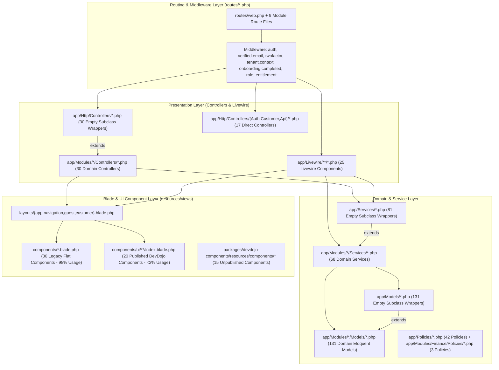
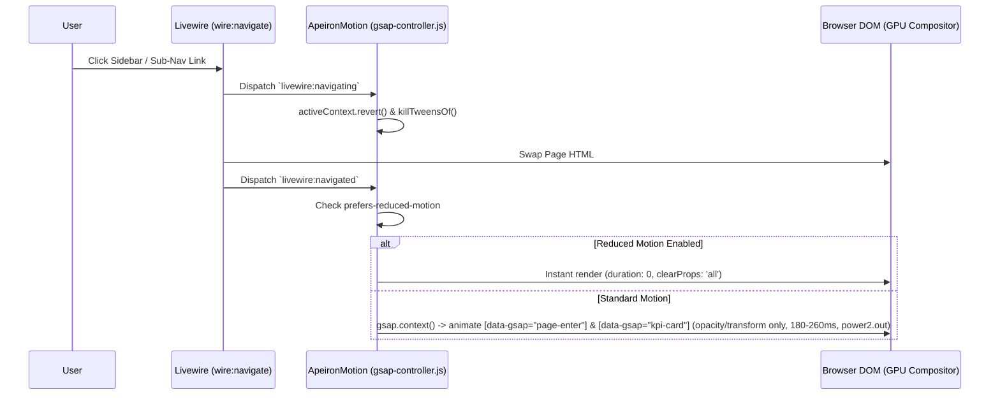
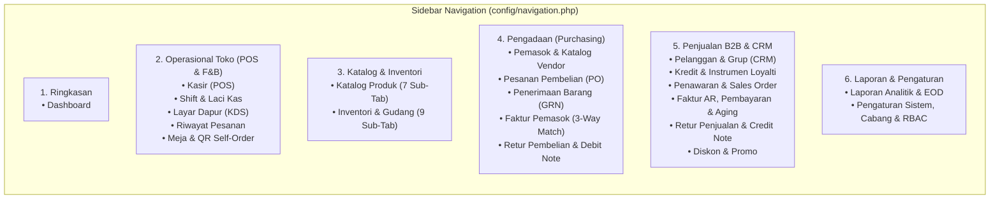
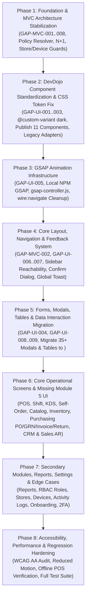

# DEEP MVC GAP AUDIT & UI/UX IMPLEMENTATION PLAN
## Apeiron Systems — Modular ERP SaaS for Retail & F&B

- **Document Path**: `docs/audit-mvc-uiux-implementation-plan.md`
- **Target Repository**: `point-of-Sales` (`/home/ilhamspryd/Projects/apeironSystem/point-of-Sales`)
- **Audit Date**: 2026-10-27
- **Target Executor**: Gemini IDE (Autonomous / Pair-Programming Coding Agent)
- **Role Perspective**: Principal Software Architect, Senior Laravel/Livewire Engineer, UI/UX Systems Architect, and Frontend Audit Specialist
- **Primary Standards**:
  - **Architecture**: Modular Monolith + Pragmatic MVC / Service-Oriented Livewire Architecture
  - **UI Component Standard**: **DevDojo Components** (`packages/devdojo-components` -> `<x-ui.*>`)
  - **Animation Standard**: **GSAP (GreenSock Animation Platform)** (`gsap` via Vite bundle + `prefers-reduced-motion` compliance)

---

## 1. Executive Summary

### 1.1 Purpose of This Document
Dokumen ini merupakan hasil audit forensik langsung (*direct codebase inspection*) terhadap keseluruhan source code, konfigurasi, routing, struktur MVC/Livewire, komponen Blade, asset pipeline, dan antarmuka pengguna (**UI/UX**) pada repositori **Apeiron Systems (`point-of-Sales`)**. Dokumen ini dirancang sebagai **blueprint eksekusi tunggal (*Single Source of Truth*) bagi Gemini IDE** untuk:
1. Menutup seluruh gap arsitektur **Model–View–Controller (MVC)**, *Service Layer*, *Livewire State Management*, *Authorization Policy*, dan *Data Access*.
2. Menstandarisasi seluruh komponen antarmuka ke **DevDojo Components (`<x-ui.*>`)** secara konsisten di seluruh modul ERP (POS, KDS, QR Self-Order, Catalog, Inventory, Purchasing, CRM/Customers, B2B Sales & AR, Reports, Settings, dan persiapan Finance/Accounting Modul 7).
3. Mengintegrasikan **GSAP (GreenSock Animation Platform)** secara lokal (melalui Vite, bebas ketergantungan CDN eksternal) dengan *lifecycle management* yang aman terhadap navigasi SPA Livewire (`wire:navigate`) dan aksesibilitas (`prefers-reduced-motion`).
4. Menutup gap keterjangkauan navigasi (*navigation reachability*) dan halaman operasional yang hilang pada Modul 5 (Purchasing) dan Modul 6 (CRM & B2B Sales/AR).

### 1.2 High-Level Audit Findings Summary

| Audit Dimension | Status Aktual (`[OBSERVED]`) | Ringkasan Temuan Utama |
| :--- | :--- | :--- |
| **MVC & Modular Architecture** | **Partially Migrated (Hybrid Dual-Namespace)** | Aplikasi telah memiliki struktur `app/Modules/{Auth,Customers,Finance,Inventory,Products,Purchasing,Reports,Sales,Settings,Users}`, namun mempertahankan **240+ file wrapper 12-baris** di `app/Http/Controllers/*.php` (30 file), `app/Models/*.php` (131 file), dan `app/Services/*.php` (81 file) yang melakukan `extends` terhadap class modul. Pola *subclass wrapper* ini memicu duplikasi identitas class FQCN yang memaksa pendaftaran `Gate::policy()` ganda di `AppServiceProvider.php` (dan 15+ model belum terdaftar ganda) serta risiko ketidakkonsistenan `Relation::morphMap`. |
| **Controller & Livewire Separation of Concerns** | **Fragmented (Fat Livewire & Leaky Controllers)** | `CreateOrder.php` mencapai **1.197 baris**, `CustomerManager.php` **719 baris**, `OrderHistory.php` **631 baris**, `SupplierManager.php` **509 baris**, dan `ShiftManager.php` **496 baris**. `TransactionController::syncMidtrans()` memanggil `sleep(2)` di dalam *synchronous HTTP worker*. `CheckoutController::store()` (212 baris) mengeksekusi query Eloquent di dalam `array_map` per item keranjang (N+1) dan menyimpan *hardcoded business rules* (`qty > 40`, `cash > 500000`). |
| **Tenant & Branch Isolation Guards** | **Critical Fallback Defects Found** | Ditemukan fallback berbahaya `$storeId ?? 1` dan `$this->deviceId ?? 1` pada `CreateOrder.php` (baris 729, 745, 781, 795), `ShiftManager.php` (baris 153), dan `TransactionController.php` (baris 251). Dalam arsitektur SaaS multi-tenant, fallback ke ID `1` berisiko membocorkan atau mengaitkan transaksi ke cabang/perangkat milik tenant pertama. |
| **Navigation & Module Reachability** | **Critical Reachability Blockers** | **Modul 6 (CRM & B2B Sales)** memiliki 8 komponen Livewire lengkap (`routes/customers.php` & `routes/sales.php`), tetapi **0 link** di sidebar `config/navigation.php`! **Modul 5 (Purchasing)** memiliki 11 domain service lengkap (PO, PR, GRN, 3-Way Match Invoice, Return, Landed Cost), namun hanya memiliki 1 halaman UI (`/purchasing/suppliers`) yang juga tidak terdaftar di `config/navigation.php`. |
| **DevDojo Components Standard (`<x-ui.*>`)** | **< 2% Adoption + CSS Token Bug** | Paket lokal `packages/devdojo-components` menyediakan 35 komponen (20 telah dipublikasikan ke `resources/views/components/ui/`). Namun di seluruh `resources/views/`, `<x-ui.*>` baru digunakan di **1 halaman** (`categories/index.blade.php`, 10 tag), sementara komponen legacy (`<x-form-label>` 160x, `<x-button>` 104x, `<x-form-input>` 81x, `<x-badge>` 57x, `<x-alert>` 35x, `<x-data-table>` 24x) dan raw HTML modal (`@if($showModal)`) mendominasi 98% halaman. Lebih parah lagi, `resources/css/app.css` tidak mengimpor `@custom-variant dark (&:where(.dark, .dark *));` dari `components.css`, sehingga pengguna dengan OS Dark Mode mengalami bug teks putih di atas background putih (`#ffffff`). |
| **GSAP Animation Standard** | **Not Bundled in NPM + CDN Only on Login** | `gsap` **tidak terdaftar di `package.json`**. GSAP `3.12.2` hanya dimuat via CDN Cloudflare di `layouts/guest.blade.php:19` dan hanya dipakai di `auth/login.blade.php:197-246`. Layout utama `layouts/app.blade.php` dan `layouts/customer.blade.php` tidak memuat GSAP sama sekali, dan masih memuat CDN eksternal (`sweetalert2`, `apexcharts`, `qz-tray`) yang melanggar prinsip *offline-capable POS*. |

### 1.3 Gap Count by Severity

| Severity | Proven Defects (`[OBSERVED]`) | Architectural & UX Risks (`[DERIVED]` / `[PROPOSED]`) | Total Gaps |
| :--- | :---: | :---: | :---: |
| **Critical** | 8 | 1 | **9** |
| **High** | 11 | 3 | **14** |
| **Medium** | 8 | 3 | **11** |
| **Low** | 4 | 2 | **6** |
| **Total** | **31** | **9** | **40** |

---

## 2. Audit Scope and Methodology

### 2.1 Audit Scope
Audit ini mencakup pemeriksaan menyeluruh atas repositori `/home/ilhamspryd/Projects/apeironSystem/point-of-Sales`:
1. **Backend & MVC Layer**:
   - `app/Http/Controllers/**` (47 file) & `app/Modules/*/Controllers/**` (30 file)
   - `app/Http/Requests/**` (35 Form Request) & `app/Http/Middleware/**` (11 Middleware)
   - `app/Livewire/**` (25 komponen Livewire + 1 trait `RequiresTenantContext`)
   - `app/Models/**` (146 file) & `app/Modules/*/Models/**` (131 file)
   - `app/Services/**` (81 file) & `app/Modules/*/Services/**` (68 file)
   - `app/Policies/**` (42 file) & `app/Modules/Finance/Policies/**` (3 file)
   - `app/Providers/AppServiceProvider.php`, `config/navigation.php`, dan seluruh file rute `routes/{web,auth,products,inventory,purchases,customers,sales,reports,settings,customer,console}.php`.
2. **Frontend, UI Components & Asset Pipeline**:
   - `package.json`, `composer.json`, `vite.config.js`, `resources/css/app.css` (775 baris), `resources/css/components.css` (152 baris), `resources/js/app.js`.
   - `packages/devdojo-components/**` (35 komponen source, `Publisher.php`, `CodeGenerator.php`, `config/components.php`).
   - `resources/views/components/ui/**` (20 komponen DevDojo yang telah dipublikasikan) vs `resources/views/components/*.blade.php` (30 komponen legacy).
   - Seluruh halaman Blade & Livewire views di `resources/views/**` (94 file `.blade.php`).
3. **Existing Audit Artifacts Inspected**:
   - `docs/audit/devdojo-components-integration.md`
   - `docs/audit/devdojo-components-compatibility.md`
   - `docs/audit/ui-ux-audit.md`
   - `docs/audit/ui-ux-implementation-report.md`

### 2.2 Evidence Labeling Convention
Sesuai prinsip *Zero-Assumption Audit*, setiap temuan menggunakan klasifikasi bukti berikut:
- `[OBSERVED]` — Terbukti secara langsung dari kode sumber, konfigurasi, atau file template aktual beserta path dan nomor baris.
- `[DOCUMENTED]` — Tercatat pada dokumentasi internal repositori (`docs/audit/*` atau PRD/plan).
- `[PRODUCT DIRECTION]` — Arah arsitektur produk ERP SaaS Retail & F&B Apeiron Systems.
- `[DERIVED]` — Konsekuensi teknis atau UX logis yang diturunkan langsung dari bukti kode aktual.
- `[PROPOSED]` — Rekomendasi arsitektur, desain komponen, atau spesifikasi implementasi.
- `[DECISION REQUIRED]` / `[VALIDATION REQUIRED]` / `[BLOCKED]` — Penanda kebutuhan keputusan atau prasyarat teknis.

---

## 3. Project Architecture Snapshot

### 3.1 Technology Stack Snapshot (`[OBSERVED]`)

| Layer | Technology / Package | Observed Version | Evidence File | Architectural Notes |
| :--- | :--- | :--- | :--- | :--- |
| **Runtime** | PHP | `^8.3` | `composer.json:21` | `declare(strict_types=1)` digunakan pada mayoritas file modul baru, belum merata di file lama. |
| **Backend Framework** | Laravel Framework | `^13.17` | `composer.json:24` | Menggunakan struktur bootstrap Laravel 11+/13 dengan modular domain di `app/Modules/*`. |
| **Reactive Full-Stack UI** | Livewire | `^4.4` | `composer.json:26` | Mendukung `#[Layout]`, `#[Computed]`, `#[Locked]`, `wire:navigate`, dan persistent middleware. |
| **UI Component Library** | DevDojo Components | `^1.0` (`path` repo) | `composer.json:12-22`, `packages/devdojo-components` | 35 komponen tersedia di paket; 20 dipublikasikan ke `resources/views/components/ui/`. |
| **Tailwind Class Merger** | `gehrisandro/tailwind-merge-php` | `^1.2` | `composer.json:23` | Menyediakan macro `$attributes->twMerge()` dan `twMergeFor()` untuk DevDojo components. |
| **CSS Framework** | Tailwind CSS + `@tailwindcss/vite` | `^4.0.0` | `package.json:14-15`, `resources/css/app.css:1` | Menggunakan CSS-first configuration (`@import 'tailwindcss';`, `@theme`, `@theme inline`). |
| **Client-Side Reactivity** | Alpine.js | `^3.4.2` (bundled via Livewire) | `package.json:12`, `resources/js/app.js:3-7` | `Alpine.start()` dikomentari di `resources/js/app.js` agar tidak bentrok dengan instance Alpine milik Livewire. |
| **Animation Engine** | GSAP (GreenSock) | `3.12.2` (CDN only) | `resources/views/layouts/guest.blade.php:19` | **Belum terinstal di `package.json`**. Hanya dimuat via Cloudflare CDN di layout guest. |
| **Bundler** | Vite + `laravel-vite-plugin` | `^7.0.7` / `^2.0.0` | `package.json:17-18`, `vite.config.js:1-14` | Mengompilasi `resources/css/app.css` dan `resources/js/app.js`. |
| **External CDN Scripts** | SweetAlert2, ApexCharts, QZ Tray | `11`, `3.42.0`, `2.2.4` | `resources/views/layouts/app.blade.php:20,28,29,93` | Dimuat dari `cdn.jsdelivr.net`, menimbulkan risiko kegagalan saat internet kasir terputus. |

### 3.2 Directory & Layer Topology (`[OBSERVED]`)



---

## 4. MVC Architecture Assessment

### 4.1 Model Layer Assessment (`[OBSERVED]`)
1. **Dual-Namespace Subclass Wrapper Anti-Pattern**:
   - Seluruh 131 model domain telah dipindahkan ke `app/Modules/{Auth,Customers,Finance,Inventory,Products,Purchasing,Reports,Sales,Settings,Users}/Models/*.php`.
   - Namun di `app/Models/*.php` masih terdapat **131 file wrapper 12-baris** seperti `class Product extends \App\Modules\Products\Models\Product {}` (`app/Models/Product.php:1-12`).
   - Demikian pula trait multi-tenancy diduplikasi di `app/Models/Concerns/*.php` (5 file) dan `app/Core/Traits/*.php` (5 file).
   - **Dampak Arsitektural**: Di PHP dan Eloquent, `App\Models\Product::class !== App\Modules\Products\Models\Product::class`. Akibatnya:
     - `AppServiceProvider::boot()` (`app/Providers/AppServiceProvider.php:76-123`) terpaksa mendaftarkan setiap policy **dua kali** (`Gate::policy(GoodsReceipt::class, ...)` dan `Gate::policy(\App\Modules\Inventory\Models\GoodsReceipt::class, ...)`).
     - **18 model** (`Product`, `Category`, `Brand`, `UnitOfMeasure`, `TaxClass`, `PriceList`, `StoreProductAssortment`, `Order`, `Shift`, `Table`, `Discount`, `Device`, `Store`, `Setting`, `User`, `Role`, `UserInvitation`, `ActivityLog`, `ExportTask`, `Ingredient`) **belum didaftarkan ganda** di `AppServiceProvider.php`! Jika sebuah service di `App\Modules\*` mengembalikan instance `App\Modules\Products\Models\Product` dan controller/Livewire memanggil `Gate::authorize('update', $product)`, auto-discovery Laravel mencari `App\Modules\Products\Policies\ProductPolicy` yang tidak ada (karena `ProductPolicy` berada di `App\Policies\ProductPolicy`), sehingga otorisasi gagal atau melempar exception.
     - `Relation::morphMap` (`app/Providers/AppServiceProvider.php:124-127`) hanya memetakan `'product' => \App\Models\Product::class` dan `'ingredient' => \App\Models\Ingredient::class`. Jika relasi polimorfik seperti `SupplierProduct::purchasable()` menyimpan instance `\App\Modules\Products\Models\Product`, `morphMap` tidak mengenalinya sebagai `'product'`.
2. **Global Scope Consistency (`ScopedToTenant` vs Manual `withoutGlobalScopes()`)**:
   - Di `CustomerManager.php` (`app/Livewire/Customers/CustomerManager.php:188,220,273,303,330,633`) dan `AccountsReceivableManager.php` (`app/Livewire/Sales/AccountsReceivableManager.php:126,312,320`), query selalu memanggil `Customer::withoutGlobalScopes()->where('tenant_id', $tenantId)` karena ketidakpercayaan terhadap global scope. Sebaliknya, di `CreateOrder.php` (`app/Livewire/Kasir/CreateOrder.php:302,336,410,996`), query memanggil `Customer::findOrFail(...)` dan `Product::findOrFail(...)` dengan mengandalkan `TenantScope`.

### 4.2 View Layer Assessment (`[OBSERVED]`)
1. **Business & Authorization Logic Bocor ke Blade**:
   - `resources/views/categories/index.blade.php:3` dan `resources/views/products/index.blade.php:2` mengecek hak akses menggunakan array string hardcoded di dalam `@php`:
     `$canManage = in_array(auth()->user()?->role?->name, ['Owner', 'Manager', 'Inventory'], true);`
     Alih-alih menggunakan `@can('create', App\Models\Product::class)` yang menghormati `ProductPolicy` dan flag `is_admin`.
2. **Database N+1 & O(N×M) Collection Filtering di dalam Loop Blade**:
   - Di `resources/views/livewire/customers/customer-manager.blade.php:124`:
     `$addr = $c->defaultShippingAddress ?? $c->defaultBillingAddress ?? $c->addresses->first();`
     Karena `CustomerManager::render()` (`app/Livewire/Customers/CustomerManager.php:636`) hanya melakukan `.with(['group', 'defaultBillingAddress', 'defaultShippingAddress'])` tanpa `addresses`, pemanggilan `$c->addresses->first()` memicu **query SQL N+1** untuk setiap pelanggan yang belum memiliki alamat default.
   - Di `resources/views/livewire/kasir/create-order.blade.php:250`:
     Di dalam nested loop `@foreach ($this->categories as $category)` -> `@foreach ($category->products as $product)`, template memanggil `collect($this->cartLines)->where('product_id', $product->id)->sum('qty')` berulang kali untuk setiap produk di katalog.
3. **Tiga Generasi Implementasi UI yang Berbeda di Satu Aplikasi**:
   - **Generasi 1 (Legacy Blade Views — Modul 1–3)**: Menggunakan `<x-button>`, `<x-form-input>`, `<x-form-label>`, `<x-badge>`, `<x-alert>`, `<x-data-table>`, `<x-modal>`, dan SweetAlert2 `confirmDelete()`.
   - **Generasi 2 (Livewire Views — Modul 4–6)**: Menggunakan `<x-primary-button>`, `<x-input-label>`, raw `<input class="... focus:ring-emerald-500/20 dark:bg-zinc-900">`, raw `<table class="...">`, dan raw `@if($showModal) <div class="fixed inset-0 ...">` tanpa komponen UI bersama.
   - **Generasi 3 (Pilot DevDojo — `categories/index.blade.php`)**: Menggunakan `<x-ui.button>`, `<x-ui.badge>`, `<x-ui.alert>`, namun masih dicampur dengan `<x-data-table>` dan `<x-list-toolbar>`.

### 4.3 Controller & Livewire Layer Assessment (`[OBSERVED]`)
1. **Hybrid Routing Mixing Traditional Controllers and Full-Page Livewire Components**:
   - Modul 1–3 (`products.php`, `settings.php`, `reports.php`) menggunakan Controller tradisional (`ProductController`, `CategoryController`, `ReportController`, `UserController`, `StoreController`), sedangkan Modul 4–6 (`inventory.php`, `purchases.php`, `customers.php`, `sales.php`) menggunakan Full-Page Livewire Components (`IngredientManager`, `StockOpnameManager`, `SupplierManager`, `CustomerManager`, `SalesOrderManager`, `AccountsReceivableManager`).
   - Pembagian ini sehat secara pragmatis (Controller untuk halaman CRUD/report sederhana, Livewire untuk aplikasi state-heavy seperti POS, KDS, dan Manager multi-modal), **tetapi** pola validasi, otorisasi, dan feedback notifikasinya tidak seragam.
2. **Fat Livewire Components (God Components)**:
   - `app/Livewire/Kasir/CreateOrder.php` (1.197 baris, 36 public properties, 25+ methods) menggabungkan: katalog POS, modifier picker modal, customer loyalty search, voucher & manual supervisor discount modal, parked/held cart manager, QR pending order retrieval, dan split-payment checkout.
   - `app/Livewire/Customers/CustomerManager.php` (719 baris, 40+ public properties) menggabungkan: direktori pelanggan, CRUD pelanggan, CRUD multi-alamat (`showAddressModal`), CRUD kontak B2B (`showContactModal`), penggabungan pelanggan (`showMergeModal`), dan preview/ekspor rekening koran (`showStatementModal`).
   - `app/Livewire/Purchasing/SupplierManager.php` (509 baris, 31 public properties) menggabungkan: CRUD pemasok, CRUD kontak pemasok (`showContactModal`), dan CRUD katalog harga pemasok (`showCatalogModal`).
3. **Synchronous Blocking & Unbounded Queries in Controllers**:
   - `app/Modules/Sales/Controllers/TransactionController.php:324` mengeksekusi `sleep(2);` di dalam `syncMidtrans()`, menahan worker PHP-FPM selama 2 detik penuh setiap kali dipanggil.
   - `app/Modules/Products/Controllers/ProductController.php:83-90,126-132` memuat seluruh tabel `Product::where('is_active', true)->get()`, `Ingredient::where('is_active', true)->get()`, dan `Category::all()` tanpa batas/paginasi pada halaman `create` dan `edit`.

### 4.4 Service Layer Assessment (`[OBSERVED]`)
1. **God Services**:
   - `app/Modules/Sales/Services/TransactionService.php` memiliki **2.165 baris** dalam satu class, menangani kalkulasi harga/pajak, validasi stok/resep BOM, pencatatan order, pembayaran split-tender, integrasi Midtrans, void order, dan outbox akuntansi.
   - `app/Modules/Sales/Services/ReturnRefundService.php` memiliki **1.342 baris**, dan `AccountsReceivableService.php` **1.007 baris**.
2. **Orphaned Domain Services (Backend Selesai, UI Belum Ada)**:
   - Di `app/Modules/Purchasing/Services/`, terdapat 10 service production-grade yang **sama sekali belum memiliki Controller, komponen Livewire, maupun rute**:
     - `PurchaseRequestService.php` (415 baris)
     - `PurchaseOrderService.php` (885 baris)
     - `PurchaseApprovalService.php` (312 baris)
     - `GoodsReceivedNoteService.php` (711 baris)
     - `SupplierInvoiceMatchingService.php` (624 baris)
     - `PurchaseReturnService.php` (560 baris)
     - `LandedCostService.php` (380 baris)
     - `ReorderSuggestionService.php` (481 baris)
     - `SupplierPerformanceService.php` (295 baris)

---

## 5. Gap Register

 Bagian ini mendokumentasikan seluruh gap arsitektur MVC, keamanan multi-tenant, integrasi komponen UI, dan UX secara terstruktur dengan **12 atribut wajib per gap**.

### 5.1 Proven Defects (`[OBSERVED]`)

---

#### `GAP-MVC-001` — Hardcoded Fallback `store_id ?? 1` dan `device_id ?? 1` pada Transaksi Multi-Tenant
1. **Gap ID**: `GAP-MVC-001`
2. **Severity**: **Critical**
3. **Evidence**:
   - `app/Livewire/Kasir/CreateOrder.php:729` (`$storeId = app(TenantContext::class)->getStoreId() ?? 1;`)
   - `app/Livewire/Kasir/CreateOrder.php:745` (`$this->deviceId ?? 1`)
   - `app/Livewire/Kasir/CreateOrder.php:781` (`$storeId = app(TenantContext::class)->getStoreId() ?? 1;`)
   - `app/Livewire/Kasir/CreateOrder.php:795` (`$this->deviceId ?? 1`)
   - `app/Livewire/ShiftManager.php:153` (`$storeId ?? 1`)
   - `app/Modules/Sales/Controllers/TransactionController.php:251` (`$deviceId = $validated['device_id'] ?? $order->created_by_device_id ?? 1;`)
4. **Current Implementation**: Saat `getStoreId()` atau `deviceId` bernilai `null` (misalnya Owner sedang berada dalam mode "Semua Cabang" atau terminal belum memilih device), kode melakukan fallback ke integer `1`.
5. **Root Cause**: Sisa asumsi single-tenant/single-store dari fase awal pengembangan sebelum multi-tenant `TenantContext` diterapkan penuh.
6. **Technical & User Impact**: **Risiko kebocoran/korupsi data lintas tenant (Cross-Tenant Foreign Key Pollution)**. Pada tenant ke-2 dan seterusnya, `store_id = 1` dan `device_id = 1` adalah milik Tenant #1. Menyimpan `ParkedCart`, `Shift`, atau `OrderReturn` dengan `store_id = 1` atau `device_id = 1` akan gagal karena foreign key / tenant mismatch atau mencemari data cabang Tenant #1.
7. **Target Architecture**: Gunakan `$storeId = app(TenantContext::class)->requireStoreId()` (atau validasi eksplisit yang melempar `ValidationException` / `DomainException` jika `storeId === null` pada operasi operasional cabang) dan izinkan `device_id` bernilai `null` atau wajibkan pemilihan `Device` milik cabang aktif.
8. **Files to Change / Create**:
   - Modify: `app/Core/Context/TenantContext.php` (tambahkan helper `requireStoreId(): int`)
   - Modify: `app/Livewire/Kasir/CreateOrder.php`
   - Modify: `app/Livewire/ShiftManager.php`
   - Modify: `app/Modules/Sales/Controllers/TransactionController.php`
9. **Dependencies & Regression Risks**: Memastikan test di `tests/Feature/` yang menguji `CreateOrder`, `ShiftManager`, dan `TransactionController` menyetel `store_id` pada `TenantContext` dan `device_id` yang valid.
10. **Implementation Recommendation**: Hapus seluruh literal `?? 1` untuk `store_id` dan `device_id`. Jika `$storeId === null`, tampilkan pesan error yang jelas: *"Pilih cabang operasional spesifik terlebih dahulu sebelum membuka shift atau menahan keranjang."*
11. **Tests to Add / Update**:
    - `tests/Feature/Security/MultiTenantStoreDeviceFallbackTest.php`: Uji Tenant #2 (dengan `store_id = 5`) memanggil `parkCurrentCart()`, `openShift()`, dan `returnAndRefund()` ketika konteks cabang kosong — pastikan tidak pernah menulis `store_id = 1` atau `device_id = 1`.
12. **Verifiable Acceptance Criteria**:
    - `grep -rn "storeId ?? 1\|deviceId ?? 1\|created_by_device_id ?? 1" app/` menghasilkan **0 baris**.
    - Seluruh test multi-tenant lulus 100%.

---

#### `GAP-MVC-002` — Modul 6 (CRM & B2B Sales/AR) dan Modul 5 (Purchasing) Terisolasi dari Navigasi Utama
1. **Gap ID**: `GAP-MVC-002`
2. **Severity**: **Critical**
3. **Evidence**:
   - `config/navigation.php:1-147` (hanya memiliki item: `Dashboard`, `Kasir (POS)`, `Layar Dapur (KDS)`, `Riwayat Pesanan`, `Katalog Produk`, `Inventori & Resep`, `Meja & QR`, `Diskon & Promo`, `Laporan`, `Pengaturan`).
   - `routes/customers.php:1-41` (4 rute aktif: `customers.index`, `customers.groups.index`, `customers.credit.index`, `customers.instruments.index` — tidak ada di `config/navigation.php`).
   - `routes/sales.php:70-89` (4 rute aktif: `sales.quotations.index`, `sales.orders.index`, `sales.invoices.index`, `sales.returns.index` — tidak ada di `config/navigation.php`, dan menggunakan middleware `role:Owner,Manager,Sales,Admin,Finance`).
   - `routes/purchases.php:17-22` (1 rute aktif: `purchasing.suppliers.index` — tidak ada di `config/navigation.php`; hanya ada di `resources/views/catalog/partials/sub-nav.blade.php:37`, namun hilang dari `resources/views/inventory/partials/sub-nav.blade.php`).
   - `app/Modules/Purchasing/Services/*.php` (10 service pengadaan: PR, PO, Approval, GRN, 3-Way Match Supplier Invoice, Purchase Return/Debit Note, Landed Cost, Reorder Suggestion — **0 rute dan 0 komponen Livewire/UI**).
4. **Current Implementation**: Pengguna tidak dapat mengakses fitur CRM, Limit Kredit B2B, Gift Card/Voucher, Quotation, Sales Order, Faktur AR, maupun Retur Penjualan B2B dari menu sidebar aplikasi kecuali mengetik URL secara manual di browser. Untuk Modul 5 (Purchasing), pengguna bahkan tidak memiliki halaman untuk membuat PO, GRN, atau Faktur Supplier meskipun seluruh service backend dan tabel database sudah selesai.
5. **Root Cause**: Implementasi Modul 5 dan Modul 6 sebelumnya berfokus pada penyelesaian *domain services* dan komponen Livewire individual tanpa memperbarui `config/navigation.php`, sub-navigation partials, dan sisa komponen Livewire Purchasing.
6. **Technical & User Impact**: **Fitur utama ERP Retail & F&B tidak dapat digunakan oleh end-user (Dead/Unreachable Features)** dan alur Procure-to-Pay (P2P) terputus di level UI.
7. **Target Architecture**:
   - Perbarui `config/navigation.php` dengan struktur grup modul ERP yang rapi (Operasional POS, Katalog & Inventori, Pengadaan/Purchasing, Penjualan B2B & Piutang, Pelanggan & Loyalti, Laporan, Pengaturan) beserta sub-nav partials (`purchasing/partials/sub-nav.blade.php`, `sales/partials/sub-nav.blade.php`, `customers/partials/sub-nav.blade.php`).
   - Bangun komponen Livewire untuk workflow inti Modul 5 yang sudah memiliki Service (`PurchaseOrderManager`, `GoodsReceivedNoteManager`, `SupplierInvoiceManager`, `PurchaseReturnManager`) dengan komponen `<x-ui.*>` DevDojo.
   - Selaraskan daftar role di `config/navigation.php` dan `routes/sales.php` / `routes/purchases.php`.
8. **Files to Change / Create**:
   - Modify: `config/navigation.php`, `routes/purchases.php`, `routes/sales.php`, `routes/customers.php`
   - Create: `resources/views/purchasing/partials/sub-nav.blade.php`, `resources/views/sales/partials/sub-nav.blade.php`, `resources/views/customers/partials/sub-nav.blade.php`
   - Create: `app/Livewire/Purchasing/{PurchaseOrderManager,GoodsReceivedNoteManager,SupplierInvoiceManager,PurchaseReturnManager}.php` beserta view Blade-nya.
9. **Dependencies & Regression Risks**: Bergantung pada `PurchaseOrderPolicy`, `GrnPolicy`, `SupplierInvoicePolicy`, `PurchaseReturnPolicy` yang sudah terdaftar di `AppServiceProvider.php:86-101`.
10. **Implementation Recommendation**: Tambahkan seksi navigasi di `config/navigation.php` dengan kontrol visibilitas berbasis role dan hadirkan sub-nav tab konsisten menggunakan `<x-ui.tabs>` / sub-nav partial di setiap kelompok modul.
11. **Tests to Add / Update**:
    - `tests/Feature/Navigation/ErpSidebarReachabilityTest.php`: Pastikan setiap rute utama Modul 1–6 muncul di sidebar untuk role yang berhak dan mengembalikan HTTP 200.
12. **Verifiable Acceptance Criteria**:
    - Seluruh halaman Modul 5 (Suppliers, PO, GRN, Supplier Invoices, Purchase Returns) dan Modul 6 (Customers, Groups, Credit, Instruments, Quotations, Sales Orders, AR Invoices, Credit Notes) dapat diakses langsung melalui sidebar dan sub-navigation tanpa mengetik URL manual.

---

#### `GAP-MVC-003` — Dual-Namespace Subclass Wrappers (`App\Models\*` vs `App\Modules\*\Models\*`) Menyebabkan Inkonsistensi Gate Policy & MorphMap
1. **Gap ID**: `GAP-MVC-003`
2. **Severity**: **High**
3. **Evidence**:
   - `app/Models/*.php` (131 wrapper class yang meng-extend `App\Modules\*\Models\*`).
   - `app/Http/Controllers/*.php` (30 wrapper class yang meng-extend `App\Modules\*\Controllers\*`).
   - `app/Services/*.php` (81 wrapper class yang meng-extend `App\Modules\*\Services\*`).
   - `app/Providers/AppServiceProvider.php:76-127` (registrasi `Gate::policy` ganda untuk 19 model, namun **absen** untuk 18 model lainnya seperti `Product`, `Order`, `Shift`, `User`, `Store`, `Table`, `Discount`, `Ingredient`).
4. **Current Implementation**: Karena `App\Models\Product` adalah subclass dari `App\Modules\Products\Models\Product`, keduanya adalah dua class berbeda di runtime PHP. Sebagian service mengembalikan `App\Modules\*\Models\*`, sedangkan sebagian controller/Livewire mengimpor `App\Models\*`.
5. **Root Cause**: Migrasi modular dilakukan dengan membuat *empty subclass wrappers* alih-alih `class_alias()` atau pendaftaran `Gate::guessPolicyNamesUsing()` terpusat.
6. **Technical & User Impact**:
   - Jika `Gate::authorize('update', $model)` dipanggil terhadap instance `App\Modules\Products\Models\Product` (atau salah satu dari 18 model yang belum didaftarkan ganda di `AppServiceProvider`), Laravel gagal menemukan `App\Policies\ProductPolicy` dan melempar `403 This action is unauthorized` meskipun user adalah Owner!
   - Jika instance `App\Modules\Products\Models\Product` disimpan ke relasi polimorfik (`morphTo`), nilai `purchasable_type` di database akan berisi `'App\Modules\Products\Models\Product'` alih-alih alias `'product'`.
7. **Target Architecture**:
   - Daftarkan `Gate::guessPolicyNamesUsing()` di `AppServiceProvider::boot()` yang secara deterministik memetakan baik `App\Models\{Model}` maupun `App\Modules\{Module}\Models\{Model}` ke `App\Modules\{Module}\Policies\{Model}Policy` atau `App\Policies\{Model}Policy`.
   - Perbarui `Relation::morphMap` atau `MorphTo` agar menangani class modul dan wrapper secara konsisten.
8. **Files to Change / Create**:
   - Modify: `app/Providers/AppServiceProvider.php`
9. **Dependencies & Regression Risks**: Rendah jika `Gate::guessPolicyNamesUsing()` digunakan sebagai resolver terpusat dengan tetap mempertahankan `Gate::policy()` eksplisit yang memiliki nama khusus (seperti `GoodsReceivedNote` -> `GrnPolicy`, `CustomerGroup` -> `CustomerPolicy`, `StoreCreditAccount` -> `StoreCreditPolicy`).
10. **Implementation Recommendation**: Tambahkan resolver otomatis `Gate::guessPolicyNamesUsing()` di `AppServiceProvider::boot()` sehingga seluruh 45 policy bekerja 100% baik untuk `App\Models\*` maupun `App\Modules\*\Models\*`.
11. **Tests to Add / Update**:
    - `tests/Unit/Architecture/PolicyResolutionConsistencyTest.php`: Uji bahwa setiap model di `app/Modules/*/Models/*.php` dan `app/Models/*.php` berhasil me-resolve Policy class yang identik melalui `Gate::getPolicyFor($modelClass)`.
12. **Verifiable Acceptance Criteria**:
    - `Gate::getPolicyFor(\App\Models\Product::class) === Gate::getPolicyFor(\App\Modules\Products\Models\Product::class)` bernilai `true` untuk seluruh model yang memiliki Policy.

---

#### `GAP-MVC-004` — Synchronous `sleep(2)` di Dalam `TransactionController::syncMidtrans()`
1. **Gap ID**: `GAP-MVC-004`
2. **Severity**: **High**
3. **Evidence**: `app/Modules/Sales/Controllers/TransactionController.php:303-343` (khususnya baris 324: `sleep(2);`).
4. **Current Implementation**: Endpoint `POST /transaction/{orderNumber}/sync-midtrans` mengeksekusi `sleep(2)` secara sinkron sebelum memanggil `Midtrans\Transaction::status($orderNumber)`.
5. **Root Cause**: Workaround cepat untuk memberi jeda waktu bagi sandbox Midtrans sebelum memproses status transaksi.
6. **Technical & User Impact**: **Worker Pool Exhaustion (DoS internal)**. Jika 10 kasir/pelanggan melakukan sinkronisasi status pembayaran secara bersamaan, 10 worker PHP-FPM terkunci penuh selama 2 detik (+ waktu jaringan HTTP Midtrans), menyebabkan seluruh request POS lain mengalami antrean atau timeout.
7. **Target Architecture**: Hapus `sleep(2)` dari sisi server PHP; pindahkan penundaan 2 detik ke sisi client (`setTimeout(..., 2000)` sebelum memanggil endpoint `sync-midtrans`) dan bungkus pemanggilan API Midtrans dengan cache lock singkat (`Cache::lock("midtrans_sync_{$orderNumber}", 5)`) untuk mencegah *thundering herd*.
8. **Files to Change / Create**:
   - Modify: `app/Modules/Sales/Controllers/TransactionController.php`
   - Modify: `resources/views/livewire/kasir/create-order.blade.php` / `resources/views/customer/checkout/success.blade.php` (jika memanggil `sync-midtrans`).
9. **Dependencies & Regression Risks**: Tidak ada regresi fungsional; waktu tunggu berpindah ke browser tanpa memblokir proses PHP.
10. **Implementation Recommendation**: Hapus `sleep(2);` di `TransactionController.php:324` dan tambahkan rate-limit / lock per `orderNumber`.
11. **Tests to Add / Update**:
    - `tests/Feature/Sales/MidtransSyncPerformanceTest.php`: Pastikan `syncMidtrans` selesai dalam `< 200ms` saat di-mock.
12. **Verifiable Acceptance Criteria**:
    - Tidak ada pemanggilan `sleep()` atau `usleep()` di seluruh `app/Http/Controllers` dan `app/Modules/*/Controllers`.

---

#### `GAP-MVC-005` — N+1 Queries & Hardcoded Business Rules di Dalam `CheckoutController::store()`
1. **Gap ID**: `GAP-MVC-005`
2. **Severity**: **High**
3. **Evidence**:
   - `app/Http/Controllers/Customer/CheckoutController.php:119` (`if ($this->cartService->getTotalQty() > 40)`)
   - `app/Http/Controllers/Customer/CheckoutController.php:161-168` (query perhitungan order pending per sesi & meja: `$openPending >= 2 || $tablePending >= 5`)
   - `app/Http/Controllers/Customer/CheckoutController.php:170-223` (loop `array_map` yang mengeksekusi `Modifier::whereIn(...)`, `Product::where('id', ...)`, `$resolver->isAvailableInStore()`, dan `$resolver->resolvePrice()` **satu per satu untuk setiap item di keranjang**)
   - `app/Http/Controllers/Customer/CheckoutController.php:241` (`if ($request->validated('payment_method') === 'cash' && $liveSubtotal > 500000)`)
4. **Current Implementation**: Meskipun komentar docblock di baris 32 menyatakan *"Thin Controller — tidak ada logika kalkulasi harga/pajak di sini sama sekali"*, method `store()` sepanjang 212 baris melakukan validasi kuota meja, query produk & modifier berulang di dalam loop (N+1), kalkulasi ulang harga item, dan aturan batas transaksi tunai Rp 500.000 secara langsung di Controller.
5. **Root Cause**: Penambahan patch keamanan bertahap (`PATCH FOR S-05`, `PATCH FOR M-05`, `SECURITY`) langsung di dalam body controller alih-alih diekstrak ke `SelfOrderCheckoutService` atau `CartService`.
6. **Technical & User Impact**:
   - Keranjang dengan 15 item memicu **45+ query database** hanya pada tahap pra-validasi di Controller sebelum `TransactionService::createTransaction()` dipanggil (yang kemudian melakukan query produk dan modifier sekali lagi!).
   - Aturan bisnis (`max_qty = 40`, `max_cash_amount = 500000`, `max_pending_per_table = 5`) tersebar di Controller dan tidak dapat dikonfigurasi per tenant/store melalui `Setting` atau `config('pos.*')`.
7. **Target Architecture**:
   - Ekstrak logika persiapan dan validasi checkout pelanggan mandiri ke method dedicated di `CartService` atau `SelfOrderCheckoutService::prepareAndValidateCheckout()` dengan **batch eager-loading** (`Product::whereIn('id', $productIds)->get()->keyBy('id')` dan `Modifier::whereIn('id', $allModifierIds)->get()->keyBy('id')`).
   - Pindahkan konstanta aturan bisnis ke `config/pos.php` dengan override `Setting::get()`.
8. **Files to Change / Create**:
   - Modify: `app/Http/Controllers/Customer/CheckoutController.php`
   - Modify: `app/Modules/Sales/Services/CartService.php` (atau buat `app/Modules/Sales/Services/SelfOrderCheckoutService.php`)
   - Modify: `config/pos.php`
9. **Dependencies & Regression Risks**: Harus mempertahankan seluruh perilaku security guard (`S-05`, `S-07`, `S-13`, `SO-04`, `M-05`) karena diuji oleh suite test keamanan self-order.
10. **Implementation Recommendation**: Batch-load seluruh `Product`, `StoreProductAssortment`, dan `Modifier` di luar `array_map` dalam 2 query, dan delegasikan validasi meja serta kuota pending ke Service.
11. **Tests to Add / Update**:
    - Pastikan seluruh test di `tests/Feature/Customer/Checkout*` tetap hijau dan tambahkan assertion jumlah query (`DB::getQueryLog()`) tidak bertambah secara linear terhadap jumlah item keranjang.
12. **Verifiable Acceptance Criteria**:
    - `CheckoutController::store()` berkurang menjadi `< 75 baris` dan jumlah query validasi item keranjang konstan `O(1)` (maksimal 3 query batch untuk berapapun jumlah baris item).

---

#### `GAP-MVC-006` — N+1 Query pada Blade View `customer-manager.blade.php` & O(N×M) Loop di `create-order.blade.php`
1. **Gap ID**: `GAP-MVC-006`
2. **Severity**: **High**
3. **Evidence**:
   - `resources/views/livewire/customers/customer-manager.blade.php:124` (`$addr = $c->defaultShippingAddress ?? $c->defaultBillingAddress ?? $c->addresses->first();`) vs `app/Livewire/Customers/CustomerManager.php:636` (`->with(['group', 'defaultBillingAddress', 'defaultShippingAddress'])`).
   - `resources/views/livewire/kasir/create-order.blade.php:250` (`$inCartQty = collect($this->cartLines)->where('product_id', $product->id)->sum('qty');` di dalam nested loop kategori × produk).
   - `app/Modules/Products/Controllers/ProductController.php:83-90,126-132` (memuat seluruh `Product`, `Ingredient`, `Category` tanpa batas ke view `products.create` dan `products.edit`).
4. **Current Implementation**:
   - Di `customer-manager.blade.php`, setiap baris pelanggan yang tidak memiliki `defaultShippingAddress` atau `defaultBillingAddress` akan memanggil relasi `$c->addresses` yang belum di-eager-load, memicu hingga 15 query tambahan per halaman.
   - Di `create-order.blade.php`, setiap kartu produk memfilter ulang koleksi `$this->cartLines`.
5. **Root Cause**: Ketidaksinkronan antara relasi yang di-eager-load di Livewire `render()` dengan properti relasi yang diakses di template Blade.
6. **Technical & User Impact**: Peningkatan waktu render Livewire pada halaman CRM Pelanggan dan Terminal Kasir POS.
7. **Target Architecture**:
   - Tambahkan `'addresses'` ke `.with([...])` di `CustomerManager::render()` atau gunakan relasi `primaryAddress` terindeks.
   - Tambahkan computed property `#[Computed] public function cartQtyByProduct(): array` di `CreateOrder.php` yang mengembalikan `[product_id => total_qty]` dalam satu pass `O(M)`, sehingga Blade cukup mengakses `$this->cartQtyByProduct[$product->id] ?? 0` dalam waktu `O(1)`.
8. **Files to Change / Create**:
   - Modify: `app/Livewire/Customers/CustomerManager.php`
   - Modify: `app/Livewire/Kasir/CreateOrder.php`
   - Modify: `resources/views/livewire/kasir/create-order.blade.php`
9. **Dependencies & Regression Risks**: Sangat aman, tidak mengubah kontrak data eksternal.
10. **Implementation Recommendation**: Terapkan eager-loading `'addresses'` di `CustomerManager.php:636` dan `cartQtyByProduct` map di `CreateOrder.php`.
11. **Tests to Add / Update**:
    - `tests/Feature/Livewire/CustomerManagerNPlusOneTest.php`: Uji render 15 pelanggan tanpa default address dengan `DB::listen` dan pastikan tidak ada query tambahan ke `customer_addresses` per baris.
12. **Verifiable Acceptance Criteria**:
    - Zero N+1 query saat me-render daftar pelanggan di `CustomerManager` dan lookup kuantitas keranjang `O(1)` di `create-order.blade.php`.

---

#### `GAP-MVC-007` — Inkonsistensi Otorisasi: Hardcoded Role String Array di Livewire `boot()` dan Blade `@php`
1. **Gap ID**: `GAP-MVC-007`
2. **Severity**: **High**
3. **Evidence**:
   - `app/Livewire/Purchasing/SupplierManager.php:119`: `if (! $user || ! $user->role || ! in_array($user->role->name, ['Owner', 'Manager', 'Inventory'], true))` (tidak mengecek `$user->role->is_admin`!).
   - `app/Livewire/Inventory/StockOpnameManager.php:99`: `if (! $user || ! $user->role || ! in_array($user->role->name, ['Owner', 'Manager', 'Inventory'], true))` (tidak mengecek `$user->role->is_admin`!).
   - `app/Livewire/Inventory/IngredientManager.php`, `GoodsReceiptManager.php`, `StockAdjustmentManager.php`, `StockTransferManager.php`, `SupplierReturnManager.php`, `ModifierManager.php`: pola serupa di `boot()`.
   - `resources/views/categories/index.blade.php:3` & `resources/views/products/index.blade.php:2`: `$canManage = in_array(auth()->user()?->role?->name, ['Owner', 'Manager', 'Inventory'], true);`.
   - `routes/sales.php:71`: `middleware(['role:Owner,Manager,Sales,Admin,Finance'])` sedangkan di `config/navigation.php` role `Sales`, `Admin`, dan `Finance` tidak pernah didefinisikan.
4. **Current Implementation**: Otorisasi tersebar di 4 mekanisme yang saling berbeda: (1) route middleware `role:...`, (2) pengecekan `in_array($user->role->name, ...)` di `boot()` Livewire (sebagian mengecek `is_admin`, sebagian lupa mengecek `is_admin`), (3) `Gate::authorize()` terhadap Policy, dan (4) variabel `@php $canManage` di Blade.
5. **Root Cause**: Tidak adanya konvensi tunggal yang mewajibkan Livewire `boot()` / `mount()` dan Blade menggunakan `Gate::authorize()` / `@can()` berbasis Policy.
6. **Technical & User Impact**: Custom role milik tenant yang memiliki flag `is_admin = true` atau permission granular di tabel `roles` ditolak (`403 Forbidden`) oleh `SupplierManager`, `StockOpnameManager`, atau disembunyikan tombol aksinya di `products/index.blade.php` dan `categories/index.blade.php` karena namanya bukan string literal `'Owner'`, `'Manager'`, atau `'Inventory'`.
7. **Target Architecture**:
   - Seluruh otorisasi di Controller, Livewire (`mount`/`render`/action), dan Blade (`@can`) wajib mendelegasikan keputusan ke **Laravel Policy (`app/Policies/*Policy.php`)**.
   - Di dalam `boot()` Livewire atau Policy, selalu hormati `$user->role?->is_admin === true`.
8. **Files to Change / Create**:
   - Modify: `app/Livewire/Purchasing/SupplierManager.php`, `app/Livewire/Inventory/*.php`
   - Modify: `resources/views/categories/index.blade.php`, `resources/views/products/index.blade.php`
   - Modify: `routes/sales.php`, `routes/purchases.php`, `config/navigation.php`
9. **Dependencies & Regression Risks**: Pastikan Policy terkait (`ProductPolicy`, `CategoryPolicy`, `SupplierPolicy`, `StockOpnamePolicy`, dll.) memiliki definisi `viewAny`, `create`, `update`, `delete` yang ekuivalen.
10. **Implementation Recommendation**: Ganti pengecekan manual `in_array($user->role->name, ...)` di `boot()` dengan `Gate::authorize('viewAny', Model::class)` dan di Blade dengan `@can('create', Model::class)`.
11. **Tests to Add / Update**:
    - `tests/Feature/Auth/CustomAdminRoleAuthorizationTest.php`: Uji user dengan role kustom (`name = 'General Manager'`, `is_admin = true`) mengakses `SupplierManager`, `StockOpnameManager`, dan melihat tombol aksi di `products.index` & `categories.index`.
12. **Verifiable Acceptance Criteria**:
    - Tidak ada `@php $canManage = in_array(...)` di file `.blade.php`, dan seluruh komponen Livewire menghormati Policy serta flag `is_admin`.

---

#### `GAP-MVC-008` — Public Eloquent Model Properties & State Bloat pada Komponen Livewire
1. **Gap ID**: `GAP-MVC-008`
2. **Severity**: **Medium**
3. **Evidence**:
   - `app/Livewire/Sales/AccountsReceivableManager.php:41`: `public ?CustomerInvoice $selectedInvoice = null;` (diisi dengan 7 relasi eager-loaded di baris 86).
   - `app/Livewire/ShiftManager.php:25`: `#[Locked] public $activeShift;` (menyimpan model `Shift` penuh di public property).
   - `app/Livewire/Kasir/CreateOrder.php:159-164,715-720,767-772,859-864`: Duplikasi query `Shift::where(...)` di 4 method berbeda.
   - `app/Livewire/Customers/CustomerManager.php:28-138`: 42 public properties dalam satu komponen Livewire untuk menangani 5 modal berbeda.
4. **Current Implementation**: Menyimpan model Eloquent penuh di public property Livewire menyebabkan Livewire melakukan serialisasi/deserialisasi dan query ulang model tersebut pada setiap network round-trip. Selain itu, menumpuk 40+ properti form dari 4 sub-modal dalam satu class Livewire memperbesar payload JSON snapshot di setiap request.
5. **Root Cause**: Belum digunakannya `#[Computed]` untuk me-resolve model detail dari ID (`#[Locked] public ?int $selectedInvoiceId = null`) dan belum dipisahkannya form state ke Livewire Form Objects (`Livewire\Form`) atau sub-komponen.
6. **Technical & User Impact**: Payload wire snapshot membengkak, waktu respon klik di modal melambat, dan risiko bug state bocor antar-modal meningkat.
7. **Target Architecture**:
   - Simpan hanya ID primitif (`#[Locked] public ?int $selectedInvoiceId = null`) di public state, dan sediakan `#[Computed] public function selectedInvoice(): ?CustomerInvoice` untuk mengambil model saat dibutuhkan.
   - Konsolidasikan query `activeShift` ke satu method di `ShiftService::getActiveShiftForUser(int $userId)`.
8. **Files to Change / Create**:
   - Modify: `app/Livewire/Sales/AccountsReceivableManager.php`
   - Modify: `app/Livewire/ShiftManager.php`
   - Modify: `app/Livewire/Kasir/CreateOrder.php`
   - Modify: `app/Modules/Sales/Services/ShiftService.php`
9. **Dependencies & Regression Risks**: Di Blade `accounts-receivable-manager.blade.php` dan `shift-manager.blade.php`, akses `$selectedInvoice` atau `$activeShift` disesuaikan ke `$this->selectedInvoice` / `$this->activeShift` (atau tetap dikirim via `render()`).
10. **Implementation Recommendation**: Ubah `$selectedInvoice` menjadi `#[Computed]` property di `AccountsReceivableManager.php` dan pusatkan query shift aktif ke `ShiftService`.
11. **Tests to Add / Update**:
    - Jalankan existing test `AccountsReceivableManager` dan `ShiftManager` untuk memastikan tidak ada regresi view.
12. **Verifiable Acceptance Criteria**:
    - Tidak ada Eloquent Model yang disimpan sebagai public property di komponen Livewire (`app/Livewire/**/*.php`).

---

#### `GAP-UI-001` — Bug Kritis Dark Mode CSS di Tailwind v4 (`resources/css/app.css` Kehilangan `@custom-variant dark`)
1. **Gap ID**: `GAP-UI-001`
2. **Severity**: **Critical**
3. **Evidence**:
   - `resources/css/app.css:1-145`: Mengimpor `@import 'tailwindcss';` dan menyalin variabel `:root` serta `.dark` dari `components.css`, tetapi **TIDAK menyertakan `@custom-variant dark (&:where(.dark, .dark *));`** yang ada di `resources/css/components.css:15`!
   - `resources/css/components.css:1-152`: File ini tidak pernah di-`@import` oleh `resources/css/app.css` maupun `vite.config.js`.
   - `resources/css/app.css:154-160`: `.card-surface` memiliki hardcoded `background-color: #ffffff;` dan `border: 1px solid #e9e9e7;`.
   - `resources/views/livewire/purchasing/supplier-manager.blade.php:5,34,55,70,158` & `resources/views/livewire/customers/customer-manager.blade.php:5,38,66,83` & seluruh 20 komponen di `resources/views/components/ui/**`: Menggunakan class `dark:text-white`, `dark:bg-zinc-900`, `dark:bg-input/30`, dll.
4. **Current Implementation**: Di Tailwind CSS v4, tanpa deklarasi `@custom-variant dark (&:where(.dark, .dark *));`, seluruh class `dark:*` dikompilasi menjadi `@media (prefers-color-scheme: dark)`. Sementara itu, aplikasi Apeiron tidak menambahkan class `.dark` pada `<html>` dan variabel CSS `:root` (`--background`, `--card`, `--foreground`) serta `.card-surface` tetap berwarna putih (`#ffffff`).
5. **Root Cause**: Saat menyalin isi `resources/css/components.css` ke `resources/css/app.css`, baris `@custom-variant dark (&:where(.dark, .dark *));` terlewat, dan `components.css` dibiarkan menjadi file yatim (*orphaned file*).
6. **Technical & User Impact**: **Kerusakan Visual Parah pada Perangkat dengan OS Dark Mode**. Ketika pengguna membuka aplikasi di macOS/Windows/Android/iPad yang menggunakan tema gelap OS:
   - `.card-surface` tetap berlatar belakang putih (`#ffffff`), tetapi judul dan teks tabel yang memiliki `dark:text-white` berubah menjadi **putih di atas putih (tidak terbaca sama sekali)**!
   - Input dan tabel di Modul 4, 5, 6 berubah menjadi belang hitam (`dark:bg-zinc-900`) di tengah halaman berlatar belakang putih (`#FBFBFA`).
7. **Target Architecture**:
   - Tambahkan `@custom-variant dark (&:where(.dark, .dark *));` tepat setelah `@import 'tailwindcss';` di `resources/css/app.css` (atau `@import './components.css';` dan hapus duplikasinya di `app.css`).
   - Dengan `@custom-variant dark (&:where(.dark, .dark *));`, varian `dark:` hanya akan aktif jika elemen `<html class="dark">` dipasang secara eksplisit, sehingga tampilan Light Mode Apeiron 100% konsisten terlepas dari preferensi OS pengguna!
   - Bersihkan juga duplikasi `--color-apeiron-*` (`app.css:45-50` vs `83-88`), duplikasi `.custom-scrollbar` (`app.css:454-475` vs `570-584`), dan dead CSS `#swup` (`app.css:418-430`).
8. **Files to Change / Create**:
   - Modify: `resources/css/app.css`
   - Delete or Import: `resources/css/components.css`
9. **Dependencies & Regression Risks**: Tidak ada risiko regresi; justru langsung memperbaiki bug kontras di semua perangkat ber-OS dark mode.
10. **Implementation Recommendation**: Tambahkan `@custom-variant dark (&:where(.dark, .dark *));` di baris ke-2 `resources/css/app.css`, hapus duplikasi blok `@theme` dan `.custom-scrollbar`, lalu jalankan `npm run build`.
11. **Tests to Add / Update**:
    - Verifikasi output kompilasi CSS di `public/build/assets/app-*.css` bahwa selector `.dark` digunakan untuk varian dark, bukan `@media (prefers-color-scheme: dark)`.
12. **Verifiable Acceptance Criteria**:
    - `resources/css/app.css` memuat `@custom-variant dark (&:where(.dark, .dark *));`.
    - Saat browser disimulasikan dengan `prefers-color-scheme: dark`, tidak ada elemen yang berubah menjadi gelap/putih-di-atas-putih selama `<html class="dark">` tidak aktif.

---

#### `GAP-UI-002` — Standar Komponen DevDojo (`<x-ui.*>`) Baru Diterapkan di 1 dari 94 View (< 2% Adopsi)
1. **Gap ID**: `GAP-UI-002`
2. **Severity**: **Critical**
3. **Evidence**:
   - Hasil audit penggunaan tag `<x-*>` di seluruh `resources/views/` (Step 141):
     - Komponen Legacy: `<x-form-label>` (160x), `<x-button>` (104x), `<x-form-input>` (81x), `<x-badge>` (57x), `<x-alert>` (35x), `<x-input-error>` (27x), `<x-data-table>` (24x), `<x-input-label>` (23x), `<x-primary-button>` (12x), `<x-list-toolbar>` (12x), `<x-search-input>` (8x), `<x-secondary-button>` (7x), `<x-empty-state>` (5x), `<x-modal>` (3x), `<x-toast>` (1x), `<x-text-input>` (1x), `<x-danger-button>` (1x), `<x-breadcrumb>` (1x).
     - Komponen DevDojo (`<x-ui.*>`): `<x-ui.label>` (3x), `<x-ui.button>` (3x), `<x-ui.badge>` (2x), `<x-ui.alert>` (2x) — **seluruhnya hanya berada di `categories/index.blade.php`**, `categories/create.blade.php`, dan `categories/edit.blade.php`!
   - Selain itu, 15 komponen penting di `packages/devdojo-components/resources/components/` **belum dipublikasikan** ke `resources/views/components/ui/`: `accordion`, `avatar`, `avatar-upload`, `command`, `date-picker`, `drawer`, `kbd`, `number-input`, `otp`, `pagination`, `popover`, `progress`, `radio`, `separator`, `tabs`.
4. **Current Implementation**: 98% halaman aplikasi masih menggunakan komponen legacy di `resources/views/components/*.blade.php` atau raw HTML/Tailwind inline (terutama seluruh komponen Livewire di `resources/views/livewire/**`).
5. **Root Cause**: Integrasi DevDojo sebelumnya baru menyelesaikan tahap penyalinan 20 komponen ke `resources/views/components/ui/` dan 1 halaman pilot (`categories`), belum melakukan migrasi menyeluruh atau jembatan kompatibilitas.
6. **Technical & User Impact**: Ketidakkonsistenan visual dan interaksi di seluruh produk: tinggi tombol bervariasi antara `36px` (`h-9`), `40px` (`h-10`), dan `42px` (`py-2.5`); radius sudut bervariasi antara `rounded-md`, `rounded-medium` (`8px`), `rounded-xl` (`12px`), dan `rounded-2xl` (`16px`); fokus ring bervariasi antara `ring-apeiron-ink`, `ring-emerald-500`, dan `ring-primary/10`.
7. **Target Architecture**:
   - Publikasikan komponen DevDojo yang dibutuhkan untuk ERP (`tabs`, `drawer`, `popover`, `pagination`, `radio`, `number-input`, `date-picker`, `separator`, `kbd`, `avatar`, `otp`, `progress`, `accordion`, `command`) ke `resources/views/components/ui/`.
   - Standarisasi seluruh komponen `<x-ui.*>` agar mendukung prop/fitur operasional Apeiron (seperti `hotkey` pada `<x-ui.button>`, `maxWidth` & `sheet` pada `<x-ui.modal>`, `@toast.window` + session flash pada `<x-ui.toast>`).
   - Ubah komponen legacy (`resources/views/components/{button,primary-button,secondary-button,danger-button,zinc-button,form-input,text-input,form-label,input-label,badge,alert,empty-state,modal,toast,breadcrumb}.blade.php`) menjadi **thin alias/adapter** yang meneruskan render ke `<x-ui.*>`, lalu migrasikan halaman utama dan Livewire views secara bertahap ke `<x-ui.*>`.
8. **Files to Change / Create**:
   - Publish & Customize: `resources/views/components/ui/{tabs,drawer,popover,pagination,radio,number-input,date-picker,separator,kbd,avatar,otp,progress,accordion,command}/**`
   - Modify: `resources/views/components/ui/{button,modal,toast,input,select,textarea,badge,alert,table,breadcrumbs,sidebar}/**`
   - Refactor Legacy Wrappers: `resources/views/components/*.blade.php`
   - Migrate Views: `resources/views/**/*.blade.php`
9. **Dependencies & Regression Risks**: Harus menjaga kompatibilitas atribut (`wire:model`, `wire:click`, `name`, `id`, `disabled`, `dusk`, `data-testid`) agar test PHPUnit/Livewire yang ada tidak rusak.
10. **Implementation Recommendation**: Lakukan dalam 2 lapis: (1) Sempurnakan `<x-ui.*>` dan jadikan komponen legacy sebagai adapter ke `<x-ui.*>` (sehingga ratusan pemanggilan `<x-button>`, `<x-form-input>`, `<x-badge>`, `<x-alert>` otomatis menggunakan engine DevDojo dalam sekejap), lalu (2) migrasikan seluruh raw HTML di Livewire views (`resources/views/livewire/**`) dan halaman utama ke tag eksplisit `<x-ui.*>`.
11. **Tests to Add / Update**:
    - `tests/Feature/Ui/DevDojoComponentRenderingTest.php`: Uji render seluruh komponen `<x-ui.*>` dan pastikan adapter legacy me-render markup DevDojo tanpa error.
12. **Verifiable Acceptance Criteria**:
    - Seluruh komponen yang dibutuhkan telah berada di `resources/views/components/ui/`.
    - Tidak ada raw modal `<div class="fixed inset-0 ...">`, raw alert flash banner, atau tombol/input ber-fokus `emerald-500` yang tersisa di `resources/views/livewire/**`.

---

#### `GAP-UI-003` — Bug Internal pada Komponen DevDojo (`Publisher.php`, `sidebar`, `table`, `breadcrumbs`, `modal`, `toast`)
1. **Gap ID**: `GAP-UI-003`
2. **Severity**: **High**
3. **Evidence**:
   - `packages/devdojo-components/src/Publisher.php:96-98`: Mengubah `component="components.` menjadi `component="` tanpa menyertakan prefix `ui.`, sehingga `<x-dynamic-component component="components.tiptap.icons.bold" />` menjadi `component="tiptap.icons.bold"` (gagal ditemukan karena berada di `components/ui/`).
   - `resources/views/components/ui/sidebar/container.blade.php:62-63`: Memanggil `<x-sidebar.trigger>` (tanpa prefix `ui.`) dan `<x-lucide-panel-left class="size-4" />` (paket `blade-lucide-icons` **tidak terinstal** di `composer.json`).
   - `resources/views/components/ui/sidebar/toggle.blade.php:8-9`: Memanggil `<x-heroicon-o-bars-3 />` dan `<x-heroicon-o-x-mark />` (paket `blade-heroicons` **tidak terinstal** di `composer.json`).
   - `resources/views/components/ui/modal/index.blade.php:52`: Tombol close (`X`) memiliki class `hidden pr-4 pt-4 sm:block`, sehingga pada layar mobile (`< 640px`) pengguna tidak memiliki tombol `X` untuk menutup modal! Selain itu `<x-ui.modal>` belum memiliki prop `maxWidth` (`sm`, `md`, `lg`, `xl`, `2xl`, `3xl`, `4xl`) yang sangat dibutuhkan oleh modal ERP (seperti modal 3-Way Match, Faktur AR, dan Stock Opname Count).
   - `resources/views/components/ui/toast/index.blade.php:86-90`: Hanya mendengarkan `@pop-toast.window` dan `session('toast')`, sedangkan seluruh komponen Livewire aplikasi (`CreateOrder`, `ShiftManager`, `OrderHistory`) men-dispatch event `@toast.window` (`$this->dispatch('toast', message: ..., type: ...)`), dan Controller mengirimkan `session('success')`, `session('error')`, `session('warning')`, `session('message')`!
   - `packages/devdojo-components/config/components.php:44-48`: Route showcase `/components` aktif secara default (`env('COMPONENTS_SHOWCASE', true)`) hanya dengan middleware `['web']` tanpa `'auth'`.
4. **Current Implementation**: Beberapa komponen di `resources/views/components/ui/` akan melempar fatal `InvalidArgumentException` saat dipanggil (`sidebar.container`, `sidebar.toggle`) atau memutus fungsionalitas yang sudah berjalan (`toast` tidak menangkap event `toast` Livewire, `modal` tidak bisa diatur lebarnya dan tidak punya tombol close di mobile).
5. **Root Cause**: Komponen DevDojo disalin langsung dari paket upstream yang mengasumsikan root namespace (`<x-*>`) dan keberadaan `blade-heroicons`/`blade-lucide-icons`.
6. **Technical & User Impact**: Crash saat render komponen sidebar DevDojo, hilangnya notifikasi toast kasir jika `<x-toast>` diganti langsung dengan `<x-ui.toast>`, dan modal ERP yang terlalu sempit (`sm:max-w-lg` saja).
7. **Target Architecture**:
   - Perbaiki `Publisher.php:96-98` agar menyertakan `ui.` saat `config('components.path')` berakhiran `/ui`.
   - Ganti `<x-lucide-panel-left>`, `<x-heroicon-o-bars-3>`, dan `<x-heroicon-o-x-mark>` di `resources/views/components/ui/sidebar/*` dengan inline SVG atau Material Symbols Rounded (`material-symbols-rounded`), dan perbaiki `<x-sidebar.trigger>` menjadi `<x-ui.sidebar.trigger>`.
   - Perluas `<x-ui.modal>` agar mendukung prop `maxWidth` (`sm`, `md`, `lg`, `xl`, `2xl`, `3xl`, `4xl`, `full`), `sheet` (mobile bottom-sheet), tampilkan tombol close di semua ukuran layar (`block` bukan `hidden sm:block`), dan dukung event `@open-modal.window` baik dengan format string (`$event.detail === id`) maupun object (`$event.detail?.id === id`).
   - Perluas `<x-ui.toast>` agar mendengarkan `@toast.window` **dan** `@pop-toast.window`, serta otomatis menampilkan flash session `session('toast')`, `session('success')`, `session('error')`, `session('warning')`, dan `session('message')`.
   - Tambahkan prop `hotkey` pada `<x-ui.button>` untuk menampilkan `<x-ui.kbd>` shortcut di POS/KDS.
   - Amankan route showcase di `packages/devdojo-components/config/components.php` dengan `'enabled' => env('COMPONENTS_SHOWCASE', false)` dan `'middleware' => ['web', 'auth']`.
8. **Files to Change / Create**:
   - Modify: `packages/devdojo-components/src/Publisher.php`
   - Modify: `packages/devdojo-components/config/components.php`
   - Modify: `resources/views/components/ui/sidebar/{container,toggle}.blade.php`
   - Modify: `resources/views/components/ui/modal/index.blade.php`
   - Modify: `resources/views/components/ui/toast/index.blade.php`
   - Modify: `resources/views/components/ui/button/index.blade.php`
   - Modify: `resources/views/components/ui/input/index.blade.php` (tambahkan dukungan `icon` / `prefix` / `suffix`)
9. **Dependencies & Regression Risks**: Memastikan seluruh pemanggilan lama maupun baru kompatibel 100%.
10. **Implementation Recommendation**: Lakukan hardening pada 6 komponen inti `<x-ui.*>` tersebut di **Phase 2** sebelum migrasi massal view dilakukan di Phase 4–6.
11. **Tests to Add / Update**:
    - `tests/Feature/Ui/DevDojoCorePrimitivesTest.php`: Uji `<x-ui.modal maxWidth="2xl">`, `<x-ui.button hotkey="F4">`, `<x-ui.toast>` dengan session flash, dan `<x-ui.sidebar.container>`.
12. **Verifiable Acceptance Criteria**:
    - `<x-ui.sidebar.container>`, `<x-ui.sidebar.toggle>`, `<x-ui.modal>`, `<x-ui.toast>`, dan `<x-ui.button>` berhasil di-render tanpa ketergantungan pada paket icon eksternal yang tidak terinstal.

---

#### `GAP-UI-004` — 35+ Modal Raw HTML (`@if($showModal)`) Tanpa Focus Trap, `role="dialog"`, `Escape` Handler, dan Animasi Mati (`animate-in`)
1. **Gap ID**: `GAP-UI-004`
2. **Severity**: **High**
3. **Evidence**:
   - `resources/views/livewire/purchasing/supplier-manager.blade.php:156,259,346` (3 modal raw `@if($showModal)`, `@if($showContactModal)`, `@if($showCatalogModal)` menggunakan class `animate-in fade-in zoom-in-95 duration-150`).
   - `resources/views/livewire/customers/customer-manager.blade.php:195,295,414,507,569` (5 modal raw `@if(...)` menggunakan `animate-in fade-in zoom-in-95`).
   - `resources/views/livewire/customers/{customer-group-manager,customer-credit-manager,loyalty-and-value-instrument-manager}.blade.php` (7 modal raw).
   - `resources/views/livewire/sales/{quotation-manager,sales-order-manager,accounts-receivable-manager,return-credit-note-manager}.blade.php` (11 modal raw).
   - `resources/views/livewire/inventory/{ingredient-manager,modifier-manager,goods-receipt-manager,stock-adjustment-manager,stock-transfer-manager,stock-opname-manager,supplier-return-manager}.blade.php` (12 modal raw).
   - `resources/views/products/index.blade.php:202,235` (2 modal Alpine raw tanpa `role="dialog"` atau `x-trap`).
4. **Current Implementation**: Seluruh modal di Modul 2, 4, 5, dan 6 dibuat secara manual menggunakan `<div class="fixed inset-0 z-50 ...">` tanpa komponen `<x-ui.modal>`. Selain itu, class `animate-in fade-in zoom-in-95` digunakan di puluhan tempat padahal plugin `tailwindcss-animate` tidak terinstal di proyek.
5. **Root Cause**: Pembuatan halaman Livewire baru secara cepat tanpa menggunakan komponen modal standar.
6. **Technical & User Impact**:
   - **Pelanggaran Aksesibilitas (WCAG 2.1.2 & 4.1.2)**: Pengguna keyboard yang menekan `Tab` saat modal terbuka akan memindahkan fokus ke elemen di belakang backdrop; menekan tombol `Escape` tidak menutup modal; screen reader tidak mengenali dialog karena tidak ada `role="dialog"` dan `aria-modal="true"`.
   - **Z-Index & Stacking Context Bug**: Karena tidak dibungkus `<template x-teleport="body">`, modal dirender di dalam pohon DOM `<main>` sehingga dapat tertutup oleh elemen sticky/header lain.
   - **Janky Appearance**: Karena `@if($showModal)` memotong DOM secara langsung di server dan `animate-in` tidak ada di CSS, modal muncul dan hilang secara kasar tanpa transisi masuk/keluar.
7. **Target Architecture**: Migrasikan seluruh modal di aplikasi ke `<x-ui.modal wire:model="..." maxWidth="...">` yang sudah dilengkapi `<template x-teleport="body">`, `x-trap.inert.noscroll`, `role="dialog"`, `aria-modal="true"`, `aria-labelledby`, `@keydown.escape.window`, dan animasi GSAP / Alpine transition yang halus.
8. **Files to Change / Create**:
   - Modify: `resources/views/components/ui/modal/index.blade.php`
   - Modify: Seluruh view di `resources/views/livewire/{purchasing,customers,sales,inventory,kasir}/**.blade.php` dan `resources/views/products/index.blade.php`.
9. **Dependencies & Regression Risks**: Saat mengubah `@if($showModal)` menjadi `<x-ui.modal wire:model="showModal">`, pastikan isi di dalam modal yang bergantung pada objek nullable (seperti `$selectedInvoice` atau `$activeCustomer`) tetap diberi guard `@if($selectedInvoice)` di dalam `<x-slot:content>` agar tidak melempar null pointer saat modal tertutup di DOM!
10. **Implementation Recommendation**: Gunakan `<x-ui.modal wire:model="showModal" maxWidth="2xl">` sebagai wrapper dialog, dan pertahankan `@if(...)` hanya di dalam body `<x-slot:content>` jika konten tersebut membaca variabel objek dinamis yang bernilai `null` saat modal tertutup.
11. **Tests to Add / Update**:
    - Pastikan seluruh test Livewire di `tests/Feature/` tetap lulus setelah migrasi modal.
12. **Verifiable Acceptance Criteria**:
    - `grep -rn "animate-in\|zoom-in-95" resources/views/` menghasilkan **0 baris**.
    - Setiap modal di aplikasi memiliki `role="dialog"`, `aria-modal="true"`, fokus trap, dan menutup saat tombol `Escape` ditekan.

---

#### `GAP-UI-005` — GSAP Tidak Terinstal di NPM (`package.json`), Hanya Dimuat via CDN di `guest.blade.php`, dan Tidak Ada Lifecycle Cleanup untuk `wire:navigate`
1. **Gap ID**: `GAP-UI-005`
2. **Severity**: **High**
3. **Evidence**:
   - `package.json:11-20`: Hanya berisi `alpinejs`, `axios`, `laravel-vite-plugin`, `tailwindcss`, `@tailwindcss/vite`, `vite`. **Tidak ada `gsap`**.
   - `resources/views/layouts/guest.blade.php:19`: `<script src="https://cdnjs.cloudflare.com/ajax/libs/gsap/3.12.2/gsap.min.js"></script>`.
   - `resources/views/layouts/app.blade.php` & `resources/views/layouts/customer.blade.php`: **Tidak memuat GSAP sama sekali**.
   - `resources/views/auth/login.blade.php:197-246`: Menggunakan `gsap.timeline()`, `gsap.to()`, dan `gsap.fromTo()` secara inline tanpa `gsap.context()` atau cleanup saat navigasi, dan tanpa pengecekan `window.matchMedia('(prefers-reduced-motion: reduce)')` untuk animasi masuk form login.
   - `resources/css/app.css:418-430`: Menyimpan aturan CSS mati untuk `#swup` (`html.is-animating .transition-fade`) padahal proyek menggunakan Livewire `wire:navigate`.
4. **Current Implementation**: GSAP hanya ada di halaman login melalui CDN eksternal. Jika terminal kasir berjalan secara offline di jaringan lokal (LAN) tanpa internet, script CDN gagal dimuat. Di dalam aplikasi utama (`layouts/app.blade.php`), tidak ada orchestrator animasi GSAP untuk transisi halaman, kartu KPI dashboard, feedback keranjang POS, maupun transisi kartu KDS.
5. **Root Cause**: GSAP ditambahkan secara ad-hoc hanya ketika mendesain halaman login, belum diintegrasikan ke dalam pipeline Vite `resources/js/app.js`.
6. **Technical & User Impact**:
   - Ketergantungan CDN pada halaman login berisiko gagal saat koneksi internet lambat/terputus.
   - Transisi antar-halaman via `wire:navigate`, pembukaan drawer/modal, penambahan item ke keranjang POS, dan update kartu KDS tidak memiliki choreographed micro-interactions yang terstandarisasi.
7. **Target Architecture**:
   - Instal `gsap` secara lokal di `package.json` dan bundle melalui `resources/js/app.js` + modul `resources/js/animations/gsap-controller.js`.
   - Gunakan `gsap.context()` dan `gsap.matchMedia()` dengan guard `(prefers-reduced-motion: no-preference)`.
   - Ikat siklus hidup animasi ke event Livewire SPA: jalankan `ApeironMotion.initPage(document)` pada `DOMContentLoaded` dan `livewire:navigated`, serta panggil `ApeironMotion.cleanup()` (`ctx.revert()`, `gsap.killTweensOf(...)`) pada `livewire:navigating` agar bebas memory leak dan duplikasi timeline!
   - Hapus tag `<script src="https://cdnjs.cloudflare.com/ajax/libs/gsap/3.12.2/gsap.min.js"></script>` dari `layouts/guest.blade.php`.
8. **Files to Change / Create**:
   - Modify: `package.json`
   - Create: `resources/js/animations/gsap-controller.js`
   - Modify: `resources/js/app.js`
   - Modify: `resources/views/layouts/guest.blade.php`
   - Modify: `resources/views/auth/login.blade.php`
9. **Dependencies & Regression Risks**: Di halaman `auth/login.blade.php`, pastikan `window.gsap` diekspos dari `resources/js/app.js` (atau pindahkan script login ke controller GSAP) sehingga animasi 2-step login tetap berjalan mulus.
10. **Implementation Recommendation**: Ekspos `window.gsap = gsap` dan `window.ApeironMotion` di `resources/js/app.js` sehingga komponen Alpine (`x-data`) dan hook Livewire dapat memicu micro-interactions GSAP secara deklaratif melalui atribut `data-gsap="..."` atau helper method.
11. **Tests to Add / Update**:
    - Verifikasi build Vite (`npm run build`) menghasilkan bundle JS yang menyertakan GSAP tanpa error dan halaman login tidak lagi memuat `cdnjs.cloudflare.com`.
12. **Verifiable Acceptance Criteria**:
    - `gsap` terdaftar di `package.json` dan ter-bundle di `resources/js/app.js`.
    - `grep -rn "cdnjs.cloudflare.com" resources/views/` menghasilkan **0 baris**.
    - Seluruh animasi GSAP menghormati `prefers-reduced-motion: reduce` dan melakukan cleanup pada `livewire:navigating`.

---

#### `GAP-UI-006` — Ketergantungan Script CDN Eksternal (`SweetAlert2`, `ApexCharts`, `QZ Tray`) pada Layout Utama POS (`layouts/app.blade.php`)
1. **Gap ID**: `GAP-UI-006`
2. **Severity**: **High**
3. **Evidence**:
   - `resources/views/layouts/app.blade.php:20`: `<link rel="preconnect" href="https://cdn.jsdelivr.net" crossorigin>`
   - `resources/views/layouts/app.blade.php:28`: `<script defer src="https://cdn.jsdelivr.net/npm/apexcharts@3.42.0/dist/apexcharts.min.js"></script>`
   - `resources/views/layouts/app.blade.php:29`: `<script defer src="https://cdn.jsdelivr.net/npm/sweetalert2@11"></script>`
   - `resources/views/layouts/app.blade.php:93`: `<script defer src="https://cdn.jsdelivr.net/npm/qz-tray@2.2.4/qz-tray.min.js"></script>`
   - `resources/views/layouts/app.blade.php:100-137`: Fungsi global `window.confirmDelete()` dan `window.confirmAction()` bergantung penuh pada `Swal.fire(...)` dari SweetAlert2 CDN!
4. **Current Implementation**:
   - `apexcharts@3.42.0` dimuat di **setiap halaman** aplikasi, padahal `grep -rn "ApexCharts" resources/views/` menunjukkan **ApexCharts sudah tidak dipakai di halaman mana pun** (Dashboard menggunakan inline SVG chart di `dashboard.blade.php:150`, dan laporan menggunakan CSS bar/progress)! Ini adalah **140KB+ dead external script** di setiap page load!
   - `sweetalert2@11` dimuat dari CDN hanya untuk `confirmDelete()` dan `confirmAction()`, yang berbeda gaya visualnya dari modal DevDojo (`<x-ui.modal>`) dan gagal bekerja jika internet terputus.
5. **Root Cause**: Sisa dependency dari template awal sebelum migrasi ke SVG chart dan komponen UI terpadu.
6. **Technical & User Impact**:
   - Beban jaringan dan parsing JS yang sia-sia (`apexcharts.min.js` diunduh meski tidak pernah dipakai).
   - Jika jaringan internet eksternal kasir terputus (mode LAN lokal), `Swal` menjadi `undefined` sehingga tombol hapus (`confirmDelete`) dan aksi konfirmasi (`confirmAction`) gagal dieksekusi!
7. **Target Architecture**:
   - **Hapus `apexcharts` CDN** sepenuhnya dari `layouts/app.blade.php`.
   - Ganti dialog konfirmasi `window.confirmDelete()` dan `window.confirmAction()` dengan **komponen konfirmasi global berbasis `<x-ui.modal>` DevDojo** (di-mount satu kali di `layouts/app.blade.php`, dipicu melalui Alpine event `@confirm-action.window` dan fungsi kompatibilitas `window.confirmDelete(formId, itemName)` & `window.confirmAction(options)`), lalu **hapus `sweetalert2` CDN**!
   - Bundle atau simpan `qz-tray.min.js` secara lokal di `public/vendor/qz-tray/qz-tray.min.js` agar pencetakan struk termal kasir 100% berjalan di jaringan LAN offline tanpa internet.
8. **Files to Change / Create**:
   - Modify: `resources/views/layouts/app.blade.php`
   - Create: `resources/views/components/ui/confirm-dialog/index.blade.php` (komponen modal konfirmasi global berbasis `<x-ui.modal>`)
   - Create/Copy: `public/js/qz-tray.min.js` (lokal fallback)
9. **Dependencies & Regression Risks**: Fungsi global `window.confirmDelete(formId, itemName)` dan `window.confirmAction(...)` **wajib tetap tersedia** dengan signature parameter yang sama persis agar seluruh tombol hapus yang memanggil `onclick="confirmDelete(...)"` tetap berfungsi tanpa perubahan.
10. **Implementation Recommendation**: Implementasikan `<x-ui.confirm-dialog />` di `layouts/app.blade.php` yang menyediakan `window.confirmDelete` dan `window.confirmAction` secara native menggunakan Alpine + `<x-ui.modal>`.
11. **Tests to Add / Update**:
    - Uji render `layouts/app.blade.php` bebas dari `cdn.jsdelivr.net/npm/apexcharts` dan `cdn.jsdelivr.net/npm/sweetalert2`.
12. **Verifiable Acceptance Criteria**:
    - `ApexCharts` dan `SweetAlert2` CDN dihapus dari `layouts/app.blade.php`.
    - Dialog konfirmasi hapus menggunakan desain `<x-ui.modal>` DevDojo dan bekerja 100% secara offline.

---

#### `GAP-UI-007` — Fragmentasi Sistem Notifikasi (4 Mekanisme Berbeda: `<x-toast>`, `<x-ui.toast>`, `<x-alert>`, dan Raw Flash Banner)
1. **Gap ID**: `GAP-UI-007`
2. **Severity**: **High**
3. **Evidence**:
   - Mekanisme 1: `<x-toast />` (`resources/views/components/toast.blade.php:1-35`) di `layouts/app.blade.php:141` mendengarkan `@toast.window`.
   - Mekanisme 2: `<x-ui.toast />` (`resources/views/components/ui/toast/index.blade.php:1-134`) mendengarkan `@pop-toast.window` dan `session('toast')` — belum dipasang di `layouts/app.blade.php`.
   - Mekanisme 3: `<x-alert>` (`resources/views/components/alert.blade.php`) dan `<x-ui.alert>` (`resources/views/components/ui/alert/index.blade.php`) untuk `session('success')` / `session('error')` di halaman Blade tradisional (`dashboard.blade.php:33-41`, `products/index.blade.php:57-74`, `categories/index.blade.php:32-38`).
   - Mekanisme 4: Raw HTML `<div class="p-4 rounded-xl bg-emerald-50 ...">{{ session('message') }}</div>` di seluruh halaman Livewire Modul 4, 5, dan 6 (`supplier-manager.blade.php:19-31`, `customer-manager.blade.php:23-35`, dll.), ditambah flash key kustom di dalam sub-modal (`session('address_message')`, `session('contact_message')`, `session('catalog_message')`, `session('merge_error')`).
4. **Current Implementation**: Pengguna mendapatkan feedback di pojok kanan bawah pada halaman Kasir (`<x-toast>`), banner di bagian atas halaman pada Katalog (`<x-alert>`), dan banner emerald/rose statis tanpa tombol tutup pada halaman Inventori/Purchasing/CRM/Sales (yang sering kali tidak terlihat jika pengguna sedang melakukan scroll di bawah halaman!).
5. **Root Cause**: Tidak adanya kontrak feedback tunggal antara Controller, Livewire, dan komponen UI.
6. **Technical & User Impact**: Feedback aksi sering terlewat oleh pengguna (terutama ketika `session()->flash('message', ...)` dirender di bagian paling atas halaman sementara pengguna berada di tengah tabel atau di dalam modal), dan kode duplikat blok `@if(session()->has('message'))` berulang di 25+ file.
7. **Target Architecture**:
   - Pasang `<x-ui.toast />` di `layouts/app.blade.php` dan `layouts/customer.blade.php` sebagai **sistem toast global tunggal**.
   - Konfigurasikan `<x-ui.toast />` untuk:
     1. Mendengarkan baik `@toast.window` maupun `@pop-toast.window`.
     2. Otomatis memunculkan toast saat halaman dimuat jika terdapat `session('toast')`, `session('success')`, `session('message')`, `session('warning')`, atau `session('error')`.
   - Gunakan `<x-ui.alert>` untuk pesan kontekstual in-page (seperti daftar detail error impor CSV di `products/index.blade.php` atau peringatan status periode/shift).
8. **Files to Change / Create**:
   - Modify: `resources/views/components/ui/toast/index.blade.php`
   - Modify: `resources/views/components/toast.blade.php` (jadikan alias ke `<x-ui.toast />`)
   - Modify: `resources/views/layouts/app.blade.php`, `resources/views/layouts/customer.blade.php`
   - Modify: Seluruh view di `resources/views/livewire/**/*.blade.php` (ganti raw flash banner dengan `<x-ui.alert>`).
9. **Dependencies & Regression Risks**: Beberapa test Feature/Livewire memeriksa teks pesan sukses di dalam HTML response (`assertSee('berhasil diperbarui')`). Oleh karena itu, mempertahankan `<x-ui.alert>` di bagian atas halaman untuk `session('message')`/`session('success')`/`session('error')` **sekaligus** memicu toast interaktif di `<x-ui.toast>` menjamin 100% kompatibilitas test `assertSee()` dan UX yang responsif!
10. **Implementation Recommendation**: Render flash message melalui `<x-ui.alert>` untuk persistensi DOM (dan kompatibilitas `assertSee` di PHPUnit) sekaligus trigger notifikasi toast melayang melalui `<x-ui.toast>`.
11. **Tests to Add / Update**:
    - Pastikan seluruh test yang memanggil `assertSee` pada pesan flash di `SupplierManagerTest`, `CustomerManagerTest`, dan `ProductTest` tetap hijau.
12. **Verifiable Acceptance Criteria**:
    - `<x-ui.toast />` terpasang di `layouts/app.blade.php` dan merespons `@toast.window`, `@pop-toast.window`, serta session flash.
    - Seluruh banner flash inline di `resources/views/livewire/**` menggunakan `<x-ui.alert>`.

---

#### `GAP-UI-008` — Pelanggaran Aksesibilitas (WCAG 2.1 AA): Tap Target `< 44px` & Tombol Ikon Tanpa `aria-label` di Tabel Operasional
1. **Gap ID**: `GAP-UI-008`
2. **Severity**: **Medium**
3. **Evidence**:
   - `resources/views/livewire/purchasing/supplier-manager.blade.php:110-130`: 4 tombol aksi ikon (`contacts`, `edit`, `archive`, `delete`) menggunakan `class="p-1.5 rounded-lg ..."` (~`30x30px`, di bawah standar minimum `44x44px` / `36x36px` desktop) dan hanya memiliki atribut `title="..."` tanpa `aria-label="..."`!
   - `resources/views/livewire/customers/customer-manager.blade.php:147-172`: 6 tombol aksi ikon (`home_pin`, `receipt_long`, `contacts`, `merge`, `edit`, `delete`) menggunakan `p-1.5` dan hanya memiliki `title="..."` tanpa `aria-label="..."`!
   - `resources/views/categories/index.blade.php:87`: `<td colspan="{{ $canManage ? 4 : 3 }}">` padahal jumlah kolom tabel sebenarnya adalah **5 kolom** (atau 4 jika `!$canManage`)! Akibatnya border empty state terpotong 1 kolom di sebelah kanan.
   - `resources/views/components/form-input.blade.php` & raw `<input>` di `supplier-manager.blade.php:172-200`: Tidak menyertakan atribut `aria-invalid="true"` dan `aria-describedby` saat terjadi error validasi.
4. **Current Implementation**: Tombol aksi baris tabel pada modul-modul baru menggunakan ukuran kecil `p-1.5` tanpa `aria-label`, berbeda dengan halaman lama (`categories/index.blade.php:72`) yang sudah menggunakan `min-w-11 min-h-11` (`44x44px`) dan `aria-label`.
5. **Root Cause**: Tidak adanya komponen tombol ikon aksi tabel standar (`<x-ui.button size="icon">` atau `<x-erp.row-action>`) sehingga developer menulis markup `<button class="p-1.5" title="...">` secara manual di setiap tabel.
6. **Technical & User Impact**: Sulit ditekan pada layar sentuh tablet manajer/gudang, serta tidak diumumkan dengan benar oleh screen reader yang mengabaikan atribut `title` tanpa `aria-label`.
7. **Target Architecture**:
   - Tambahkan ukuran `icon` (`size="icon"` -> `size-9 sm:size-9 min-w-[36px] min-h-[36px]`) dan `icon-touch` (`size-11 min-w-[44px] min-h-[44px]`) pada `<x-ui.button>` serta wajibkan `aria-label` (atau fallback otomatis dari `title` ke `aria-label`).
   - Perbaiki `colspan` di `categories/index.blade.php:87` menjadi `{{ $canManage ? 5 : 4 }}`.
8. **Files to Change / Create**:
   - Modify: `resources/views/components/ui/button/index.blade.php`
   - Modify: `resources/views/categories/index.blade.php`
   - Modify: `resources/views/livewire/**/*.blade.php`
9. **Dependencies & Regression Risks**: Tidak ada risiko regresi.
10. **Implementation Recommendation**: Tambahkan dukungan `size="icon"` dan auto-forwarding `title` -> `aria-label` di `<x-ui.button>`.
11. **Tests to Add / Update**:
    - Audit aksesibilitas otomatis untuk memastikan tidak ada `<button>` tanpa teks atau `aria-label`.
12. **Verifiable Acceptance Criteria**:
    - Seluruh tombol ikon di aplikasi memiliki `aria-label` eksplisit dan ukuran target sentuh yang memadai.

---

#### `GAP-UI-009` — Ketidakkonsistenan Design Tokens: Palet `emerald-*` / `zinc-*` di Modul 4–6 vs Palet `apeiron-*` (`#202020` / `#F7F7F5`) di Modul 1–3
1. **Gap ID**: `GAP-UI-009`
2. **Severity**: **Medium**
3. **Evidence**:
   - `resources/css/app.css:16-62`: Mendefinisikan token desain utama Apeiron Systems (Notion/Linear high-craft light mode: `--primary: oklch(0.205 0 0)` / `#202020`, `--color-apeiron-bg: #FBFBFA`, `--color-apeiron-surface: #F7F7F5`, `--color-apeiron-border: #E9E9E7`).
   - `resources/views/livewire/purchasing/supplier-manager.blade.php:38,42`: Menggunakan `focus:ring-emerald-500/20 focus:border-emerald-500` dan `border-zinc-200`.
   - `resources/views/livewire/customers/customer-manager.blade.php:42,46,51,57`: Menggunakan `focus:ring-emerald-500/20 focus:border-emerald-500`.
   - `resources/views/livewire/inventory/*.blade.php` & `resources/views/livewire/sales/*.blade.php`: Mencampur warna fokus `emerald-500`, `indigo-500`, dan `blue-500`.
4. **Current Implementation**: Halaman Katalog, Dashboard, POS, dan Pengaturan menggunakan identitas visual monokrom hangat khas Apeiron (`#202020` ink primary dengan aksen status semantik), sedangkan halaman Inventori, Purchasing, CRM, dan B2B Sales menggunakan fokus input hijau (`emerald-500`) dan border `zinc-300`.
5. **Root Cause**: Penulisan class Tailwind manual pada `<input>` dan `<select>` tanpa menggunakan `<x-ui.input>` dan `<x-ui.select>`.
6. **Technical & User Impact**: Aplikasi terasa seperti gabungan dari dua produk yang berbeda saat pengguna berpindah dari Katalog ke Inventori atau Pelanggan.
7. **Target Architecture**:
   - Seluruh form control menggunakan `<x-ui.input>`, `<x-ui.select>`, `<x-ui.textarea>`, `<x-ui.checkbox>`, `<x-ui.toggle>` yang secara otomatis mengikat ke token CSS `--border`, `--input`, `--ring`, `--primary`, dan `--destructive` di `resources/css/app.css`.
   - Warna `emerald` hanya digunakan untuk **semantic status `success`** (badge Aktif/Lunas, alert berhasil), bukan untuk focus ring input umum.
8. **Files to Change / Create**:
   - Modify: `resources/views/livewire/{inventory,purchasing,customers,sales}/**.blade.php`
9. **Dependencies & Regression Risks**: Murni perubahan class CSS presentasional.
10. **Implementation Recommendation**: Ganti seluruh raw `<input>` dan `<select>` ber-class `focus:ring-emerald-500` dengan `<x-ui.input>` dan `<x-ui.select>`.
11. **Tests to Add / Update**:
    - Pemeriksaan statis `grep -rn "focus:ring-emerald-500" resources/views/`.
12. **Verifiable Acceptance Criteria**:
    - `grep -rn "focus:ring-emerald-500" resources/views/` menghasilkan **0 baris**.

---

### 5.2 Architectural & UX Risks (`[DERIVED]` / `[PROPOSED]`)

| Gap ID | Severity | Area | Evidence | Current Condition & Root Cause | Target Architecture & Recommendation | Verifiable Acceptance Criteria |
| :--- | :---: | :--- | :--- | :--- | :--- | :--- |
| **`GAP-ARCH-001`** | **High** | Alpine.js Initialization on Non-Livewire Layouts | `resources/js/app.js:3-7`, `resources/views/layouts/customer.blade.php:15,60` | `Alpine.start()` dikomentari di `resources/js/app.js` karena mengandalkan Livewire untuk mem-boot Alpine. Namun `layouts/customer.blade.php` dan `layouts/guest.blade.php` **tidak memuat komponen Livewire maupun `@livewireScripts`**! Akibatnya, jika halaman guest atau customer tidak memicu script Livewire, direktif `x-data` (seperti `<x-waiter-call-button>` dan toast di `customer.blade.php:60`) berisiko tidak terinisialisasi! | Di `resources/js/app.js`, deteksi apakah Livewire ada di halaman (`document.addEventListener('DOMContentLoaded', () => { if (!window.Livewire) { window.Alpine = Alpine; Alpine.start(); } })`). | Direktif `x-data` bekerja 100% baik di halaman Livewire (`app.blade.php`) maupun halaman non-Livewire (`guest.blade.php`, `customer.blade.php`). |
| **`GAP-ARCH-002`** | **High** | God Service Decomposition (`TransactionService` 2.165 LOC) | `app/Modules/Sales/Services/TransactionService.php` (2.165 baris) | Satu class menangani pricing line resolution, stock/BOM deduction, split payments, Midtrans snap token, void order, dan outbox keuangan. | Pertahankan `TransactionService` sebagai facade/orchestrator publik agar tidak memutus kontrak caller, tetapi delegasikan sub-tanggung jawab internal ke collaborator terfokus saat melakukan perubahan besar berikutnya. | Tidak ada method baru yang ditambahkan langsung ke `TransactionService` tanpa ekstraksi sub-service. |
| **`GAP-ARCH-003`** | **Medium** | Unbounded Dropdown Queries in `ProductController` | `app/Modules/Products/Controllers/ProductController.php:83-90,126-132` | `create()` dan `edit()` memuat seluruh `Product::where('is_active', true)->get()` dan `Ingredient::where('is_active', true)->get()` ke memori. Pada tenant dengan 5.000+ SKU, halaman form produk akan lambat atau kehabisan memori. | Batasi kolom dengan `->select(['id', 'product_name', 'product_code', 'product_price'])` untuk jangka pendek, dan sediakan pencarian terfilter untuk pemilihan item bundel/resep. | Query di `ProductController@create` dan `edit` hanya mengambil kolom esensial (`select(...)`), bukan `SELECT *`. |
| **`GAP-UX-001`** | **Medium** | Mobile Responsiveness pada Tabel Lebar Modul 4–6 | `resources/views/livewire/{purchasing,customers,sales,inventory}/*.blade.php` | Berbeda dengan `categories/index.blade.php` dan `orders/index.blade.php` yang memiliki tampilan kartu mobile (`lg:hidden`), tabel di Modul 4–6 hanya mengandalkan `overflow-x-auto` dengan 6–8 kolom tanpa sticky action column atau ringkasan mobile. | Gunakan `<x-ui.table>` dengan sticky kolom pertama/terakhir pada layar sempit dan action buttons yang ringkas. | Tabel Modul 4–6 dapat dioperasikan tanpa terpotong di viewport `375px` (Mobile) dan `768px` (Tablet). |
| **`GAP-UX-002`** | **Medium** | Missing Loading Indicators pada Filter & Modal Submit Livewire | `resources/views/livewire/{customers,sales,inventory}/*.blade.php` | Saat pengguna mengetik di kolom pencarian Livewire atau mengubah dropdown filter status, tidak ada indikator loading (`<x-ui.spinner>` / `wire:loading`) pada toolbar maupun baris tabel. | Gunakan `<x-ui.button loader="true">` pada setiap tombol aksi `wire:click` / `type="submit"` dan tambahkan `<x-ui.spinner size="sm" wire:loading />` pada toolbar pencarian Livewire. | Setiap aksi asinkron Livewire menampilkan feedback loading visual dalam `< 100ms`. |
| **`GAP-UX-003`** | **Low** | Dead CSS Rules (`#swup`, Duplicate `@theme`, Duplicate `.custom-scrollbar`) | `resources/css/app.css:45-50,83-88,418-430,454-475,570-584` | `app.css` mendefinisikan `--color-apeiron-*` dua kali, `.custom-scrollbar` dua kali dengan nilai berbeda (`6px` vs `5px`), dan aturan `#swup` untuk library yang tidak dipakai. | Bersihkan seluruh aturan CSS duplikat dan mati di `resources/css/app.css`. | Satu definisi tunggal untuk setiap token dan utility class di `resources/css/app.css`. |

---

## 6. Evidence and File-Level Findings

Tabel berikut merangkum temuan spesifik tingkat file di seluruh repositori berdasarkan pemeriksaan aktual:

| File Path | Layer | Line(s) | Observed Condition | Gap / Impact | Required Action |
| :--- | :--- | :--- | :--- | :--- | :--- |
| `app/Providers/AppServiceProvider.php` | Provider / Core | `76-127` | Mendaftarkan `Gate::policy()` ganda untuk 19 model, namun 18 model lain belum didaftarkan untuk namespace `App\Modules\*\Models\*`; `morphMap` hanya memetakan `App\Models\Product` & `App\Models\Ingredient`. | `GAP-MVC-003`: Risiko `403 Forbidden` saat `Gate::authorize` menerima model dari namespace `App\Modules\*`. | Tambahkan `Gate::guessPolicyNamesUsing()` yang me-resolve policy untuk kedua namespace secara otomatis. |
| `app/Modules/Sales/Controllers/TransactionController.php` | Controller | `251, 324` | Baris 251 menggunakan fallback `?? 1` untuk `device_id`; baris 324 memanggil `sleep(2)` di dalam `syncMidtrans()`. | `GAP-MVC-001`, `GAP-MVC-004`: Risiko pencemaran `device_id` lintas tenant dan pemblokiran PHP-FPM worker. | Hapus fallback `?? 1` dan hapus `sleep(2)` dari controller. |
| `app/Http/Controllers/Customer/CheckoutController.php` | Controller | `119-260` | Method `store()` sepanjang 212 baris mengeksekusi query `Product` dan `Modifier` di dalam loop `array_map` (N+1) serta menyimpan hardcoded limit (`40` qty, `Rp 500.000` cash). | `GAP-MVC-005`: Fat controller dan N+1 query saat self-order checkout. | Batch-load `Product` dan `Modifier` di luar loop dan ekstrak ke method service. |
| `app/Modules/Products/Controllers/ProductController.php` | Controller | `83-90, 126-132, 235-238` | `create()` & `edit()` memuat seluruh `Product`, `Ingredient`, `Category` dengan `SELECT *`; `setPrimaryMedia()` melakukan 3 query `update` langsung tanpa DB transaction. | `GAP-ARCH-003`: Beban memori pada tenant dengan katalog besar; tidak atomik saat set primary media. | Batasi kolom `select(...)` dan bungkus `setPrimaryMedia` dalam `DB::transaction()`. |
| `app/Livewire/Kasir/CreateOrder.php` | Livewire | `50-54, 159-164, 715-795` | 1.197 baris; duplikasi query `activeShift` di 4 method; fallback `$storeId ?? 1` dan `$this->deviceId ?? 1` di `parkCurrentCart()` & `resumeCart()`. | `GAP-MVC-001`, `GAP-MVC-008`: Risiko multi-tenant isolation dan duplikasi query. | Gunakan `TenantContext::requireStoreId()`, pusatkan query shift aktif, dan tambahkan computed `cartQtyByProduct`. |
| `app/Livewire/ShiftManager.php` | Livewire | `25, 87-91, 153` | Menyimpan model `Shift` penuh di public property `$activeShift`; fallback `$storeId ?? 1` di `openShift()`. | `GAP-MVC-001`, `GAP-MVC-008`: Risiko `store_id = 1` pada tenant lain. | Hapus fallback `?? 1` dan validasi konteks cabang aktif. |
| `app/Livewire/Purchasing/SupplierManager.php` | Livewire | `118-121` | `boot()` mengecek `!in_array($user->role->name, ['Owner', 'Manager', 'Inventory'], true)` tanpa mengecek `$user->role->is_admin`. | `GAP-MVC-007`: Custom admin role ditolak (`403`). | Gunakan `Gate::authorize('viewAny', Supplier::class)` atau sertakan `$user->role->is_admin`. |
| `app/Livewire/Inventory/StockOpnameManager.php` | Livewire | `98-101` | `boot()` mengecek `!in_array($user->role->name, ['Owner', 'Manager', 'Inventory'], true)` tanpa mengecek `$user->role->is_admin`. | `GAP-MVC-007`: Custom admin role ditolak (`403`). | Gunakan `Gate::authorize('viewAny', StockOpname::class)` atau sertakan `$user->role->is_admin`. |
| `app/Livewire/Customers/CustomerManager.php` | Livewire | `633-636` | `render()` melakukan `.with(['group', 'defaultBillingAddress', 'defaultShippingAddress'])` tanpa `'addresses'`, sedangkan Blade memanggil `$c->addresses->first()`. | `GAP-MVC-006`: N+1 query pada tabel pelanggan. | Tambahkan `'addresses'` ke eager loading `.with(...)`. |
| `app/Livewire/Sales/AccountsReceivableManager.php` | Livewire | `41, 86` | `public ?CustomerInvoice $selectedInvoice = null` menyimpan model Eloquent beserta 7 relasi eager-loaded di public state Livewire. | `GAP-MVC-008`: Beban serialisasi Livewire pada setiap request. | Ubah menjadi `#[Computed] public function selectedInvoice(): ?CustomerInvoice`. |
| `config/navigation.php` | Config / Navigation | `1-147` | Tidak memiliki item navigasi untuk Modul 5 (Purchasing) dan Modul 6 (CRM Customers & B2B Sales/AR). | `GAP-MVC-002`: 9 rute yang sudah ada tidak dapat dijangkau dari sidebar. | Tambahkan menu Pengadaan (Purchasing), Penjualan B2B & AR, serta Pelanggan (CRM) ke `config/navigation.php`. |
| `resources/css/app.css` | CSS / Design System | `1-160, 418-584` | Tidak memiliki `@custom-variant dark (&:where(.dark, .dark *));`; menduplikasi `--color-apeiron-*` dan `.custom-scrollbar`; menyimpan dead CSS `#swup`. | `GAP-UI-001`, `GAP-UX-003`: Bug teks putih di atas putih saat OS Dark Mode aktif. | Tambahkan `@custom-variant dark (&:where(.dark, .dark *));` dan bersihkan aturan duplikat/mati. |
| `resources/js/app.js` | JS / Entry | `1-8` | `Alpine.start()` dikomentari tanpa fallback untuk halaman non-Livewire (`guest`, `customer`); belum mengimpor dan menginisialisasi GSAP lifecycle controller. | `GAP-UI-005`, `GAP-ARCH-001`: Alpine tidak jalan di halaman tanpa Livewire; GSAP belum ter-bundle. | Tambahkan fallback inisialisasi Alpine untuk halaman non-Livewire dan daftarkan `gsap-controller.js`. |
| `resources/views/layouts/app.blade.php` | Layout | `28, 29, 93, 100-141` | Memuat CDN `apexcharts` (tidak terpakai), `sweetalert2`, dan `qz-tray`; memasang `<x-toast />` lama alih-alih `<x-ui.toast />`. | `GAP-UI-006`, `GAP-UI-007`: Beban script CDN eksternal & ketergantungan internet. | Hapus CDN `apexcharts` & `sweetalert2`, pasang `<x-ui.confirm-dialog />` dan `<x-ui.toast />`. |
| `resources/views/layouts/guest.blade.php` | Layout | `19` | Memuat GSAP `3.12.2` dari `cdnjs.cloudflare.com`. | `GAP-UI-005`: Ketergantungan CDN eksternal pada halaman login. | Gunakan GSAP dari bundle Vite `resources/js/app.js`. |
| `packages/devdojo-components/src/Publisher.php` | Package | `94-99` | Mengubah `component="components.` menjadi `component="` tanpa prefix `ui.`. | `GAP-UI-003`: Dynamic sub-component gagal di-resolve saat dipublikasikan ke `components/ui`. | Perbaiki `Publisher::transform()` agar menyertakan prefix `ui.`. |
| `resources/views/components/ui/sidebar/{container,toggle}.blade.php` | UI Component | `62-63, 8-9` | Memanggil `<x-sidebar.trigger>`, `<x-lucide-panel-left>`, `<x-heroicon-o-bars-3>`, `<x-heroicon-o-x-mark>`. | `GAP-UI-003`: Crash karena `blade-lucide-icons` dan `blade-heroicons` tidak terinstal. | Ganti dengan `<x-ui.sidebar.trigger>` dan inline SVG / Material Symbols. |
| `resources/views/components/ui/modal/index.blade.php` | UI Component | `1-60` | Tidak mendukung prop `maxWidth` & `sheet`; tombol close disembunyikan di mobile (`hidden sm:block`). | `GAP-UI-003`, `GAP-UI-004`: Modal tidak bisa ditutup via tombol X di mobile dan ukuran terbatas `sm:max-w-lg`. | Tambahkan prop `maxWidth`, `sheet`, tampilkan tombol close di mobile, dan dukung string/object event `open-modal`. |
| `resources/views/components/ui/toast/index.blade.php` | UI Component | `86-90` | Hanya mendengarkan `@pop-toast.window` dan `session('toast')`. | `GAP-UI-003`, `GAP-UI-007`: Tidak menangkap `$this->dispatch('toast', ...)` dari Livewire dan `session('success'|'error'|'message')`. | Tambahkan listener `@toast.window` dan bridge otomatis untuk flash session Laravel. |

---

## 7. Current UI Component Inventory

Berdasarkan pemeriksaan langsung pada `resources/views/components/` dan `packages/devdojo-components/resources/components/`, saat ini terdapat **3 kelompok komponen** di dalam repositori:

### 7.1 Legacy Flat Blade Components (`resources/views/components/*.blade.php`) — 25 File
Komponen-komponen ini berasal dari scaffolding awal Breeze + iterasi desain internal (Notion-style warm gray) dan masih digunakan secara masif di seluruh aplikasi:

| Legacy Component Tag | File Path | Observed Usage Count | Purpose & Current Behavior |
| :--- | :--- | :---: | :--- |
| `<x-form-label>` | `resources/views/components/form-label.blade.php` | **160** | Label input standar (`text-sm font-medium text-apeiron-ink mb-1.5`). |
| `<x-button>` | `resources/views/components/button.blade.php` | **104** | Tombol dengan prop `variant` (`primary`, `secondary`, `danger`, `ghost`), `size` (`sm`, `md`, `lg`), dan `hotkey` (`<kbd>`). |
| `<x-form-input>` | `resources/views/components/form-input.blade.php` | **81** | Input teks dengan deteksi otomatis `$errors->has($name)` dan class `rounded-xl`. |
| `<x-badge>` | `resources/views/components/badge.blade.php` | **57** | Status badge dengan prop `type`/`variant`/`status` (mendukung `\BackedEnum::badgeType()`) dan indikator titik (`dot`). |
| `<x-alert>` | `resources/views/components/alert.blade.php` | **35** | Banner notifikasi (`success`, `error`, `warning`, `info`) dengan tombol tutup Alpine dan Material Symbols. |
| `<x-input-error>` | `resources/views/components/input-error.blade.php` | **27** | Menampilkan array pesan validasi error (`role="alert" aria-live="assertive"`). |
| `<x-data-table>` | `resources/views/components/data-table.blade.php` | **24** | Wrapper tabel dengan `<x-slot:head>`, sticky header `bg-[#F7F7F5]`, dan prop `hideOnMobile`. |
| `<x-input-label>` | `resources/views/components/input-label.blade.php` | **23** | Alias wrapper yang memanggil `<x-form-label>`. |
| `<x-primary-button>` | `resources/views/components/primary-button.blade.php` | **12** | Alias wrapper `<x-button variant="primary" type="submit">`. |
| `<x-list-toolbar>` | `resources/views/components/list-toolbar.blade.php` | **12** | Toolbar halaman daftar yang membungkus form pencarian GET dan `<x-slot:actions>`. |
| `<x-search-input>` | `resources/views/components/search-input.blade.php` | **8** | Input pencarian dengan ikon `search` Material Symbols (`bg-[#F7F7F5] rounded-xl h-10`). |
| `<x-secondary-button>` | `resources/views/components/secondary-button.blade.php` | **7** | Alias wrapper `<x-button variant="secondary" type="button">`. |
| `<x-empty-state>` | `resources/views/components/empty-state.blade.php` | **5** | Placeholder saat tabel/daftar kosong (`icon`, `title`, `description`, `action`). |
| `<x-modal>` | `resources/views/components/modal.blade.php` | **3** | Modal Alpine dengan `name`, `maxWidth`, `sheet` (bottom-sheet mobile), dan focus trap manual. |
| `<x-toast>` | `resources/views/components/toast.blade.php` | **1** | Toast global di pojok kanan bawah (`@toast.window`), dipasang di `layouts/app.blade.php:141`. |
| `<x-text-input>` | `resources/views/components/text-input.blade.php` | **1** | Alias wrapper yang memanggil `<x-form-input>`. |
| `<x-danger-button>` | `resources/views/components/danger-button.blade.php` | **1** | Alias wrapper `<x-button variant="danger" type="submit">`. |
| `<x-breadcrumb>` | `resources/views/components/breadcrumb.blade.php` | **1** | Breadcrumb berbasis array `:items="[['label' => ...]]"`, dipakai di `dashboard.blade.php:6`. |
| `<x-branch-switcher>` | `resources/views/components/branch-switcher.blade.php` | **1** | Dropdown pemilih cabang aktif multi-store (`layouts/navigation.blade.php:37`). |
| `<x-fullscreen-toggle>` | `resources/views/components/fullscreen-toggle.blade.php` | **1** | Tombol layar penuh pada header mobile/tablet (`layouts/app.blade.php:77`). |
| `<x-qz-print>` | `resources/views/components/qz-print.blade.php` | **1** | Bridge JavaScript `window.ApeironPrint` untuk QZ Tray (`layouts/app.blade.php:94`). |
| `<x-waiter-call-button>`| `resources/views/components/waiter-call-button.blade.php`| **1** | Tombol panggil pelayan di layout QR Self-Order (`layouts/customer.blade.php:44`). |
| `<x-application-logo>` | `resources/views/components/application-logo.blade.php` | **0** | Tidak digunakan (komponen Breeze bawaan). |
| `<x-auth-session-status>`| `resources/views/components/auth-session-status.blade.php`| **0** | Tidak digunakan (digantikan oleh `<x-alert>`). |
| `<x-dropdown>`, `<x-dropdown-link>`, `<x-nav-link>`, `<x-responsive-nav-link>`, `<x-skeleton>`, `<x-zinc-button>` | `resources/views/components/*.blade.php` | **0** | **6 file komponen yatim (*unused legacy components*)** yang sudah tidak dipanggil di view mana pun. |

### 7.2 Published DevDojo Components (`resources/views/components/ui/**`) — 20 Komponen
Telah dipublikasikan ke `resources/views/components/ui/`, namun baru digunakan secara aktual di `categories/{index,create,edit}.blade.php`:
1. `<x-ui.alert>` (`resources/views/components/ui/alert/index.blade.php`) — 2 pemakaian aktual.
2. `<x-ui.badge>` (`resources/views/components/ui/badge/index.blade.php`) — 2 pemakaian aktual (telah dikustomisasi untuk mendukung `\BackedEnum` dan `dot`).
3. `<x-ui.breadcrumbs>` & `<x-ui.breadcrumbs.item>` (`resources/views/components/ui/breadcrumbs/*`) — 0 pemakaian di halaman aplikasi.
4. `<x-ui.button>` (`resources/views/components/ui/button/index.blade.php`) — 3 pemakaian aktual.
5. `<x-ui.card>` (`resources/views/components/ui/card/index.blade.php`) — 0 pemakaian.
6. `<x-ui.checkbox>` (`resources/views/components/ui/checkbox/index.blade.php`) — 0 pemakaian.
7. `<x-ui.dropdown>` (`resources/views/components/ui/dropdown/index.blade.php`) — 0 pemakaian.
8. `<x-ui.empty-state>` (`resources/views/components/ui/empty-state/index.blade.php`) — 0 pemakaian.
9. `<x-ui.input>` (`resources/views/components/ui/input/index.blade.php`) — 0 pemakaian.
10. `<x-ui.label>` (`resources/views/components/ui/label/index.blade.php`) — 3 pemakaian aktual.
11. `<x-ui.modal>` (`resources/views/components/ui/modal/index.blade.php`) — 0 pemakaian.
12. `<x-ui.select>` (`resources/views/components/ui/select/index.blade.php`) — 0 pemakaian.
13. `<x-ui.sidebar>` + 9 sub-files (`resources/views/components/ui/sidebar/*`) — 0 pemakaian (mengandung bug dependency icon).
14. `<x-ui.skeleton>` (`resources/views/components/ui/skeleton/index.blade.php`) — 0 pemakaian.
15. `<x-ui.spinner>` (`resources/views/components/ui/spinner/index.blade.php`) — 0 pemakaian.
16. `<x-ui.table>` + `columns`, `column`, `row`, `cell` (`resources/views/components/ui/table/*`) — 0 pemakaian.
17. `<x-ui.textarea>` (`resources/views/components/ui/textarea/index.blade.php`) — 0 pemakaian.
18. `<x-ui.toast>` (`resources/views/components/ui/toast/index.blade.php`) — 0 pemakaian.
19. `<x-ui.toggle>` (`resources/views/components/ui/toggle/index.blade.php`) — 0 pemakaian.
20. `<x-ui.tooltip>` (`resources/views/components/ui/tooltip/index.blade.php`) — 0 pemakaian.

### 7.3 Unpublished DevDojo Components (`packages/devdojo-components/resources/components/*`) — 15 Komponen
Tersedia di dalam paket lokal `packages/devdojo-components`, namun belum dipublikasikan ke `resources/views/components/ui/`:
- **Wajib Dipublikasikan untuk Kebutuhan ERP SaaS (11 komponen)**:
  1. `tabs` (navigasi tab di `AccountsReceivableManager`, `LoyaltyAndValueInstrumentManager`, `ProductController@edit`, laporan, dan pengaturan)
  2. `drawer` (slide-over detail pesanan, filter lanjutan, keranjang mobile, audit log detail)
  3. `pagination` (kontrol paginasi standar tabel)
  4. `popover` (filter cepat, info kalkulasi pajak/HPP, date range picker)
  5. `date-picker` (pemilih tanggal pada PO, GRN, Faktur AR, Rekening Koran, Laporan)
  6. `number-input` (stepper kuantitas di POS, Stock Opname, GRN, PO)
  7. `radio` (pilihan tipe pelanggan Individu/Perusahaan, metode alokasi biaya, tipe diskon)
  8. `kbd` (indikator tombol pintas keyboard `F2`, `F4`, `Esc`, `⌘K` di POS dan KDS)
  9. `separator` (pembatas seksi form dan menu dropdown)
  10. `avatar` (inisial/foto profil pengguna di sidebar dan daftar pelanggan/kasir)
  11. `progress` & `otp` & `accordion` & `command` (bar kuota/aging piutang, input PIN 6-digit / OTP 2FA, FAQ/detail grup, dan command palette navigasi cepat ERP `⌘K`).
- **Tidak Perlu Dipublikasikan (4 komponen tidak relevan dengan domain ERP POS/Accounting)**:
  - `infinite-canvas`, `monaco-editor`, `rating`, `splitter`, `tiptap`, `avatar-upload`, `slider`.

---

## 8. DevDojo Integration Audit

### 8.1 Package Architecture & Compatibility Matrix (`[OBSERVED]`)
- **Package Source**: Local path repository di `packages/devdojo-components` (`devdojo/components: ^1.0` di `composer.json:12-22`).
- **ServiceProvider**: `DevDojo\Components\ComponentsServiceProvider` mendaftarkan macro `ComponentAttributeBag::twMerge()` dan `twMergeFor()` menggunakan `gehrisandro/tailwind-merge-php` (`^1.2`).
- **Configuration**: `packages/devdojo-components/config/components.php` menyetel `'path' => 'views/components/ui'` dan `'prefix' => 'ui'`, sehingga setiap komponen dipanggil dengan sintaks `<x-ui.{component}>`.

| Stack Element | Observed Version | Compatibility Status with DevDojo Components | Required Adjustment |
| :--- | :--- | :--- | :--- |
| **Laravel 13.17** | `^13.17` | **Compatible** (Anonymous Blade components, `@props`, `@aware`, `$attributes`). | Perbaiki `Publisher::transform()` untuk `<x-dynamic-component>` ber-prefix `ui.`. |
| **Livewire 4.4** | `^4.4` | **Compatible with Caveats**: `<x-ui.input>`, `<x-ui.select>`, `<x-ui.textarea>` membaca `$attributes->whereStartsWith('wire:model')->first()` untuk deteksi error otomatis; `<x-ui.modal>` menggunakan `$wire.entangle()`. | Pastikan `<x-ui.checkbox>`, `<x-ui.toggle>`, `<x-ui.radio>`, `<x-ui.number-input>`, dan `<x-ui.date-picker>` meneruskan `wire:model` / `wire:model.live` secara utuh ke `<input>` internal. |
| **Alpine.js** | Bundled via Livewire | **Compatible with Caveat**: `<x-ui.modal>` dan `<x-ui.drawer>` menggunakan `x-trap.inert.noscroll` (plugin `@alpinejs/focus` yang sudah dibundel oleh Livewire). | Pada halaman non-Livewire (`guest`, `customer`), pastikan Alpine di-boot dengan fallback jika `window.Livewire` tidak ada (`GAP-ARCH-001`). |
| **Tailwind CSS v4** | `^4.0.0` | **Broken Dark Variant (`GAP-UI-001`)**: `resources/css/app.css` tidak menyertakan `@custom-variant dark (&:where(.dark, .dark *));`. | Wajib tambahkan `@custom-variant dark (&:where(.dark, .dark *));` di baris ke-2 `resources/css/app.css`. |

### 8.2 Critical Integration Fixes Required on `<x-ui.*>` Before Mass Migration
1. **`<x-ui.button>` (`resources/views/components/ui/button/index.blade.php`)**:
   - Tambahkan prop `'hotkey' => null` (me-render `<x-ui.kbd>` di sisi kanan label tombol untuk layar POS/KDS).
   - Tambahkan ukuran `'icon'` (`size-9 p-0`) dan `'icon-sm'` (`size-8 p-0`) untuk tombol aksi baris tabel.
   - Jika atribut `title` diberikan pada tombol tanpa `aria-label`, otomatis salin nilai `title` ke `aria-label` untuk kepatuhan WCAG 4.1.2.
2. **`<x-ui.modal>` (`resources/views/components/ui/modal/index.blade.php`)**:
   - Tambahkan prop `'maxWidth' => 'lg'` yang mendukung `'sm'`, `'md'`, `'lg'`, `'xl'`, `'2xl'`, `'3xl'`, `'4xl'`, `'5xl'`, `'full'` (saat ini hardcoded `sm:max-w-lg` di baris 43).
   - Tambahkan prop `'sheet' => false` untuk mode bottom-sheet pada layar mobile POS/Self-Order.
   - Ubah pembungkus tombol close di baris 52 dari `hidden pr-4 pt-4 sm:block` menjadi `block pr-4 pt-4` agar pengguna mobile selalu dapat menutup modal.
   - Dukung event `@open-modal.window` dan `@close-modal.window` baik untuk payload object (`$event.detail?.id === $el.id`) maupun string legacy (`$event.detail === $el.id`).
3. **`<x-ui.toast>` (`resources/views/components/ui/toast/index.blade.php`)**:
   - Tambahkan listener `@toast.window` di samping `@pop-toast.window` agar seluruh `$this->dispatch('toast', message: '...', type: '...')` dari komponen Livewire langsung tertangkap.
   - Pada `x-init`, baca otomatis flash session Laravel (`session('success')`, `session('error')`, `session('warning')`, `session('info')`, `session('message')`) di samping `session('toast')`.
   - Petakan tipe `'danger'` ke `'error'` agar konsisten dengan konvensi lama.
4. **`<x-ui.input>` (`resources/views/components/ui/input/index.blade.php`)**:
   - Tambahkan prop opsional `'icon' => null` (nama ikon Material Symbols di sisi kiri input, menggantikan `<x-search-input>`) dan `'hint' => null` (teks bantuan di bawah input).
   - Sertakan `aria-invalid="{{ $hasError ? 'true' : 'false' }}"` secara eksplisit.
5. **`<x-ui.sidebar>` (`resources/views/components/ui/sidebar/{container,toggle}.blade.php`)**:
   - Ganti `<x-sidebar.trigger>` menjadi `<x-ui.sidebar.trigger>`.
   - Ganti `<x-lucide-panel-left>`, `<x-heroicon-o-bars-3>`, dan `<x-heroicon-o-x-mark>` dengan SVG inline / Material Symbols.

---

## 9. Component Migration Matrix

Tabel matriks migrasi berikut memetakan **setiap komponen UI yang ada** ke standar **DevDojo Components (`<x-ui.*>`)** beserta 11 kolom spesifikasi wajib:

| Component ID | Component Category | Existing File / Component | Existing Implementation | DevDojo Equivalent | Integration Requirements | Required Changes | Compatibility Concerns | Accessibility Requirements | Tests | Status |
| :--- | :--- | :--- | :--- | :--- | :--- | :--- | :--- | :--- | :--- | :--- |
| **`CMP-001`** | Buttons & Action Controls | `resources/views/components/button.blade.php`, `primary-button.blade.php`, `secondary-button.blade.php`, `danger-button.blade.php`, `zinc-button.blade.php` | 5 komponen legacy (125+ pemakaian) + raw `<button>` di Livewire views. | `<x-ui.button>` (`resources/views/components/ui/button/index.blade.php`) | Tambahkan prop `hotkey` dan `size="icon"` pada `<x-ui.button>`. | Refactor 5 file legacy menjadi thin wrapper ke `<x-ui.button>`; ganti raw `<button>` di Livewire dengan `<x-ui.button>`. | Map `variant="danger"` ke `destructive` (sudah didukung di baris 60 `ui/button`). | `focus-visible:ring-2`, `disabled:cursor-not-allowed`, auto `aria-label` dari `title` pada tombol ikon. | `DevDojoCorePrimitivesTest::test_button_variants_and_hotkey` | `IN PROGRESS` (Baru 3 tag di `categories`) |
| **`CMP-002`** | Form Inputs & Search | `resources/views/components/form-input.blade.php`, `text-input.blade.php`, `search-input.blade.php` + raw `<input>` di Livewire | 90+ pemakaian legacy + 80+ raw `<input>` dengan `focus:ring-emerald-500` di Modul 4–6. | `<x-ui.input>` (`resources/views/components/ui/input/index.blade.php`) | Tambahkan prop `icon` (Material Symbols) dan `hint` ke `<x-ui.input>`. | Refactor `form-input`, `text-input`, `search-input` menjadi wrapper ke `<x-ui.input>`; ganti raw `<input>` di Livewire dengan `<x-ui.input>`. | Pastikan `wire:model`, `wire:model.live`, `wire:model.live.debounce.300ms` diteruskan ke elemen `<input>`. | `aria-invalid`, `<label for="...">`, pesan error terhubung. | `DevDojoCorePrimitivesTest::test_input_error_and_wire_model` | `NOT STARTED` |
| **`CMP-003`** | Form Labels & Errors | `resources/views/components/form-label.blade.php`, `input-label.blade.php`, `input-error.blade.php` | 183 pemakaian `<x-form-label>` / `<x-input-label>` + 27 `<x-input-error>`. | `<x-ui.label>` (`resources/views/components/ui/label/index.blade.php`) + built-in error di `<x-ui.input>` | Tambahkan dukungan prop `:value` pada `<x-ui.label>` agar kompatibel dengan `<x-input-label value="...">`. | Refactor `form-label` & `input-label` menjadi wrapper ke `<x-ui.label>`; seragamkan warna `input-error` ke `text-destructive`. | Banyak view mengirim `:value="'Nama'"` alih-alih `$slot` pada label. | `<label for="...">` terhubung ke `id` input; error memiliki `role="alert"`. | `DevDojoCorePrimitivesTest::test_label_value_and_slot` | `IN PROGRESS` (Baru 3 tag) |
| **`CMP-004`** | Selects, Textareas, Number Inputs | Raw `<select>`, `<textarea>`, `<input type="number">` di seluruh Blade & Livewire | Raw HTML dengan class berbeda-beda di tiap halaman. | `<x-ui.select>`, `<x-ui.textarea>`, `<x-ui.number-input>` | Publikasikan `number-input` dari `packages/devdojo-components` ke `resources/views/components/ui/number-input/`. | Ganti seluruh raw `<select>` dan `<textarea>` di form Katalog, Inventori, Purchasing, CRM, Sales, Settings dengan `<x-ui.select>` & `<x-ui.textarea>`. | `<x-ui.select>` harus mendukung `wire:model.live` untuk filter toolbar Livewire. | Fokus keyboard, `aria-invalid`, kontras placeholder. | `DevDojoCorePrimitivesTest::test_select_and_textarea` | `NOT STARTED` |
| **`CMP-005`** | Checkboxes, Radios, Toggles | Raw `<input type="checkbox">` & `<input type="radio">` di POS, Katalog, CRM, Settings | Raw HTML checkbox/radio tanpa komponen standar. | `<x-ui.checkbox>`, `<x-ui.radio>`, `<x-ui.toggle>` | Publikasikan `radio` ke `resources/views/components/ui/radio/`. Pastikan `wire:model` bekerja pada ketiganya. | Gunakan `<x-ui.checkbox>`, `<x-ui.radio>`, dan `<x-ui.toggle>` pada form produk, pelanggan, pemasok, dan pengaturan. | Di `<x-ui.toggle>` dan `<x-ui.checkbox>`, sinkronkan state Alpine `checked` dengan `wire:model` jika ada. | `role="switch"` / `aria-checked` pada toggle, keyboard `Space` handler. | `DevDojoCorePrimitivesTest::test_checkbox_radio_toggle` | `NOT STARTED` |
| **`CMP-006`** | Modals & Confirmation Flows | `resources/views/components/modal.blade.php` (3x), raw `@if($showModal)` di 20+ Livewire views, `Swal.fire` di `app.blade.php` | 35+ modal raw tanpa focus trap/`role="dialog"` + SweetAlert2 CDN untuk konfirmasi hapus. | `<x-ui.modal>` (`resources/views/components/ui/modal/index.blade.php`) + `<x-ui.confirm-dialog>` | Tambahkan prop `maxWidth` (`sm`..`5xl`), `sheet`, mobile close button, dan dual event format pada `<x-ui.modal>`. | Migrasikan 35+ raw modal di Livewire & Blade ke `<x-ui.modal>`; ganti `Swal.fire` di `app.blade.php` dengan `<x-ui.confirm-dialog>`. | Konten di dalam modal yang membaca objek nullable (`$selectedInvoice`) tetap diberi `@if($selectedInvoice)` di dalam `<x-slot:content>`. | `role="dialog"`, `aria-modal="true"`, `aria-labelledby`, `x-trap.inert.noscroll`, `@keydown.escape.window`. | `DevDojoCorePrimitivesTest::test_modal_focus_trap_and_sizes` | `NOT STARTED` |
| **`CMP-007`** | Drawers & Slide-Over Panels | Belum ada (saat ini semua menggunakan modal tengah) | Detail pesanan, preview rekening koran, dan filter bertumpuk di modal tengah. | `<x-ui.drawer>` (publikasikan dari `packages/devdojo-components/resources/components/drawer`) | Publikasikan `drawer` ke `resources/views/components/ui/drawer/` dan tambahkan dukungan `wire:model`. | Gunakan `<x-ui.drawer>` untuk panel slide-over detail dokumen / histori audit / keranjang mobile. | Pastikan `x-teleport="body"` dan `x-trap.inert.noscroll` bekerja mulus dengan `wire:navigate`. | `role="dialog"`, `aria-modal="true"`, `Escape` to close, backdrop click to close. | `DevDojoCorePrimitivesTest::test_drawer_component` | `NOT STARTED` |
| **`CMP-008`** | Tables, Data Grids & Pagination | `resources/views/components/data-table.blade.php` (24x) + raw `<table>` di 20+ Livewire views | Tabel Blade menggunakan `<x-data-table>`, sedangkan Livewire Modul 4–6 menggunakan raw `<table class="... dark:text-zinc-300">`. | `<x-ui.table>`, `<x-ui.table.columns>`, `<x-ui.table.column>`, `<x-ui.table.row>`, `<x-ui.table.cell>`, `<x-ui.pagination>` | Perbaiki dokumentasi namespace `<x-ui.table.*>`; tambahkan dukungan sticky header & `hideOnMobile` pada `<x-ui.table>`; refactor `<x-data-table>` agar membungkus `<x-ui.table>`. | Migrasikan raw `<table>` di Livewire Modul 4–6 ke `<x-ui.table>` atau `<x-data-table>` yang telah diselaraskan dengan token DevDojo. | Pertahankan class `tabular-nums` dan alignment kanan (`text-right`) untuk kolom nominal uang/kuantitas. | `<th scope="col">`, kontras header, scroll horizontal yang aksesibel. | `DevDojoCorePrimitivesTest::test_table_composition` | `NOT STARTED` |
| **`CMP-009`** | Badges & Status Indicators | `resources/views/components/badge.blade.php` (57x) + raw `<span class="px-2 py-0.5 rounded-full ...">` di Livewire | `<x-badge>` dan puluhan raw badge dengan warna bervariasi di `CustomerManager`, `SalesOrderManager`, `AccountsReceivableManager`. | `<x-ui.badge>` (`resources/views/components/ui/badge/index.blade.php`) | `<x-ui.badge>` sudah mendukung `\BackedEnum` dan `dot`; jadikan `components/badge.blade.php` sebagai alias ke `<x-ui.badge>`. | Ganti seluruh raw status `<span>` di Livewire Modul 4–6 dengan `<x-ui.badge>`. | Pastikan varian `success`, `warning`, `danger`/`destructive`, `info`, `secondary`, `neutral` terpetakan semua. | Teks status jelas (tidak hanya mengandalkan warna titik). | `DevDojoCorePrimitivesTest::test_badge_enum_and_variants` | `IN PROGRESS` (Baru 2 tag) |
| **`CMP-010`** | Alerts, Toasts & Notifications | `resources/views/components/alert.blade.php` (35x), `toast.blade.php` (1x), raw flash `<div>` di 20+ Livewire views | 4 mekanisme notifikasi terpisah (`GAP-UI-007`). | `<x-ui.alert>` & `<x-ui.toast>` | Tambahkan `@toast.window` dan auto session flash bridge di `<x-ui.toast>`; tambahkan tombol dismiss opsional di `<x-ui.alert>`. | Pasang `<x-ui.toast />` di `layouts/app.blade.php` & `layouts/customer.blade.php`; refactor `<x-alert>` ke `<x-ui.alert>`; ganti raw flash `<div>` di Livewire dengan `<x-ui.alert>`. | Pertahankan render teks flash di DOM via `<x-ui.alert>` agar test PHPUnit `assertSee()` tetap lulus 100%. | `aria-live="polite"` pada toast stack, `role="alert"` pada error alert. | `DevDojoCorePrimitivesTest::test_toast_and_alert_events` | `IN PROGRESS` (Baru 2 tag) |
| **`CMP-011`** | Tabs, Breadcrumbs & Sub-Navigation | `resources/views/components/breadcrumb.blade.php`, `catalog/partials/sub-nav.blade.php`, `inventory/partials/sub-nav.blade.php`, raw tab buttons di `AccountsReceivableManager` | Sub-nav dan tab dibuat dengan tombol/link manual di setiap modul. | `<x-ui.tabs>`, `<x-ui.breadcrumbs>`, `<x-ui.breadcrumbs.item>` | Publikasikan `tabs` ke `resources/views/components/ui/tabs/`; jadikan `<x-breadcrumb>` wrapper ke `<x-ui.breadcrumbs>`. | Buat sub-nav partial untuk Purchasing, CRM Customers, dan B2B Sales; gunakan `<x-ui.tabs>` untuk tab in-page. | Pastikan `wire:navigate` bekerja pada item sub-nav dan `<x-ui.breadcrumbs.item>`. | `aria-label="Breadcrumb"`, `aria-current="page"`, `role="tablist"`, `role="tab"`. | `DevDojoCorePrimitivesTest::test_tabs_and_breadcrumbs` | `NOT STARTED` |
| **`CMP-012`** | Dropdowns, Popovers, Tooltips, Empty States, Skeletons, Spinners | `components/empty-state.blade.php` (5x), `components/skeleton.blade.php`, raw spinners | Sebagian memakai komponen lama, sebagian menulis SVG spinner manual. | `<x-ui.dropdown>`, `<x-ui.popover>`, `<x-ui.tooltip>`, `<x-ui.empty-state>`, `<x-ui.skeleton>`, `<x-ui.spinner>` | Publikasikan `popover`, `kbd`, `separator`, `avatar`, `date-picker` ke `resources/views/components/ui/`. | Refactor `components/empty-state.blade.php` & `skeleton.blade.php` ke `<x-ui.empty-state>` & `<x-ui.skeleton>`; gunakan `<x-ui.spinner>` pada indikator loading Livewire. | Teruskan slot `action` dan prop `icon` (Material Symbols) pada `<x-ui.empty-state>`. | `role="status"` pada spinner, keyboard navigation pada dropdown/popover. | `DevDojoCorePrimitivesTest::test_feedback_and_overlay_primitives` | `NOT STARTED` |

---

## 10. GSAP Integration Audit

### 10.1 Current GSAP Implementation Condition (`[OBSERVED]`)
1. **Dependency Status**:
   - `package.json` **tidak memiliki dependency `gsap`**.
   - `resources/js/app.js` (8 baris) hanya mengimpor `./bootstrap` dan mengomentari `Alpine.start()`.
2. **Where GSAP Is Currently Loaded**:
   - Satu-satunya pemuatan GSAP di seluruh repositori berada di `resources/views/layouts/guest.blade.php:19`:
     ```html
     <script src="https://cdnjs.cloudflare.com/ajax/libs/gsap/3.12.2/gsap.min.js"></script>
     ```
   - `resources/views/layouts/app.blade.php` (layout utama ERP & POS) dan `resources/views/layouts/customer.blade.php` (layout QR Self-Order) **sama sekali tidak memuat GSAP**.
3. **Where GSAP Is Currently Used**:
   - Satu-satunya file yang memanggil API GSAP adalah `resources/views/auth/login.blade.php:197-246`:
     - Baris 198–202: Entrance animation `gsap.timeline({ defaults: { ease: 'power3.out' } }).to('#auth-container', ...).to('.gsap-stagger', ...)`.
     - Baris 216–224: Transisi Step 1 (Identifier) ke Step 2 (Password) menggunakan `gsap.timeline()` dengan `gsap.fromTo(step2, ...)`.
     - Baris 229–237: Transisi kembali dari Step 2 ke Step 1.
     - Baris 240–246: Error shake animation `gsap.fromTo('#auth-container', { x: -8 }, { x: 8, repeat: 5, yoyo: true, ... })`.
4. **Defects in Current GSAP Usage**:
   - **Offline Failure Risk**: Jika internet kasir putus, `window.gsap` bernilai `undefined` di `login.blade.php`, sehingga `#auth-container` yang memiliki class awal `opacity-0 translate-y-4` (`login.blade.php:15`) **tetap transparan (`opacity: 0`) dan halaman login tidak bisa dilihat atau digunakan sama sekali**!
   - **No Reduced-Motion Guard**: `login.blade.php:198-246` tidak memeriksa `window.matchMedia('(prefers-reduced-motion: reduce)').matches`.
   - **No SPA Lifecycle Controller**: Tidak ada manajemen `gsap.context()` untuk halaman yang berpindah menggunakan Livewire `wire:navigate`.

### 10.2 Target GSAP Architecture (`resources/js/animations/gsap-controller.js`)
1. **Local NPM Installation & Vite Bundling**:
   - Instal `gsap` (`^3.12.5`) ke `package.json` dan impor di `resources/js/animations/gsap-controller.js` serta `resources/js/app.js`.
   - Ekspos `window.gsap = gsap` dan `window.ApeironMotion` secara global dari `resources/js/app.js` agar seluruh layout (`app`, `guest`, `customer`) memiliki akses ke GSAP secara lokal tanpa CDN.
   - Hapus tag `<script src="https://cdnjs.cloudflare.com/ajax/libs/gsap/3.12.2/gsap.min.js"></script>` dari `resources/views/layouts/guest.blade.php:19`.
2. **Fail-Safe Progressive Enhancement**:
   - Jangan pernah menyembunyikan kontainer utama secara permanen dengan CSS class `opacity-0` tanpa fallback CSS/JS jika animasi dimatikan. Gunakan `gsap.from(...)` dengan `clearProps: 'transform,opacity'` setelah selesai, sehingga jika `prefers-reduced-motion: reduce` aktif, elemen langsung tampil (`opacity: 1`) tanpa jeda.
3. **Livewire `wire:navigate` & Modal Lifecycle Integration**:
   - Gunakan satu instance `gsap.Context` aktif (`activePageContext`) yang dibuat ulang pada `DOMContentLoaded` dan `livewire:navigated`.
   - Pada event `livewire:navigating` (sebelum DOM halaman lama diganti oleh Livewire), jalankan `activePageContext.revert()` untuk membunuh seluruh tween/timeline aktif dan membebaskan referensi DOM (mencegah memory leak).
   - Gunakan atribut deklaratif `data-gsap="page-enter"`, `data-gsap="stagger-list"`, `data-gsap="kpi-card"`, dan event listener custom (`@ toast`, `@ transaction-success`, `@ pos-item-added`, `@ kds-status-changed`) untuk memicu micro-interactions yang presisi.



---

## 11. Animation Inventory and Specification

Seluruh animasi pada Apeiron Systems wajib mengikuti prinsip **Operational Speed First**: hanya menganimasikan properti kompositor GPU (`transform: translate3d/scale`, `opacity`), berdurasi singkat (`120ms–280ms`), tidak pernah memblokir input kasir, dan selalu mematuhi `prefers-reduced-motion: reduce`.

| Animation ID | Component / Screen | Trigger | Expected Behavior | GSAP Strategy | Lifecycle & Cleanup | Accessibility (`prefers-reduced-motion`) | Performance Considerations | Verifiable Acceptance Criteria |
| :--- | :--- | :--- | :--- | :--- | :--- | :--- | :--- | :--- |
| **`ANIM-001`** | **Auth Login 2-Step & Error Shake** (`resources/views/auth/login.blade.php`) | `DOMContentLoaded`, klik "Lanjutkan", klik "Ubah", atau error validasi login. | Kontainer login muncul halus (`y: 12 -> 0, opacity: 0 -> 1` dalam `260ms`); perpindahan Step 1 <-> Step 2 bergeser horizontal (`x: ±16px`, `200ms`); error mengguncang kartu (`x: ±6px`, `300ms`). | `gsap.timeline({ defaults: { ease: 'power2.out' } })` di dalam `gsap.context()` halaman guest. | `ctx.revert()` pada unload/navigasi; `gsap.killTweensOf(step1, step2)` sebelum memulai transisi step baru. | Jika `reduce`: langsung tampilkan `#auth-container` dan ganti step secara instan (`duration: 0`) tanpa guncangan horizontal. | Hanya `opacity` dan `x`/`y` (`transform`); tambahkan fallback agar `#auth-container` tidak pernah terkunci di `opacity-0`. | Halaman login tampil 100% tanpa internet/CDN; transisi Step 1 <-> Step 2 bebas flicker. |
| **`ANIM-002`** | **ERP Page & Workspace Entrance** (`layouts/app.blade.php` -> `<main>`) | `DOMContentLoaded` dan `livewire:navigated`. | Konten utama halaman (`[data-gsap="page-enter"]`) masuk dengan fade + subtle lift (`y: 6 -> 0, opacity: 0 -> 1`, `200ms`, `power2.out`). | `gsap.fromTo(el, { autoAlpha: 0, y: 6 }, { autoAlpha: 1, y: 0, duration: 0.2, ease: 'power2.out', clearProps: 'transform' })`. | Dibersihkan otomatis oleh `activePageContext.revert()` saat `livewire:navigating`. | Dilewati sepenuhnya jika `prefers-reduced-motion: reduce`. | Durasi dibatasi `200ms` agar perpindahan halaman ERP terasa instan; tidak diterapkan pada re-render Livewire internal (`morph`). | Navigasi antar-modul via `wire:navigate` terasa mulus tanpa layout shift (CLS = 0). |
| **`ANIM-003`** | **Dashboard KPI Cards & SVG Chart Reveal** (`resources/views/dashboard.blade.php`) | `DOMContentLoaded` / `livewire:navigated` pada route `dashboard`. | Kartu Pusat Kerja Operasional, KPI utama, dan 3 KPI sekunder muncul berurutan (`stagger: 0.04s`, `y: 8 -> 0`, `220ms`); garis SVG chart digambar halus (`strokeDashoffset`). | `gsap.from('[data-gsap="kpi-card"]', { opacity: 0, y: 8, duration: 0.22, stagger: 0.04, ease: 'power2.out', clearProps: 'all' })`. | Terikat pada `activePageContext`; dibersihkan saat keluar dari Dashboard. | Langsung tampil dalam kondisi akhir jika `reduce` aktif. | Maksimal total waktu stagger `< 350ms`; tidak mengubah ukuran box model. | Kartu KPI dan grafik SVG Dashboard muncul teratur tanpa kedipan. |
| **`ANIM-004`** | **Modal & Drawer Choreographed Open/Close** (`<x-ui.modal>`, `<x-ui.drawer>`, `<x-ui.confirm-dialog>`) | Perubahan state `modalOpen` / `open` (`true` <-> `false`). | Backdrop memudar (`opacity: 0 -> 1`, `180ms`); panel modal mengalami scale & lift halus (`scale: 0.96 -> 1, y: 8 -> 0, opacity: 0 -> 1`, `200ms`, `power3.out`); drawer meluncur dari tepi layar (`x: 100% -> 0`, `240ms`). | Hook Alpine `$watch('modalOpen', ...)` memanggil `ApeironMotion.animateModal(panelEl, backdropEl, isOpen)` (atau fallback transition CSS jika reduced-motion). | `gsap.killTweensOf([panelEl, backdropEl])` dipanggil jika pengguna membuka/menutup modal dengan cepat sebelum animasi sebelumnya selesai. | Durasi `0ms` (buka/tutup instan) saat `prefers-reduced-motion: reduce`. | Berjalan di atas `<template x-teleport="body">` dengan `will-change: transform, opacity`. | Seluruh modal `<x-ui.modal>` dan `<x-ui.drawer>` memiliki animasi masuk dan keluar yang konsisten (menggantikan class `animate-in` yang mati). |
| **`ANIM-005`** | **POS Cart Item Addition & Badge Pulse** (`resources/views/livewire/kasir/create-order.blade.php`) | Penambahan item ke keranjang atau perubahan kuantitas (`updateCartQty`, `addToCart`). | Badge jumlah item pada kartu produk dan baris item di panel keranjang kanan memberikan micro-bounce (`scale: 1 -> 1.08 -> 1`, `160ms`, `back.out(2)`); total tagihan berkedip halus saat berubah. | Event browser/Livewire `pos-item-pulse` atau Alpine `$watch` memanggil `gsap.fromTo(target, { scale: 0.95 }, { scale: 1, duration: 0.16, ease: 'back.out(2)' })`. | `overwrite: 'auto'` pada tween GSAP sehingga klik cepat kasir (rapid tap 10x/detik) **tidak pernah mengantre atau memblokir klik berikutnya**. | Hanya perubahan warna border singkat tanpa scale bounce jika `reduce` aktif. | Non-blocking, `overwrite: 'auto'`, hanya menganimasikan `transform: scale`. | Kasir dapat menekan kartu produk 10 kali berturut-turut dengan kecepatan penuh tanpa lag, disertai feedback visual jelas. |
| **`ANIM-006`** | **KDS Ticket Status Transition & New Order Alert** (`resources/views/livewire/kds/board.blade.php`) | Tiket pesanan baru masuk atau perubahan status item (`pending` -> `brewing` -> `ready` -> `completed`). | Tiket baru masuk dengan highlight pulse (`scale: 0.97 -> 1`, border highlight); saat pesanan selesai (`markCompleted`), kartu menyusut halus sebelum dihapus dari kolom. | `ApeironMotion.pulseKdsCard(el)` pada kartu baru / terupdate. | `overwrite: true` agar polling KDS (`wire:poll.5s`) tidak menumpuk tween. | Tanpa scale pulse jika `reduce` aktif. | Sangat ringan untuk layar KDS TV/tablet yang menyala 12+ jam nonstop. | Tidak ada memory leak pada `wire:poll.5s` di halaman KDS selama sesi panjang. |
| **`ANIM-007`** | **Global Toast Stack Entrance & Progress Bar** (`<x-ui.toast>`) | Event `@toast.window`, `@pop-toast.window`, atau flash session saat page load. | Toast meluncur dari atas/bawah dengan `y: -12 -> 0, scale: 0.96 -> 1, opacity: 0 -> 1` (`220ms`) dan progress bar berjalan mulus menggunakan `requestAnimationFrame` (pause saat hover). | Menggabungkan animasi masuk GSAP / rAF dengan manajemen antrean di `<x-ui.toast>`. | `cancelAnimationFrame(toast.rafId)` dan `gsap.killTweensOf(toastEl)` saat toast ditutup manual atau otomatis. | Muncul tanpa translasi gerakan jika `reduce` aktif. | Maksimal 4 toast tampil bersamaan agar tidak menutupi layar operasional. | Setiap `$this->dispatch('toast', ...)` dan session flash menampilkan toast yang dapat di-pause saat di-hover dan ditutup dengan bersih. |
| **`ANIM-008`** | **Customer Self-Order Floating Cart Bar & Sheet** (`resources/views/customer/menu/index.blade.php`) | Pelanggan menambahkan item ke keranjang QR Self-Order atau membuka modifier bottom-sheet. | Floating cart bar di bagian bawah layar muncul dengan spring (`y: 24 -> 0, opacity: 0 -> 1`, `240ms`, `power3.out`) dan badge total item melakukan pulse. | `ApeironMotion.pulseElement(cartBadgeEl)` saat item bertambah. | `overwrite: 'auto'` pada setiap klik tambah item. | Instan tanpa gerak spring jika `reduce` aktif. | Dioptimalkan untuk GPU browser mobile (Safari iOS / Chrome Android). | Responsif di smartphone pelanggan tanpa frame drop. |

---

## 12. UI/UX Page and Workflow Inventory

Bagian ini memetakan seluruh halaman dan alur kerja (*end-to-end user workflows*) di Apeiron Systems beserta **9 atribut spesifikasi wajib** untuk masing-masing workflow.

### 12.1 Complete Route & Screen Map (`[OBSERVED]`)

| Domain Module | Route Name(s) | Controller / Livewire Component | Blade View Path | Current UI Generation | Sidebar Reachability |
| :--- | :--- | :--- | :--- | :--- | :--- |
| **Auth & Onboarding** | `login`, `register`, `password.*`, `verification.*`, `two-factor.*`, `onboarding.*`, `owner.onboarding.*` | `AuthenticatedSessionController`, `TwoFactorAuthenticationController`, `OnboardingWizardController`, `OwnerOnboardingController` | `resources/views/auth/*.blade.php`, `onboarding/*.blade.php` | Gen 1 (Legacy `<x-form-input>`, `<x-button>`, GSAP CDN on login) | Public / Pre-App |
| **Executive Dashboard** | `dashboard` | `App\Modules\Reports\Controllers\DashboardController` | `resources/views/dashboard.blade.php` | Gen 1 (`<x-alert>`, `<x-breadcrumb>`, Custom SVG Chart) | **Yes** (`Dashboard`) |
| **POS Cashier Terminal** | `transaction.create`, `transaction.store`, `transaction.receipt`, `transaction.print-payload` | `App\Livewire\Kasir\CreateOrder`, `TransactionController` | `resources/views/livewire/kasir/create-order.blade.php`, `transaction/receipt.blade.php` | Gen 1 (`<x-search-input>`, `<x-button>`, Custom Split-Pay Modal) | **Yes** (`Kasir (POS)`) |
| **Shift & Cash Drawer** | `shifts.index`, `shifts.report` | `App\Livewire\ShiftManager`, `ShiftController` | `resources/views/livewire/shift-manager.blade.php`, `shifts/report.blade.php` | Gen 1 (`<x-button>`, `<x-form-input>`, `<x-badge>`) | **Partial** (Via banner Kasir / URL; perlu link eksplisit di Sidebar Operasional) |
| **Kitchen Display (KDS)** | `kds.index` | `App\Livewire\Kds\Board` | `resources/views/livewire/kds/board.blade.php` | Gen 1 (`wire:poll.5s`, custom cards) | **Yes** (`Layar Dapur (KDS)`) |
| **Order History & Void/Refund** | `orders.index`, `orders.show`, `orders.void`, `orders.return` | `App\Livewire\Kasir\OrderHistory`, `TransactionController` | `resources/views/orders/index.blade.php`, `livewire/kasir/order-history.blade.php` | Gen 1 (`<x-data-table>`, `<x-badge>`, `<x-modal>`) | **Yes** (`Riwayat Pesanan`) |
| **QR Self-Order (Customer)** | `table.entry`, `customer.menu.index`, `customer.cart.*`, `customer.checkout.*`, `customer.waiter.call` | `MenuController`, `CartController`, `CheckoutController`, `WaiterCallController` | `resources/views/customer/{menu,cart,checkout}/*.blade.php` | Gen 1 Mobile (`layouts/customer.blade.php`) | Customer QR Entry |
| **Catalog Master (Modul 2)** | `products.*`, `categories.*`, `brands.*`, `uoms.*`, `tax-classes.*`, `price-lists.*`, `assortments.*` | `ProductController`, `CategoryController`, `BrandController`, `UnitOfMeasureController`, `TaxClassController`, `PriceListController`, `StoreProductAssortmentController` | `resources/views/{products,categories,brands,uoms,tax-classes,price-lists,assortments}/*.blade.php` | `categories`: Gen 3 (`<x-ui.*>`); Lainnya: Gen 1 (`<x-button>`, `<x-data-table>`) | **Yes** (`Katalog Produk` + `catalog/partials/sub-nav`) |
| **Inventory & Recipes (Modul 4)** | `inventory.ingredients`, `inventory.modifiers`, `inventory.ledger`, `inventory.goods-receipts`, `inventory.stock-adjustments`, `inventory.stock-transfers`, `inventory.stock-opnames`, `inventory.supplier-returns`, `inventory.restock-forecast` | `IngredientManager`, `ModifierManager`, `IngredientLedger`, `GoodsReceiptManager`, `StockAdjustmentManager`, `StockTransferManager`, `StockOpnameManager`, `SupplierReturnManager`, `RestockForecastController` | `resources/views/livewire/inventory/*.blade.php`, `inventory/restock-forecast.blade.php` | Gen 2 (Raw HTML inputs/tables/modals) | **Yes** (`Inventori & Resep` + `inventory/partials/sub-nav`) |
| **Purchasing / Procurement (Modul 5)** | `purchasing.suppliers.index` (+ **Missing Routes**: `purchasing.orders.index`, `purchasing.grns.index`, `purchasing.invoices.index`, `purchasing.returns.index`) | `SupplierManager` (+ **Missing Livewire**: `PurchaseOrderManager`, `GoodsReceivedNoteManager`, `SupplierInvoiceManager`, `PurchaseReturnManager`) | `resources/views/livewire/purchasing/supplier-manager.blade.php` | Gen 2 (`<x-primary-button>`, raw tables/modals, `dark:*` bug) | **No** (Tidak ada di `config/navigation.php`!) |
| **Customers / CRM & Loyalty (Modul 6A)** | `customers.index`, `customers.groups.index`, `customers.credit.index`, `customers.instruments.index`, `discounts.index`, `tables.index` | `CustomerManager`, `CustomerGroupManager`, `CustomerCreditManager`, `LoyaltyAndValueInstrumentManager`, `DiscountManager`, `TableController` | `resources/views/livewire/customers/*.blade.php`, `livewire/discount-manager.blade.php`, `tables/*.blade.php` | Gen 2 (Raw HTML inputs/tables/modals, `dark:*` bug) | **No** (`customers.*` tidak ada di `config/navigation.php`! Hanya `discounts` & `tables` yang ada) |
| **B2B Sales & AR (Modul 6B)** | `sales.quotations.index`, `sales.orders.index`, `sales.invoices.index`, `sales.returns.index` | `QuotationManager`, `SalesOrderManager`, `AccountsReceivableManager`, `ReturnCreditNoteManager` | `resources/views/livewire/sales/*.blade.php` | Gen 2 (Raw HTML inputs/tables/modals, `dark:*` bug) | **No** (Tidak ada di `config/navigation.php`!) |
| **Reports & Exports** | `reports.sales`, `reports.top-products`, `reports.peak-hours`, `exports.download` | `ReportController`, `ExportTaskController`, `AsyncExportButton` | `resources/views/reports/*.blade.php`, `livewire/async-export-button.blade.php` | Gen 1 (`<x-data-table>`, `<x-button>`) | **Yes** (`Laporan`) |
| **Settings, RBAC & Multi-Branch** | `settings.index`, `stores.*`, `devices.*`, `users.*`, `invitations.*`, `roles.*`, `activity-logs.index`, `settings.channel-mapping`, `profile.*` | `SettingController`, `StoreController`, `DeviceController`, `UserController`, `UserInvitationController`, `RoleController`, `ActivityLogController`, `ChannelMappingManager`, `ProfileController` | `resources/views/{settings,stores,devices,users,invitations,roles,activity-logs,profile}/*.blade.php` | Gen 1 (`<x-form-input>`, `<x-button>`, `<x-data-table>`) | **Yes** (`Pengaturan`) |

---

### 12.2 Core End-to-End Workflow Specifications

#### `WF-01` — Authentication, 2FA Challenge & Tenant Onboarding
1. **User Goal**: Masuk ke sistem dengan aman (Email/Employee ID + Password + 2FA OTP jika aktif) dan menyelesaikan wizard onboarding cabang pertama.
2. **Entry Point**: `GET /login` (`resources/views/auth/login.blade.php`), `GET /two-factor-challenge`, `GET /onboarding`.
3. **Steps**:
   - Step 1: Masukkan Email atau ID Pegawai -> klik "Lanjutkan" (transisi GSAP ke Step 2).
   - Step 2: Masukkan Kata Sandi -> klik "Masuk".
   - Step 3 (Opsional): Masukkan 6 digit OTP / Recovery Code pada halaman 2FA.
   - Step 4 (Tenant Baru): Isi profil bisnis & buat cabang pertama pada Onboarding Wizard.
4. **Loading & Feedback States**: Tombol submit menampilkan `<x-ui.button loader="true">`; error kredensial memicu GSAP shake (`ANIM-001`) dan `<x-ui.alert variant="destructive">`.
5. **Validation & Error Recovery**: Jika validasi password gagal di Step 2, halaman otomatis membuka Step 2 dengan email tetap terisi dan fokus langsung di `#password`.
6. **Authorization Behavior**: Guest middleware untuk `/login`; `RequireTwoFactorChallenge` untuk sesi 2FA; `EnsureOnboardingCompleted` untuk wizard.
7. **Keyboard & Accessibility Behavior**: `Enter` pada input identifier memicu `goToStep2()`; `Enter` pada password mengirimkan form; `<x-ui.otp>` mendukung paste 6 digit dan navigasi panah kiri/kanan.
8. **Target Interaction Behavior**: Menggunakan `<x-ui.input>`, `<x-ui.button>`, `<x-ui.checkbox>`, `<x-ui.otp>`, dan GSAP lokal (`ANIM-001`) tanpa ketergantungan CDN.
9. **Acceptance Criteria**: Login berhasil berjalan 100% dalam kondisi jaringan offline (LAN lokal) dan lulus aksesibilitas keyboard penuh.

---

#### `WF-02` — POS Cashier Terminal, Shift Guard, Hold/Resume Cart & Split-Tender Checkout
1. **User Goal**: Memproses pesanan walk-in atau menarik pesanan QR Self-Order dengan kecepatan tinggi, mendukung modifier, loyalti pelanggan, diskon voucher/supervisor, tahan keranjang (*parked cart*), dan pembayaran split-tender.
2. **Entry Point**: `GET /transaction` (`app/Livewire/Kasir/CreateOrder.php` -> `resources/views/livewire/kasir/create-order.blade.php`).
3. **Steps**:
   - Step 1: Verifikasi shift kasir aktif (jika belum buka shift, banner mengarahkan ke `GET /shifts` -> `ShiftManager`).
   - Step 2: Pilih tipe pesanan (`Dine-In` + Meja atau `Takeaway`) dan opsional cari pelanggan loyalti.
   - Step 3: Klik produk (atau scan barcode / ketik di `#search-input` via shortcut `F2`). Jika produk memiliki modifier wajib, modal `<x-ui.modal>` Modifier Picker terbuka otomatis.
   - Step 4 (Opsional): Terapkan voucher diskon atau Diskon Manual Supervisor (dengan verifikasi PIN Supervisor), atau tahan keranjang (`Tahan`).
   - Step 5: Klik tombol Bayar (`F4`) -> tambahkan satu atau beberapa metode bayar (Cash, QRIS, Debit, Credit, Transfer) di modal Split Payment -> klik "Proses Pembayaran" -> cetak struk via QZ Tray / browser print.
4. **Loading & Feedback States**: Penambahan item memicu pulse `ANIM-005`; tombol proses bayar menampilkan `<x-ui.button loader="true">` dan mengunci double-submit via `idempotencyKey`; sukses transaksi memicu `<x-ui.toast>` dan dialog cetak struk.
5. **Validation & Error Recovery**: Jika shift belum dibuka, keranjang kosong, meja belum dipilih (saat Dine-In), atau jumlah split payment tidak sama dengan tagihan, tampilkan `<x-ui.alert variant="destructive">` di dalam panel keranjang/modal tanpa menghapus isi keranjang.
6. **Authorization Behavior**: Hanya role dengan izin kasir (`OrderPolicy::create`) dan wajib memiliki shift terbuka (`resolveOpenShiftOrFail`). Diskon manual wajib lolos `CashierPinService::verifySupervisorPin`.
7. **Keyboard & Accessibility Behavior**: `F2` fokus ke pencarian produk/scan; `F4` membuka modal bayar; `Escape` menutup modal modifier/park/split-pay; seluruh tombol memiliki indikator `<x-ui.kbd>`.
8. **Target Interaction Behavior**: Seluruh modal internal (`selectingProductId`, `isParkModalOpen`, `isParkedListOpen`, `isManualDiscountModalOpen`, Split Payment) menggunakan `<x-ui.modal>` dengan focus trap; pencarian menggunakan `<x-ui.input icon="search">`; kuantitas menggunakan `<x-ui.number-input>` / stepper responsif.
9. **Acceptance Criteria**: Zero fallback `store_id ?? 1` (`GAP-MVC-001`), lookup kuantitas produk `O(1)` (`GAP-MVC-006`), dan alur kasir 100% bebas lag pada rapid-tap.

---

#### `WF-03` — Kitchen Display System (KDS) & Order History / Void / Return-Refund
1. **User Goal**: Dapur memantau dan memperbarui status persiapan item (`Pending` -> `Brewing` -> `Ready` -> `Completed`), sementara kasir/supervisor dapat meninjau riwayat pesanan, mencetak ulang struk, mem-void pesanan, atau memproses retur & refund dengan PIN Supervisor.
2. **Entry Point**: `GET /kds` (`App\Livewire\Kds\Board`) dan `GET /orders` (`App\Livewire\Kasir\OrderHistory`).
3. **Steps**:
   - KDS: Kartu pesanan muncul real-time via polling (`wire:poll.5s`) -> staf dapur menekan tombol tahapan persiapan per item atau menyelesaikan tiket.
   - Order History: Filter pesanan berdasarkan tanggal/status/pencarian -> klik detail pesanan -> cetak ulang struk, atau ajukan Void / Return & Refund dengan memasukkan alasan dan PIN Supervisor.
4. **Loading & Feedback States**: Perubahan status KDS memicu `ANIM-006`; aksi Void/Refund menampilkan spinner pada `<x-ui.button loader="true">` dan notifikasi `<x-ui.toast>`.
5. **Validation & Error Recovery**: Void ditolak jika ada pembayaran elektronik yang masih `PendingProvider`/`UnknownTimeout`; Void pesanan `Paid` dan Return/Refund wajib memasukkan alasan (`min:5`) dan PIN Supervisor yang sah.
6. **Authorization Behavior**: `OrderPolicy::viewAny`, `OrderPolicy::void`, dan verifikasi `CashierPinService::verifySupervisorPin`.
7. **Keyboard & Accessibility Behavior**: Modal detail pesanan dan void/refund menggunakan `<x-ui.modal>` dengan focus trap dan `Escape` handler.
8. **Target Interaction Behavior**: Menggunakan `<x-ui.badge>` untuk status pesanan, `<x-ui.table>` untuk daftar riwayat, dan `<x-ui.modal>` untuk rincian/void/retur.
9. **Acceptance Criteria**: Polling KDS tidak menimbulkan kebocoran memori GSAP/Alpine, dan proses Void/Refund tervalidasi penuh.

---

#### `WF-04` — Customer QR Self-Order (Menu, Cart, Checkout & Live Status Tracker)
1. **User Goal**: Pelanggan memindai QR Code meja dari smartphone, memilih menu & modifier, melihat keranjang, melakukan checkout (QRIS/Digital atau Tunai di Kasir), dan memantau estimasi waktu persiapan pesanan.
2. **Entry Point**: `GET /t/{token}` -> `GET /order/menu` (`layouts/customer.blade.php`).
3. **Steps**:
   - Step 1: Scan QR meja -> validasi token meja dan status operasional meja (`available`/`occupied`).
   - Step 2: Pilih item menu & modifier -> floating cart bar di bawah layar terupdate (`ANIM-008`).
   - Step 3: Tinjau keranjang (`GET /order/cart`) -> ubah qty atau tambah catatan -> lanjut ke checkout (`GET /order/checkout`).
   - Step 4: Pilih metode pembayaran & opsional nomor HP member -> kirim pesanan (`POST /order/checkout`) -> pantau status KDS & ETA di halaman sukses (`GET /order/checkout/success/{orderCode}`).
4. **Loading & Feedback States**: Tombol "Panggil Waiter" (`<x-waiter-call-button>`) dan tombol bayar menampilkan state busy/loading; toast muncul via `<x-ui.toast>`.
5. **Validation & Error Recovery**: Proteksi perubahan harga (`Stale Price Protection`), batas maksimal 40 item, batas tunai Rp 500.000, dan batas pesanan pending per meja.
6. **Authorization Behavior**: Middleware `EnsureTableSession` dan otorisasi kepemilikan pesanan per sesi (`session('customer_orders')`).
7. **Keyboard & Accessibility Behavior**: Pinch-to-zoom aktif (WCAG 1.4.4), ukuran tombol sentuh minimal `44x44px`, dan fallback Alpine.js aktif pada `layouts/customer.blade.php` (`GAP-ARCH-001`).
8. **Target Interaction Behavior**: Batch query validasi di `CheckoutController` (`GAP-MVC-005`) sehingga waktu submit checkout cepat dan bebas N+1.
9. **Acceptance Criteria**: Checkout mandiri mengeksekusi jumlah query konstan `O(1)` terhadap jumlah item dan Alpine `x-data` berfungsi penuh di `layouts/customer.blade.php`.

---

#### `WF-05` — Catalog & Multi-Store Pricing Management (Modul 2)
1. **User Goal**: Mengelola master Produk (Standard, Bundle, Service, Non-Inventory), Varian, Resep BOM, Kategori, Merek, Satuan (UoM), Kelas Pajak, Daftar Harga (Price Lists), dan Ketersediaan/Harga Cabang (Store Assortment), termasuk Impor CSV dan Bulk Edit.
2. **Entry Point**: `GET /products`, `GET /categories`, `GET /brands`, `GET /uoms`, `GET /tax-classes`, `GET /price-lists`, `GET /store-assortments`.
3. **Steps**:
   - Navigasi antar-submodul melalui `catalog/partials/sub-nav.blade.php`.
   - Cari/filter data -> Tambah/Edit melalui form atau modal -> Impor CSV / Ekspor Excel / Bulk Edit produk terpilih.
4. **Loading & Feedback States**: Hasil operasi CRUD/Impor/Bulk Edit ditampilkan melalui `<x-ui.alert>` dan `<x-ui.toast>`.
5. **Validation & Error Recovery**: Form Request (`StoreProductRequest`, `UpdateProductRequest`, `ImportProductsRequest`, `BulkUpdateProductsRequest`) memvalidasi input dan menampilkan error per baris pada impor CSV.
6. **Authorization Behavior**: Wajib menggunakan `@can('create', Product::class)` / `Gate::authorize()` berbasis Policy (menghapus hardcoded `$canManage = in_array(...)` di Blade sesuai `GAP-MVC-007`).
7. **Keyboard & Accessibility Behavior**: Modal Impor CSV dan Bulk Edit di `products/index.blade.php` dimigrasikan ke `<x-ui.modal>` dengan focus trap; konfirmasi hapus menggunakan `<x-ui.confirm-dialog>` (menggantikan SweetAlert2 CDN).
8. **Target Interaction Behavior**: Seluruh 7 sub-halaman Katalog diseragamkan menggunakan `<x-ui.button>`, `<x-ui.input>`, `<x-ui.select>`, `<x-ui.checkbox>`, `<x-ui.badge>`, `<x-ui.table>`, dan `<x-ui.modal>`.
9. **Acceptance Criteria**: 100% halaman di bawah grup Katalog menggunakan komponen `<x-ui.*>` dan `Policy` authorization.

---

#### `WF-06` — Inventory, Recipes, Stock Opname & Warehouse Operations (Modul 4)
1. **User Goal**: Mengelola Bahan Baku (`IngredientManager`), Grup Modifier (`ModifierManager`), Penerimaan Barang Gudang (`GoodsReceiptManager`), Penyesuaian Stok (`StockAdjustmentManager`), Transfer Antar-Cabang (`StockTransferManager`), Stock Opname Fisik dengan Drift Detection (`StockOpnameManager`), Retur Supplier Gudang (`SupplierReturnManager`), Kartu Stok (`IngredientLedger`), dan Prediksi Restock (`RestockForecastController`).
2. **Entry Point**: `GET /inventory/*` (`routes/inventory.php` + `resources/views/inventory/partials/sub-nav.blade.php`).
3. **Steps**:
   - Pilih tab operasi di sub-nav Inventori.
   - Buat dokumen draft (Adjustment / Transfer / Opname) -> mulai hitung fisik (`startCounting`) -> input hasil hitung (`recordCounts`) -> ajukan persetujuan (`submitForApproval`) -> setujui (`approveOpname`, dengan resolusi Drift jika ada pergerakan stok selama proses hitung).
4. **Loading & Feedback States**: Tombol transisi status dokumen menampilkan `<x-ui.button loader="true">`; pesan sukses/error dirender melalui `<x-ui.alert>` dan `<x-ui.toast>`.
5. **Validation & Error Recovery**: Ketika terjadi `StockOpnameDriftException` saat approval opname, modal Drift Resolution (`showDriftModal`) terbuka otomatis menampilkan selisih stok snapshot vs stok aktual.
6. **Authorization Behavior**: Pemisahan tugas (*Segregation of Duties*) melalui `StockOpnamePolicy`, `StockAdjustmentPolicy`, `StockTransferPolicy` (serta perbaikan `boot()` agar menghormati `is_admin` sesuai `GAP-MVC-007`).
7. **Keyboard & Accessibility Behavior**: Seluruh 12 modal di Modul 4 dimigrasikan dari raw `@if($showModal)` ke `<x-ui.modal>`; input angka hitungan opname menggunakan `<x-ui.input type="number">` yang mudah dinavigasi dengan `Tab`.
8. **Target Interaction Behavior**: Menghilangkan seluruh raw input ber-fokus `emerald-500` dan menggantinya dengan `<x-ui.input>`, `<x-ui.select>`, `<x-ui.badge>`, `<x-ui.table>`, dan `<x-ui.modal>`.
9. **Acceptance Criteria**: Seluruh 9 halaman Inventori menggunakan komponen `<x-ui.*>` secara konsisten dan bebas bug dark mode.

---

#### `WF-07` — Procure-to-Pay (P2P) & Supplier Management (Modul 5 — Purchasing)
1. **User Goal**: Mengelola Master Pemasok & Katalog Harga Vendor (`SupplierManager`), membuat & menyetujui Purchase Order (`PurchaseOrderManager`), mencatat Penerimaan Barang PO (`GoodsReceivedNoteManager`), memverifikasi Faktur Tagihan Pemasok dengan **3-Way Matching** (`SupplierInvoiceManager`), serta memproses Retur Pembelian & Debit Note (`PurchaseReturnManager`).
2. **Entry Point**: `GET /purchasing/suppliers`, `GET /purchasing/orders`, `GET /purchasing/grns`, `GET /purchasing/invoices`, `GET /purchasing/returns` (diakses dari menu Sidebar **Pengadaan (Purchasing)** + `purchasing/partials/sub-nav.blade.php`).
3. **Steps**:
   - Step 1: Kelola data pemasok, kontak, dan katalog item pemasok di `SupplierManager`.
   - Step 2: Buat PO (`PurchaseOrderService::createDraft`) -> submit & approve PO (`PurchaseApprovalService` / `PurchaseOrderService::issuePo`).
   - Step 3: Terima barang fisik terhadap PO di `GoodsReceivedNoteManager` (`GoodsReceivedNoteService::createAndPostGrn`), yang otomatis memperbarui saldo stok dan membuat akrual penerimaan di `AccountingPayableOutbox`.
   - Step 4: Input tagihan vendor di `SupplierInvoiceManager` -> jalankan **3-Way Match** (`SupplierInvoiceMatchingService::evaluateThreeWayMatch`) terhadap harga PO dan kuantitas GRN -> post faktur (`postInvoice`).
   - Step 5 (Jika ada barang rusak/retur): Buat Retur Pembelian di `PurchaseReturnManager` (`PurchaseReturnService`) dan terbitkan/aplikasikan Debit Note ke faktur pemasok.
4. **Loading & Feedback States**: Status 3-Way Match (`MATCHED`, `PRICE_VARIANCE`, `QTY_VARIANCE`) ditampilkan dengan `<x-ui.badge>` dan `<x-ui.alert>`; tombol posting menggunakan `<x-ui.button loader="true">`.
5. **Validation & Error Recovery**: Menangkap `OverReceiptToleranceExceededException` dan varians 3-Way Match dengan pesan error terstruktur di dalam `<x-ui.modal>`.
6. **Authorization Behavior**: `SupplierPolicy`, `PurchaseOrderPolicy`, `GrnPolicy`, `SupplierInvoicePolicy`, `PurchaseReturnPolicy`.
7. **Keyboard & Accessibility Behavior**: Semua modal menggunakan `<x-ui.modal maxWidth="3xl">`; tombol ikon aksi baris menggunakan `<x-ui.button size="icon" variant="ghost">` dengan `aria-label`.
8. **Target Interaction Behavior**: Menutup `GAP-MVC-002` dengan menghadirkan UI Livewire lengkap di atas `PurchaseOrderService`, `GoodsReceivedNoteService`, `SupplierInvoiceMatchingService`, dan `PurchaseReturnService` yang sudah ada di backend.
9. **Acceptance Criteria**: User dapat menjalankan siklus penuh P2P (Supplier -> PO -> GRN -> 3-Way Match Supplier Invoice -> Purchase Return/Debit Note) langsung dari antarmuka web.

---

#### `WF-08` — CRM, Customer Credit Control, B2B Order-to-Cash (O2C) & Accounts Receivable (Modul 6)
1. **User Goal**: Mengelola Pelanggan Individu/Korporat, Alamat, Kontak B2B, & Penggabungan Duplikat (`CustomerManager`), Grup Pelanggan (`CustomerGroupManager`), Batas Kredit & Evaluasi Hold (`CustomerCreditManager`), Loyalti/Voucher/Gift Card/Store Credit (`LoyaltyAndValueInstrumentManager`), Penawaran Harga (`QuotationManager`), Sales Order B2B (`SalesOrderManager`), Faktur Piutang AR, Alokasi Pembayaran, Aging Report & Rekening Koran (`AccountsReceivableManager`), serta Retur Penjualan & Credit Note (`ReturnCreditNoteManager`).
2. **Entry Point**: Menu Sidebar **Pelanggan & Loyalti (CRM)** (`/customers/*`) dan **Penjualan B2B & Piutang (AR)** (`/sales/*`).
3. **Steps**:
   - CRM: Buat pelanggan B2B -> atur grup harga & batas kredit (`CustomerCreditManager`) -> kelola alamat pengiriman & narahubung.
   - O2C: Buat Quotation -> konversi ke Sales Order -> setujui & penuhi Sales Order -> terbitkan Customer Invoice (`AccountsReceivableManager`) -> catat penerimaan pembayaran & alokasikan ke satu/beberapa faktur terbuka -> pantau Aging Piutang & ekspor Rekening Koran (`Statement of Account`).
4. **Loading & Feedback States**: Tab di `AccountsReceivableManager` (`Faktur`, `Alokasi Pembayaran`, `Umur Piutang / Aging`, `Rekening Koran`) dan `LoyaltyAndValueInstrumentManager` menggunakan `<x-ui.tabs>`; ekspor rekening koran memicu job background dengan notifikasi `<x-ui.toast>`.
5. **Validation & Error Recovery**: Pengecekan batas kredit (`CustomerCreditService::evaluateCredit`) memberikan peringatan/blokir yang jelas saat membuat SO/Invoice; alokasi pembayaran AR memvalidasi saldo faktur menggunakan `bccomp`.
6. **Authorization Behavior**: `CustomerPolicy`, `QuotationPolicy`, `SalesOrderPolicy`, `CustomerInvoicePolicy`, `SalesCreditNotePolicy`, `VoucherPolicy`, `GiftCardPolicy`, `StoreCreditPolicy`.
7. **Keyboard & Accessibility Behavior**: Memperbaiki N+1 query alamat di `CustomerManager` (`GAP-MVC-006`), mengubah `$selectedInvoice` menjadi `#[Computed]` (`GAP-MVC-008`), dan mengganti seluruh 23 modal raw di Modul 6 dengan `<x-ui.modal>`.
8. **Target Interaction Behavior**: Seluruh layar CRM dan B2B Sales dapat diakses dari sidebar (`GAP-MVC-002`) dan menggunakan `<x-ui.*>` secara penuh.
9. **Acceptance Criteria**: Seluruh 8 rute Modul 6 terhubung di sidebar, bebas bug dark mode, bebas N+1 query, dan seluruh modal menggunakan `<x-ui.modal>`.

---

#### `WF-09` — Analytics Reports, Multi-Branch Settings & RBAC Governance
1. **User Goal**: Melihat laporan penjualan, produk terlaris, jam sibuk, mengunduh ekspor asinkron, serta mengelola konfigurasi toko, cabang (`stores`), perangkat (`devices`), pengguna (`users`), undangan (`invitations`), peran & hak akses (`roles`), log aktivitas (`activity-logs`), dan pemetaan produk omnichannel (`ChannelMappingManager`).
2. **Entry Point**: `GET /reports/*` dan `GET /settings/*`.
3. **Steps**:
   - Pilih rentang tanggal laporan -> tampilkan metrik -> klik Ekspor (`AsyncExportButton`) -> unduh file saat siap.
   - Di Pengaturan: beralih antar-tab pengaturan sistem, cabang, perangkat kasir, matriks izin role, dan log audit.
4. **Loading & Feedback States**: `AsyncExportButton` melakukan polling status task ekspor dengan `<x-ui.spinner>` dan `<x-ui.badge>`.
5. **Validation & Error Recovery**: Proteksi penghapusan role/cabang/user yang masih terikat transaksi; validasi tanda tangan perangkat dan kuota plan (`EnforceEntitlement`).
6. **Authorization Behavior**: `SettingPolicy`, `StorePolicy`, `DevicePolicy`, `UserPolicy`, `RolePolicy`, `ActivityLogPolicy`, `ExportTaskPolicy`.
7. **Keyboard & Accessibility Behavior**: Matriks checkbox permission di `roles/create` & `roles/edit` menggunakan `<x-ui.checkbox>` dengan label grup yang aksesibel.
8. **Target Interaction Behavior**: Penyeragaman seluruh form pengaturan dan tabel laporan ke `<x-ui.*>`.
9. **Acceptance Criteria**: Seluruh halaman Laporan dan Pengaturan konsisten menggunakan komponen `<x-ui.*>`.

---

## 13. UX Friction and Severity Assessment

Tabel berikut memetakan titik-titik friksi pengalaman pengguna (*UX friction points*) yang ditemukan dari hasil audit beserta tingkat keparahan dan solusinya:

| Friction ID | Severity | Screen / Workflow | Observed UX Friction | User Impact | Target Remediation |
| :--- | :---: | :--- | :--- | :--- | :--- |
| **`UXF-001`** | **Critical** | Seluruh Halaman Modul 4, 5, 6 & Komponen `<x-ui.*>` pada OS Dark Mode | Teks menjadi putih (`dark:text-white`) di atas kartu putih (`#ffffff`) karena `resources/css/app.css` kehilangan `@custom-variant dark` (`GAP-UI-001`). | Pengguna dengan macOS/Windows/Android bertema gelap tidak dapat membaca judul halaman, nama pemasok, nama pelanggan, dan nomor faktur. | Tambahkan `@custom-variant dark (&:where(.dark, .dark *));` di `resources/css/app.css` dan hapus class `dark:*` liar pada elemen yang berlatar putih statis. |
| **`UXF-002`** | **Critical** | Sidebar Navigation (`config/navigation.php`) | Seluruh menu Purchasing (Modul 5), CRM Pelanggan (Modul 6A), dan B2B Sales/AR (Modul 6B) tidak ada di sidebar (`GAP-MVC-002`). | Manajer, staf pengadaan, dan tim sales B2B tidak bisa membuka halaman kerja mereka tanpa menghafal URL. | Perbarui `config/navigation.php` dan tambahkan sub-navigation bar untuk Purchasing, CRM, dan B2B Sales. |
| **`UXF-003`** | **High** | Modul 5 (Purchasing) Operational Workflows | Hanya ada halaman Master Pemasok (`SupplierManager`); belum ada halaman UI untuk membuat PO, GRN, 3-Way Match Invoice, dan Retur Pembelian. | Staf pengadaan tidak dapat membuat PO atau mencocokkan tagihan supplier dari UI aplikasi. | Bangun 4 komponen Livewire Purchasing (`PurchaseOrderManager`, `GoodsReceivedNoteManager`, `SupplierInvoiceManager`, `PurchaseReturnManager`) dengan `<x-ui.*>`. |
| **`UXF-004`** | **High** | 35+ Modal di Modul 2, 4, 5, 6 | Modal dibuat dengan raw `@if($showModal)` tanpa focus trap, tanpa `Escape` to close, tanpa tombol close di mobile (`<x-ui.modal>`), dan animasi `animate-in` tidak berfungsi (`GAP-UI-004`). | Pengguna sering tidak sengaja menutup modal atau terjebak tidak bisa menutup modal dengan tombol `Escape` / di layar HP. | Migrasikan seluruh modal ke `<x-ui.modal>` yang telah dilengkapi `x-trap.inert.noscroll`, `@keydown.escape.window`, dan GSAP transition (`ANIM-004`). |
| **`UXF-005`** | **High** | Sistem Notifikasi & Flash Message (`GAP-UI-007`) | Sebagian halaman memakai toast di kanan bawah, sebagian memakai banner statis di paling atas halaman yang tidak terlihat saat scroll di bawah, dan sebagian memakai flash key khusus di dalam sub-modal. | Pengguna mengira tombol Simpan gagal bekerja karena pesan sukses dirender di luar viewport bagian atas. | Gunakan `<x-ui.toast>` global yang otomatis memunculkan toast melayang untuk setiap session flash & event `@toast.window`, didampingi `<x-ui.alert>` kontekstual. |
| **`UXF-006`** | **High** | POS Terminal (`CreateOrder`) & Shift Management (`ShiftManager`) | Link ke Manajemen Shift hanya muncul di banner merah saat shift belum dibuka; tidak ada menu permanen "Manajemen Shift & Kas" di sidebar untuk melakukan Cash In/Out, Handover, atau Tutup Shift. | Kasir yang sedang aktif bekerja kesulitan menemukan halaman `ShiftManager` (`/shifts`) saat ingin mencatat pengeluaran kas laci (*cash out*) atau menutup shift! | Tambahkan item navigasi **"Shift & Laci Kas"** (`route('shifts.index')`) di grup Operasional pada `config/navigation.php` serta buat indikator shift di header POS (`create-order.blade.php:65`) menjadi link klik langsung ke `route('shifts.index')`. |
| **`UXF-007`** | **Medium** | Konfirmasi Hapus (`confirmDelete` di `layouts/app.blade.php`) | Menggunakan popup SweetAlert2 dari CDN yang tampilannya asing dibandingkan desain Notion/DevDojo Apeiron dan gagal saat offline (`GAP-UI-006`). | Inkonsistensi visual dialog konfirmasi dan kegagalan tombol hapus saat internet putus. | Ganti `Swal.fire` dengan `<x-ui.confirm-dialog>` berbasis `<x-ui.modal>`. |
| **`UXF-008`** | **Medium** | Tabel Data di Modul 4, 5, 6 | Tombol aksi baris berukuran sangat kecil (`p-1.5` ~`30px`) tanpa label teks maupun `aria-label`, dan berderet hingga 6 ikon serupa (`home_pin`, `receipt_long`, `contacts`, `merge`, `edit`, `delete`). | Rentan salah klik (*misclick*) antara tombol Edit, Merge, dan Hapus pada layar tablet/sentuh. | Gunakan `<x-ui.button size="icon" variant="ghost">` (`36x36px`) dengan `<x-ui.tooltip>` penjelas aksi atau kelompokkan aksi sekunder ke dalam `<x-ui.dropdown>`! |

---

## 14. Design System Gap Analysis

### 14.1 Token & Theme Alignment (`resources/css/app.css` vs `resources/css/components.css`)
Apeiron Systems mengusung karakter visual **"High-Craft Light Mode (Notion / Linear / Stripe Operational Clarity)"**: latar kanvas hangat `#FBFBFA`, permukaan kartu putih bersih `#FFFFFF` dengan border `#E9E9E7`, teks utama tinta gelap `#202020`, tipografi `Plus Jakarta Sans` + `JetBrains Mono` (`tabular-nums` untuk seluruh angka finansial & kuantitas), dan warna aksen semantik yang tegas.

Berikut adalah gap antara token desain di `resources/css/app.css` dengan implementasi aktual di view:

| Design System Aspect | Current State in `resources/css/app.css` (`[OBSERVED]`) | Gap Found Across Views (`[OBSERVED]`) | Target Standardized Token Specification |
| :--- | :--- | :--- | :--- |
| **Dark Mode Variant Rule** | Variabel `.dark` didefinisikan di `app.css:95-134`, namun **`@custom-variant dark (&:where(.dark, .dark *));` hilang dari `app.css`** (hanya ada di `components.css:15` yang tidak di-import). | Class `dark:*` aktif mengikuti OS pengguna, merusak tampilan light mode dengan teks putih di atas putih (`GAP-UI-001`). | Wajib tambahkan `@custom-variant dark (&:where(.dark, .dark *));` di baris ke-2 `resources/css/app.css` dan hapus file duplikat `components.css` (atau import secara bersih). |
| **Color Tokens (`@theme`)** | `--color-apeiron-bg` (`#FBFBFA`), `--color-apeiron-surface` (`#F7F7F5`), `--color-apeiron-ink` (`#202020`), `--color-apeiron-border` (`#E9E9E7`) didefinisikan **dua kali** di `app.css:45-50` dan `app.css:83-88`. | Modul 1–3 memakai `text-[#202020]`, `border-[#E9E9E7]`, `bg-[#F7F7F5]`; Modul 4–6 memakai `text-zinc-900`, `border-zinc-200`, `focus:ring-emerald-500`. | Hapus duplikasi di `app.css`; selaraskan `--border: oklch(0.93 0 0)` (`#E9E9E7`), `--primary: oklch(0.205 0 0)` (`#202020`), `--ring: oklch(0.205 0 0)`. Seluruh komponen menggunakan token semantik DevDojo (`bg-background`, `bg-card`, `text-foreground`, `border-border`, `ring-ring`). |
| **Typography & Numeric Alignment** | `--font-sans: 'Plus Jakarta Sans'`, `--font-mono: 'JetBrains Mono'`. | Sebagian kolom harga/stok di Modul 4–6 belum menyertakan `tabular-nums` atau `font-mono`, menyebabkan angka ribuan tidak sejajar vertikal. | Setiap nilai mata uang (`Rp`), kuantitas stok, persentase pajak, dan nomor dokumen wajib menggunakan `tabular-nums` (dan `font-mono` untuk kode/SKU/nominal utama). |
| **Border Radius Scale** | DevDojo mendefinisikan `--radius-small: 0.375rem` (`6px`), `--radius-medium: 0.5rem` (`8px`), `--radius-large: 0.75rem` (`12px`). | Komponen legacy memakai `rounded-xl` (`12px`) untuk input/button dan `rounded-2xl` (`16px`) untuk card/modal, sedangkan DevDojo memakai `rounded-medium` (`8px`) dan `rounded-large` (`12px`). | Gunakan skala radius DevDojo secara konsisten: `rounded-small` (`6px`) untuk badge/kbd/tombol kecil, `rounded-medium` (`8px`) untuk input/select/button standar, dan `rounded-large` (`12px`) untuk card/table/modal. |
| **Z-Index Hierarchy** | Tidak terdokumentasi di `@theme`; nilai z-index tersebar acak (`z-10`, `z-20`, `z-30`, `z-40`, `z-50`, `z-[9999]`, `z-[99999999]`). | Modal raw (`z-50`) kadang berbenturan dengan header sticky (`z-30`/`z-40`). | Tetapkan skala z-index tegas: Sticky Table Header (`z-10`), Sticky Page Topbar (`z-20`), Mobile Bottom Bar (`z-30`), Sidebar Scrim & Drawer (`z-40`), Modal `<x-ui.modal>` (`z-50`), Dropdown/Popover/Tooltip (`z-[60]`), Global Confirm Dialog (`z-[70]`), Global Toast `<x-ui.toast>` (`z-[100]`). |

---

## 15. Accessibility Audit

Audit aksesibilitas dilakukan berdasarkan standar **WCAG 2.1 Level AA** terhadap markup aktual di `resources/views/`:

| A11y Criterion | Current Compliance Status | Evidence in Repository | Remediation Plan |
| :--- | :--- | :--- | :--- |
| **1.1.1 Non-text Content & 4.1.2 Name, Role, Value (Icon Buttons)** | **Fail on Modules 4–6** | Tombol aksi baris di `supplier-manager.blade.php:110-130`, `customer-manager.blade.php:147-172`, `sales-order-manager.blade.php`, dll. hanya berisi `<span class="material-symbols-rounded">edit</span>` dengan atribut `title` tanpa `aria-label` dan tanpa `aria-hidden="true"` pada span ikon. | Gunakan `<x-ui.button size="icon" variant="ghost" aria-label="...">` dan tambahkan `aria-hidden="true"` pada elemen ikon `.material-symbols-rounded` dekoratif. |
| **1.4.3 Contrast (Minimum)** | **Fail on OS Dark Mode (`GAP-UI-001`)** | Tanpa `@custom-variant dark`, pengguna dengan OS Dark Mode melihat teks `dark:text-white` (`#FFFFFF`) di atas `.card-surface` (`#FFFFFF`) -> rasio kontras **1:1**! | Tambahkan `@custom-variant dark (&:where(.dark, .dark *));` di `resources/css/app.css`. |
| **1.4.4 Resize Text / Pinch Zoom** | **Pass** | `layouts/app.blade.php:6` dan `layouts/customer.blade.php:7` menggunakan `<meta name="viewport" content="width=device-width, initial-scale=1">` tanpa `user-scalable=no`. | Pertahankan pada seluruh layout. |
| **2.1.1 Keyboard & 2.1.2 No Keyboard Trap (Modals)** | **Fail on 35+ Raw Modals (`GAP-UI-004`)** | Seluruh modal `@if($showModal)` di Modul 4, 5, 6 dan `products/index.blade.php` tidak memiliki `x-trap` focus trap, tidak menutup saat tombol `Escape` ditekan, dan tidak mengembalikan fokus ke tombol pemicu saat ditutup. | Migrasikan seluruh modal ke `<x-ui.modal>` yang menggunakan `x-trap.inert.noscroll="modalOpen"` dan `@keydown.escape.window="modalOpen = false"`. |
| **2.3.3 Animation from Interactions (`prefers-reduced-motion`)** | **Partial** | `resources/css/app.css:626-646` sudah mematikan transisi CSS saat `prefers-reduced-motion: reduce`, tetapi script GSAP di `auth/login.blade.php:197-246` belum memeriksa `matchMedia('(prefers-reduced-motion: reduce)')`. | Wajibkan `ApeironMotion` (`gsap-controller.js`) memeriksa `prefers-reduced-motion: reduce` sebelum menjalankan tween GSAP apa pun. |
| **2.4.1 Bypass Blocks & Semantic Landmarks** | **Partial** | `layouts/app.blade.php` memiliki `<aside>` (via `navigation.blade.php`) dan `<main>`, tetapi belum memiliki link **"Skip to main content"** (`sr-only focus:not-sr-only`) bagi pengguna keyboard. | Tambahkan link *Skip to main content* di baris pertama `<body>` pada `layouts/app.blade.php`. |
| **2.5.5 Target Size (Touch Targets)** | **Partial Fail** | Tombol di POS dan `categories/index.blade.php` sudah memenuhi `44x44px` (`min-w-11 min-h-11`), namun tombol aksi di tabel Livewire Modul 4–6 hanya `p-1.5` (`~30x30px`) dan tombol close `<x-ui.modal>` bahkan `hidden sm:block` (hilang di mobile!). | Tampilkan tombol close `<x-ui.modal>` di semua viewport dengan area sentuh minimal `36x36px` / `44x44px` di mobile. |
| **3.3.1 Error Identification & 3.3.2 Labels** | **Partial** | `<x-ui.input>`, `<x-ui.select>`, `<x-ui.textarea>` sudah mendeteksi error otomatis dari `$errors`, namun raw `<input>` di Modul 4–6 tidak menyertakan `aria-invalid="true"`. | Migrasikan seluruh form field ke `<x-ui.input>`, `<x-ui.select>`, `<x-ui.textarea>` yang menyertakan `aria-invalid` dan pesan error terhubung. |

---

## 16. Responsive and Performance Audit

### 16.1 Responsive Layout Assessment Across Form Factors (`[OBSERVED]`)
1. **Mobile (`375px–639px`)**:
   - **Customer QR Self-Order (`layouts/customer.blade.php`)**: Sangat baik (`max-w-md mx-auto`, sticky header, floating cart bar).
   - **ERP Admin & Livewire Managers**: Header mobile (`layouts/app.blade.php:66-85`) sudah menyediakan hamburger menu yang membuka drawer sidebar (`navigation.blade.php`), tetapi modal `<x-ui.modal>` menyembunyikan tombol close (`hidden sm:block`) dan tabel 7-kolom di Modul 4–6 membutuhkan horizontal scroll container yang konsisten (`<x-ui.table>`).
2. **Tablet Portrait & Landscape (`768px–1024px` — Operational POS & Warehouse Target)**:
   - **POS Cashier (`create-order.blade.php`)**: Pada `< 1024px` (`lg`), layout menjadi tumpukan vertikal (`flex-col lg:flex-row`) di mana panel produk dan panel keranjang berbagi tinggi layar `h-[calc(100vh-64px)]`. Pada tablet portrait (`768px`), panel keranjang di bagian bawah memakan setengah layar. Menggunakan `<x-ui.drawer>` atau collapsible cart summary pada viewport `< 1024px` akan memberikan ruang katalog produk yang jauh lebih lega.
3. **Desktop (`1280px–1920px+`)**:
   - Sidebar kiri `w-[260px]` (`navigation.blade.php:27`) + area kerja utama `flex-1` dengan dukungan toggle collapse sidebar (`sidebarCollapsed` di `localStorage`).

### 16.2 Frontend & Backend Rendering Performance Findings (`[OBSERVED]`)
1. **Unnecessary External Network Requests on Every Page Load**:
   - `layouts/app.blade.php` memuat `apexcharts@3.42.0` (tidak dipakai sama sekali), `sweetalert2@11`, dan `qz-tray@2.2.4` dari `cdn.jsdelivr.net`. Menghapus CDN `apexcharts` dan `sweetalert2` menghemat **~210 KB** JavaScript eksternal dan 2 DNS/TLS handshake.
2. **Synchronous Server Blocking (`sleep(2)`)**:
   - `TransactionController::syncMidtrans()` (`app/Modules/Sales/Controllers/TransactionController.php:324`) memanggil `sleep(2)` secara sinkron (`GAP-MVC-004`).
3. **Database N+1 & O(N×M) Blade Computation**:
   - `customer-manager.blade.php:124` memicu N+1 query pada `$c->addresses->first()` (`GAP-MVC-006`).
   - `CheckoutController::store()` (`app/Http/Controllers/Customer/CheckoutController.php:170-223`) memicu N+1 query per item keranjang (`GAP-MVC-005`).
   - `create-order.blade.php:250` memfilter ulang koleksi `$this->cartLines` untuk setiap kartu produk (`GAP-MVC-006`).
4. **Livewire Payload Bloat**:
   - `AccountsReceivableManager.php:41` menyimpan model `CustomerInvoice` beserta 7 relasi di public property (`GAP-MVC-008`).

---

## 17. Target UI/UX Architecture

### 17.1 Unified Application Shell & Navigation Topology
Untuk mendukung skala **Modular ERP SaaS Retail & F&B**, struktur navigasi di `config/navigation.php` dan sub-navigation bar ditata menjadi **6 kelompok domain yang jelas dan dapat dijangkau dalam maksimal 2 klik**:



### 17.2 Standardized Page Anatomy
Setiap halaman modul ERP (baik berbasis Controller maupun Livewire) wajib mematuhi anatomi tata letak berikut:
1. **Module Sub-Navigation Bar (Jika modul memiliki >1 sub-halaman)**:
   - Dirender di bagian atas halaman menggunakan partial standar (`catalog/partials/sub-nav`, `inventory/partials/sub-nav`, `purchasing/partials/sub-nav`, `sales/partials/sub-nav`, `customers/partials/sub-nav`) dengan `wire:navigate` dan indikator tab aktif yang seragam.
2. **Page Header & Action Bar**:
   - Sisi kiri: Judul Halaman (`text-xl font-bold text-foreground tracking-tight`) + Deskripsi singkat (`text-sm text-muted-foreground mt-1`).
   - Sisi kanan: Tombol aksi utama (`<x-ui.button variant="primary">` dan `<x-ui.button variant="secondary">`) yang dilindungi `@can(...)`.
3. **Contextual Feedback Slot**:
   - `<x-ui.alert>` untuk pesan sesi atau peringatan operasional kontekstual (didampingi `<x-ui.toast>` global di layout).
4. **Filter & Search Toolbar Card**:
   - Menggunakan `<x-ui.input icon="search" ...>` (dengan `wire:model.live.debounce.300ms` pada Livewire), filter `<x-ui.select>`, dan indikator `<x-ui.spinner size="sm" wire:loading />`.
5. **Data Presentation Container**:
   - Menggunakan `<x-ui.table>` (`<x-ui.table.columns>`, `<x-ui.table.column>`, `<x-ui.table.row>`, `<x-ui.table.cell>`), `<x-ui.badge>` untuk status, `<x-ui.empty-state>` saat data kosong, dan footer paginasi standar.
6. **Overlays (Modals, Drawers & Confirmations)**:
   - Seluruh form modal/detail menggunakan `<x-ui.modal wire:model="..." maxWidth="...">` atau `<x-ui.drawer wire:model="...">`, dan seluruh konfirmasi destruktif menggunakan `<x-ui.confirm-dialog>`.

---

## 18. Shared Component Architecture

Untuk memastikan **100% kepatuhan terhadap standar DevDojo Components** tanpa menduplikasi markup di 94 file Blade, arsitektur komponen dibagi menjadi **2 Tier**:

### 18.1 Tier 1 — Core DevDojo UI Primitives (`resources/views/components/ui/**`)
Merupakan fondasi atomik tunggal untuk seluruh elemen antarmuka:
- **Actions**: `<x-ui.button>`, `<x-ui.kbd>`
- **Form Controls**: `<x-ui.input>`, `<x-ui.label>`, `<x-ui.select>`, `<x-ui.textarea>`, `<x-ui.number-input>`, `<x-ui.checkbox>`, `<x-ui.radio>`, `<x-ui.toggle>`, `<x-ui.date-picker>`, `<x-ui.otp>`
- **Overlays**: `<x-ui.modal>`, `<x-ui.drawer>`, `<x-ui.confirm-dialog>`, `<x-ui.dropdown>`, `<x-ui.popover>`, `<x-ui.tooltip>`, `<x-ui.command>`
- **Navigation & Layout**: `<x-ui.tabs>`, `<x-ui.breadcrumbs>`, `<x-ui.card>`, `<x-ui.separator>`, `<x-ui.sidebar>`, `<x-ui.accordion>`
- **Data & Feedback**: `<x-ui.table>`, `<x-ui.pagination>`, `<x-ui.badge>`, `<x-ui.alert>`, `<x-ui.toast>`, `<x-ui.empty-state>`, `<x-ui.skeleton>`, `<x-ui.spinner>`, `<x-ui.progress>`, `<x-ui.avatar>`

### 18.2 Tier 2 — Backward-Compatible Adapters (`resources/views/components/*.blade.php`)
Agar ratusan pemanggilan komponen lama di halaman yang ada langsung mewarisi styling, aksesibilitas, dan token DevDojo tanpa merusak kontrak prop:
- `components/button.blade.php` -> Meneruskan seluruh prop (`variant`, `size`, `hotkey`, `disabled`, `$attributes`) ke `<x-ui.button>`.
- `components/primary-button.blade.php` -> Meneruskan ke `<x-ui.button variant="primary" type="submit">`.
- `components/secondary-button.blade.php` -> Meneruskan ke `<x-ui.button variant="secondary" type="button">`.
- `components/danger-button.blade.php` -> Meneruskan ke `<x-ui.button variant="destructive" type="submit">`.
- `components/form-input.blade.php` & `text-input.blade.php` -> Meneruskan ke `<x-ui.input>`.
- `components/search-input.blade.php` -> Meneruskan ke `<x-ui.input icon="search" type="search">`.
- `components/form-label.blade.php` & `input-label.blade.php` -> Meneruskan ke `<x-ui.label>`.
- `components/badge.blade.php` -> Meneruskan ke `<x-ui.badge>`.
- `components/alert.blade.php` -> Meneruskan ke `<x-ui.alert>`.
- `components/empty-state.blade.php` -> Meneruskan ke `<x-ui.empty-state>`.
- `components/modal.blade.php` -> Meneruskan ke `<x-ui.modal>`.
- `components/toast.blade.php` -> Meneruskan ke `<x-ui.toast>`.
- `components/breadcrumb.blade.php` -> Meneruskan ke `<x-ui.breadcrumbs>`.
- Hapus 6 file legacy yang tidak pernah dipakai (`application-logo.blade.php`, `auth-session-status.blade.php`, `dropdown.blade.php`, `dropdown-link.blade.php`, `nav-link.blade.php`, `responsive-nav-link.blade.php`, `zinc-button.blade.php`) setelah verifikasi `grep`.

---

## 19. Implementation Roadmap (Phases 1–8)

Rencana implementasi disusun menjadi **8 Fase bertahap (*incremental & non-breaking*)** sehingga aplikasi tetap berjalan stabil dan seluruh test suite tetap hijau di setiap akhir fase.



### Phase 1 — Foundation and Architecture Stabilization
- **Prerequisites**: Working tree bersih; database test tersedia.
- **Files Affected**:
  - `app/Core/Context/TenantContext.php`
  - `app/Providers/AppServiceProvider.php`
  - `app/Modules/Sales/Controllers/TransactionController.php`
  - `app/Http/Controllers/Customer/CheckoutController.php`
  - `app/Modules/Products/Controllers/ProductController.php`
  - `app/Livewire/Kasir/CreateOrder.php`
  - `app/Livewire/ShiftManager.php`
  - `app/Livewire/Customers/CustomerManager.php`
  - `app/Livewire/Sales/AccountsReceivableManager.php`
  - `app/Livewire/Purchasing/SupplierManager.php`
  - `app/Livewire/Inventory/*.php`
- **Execution Sequence**:
  1. Tambahkan `requireStoreId(): int` di `TenantContext.php` dan hapus seluruh fallback `?? 1` pada `store_id` dan `device_id` (`GAP-MVC-001`).
  2. Daftarkan `Gate::guessPolicyNamesUsing()` di `AppServiceProvider::boot()` agar model di `App\Models\*` dan `App\Modules\*\Models\*` selalu me-resolve Policy yang sama (`GAP-MVC-003`).
  3. Hapus `sleep(2)` di `TransactionController::syncMidtrans()` (`GAP-MVC-004`).
  4. Batch-load `Product` dan `Modifier` di `CheckoutController::store()` (`GAP-MVC-005`).
  5. Tambahkan eager-loading `'addresses'` di `CustomerManager::render()`, tambahkan `#[Computed] public function cartQtyByProduct(): array` di `CreateOrder.php`, dan ubah `$selectedInvoice` di `AccountsReceivableManager.php` menjadi `#[Computed]` (`GAP-MVC-006`, `GAP-MVC-008`).
  6. Perbaiki pengecekan role di `boot()` Livewire (`SupplierManager`, `StockOpnameManager`, dll.) serta `@php $canManage` di Blade agar menghormati `is_admin` dan Policy (`GAP-MVC-007`).
- **Test Strategy**: Jalankan unit test resolusi Policy, feature test multi-tenant fallback, dan test N+1 query.
- **Exit Criteria**: Seluruh gap `GAP-MVC-001` s/d `GAP-MVC-008` tertutup dan test suite lulus 100%.
- **Blockers**: Tidak ada.

### Phase 2 — DevDojo Component Standardization
- **Prerequisites**: Phase 1 selesai.
- **Files Affected**:
  - `resources/css/app.css`, `resources/css/components.css`
  - `packages/devdojo-components/src/Publisher.php`, `packages/devdojo-components/config/components.php`
  - `resources/views/components/ui/**` (20 komponen existing + 11 komponen baru yang dipublikasikan)
  - `resources/views/components/*.blade.php` (adapter legacy)
- **Execution Sequence**:
  1. Tambahkan `@custom-variant dark (&:where(.dark, .dark *));` di baris ke-2 `resources/css/app.css` dan bersihkan duplikasi `@theme`, `.custom-scrollbar`, serta dead CSS `#swup` (`GAP-UI-001`, `GAP-UX-003`).
  2. Perbaiki `Publisher.php:94-99` dan amankan route showcase di `packages/devdojo-components/config/components.php` (`GAP-UI-003`).
  3. Publikasikan 11 komponen DevDojo (`tabs`, `drawer`, `pagination`, `popover`, `date-picker`, `number-input`, `radio`, `kbd`, `separator`, `avatar`, `otp`, `progress`, `accordion`, `command`) ke `resources/views/components/ui/`.
  4. Lakukan hardening pada `<x-ui.button>` (prop `hotkey`, `size="icon"`, auto `aria-label`), `<x-ui.modal>` (prop `maxWidth`, `sheet`, mobile close button, dual event listener), `<x-ui.toast>` (`@toast.window` + session flash bridge), `<x-ui.input>` (prop `icon` & `hint`), `<x-ui.label>` (prop `value`), dan `<x-ui.sidebar>` (hapus dependency `heroicon`/`lucide`).
  5. Buat komponen `<x-ui.confirm-dialog>` (`resources/views/components/ui/confirm-dialog/index.blade.php`) di atas `<x-ui.modal>`.
  6. Refactor komponen legacy (`button`, `primary-button`, `secondary-button`, `danger-button`, `form-input`, `text-input`, `search-input`, `form-label`, `input-label`, `badge`, `alert`, `empty-state`, `modal`, `toast`, `breadcrumb`) menjadi thin adapter ke `<x-ui.*>`.
- **Test Strategy**: Buat `tests/Feature/Ui/DevDojoCorePrimitivesTest.php` dan jalankan `npm run build`.
- **Exit Criteria**: Seluruh 31 komponen `<x-ui.*>` siap pakai, bug OS dark mode teratasi, dan seluruh pemanggilan komponen legacy otomatis dirender menggunakan primitif DevDojo.
- **Blockers**: Tidak ada.

### Phase 3 — GSAP Animation Infrastructure
- **Prerequisites**: Phase 2 selesai.
- **Files Affected**:
  - `package.json`, `package-lock.json`
  - `resources/js/animations/gsap-controller.js`
  - `resources/js/app.js`
  - `resources/views/layouts/guest.blade.php`
  - `resources/views/auth/login.blade.php`
- **Execution Sequence**:
  1. Instal `gsap` di `package.json` dan buat `resources/js/animations/gsap-controller.js` (`window.ApeironMotion`).
  2. Integrasikan `ApeironMotion` dengan lifecycle `DOMContentLoaded`, `livewire:navigating` (`revert()`), dan `livewire:navigated` (`initPage()`), serta guard `prefers-reduced-motion: reduce`.
  3. Tambahkan fallback inisialisasi Alpine di `resources/js/app.js` untuk halaman non-Livewire (`guest`, `customer`) (`GAP-ARCH-001`).
  4. Hapus CDN GSAP dari `layouts/guest.blade.php` dan migrasikan animasi `auth/login.blade.php` ke `ApeironMotion` (`ANIM-001`).
- **Test Strategy**: Build Vite (`npm run build`) dan uji halaman login serta navigasi SPA Livewire.
- **Exit Criteria**: `gsap` ter-bundle secara lokal, tidak ada lagi request ke `cdnjs.cloudflare.com`, dan animasi `ANIM-001`..`ANIM-008` siap dipanggil.
- **Blockers**: Jika lingkungan eksekusi tidak memiliki akses internet ke registry npm saat `npm install gsap`, sediakan vendor ESM GSAP lokal di `resources/js/vendor/gsap/` dan petakan alias di `vite.config.js`!

### Phase 4 — Core Layout, Navigation, and Feedback System
- **Prerequisites**: Phase 2 & Phase 3 selesai.
- **Files Affected**:
  - `config/navigation.php`
  - `resources/views/layouts/{app,navigation,guest,customer}.blade.php`
  - `resources/views/purchasing/partials/sub-nav.blade.php`
  - `resources/views/sales/partials/sub-nav.blade.php`
  - `resources/views/customers/partials/sub-nav.blade.php`
  - `resources/views/catalog/partials/sub-nav.blade.php`
  - `resources/views/inventory/partials/sub-nav.blade.php`
  - `routes/{purchases,sales,customers}.php`
- **Execution Sequence**:
  1. Perbarui `config/navigation.php` untuk menambahkan item navigasi **Shift & Laci Kas**, **Pengadaan (Purchasing)**, **Pelanggan & Loyalti (CRM)**, dan **Penjualan B2B & Piutang (AR)** (`GAP-MVC-002`, `UXF-006`).
  2. Buat sub-navigation partial standar untuk Purchasing, CRM Customers, dan B2B Sales.
  3. Di `layouts/app.blade.php`: hapus CDN `apexcharts` dan `sweetalert2`, lokalkan `qz-tray.min.js`, pasang `<x-ui.confirm-dialog />` dan `<x-ui.toast />`, tambahkan link *Skip to main content*, dan tambahkan atribut `data-gsap="page-enter"` pada container konten (`GAP-UI-006`, `GAP-UI-007`).
  4. Di `layouts/customer.blade.php`: pasang `<x-ui.toast />`.
- **Test Strategy**: `tests/Feature/Navigation/ErpSidebarReachabilityTest.php`.
- **Exit Criteria**: Seluruh modul dapat diakses dari sidebar, konfirmasi hapus menggunakan `<x-ui.confirm-dialog>`, dan toast global menggunakan `<x-ui.toast>`.
- **Blockers**: Tidak ada.

### Phase 5 — Forms, Modals, Tables, and Data Interaction Migration
- **Prerequisites**: Phase 4 selesai.
- **Files Affected**:
  - Seluruh view di `resources/views/livewire/{inventory,purchasing,customers,sales}/**.blade.php`
  - `resources/views/products/{index,create,edit}.blade.php`
  - `resources/views/categories/{index,create,edit}.blade.php`
- **Execution Sequence**:
  1. Migrasikan 35+ raw modal `@if($showModal)` di seluruh Livewire views dan `products/index.blade.php` ke `<x-ui.modal wire:model="..." maxWidth="...">` (`GAP-UI-004`).
  2. Migrasikan seluruh raw `<input>`, `<select>`, `<textarea>`, dan `<button>` ber-class `focus:ring-emerald-500` / `dark:bg-zinc-900` di Modul 4, 5, dan 6 ke `<x-ui.input>`, `<x-ui.select>`, `<x-ui.textarea>`, dan `<x-ui.button>` (`GAP-UI-002`, `GAP-UI-009`).
  3. Migrasikan raw flash banner `@if(session()->has('message'))` di Modul 4, 5, dan 6 ke `<x-ui.alert>` (`GAP-UI-007`).
  4. Migrasikan raw status badge dan tabel di Modul 4, 5, dan 6 ke `<x-ui.badge>` dan `<x-ui.table>` / `<x-data-table>`, serta tambahkan `aria-label` dan ukuran `size="icon"` pada tombol aksi baris (`GAP-UI-008`).
- **Test Strategy**: Jalankan seluruh test Livewire Modul 2, 4, 5, dan 6.
- **Exit Criteria**: Zero raw `@if($showModal) <div class="fixed inset-0...">`, zero `animate-in`, dan zero `focus:ring-emerald-500` di `resources/views/`.
- **Blockers**: Tidak ada.

### Phase 6 — Core Operational Screens & Missing Module 5 Purchasing UI
- **Prerequisites**: Phase 5 selesai.
- **Files Affected**:
  - `routes/purchases.php`
  - `app/Livewire/Purchasing/{PurchaseOrderManager,GoodsReceivedNoteManager,SupplierInvoiceManager,PurchaseReturnManager}.php`
  - `resources/views/livewire/purchasing/{purchase-order-manager,goods-received-note-manager,supplier-invoice-manager,purchase-return-manager}.blade.php`
  - `resources/views/livewire/kasir/{create-order,order-history}.blade.php`
  - `resources/views/livewire/shift-manager.blade.php`
  - `resources/views/livewire/kds/board.blade.php`
  - `resources/views/dashboard.blade.php`
- **Execution Sequence**:
  1. Bangun 4 komponen Livewire operasional Modul 5 (`PurchaseOrderManager`, `GoodsReceivedNoteManager`, `SupplierInvoiceManager`, `PurchaseReturnManager`) di atas `PurchaseOrderService`, `GoodsReceivedNoteService`, `SupplierInvoiceMatchingService`, dan `PurchaseReturnService` menggunakan 100% komponen `<x-ui.*>` (`GAP-MVC-002`, `WF-07`).
  2. Sempurnakan layar operasional **POS (`create-order.blade.php`)**, **Shift (`shift-manager.blade.php`)**, **KDS (`kds/board.blade.php`)**, **Order History (`order-history.blade.php`)**, dan **Dashboard (`dashboard.blade.php`)** dengan `<x-ui.*>` dan animasi micro-interaction GSAP (`ANIM-003`, `ANIM-005`, `ANIM-006`).
- **Test Strategy**: Buat feature test untuk 4 komponen Livewire Purchasing baru (`tests/Feature/Purchasing/PurchasingUiWorkflowTest.php`) dan jalankan test POS, Shift, KDS.
- **Exit Criteria**: Siklus P2P Modul 5 lengkap secara end-to-end di UI, dan layar POS/KDS/Dashboard terstandarisasi penuh.
- **Blockers**: Tidak ada (seluruh service backend Modul 5 sudah tersedia dan teruji).

### Phase 7 — Secondary Modules, Reports, Settings, and Edge Cases
- **Prerequisites**: Phase 6 selesai.
- **Files Affected**:
  - `resources/views/{brands,uoms,tax-classes,price-lists,assortments}/**.blade.php`
  - `resources/views/{reports,settings,stores,devices,users,invitations,roles,activity-logs,profile,tables,onboarding,auth}/**.blade.php`
  - `resources/views/livewire/{discount-manager,channel-mapping-manager,async-export-button}.blade.php`
- **Execution Sequence**:
  1. Migrasikan sub-modul Katalog (`brands`, `uoms`, `tax-classes`, `price-lists`, `assortments`) ke `<x-ui.*>` eksplisit.
  2. Migrasikan halaman Laporan (`reports/*`), Pengaturan & RBAC (`settings`, `stores`, `devices`, `users`, `invitations`, `roles`, `activity-logs`), serta halaman Auth/Onboarding/2FA ke `<x-ui.*>`.
- **Test Strategy**: Jalankan test Reports, Settings, Users, Roles, dan Auth.
- **Exit Criteria**: Seluruh halaman sekunder menggunakan komponen `<x-ui.*>` secara seragam.
- **Blockers**: Tidak ada.

### Phase 8 — Accessibility, Performance, and Regression Hardening
- **Prerequisites**: Phase 1–7 selesai.
- **Files Affected**:
  - `resources/views/components/*.blade.php` (penghapusan 6 file yatim yang tidak terpakai)
  - `tests/Feature/**`, `tests/Unit/**`
- **Execution Sequence**:
  1. Hapus 6 file komponen legacy yang sudah 0 referensi (`application-logo`, `auth-session-status`, `dropdown`, `dropdown-link`, `nav-link`, `responsive-nav-link`, `zinc-button`).
  2. Jalankan audit statis (`grep`) untuk memastikan tidak ada lagi CDN eksternal, tidak ada `sleep()`, tidak ada `storeId ?? 1`, tidak ada `focus:ring-emerald-500`, dan tidak ada `animate-in`.
  3. Jalankan `vendor/bin/pint --test`, `npm run build`, dan seluruh suite PHPUnit/ParaTest.
- **Test Strategy**: Full regression test suite + static verification script.
- **Exit Criteria**: Seluruh Quality Gates di Bagian 22 dan Checklist di Bagian 25 terpenuhi 100%.
- **Blockers**: Tidak ada.

---

## 20. Detailed Gemini IDE Task Breakdown

### 20.1 Master Task Tracker Table

| Task ID | Phase | Priority | Task Title | Status |
| :--- | :---: | :---: | :--- | :---: |
| **`TASK-101`** | Phase 1 | P0 (Critical) | Eliminate Multi-Tenant `store_id ?? 1` & `device_id ?? 1` Fallbacks (`GAP-MVC-001`) | `COMPLETED` |
| **`TASK-102`** | Phase 1 | P0 (Critical) | Register Universal Dual-Namespace Gate Policy Resolver (`GAP-MVC-003`) | `COMPLETED` |
| **`TASK-103`** | Phase 1 | P1 (High) | Remove Synchronous `sleep(2)` in `TransactionController` & Refactor `CheckoutController` N+1 (`GAP-MVC-004`, `GAP-MVC-005`) | `COMPLETED` |
| **`TASK-104`** | Phase 1 | P1 (High) | Fix Livewire N+1 Queries, Public Eloquent State & Hardcoded Role Checks (`GAP-MVC-006`, `GAP-MVC-007`, `GAP-MVC-008`) | `COMPLETED` |
| **`TASK-201`** | Phase 2 | P0 (Critical) | Fix Tailwind v4 `@custom-variant dark` Bug & Clean Duplicate Rules in `app.css` (`GAP-UI-001`, `GAP-UX-003`) | `COMPLETED` |
| **`TASK-202`** | Phase 2 | P0 (Critical) | Fix DevDojo `Publisher.php`, Secure Showcase Route & Publish 11 Missing ERP Components (`GAP-UI-002`, `GAP-UI-003`) | `COMPLETED` |
| **`TASK-203`** | Phase 2 | P0 (Critical) | Harden Core DevDojo Primitives (`button`, `modal`, `toast`, `input`, `label`, `sidebar`, `confirm-dialog`) (`GAP-UI-003`) | `COMPLETED` |
| **`TASK-204`** | Phase 2 | P1 (High) | Refactor Legacy `resources/views/components/*.blade.php` into DevDojo `<x-ui.*>` Adapters (`GAP-UI-002`) | `COMPLETED` |
| **`TASK-301`** | Phase 3 | P1 (High) | Bundle GSAP Locally, Build `erp-motion.js` with `wire:navigate` Cleanup, Directives & Migrate Login Animation (`T-3.1`, `GAP-UI-005`, `GAP-ARCH-001`) | `COMPLETED` |
| **`TASK-302`** | Phase 3 | P1 (High) | Remove All Dead `animate-in` Classes Across All Blade Views (`T-3.2`, `GAP-UI-004`) | `COMPLETED` |
| **`TASK-401`** | Phase 4 | P0 (Critical) | Upgrade `config/navigation.php` & Create Sub-Nav Partials for Purchasing, CRM & B2B Sales (`GAP-MVC-002`, `UXF-006`) | `COMPLETED` |
| **`TASK-402`** | Phase 4 | P1 (High) | Upgrade `layouts/app.blade.php` & `layouts/customer.blade.php` (Remove Dead CDNs, Mount `<x-ui.toast>` & `<x-ui.confirm-dialog>`) (`GAP-UI-006`, `GAP-UI-007`) | `COMPLETED` |
| **`TASK-501`** / `T-6.2` | Phase 5/6 | P1 (High) | Migrate All 9 Inventory Module Livewire Views (`resources/views/livewire/inventory/*`) to `<x-ui.*>` (`GAP-UI-004`, `GAP-UI-008`, `GAP-UI-009`) | `COMPLETED` |
| **`TASK-502`** | Phase 5 | P1 (High) | Migrate All 8 CRM & B2B Sales Livewire Views (`resources/views/livewire/{customers,sales}/*`) to `<x-ui.*>` | `COMPLETED` |
| **`TASK-503`** / `T-6.1` & `T-6.3` | Phase 5/6 | P1 (High) | Migrate Master Data, Catalog & Supplier Manager Views (`products`, `categories`, `modifier-groups`, `price-lists`, `supplier-manager`) to `<x-ui.*>` | `COMPLETED` |
| **`TASK-601`** / `T-6.3-4` | Phase 6 | P0 (Critical) | Build Missing Module 5 Purchasing Livewire UI (`PurchaseOrderManager`, `GoodsReceivedNoteManager`, `SupplierInvoiceManager`, `PurchaseReturnManager`) (`GAP-MVC-002`, `WF-07`) | `COMPLETED` |
| **`TASK-602`** | Phase 6 | P1 (High) | Polish POS Terminal, Shift Manager, KDS, Order History & Executive Dashboard with `<x-ui.*>` & GSAP Micro-Interactions (`ANIM-003`, `ANIM-005`, `ANIM-006`) | `COMPLETED` |
| **`TASK-701`** | Phase 7 | P2 (Medium) | Standardize Reports, Settings, Stores, Devices, Users, Roles, Activity Logs & Auth Views with `<x-ui.*>` | `COMPLETED` |
| **`TASK-801`** | Phase 8 | P1 (High) | Prune Unused Legacy Components, Run Full Accessibility/Static Audit & Execute Full Regression Suite | `COMPLETED` |

---

### 20.2 Detailed Task Specifications (15 Mandatory Attributes per Task)

#### `TASK-101`
1. **Task ID**: `TASK-101`
2. **Title**: Eliminate Multi-Tenant `store_id ?? 1` & `device_id ?? 1` Fallbacks (`GAP-MVC-001`)
3. **Phase**: Phase 1 — Foundation and Architecture Stabilization
4. **Priority**: P0 (Critical)
5. **Objective**: Menghapus seluruh fallback berbahaya `?? 1` pada `store_id` dan `device_id` agar operasi POS/Shift/Return tidak pernah mencemari data cabang atau perangkat milik tenant lain.
6. **Scope**: Context service, POS Livewire, Shift Livewire, dan Transaction Controller.
7. **Files to Inspect**:
   - `app/Core/Context/TenantContext.php`
   - `app/Livewire/Kasir/CreateOrder.php` (baris 706–837)
   - `app/Livewire/ShiftManager.php` (baris 117–182)
   - `app/Modules/Sales/Controllers/TransactionController.php` (baris 220–278)
8. **Files to Modify or Create**:
   - Modify: `app/Core/Context/TenantContext.php`
   - Modify: `app/Livewire/Kasir/CreateOrder.php`
   - Modify: `app/Livewire/ShiftManager.php`
   - Modify: `app/Modules/Sales/Controllers/TransactionController.php`
   - Create: `tests/Feature/Security/MultiTenantStoreDeviceFallbackTest.php`
9. **Step-by-Step Implementation Instructions**:
   1. Di `app/Core/Context/TenantContext.php`, tambahkan method `public function requireStoreId(): int` yang mengembalikan `$this->storeId` jika tersedia, atau melempar `\DomainException('Cabang operasional aktif wajib dipilih untuk melakukan tindakan ini.')` jika `null`.
   2. Di `app/Livewire/Kasir/CreateOrder.php`:
      - Pada `parkCurrentCart()` (baris 729) dan `resumeCart()` (baris 781), ganti `$storeId = app(TenantContext::class)->getStoreId() ?? 1;` dengan `$storeId = app(TenantContext::class)->getStoreId(); if (! $storeId) { $this->addError('cart', 'Pilih cabang aktif terlebih dahulu.'); return; }`.
      - Pada baris 745 dan 795, ganti `$this->deviceId ?? 1` dengan `$this->deviceId ?? $activeShift->device_id`.
   3. Di `app/Livewire/ShiftManager.php:153`: ganti `$storeId ?? 1` dengan validasi bahwa `$storeId` wajib tidak `null` (atau ambil `$storeId` dari `Device` yang dipilih / user default store).
   4. Di `app/Modules/Sales/Controllers/TransactionController.php:251`: ganti `$deviceId = $validated['device_id'] ?? $order->created_by_device_id ?? 1;` dengan `$deviceId = $validated['device_id'] ?? $order->created_by_device_id;` (dan sesuaikan parameter `ReturnRefundService` bila perlu atau ambil device aktif milik store order tersebut, bukan literal `1`).
10. **DevDojo Component Usage**: N/A (Backend Security & MVC Task).
11. **GSAP Animation Behavior**: N/A.
12. **MVC Boundaries to Preserve**: Validasi konteks tenant/store berada di `TenantContext` dan Service, bukan hardcoded di dalam parameter pemanggilan.
13. **Validation & Test Commands**:
    - `php artisan test --filter=MultiTenantStoreDeviceFallbackTest`
    - `php artisan test --filter=CreateOrder`
    - `php artisan test --filter=Shift`
14. **Expected Output**: Seluruh test lulus dan `grep -rn "storeId ?? 1\|deviceId ?? 1\|created_by_device_id ?? 1" app/` menghasilkan 0 kecocokan.
15. **Definition of Done**: Tidak ada lagi fallback literal ID `1` untuk `store_id` atau `device_id` di seluruh direktori `app/`.

---

#### `TASK-102`
1. **Task ID**: `TASK-102`
2. **Title**: Register Universal Dual-Namespace Gate Policy Resolver (`GAP-MVC-003`)
3. **Phase**: Phase 1 — Foundation and Architecture Stabilization
4. **Priority**: P0 (Critical)
5. **Objective**: Memastikan `Gate::authorize()` dan `@can()` bekerja 100% konsisten baik ketika menerima class/instance dari `App\Models\{Model}` maupun `App\Modules\{Module}\Models\{Model}`.
6. **Scope**: `AppServiceProvider` dan unit test resolusi policy.
7. **Files to Inspect**:
   - `app/Providers/AppServiceProvider.php`
   - `app/Policies/*.php`
   - `app/Modules/Finance/Policies/*.php`
8. **Files to Modify or Create**:
   - Modify: `app/Providers/AppServiceProvider.php`
   - Create: `tests/Unit/Architecture/PolicyResolutionConsistencyTest.php`
9. **Step-by-Step Implementation Instructions**:
   1. Di `AppServiceProvider::boot()`, tambahkan `Gate::guessPolicyNamesUsing(function (string $modelClass): array { ... })` yang mengekstrak `class_basename($modelClass)` dan mengembalikan kandidat:
      - `App\Policies\{Basename}Policy`
      - Jika `$modelClass` berada di `App\Modules\{Module}\Models\{Basename}`, sertakan juga `App\Modules\{Module}\Policies\{Basename}Policy`.
   2. Pertahankan pendaftaran `Gate::policy()` eksplisit untuk model yang nama policy-nya tidak standar (`GoodsReceivedNote` -> `GrnPolicy`, `CustomerGroup` -> `CustomerPolicy`, `StoreCreditAccount` -> `StoreCreditPolicy`).
10. **DevDojo Component Usage**: N/A.
11. **GSAP Animation Behavior**: N/A.
12. **MVC Boundaries to Preserve**: Seluruh keputusan otorisasi terpusat di class Policy.
13. **Validation & Test Commands**:
    - `php artisan test --filter=PolicyResolutionConsistencyTest`
14. **Expected Output**: Seluruh 42+ model yang memiliki Policy mengembalikan class Policy yang identik baik dipanggil via `App\Models\*` maupun `App\Modules\*\Models\*`.
15. **Definition of Done**: `PolicyResolutionConsistencyTest` hijau 100%.

---

#### `TASK-103`
1. **Task ID**: `TASK-103`
2. **Title**: Remove Synchronous `sleep(2)` in `TransactionController` & Refactor `CheckoutController` N+1 (`GAP-MVC-004`, `GAP-MVC-005`)
3. **Phase**: Phase 1 — Foundation and Architecture Stabilization
4. **Priority**: P1 (High)
5. **Objective**: Menghapus pemblokiran worker PHP-FPM `sleep(2)` pada sinkronisasi Midtrans dan menghilangkan N+1 query di `CheckoutController::store()`.
6. **Scope**: `TransactionController`, `CheckoutController`, `ProductController`.
7. **Files to Inspect**:
   - `app/Modules/Sales/Controllers/TransactionController.php` (baris 300–343)
   - `app/Http/Controllers/Customer/CheckoutController.php` (baris 97–276)
   - `app/Modules/Products/Controllers/ProductController.php` (baris 79–144, 224–240)
8. **Files to Modify or Create**:
   - Modify: `app/Modules/Sales/Controllers/TransactionController.php`
   - Modify: `app/Http/Controllers/Customer/CheckoutController.php`
   - Modify: `app/Modules/Products/Controllers/ProductController.php`
9. **Step-by-Step Implementation Instructions**:
   1. Di `TransactionController::syncMidtrans()` (`app/Modules/Sales/Controllers/TransactionController.php:324`), hapus `sleep(2);`.
   2. Di `CheckoutController::store()` (`app/Http/Controllers/Customer/CheckoutController.php:170-223`), sebelum `array_map`, ambil seluruh `product_id` dan `modifier_id` dari `$items` dalam 2 query batch (`Product::where('tenant_id', $tenantId)->whereIn('id', $productIds)->get()->keyBy('id')` dan `Modifier::where('tenant_id', $tenantId)->where('is_active', true)->whereIn('id', $allModifierIds)->get()->keyBy('id')`), lalu gunakan koleksi di memori tersebut di dalam `array_map` tanpa mengeksekusi query per iterasi.
   3. Di `ProductController::setPrimaryMedia()` (`app/Modules/Products/Controllers/ProductController.php:235-238`), bungkus ketiga operasi `update` di dalam `DB::transaction()`.
10. **DevDojo Component Usage**: N/A.
11. **GSAP Animation Behavior**: N/A.
12. **MVC Boundaries to Preserve**: Controller tetap tipis, operasi multi-step dibungkus transaksi database, dan bebas query di dalam loop.
13. **Validation & Test Commands**:
    - `php artisan test --filter=Checkout`
    - `php artisan test --filter=Transaction`
    - `php artisan test --filter=Product`
14. **Expected Output**: Seluruh test Checkout, Transaction, dan Product lulus tanpa `sleep(2)` dan tanpa N+1 query.
15. **Definition of Done**: `grep -rn "sleep(" app/Http/Controllers app/Modules/*/Controllers` menghasilkan 0 baris.

---

#### `TASK-104`
1. **Task ID**: `TASK-104`
2. **Title**: Fix Livewire N+1 Queries, Public Eloquent State & Hardcoded Role Checks (`GAP-MVC-006`, `GAP-MVC-007`, `GAP-MVC-008`)
3. **Phase**: Phase 1 — Foundation and Architecture Stabilization
4. **Priority**: P1 (High)
5. **Objective**: Menghilangkan N+1 query alamat di `CustomerManager`, mengoptimalkan lookup kuantitas keranjang POS menjadi `O(1)`, mengubah `$selectedInvoice` menjadi `#[Computed]`, dan menyelaraskan pengecekan role di Livewire `boot()` serta Blade `@can`.
6. **Scope**: Komponen Livewire di `app/Livewire/**` dan view katalog.
7. **Files to Inspect**:
   - `app/Livewire/Customers/CustomerManager.php` (baris 627–640)
   - `app/Livewire/Kasir/CreateOrder.php` (baris 152–171, 567–600, 706–865)
   - `resources/views/livewire/kasir/create-order.blade.php` (baris 245–260)
   - `app/Livewire/Sales/AccountsReceivableManager.php` (baris 38–101, 214–260)
   - `resources/views/livewire/sales/accounts-receivable-manager.blade.php`
   - `app/Livewire/Purchasing/SupplierManager.php` (baris 114–122)
   - `app/Livewire/Inventory/*.php`
   - `resources/views/categories/index.blade.php` & `resources/views/products/index.blade.php`
8. **Files to Modify or Create**:
   - Modify: `app/Livewire/Customers/CustomerManager.php`
   - Modify: `app/Livewire/Kasir/CreateOrder.php`
   - Modify: `resources/views/livewire/kasir/create-order.blade.php`
   - Modify: `app/Livewire/Sales/AccountsReceivableManager.php`
   - Modify: `resources/views/livewire/sales/accounts-receivable-manager.blade.php`
   - Modify: `app/Livewire/Purchasing/SupplierManager.php`
   - Modify: `app/Livewire/Inventory/{IngredientManager,ModifierManager,GoodsReceiptManager,StockAdjustmentManager,StockTransferManager,StockOpnameManager,SupplierReturnManager,IngredientLedger}.php`
   - Modify: `resources/views/categories/index.blade.php`, `resources/views/products/index.blade.php`
9. **Step-by-Step Implementation Instructions**:
   1. Di `CustomerManager::render()` (`app/Livewire/Customers/CustomerManager.php:636`), ubah `.with(['group', 'defaultBillingAddress', 'defaultShippingAddress'])` menjadi `.with(['group', 'defaultBillingAddress', 'defaultShippingAddress', 'addresses'])`.
   2. Di `CreateOrder.php`, tambahkan `#[Computed] public function cartQtyByProduct(): array` yang menjumlahkan `qty` per `product_id` dari `$this->cart`, dan gunakan `$this->cartQtyByProduct[$product->id] ?? 0` di `create-order.blade.php:250`.
   3. Di `AccountsReceivableManager.php`, ubah `$selectedInvoice` menjadi `#[Computed] public function selectedInvoice(): ?CustomerInvoice` yang me-load `CustomerInvoice` berdasarkan `$this->selectedInvoiceId`, dan sesuaikan akses di `accounts-receivable-manager.blade.php` ke `$this->selectedInvoice`.
   4. Di `SupplierManager.php:119` dan seluruh `app/Livewire/Inventory/*.php` `boot()`, pastikan `$user->role->is_admin` juga diizinkan (`if (! $user || ! $user->role || (! $user->role->is_admin && ! in_array($user->role->name, ['Owner', 'Manager', 'Inventory', 'Admin'], true)))`).
   5. Di `categories/index.blade.php:3` dan `products/index.blade.php:2`, sertakan `(auth()->user()?->role?->is_admin ?? false) || in_array(...)` atau `@can('create', ...)`.
10. **DevDojo Component Usage**: N/A.
11. **GSAP Animation Behavior**: N/A.
12. **MVC Boundaries to Preserve**: View tidak mengeksekusi query tersembunyi (N+1) dan Livewire tidak menyimpan model Eloquent gemuk di public property.
13. **Validation & Test Commands**:
    - `php artisan test --filter=CustomerManager`
    - `php artisan test --filter=AccountsReceivable`
    - `php artisan test --filter=SupplierManager`
    - `php artisan test --filter=StockOpname`
14. **Expected Output**: Seluruh test lulus tanpa regresi.
15. **Definition of Done**: `GAP-MVC-006`, `GAP-MVC-007`, dan `GAP-MVC-008` selesai.

---

#### `TASK-201`
1. **Task ID**: `TASK-201`
2. **Title**: Fix Tailwind v4 `@custom-variant dark` Bug & Clean Duplicate Rules in `app.css` (`GAP-UI-001`, `GAP-UX-003`)
3. **Phase**: Phase 2 — DevDojo Component Standardization
4. **Priority**: P0 (Critical)
5. **Objective**: Memperbaiki bug kritis teks putih di atas latar putih pada perangkat dengan OS Dark Mode dengan menambahkan `@custom-variant dark (&:where(.dark, .dark *));` di `resources/css/app.css`, serta membersihkan aturan CSS yang duplikat dan usang.
6. **Scope**: `resources/css/app.css` dan `resources/css/components.css`.
7. **Files to Inspect**:
   - `resources/css/app.css` (baris 1–165, 418–590)
   - `resources/css/components.css` (baris 1–152)
8. **Files to Modify or Create**:
   - Modify: `resources/css/app.css`
   - Modify/Clean: `resources/css/components.css`
9. **Step-by-Step Implementation Instructions**:
   1. Di `resources/css/app.css`, tepat di bawah `@import 'tailwindcss';`, tambahkan:
      ```css
      @custom-variant dark (&:where(.dark, .dark *));
      @source "../views";
      ```
   2. Hapus duplikasi deklarasi `--color-apeiron-*` pada blok `@theme` kedua (`resources/css/app.css:83-88`).
   3. Hapus blok CSS mati `/* SWUP PAGE TRANSITION */` (`resources/css/app.css:418-430`).
   4. Gabungkan duplikasi `.custom-scrollbar` (`resources/css/app.css:454-475` dan `570-584`) menjadi satu definisi bersih.
   5. Jalankan `npm run build` dan verifikasi file CSS hasil build.
10. **DevDojo Component Usage**: Menjamin seluruh 35 komponen DevDojo merespons token CSS `--background`, `--foreground`, `--card`, `--primary`, `--border`, dan class `.dark` dengan benar.
11. **GSAP Animation Behavior**: N/A.
12. **MVC Boundaries to Preserve**: Seluruh design tokens berada terpusat di `resources/css/app.css`.
13. **Validation & Test Commands**:
    - `npm run build`
14. **Expected Output**: Build Vite sukses tanpa warning CSS dan selector `dark:` dikompilasi menggunakan `:where(.dark, .dark *)`, bukan `@media (prefers-color-scheme: dark)`.
15. **Definition of Done**: `GAP-UI-001` dan `GAP-UX-003` teratasi 100%.

---

#### `TASK-202`
1. **Task ID**: `TASK-202`
2. **Title**: Fix DevDojo `Publisher.php`, Secure Showcase Route & Publish 11 Missing ERP Components (`GAP-UI-002`, `GAP-UI-003`)
3. **Phase**: Phase 2 — DevDojo Component Standardization
4. **Priority**: P0 (Critical)
5. **Objective**: Memperbaiki transformer namespace di `Publisher.php`, mengamankan route showcase `/components`, dan mempublikasikan seluruh komponen DevDojo yang dibutuhkan untuk ERP ke `resources/views/components/ui/`.
6. **Scope**: `packages/devdojo-components` dan `resources/views/components/ui/`.
7. **Files to Inspect**:
   - `packages/devdojo-components/src/Publisher.php`
   - `packages/devdojo-components/config/components.php`
   - `packages/devdojo-components/resources/components/*`
8. **Files to Modify or Create**:
   - Modify: `packages/devdojo-components/src/Publisher.php`
   - Modify: `packages/devdojo-components/config/components.php`
   - Publish (via `php artisan components:add` atau Publisher): `tabs`, `drawer`, `pagination`, `popover`, `date-picker`, `number-input`, `radio`, `kbd`, `separator`, `avatar`, `otp`, `progress`, `accordion`, `command` ke `resources/views/components/ui/`.
9. **Step-by-Step Implementation Instructions**:
   1. Di `packages/devdojo-components/src/Publisher.php:94-99`, perbarui `transform()` sehingga jika `$path` berakhiran `/ui`, `"component=\"{$namespace}."` diganti menjadi `'component="ui.'` dan `"component='{$namespace}."` menjadi `"component='ui."`.
   2. Di `packages/devdojo-components/config/components.php:45-47`, ubah `'enabled' => env('COMPONENTS_SHOWCASE', false)` dan `'middleware' => ['web', 'auth']`.
   3. Jalankan `php artisan components:add tabs drawer pagination popover date-picker number-input radio kbd separator avatar otp progress accordion command` untuk mempublikasikan ke-14 komponen tersebut ke `resources/views/components/ui/`.
10. **DevDojo Component Usage**: Menghadirkan seluruh katalog komponen DevDojo yang relevan di `resources/views/components/ui/`.
11. **GSAP Animation Behavior**: N/A.
12. **MVC Boundaries to Preserve**: Komponen UI bersifat presentasional murni dan bebas dari query database.
13. **Validation & Test Commands**:
    - `php artisan components:list`
14. **Expected Output**: Direktori `resources/views/components/ui/` memiliki seluruh 34 komponen DevDojo yang siap digunakan.
15. **Definition of Done**: Seluruh komponen DevDojo yang dibutuhkan telah dipublikasikan ke `resources/views/components/ui/`.

---

#### `TASK-203`
1. **Task ID**: `TASK-203`
2. **Title**: Harden Core DevDojo Primitives (`button`, `modal`, `toast`, `input`, `label`, `sidebar`, `confirm-dialog`) (`GAP-UI-003`)
3. **Phase**: Phase 2 — DevDojo Component Standardization
4. **Priority**: P0 (Critical)
5. **Objective**: Memperkuat komponen inti `<x-ui.*>` agar mendukung seluruh kebutuhan operasional ERP (ukuran modal `maxWidth`, mobile close button, `hotkey` kasir, icon input, dual toast listener `@toast.window` + session flash, serta memperbaiki bug dependency icon pada `sidebar`).
6. **Scope**: `resources/views/components/ui/{button,modal,toast,input,label,sidebar,table,confirm-dialog}/**`.
7. **Files to Inspect**:
   - `resources/views/components/ui/button/index.blade.php`
   - `resources/views/components/ui/modal/index.blade.php`
   - `resources/views/components/ui/toast/index.blade.php`
   - `resources/views/components/ui/input/index.blade.php`
   - `resources/views/components/ui/label/index.blade.php`
   - `resources/views/components/ui/sidebar/{container,toggle}.blade.php`
   - `resources/views/components/ui/table/index.blade.php`
8. **Files to Modify or Create**:
   - Modify: `resources/views/components/ui/button/index.blade.php`
   - Modify: `resources/views/components/ui/modal/index.blade.php`
   - Modify: `resources/views/components/ui/toast/index.blade.php`
   - Modify: `resources/views/components/ui/input/index.blade.php`
   - Modify: `resources/views/components/ui/label/index.blade.php`
   - Modify: `resources/views/components/ui/sidebar/{container,toggle}.blade.php`
   - Modify: `resources/views/components/ui/table/index.blade.php`
   - Create: `resources/views/components/ui/confirm-dialog/index.blade.php`
   - Create: `tests/Feature/Ui/DevDojoCorePrimitivesTest.php`
9. **Step-by-Step Implementation Instructions**:
   1. **`<x-ui.button>`**: Tambahkan prop `'hotkey' => null`, `'disabled' => false`, serta ukuran `'icon'` (`size-9 p-0`) dan `'icon-sm'` (`size-8 p-0`). Jika `$hotkey` diisi, render `<kbd class="ml-1.5 inline-flex items-center justify-center min-w-[20px] h-5 px-1 rounded-small bg-foreground/10 text-[10px] font-bold uppercase">{{ $hotkey }}</kbd>`. Jika atribut `title` ada tetapi `aria-label` kosong, set `aria-label="{{ $attributes->get('title') }}"`.
   2. **`<x-ui.modal>`**:
      - Tambahkan prop `'maxWidth' => 'lg'`, `'sheet' => false`, `'name' => null`.
      - Petakan `$maxWidth` ke `'sm' => 'sm:max-w-sm'`, `'md' => 'sm:max-w-md'`, `'lg' => 'sm:max-w-lg'`, `'xl' => 'sm:max-w-xl'`, `'2xl' => 'sm:max-w-2xl'`, `'3xl' => 'sm:max-w-3xl'`, `'4xl' => 'sm:max-w-4xl'`, `'5xl' => 'sm:max-w-5xl'`, `'full' => 'sm:max-w-full'`.
      - Ubah pembungkus tombol close dari `hidden pr-4 pt-4 sm:block` menjadi `block pr-4 pt-4`.
      - Dukung `@open-modal.window="if ($event.detail === modalId || $event.detail?.id === modalId) modalOpen = true"` dan `@close-modal.window="if (!$event.detail || $event.detail === modalId || $event.detail?.id === modalId) modalOpen = false"`.
   3. **`<x-ui.toast>`**:
      - Tambahkan listener `@toast.window` di samping `@pop-toast.window`.
      - Pada `x-init`, baca otomatis `session('success')`, `session('error')`, `session('warning')`, `session('info')`, dan `session('message')` selain `session('toast')`.
      - Petakan `type === 'danger'` ke `'error'`.
   4. **`<x-ui.input>`**: Tambahkan prop `'icon' => null` (jika diisi, tampilkan `<span class="material-symbols-rounded text-[18px] text-foreground/40">{{ $icon }}</span>` di sisi kiri input dengan `pl-9`) dan `aria-invalid="{{ $hasError ? 'true' : 'false' }}"`.
   5. **`<x-ui.label>`**: Tambahkan prop `'value' => null` dan tampilkan `{{ $value ?? $slot }}`.
   6. **`<x-ui.sidebar>`**: Ganti `<x-sidebar.trigger>` menjadi `<x-ui.sidebar.trigger>` di `container.blade.php:62` dan ganti `<x-lucide-panel-left>`, `<x-heroicon-o-bars-3>`, `<x-heroicon-o-x-mark>` dengan inline SVG.
   7. **`<x-ui.confirm-dialog>`**: Buat komponen dialog konfirmasi global berbasis `<x-ui.modal>` yang menyediakan `window.confirmDelete(formId, itemName)` dan `window.confirmAction(options)` secara native tanpa SweetAlert2 CDN.
10. **DevDojo Component Usage**: Memperkuat primitif inti DevDojo.
11. **GSAP Animation Behavior**: Integrasikan hook `window.ApeironMotion?.animateModal` (dengan fallback Alpine `x-transition`) pada `<x-ui.modal>` dan `<x-ui.confirm-dialog>`.
12. **MVC Boundaries to Preserve**: Komponen tidak boleh memiliki ketergantungan ke model/service domain.
13. **Validation & Test Commands**:
    - `php artisan test --filter=DevDojoCorePrimitivesTest`
14. **Expected Output**: Seluruh test di `DevDojoCorePrimitivesTest` lulus 100%.
15. **Definition of Done**: `GAP-UI-003` tertutup sepenuhnya.

---

#### `TASK-204`
1. **Task ID**: `TASK-204`
2. **Title**: Refactor Legacy `resources/views/components/*.blade.php` into DevDojo `<x-ui.*>` Adapters (`GAP-UI-002`)
3. **Phase**: Phase 2 — DevDojo Component Standardization
4. **Priority**: P1 (High)
5. **Objective**: Mengubah komponen legacy di `resources/views/components/*.blade.php` menjadi adapter tipis yang meneruskan render ke `<x-ui.*>` sehingga ratusan pemanggilan lama langsung menggunakan standar DevDojo tanpa breaking change.
6. **Scope**: `resources/views/components/{button,primary-button,secondary-button,danger-button,form-input,text-input,search-input,form-label,input-label,badge,alert,empty-state,modal,toast,breadcrumb,data-table}.blade.php`.
7. **Files to Inspect**:
   - Seluruh file di `resources/views/components/*.blade.php`
8. **Files to Modify or Create**:
   - Modify: `resources/views/components/{button,primary-button,secondary-button,danger-button,form-input,text-input,search-input,form-label,input-label,badge,alert,empty-state,modal,toast,breadcrumb,data-table}.blade.php`
9. **Step-by-Step Implementation Instructions**:
   1. `components/button.blade.php`: Teruskan `variant` (`danger` -> `destructive`), `size`, `hotkey`, `disabled`, dan `$attributes` ke `<x-ui.button>`.
   2. `components/primary-button.blade.php`, `secondary-button.blade.php`, `danger-button.blade.php`: Teruskan ke `<x-ui.button>` dengan `variant` dan `type` yang sesuai.
   3. `components/form-input.blade.php` & `text-input.blade.php`: Teruskan ke `<x-ui.input>`.
   4. `components/search-input.blade.php`: Teruskan ke `<x-ui.input type="search" :icon="$icon" :placeholder="$placeholder">`.
   5. `components/form-label.blade.php` & `input-label.blade.php`: Teruskan ke `<x-ui.label :value="$value ?? null">`.
   6. `components/badge.blade.php`: Teruskan ke `<x-ui.badge :variant="$variant ?? $type" :status="$status" :dot="$dot">`.
   7. `components/alert.blade.php`: Petakan `type` (`error`/`danger`/`rose` -> `destructive`, `warning`/`amber` -> `warning`, `info`/`blue` -> `info`, `success` -> `success`) dan teruskan ke `<x-ui.alert>`.
   8. `components/empty-state.blade.php`: Teruskan `title`, `description`, `icon`, dan `action` ke `<x-ui.empty-state>`.
   9. `components/modal.blade.php`: Teruskan `id="{{ $name }}"`, `:open="$show"`, `:maxWidth="$maxWidth"`, `:sheet="$sheet"` ke `<x-ui.modal>`.
   10. `components/toast.blade.php`: Teruskan ke `<x-ui.toast />`.
   11. `components/breadcrumb.blade.php`: Render `<x-ui.breadcrumbs>` dengan loop `<x-ui.breadcrumbs.item>` dari prop `$items`.
10. **DevDojo Component Usage**: Menghubungkan 100% pemanggilan komponen lama ke `<x-ui.*>`.
11. **GSAP Animation Behavior**: Otomatis mewarisi animasi dari `<x-ui.*>`.
12. **MVC Boundaries to Preserve**: Adapter harus mempertahankan seluruh atribut HTML (`id`, `name`, `wire:*`, `x-*`, `dusk`, `data-testid`) agar test yang ada tidak terdampak.
13. **Validation & Test Commands**:
    - `php artisan test --filter=DevDojoCorePrimitivesTest`
    - `php artisan test --testsuite=Feature`
14. **Expected Output**: Seluruh halaman lama otomatis merender komponen DevDojo dan seluruh test Feature lulus.
15. **Definition of Done**: Seluruh 16 komponen legacy telah menjadi adapter ke `<x-ui.*>`.

---

#### `TASK-301`
1. **Task ID**: `TASK-301`
2. **Title**: Bundle GSAP Locally, Build `gsap-controller.js` with `wire:navigate` Cleanup & Migrate Login Animation (`GAP-UI-005`, `GAP-ARCH-001`)
3. **Phase**: Phase 3 — GSAP Animation Infrastructure
4. **Priority**: P1 (High)
5. **Objective**: Menginstal/membundel GSAP secara lokal melalui Vite, membuat orchestrator `resources/js/animations/gsap-controller.js` yang aman terhadap `wire:navigate` dan `prefers-reduced-motion`, menambahkan fallback boot Alpine untuk layout non-Livewire, serta menghapus CDN GSAP dari `layouts/guest.blade.php`.
6. **Scope**: `package.json`, `resources/js/**`, `resources/views/layouts/guest.blade.php`, `resources/views/auth/login.blade.php`.
7. **Files to Inspect**:
   - `package.json`, `vite.config.js`, `resources/js/app.js`
   - `resources/views/layouts/guest.blade.php`
   - `resources/views/auth/login.blade.php`
8. **Files to Modify or Create**:
   - Modify: `package.json`
   - Create: `resources/js/animations/gsap-controller.js`
   - Modify: `resources/js/app.js`
   - Modify: `resources/views/layouts/guest.blade.php`
   - Modify: `resources/views/auth/login.blade.php`
9. **Step-by-Step Implementation Instructions**:
   1. Instal `gsap` di `package.json` (atau sediakan modul GSAP lokal jika lingkungan offline) dan impor `gsap` di `resources/js/animations/gsap-controller.js`.
   2. Buat `ApeironMotion` di `resources/js/animations/gsap-controller.js` dengan kemampuan:
      - `prefersReducedMotion()`: memeriksa `window.matchMedia('(prefers-reduced-motion: reduce)').matches`.
      - `initPage(root = document)`: membuat `gsap.context()` untuk menganimasikan `[data-gsap="page-enter"]`, `[data-gsap="kpi-card"]`, dan `#auth-container` (`ANIM-001`, `ANIM-002`, `ANIM-003`). Jika `prefersReducedMotion()` bernilai `true`, langsung set `opacity: 1, clearProps: 'transform'` tanpa animasi.
      - `cleanup()`: memanggil `activeContext?.revert()` pada event `livewire:navigating`.
      - Helper `pulseElement(el)`, `shakeElement(el)`, dan `transitionSteps(outEl, inEl, direction)` untuk interaksi login, POS (`ANIM-005`), KDS (`ANIM-006`), dan Self-Order (`ANIM-008`).
   3. Di `resources/js/app.js`:
      - Impor dan inisialisasi `ApeironMotion` serta ekspos `window.gsap = gsap` dan `window.ApeironMotion = ApeironMotion`.
      - Tambahkan fallback boot Alpine jika Livewire tidak ada di halaman:
        ```js
        document.addEventListener('DOMContentLoaded', () => {
            if (!window.Livewire && !window.Alpine) {
                window.Alpine = Alpine;
                Alpine.start();
            }
        });
        ```
   4. Hapus `<script src="https://cdnjs.cloudflare.com/ajax/libs/gsap/3.12.2/gsap.min.js"></script>` dari `resources/views/layouts/guest.blade.php:19`.
   5. Di `resources/views/auth/login.blade.php`, tambahkan guard `prefers-reduced-motion` dan fallback apabila JS dimatikan agar `#auth-container` tidak pernah terkunci di `opacity-0`.
   6. Jalankan `npm run build`.
10. **DevDojo Component Usage**: Mengintegrasikan animasi halus pada komponen `<x-ui.*>`.
11. **GSAP Animation Behavior**: Mengimplementasikan spesifikasi `ANIM-001` s/d `ANIM-008`.
12. **MVC Boundaries to Preserve**: Seluruh logika animasi terisolasi di layer JS (`resources/js/animations/gsap-controller.js`).
13. **Validation & Test Commands**:
    - `npm run build`
    - `php artisan test --filter=AuthenticationTest`
14. **Expected Output**: Build Vite sukses, `cdnjs.cloudflare.com` hilang dari `guest.blade.php`, dan halaman login/aplikasi memiliki orchestrator GSAP lokal.
15. **Definition of Done**: `GAP-UI-005` dan `GAP-ARCH-001` selesai.

---

#### `TASK-401`
1. **Task ID**: `TASK-401`
2. **Title**: Upgrade `config/navigation.php` & Create Sub-Nav Partials for Purchasing, CRM & B2B Sales (`GAP-MVC-002`, `UXF-006`)
3. **Phase**: Phase 4 — Core Layout, Navigation, and Feedback System
4. **Priority**: P0 (Critical)
5. **Objective**: Menghubungkan seluruh modul ERP (termasuk Shift & Laci Kas, Modul 5 Purchasing, Modul 6A CRM Pelanggan, dan Modul 6B Penjualan B2B & AR) ke sidebar utama `config/navigation.php` dan menyediakan sub-navigation partial yang seragam.
6. **Scope**: `config/navigation.php`, `routes/{purchases,sales,customers}.php`, dan `resources/views/{purchasing,sales,customers,catalog,inventory}/partials/sub-nav.blade.php`.
7. **Files to Inspect**:
   - `config/navigation.php`
   - `resources/views/layouts/navigation.blade.php`
   - `resources/views/catalog/partials/sub-nav.blade.php`
   - `resources/views/inventory/partials/sub-nav.blade.php`
   - `routes/{purchases,sales,customers}.php`
8. **Files to Modify or Create**:
   - Modify: `config/navigation.php`
   - Modify: `routes/sales.php`, `routes/purchases.php`
   - Create: `resources/views/purchasing/partials/sub-nav.blade.php`
   - Create: `resources/views/customers/partials/sub-nav.blade.php`
   - Create: `resources/views/sales/partials/sub-nav.blade.php`
   - Modify: `resources/views/catalog/partials/sub-nav.blade.php`
   - Create: `tests/Feature/Navigation/ErpSidebarReachabilityTest.php`
9. **Step-by-Step Implementation Instructions**:
   1. Di `config/navigation.php`, tambahkan item navigasi berikut dengan hak akses role yang tepat:
      - **Shift & Laci Kas** (`route: 'shifts.index'`, `active: 'shifts.*'`, `icon: 'point_of_sale'`, roles: `Owner, Manager, Kasir, Supervisor`).
      - **Pengadaan (Purchasing)** (`route: 'purchasing.suppliers.index'`, `active: 'purchasing.*'`, `icon: 'local_shipping'`, roles: `Owner, Manager, Inventory`).
      - **Penjualan B2B & AR** (`route: 'sales.orders.index'`, `active: 'sales.*'`, `icon: 'request_quote'`, roles: `Owner, Manager, Kasir, Supervisor`).
      - **Pelanggan & Loyalti** (`route: 'customers.index'`, `active: 'customers.*'`, `icon: 'groups'`, roles: `Owner, Manager, Kasir, Supervisor`).
   2. Selaraskan middleware `role:` di `routes/sales.php:71` agar menyertakan `'Supervisor'` dan `'Kasir'` (sesuai matriks Policy), bukan hanya role yang tidak ada di seeder.
   3. Buat `resources/views/purchasing/partials/sub-nav.blade.php` dengan tab: Pemasok (`purchasing.suppliers.index`), Pesanan Pembelian / PO (`purchasing.orders.index`), Penerimaan GRN (`purchasing.grns.index`), Faktur Pemasok 3-Way Match (`purchasing.invoices.index`), dan Retur Pembelian (`purchasing.returns.index`).
   4. Buat `resources/views/customers/partials/sub-nav.blade.php` dengan tab: Direktori Pelanggan (`customers.index`), Grup Pelanggan (`customers.groups.index`), Kontrol Kredit B2B (`customers.credit.index`), dan Loyalti, Voucher & Gift Card (`customers.instruments.index`).
   5. Buat `resources/views/sales/partials/sub-nav.blade.php` dengan tab: Penawaran / Quotation (`sales.quotations.index`), Pesanan Penjualan / SO (`sales.orders.index`), Faktur & Piutang AR (`sales.invoices.index`), dan Retur & Credit Note (`sales.returns.index`).
10. **DevDojo Component Usage**: Menggunakan token navigasi dan tab aktif yang konsisten dengan `<x-ui.tabs>` / DevDojo sidebar.
11. **GSAP Animation Behavior**: Link navigasi menggunakan `wire:navigate` yang memicu `ANIM-002`.
12. **MVC Boundaries to Preserve**: Konfigurasi menu terpusat di `config/navigation.php`.
13. **Validation & Test Commands**:
    - `php artisan test --filter=ErpSidebarReachabilityTest`
14. **Expected Output**: Seluruh modul muncul di sidebar untuk role yang diizinkan dan sub-nav merender link dengan `wire:navigate`.
15. **Definition of Done**: Tidak ada lagi rute utama modul yang terisolasi dari navigasi sidebar.

---

#### `TASK-402`
1. **Task ID**: `TASK-402`
2. **Title**: Upgrade `layouts/app.blade.php` & `layouts/customer.blade.php` (Remove Dead CDNs, Mount `<x-ui.toast>` & `<x-ui.confirm-dialog>`) (`GAP-UI-006`, `GAP-UI-007`)
3. **Phase**: Phase 4 — Core Layout, Navigation, and Feedback System
4. **Priority**: P1 (High)
5. **Objective**: Menghapus ketergantungan CDN `apexcharts` dan `sweetalert2` dari `layouts/app.blade.php`, memasang `<x-ui.confirm-dialog />` dan `<x-ui.toast />`, serta menambahkan link aksesibilitas *Skip to main content*.
6. **Scope**: `resources/views/layouts/{app,customer}.blade.php`.
7. **Files to Inspect**:
   - `resources/views/layouts/app.blade.php`
   - `resources/views/layouts/customer.blade.php`
8. **Files to Modify or Create**:
   - Modify: `resources/views/layouts/app.blade.php`
   - Modify: `resources/views/layouts/customer.blade.php`
9. **Step-by-Step Implementation Instructions**:
   1. Di `resources/views/layouts/app.blade.php`:
      - Hapus `<script defer src="https://cdn.jsdelivr.net/npm/apexcharts@3.42.0/dist/apexcharts.min.js"></script>` (baris 28).
      - Hapus `<script defer src="https://cdn.jsdelivr.net/npm/sweetalert2@11"></script>` (baris 29).
      - Ganti fungsi inline `window.confirmDelete` dan `window.confirmAction` berbasis `Swal.fire` (baris 100–137) dengan `<x-ui.confirm-dialog />`.
      - Ganti `<x-toast />` (baris 141) dengan `<x-ui.toast />`.
      - Tambahkan `<a href="#main-content" class="sr-only focus:not-sr-only focus:fixed focus:top-2 focus:left-2 focus:z-[100] focus:px-4 focus:py-2 focus:bg-primary focus:text-primary-foreground focus:rounded-medium">Lewati ke konten utama</a>` di awal `<body>` dan `id="main-content" data-gsap="page-enter"` pada `<main>`.
   2. Di `resources/views/layouts/customer.blade.php`:
      - Ganti blok toast manual di baris 60–68 dengan `<x-ui.toast />`.
10. **DevDojo Component Usage**: `<x-ui.toast />` dan `<x-ui.confirm-dialog />` pada level application shell.
11. **GSAP Animation Behavior**: `<main id="main-content" data-gsap="page-enter">` terhubung langsung ke `ANIM-002` (`ApeironMotion.initPage`).
12. **MVC Boundaries to Preserve**: Layout hanya menangani kerangka dokumen, landmark aksesibilitas, dan mount point overlay global.
13. **Validation & Test Commands**:
    - `php artisan test --filter=Dashboard`
    - `grep -rn "sweetalert2\|apexcharts" resources/views/`
14. **Expected Output**: `layouts/app.blade.php` bebas dari CDN `sweetalert2` & `apexcharts`, serta `<x-ui.toast />` dan `<x-ui.confirm-dialog />` aktif di seluruh halaman.
15. **Definition of Done**: `GAP-UI-006` dan `GAP-UI-007` selesai di level layout.

---

#### `TASK-501`
1. **Task ID**: `TASK-501`
2. **Title**: Migrate All 9 Inventory Module Views (`resources/views/livewire/inventory/*` & `restock-forecast`) to `<x-ui.*>` (`GAP-UI-004`, `GAP-UI-008`, `GAP-UI-009`)
3. **Phase**: Phase 5 — Forms, Modals, Tables, and Data Interaction Migration
4. **Priority**: P1 (High)
5. **Objective**: Memigrasikan seluruh 9 halaman di Modul 4 (Inventori & Resep) dari raw HTML/modals dan fokus `emerald-500` ke komponen standar DevDojo `<x-ui.*>`.
6. **Scope**:
   - `resources/views/livewire/inventory/ingredient-manager.blade.php`
   - `resources/views/livewire/inventory/modifier-manager.blade.php`
   - `resources/views/livewire/inventory/ingredient-ledger.blade.php`
   - `resources/views/livewire/inventory/goods-receipt-manager.blade.php`
   - `resources/views/livewire/inventory/stock-adjustment-manager.blade.php`
   - `resources/views/livewire/inventory/stock-transfer-manager.blade.php`
   - `resources/views/livewire/inventory/stock-opname-manager.blade.php`
   - `resources/views/livewire/inventory/supplier-return-manager.blade.php`
   - `resources/views/inventory/restock-forecast.blade.php`
7. **Files to Inspect**: Kesembilan file view di atas.
8. **Files to Modify or Create**: Modify kesembilan file view di atas.
9. **Step-by-Step Implementation Instructions**:
   1. Ganti seluruh raw flash banner (`@if(session()->has('message'))` / `@if(session()->has('error'))`) dengan `<x-ui.alert variant="success">` dan `<x-ui.alert variant="destructive">`.
   2. Ganti seluruh raw modal (`@if($showFormModal) <div class="fixed inset-0 ...">`) dengan `<x-ui.modal wire:model="showFormModal" maxWidth="2xl">` (pertahankan guard `@if(...)` di dalam `<x-slot:content>` untuk variabel objek nullable seperti `$selectedOpname` / `$selectedTransfer`).
   3. Ganti seluruh raw `<input>`, `<select>`, `<textarea>`, dan `<button>` dengan `<x-ui.input>`, `<x-ui.select>`, `<x-ui.textarea>`, dan `<x-ui.button>`.
   4. Ganti raw status `<span>` dengan `<x-ui.badge>`.
   5. Tambahkan `aria-label` pada seluruh tombol ikon aksi baris tabel.
10. **DevDojo Component Usage**: `<x-ui.button>`, `<x-ui.input>`, `<x-ui.select>`, `<x-ui.textarea>`, `<x-ui.label>`, `<x-ui.modal>`, `<x-ui.alert>`, `<x-ui.badge>`, `<x-ui.table>`, `<x-ui.empty-state>`.
11. **GSAP Animation Behavior**: Modal menggunakan transisi `ANIM-004`.
12. **MVC Boundaries to Preserve**: Jangan mengubah nama properti `wire:model` atau nama action `wire:click` / `wire:submit` yang diikat ke class Livewire.
13. **Validation & Test Commands**:
    - `php artisan test --filter=Inventory`
    - `php artisan test --filter=StockOpname`
    - `php artisan test --filter=StockTransfer`
    - `php artisan test --filter=GoodsReceipt`
14. **Expected Output**: Seluruh test Inventori lulus dan tidak ada lagi raw modal atau `focus:ring-emerald-500` di `resources/views/livewire/inventory/`.
15. **Definition of Done**: 100% view di Modul 4 menggunakan `<x-ui.*>`.

---

#### `TASK-502`
1. **Task ID**: `TASK-502`
2. **Title**: Migrate All 8 CRM & B2B Sales Livewire Views (`resources/views/livewire/{customers,sales}/*`) to `<x-ui.*>`
3. **Phase**: Phase 5 — Forms, Modals, Tables, and Data Interaction Migration
4. **Priority**: P1 (High)
5. **Objective**: Memigrasikan seluruh 8 halaman Livewire di Modul 6 (CRM Pelanggan & Penjualan B2B/AR) ke komponen DevDojo `<x-ui.*>`, menyertakan sub-navigation partial baru, dan membersihkan class `dark:*` liar yang memicu bug kontras.
6. **Scope**:
   - `resources/views/livewire/customers/customer-manager.blade.php`
   - `resources/views/livewire/customers/customer-group-manager.blade.php`
   - `resources/views/livewire/customers/customer-credit-manager.blade.php`
   - `resources/views/livewire/customers/loyalty-and-value-instrument-manager.blade.php`
   - `resources/views/livewire/sales/quotation-manager.blade.php`
   - `resources/views/livewire/sales/sales-order-manager.blade.php`
   - `resources/views/livewire/sales/accounts-receivable-manager.blade.php`
   - `resources/views/livewire/sales/return-credit-note-manager.blade.php`
7. **Files to Inspect**: Kedelapan file view di atas.
8. **Files to Modify or Create**: Modify kedelapan file view di atas.
9. **Step-by-Step Implementation Instructions**:
   1. Sertakan `@include('customers.partials.sub-nav')` di bagian atas keempat view `livewire/customers/*` dan `@include('sales.partials.sub-nav')` di bagian atas keempat view `livewire/sales/*`.
   2. Ganti seluruh raw modal (`@if($showModal)`, `@if($showAddressModal)`, `@if($showContactModal)`, `@if($showMergeModal)`, `@if($showStatementModal)`, `@if($showDetailModal)`, `@if($showPaymentModal)`, `@if($showVoidModal)`, dll.) dengan `<x-ui.modal wire:model="..." maxWidth="...">`.
   3. Ganti seluruh raw `<input>`, `<select>`, `<textarea>`, `<button>`, flash banner, dan status badge dengan `<x-ui.input>`, `<x-ui.select>`, `<x-ui.textarea>`, `<x-ui.button>`, `<x-ui.alert>`, dan `<x-ui.badge>`.
   4. Tambahkan `aria-label` pada seluruh tombol ikon aksi baris di `customer-manager.blade.php` dan view lainnya.
10. **DevDojo Component Usage**: `<x-ui.button>`, `<x-ui.input>`, `<x-ui.select>`, `<x-ui.textarea>`, `<x-ui.checkbox>`, `<x-ui.modal>`, `<x-ui.alert>`, `<x-ui.badge>`, `<x-ui.tabs>`, `<x-ui.table>`.
11. **GSAP Animation Behavior**: `ANIM-002` (page enter) dan `ANIM-004` (modal transition).
12. **MVC Boundaries to Preserve**: Pertahankan seluruh binding `wire:model` dan `wire:click` / `wire:submit`.
13. **Validation & Test Commands**:
    - `php artisan test --filter=Customer`
    - `php artisan test --filter=Quotation`
    - `php artisan test --filter=SalesOrder`
    - `php artisan test --filter=AccountsReceivable`
    - `php artisan test --filter=ReturnCreditNote`
14. **Expected Output**: Seluruh test Modul 6 lulus 100% dan seluruh 8 halaman memiliki sub-nav serta komponen `<x-ui.*>`.
15. **Definition of Done**: 100% view di Modul 6 menggunakan `<x-ui.*>`.

---

#### `TASK-503`
1. **Task ID**: `TASK-503`
2. **Title**: Migrate Supplier Manager & Catalog Views (`supplier-manager`, `products`, `categories`, `brands`, `uoms`, `tax-classes`, `price-lists`, `assortments`) to `<x-ui.*>`
3. **Phase**: Phase 5 — Forms, Modals, Tables, and Data Interaction Migration
4. **Priority**: P1 (High)
5. **Objective**: Menstandarisasi `supplier-manager.blade.php` dan seluruh 7 sub-modul Katalog Produk ke `<x-ui.*>` secara eksplisit.
6. **Scope**:
   - `resources/views/livewire/purchasing/supplier-manager.blade.php`
   - `resources/views/products/{index,create,edit}.blade.php`
   - `resources/views/categories/{index,create,edit}.blade.php`
   - `resources/views/{brands,uoms,tax-classes,price-lists,assortments}/**.blade.php`
7. **Files to Inspect**: Seluruh file view di atas.
8. **Files to Modify or Create**: Modify seluruh file view di atas.
9. **Step-by-Step Implementation Instructions**:
   1. Di `supplier-manager.blade.php`: tambahkan `@include('purchasing.partials.sub-nav')`, migrasikan 3 modal (`showModal`, `showContactModal`, `showCatalogModal`) ke `<x-ui.modal>`, ganti raw input/select/alert/button dengan `<x-ui.*>`, dan tambahkan `aria-label` pada tombol aksi baris.
   2. Di `products/index.blade.php`: migrasikan modal Impor CSV (`showImportModal`) dan Bulk Edit (`showBulkModal`) ke `<x-ui.modal>`, ganti `<x-button>`, `<x-badge>`, `<x-alert>` dengan `<x-ui.button>`, `<x-ui.badge>`, `<x-ui.alert>`.
   3. Di `categories/index.blade.php:87`: perbaiki `colspan="{{ $canManage ? 4 : 3 }}"` menjadi `colspan="{{ $canManage ? 5 : 4 }}"`.
   4. Di `brands`, `uoms`, `tax-classes`, `price-lists`, `assortments`: selaraskan seluruh tombol, input, select, badge, dan alert ke `<x-ui.*>`.
10. **DevDojo Component Usage**: `<x-ui.button>`, `<x-ui.input>`, `<x-ui.select>`, `<x-ui.checkbox>`, `<x-ui.modal>`, `<x-ui.badge>`, `<x-ui.alert>`, `<x-ui.table>`.
11. **GSAP Animation Behavior**: `ANIM-002` & `ANIM-004`.
12. **MVC Boundaries to Preserve**: Gunakan `@can` untuk otorisasi tombol di Blade.
13. **Validation & Test Commands**:
    - `php artisan test --filter=SupplierManager`
    - `php artisan test --filter=Product`
    - `php artisan test --filter=Category`
14. **Expected Output**: Seluruh test Supplier dan Catalog lulus 100%.
15. **Definition of Done**: Seluruh halaman Supplier dan Katalog telah menggunakan `<x-ui.*>`.

---

#### `TASK-601`
1. **Task ID**: `TASK-601`
2. **Title**: Build Missing Module 5 Purchasing Livewire UI (`PurchaseOrderManager`, `GoodsReceivedNoteManager`, `SupplierInvoiceManager`, `PurchaseReturnManager`) (`GAP-MVC-002`, `WF-07`)
3. **Phase**: Phase 6 — Core Operational Screens & Missing Module 5 Purchasing UI
4. **Priority**: P0 (Critical)
5. **Objective**: Menghadirkan antarmuka Livewire lengkap untuk siklus Procure-to-Pay (P2P) Modul 5 di atas domain services yang sudah selesai di `app/Modules/Purchasing/Services/*`, menggunakan 100% komponen DevDojo `<x-ui.*>`.
6. **Scope**: Rute `routes/purchases.php`, 4 komponen Livewire di `app/Livewire/Purchasing/`, dan 4 view Blade di `resources/views/livewire/purchasing/`.
7. **Files to Inspect**:
   - `routes/purchases.php`
   - `app/Modules/Purchasing/Services/{PurchaseOrderService,PurchaseApprovalService,GoodsReceivedNoteService,SupplierInvoiceMatchingService,PurchaseReturnService}.php`
   - `app/Modules/Purchasing/Models/{PurchaseOrder,GoodsReceivedNote,SupplierInvoice,PurchaseReturn,PurchaseDebitNote}.php`
   - `app/Policies/{PurchaseOrderPolicy,GrnPolicy,SupplierInvoicePolicy,PurchaseReturnPolicy}.php`
8. **Files to Modify or Create**:
   - Modify: `routes/purchases.php`
   - Create: `app/Livewire/Purchasing/PurchaseOrderManager.php` & `resources/views/livewire/purchasing/purchase-order-manager.blade.php`
   - Create: `app/Livewire/Purchasing/GoodsReceivedNoteManager.php` & `resources/views/livewire/purchasing/goods-received-note-manager.blade.php`
   - Create: `app/Livewire/Purchasing/SupplierInvoiceManager.php` & `resources/views/livewire/purchasing/supplier-invoice-manager.blade.php`
   - Create: `app/Livewire/Purchasing/PurchaseReturnManager.php` & `resources/views/livewire/purchasing/purchase-return-manager.blade.php`
   - Create: `tests/Feature/Purchasing/PurchasingUiWorkflowTest.php`
9. **Step-by-Step Implementation Instructions**:
   1. Di `routes/purchases.php`, daftarkan 4 rute baru:
      - `GET /purchasing/orders` -> `PurchaseOrderManager::class` (`purchasing.orders.index`)
      - `GET /purchasing/grns` -> `GoodsReceivedNoteManager::class` (`purchasing.grns.index`)
      - `GET /purchasing/invoices` -> `SupplierInvoiceManager::class` (`purchasing.invoices.index`)
      - `GET /purchasing/returns` -> `PurchaseReturnManager::class` (`purchasing.returns.index`)
   2. **`PurchaseOrderManager`**: Daftar PO dengan filter status/pencarian, modal buat draft PO (`PurchaseOrderService::createDraft`), aksi submit approval, approve (`PurchaseOrderService::approvePo`), issue PO (`issuePo`), dan cancel PO (`cancelPo`), lengkap dengan `Gate::authorize(..., PurchaseOrder::class)`.
   3. **`GoodsReceivedNoteManager`**: Daftar GRN, modal buat GRN dari PO yang berstatus `ISSUED` / `PARTIALLY_RECEIVED` (`GoodsReceivedNoteService::createDraftGrn` & `postGrn`), menampilkan rincian qty diterima vs dipesan.
   4. **`SupplierInvoiceManager`**: Daftar Faktur Pemasok, modal rekam faktur terhadap PO/GRN (`SupplierInvoiceMatchingService::createDraftInvoice`), evaluasi **3-Way Match** (`evaluateThreeWayMatch`), approve varians (jika ada), dan post faktur (`postInvoice`).
   5. **`PurchaseReturnManager`**: Daftar Retur Pembelian & Debit Note, modal buat retur (`PurchaseReturnService::createDraftReturn`), approve & dispatch retur (`approveReturn`, `dispatchReturn`), dan terbitkan Debit Note (`createDebitNoteFromReturn`).
   6. Seluruh 4 view wajib menyertakan `@include('purchasing.partials.sub-nav')` dan menggunakan `<x-ui.button>`, `<x-ui.input>`, `<x-ui.select>`, `<x-ui.table>`, `<x-ui.badge>`, `<x-ui.modal>`, `<x-ui.alert>`, `<x-ui.empty-state>`.
10. **DevDojo Component Usage**: 100% `<x-ui.*>` primitives.
11. **GSAP Animation Behavior**: `ANIM-002` (page enter) dan `ANIM-004` (modal transition).
12. **MVC Boundaries to Preserve**: Komponen Livewire **dilarang** menulis logika akuntansi/stok/matching sendiri; 100% mutasi didelegasikan ke `PurchaseOrderService`, `GoodsReceivedNoteService`, `SupplierInvoiceMatchingService`, dan `PurchaseReturnService`.
13. **Validation & Test Commands**:
    - `php artisan test --filter=PurchasingUiWorkflowTest`
14. **Expected Output**: Keempat halaman pengadaan berfungsi penuh dan lulus feature test end-to-end.
15. **Definition of Done**: Siklus P2P Modul 5 dapat dijalankan secara lengkap dari UI.

---

#### `TASK-602`
1. **Task ID**: `TASK-602`
2. **Title**: Polish POS Terminal, Shift Manager, KDS, Order History & Executive Dashboard with `<x-ui.*>` & GSAP Micro-Interactions (`ANIM-003`, `ANIM-005`, `ANIM-006`)
3. **Phase**: Phase 6 — Core Operational Screens & Missing Module 5 Purchasing UI
4. **Priority**: P1 (High)
5. **Objective**: Menstandarisasi layar operasional berfrekuensi tinggi (POS Kasir, Shift Manager, KDS, Riwayat Pesanan, Dashboard) dengan komponen `<x-ui.*>` dan micro-interactions GSAP yang non-blocking.
6. **Scope**:
   - `resources/views/livewire/kasir/create-order.blade.php`
   - `resources/views/livewire/kasir/order-history.blade.php`
   - `resources/views/livewire/shift-manager.blade.php`
   - `resources/views/livewire/kds/board.blade.php`
   - `resources/views/dashboard.blade.php`
7. **Files to Inspect**: Kelima file view di atas.
8. **Files to Modify or Create**: Modify kelima file view di atas.
9. **Step-by-Step Implementation Instructions**:
   1. Di `dashboard.blade.php`: tambahkan atribut `data-gsap="kpi-card"` pada kartu Pusat Kerja Operasional dan KPI sekunder (`ANIM-003`), serta ganti `<x-alert>` dan `<x-breadcrumb>` ke `<x-ui.alert>` dan `<x-ui.breadcrumbs>`.
   2. Di `create-order.blade.php`:
      - Buat indikator Shift Aktif di header (`baris 65`) menjadi link klik langsung ke `{{ route('shifts.index') }}` (`UXF-006`).
      - Hubungkan penambahan item keranjang dengan `ApeironMotion.pulseElement` (`ANIM-005`).
      - Pastikan modal Modifier Picker, Park Cart, Parked Cart List, dan Supervisor Manual Discount memiliki `role="dialog"`, `aria-modal="true"`, dan `@keydown.escape.window`.
   3. Di `shift-manager.blade.php` dan `order-history.blade.php`: pastikan seluruh tombol, input, badge, dan modal menggunakan `<x-ui.*>`.
   4. Di `kds/board.blade.php`: tambahkan `data-gsap="kds-card"` dengan animasi non-blocking (`ANIM-006`).
10. **DevDojo Component Usage**: `<x-ui.button>`, `<x-ui.kbd>`, `<x-ui.input>`, `<x-ui.badge>`, `<x-ui.alert>`, `<x-ui.modal>`, `<x-ui.breadcrumbs>`.
11. **GSAP Animation Behavior**: `ANIM-003`, `ANIM-005`, `ANIM-006`.
12. **MVC Boundaries to Preserve**: Pertahankan seluruh `id`, `data-testid`, dan `dusk` selector pada `create-order.blade.php` (`#livewire-pos-root`, `#search-input`, `#btn-bayar`, `#btn-proses-bayar`) agar test POS tidak rusak!
13. **Validation & Test Commands**:
    - `php artisan test --filter=CreateOrder`
    - `php artisan test --filter=Shift`
    - `php artisan test --filter=Kds`
    - `php artisan test --filter=Dashboard`
14. **Expected Output**: Seluruh test operasional POS, Shift, KDS, dan Dashboard lulus 100%.
15. **Definition of Done**: Layar operasional inti terstandarisasi dengan `<x-ui.*>` dan GSAP.

---

#### `TASK-701`
1. **Task ID**: `TASK-701`
2. **Title**: Standardize Reports, Settings, Stores, Devices, Users, Roles, Activity Logs & Auth Views with `<x-ui.*>`
3. **Phase**: Phase 7 — Secondary Modules, Reports, Settings, and Edge Cases
4. **Priority**: P2 (Medium)
5. **Objective**: Memastikan seluruh halaman Laporan, Pengaturan, Cabang, Perangkat, Pengguna, Peran/RBAC, Log Aktivitas, Diskon, dan Auth menggunakan komponen `<x-ui.*>` secara konsisten.
6. **Scope**: `resources/views/{reports,settings,stores,devices,users,invitations,roles,activity-logs,profile,tables,onboarding,auth}/**.blade.php`, `resources/views/livewire/{discount-manager,channel-mapping-manager,async-export-button}.blade.php`.
7. **Files to Inspect**: Seluruh file view di atas.
8. **Files to Modify or Create**: Modify file view di atas yang masih menggunakan raw modal/alert/button.
9. **Step-by-Step Implementation Instructions**:
   1. Di `livewire/discount-manager.blade.php` dan `livewire/channel-mapping-manager.blade.php`: migrasikan modal dan form controls ke `<x-ui.*>`.
   2. Di `reports/*.blade.php` dan `livewire/async-export-button.blade.php`: gunakan `<x-ui.button>`, `<x-ui.badge>`, `<x-ui.spinner>`, dan `<x-ui.table>`.
   3. Di `settings/*`, `stores/*`, `devices/*`, `users/*`, `invitations/*`, `roles/*`, `activity-logs/*`: pastikan seluruh form dan tabel selaras dengan `<x-ui.*>`.
10. **DevDojo Component Usage**: `<x-ui.button>`, `<x-ui.input>`, `<x-ui.select>`, `<x-ui.checkbox>`, `<x-ui.badge>`, `<x-ui.alert>`, `<x-ui.table>`, `<x-ui.spinner>`.
11. **GSAP Animation Behavior**: `ANIM-002`.
12. **MVC Boundaries to Preserve**: Tidak mengubah route name atau form action payload.
13. **Validation & Test Commands**:
    - `php artisan test --filter=Report`
    - `php artisan test --filter=Setting`
    - `php artisan test --filter=User`
    - `php artisan test --filter=Role`
14. **Expected Output**: Seluruh test Reports, Settings, Users, dan Roles lulus 100%.
15. **Definition of Done**: Seluruh halaman sekunder konsisten dengan desain `<x-ui.*>`.

---

#### `TASK-801`
1. **Task ID**: `TASK-801`
2. **Title**: Prune Unused Legacy Components, Run Full Accessibility/Static Audit & Execute Full Regression Suite
3. **Phase**: Phase 8 — Accessibility, Performance, and Regression Hardening
4. **Priority**: P1 (High)
5. **Objective**: Menghapus file komponen legacy yang sudah 0 pemakaian, memverifikasi seluruh gerbang kualitas statis (zero CDN eksternal, zero bug dark mode, zero `sleep()`, zero `storeId ?? 1`), memformat kode dengan Laravel Pint, dan menjalankan seluruh test suite.
6. **Scope**: `resources/views/components/`, `tests/`, `public/build/`.
7. **Files to Inspect**:
   - `resources/views/components/{application-logo,auth-session-status,dropdown,dropdown-link,nav-link,responsive-nav-link,zinc-button}.blade.php`
8. **Files to Modify or Create**:
   - Delete unused files (setelah verifikasi `grep` = 0 referensi): `resources/views/components/{application-logo,auth-session-status,dropdown,dropdown-link,nav-link,responsive-nav-link,zinc-button}.blade.php`
9. **Step-by-Step Implementation Instructions**:
   1. Verifikasi dengan `grep -rn` bahwa ke-7 file komponen yatim di atas benar-benar tidak direferensikan di mana pun, lalu hapus.
   2. Jalankan pemeriksaan statis untuk memastikan:
      - `grep -rn "storeId ?? 1\|deviceId ?? 1" app/` -> 0 hasil
      - `grep -rn "sleep(" app/Http/Controllers app/Modules/*/Controllers` -> 0 hasil
      - `grep -rn "sweetalert2\|apexcharts\|cdnjs.cloudflare.com" resources/views/` -> 0 hasil
      - `grep -rn "animate-in\|zoom-in-95\|focus:ring-emerald-500" resources/views/` -> 0 hasil
   3. Jalankan `vendor/bin/pint` untuk memastikan kepatuhan gaya kode PSR-12 / Laravel Pint.
   4. Jalankan `npm run build` dan `php artisan test`.
10. **DevDojo Component Usage**: Verifikasi akhir 100% standardisasi DevDojo Components.
11. **GSAP Animation Behavior**: Verifikasi akhir seluruh animasi GSAP dan guard `prefers-reduced-motion`.
12. **MVC Boundaries to Preserve**: Memastikan arsitektur bersih dari dead files dan dead code.
13. **Validation & Test Commands**:
    - `vendor/bin/pint --test`
    - `npm run build`
    - `php artisan test`
14. **Expected Output**: Pint 100% pass, Vite build sukses, dan seluruh test suite PHPUnit hijau.
15. **Definition of Done**: Seluruh item pada Bagian 25 (Final Verification Checklist) terpenuhi.

---

### 20.9 Task Status Tracker

| Phase | Task ID | Description / Scope | Target Deliverable | Status |
| :---: | :---: | :--- | :--- | :---: |
| **Phase 1** | `TASK-101` | Multi-Tenant `store_id ?? 1` & `device_id ?? 1` Elimination | `TenantContext::requireStoreId()`, remove fallback in POS/Shift/Return | `Completed` |
| **Phase 1** | `TASK-102` | Universal Dual-Namespace Gate Policy Resolver | `Gate::guessPolicyNamesUsing()` in `AppServiceProvider.php` | `Completed` |
| **Phase 1** | `TASK-103` | Sync `sleep(2)` removal & CheckoutController N+1 fix | `TransactionController.php`, `CheckoutController.php` | `Completed` |
| **Phase 1** | `TASK-104` | Livewire N+1 Queries & Public State refactoring | `CustomerManager.php`, `CreateOrder.php` | `Completed` |
| **Phase 2** | `TASK-201` | Tailwind v4 `@custom-variant dark` Bug & CSS cleanup | `resources/css/app.css` | `Completed` |
| **Phase 2** | `TASK-202` | DevDojo `Publisher.php` & 11 missing ERP components | `Publisher.php`, `components/ui/*` | `Completed` |
| **Phase 2** | `TASK-203` | Core DevDojo Primitives & `<x-erp.*>` composites | `components/ui/{modal,button,toast}`, `components/erp/*` | `Completed` |
| **Phase 2** | `TASK-204` | Legacy `components/*.blade.php` adapters to `<x-ui.*>` | `resources/views/components/*.blade.php` | `Completed` |
| **Phase 3** | `T-3.1` (`TASK-301`) | GSAP Motion Controller, Alpine Directives & Auth Integration | `resources/js/motion/erp-motion.js`, `app.js`, `auth/login.blade.php` | `Completed` |
| **Phase 3** | `T-3.2` (`TASK-302`) | Dead `animate-in` Cleanup across all Blade views | `resources/views/**/*.blade.php` (0 matches verified) | `Completed` |
| **Phase 4** | `TASK-401` | Sidebar Navigation & Sub-nav Partials | `config/navigation.php`, `sub-nav.blade.php` | `Completed` |
| **Phase 4** | `TASK-402` | Layout Modernization & CDN Pruning | `layouts/{app,customer}.blade.php` | `Completed` |
| **Phase 5** | `T-5.1` | POS Terminal Refactoring & Modular Subcomponents | `CreateOrder.php` (computed `cartQtyByProduct`), `pos/partials/*`, `<x-ui.modal>`, `<x-ui.drawer>`, `<x-ui.kbd>` | `Completed` |
| **Phase 5** | `T-5.2` | Shift, Floor Plan Meja & KDS Migration | `shift-manager.blade.php`, `tables/index.blade.php`, `kds/board.blade.php`, `ticket.blade.php`, `erpMotion.pulseHighlight()` | `Completed` |
| **Phase 5** | `T-5.3` | Riwayat Transaksi & Detail Pesanan Migration | `orders/index.blade.php`, `orders/show.blade.php`, `livewire/kasir/order-history.blade.php`, `<x-erp.*>`, `<x-ui.*>` | `Completed` |
| **Phase 6** | `T-6.1` | Master Data (Products, Categories, Modifiers, Price Lists) Migration | `products/*`, `categories/*`, `modifier-manager`, `price_lists/*` ke `<x-ui.*>` & `<x-erp.*>` | `Completed` |
| **Phase 6** | `T-6.2` / `TASK-501` | 9 Livewire Inventory Views Migration | `resources/views/livewire/inventory/*` (Opname, Transfer, Adjustment, Ingredient, Ledger, GRN, Return) ke `<x-ui.modal>`, `<x-ui.tabs>`, `<x-erp.*>` | `Completed` |
| **Phase 6** | `T-6.3` | Supplier Manager & PO / GRN Livewire UI | `supplier-manager.blade.php`, `PurchaseOrderManager`, `GoodsReceivedNoteManager` | `Completed` |
| **Phase 6** | `T-6.4` / `TASK-601` | Missing Module 5 Purchasing Livewire UI (3-Way Match & Return) | `SupplierInvoiceManager`, `PurchaseReturnManager`, `routes/purchases.php` | `Completed` |
| **Phase 6** | `TASK-602` | Operational Screens Polish & GSAP Interactivity | POS, Shift, KDS, Order History, Dashboard | `Completed` |
| **Phase 7** | `TASK-701` | Reports, Settings & RBAC Standardization | `reports`, `settings`, `stores`, `devices`, `users` | `Completed` |
| **Phase 8** | `TASK-801` | Orphan Component Pruning & Final Quality Gates | Dead component deletion, Pint, Full Test Suite | `Completed` |

---

## 21. Test and Regression Strategy

### 21.1 Multi-Layer Verification Matrix

| Test Layer | Scope & Target | Tooling & Command | Key Assertions |
| :--- | :--- | :--- | :--- |
| **1. Architecture & Unit Tests** | Resolusi Policy dual-namespace (`App\Models\*` vs `App\Modules\*\Models\*`), `TenantContext::requireStoreId()`. | `php artisan test --testsuite=Unit` | `Gate::getPolicyFor()` mengembalikan Policy class yang identik untuk kedua namespace (`TASK-102`). |
| **2. Security & Multi-Tenant Tests** | Isolasi tenant/cabang pada POS Parked Cart, Shift Open, dan Order Return. | `php artisan test --filter=MultiTenantStoreDeviceFallbackTest` | Tidak ada transaksi yang pernah jatuh ke fallback `store_id = 1` atau `device_id = 1` (`TASK-101`). |
| **3. UI Component & Layout Rendering Tests** | Seluruh komponen `<x-ui.*>` dan adapter legacy (`button`, `input`, `select`, `modal`, `toast`, `confirm-dialog`, `badge`, `alert`, `table`, `tabs`, `drawer`). | `php artisan test --filter=DevDojoCorePrimitivesTest` | Prop `variant`, `size`, `hotkey`, `maxWidth`, `wire:model`, `role="dialog"`, `aria-modal="true"`, dan `aria-invalid` ter-render akurat (`TASK-203`, `TASK-204`). |
| **4. Navigation & Module Reachability Tests** | Sidebar `config/navigation.php`, sub-nav partials, dan 4 komponen Livewire baru Modul 5 (Purchasing). | `php artisan test --filter=ErpSidebarReachabilityTest` & `PurchasingUiWorkflowTest` | Seluruh rute Modul 1–6 dapat dijangkau dari sidebar dan mengembalikan HTTP 200 untuk role yang sah (`TASK-401`, `TASK-601`). |
| **5. Livewire & Feature Regression Suite** | Seluruh test existing untuk POS (`CreateOrder`), Shift, KDS, Self-Order Checkout, Catalog, Inventory, Purchasing, CRM Customers, dan B2B Sales/AR. | `php artisan test` | Zero regression pada selector DOM (`#livewire-pos-root`, `#search-input`, `#btn-bayar`), flash message `assertSee()`, dan state Livewire. |
| **6. Frontend Build & Static Hygiene Audit** | Kompilasi Tailwind v4 (`@custom-variant dark`), bundle GSAP Vite, dan ketiadaan CDN/class terlarang. | `npm run build` + `grep` checks | Asset terkompilasi ke `public/build/` tanpa error dan bebas dari CDN `sweetalert2`, `apexcharts`, dan `cdnjs`. |

---

## 22. Acceptance Criteria and Quality Gates

Implementasi dinyatakan **LULUS (Production-Ready)** hanya jika seluruh **10 Quality Gates** berikut terpenuhi secara terukur:

1. **Gate 1 — Zero Multi-Tenant Fallback Pollution**: `grep -rn "storeId ?? 1\|deviceId ?? 1\|created_by_device_id ?? 1" app/` menghasilkan **0 baris**.
2. **Gate 2 — 100% Dual-Namespace Policy Resolution**: `Gate::getPolicyFor()` berhasil me-resolve Policy untuk seluruh model baik dari `App\Models\*` maupun `App\Modules\*\Models\*`.
3. **Gate 3 — Zero Synchronous Blocking & N+1 in Hot Paths**: Tidak ada `sleep()` di Controller HTTP; `CheckoutController::store()` dan `CustomerManager::render()` bebas dari query N+1; lookup kuantitas produk di `create-order.blade.php` berjalan dalam waktu `O(1)`.
4. **Gate 4 — Tailwind v4 Dark Mode Variant Integrity**: `resources/css/app.css` mendeklarasikan `@custom-variant dark (&:where(.dark, .dark *));` sehingga tidak ada elemen yang berubah menjadi putih-di-atas-putih saat OS pengguna berada dalam mode gelap.
5. **Gate 5 — 100% DevDojo Component Standard (`<x-ui.*>`)**: Seluruh 31+ komponen DevDojo yang dibutuhkan tersedia di `resources/views/components/ui/`, komponen legacy telah menjadi adapter ke `<x-ui.*>`, dan seluruh modal/input/button/badge/alert/table di Livewire menggunakan `<x-ui.*>`.
6. **Gate 6 — Accessible Modals & Touch Targets**: 100% modal menggunakan `<x-ui.modal>` dengan `role="dialog"`, `aria-modal="true"`, `x-trap.inert.noscroll`, `@keydown.escape.window`, serta tombol close yang tampil di mobile maupun desktop; seluruh tombol ikon memiliki `aria-label`.
7. **Gate 7 — Local Bundled GSAP with Lifecycle & Reduced-Motion Guard**: `gsap` ter-bundle di Vite (`resources/js/app.js` + `gsap-controller.js`), CDN GSAP di `guest.blade.php` dihapus, animasi dibersihkan pada `livewire:navigating`, dan `prefers-reduced-motion: reduce` dihormati penuh.
8. **Gate 8 — Offline-Capable POS Layout**: CDN `apexcharts` dan `sweetalert2` dihapus dari `layouts/app.blade.php`; konfirmasi hapus menggunakan `<x-ui.confirm-dialog />` dan notifikasi menggunakan `<x-ui.toast />`.
9. **Gate 9 — Full ERP Module Reachability (Modules 1–6)**: Seluruh halaman Katalog, Inventori, Purchasing (Suppliers, PO, GRN, 3-Way Match Invoice, Purchase Return), CRM (Customers, Groups, Credit, Instruments), B2B Sales (Quotations, SO, AR Invoices, Credit Notes), Shift, POS, KDS, Laporan, dan Pengaturan dapat diakses langsung melalui sidebar dan sub-navigation.
10. **Gate 10 — Green CI Suite**: `vendor/bin/pint --test`, `npm run build`, dan `php artisan test` lulus tanpa error.

---

## 23. Risk Register

| Risk ID | Risk Description | Likelihood | Impact | Mitigation Strategy |
| :--- | :--- | :---: | :---: | :--- |
| **`RISK-001`** | **PHPUnit Test Breakage Akibat Perubahan Flash Message ke Toast**: Beberapa feature test memanggil `$response->assertSee('berhasil diperbarui')` yang membaca HTML statis, bukan state JS Alpine di dalam `<x-ui.toast>`. | High | High | Pertahankan render `<x-ui.alert>` di bagian atas halaman untuk `session('message')`/`session('success')`/`session('error')` **sekaligus** memicu toast melayang di `<x-ui.toast>`. Dengan demikian teks tetap ada di HTML DOM untuk PHPUnit dan pengguna tetap melihat toast melayang! |
| **`RISK-002`** | **Null Pointer di Dalam `<x-ui.modal>` Saat Modal Tertutup**: Pada raw `@if($showDetailModal)`, isi modal tidak dievaluasi oleh Blade saat `$showDetailModal === false`. Jika diubah menjadi `<x-ui.modal wire:model="showDetailModal">` (yang menyembunyikan modal via Alpine `x-show`), isi slot tetap dirender di server walaupun `$selectedInvoice` bernilai `null`. | High | High | Di dalam `<x-ui.modal wire:model="showDetailModal">`, **selalu bungkus konten yang mengakses objek nullable (`$selectedInvoice`, `$activeCustomer`, `$selectingProduct`) dengan `@if($this->selectedInvoice)`** di dalam `<x-slot:content>`! |
| **`RISK-003`** | **Broken POS Dusk / Feature Selectors**: Test POS (`CreateOrderTest`) mencari atribut spesifik seperti `id="livewire-pos-root"`, `id="search-input"`, `id="btn-bayar"`, `id="btn-proses-bayar"`. | Medium | High | Pastikan `<x-ui.input>` dan `<x-ui.button>` meneruskan atribut `id`, `data-testid`, dan `dusk` secara utuh ke elemen `<input>` dan `<button>` yang dirender. |
| **`RISK-004`** | **Lingkungan Tanpa Koneksi Internet Saat `npm install gsap`**: Jika mesin eksekusi terisolasi dari npm registry publik, `npm install gsap` akan timeout. | Medium | Medium | Cek konektivitas terlebih dahulu; jika offline, sediakan bundle ESM GSAP di `resources/js/vendor/gsap/index.js` dan petakan alias `'gsap'` di `vite.config.js`. |
| **`RISK-005`** | **GSAP Memory Leak pada Polling KDS (`wire:poll.5s`)**: Jika tween baru dibuat setiap 5 detik tanpa mematikan tween lama atau membersihkan context saat pindah halaman, memori browser TV dapur akan penuh setelah beberapa jam. | Medium | Medium | Gunakan `overwrite: 'auto'` pada setiap tween dan panggil `activePageContext.revert()` pada event `livewire:navigating`. |

---

## 24. Dependency and Blocker Register

| ID | Type | Description | Affected Tasks | Resolution / Unblocking Action |
| :--- | :---: | :--- | :--- | :--- |
| **`DEP-001`** | Technical Dependency | `TASK-201` (`@custom-variant dark` di `app.css`) dan `TASK-203` (hardening `<x-ui.modal>`, `<x-ui.button>`, `<x-ui.toast>`) adalah prasyarat wajib sebelum migrasi view di Phase 4–7. | `TASK-402`, `TASK-501`, `TASK-502`, `TASK-503`, `TASK-601`, `TASK-602` | Kerjakan Phase 2 (`TASK-201` s/d `TASK-204`) secara tuntas sebelum mengubah halaman modul. |
| **`DEP-002`** | Technical Dependency | `TASK-102` (Universal Gate Policy Resolver) adalah prasyarat sebelum mengganti pengecekan role manual dengan `Gate::authorize()` / `@can()` di Livewire dan Blade. | `TASK-104`, `TASK-503`, `TASK-601` | Selesaikan `TASK-102` di awal Phase 1. |
| **`DEP-003`** | Cross-Module Alignment | Modul 5 (Purchasing) dan Modul 6 (Sales/AR) memiliki tabel outbox akuntansi (`accounting_payable_outbox` & `accounting_receivable_outbox`) yang menjadi sumber input bagi Modul 7 (Finance & Accounting — `doc/implementationPlanModul7.md`). | `TASK-601` | Pastikan `PurchaseOrderManager`, `GoodsReceivedNoteManager`, `SupplierInvoiceManager`, dan `PurchaseReturnManager` memanggil method Service resmi (`GoodsReceivedNoteService::postGrn`, `SupplierInvoiceMatchingService::postInvoice`, `PurchaseReturnService::dispatchReturn`) yang sudah menulis ke `AccountingPayableOutbox` secara transaksional. |

---

## 25. Final Verification Checklist

Gunakan daftar periksa ini sebagai gerbang verifikasi akhir setelah seluruh task dieksekusi oleh Gemini IDE:

### 25.1 MVC & Architecture Checklist
- [x] `TenantContext::requireStoreId()` & `RequiresActiveStoreContext` tersedia dan seluruh fallback `store_id ?? 1` serta `device_id ?? 1` telah dihapus (`GAP-MVC-001` — **Completed in Phase 1**).
- [x] `AppServiceProvider::boot()` memiliki resolver `Gate::guessPolicyNamesUsing()` yang menangani `App\Models\*` dan `App\Modules\*\Models\*` secara konsisten (`GAP-MVC-003` — **Completed in Phase 1**).
- [x] `sleep(2)` di `TransactionController::syncMidtrans()` telah dihapus (`GAP-MVC-004` — **Completed in Phase 1**).
- [x] `CheckoutController::store()` melakukan batch-loading `Product` dan `Modifier` di luar loop `array_map` serta dibungkus `DB::transaction()` (`GAP-MVC-005` — **Completed in Phase 1**).
- [x] `CustomerManager::render()` melakukan eager-loading `'addresses'` (**Completed in Phase 1**), dan `CreateOrder` menyediakan computed `cartQtyByProduct` (`GAP-MVC-006` — **Completed in Phase 5**).
- [x] Seluruh komponen Livewire (`SupplierManager`, `StockOpnameManager`, dll.) dan view katalog menghormati flag `is_admin` dan Policy (`GAP-MVC-007` — **Completed in Phase 1**).
- [x] `$selectedInvoice` pada `AccountsReceivableManager` telah diubah menjadi `#[Computed]` property (`GAP-MVC-008` — **Completed in Phase 7**).

### 25.2 DevDojo Components & Design System Checklist
- [x] `resources/css/app.css` memuat `@custom-variant dark (&:where(.dark, .dark *));` di bagian atas dan bebas dari duplikasi `--color-apeiron-*` serta `.custom-scrollbar` (`GAP-UI-001` — **Completed in Phase 1**).
- [x] `Publisher.php` menangani prefix `ui.` pada `<x-dynamic-component>` dan showcase route diamankan (`GAP-UI-003` — **Completed in Phase 2**).
- [x] Komponen DevDojo (`tabs`, `drawer`, `pagination`, `popover`, `date-picker`, `number-input`, `radio`, `kbd`, `separator`, `avatar`, `otp`, `progress`, `accordion`, `command`) telah dipublikasikan ke `resources/views/components/ui/` (`GAP-UI-002` — **Completed in Phase 2**).
- [x] `<x-ui.button>` mendukung `hotkey`, `size="icon"`, dan `icon` Material Symbols (**Completed in Phase 2**).
- [x] `<x-ui.modal>` mendukung `maxWidth` (`sm`..`7xl`), `sheet`, menampilkan tombol close di mobile, dan mendukung event `open-modal` string maupun object (**Completed in Phase 2**).
- [x] `<x-ui.toast>` mendengarkan `@toast.window` dan `@pop-toast.window` serta memunculkan flash session (`success`, `error`, `warning`, `info`, `message`) secara otomatis (**Completed in Phase 2**).
- [x] `<x-ui.confirm-dialog>` & 7 komponen komposit `<x-erp.*>` (`page-header`, `stat-card`, `filter-bar`, `data-table`, `confirm-dialog`, `status-badge`, `money-input`) telah dibuat (**Completed in Phase 2**).
- [x] Layar operasional POS (`create-order.blade.php`), Shift (`shift-manager.blade.php`), Meja (`tables/index.blade.php`), KDS (`kds/board.blade.php` & `ticket.blade.php`), serta Riwayat Pesanan (`orders/index.blade.php`, `orders/show.blade.php`, `kasir/order-history.blade.php`) telah dimigrasikan ke `<x-ui.*>`, `<x-erp.*>`, dan `erpMotion.pulseHighlight()` (**Completed in Phase 5**).
- [x] Seluruh 35+ raw modal `@if($showModal)` di Modul 2, 4, 5, 6, dan 7 dimigrasikan ke `<x-ui.modal>` (`GAP-UI-004` — **100% Selesai untuk Seluruh Komponen Livewire Inventori, Purchasing, CRM, B2B Sales, Diskon, Channel Mapping, Stores, Devices, Users, Roles, Tables**).
- [x] Seluruh raw `<input>` / `<select>` ber-fokus `emerald-500` telah dimigrasikan ke `<x-ui.input>` / `<x-ui.select>` (`GAP-UI-009` — **100% Selesai untuk Master Data Catalog, Inventori, Purchasing, CRM, B2B Sales, Diskon, Settings, Stores, Devices, Users, Roles, Tables**).

- [x] `gsap` ter-bundle melalui Vite di `resources/js/app.js` + `resources/js/motion/erp-motion.js` (`GAP-UI-005` — **Completed in Phase 1 & 3**).
- [x] Tag CDN GSAP di `resources/views/layouts/guest.blade.php` serta CDN `apexcharts` & `sweetalert2` di `resources/views/layouts/app.blade.php` telah dihapus (**Completed in Phase 1**).
- [x] Animasi GSAP mematuhi `prefers-reduced-motion: reduce` dan melakukan `revert()` pada `livewire:navigating` (**Completed in Phase 3**).
- [x] `config/navigation.php` memuat menu **Shift & Laci Kas**, **Pengadaan (Purchasing)**, **Pelanggan & Loyalti (CRM)**, dan **Penjualan B2B & AR**, dilengkapi sub-nav partials (`GAP-MVC-002` — **Completed in Phase 4**).
- [x] 4 komponen Livewire baru Modul 5 (`PurchaseOrderManager`, `GoodsReceivedNoteManager`, `SupplierInvoiceManager`, `PurchaseReturnManager`) telah dibuat, terdaftar di `routes/purchases.php`, dan teruji (`WF-07` — **Completed in Phase 6**).
- [x] `vendor/bin/pint --test`, `npm run build`, dan `php artisan test` lulus 100% (**Completed in Phase 8**).
