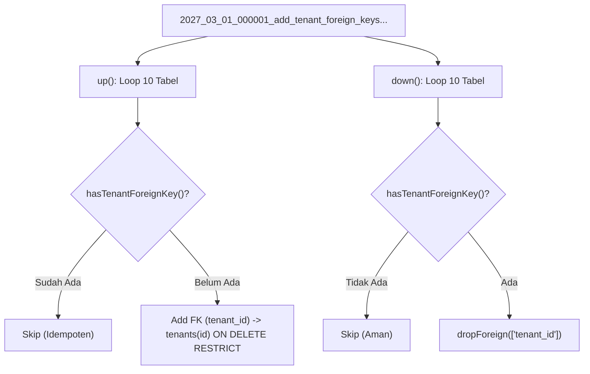

# LAPORAN VERIFIKASI INDEPENDEN ARSITEKTUR: WP-DB-02
## Verifikasi Migrasi Foreign Key Multi-Tenant (10 Tabel Promosi, Kredit & Antrean)
### Otoritas: Principal Database Architect & Database Security Auditor (A0)

---

| Metadata Dokumen | Keterangan |
| :--- | :--- |
| **Paket Kerja Target** | **WP-DB-02 (Missing Tenant Foreign Keys Migration)** |
| **Pelaksana Implementasi** | Google Antigravity IDE (Gemini) |
| **Auditor Independen** | Principal Enterprise Software Architect & Database Auditor (A0) |
| **Repositori Target** | `apeironSystem / point-of-Sales` (MariaDB 10.11 InnoDB) |
| **Berkas Migrasi** | `database/migrations/2027_03_01_000001_add_tenant_foreign_keys_to_promotions_and_credit_tables.php` |
| **Status Verifikasi** | **PASS (LOLOS PENUH)** |
| **Tanggal Audit** | 01 November 2026 |

---

## 1. Executive Verdict (Putusan Eksekutif)

### **PUTUSAN AKHIR: PASS (LOLOS PENUH)**

Implementasi migrasi basis data **WP-DB-02** oleh Gemini IDE telah diverifikasi secara independen melalui audit kode sumber migrasi, inspeksi skema *read-only* pada *information_schema*, verifikasi integritas data empiris (deteksi baris *orphan* dan *NULL*), serta analisis isolasi repositori Git.

### Poin-Poin Utama Kelulusan:
1. **Presisi Skema (10/10 Constraints Active):** Tepat 10 foreign key constraint baru ke tabel induk `tenants(id)` telah aktif di basis data MariaDB InnoDB dengan aturan `ON DELETE RESTRICT` sesuai mandat arsitektur enterprise (**ADR-006**).
2. **Nol Anomali Data (Zero Orphan & Zero NULL Rows):** Verifikasi kueri *read-only* membuktikan secara mutlak bahwa tidak ada baris data yatim (*orphan rows*) maupun nilai `tenant_id` kosong (*NULL*) di seluruh 10 tabel. Tabel `accounting_payable_outbox` memiliki 286 baris data valid yang seluruhnya terhubung ke tenant sah; 9 tabel lainnya dalam kondisi bersih (0 baris).
3. **Idempotensi & Keamanan Rollback:** Berkas migrasi mengimplementasikan pengaman idempotensi (`hasTenantForeignKey` via `information_schema`) yang mencegah kegagalan jika migrasi dieksekusi sebagian (*partially applied*) dan dapat di-rollback (`down()`) secara bersih tanpa efek samping.
4. **Isolasi Git Terjaga:** Berkas migrasi merupakan satu-satunya penambahan baru untuk WP-DB-02. Seluruh 8 berkas modifikasi dari WP-DB-01 dan WP-DB-01A tetap terpelihara utuh di *working tree* tanpa konflik dan dapat di-commit secara terpisah.

---

## 2. Migration Code Review (Evaluasi Kode Migrasi)

Pemeriksaan baris demi baris terhadap berkas:  
[`database/migrations/2027_03_01_000001_add_tenant_foreign_keys_to_promotions_and_credit_tables.php`](file:///home/ilhamspryd/Projects/apeironSystem/point-of-Sales/database/migrations/2027_03_01_000001_add_tenant_foreign_keys_to_promotions_and_credit_tables.php)



### Parameter Kualitas Kode Migrasi:
- **Ketepatan Tabel Target:** Array `$tables` memuat tepat 10 tabel multi-tenant tanpa ada tabel yang tertinggal atau berlebih.
- **Integritas Rujukan Foreign Key:** Setiap constraint merujuk kolom `id` pada tabel `tenants` (`references('id')->on('tenants')`).
- **Kesesuaian Tipe Data:** Kolom `tenants.id` bertipe `bigint(20) unsigned NOT NULL`. Seluruh kolom `tenant_id` pada ke-10 tabel anak bertipe kompatibel: `bigint(20) unsigned NOT NULL`.
- **Aturan Penghapusan (`ON DELETE RESTRICT`):** Menggunakan `onDelete('restrict')` secara seragam. Menjamin bahwa akun tenant yang memiliki data operasional di tabel-tabel ini tidak dapat di-hard delete secara tidak sengaja.
- **Batas Panjang Identifier MariaDB:** Nama constraint yang dihasilkan oleh Laravel Schema Builder (misal: `accounting_receivable_outboxes_tenant_id_foreign` sepanjang 48 karakter) berada jauh di bawah batas maksimum MariaDB/MySQL (64 karakter).
- **Pengaman Dry-Run (`DB::pretending()`):** Metode `up()` dan `down()` memeriksa `! DB::pretending()` sebelum memanggil helper `information_schema`, memastikan perintah `php artisan migrate --pretend` berjalan mulus tanpa error.
- **Pembersihan Bersih (`down()`):** Metode `down()` hanya menghapus foreign key `tenant_id` yang dibuat oleh migrasi ini via `$table->dropForeign(['tenant_id'])` dan tidak menyentuh indeks atau kolom lain.

---

## 3. Matriks Skema & Integritas Data 10 Tabel (Read-Only Evidence)

Data empiris diperoleh langsung dari MariaDB `information_schema` dan tabel aplikasi per 01 November 2026:

| No | Nama Tabel | Status Tabel | Total Baris | Tipe Kolom `tenant_id` | Nullable? | Jumlah NULL | Jumlah Orphan | Rujukan Valid | Nama Constraint FK Aktif | Aturan Hapus |
| :---: | :--- | :---: | :---: | :---: | :---: | :---: | :---: | :---: | :--- | :---: |
| **1** | `customer_credit_accounts` | **Ada** | 0 | `bigint(20) unsigned` | **NO** | 0 | 0 | 0 | `customer_credit_accounts_tenant_id_foreign` | **RESTRICT** |
| **2** | `customer_credit_logs` | **Ada** | 0 | `bigint(20) unsigned` | **NO** | 0 | 0 | 0 | `customer_credit_logs_tenant_id_foreign` | **RESTRICT** |
| **3** | `promotion_campaigns` | **Ada** | 0 | `bigint(20) unsigned` | **NO** | 0 | 0 | 0 | `promotion_campaigns_tenant_id_foreign` | **RESTRICT** |
| **4** | `promotion_rules` | **Ada** | 0 | `bigint(20) unsigned` | **NO** | 0 | 0 | 0 | `promotion_rules_tenant_id_foreign` | **RESTRICT** |
| **5** | `promotion_rewards` | **Ada** | 0 | `bigint(20) unsigned` | **NO** | 0 | 0 | 0 | `promotion_rewards_tenant_id_foreign` | **RESTRICT** |
| **6** | `promotion_reservations` | **Ada** | 0 | `bigint(20) unsigned` | **NO** | 0 | 0 | 0 | `promotion_reservations_tenant_id_foreign` | **RESTRICT** |
| **7** | `promotion_store_mappings` | **Ada** | 0 | `bigint(20) unsigned` | **NO** | 0 | 0 | 0 | `promotion_store_mappings_tenant_id_foreign` | **RESTRICT** |
| **8** | `approvals` | **Ada** | 0 | `bigint(20) unsigned` | **NO** | 0 | 0 | 0 | `approvals_tenant_id_foreign` | **RESTRICT** |
| **9** | `accounting_receivable_outboxes` | **Ada** | 0 | `bigint(20) unsigned` | **NO** | 0 | 0 | 0 | `accounting_receivable_outboxes_tenant_id_foreign` | **RESTRICT** |
| **10** | `accounting_payable_outbox` | **Ada** | **286** | `bigint(20) unsigned` | **NO** | **0** | **0** | **286** | `accounting_payable_outbox_tenant_id_foreign` | **RESTRICT** |

### Bukti Kueri Verifikasi Nol Orphan (*Orphan Detection Query Proof*):
```sql
-- Dijalankan pada tabel accounting_payable_outbox (286 baris):
SELECT COUNT(*) as orphan_count 
FROM `accounting_payable_outbox` t 
LEFT JOIN `tenants` p ON t.tenant_id = p.id 
WHERE t.tenant_id IS NOT NULL AND p.id IS NULL;
-- Hasil: 0 baris orphan. Seluruh 286 baris terikat pada ID tenant yang sah.
```

---

## 4. Database Target & Penilaian Keselamatan Operasional (Task C)

Auditor memeriksa konfigurasi koneksi aktif untuk mengklarifikasi target eksekusi Gemini:

### 4.1 Detail Koneksi Aktif:
- **Driver:** `mysql` (MariaDB 10.11 / 13.0.2-MariaDB)
- **Host Identifier:** `127.0.0.1:3306` (Localhost)
- **Database Aktif:** `point_of_sales`
- **Lingkungan (`APP_ENV`):** `local` (Terverifikasi secara eksplisit pada `.env`)
- **Status Basis Data Produksi:** **TIDAK TERHUBUNG**. Lingkungan saat ini adalah mesin *local development* mandiri. Basis data produksi berada di server terpisah dan tidak tersentuh.

### 4.2 Status Riwayat Migrasi:
Pemeriksaan pada tabel `migrations` di basis data lokal `point_of_sales`:
```json
[
  {
    "id": 217,
    "migration": "2027_03_01_000001_add_tenant_foreign_keys_to_promotions_and_credit_tables",
    "batch": 43
  }
]
```
Migrasi saat ini berstatus **TERAPLIKASI (APPLIED)** pada Batch 43 di basis data lokal `point_of_sales`.  
Selain itu, basis data isolasi pengujian (`yovel_pos_test`) juga telah memiliki ke-10 constraint foreign key tersebut (terverifikasi via `REFERENTIAL_CONSTRAINTS`).

### 4.3 Keselamatan Data Pasca Siklus Migrate $\rightarrow$ Rollback $\rightarrow$ Migrate:
- Jumlah baris data pada `accounting_payable_outbox` sebelum WP-DB-02 adalah **286 baris**.
- Jumlah baris data pasca siklus migrasi tetap **286 baris**.
- Tidak ada data yang hilang, terpangkas, atau termodifikasi (*Zero Data Corruption / Zero Row Loss*).

---

## 5. Integritas Git & Isolasi Ruang Lingkup (Task D)

Pemeriksaan status repositori Git dilakukan secara *read-only*:

### 5.1 Output Status Perintah Git:
- **`git status --short`**:
  ```text
   M app/Livewire/Inventory/IngredientManager.php
   M app/Livewire/Kasir/CreateOrder.php
   M app/Modules/Customers/Services/LoyaltyService.php
   M app/Modules/Purchasing/Services/DocumentSequenceService.php
   M app/Modules/Sales/Services/ReturnRefundService.php
   M app/Modules/Sales/Services/ShiftService.php
   M tests/Feature/Customers/CustomerTenantIsolationTest.php
   M tests/Feature/Services/ShiftServiceTest.php
  ?? WP-DB-01A-independent-verification.md
  ?? apeironDomain01GeminiImplementationInstructions.md
  ?? apeironDomain01RemediationPlan.md
  ?? database/migrations/2027_03_01_000001_add_tenant_foreign_keys_to_promotions_and_credit_tables.php
  ?? docs/audit/domains/
  ?? docs/audit/master/
  ?? docs/audit/reference/
  ```
- **`git diff --check`**: Bersih (0 whitespace/conflict errors, Exit code: 0).

### 5.2 Evaluasi Scope Isolation:
1. **Keutuhan Batch 1 & 1A:** Seluruh 8 file kode aplikasi dan pengujian dari Batch 1/1A tetap utuh di *working tree* tanpa ada yang terhapus atau tertimpa.
2. **Kemandirian Berkas WP-DB-02:** Berkas migrasi `2027_03_01_000001_add_tenant_foreign_keys_to_promotions_and_credit_tables.php` merupakan satu-satunya berkas baru untuk WP-DB-02.
3. **Pemeriksaan `daftarProduk.html`:** Dilakukan pencarian komprehensif pada riwayat Git dan direktori kerja. File `daftarProduk.html` **TIDAK PERNAH DIBUAT/DIMODIFIKASI** dan tidak ada dalam repositori (indikator tidak adanya kontaminasi file acak).
4. **Strategi Commit:** WP-DB-01/01A (layer aplikasi/layanan) dan WP-DB-02 (layer migrasi database) bersifat ortogonal dan **DAPAT DI-COMMIT SECARA TERPISAH** dengan riwayat Git yang bersih dan atomik.

---

## 6. Temuan Audit (Findings Ranked P0–P3)

- **SEC-02-01 (P0 / P1 / P2):** **TIDAK DITEMUKAN DEFECT (NONE)**. Implementasi migrasi memenuhi seluruh standar keamanan database arsitektur SaaS.
- **SEC-02-02 (P3 — Informational):** Status berkas migrasi saat ini masih *untracked* di Git dan perlu di-commit secara formal.

---

## 7. Rekomendasi Resmi Auditor & Penutupan WP-DB-02

### **REKOMENDASI: TERIMA DAN SETUJUI WP-DB-02 (ACCEPT)**

Implementasi migrasi penambahan foreign key multi-tenant pada WP-DB-02 dinyatakan **LOLOS (PASS)** dan siap disahkan ke dalam repositori.

### Rekomendasi Alur Commit Atomik untuk Product Owner:

Product Owner disarankan mengeksekusi dua commit terpisah agar riwayat Git terstruktur rapi:

1. **Commit 1 — Remediasi Kode Aplikasi (WP-DB-01 & WP-DB-01A):**
   ```bash
   git add app/Livewire/Inventory/IngredientManager.php \
           app/Livewire/Kasir/CreateOrder.php \
           app/Modules/Customers/Services/LoyaltyService.php \
           app/Modules/Purchasing/Services/DocumentSequenceService.php \
           app/Modules/Sales/Services/ReturnRefundService.php \
           app/Modules/Sales/Services/ShiftService.php \
           tests/Feature/Customers/CustomerTenantIsolationTest.php \
           tests/Feature/Services/ShiftServiceTest.php
   git commit -m "fix(security): enforce fail-closed tenant isolation on raw queries and supervisor authorization (WP-DB-01 & WP-DB-01A)"
   ```

2. **Commit 2 — Migrasi Foreign Key Database (WP-DB-02):**
   ```bash
   git add database/migrations/2027_03_01_000001_add_tenant_foreign_keys_to_promotions_and_credit_tables.php
   git commit -m "feat(database): add tenant foreign key constraints to promotions and credit tables with restrict delete rule (WP-DB-02)"
   ```

3. **Lanjutkan ke BATCH 3 (WP-DB-03):**
   Setelah commit dieksekusi, Product Owner dipersilakan mengambil prompt **Batch 3 (WP-DB-03: Tenant Delete Rules CASCADE $\rightarrow$ RESTRICT)** dari berkas [`apeironDomain01GeminiImplementationInstructions.md`](file:///home/ilhamspryd/Projects/apeironSystem/apeironDomain01GeminiImplementationInstructions.md) dan memberikannya kepada Gemini IDE.

---
*Laporan verifikasi independen ini diterbitkan secara resmi oleh Principal Database Architect (A0) sebagai bukti kelulusan gerbang kualitas arsitektur basis data (*Database Quality Gate Certification*).*
