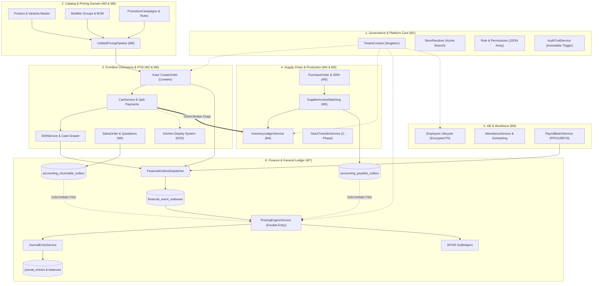

# ENTERPRISE CROSS-DOMAIN ARCHITECTURE & DEPENDENCY MAP
## Apeiron Systems — Multi-Tenant Enterprise SaaS ERP Platform

- **Auditor:** A0 — Principal Enterprise Architect & Systems Auditor
- **Target:** Cross-Module Topography, Data Ownership, Interaction Contracts, Failure Propagation, and Architectural Risks across Domains 1–10
- **Scope:** M1 (Platform/Auth), M2 (POS/Sales), M3 (Catalog), M4 (Inventory), M5 (Purchasing), M6 (CRM/B2B), M7 (Finance/GL), M8 (Pricing), M9 (HR/Payroll), and DevOps/Integrations
- **Audit Date:** 1 November 2026
- **Status:** **COMPLETE**

---

## 1. CROSS-DOMAIN SYSTEM ARCHITECTURE TOPOLOGY

Berikut adalah peta topologi ketergantungan lintas-domain, produsen data (*producers*), konsumen (*consumers*), dan jalur komunikasi asinkron/sinkron di seluruh sistem:

---

## 2. CROSS-DOMAIN INTERACTION CONTRACTS MATRIX

Tabel berikut memetakan setiap interaksi lintas-domain, kontrak data, mekanisme kegagalan, dan risiko arsitektur:

| Producer Domain | Consumer Domain | Data Contract / DTO | Mode Interaksi | Failure Mode | Recovery Mechanism | Architectural Risk |
|---|---|---|---|---|---|---|
| **M8 Pricing** | **M2 POS / Sales** | `CartEvaluationResultDto`, `CheckoutCalculationBreakdownDto` | **Synchronous Direct Method Call** | Exception pada rule evaluasi atau diskon supervisor invalid | Transaksi POS gagal, keranjang dikembalikan ke state edit | Tight Coupling; POS kasir bergantung penuh pada ketersediaan runtime Pricing Engine |
| **M2 POS / Sales** | **M4 Inventory** | Raw SQL updates & `stock_movements` insert (Bypasses Service) | **Synchronous Direct Mutation** | `ValidationException` (stok produk/bahan tidak mencukupi) | Rollback `DB::transaction` kasir, batalkan pesanan | **Architectural Fracture (P1)**: POS bypass `InventoryLedgerService`, memicu dual mutation path |
| **M2 POS / Sales** | **M7 Finance** | `FinancialEventOutbox` (Event: `pos.order.paid`, `pos.shift.closed`, `sales.return.refunded`) | **Deferred Transactional Outbox** (DB Table + Queue Job) | Queue worker mati atau job timeout | `ProcessFinancialOutboxCommand` fallback (saat ini belum di-scheduler) | **Scheduler Gap (P1)**: Jika worker mati, outbox menumpuk tanpa cron sweep otomatis |
| **M5 Purchasing** | **M4 Inventory** | `GoodsReceivedNoteItem` & `InventoryLedgerService::recordMovement` | **Synchronous DB Transaction** | Mutasi gagal jika item melanggar XOR atau tenant context mismatch | Rollback transaksi GRN | Sangat Aman; dilindungi database triggers `trg_goods_receipt_items_xor` |
| **M5 Purchasing** | **M7 Finance** | `AccountingPayableOutbox` (Event: `supplier_invoice.approved`) | **Deferred Transactional Outbox** | **Consumer Disconnected**: Outbox tersimpan tapi tidak diproses | **NIL (0 Callers)** di lingkungan produksi | **Critical Disconnect (P1)**: Hutang usaha ke pemasok tidak pernah dijurnal ke GL |
| **M6 Customers** | **M7 Finance** | `AccountingReceivableOutbox` (Event: `ar.invoice.posted`, `ar.payment.allocated`) | **Deferred Transactional Outbox** | **Consumer Disconnected**: Outbox tersimpan tapi tidak diproses | **NIL (0 Callers)** di lingkungan produksi | **Critical Disconnect (P1)**: Piutang usaha dari penjualan B2B tidak pernah dijurnal ke GL |
| **M9 HR / Payroll** | **M7 Finance** | `PayrollPostingService` & `FinancialEventOutbox` (`payroll.batch.posted`) | **Deferred Transactional Outbox** | Outbox tersimpan dengan jurnal gaji debet beban gaji / kredit hutang gaji | Job `ProcessFinancialOutboxJob` | Aman; mengikuti alur Financial Outbox standar |
| **M1 Platform** | **All Modules** | `TenantContext` & `StoreResolver` | **Container Scoped Singleton** | `RuntimeException` saat tenant context kosong (Fail-Closed) | Abort 403/500, tolak resolusi Route Model Binding | Fondasi isolasi sangat kokoh; seluruh modul mewarisi proteksi tenant |

---

## 3. IDENTIFIKASI ROOT CAUSE BERSAMA (CROSS-DOMAIN ROOT CAUSES)

Analisis lintas-domain membuktikan bahwa sebagian besar temuan independen berakar dari 3 akar masalah fundamental:

### Root Cause 1: Pola Eksekusi Outbox yang Belum Di-Wiring Secara Sistemik
- *Manifestasi:* `accounting_payable_outbox` tidak diproses, `accounting_receivable_outbox` tidak diproses, dan `finance:process-outbox` tidak terdaftar di cron scheduler.
- *Akar Masalah:* Pembangunan modul dilakukan secara parsial (unit per unit). Service consumer dibangun dan diuji dalam test feature terisolasi, namun tidak ada fase integrasi arsitektural untuk mendaftarkan command runner ke scheduler sistem `routes/console.php`.

### Root Cause 2: Asumsi Interface Eksternal yang Tidak Sinkron (Library Mismatch)
- *Manifestasi:* 10 policy finansial memanggil `$user->hasPermissionTo(...)` dan `$user->hasRole(...)` yang menyebabkan fatal runtime error.
- *Akar Masalah:* Pengembang menyalin atau mengadopsi pola dari Spatie Laravel Permission tanpa memverifikasi bahwa model `User` Apeiron menggunakan implementasi RBAC kustom internal (`$user->hasPermission(...)`).

### Root Cause 3: Sisa Kode Legacy yang Melewati Bounded Context Inventori
- *Manifestasi:* POS kasir memotong `products.stock` dan `ingredients.current_stock` secara manual.
- *Akar Masalah:* Komponen frontline kasir (Modul 2) dibangun sebelum Modul 4 (Inventory Ledger) disempurnakan. Ketika Modul 4 selesai dengan 8 invariants canggih, Modul 2 tidak direfactor secara tuntas untuk mendelegasikan mutasi ke `InventoryLedgerService`.

---

## 4. KESIMPULAN ARSITEKTURAL
Peta arsitektur lintas-domain Apeiron Systems memiliki **fondasi basis data dan multi-tenancy yang luar biasa kokoh**, namun mengalami **sumbatan integrasi pada layer orkestrasi perantara (Outbox Consumers & Scheduler Wiring)**. Menyelesaikan 3 akar masalah di atas akan secara otomatis memulihkan integritas operasional di seluruh 9 modul sistem.
