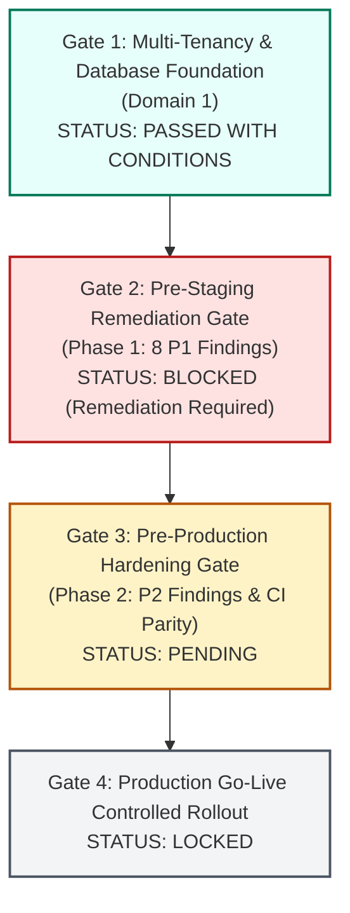

# ENTERPRISE PRODUCTION READINESS ASSESSMENT
## Apeiron Systems — Multi-Tenant Enterprise SaaS ERP Platform (Domains 1–10)

- **Auditor:** A0 — Principal Enterprise Architect & Production Gatekeeper
- **Target:** Production Readiness Gate Evaluation across Infrastructure, Security, Business Integrity, Concurrency, and Disaster Recovery
- **Assessment Scope:** Full Platform (Domains 1 through 10)
- **Audit Date:** 1 November 2026
- **Status:** **NOT READY FOR PRODUCTION DEPLOYMENT (BLOCKED BY PRE-STAGING GATE)**
- **Confidence:** **HIGH** (Empirically verified against current code and database state)

---

## 1. PRODUCTION READINESS VERDICT & EXECUTIVE SUMMARY

Berdasarkan hasil audit komprehensif terhadap seluruh domain arsitektur, teknik, keamanan, dan operasional (Domain 1 hingga Domain 10), platform **Apeiron Systems DINYATAKAN: BELUM SIAP UNTUK DEPLOYMENT PRODUKSI (*NOT READY FOR PRODUCTION DEPLOYMENT*)**.

### 1.1 Status Gerbang Kualitas (*Quality Gates*)

### 1.2 Ringkasan Alasan Pemblokiran Gerbang Produksi
Meskipun fondasi database dan multi-tenancy Domain 1 telah berstatus `CLOSED WITH CONDITIONS`, sistem saat ini terblokir di **Gate 2 (Pre-Staging Gate)** oleh **8 temuan kritis tingkat P1**:
1. **Financial Integration Disconnect:** Hutang Usaha (AP) dari faktur pembelian dan Piutang Usaha (AR) tidak mengalir ke General Ledger karena consumer outbox tidak terhubung di lingkungan runtime (`FINDING-P1-01`).
2. **Missing Outbox Cron Sweep:** Peristiwa finansial kasir POS tidak memiliki fallback scheduler otomatis jika terjadi kegagalan queue worker (`FINDING-P1-02`).
3. **Runtime Policy Defect:** 10 policy finansial memanggil method `hasPermissionTo()` yang menyebabkan crash fatal 500 (`FINDING-P1-03`).
4. **Missing Component-Level Authorization:** 23 komponen Livewire manajerial rentan terhadap eksekusi mutasi tanpa otorisasi (`FINDING-P1-04`).
5. **Supervisor PIN Leak:** Kredensial PIN supervisor terekspos dalam snapshot JSON di sisi klien browser kasir (`FINDING-P1-05`).
6. **Double-Submit Duplicate Postings:** Formulir jurnal manual akuntansi rentan menduplikasi posting jurnal ke General Ledger saat terjadi double-click (`FINDING-P1-06`).
7. **Bypassing Inventory Ledger:** Kasir POS memotong stok secara langsung pada kolom legacy tanpa mendelegasikan ke `InventoryLedgerService` (`FINDING-P1-07`).
8. **Premature Lock Release:** Worker outbox melepaskan lock pesimistik sebelum pemrosesan selesai, memicu race condition (`FINDING-P1-08`).

---

## 2. PRODUCTION RISK REGISTER & SEVERITY EVALUATION

| Risk Domain | Risk Title & Trigger | Severity | Likelihood | Impact on Production Operations | Mitigating Requirement |
|---|---|:---:|:---:|---|---|
| **Financial Integrity** | **Buku Besar Hutang/Piutang Lumpuh (Disconnected Outbox Consumers)** | **P1** | **CERTAIN (100%)** | Laporan Neraca Keuangan dan Hutang Usaha ke Pemasok tidak ter-update di General Ledger. | Selesaikan `WP-CORE-01`. |
| **Financial Integrity** | **Duplikasi Jurnal Akuntansi akibat Double Click Kasir/Akuntan** | **P1** | **HIGH** | Pembukuan ganda pada transaksi manual, merusak neraca saldo. | Selesaikan `WP-CORE-04`. |
| **Security & Privacy** | **Pencurian PIN Supervisor dari Browser Console Kasir** | **P1** | **HIGH** | Kasir nakal dapat mencuri PIN supervisor untuk memberikan diskon manual tanpa izin. | Selesaikan `WP-CORE-04`. |
| **Security & Governance** | **Bypass Otorisasi Livewire Manajerial (Missing Component Gates)** | **P1** | **MEDIUM** | Pengguna dapat mengeksekusi mutasi gaji, stok, atau akuntansi tanpa izin peran yang sah. | Selesaikan `WP-CORE-03`. |
| **Inventory Integrity** | **Desinkronisasi Saldo Stok POS vs Materialized Balances** | **P1** | **HIGH** | Laporan stok cabang dan pembukuan fisik inventori berbeda dengan riwayat mutasi kasir. | Selesaikan `WP-CORE-05`. |
| **Operational Stability** | **Deadlock & Job Outbox Crash akibat Pelepasan Lock Prematur** | **P1** | **MEDIUM** | Antrean posting jurnal finansial terhenti (*stalled*) saat volume pesanan tinggi. | Selesaikan `WP-CORE-06`. |
| **Operational Continuity** | **Kasir POS Hang saat Jaringan Wi-Fi Outlet Putus (No Offline Mode)** | **P2** | **HIGH** | Antrean kasir restoran terhenti total saat koneksi internet lokal drop. | Selesaikan `WP-HARD-03` / PWA. |
| **DevOps / CI Parity** | **Regresi Spesifik MariaDB Lolos CI akibat Penggunaan MySQL 8.0** | **P2** | **MEDIUM** | Build CI lulus tapi aplikasi crash atau gagal migrasi di database MariaDB produksi. | Selesaikan `WP-HARD-04`. |

---

## 3. MANDATORY PRE-CONDITIONS FOR PRODUCTION RELEASE

Sebelum sistem diizinkan meluncur ke lingkungan Staging dan Produksi, **seluruh kriteria prasyarat mutlak berikut wajib terpenuhi 100%**:

### 3.1 Pre-Staging Verification Gate
- [ ] Seluruh 6 Work Packages di Phase 1 (`WP-CORE-01` s.d. `WP-CORE-06`) telah diimplementasikan dalam commit terpisah.
- [ ] Perintah `php artisan finance:process-subledgers` dan `finance:process-outbox` terverifikasi aktif di `php artisan schedule:list`.
- [ ] Seluruh 10 file policy finansial diverifikasi bebas dari pemanggilan `hasPermissionTo()`.
- [ ] Seluruh 23 komponen Livewire manajerial memiliki pemanggilan `$this->authorize(...)`.
- [ ] Snapshot JSON Livewire pada terminal kasir diverifikasi bebas dari properti `$manualDiscountSupervisorPin`.
- [ ] Alur checkout POS diverifikasi memotong stok melalui `InventoryLedgerService::recordMovement()`.
- [ ] Seluruh suite pengujian fitur finansial dan konkurensi lulus 100% (`php artisan test`).

### 3.2 Pre-Production Hardening Gate
- [ ] Service container database pada CI Actions `.github/workflows/tests.yml` diubah menjadi `mariadb:10.11` dan seluruh tes berjalan hijau.
- [ ] Generator nomor transfer stok menggunakan alokasi sekuensial atomik (`DocumentSequenceService`).
- [ ] Pemrosesan batch outbox menggunakan `lockForUpdate()->skipLocked()`.
- [ ] Pembersihan artefak data uji lokal Tenant 6 diselesaikan.

---

## 4. SIGN-OFF CRITERIA FOR PRINCIPAL SYSTEM ARCHITECT
Deployment ke lingkungan produksi hanya dapat disetujui apabila laporan verifikasi independen pasca-remediasi menunjukkan:
- **Zero P0 and Zero P1 open findings.**
- **100% automated test pass rate** pada pipeline CI MariaDB.
- **Static analysis clean exit** (`./vendor/bin/phpstan analyse --level=5+` dengan 0 errors).
- **Persetujuan resmi tertulis dari Human Product Owner.**
