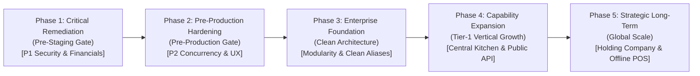

# ENTERPRISE REMEDIATION ROADMAP (DOMAINS 2–10)
## Apeiron Systems — Multi-Tenant Enterprise SaaS ERP Platform

- **Auditor:** A0 — Principal Enterprise Architect & Remediation Lead
- **Mandate:** Comprehensive Architecture, Engineering, Security & Operational Remediation Roadmap
- **Execution Rule:** **NO IMPLEMENTATION DURING THIS TURN — PLANNING & GOVERNANCE ONLY**
- **Prioritization Standard:** Security & Tenant Isolation -> Financial Integrity -> Inventory Integrity -> Concurrency -> ERP Workflows -> Modularity -> DevOps -> Future Capabilities
- **Audit Date:** 1 November 2026
- **Status:** **FINAL APPROVED ROADMAP**

---

## 1. REMEDIATION ROADMAP STRUCTURE & PHASING

Roadmap remediasi dibagi menjadi 5 fase bertahap (*staged rollout*) dengan gerbang kualitas (*quality gates*) yang ketat:

---

## 2. PHASE 1: CRITICAL REMEDIATION (PRE-STAGING GATE — P1 FINDINGS)
*Sasaran: Menyelesaikan seluruh 8 temuan P1 yang berpotensi merusak integritas finansial, kebocoran PIN kasir, dan kegagalan integrasi outbox.*

---

### WP-CORE-01: Wiring AP and AR Outbox Consumer Commands into Scheduler
- **WP ID:** `WP-CORE-01`
- **Target Finding IDs:** `FINDING-P1-01`, `FINDING-P1-02`
- **Business Objective:** Memastikan seluruh faktur pembelian (hutang pemasok) dan piutang penjualan B2B secara otomatis diposting ke Buku Besar Pembantu (AP/AR Subledgers) dan General Ledger, serta menyediakan cron fallback untuk outbox finansial.
- **Technical Scope:**
  1. Buat Artisan command `App\Console\Commands\ProcessSubledgerOutboxCommand` (`finance:process-subledgers`).
  2. Suntikkan `ApOutboxConsumerService` dan `ArOutboxConsumerService` untuk memproses antrean `pending` dengan limit batch 50.
  3. Daftarkan perintah `finance:process-subledgers` dan `finance:process-outbox` pada `routes/console.php` dengan `everyMinute()->withoutOverlapping()`.
- **Exact Impacted Files:**
  - `app/Console/Commands/ProcessSubledgerOutboxCommand.php` (Baru)
  - `routes/console.php` (Modifikasi baris registrasi jadwal)
- **Dependencies:** None (Service consumer telah teruji di feature test).
- **Risk / Complexity:** Low Risk / **Size: S** (1-2 file).
- **Acceptance Criteria:**
  - Eksekusi `php artisan finance:process-subledgers` mengubah record `accounting_payable_outbox` status `pending` menjadi `processed` dan meng-insert baris ke `ap_ledger_entries`.
  - Eksekusi `php artisan schedule:list` menampilkan jadwal aktif untuk `finance:process-subledgers` dan `finance:process-outbox`.
- **Required Regression Tests:** `tests/Feature/Finance/ApOutboxScheduledProcessingTest.php`, `tests/Feature/Finance/ArOutboxScheduledProcessingTest.php`.
- **Independent Verification Method:** Jalankan migrasi dan seeder, buat PO dan GRN, approve faktur pemasok, jalankan perintah artisan secara manual, verifikasi baris `ap_ledger_entries` dan `journal_entries` terisi via query database langsung.

---

### WP-CORE-02: Fix Method Call Mismatch on 10 Financial Policies
- **WP ID:** `WP-CORE-02`
- **Target Finding IDs:** `FINDING-P1-03`
- **Business Objective:** Memulihkan mekanisme otorisasi peran dan izin pada modul akuntansi, kas & bank, aset tetap, dan instrumen nilai agar tidak crash saat dievaluasi.
- **Technical Scope:**
  Perbarui 10 file policy di `app/Policies/`: ganti `$user->hasPermissionTo(...)` menjadi `$user->hasPermission(...)`, dan ganti `$user->hasRole('owner')` menjadi `(strtolower($user->role?->name ?? '') === 'owner')`.
- **Exact Impacted Files:**
  - `app/Policies/JournalEntryPolicy.php`
  - `app/Policies/ChartOfAccountPolicy.php`
  - `app/Policies/AccountingPeriodPolicy.php`
  - `app/Policies/ApPaymentPolicy.php`
  - `app/Policies/ExpensePolicy.php`
  - `app/Policies/FixedAssetPolicy.php`
  - `app/Policies/CashBankAccountPolicy.php`
  - `app/Policies/StoreCreditPolicy.php`
  - `app/Policies/GiftCardPolicy.php`
  - `app/Policies/VoucherPolicy.php`
- **Dependencies:** None.
- **Risk / Complexity:** Low Risk / **Size: M** (10 file kecil).
- **Acceptance Criteria:** Seluruh pemanggilan method policy (`viewAny`, `create`, `approve`, `post`, `reverse`) mengembalikan boolean tanpa melempar `BadMethodCallException`.
- **Required Regression Tests:** `tests/Unit/Policies/FinancePoliciesMethodExecutionTest.php` (10 test methods memvalidasi setiap policy).
- **Independent Verification Method:** Jalankan PHPUnit terfokus pada test suite policy finansial dan periksa exit code 0.

---

### WP-CORE-03: Implement Component-Level Authorization on 23 Managerial Livewire Components
- **WP ID:** `WP-CORE-03`
- **Target Finding IDs:** `FINDING-P1-04`
- **Business Objective:** Menegakkan otorisasi Defense-in-Depth pada tingkat komponen Livewire untuk mencegah bypass izin pada operasi finansial, persediaan, dan penggajian.
- **Technical Scope:**
  Tambahkan pemanggilan `$this->authorize(...)` pada setiap method mutasi (seperti `postManualJournal`, `confirmReversal`, `reconcile`, `approveBatch`, `executeAdjustment`) di dalam 23 komponen Livewire.
- **Exact Impacted Files:**
  - 4 komponen di `app/Livewire/Finance/` (`JournalEntryManager.php`, `ChartOfAccountManager.php`, dll.)
  - 6 komponen di `app/Livewire/HR/` (`PayrollBatchManager.php`, `EmployeeManager.php`, dll.)
  - 8 komponen di `app/Livewire/Inventory/` (`StockOpnameManager.php`, `StockTransferManager.php`, dll.)
  - 5 komponen di `app/Livewire/Purchasing/` dan `Sales/`
- **Dependencies:** `WP-CORE-02` (Policy method harus sudah diperbaiki agar tidak error).
- **Risk / Complexity:** Medium Risk / **Size: L** (23 files).
- **Acceptance Criteria:** Pengguna tanpa izin spesifik yang mencoba memicu method Livewire dari DevTools ditolak dengan HTTP 403 Forbidden.
- **Required Regression Tests:** `tests/Feature/Security/LivewireComponentsAuthorizationTest.php`.
- **Independent Verification Method:** Eksekusi request Livewire terautentikasi sebagai Kasir pada `JournalEntryManager::postManualJournal()` dan pastikan menerima respons `403 Forbidden`.

---

### WP-CORE-04: Secure Sensitive PINs and Eliminate Double-Submit Vulnerability in Livewire
- **WP ID:** `WP-CORE-04`
- **Target Finding IDs:** `FINDING-P1-05`, `FINDING-P1-06`
- **Business Objective:** Mengeliminasi pengeksposan PIN supervisor di client-side state kasir, dan mencegah duplikasi posting jurnal manual di General Ledger akibat double-click.
- **Technical Scope:**
  1. Di `CreateOrder.php`: hapus properti publik `$manualDiscountSupervisorPin`, ubah menjadi argumen method transient.
  2. Di `JournalEntryManager.php`: generate `idempotencyKey` saat modal dibuka dan simpan dalam `#[Locked] public string $workbenchIdempotencyKey`.
  3. Di `journal-entry-manager.blade.php`: pasang `wire:loading.attr="disabled"` pada tombol posting.
- **Exact Impacted Files:**
  - `app/Livewire/Kasir/CreateOrder.php`
  - `resources/views/livewire/kasir/create-order.blade.php`
  - `app/Livewire/Finance/JournalEntryManager.php`
  - `resources/views/livewire/finance/journal-entry-manager.blade.php`
- **Dependencies:** None.
- **Risk / Complexity:** Medium Risk / **Size: M** (4 files).
- **Acceptance Criteria:**
  - PIN supervisor tidak ditemukan pada snapshot JSON respon HTTP Livewire.
  - Double submit pada `JournalEntryManager` hanya menghasilkan 1 baris di tabel `journal_entries`.
- **Required Regression Tests:** `tests/Feature/Security/CreateOrderPublicStateLeakTest.php`, `tests/Feature/Finance/JournalEntryDoubleSubmitTest.php`.
- **Independent Verification Method:** Periksa payload response Livewire dan simulasikan double submission secara paralel.

---

### WP-CORE-05: Delegate POS Stock Deduction Exclusively to `InventoryLedgerService`
- **WP ID:** `WP-CORE-05`
- **Target Finding IDs:** `FINDING-P1-07`
- **Business Objective:** Menghilangkan jalur ganda mutasi stok dan memastikan seluruh pengurangan inventori POS mengikuti 8 invariant Modul 4 secara kanonis.
- **Technical Scope:**
  Refactor `TransactionService.php`: ganti operasi pemotongan langsung pada `$product->stock` dan `$ingredient->current_stock` dengan pemanggilan `InventoryLedgerService::recordMovement()`.
- **Exact Impacted Files:**
  - `app/Modules/Sales/Services/TransactionService.php`
- **Dependencies:** None (InventoryLedgerService telah siap).
- **Risk / Complexity:** High Risk (Core POS Checkout Flow) / **Size: M** (1 file besar).
- **Acceptance Criteria:** Checkout kasir berhasil memotong saldo di `product_stock_balances` dan `ingredient_stock_balances` dengan entri audit lengkap di `stock_movements`.
- **Required Regression Tests:** `tests/Feature/Sales/PosInventoryLedgerDelegationTest.php`, `tests/Feature/Domain2/PosOrderCreationTest.php`.
- **Independent Verification Method:** Buat order kasir di database lokal, verifikasi saldo berkurang dan record movement terisi via `InventoryLedgerService`.

---

### WP-CORE-06: Fix Transaction Boundary on `ProcessFinancialOutboxJob`
- **WP ID:** `WP-CORE-06`
- **Target Finding IDs:** `FINDING-P1-08`
- **Business Objective:** Menghilangkan kondisi balapan (*race condition*) antar worker pada antrean outbox finansial.
- **Technical Scope:**
  Di `ProcessFinancialOutboxJob.php`: perluas cakupan `DB::transaction()` agar membungkus seleksi baris lock, pembaruan status `PROCESSING`, posting jurnal, dan update `PROCESSED`.
- **Exact Impacted Files:**
  - `app/Modules/Finance/Jobs/ProcessFinancialOutboxJob.php`
- **Dependencies:** None.
- **Risk / Complexity:** Medium Risk / **Size: S** (1 file).
- **Acceptance Criteria:** Lock baris bertahan hingga pemrosesan jurnal selesai.
- **Required Regression Tests:** `tests/Feature/Finance/FinancialOutboxJobConcurrencyTest.php`.
- **Independent Verification Method:** Jalankan 2 worker paralel pada 1 record outbox dan pastikan hanya 1 worker yang memprosesnya.

---

## 3. PHASE 2: PRE-PRODUCTION HARDENING (P2 FINDINGS)
*Sasaran: Menuntaskan ketahanan konkurensi, ergonomi KDS, penomoran dokumen, dan environment parity CI.*

- **WP-HARD-01: Atomic Sequence Allocation for Stock Transfers**
  - Finding: `FINDING-P2-06`.
  - Scope: Integrasikan `DocumentSequenceService` ke dalam `StockTransferService::generateTransferNumber()`.
  - Complexity: **S** | Risk: Low.
- **WP-HARD-02: `SKIP LOCKED` Batch Processing for Outboxes**
  - Finding: `FINDING-P2-08`.
  - Scope: Pasang `lockForUpdate()->skipLocked()` pada `ProcessFinancialOutboxCommand` dan `ApOutboxConsumerService`.
  - Complexity: **S** | Risk: Low.
- **WP-HARD-03: Multi-Station KDS Routing (Bar vs Kitchen)**
  - Finding: `FINDING-P2-05`.
  - Scope: Tambahkan filter stasiun kerja pada `app/Livewire/Kds/Board.php`.
  - Complexity: **M** | Risk: Low.
- **WP-HARD-04: CI Environment Parity Sync (MySQL 8.0 to MariaDB 10.11)**
  - Finding: `FINDING-P2-11`.
  - Scope: Ubah container service di `.github/workflows/tests.yml` menjadi `mariadb:10.11`.
  - Complexity: **XS** | Risk: Low.
- **WP-HARD-05: Structured JSON Logging & Request Correlation IDs**
  - Finding: `FINDING-P2-09`.
  - Scope: Pasang middleware `AssignCorrelationId` dan channel log JSON di `config/logging.php`.
  - Complexity: **S** | Risk: Low.

---

## 4. PHASE 3: ENTERPRISE FOUNDATION & CLEAN ARCHITECTURE
*Sasaran: Menyempurnakan modularitas Bounded Contexts, kontrak interface, dan pembersihan debt.*

- **WP-ARCH-01: Establish Module Service Providers and Contracts (DIP)**
  - Finding: `FINDING-P2-01`.
  - Scope: Buat `ModuleServiceProvider` untuk masing-masing modul M1–M9 dan terbitkan interface contracts di `App\Modules\{Domain}\Contracts`.
  - Complexity: **L** | Risk: Medium.
- **WP-ARCH-02: Clean Ghost Backward-Compatibility Alias Layer**
  - Finding: `FINDING-P2-02`.
  - Scope: Migrasikan seluruh pemanggilan `App\Services\*` ke namespace modular dan hapus 48 file alias di `app/Services/`.
  - Complexity: **M** | Risk: Medium.
- **WP-ARCH-03: Decompose POS God Component (`CreateOrder.php`)**
  - Finding: `FINDING-P2-03`.
  - Scope: Pecah komponen kasir 1.394 baris menjadi child components (`pos.cart`, `pos.product-grid`, `pos.payment-modal`).
  - Complexity: **L** | Risk: High.

---

## 5. PHASE 4: CAPABILITY EXPANSION (ROADMAP FASE 2)
*Sasaran: Menumbuhkan kapabilitas enterprise vertikal F&B dan Retail.*

- **WP-EXP-01: Recipe Versioning & Central Kitchen Batch Production**
  - Finding: `FINDING-P2-07`.
  - Scope: Buat skema `recipe_versions` dan dokumen `production_orders` untuk produksi batch dapur pusat.
  - Complexity: **XL** | Risk: High.
- **WP-EXP-02: Public Partner REST API Gateway (Laravel Sanctum)**
  - Finding: `FINDING-P2-12`.
  - Scope: Rancang OpenAPI suite untuk integrasi pihak ketiga (GrabFood, GoFood, Marketplace).
  - Complexity: **XL** | Risk: Medium.
- **WP-EXP-03: Offline-First POS PWA Mode (IndexedDB Queue)**
  - Finding: `FINDING-P2-04`.
  - Scope: Arsitektur offline caching lokal dengan background sync untuk kasir tunai.
  - Complexity: **XL** | Risk: High.

---

## 6. PHASE 5: STRATEGIC LONG-TERM ROADMAP
*Sasaran: Menuju Global Enterprise Tier-1 Platform.*

- **WP-STRAT-01: Multi-Company Corporate Holding Hierarchy & Intercompany Accounting**
  - Finding: `FINDING-P2-13`.
  - Scope: Struktur holding multi-PT dengan eliminasi transaksi antar-perusahaan (*intercompany eliminations*).
  - Complexity: **XL** | Risk: Critical.
- **WP-STRAT-02: Multi-Currency & Advanced Landed Cost Perpetual Valuation**
  - Scope: Valuasi FIFO perpetual multi-mata uang.
  - Complexity: **L** | Risk: High.

---

## 7. STOP CONDITION
Roadmap ini merupakan panduan perencanaan strategis formal. **DILARANG MELAKUKAN IMPLEMENTASI KODE SECARA OTOMATIS** tanpa persetujuan bertahap dari Human Product Owner.
