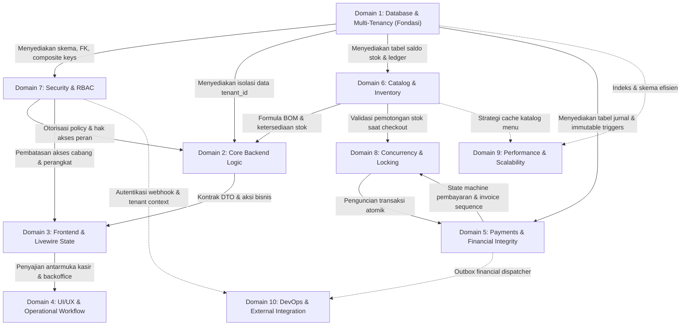

# APEIRON SYSTEMS — CROSS-DOMAIN DEPENDENCY MAP
## Peta Ketergantungan Lintas Domain, Matriks Blast Radius & Urutan Remediasi Terkoordinasi

---

| Metadata Dokumen | Keterangan |
| :--- | :--- |
| **Audit Lead** | Principal Enterprise Software Architect (A0) |
| **Status Dokumen** | **LIVING ARCHITECTURAL MAP (DOMAIN 1 BASELINE)** |
| **Tanggal Pembaruan** | 01 November 2026 |

---

## 1. Peta Ketergantungan Makro Antar-Domain (*Macro Dependency Graph*)

Perubahan pada satu domain sistem ERP multi-tenant memiliki efek domino (*blast radius*) yang signifikan ke domain lainnya. Diagram berikut memetakan ketergantungan kritis antar-domain dalam Apeiron Systems:

---

## 2. Matriks Efek Domino Lintas Domain (*Cross-Domain Blast Radius Matrix*)

| Domain Sumber Modifikasi | Domain Terdampak Langsung | Modul & Komponen Terpengaruh | Risiko Kerusakan Alur Kerja Bisnis (*Business Workflow Risk*) | Urutan Pengamanan yang Wajib Dipatuhi |
| :--- | :--- | :--- | :--- | :--- |
| **Domain 1 (Database & Multi-Tenancy)** | Domain 2, Domain 3, Domain 7 | `tenants`, `stores`, `users`, `TenantScope`, `CreateOrder`, `LoyaltyService` | Jika migrasi foreign key atau pengetatan `tenant_id` gagal, kueri raw `DB::table()` akan melempar SQL error saat kasir beroperasi. | 1. Audit seluruh kueri raw `DB::table()`. 2. Perbaiki kueri di level service/Livewire. 3. Tambahkan constraint foreign key di database. |
| **Domain 6 (Catalog & Inventory)** | Domain 2, Domain 5, Domain 8 | `products`, `ingredients`, `ingredient_stock_balances`, `TransactionService`, `product-grid` | Mengubah formula ketersediaan BOM tanpa mengaktifkan `POS_STOCK_BALANCES_AUTHORITATIVE` menyebabkan kasir menerima pesanan namun gagal saat pemotongan saldo. | 1. Sinkronkan konfigurasi `.env`. 2. Perbarui `Product::scopeAvailableForOrder()`. 3. Validasi dengan integration test checkout. |
| **Domain 5 (Payments & Financial GL)** | Domain 1, Domain 8, Domain 10 | `payments`, `journal_entries`, `orders`, `FinancialOutboxDispatcherService` | Kegagalan posting ke General Ledger atau pelanggaran trigger immutability menyebabkan selisih buku besar kasir vs akuntansi. | 1. Pastikan trigger database mengizinkan reversal. 2. Gunakan `DB::afterCommit` untuk outbox dispatcher. 3. Pastikan format moneter selalu BCMath. |
| **Domain 7 (Security & RBAC)** | Domain 3, Domain 4 | `roles`, `permissions`, `navigation.php`, Livewire Actions | Mengetatkan policy tanpa memperbarui view dapat menyembunyikan tombol operasional yang sah bagi kasir atau supervisor di gerai. | 1. Pastikan seeder permissions sinkron. 2. Sinkronkan filter otorisasi pada blade views. |

---

## 3. Registri Ketergantungan Spesifik Temuan Domain 1

### Ketergantungan Temuan DB-001 (Deviasi Basis Data PRD OD-02):
- **Domain Asal:** Domain 1 (Database Architecture)
- **Domain Terdampak:** Domain 7 (Security & RBAC), Domain 9 (Performance), Domain 10 (DevOps)
- **Komponen Terdampak:** Seluruh 195 Eloquent Models, `TenantScope`, 599 kueri `DB::table()`, driver koneksi `config/database.php`.
- **Rencana Mitigasi Terkoordinasi:** Karena keputusan arsitektural menetapkan MariaDB InnoDB, proteksi isolasi tenant tidak dapat mengandalkan kernel database (RLS). Seluruh beban pertahanan dipikul oleh:
  1. *Fail-closed* global scope `TenantScope` (Domain 1 & 7).
  2. Composite foreign keys `(tenant_id, id)` yang mencegah hubungan silang tenant (Domain 1).
  3. Linter otomatis / PHPStan rule yang melarang pemanggilan `DB::table()` tanpa parameter `tenant_id` (Domain 2 & 9).

### Ketergantungan Temuan DB-002 (Celah Raw DB Queries):
- **Domain Asal:** Domain 1 (Multi-Tenancy)
- **Domain Terdampak:** Domain 2 (Core Backend), Domain 3 (Livewire State), Domain 5 (Customer Credit / Loyalty)
- **File Terdampak:**
  - `app/Livewire/Kasir/CreateOrder.php` (baris 392)
  - `app/Modules/Customers/Services/LoyaltyService.php` (baris 33, 39, 48)
  - `app/Modules/Sales/Services/ReturnRefundService.php` (baris 537)
- **Rencana Mitigasi Terkoordinasi:** Perbaiki kueri raw tersebut untuk menyuntikkan `where('tenant_id', $tenantId)` sebelum migrasi constraint foreign key baru diterapkan.
