# APEIRON SYSTEMS — MASTER AUDIT PLAN
## Enterprise ERP SaaS Master System Audit (Multi-Tenant POS & ERP)

---

| Metadata Dokumen | Keterangan |
| :--- | :--- |
| **Otoritas / Peran** | Principal Enterprise Software Architect, SaaS Platform Auditor & Technical Due Diligence Lead (A0) |
| **Sistem Target** | Apeiron Systems — Multi-Tenant F&B & Retail ERP / POS SaaS |
| **Dokumen Acuan Utama** | *Apeiron Systems — Final Master PRD.docx* (Konsolidasi Kanonik & Resolusi OD-01 s.d. OD-38) |
| **Status Rencana** | **APPROVED BASELINE — PHASED SEQUENTIAL EXECUTION** |
| **Protokol Eksekusi** | **ONE DOMAIN AT A TIME** (Eksekusi 10 Domain Bertahap dengan Gerbang Persetujuan Pemilik Produk) |
| **Tanggal Terbit** | 01 November 2026 |

---

## 1. Latar Belakang & Mandat Audit

Apeiron Systems dikembangkan sebagai platform SaaS POS & Enterprise ERP generasi baru yang menggabungkan operasional *counter-service* F&B (Fase 1 MVP), kapabilitas ritel dinamis (Fase 2), dan *full dine-in restaurant operations* (Fase 3). 

Audit ini dilakukan secara independen, kritis, dan berbasis bukti aktual (*evidence-based technical due diligence*). Fokus audit bukan semata-mata mencari *bug* sintaksis, melainkan memverifikasi apakah Apeiron Systems memiliki fondasi arsitektur ERP SaaS kelas enterprise (*Global Tier-1 SaaS*) yang:
1. **Secure by Design:** Kebijakan isolasi multi-tenant yang kedap (*fail-closed*), kontrol akses granular berbasis peran (RBAC), dan perlindungan data sensitif.
2. **Financially & Operationally Consistent:** Integritas transaksi keuangan, buku besar *append-only*, alokasi diskon/pajak matematis eksak (BCMath), dan mitigasi kecurangan (*fraud prevention*).
3. **Transactionally Reliable:** Penguncian konkurensi deterministik, eliminasi *deadlock*, dan manajemen idempotensi checkout.
4. **Modular & Maintainable:** Pemisahan domain (*Modular Monolith*), kepatuhan MVC vertikal, dan ketiadaan *architectural debt*.
5. **Scalable & Observable:** Desain skema terindeks, strategi caching cerdas tanpa *stale data*, dan kesiapan operasional produksi.

---

## 2. Hirarki Dokumen Acuan (*Source of Truth & Document Precedence*)

Berdasarkan aturan presedensi resmi (Bab 1 & Bab 34 PRD):
1. **Prioritas 1 (Kanonik):** `Apeiron Systems — Final Master PRD.docx` (serta salinan resmi di `docs/audit/reference/`). Dokumen ini menggantikan seluruh draf awal yang bertentangan dan memuat resolusi resmi atas keputusan terbuka `OD-01` sampai `OD-38`.
2. **Prioritas 2:** Dokumen arsitektur dan keputusan resmi di repositori (`doc/`, `docs/`, `implementationPlanModul9.md`).
3. **Prioritas 3:** Aturan rekayasa AI (`GEMINI.md`, `AGENTS.md`, `.agents/skills/`).
4. **Prioritas 4:** Laporan audit dan validasi forensik sebelumnya (`fullSystemAuditReport.md`, `apeironFinalImplementationReadiness.md`).
5. **Prioritas 5:** Kode sumber aktual (`app/`, `routes/`, `resources/`, `config/`).
6. **Prioritas 6:** Skema basis data MariaDB InnoDB, migrasi, dan suite pengujian PHPUnit.
7. **Prioritas 7:** Riwayat commit Git dan status *working tree*.
8. **Prioritas 8:** Dokumen integrasi otomasi n8n (jika tersedia).

> [!IMPORTANT]
> **Aturan Evaluasi Ketat:**
> Jika terdapat diskrepansi antara implementasi kode dan Final Master PRD (misalnya: pemilihan basis data MariaDB vs PostgreSQL RLS pada `OD-02`), diskrepansi tersebut **WAJIB dicatat sebagai PRD Deviation & Architectural Gap**, bukan disamarkan sebagai kebenaran implementasi.

---

## 3. Pentahapan Produk & Batasan Ruang Lingkup Bisnis

| Fase Produk | Fokus Ruang Lingkup Bisnis | Batasan Evaluasi Audit |
| :--- | :--- | :--- |
| **Phase 1 — MVP** | Layanan Kasir F&B (*Counter-Service*) | **AUDIT PENUH:** Tenant & Branch Management, IAM/RBAC, Katalog, Resep BOM, POS Checkout, Pembayaran Manual (Tunai, QRIS Statis, EDC Eksternal, Transfer), Inventory Ledger, Shift & Cash Drawer, Cetak Struk/Dapur, Laporan Dasar, Langganan & Onboarding. |
| **Phase 2 — F2** | Ritel & Otomasi Gateway | **EVALUASI KESIAPAN (READINESS GAP):** Payment Gateway Otomatis (Midtrans - `OD-03`), Manajemen Pembelian Lanjutan (PO/GRN), Diskon Grosir/Matriks Varian Ritel, Integrasi n8n. *Fitur ini tidak wajib ada di MVP, namun arsitektur tidak boleh menghambat rilis F2.* |
| **Phase 3 — F3** | Restoran Dine-In Penuh & AI | **BATAS ROADMAP:** Manajemen Meja Terintegrasi Penuh, Self-Order QR Dinamis, Kitchen Display System (KDS) Terhubung, AI Restock Forecasting (`OD-33`). |

Setiap fitur yang diaudit akan diklasifikasikan ke dalam 6 status:
- `IMPLEMENTED`
- `PARTIALLY IMPLEMENTED`
- `NOT IMPLEMENTED`
- `OUT OF SCOPE CURRENT PHASE`
- `BLOCKED BY OPEN DECISION`
- `IMPLEMENTATION DEVIATES FROM PRD`

---

## 4. Protokol Eksekusi: One Domain at a Time

Audit tidak dilakukan secara simultan. Audit dijalankan melalui 10 fase berurutan dengan gerbang kendali pemilik produk (*Human Owner Gate*):

```mermaid
flowchart TD
    P0["Phase 0: Audit Baseline & Discovery (SELESAI)"] --> D1["Phase 1: Domain 1 — Database Architecture & Multi-Tenancy"]
    D1 --> G1{"Gerbang Persetujuan Owner 1"}
    G1 -- Disetujui --> D2["Phase 2: Domain 2 — Core Backend & Business Logic"]
    D2 --> G2{"Gerbang Persetujuan Owner 2"}
    G2 -- Disetujui --> D3["Phase 3: Domain 3 — Frontend, Livewire & State Management"]
    D3 --> G3{"Gerbang Persetujuan Owner 3"}
    G3 -- Disetujui --> D4["Phase 4: Domain 4 — UI/UX & Operational Workflow"]
    D4 --> G4{"Gerbang Persetujuan Owner 4"}
    G4 -- Disetujui --> D5["Phase 5: Domain 5 — Payments, Financial Integrity & Accounting"]
    D5 --> G5{"Gerbang Persetujuan Owner 5"}
    G5 -- Disetujui --> D6["Phase 6: Domain 6 — Dynamic Catalog, Inventory & Purchasing"]
    D6 --> G6{"Gerbang Persetujuan Owner 6"}
    G6 -- Disetujui --> D7["Phase 7: Domain 7 — Security, RBAC & SaaS Governance"]
    D7 --> G7{"Gerbang Persetujuan Owner 7"}
    G7 -- Disetujui --> D8["Phase 8: Domain 8 — Concurrency, Transaction & Locking"]
    D8 --> G8{"Gerbang Persetujuan Owner 8"}
    G8 -- Disetujui --> D9["Phase 9: Domain 9 — Performance, Scalability & Observability"]
    D9 --> G9{"Gerbang Persetujuan Owner 9"}
    G9 -- Disetujui --> D10["Phase 10: Domain 10 — DevOps, Infrastructure & Integration"]
    D10 --> FIN["Final Master Audit Report & Staging Readiness Sign-Off"]
```

---

## 5. Rincian 10 Master Audit Domains

1. **Domain 1 — Database Architecture & Multi-Tenancy:**
   Skema database, relasi Tenant $\rightarrow$ Branch $\rightarrow$ Device $\rightarrow$ User, isolasi multi-tenant, foreign keys, composite keys, cascading delete, retensi data finansial, append-only ledgers, presisi desimal, integritas migrasi, query scoping, kebocoran cross-tenant.
2. **Domain 2 — Core Backend & Business Logic:**
   Batas modul domain, service layer, controllers, validasi sisi server, model lifecycle, state transitions, subscription enforcement, approval workflows, konsistensi MVC.
3. **Domain 3 — Frontend, Livewire & State Management:**
   Arsitektur komponen Livewire, sinkronisasi state, public property exposure, otorisasi pada setiap action, mitigasi request duplikat, Alpine.js contracts.
4. **Domain 4 — UI/UX & Operational Workflow:**
   Pengalaman pengguna berbasis peran (Super Admin, Owner, Manager, Kasir, Gudang, Finance), efisiensi kasir F&B, ergonomi formulir, konfirmasi aksi destruktif.
5. **Domain 5 — Payments, Financial Integrity & Accounting:**
   Metode pembayaran manual, static QRIS, EDC, invoice numbering (`OD-05`), aturan refund proporsional (`OD-06`), shift cash drawer, GL posting, idempotensi, persiapan gateway Midtrans (`OD-03`).
6. **Domain 6 — Dynamic Catalog, Inventory & Purchasing:**
   Katalog produk, varian, resep BOM, HPP moving average (`OD-06`), saldo stok cabang (`ingredient_stock_balances`), penerimaan barang (GRN), opname, pemisahan sellability vs fulfillability, invalidasi cache.
7. **Domain 7 — Security, RBAC & SaaS Governance:**
   Autentikasi, otorisasi policy/gate, PIN kasir dengan lockout 15 menit (`OD-12`), sanitasi input, mitigasi IDOR, secret management, break-glass protocol, audit trails.
8. **Domain 8 — Concurrency, Transaction & Locking:**
   Transaksi atomik DB, pessimistic locking (`lockForUpdate`), pengurutan kunci deterministik (anti-deadlock), idempotensi ganda, soft reservation 120 detik (`OD-04`).
9. **Domain 9 — Performance, Scalability & Observability:**
   N+1 query detection, efisiensi indeks, livewire payload size, database connection pool, structured logging, target NFR PRD.
10. **Domain 10 — DevOps, Infrastructure & Integration:**
    Konfigurasi runtime PHP 8.2+, MariaDB engine tuning, database cache, backup/DR, integrasi webhook, audit keamanan n8n workflow.

---

## 6. Standar Penilaian (*Scoring & Status Taxonomy*)

Setiap domain dinilai menggunakan skala 0–100 pada 8 dimensi:
1. *Correctness* (Kebenaran Fungsional)
2. *Security* (Keamanan & Akses)
3. *Data Integrity* (Integritas Data & Relasional)
4. *Maintainability* (Kebersihan & Struktur Kode)
5. *Scalability* (Skalabilitas Beban Kerja)
6. *Test Coverage* (Bukti Verifikasi Otomatis)
7. *Operational Readiness* (Kesiapan Operasional)
8. *PRD Compliance* (Kesesuaian terhadap Final Master PRD)

### Klasifikasi Status Domain:
- `NOT AUDITED` (Belum diperiksa)
- `IN PROGRESS` (Sedang dalam proses audit)
- `BLOCKED` (Terhambat keputusan/dokumen/working tree)
- `CRITICAL ISSUES` (Ditemukan cacat P0 yang mengancam integritas sistem)
- `NEEDS REMEDIATION` (Ditemukan celah P1/P2 yang memerlukan perbaikan)
- `CONDITIONALLY ACCEPTED` (Diterima dengan syarat tindakan perbaikan tertentu)
- `ACCEPTED` (Memenuhi standar enterprise dan siap produksi)
