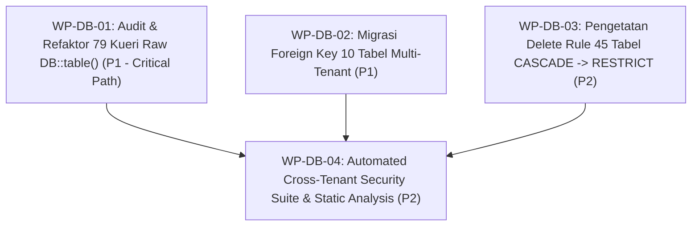

# APEIRON SYSTEMS — REMEDIATION ROADMAP
## Peta Jalan Tindakan Remediasi Terpadu, Estimasi Upaya & Rencana Eksekusi Bertahap

---

| Metadata Dokumen | Keterangan |
| :--- | :--- |
| **Audit Lead** | Principal Enterprise Software Architect (A0) |
| **Status Dokumen** | **POST-DECISION ROADMAP BASELINE (DOMAIN 1)** |
| **Tanggal Pembaruan** | 01 November 2026 |
| **Keputusan Terkait** | DEC-DB-01, DEC-DB-02, DEC-DB-03 (Tercatat di ADR-006) |

---

## 1. Rencana Paket Kerja Remediasi Domain 1 (Remediation Work Packages)

Seluruh tindakan perbaikan di Domain 1 dibagi ke dalam 4 paket kerja (*Work Packages / WP*), terurut berdasarkan prioritas dan analisis dependensi:



---

## 2. Rincian Paket Kerja, Dependensi & Kriteria Verifikasi

### Paket Kerja WP-DB-01: Audit & Refaktor 79 Kueri Mentah `DB::table()`
- **Prioritas:** **P1 (High)**
- **Dependensi:** Tidak ada dependensi skema; dapat dikerjakan langsung pada layer aplikasi.
- **Ruang Lingkup File:**
  - `app/Livewire/Kasir/CreateOrder.php` (baris 392 - `store_credit_accounts`).
  - `app/Modules/Customers/Services/LoyaltyService.php` (baris 33, 39, 48 - `customer_loyalty_accounts`, `loyalty_tiers`).
  - `app/Modules/Sales/Services/ShiftService.php` (baris 737, 742 - `user_stores`).
  - `app/Modules/Sales/Services/ReturnRefundService.php` (baris 537 - `loyalty_ledger`).
  - Serta 74 kueri `DB::table()` lainnya yang menyentuh tabel multi-tenant.
- **Tindakan Teknis:**
  1. Telusuri sumber identifier (`customer_id`, `store_id`, `order_id`).
  2. Suntikkan klausul pengunci tenant:
     ```php
     $tenantId = app(\App\Core\Context\TenantContext::class)->requireTenantId();
     $query->where('tenant_id', $tenantId);
     ```
  3. Untuk entitas inti, refaktor menjadi kueri Eloquent resmi yang memanfaatkan `ScopedToTenant`.
- **Kriteria Verifikasi (*Validation Tests*):**
  - Buat unit/feature test: `tests/Feature/Security/RawQueryTenantIsolationTest.php`.
  - Simulasi request dengan ID milik Tenant 2 pada sesi Tenant 1; kueri wajib menghasilkan `null` / empty collection.

---

### Paket Kerja WP-DB-02: Migrasi Penambahan Foreign Key pada 10 Tabel Multi-Tenant
- **Prioritas:** **P1 (High)**
- **Dependensi:** WP-DB-01 (Kueri aplikasi siap sebelum database diperketat).
- **Hasil Verifikasi Awal Pra-Migrasi (Telah Selesai Diverifikasi):**
  - Seluruh 10 tabel memiliki tipe kolom `bigint(20) unsigned` dan `IS_NULLABLE = NO` (identik dengan `tenants.id`).
  - **Hasil Deteksi Orphan Rows:** **0 baris yatim** pada seluruh 10 tabel:
    - `promotion_reservations`: 0 baris (0 yatim).
    - `accounting_receivable_outboxes`: 0 baris (0 yatim).
    - `approvals`: 0 baris (0 yatim).
    - `accounting_payable_outbox`: 286 baris (0 yatim, seluruhnya valid).
    - `promotion_store_mappings`: 0 baris (0 yatim).
    - `customer_credit_logs`: 0 baris (0 yatim).
    - `promotion_rules`: 0 baris (0 yatim).
    - `promotion_rewards`: 0 baris (0 yatim).
    - `customer_credit_accounts`: 0 baris (0 yatim).
    - `promotion_campaigns`: 0 baris (0 yatim).
- **Tindakan Teknis:**
  Buat migrasi: `database/migrations/2027_03_01_000001_add_tenant_foreign_keys_to_promotions_and_credit_tables.php`:
  ```php
  Schema::table('customer_credit_accounts', function (Blueprint $table) {
      $table->foreign('tenant_id')->references('id')->on('tenants')->onDelete('restrict');
  });
  // Ulangi untuk 9 tabel lainnya...
  ```
- **Kriteria Verifikasi:**
  - Migrasi `migrate` dan `rollback` berjalan bersih tanpa error.
  - Kueri `INFORMATION_SCHEMA` membuktikan seluruh 10 tabel memiliki foreign key aktif.

---

### Paket Kerja WP-DB-03: Pengetatan Delete Rule dari CASCADE ke RESTRICT pada 45 Tabel
- **Prioritas:** **P2 (Medium)**
- **Dependensi:** WP-DB-02.
- **Klasifikasi 45 Tabel Berdasarkan Karakteristik Bisnis:**
  1. **Klaster Finansial, Penggajian & Riwayat Biaya (MANDATORY RESTRICT):**
     `payroll_records`, `payroll_batches`, `payroll_items`, `payroll_periods`, `payroll_adjustments`, `commission_records`, `commission_rules`, `product_cost_histories`, `purchase_requests`, `purchase_request_lines`, `purchase_approval_requests`, `purchase_approval_logs`, `leave_transactions`.
  2. **Klaster Operasional & Master Organisasi (RESTRICT):**
     `employees`, `departments`, `job_titles`, `work_schedules`, `shift_templates`, `attendance_records`, `attendance_breaks`, `overtime_records`, `suppliers`, `customer_groups`, `brands`, `units_of_measure`, `tax_classes`, `devices`, `document_sequences`, `employee_id_sequences`.
  3. **Klaster Lifecycle Tenant (RESTRICT dengan SOP Archival):**
     `tenant_subscriptions`, `tenant_entitlement_overrides`, `user_invitations`, `product_media`, `product_unit_conversions`.
- **Tindakan Teknis:**
  Buat migrasi bertahap untuk melakukan drop foreign key lama dan re-create dengan `onDelete('restrict')`.
- **Kriteria Verifikasi:**
  - Jalankan test `tests/Feature/Database/TenantDeletionIntegrityTest.php`:
    Percobaan `DB::table('tenants')->where('id', $tenantWithSalesOrPayroll->id)->delete()` wajib melempar `QueryException: Integrity constraint violation (1451)`.

---

### Paket Kerja WP-DB-04: Automated Cross-Tenant Security Suite & Static Analysis
- **Prioritas:** **P2 (Medium)**
- **Dependensi:** WP-DB-01, WP-DB-02, WP-DB-03.
- **Tindakan Teknis:**
  1. Terapkan test suite keamanan otomatis: `tests/Feature/Security/CrossTenantIsolationSecurityTest.php`.
  2. Konfigurasikan custom PHPStan / Larastan rule di `phpstan.neon` untuk mendeteksi pemanggilan `DB::table()` yang menyasar tabel multi-tenant tanpa klausa tenant.
- **Kriteria Verifikasi:**
  - CI pipeline `php artisan test` mengeksekusi test suite isolasi dan lulus 100%.
  - `./vendor/bin/phpstan analyse` mengonfirmasi 0 pelanggaran kueri un-scoped.
