# PETA INTEGRASI SISTEM LENGKAP (FULL-SYSTEM INTEGRATION MAP)
## APEIRON SYSTEMS — MODULAR ERP & POS SAAS (MODUL 1–9)
### Topologi Ketergantungan, Aliran Data Lintas-Domain, Kepemilikan Basis Data, Kontrak Servis & Alur Bisnis Kritis

---

## 1. Official Module Inventory & Domain Taxonomy

Apeiron Systems dirancang menggunakan pola **Modular Monolith** dengan batasan domain yang jelas. Masing-masing domain berlokasi di dalam namespace `App\Modules\{Domain}` dan mengekspos *service contracts*, *data transfer objects (DTOs)*, serta *event contracts*.

| Domain Code | Module Name | Root Namespace | Primary Responsibility | Data Store Focus |
| :---: | :--- | :--- | :--- | :--- |
| **M1** | **Core Platform & Multi-Tenancy** | `App\Modules\Auth`, `Users`, `Settings` | Isolasi multi-tenant, otentikasi, perizinan (RBAC), hierarki cabang, perangkat POS, dan log audit aktivitas. | `tenants`, `stores`, `users`, `roles`, `permissions`, `devices`, `activity_logs` |
| **M2** | **POS & Retail Operations** | `App\Modules\Sales` (POS), `App\Livewire\Kasir` | Transaksi penjualan langsung, keranjang belanja, split pembayaran, manajemen meja resto, shift kasir, dan retur kasir. | `orders`, `order_items`, `order_item_modifiers`, `tables`, `shifts`, `shift_handovers`, `parked_carts` |
| **M3** | **Product & Catalog Management** | `App\Modules\Products` | Data induk produk/SKU, kategori berjenjang, merek, modifier groups, satuan ukur (UoM), dan pemetaan kanal (Grab/Gojek). | `products`, `categories`, `brands`, `modifiers`, `modifier_groups`, `units_of_measure`, `channel_product_mappings` |
| **M4** | **Inventory & Warehouse Management** | `App\Modules\Inventory` | Saldo fisik stok, resep bahan baku (BOM), mutasi stok append-only, penyesuaian stok, stock opname fisik, dan transfer cabang. | `ingredients`, `ingredient_stock_balances`, `ingredient_stock_movements`, `product_stock_balances`, `stock_movements`, `stock_opnames`, `stock_transfers` |
| **M5** | **Purchasing & Supplier Management** | `App\Modules\Purchasing` | Pengadaan barang (P2P), direktori pemasok, Purchase Order (PO), penerimaan fisik (GRN), 3-Way Matching faktur, dan retur pembelian. | `suppliers`, `purchase_orders`, `goods_received_notes`, `supplier_invoices`, `supplier_returns`, `accounting_payable_outbox` |
| **M6** | **Sales & Customer Management (CRM & B2B)**| `App\Modules\Customers`, `App\Modules\Sales` | Data induk pelanggan, kelompok pelanggan, plafon kredit B2B, instrumen loyalti/voucher/gift card, quotation, sales order, dan faktur AR. | `customers`, `customer_groups`, `customer_credit_accounts`, `vouchers`, `gift_cards`, `store_credit_accounts`, `sales_orders`, `customer_invoices` |
| **M7** | **Finance & General Ledger** | `App\Modules\Finance` | Buku besar akuntansi ganda (*double-entry*), bagan akun (COA), jurnal akrual otomatis, kas & bank, rekonsiliasi, aset tetap, dan pajak. | `chart_of_accounts`, `journal_entries`, `journal_lines`, `accounting_periods`, `cash_bank_accounts`, `bank_statements`, `expenses`, `fixed_assets`, `tax_ledger_entries` |
| **M8** | **Pricing, Promotion & Loyalty Engine** | `App\Modules\Pricing` | Mesin kalkulasi harga terpadu, promosi dinamis (BxGY, Happy Hour, Bundles), price books, reservasi kuota 2-fase, dan approval diskon. | `promotion_campaigns`, `promotion_rules`, `promotion_rewards`, `promotion_reservations`, `approvals`, `price_lists`, `price_list_items` |
| **M9** | **HR, Employee & Payroll (WIP)** | `App\Modules\HR` | Data induk karyawan terenkripsi, departemen, jabatan, shift kerja, absensi server, cuti, komisi POS, dan penggajian regulasi Indonesia. | `employees`, `departments`, `job_titles`, `employee_tax_profiles`, `employee_bank_accounts`, `employee_bpjs_profiles` |

---

## 2. Mermaid System Architecture Diagram

Diagram berikut mengilustrasikan topologi arsitektur sistem, batasan domain, dan jalur komunikasi antar modul:

```mermaid
graph TD
    subgraph PLATFORM_LAYER["1. Platform & Governance Layer"]
        TenantContext["App\\Core\\Context\\TenantContext\n(Singleton Tenant Context)"]
        StoreResolver["App\\Services\\Context\\StoreResolver\n(Branch/Store Context)"]
        RBAC["App\\Http\\Middleware\\EnsureUserHasRole\n(RBAC Gate System)"]
        AuditTrail["App\\Services\\AuditTrailService\n(trg_activity_logs_immutable)"]
    end

    subgraph CATALOG_LAYER["2. Catalog & Pricing Domain"]
        Products["Product & Variants Master\n(Modul 3 Products)"]
        Modifiers["Modifier Groups & Recipes\n(Modul 3 Catalog)"]
        PricePipeline["UnifiedPricingCalculationPipelineService\n(Modul 8 Pricing Engine)"]
        Promotions["PromotionCampaign & Rules\n(Modul 8 Engine)"]
    end

    subgraph FRONTLINE_LAYER["3. POS & Commerce Domain"]
        Cashier["Livewire Kasir (CreateOrder)\n(Modul 2 POS Operations)"]
        Shifts["Shift & Cash Drawer Reconciliation\n(Modul 2 / Modul 7)"]
        B2BSales["Quotations & Sales Orders\n(Modul 6 B2B Commerce)"]
        SelfOrder["Customer Table Self-Order\n(Modul 2 QR Meja)"]
    end

    subgraph CRM_LAYER["4. Customer & Value Instruments"]
        Customers["Customer & Groups Master\n(Modul 6 CRM)"]
        CreditControl["CustomerCreditService\n(Credit Limits & Hold)"]
        ValueStore["Loyalty, Vouchers & Gift Cards\n(Modul 6 Value Store)"]
    end

    subgraph SUPPLY_LAYER["5. Inventory & Supply Chain"]
        InventoryLedger["InventoryLedgerService\n(Deterministic Lock Ordering)"]
        StockMovements["StockMovements & Balances\n(Authoritative Store Balances)"]
        PurchasingP2P["PurchaseOrder & GRN (P2P)\n(Modul 5 Purchasing)"]
    end

    subgraph FINANCIAL_LAYER["6. Financial Integrity & GL Hub"]
        APOutbox["accounting_payable_outbox\n(Accrued Inbound Goods)"]
        AROutbox["accounting_receivable_outboxes\n(B2B Customer Invoices)"]
        PostingEngine["PostingEngineService\n(Double-Entry GL Rules)"]
        GL["Chart of Accounts & Journals\n(Modul 7 General Ledger)"]
    end

    subgraph WORKFORCE_LAYER["7. Workforce & HR Domain (WIP)"]
        Employees["Employee Master & Identities\n(Modul 9 HR - Phase 1-2)"]
        Backfill["BackfillEmployeesCommand\n(Modul 9 HR - Phase 3)"]
        Attendance["Attendance & Shift Rosters\n(Modul 9 - Planned Phase 4-8)"]
        PayrollPipeline["Indonesian Statutory Payroll\n(Modul 9 - Planned Phase 11-15)"]
    end

    %% Governing Context Flow
    TenantContext --> FRONTLINE_LAYER & SUPPLY_LAYER & FINANCIAL_LAYER & WORKFORCE_LAYER & CRM_LAYER & CATALOG_LAYER
    StoreResolver --> FRONTLINE_LAYER & SUPPLY_LAYER

    %% Commerce & Catalog Interaction
    Products --> PricePipeline
    Modifiers --> PricePipeline
    Promotions --> PricePipeline
    PricePipeline --> Cashier & B2BSales
    Customers --> Cashier & B2BSales
    ValueStore -.->|Voucher Code & Stored Value| Cashier

    %% Stock & Inventory Consumption
    Cashier -->|Deduct Sold SKU & BOM| InventoryLedger
    B2BSales -->|Fulfill Committed Order| InventoryLedger
    PurchasingP2P -->|Receive Goods GRN| InventoryLedger
    InventoryLedger --> StockMovements

    %% Financial Postings via Outbox
    Cashier -->|Cash Transactions| Shifts
    PurchasingP2P -->|Accrue Receiving| APOutbox
    B2BSales -->|Issue Invoices| AROutbox
    APOutbox -->|Idempotent Event Stream| PostingEngine
    AROutbox -->|Idempotent Event Stream| PostingEngine
    Shifts -->|EOD Cash Journal| PostingEngine
    PostingEngine --> GL

    %% HR Integration
    Employees -.->|Staff Commission Source| Cashier
    PayrollPipeline -.->|Payroll Accrual Outbox| PostingEngine
```



---

## 3. Database Ownership & Boundary Map

Apeiron Systems menegakkan model kepemilikan data 4-tingkat (*4-tier ownership model*) untuk menjamin isolasi multi-tenant yang mutlak di level mesin basis data MariaDB/MySQL:

| Tier | Deskripsi Kepemilikan | Penegakan Foreign Key & Constraints | Contoh Tabel |
| :---: | :--- | :--- | :--- |
| **Tier 1 (Platform)** | Entitas tingkat global tanpa `tenant_id`. Hanya dapat diakses oleh sistem atau superadmin platform. | Primary Key murni; isolasi logis. | `tenants`, `plans`, `plan_entitlements`, `permissions`, `provisioning_nonces`, `cache`, `jobs`, `failed_jobs`, `sessions`, `migrations` |
| **Tier 2 (Tenant-Owned)** | Entitas yang dimiliki langsung oleh satu Tenant. Wajib memiliki kolom `tenant_id`. | `FOREIGN KEY (tenant_id) REFERENCES tenants(id) ON DELETE CASCADE`. Model wajib memakai `AssignsTenant` & `ScopedToTenant`. | `stores`, `users`, `roles`, `categories`, `products`, `brands`, `modifiers`, `customers`, `customer_groups`, `vouchers`, `gift_cards`, `suppliers`, `chart_of_accounts`, `journal_entries`, `accounting_periods`, `employees`, `departments`, `job_titles` |
| **Tier 3A (Store-Owned)** | Entitas operasional yang terikat ke cabang spesifik dalam satu tenant. Wajib memiliki `tenant_id` dan `store_id`. | Composite FK: `FOREIGN KEY (tenant_id, store_id) REFERENCES stores(tenant_id, id)`. Model wajib memakai `ScopedToStore`. | `orders`, `order_items`, `payments`, `payment_attempts`, `shifts`, `shift_handovers`, `cash_drawer_movements`, `devices`, `tables`, `stock_balances`, `stock_movements`, `stock_opnames`, `purchase_orders`, `goods_received_notes` |
| **Tier 3B (Sub-Entity Child)** | Entitas detail/baris transaksi yang mewarisi kepemilikan dari header tabel induk. | Composite FK ke header tabel induk `(tenant_id, parent_id)` atau cascade delete. | `order_items`, `order_item_modifiers`, `purchase_order_lines`, `goods_received_note_lines`, `journal_lines`, `expense_lines`, `customer_invoice_lines` |
| **Hybrid (Nullable Store)** | Entitas yang dapat berlaku untuk seluruh cabang (`store_id IS NULL`) atau spesifik untuk cabang tertentu (`store_id = X`). | Composite FK bersyarat atau `DiscountStoreScope`. | `discounts`, `promotion_campaigns`, `price_lists`, `loyalty_ledger`, `product_cost_histories`, `document_sequences`, `accounting_payable_outbox` |

---

## 4. Single Source of Truth (SSOT) per Business Domain

Untuk mencegah duplikasi logika bisnis dan status data ganda (*dual state divergence*), sistem menetapkan satu sumber kebenaran kanonikal untuk setiap domain:

| Domain Bisnis | Sumber Kebenaran Kanonikal (SSOT) | Model Eloquent Terkait | Prosedur Sinkronisasi & Larangan |
| :--- | :--- | :--- | :--- |
| **Saldo Fisik Stok (Store Stock)** | Tabel `stock_balances` (`quantity_on_hand`) | `App\Models\StockBalance` | **Dilarang** menghitung saldo stok dengan melakukan agregasi `SUM()` dari awal pada `stock_movements`. `stock_balances` adalah saldo otoritatif yang dikunci dengan *optimistic lock* (`version`). |
| **Jejak Mutasi Inventori** | Tabel `stock_movements` & `ingredient_stock_movements` | `StockMovement`, `IngredientStockMovement` | Buku besar append-only murni. Dilindungi trigger database `trg_stock_movements_before_update/delete` yang menolak mutasi rekaman historis. |
| **Saldo Poin Loyalti Pelanggan** | Tabel `loyalty_ledger` (Append-Only Hash Chain) | `CustomerLoyaltyAccount`, `LoyaltyLedger` | Kolom `customer_loyalty_accounts.points_balance` disinkronkan otomatis oleh trigger database `trg_loyalty_ledger_sync_account`. Layanan aplikasi **dilarang** memanggil `increment('points_balance')` manual. |
| **Saldo Piutang Pelanggan (AR)** | Tabel `ar_ledger_entries` & `customer_invoices` | `ArLedgerEntry`, `CustomerInvoice` | Kolom `customer_credit_accounts.used_credit_amount` hanya merupakan ringkasan ter-materialisasi. Saldo otoritatif berasal dari kalkulasi faktur terbuka pada `ar_ledger_entries`. |
| **Saldo Utang Pemasok (AP)** | Tabel `ap_ledger_entries` & `supplier_invoices` | `ApLedgerEntry`, `SupplierInvoice` | Seluruh kewajiban pembayaran pemasok wajib berasal dari faktur yang lolos verifikasi 3-way matching pada `supplier_invoices`. |
| **Buku Besar Finansial (GL)** | Tabel `journal_lines` & `journal_entries` | `JournalLine`, `JournalEntry` | Saldo akun berasal dari tabel `account_period_balances` yang di-update oleh `PostingEngineService`. Jurnal `POSTED` terkunci permanen oleh trigger `trg_journal_entries_before_update`. |
| **Harga Jual Transaksi Kasir** | `UnifiedPricingCalculationPipelineService` | `PriceResolutionContextDto`, `CheckoutCalculationBreakdownDto` | Nilai total pesanan **tidak boleh** dipercaya dari kalkulasi klien/frontend, melainkan wajib dihitung ulang secara deterministik di server. |
| **Identitas Staf / Karyawan** | Tabel `employees` (`employee_number`) | `App\Modules\HR\Models\Employee` | Kolom `users.employee_id` warisan masa lalu didegradasi menjadi referensi pembantu. Data induk staf berakar pada entitas `employees`. |

---

## 5. Critical Business Workflows & Data Flows

### 5.1 Alur Kerja Order-to-Cash (POS Retail & F&B Checkout)

```
[1. Kasir / Pelanggan]
        │
        ├── Memilih Menu & Modifier
        ├── Memasukkan Voucher / Kupon Promosi
        ▼
[2. UnifiedPricingCalculationPipelineService]
        │
        ├── 2.1 Resolusi Harga Dasar Produk (CatalogPriceResolverService)
        ├── 2.2 Evaluasi Promosi Dinamis (BxGY, Happy Hour, Paket Bundle)
        ├── 2.3 Evaluasi Diskon Manual & Supervisor Approval Check
        ├── 2.4 Evaluasi Voucher Diskon (VoucherService::reserveVoucher) -> 2-Phase Reservation
        ├── 2.5 Perhitungan Pajak PB1/PPN & Service Charge (Half-Up Rounding)
        ▼
[3. Livewire Kasir (CreateOrder) / TransactionService]
        │
        ├── 3.1 Validasi Idempotency Key unik per tenant
        ├── 3.2 Buka Transaksi Database (DB::transaction)
        ├── 3.3 Verifikasi Shift Kasir Aktif & Status Kasir
        ├── 3.4 Simpan Record Pesanan ke `orders`, `order_items`, `order_item_modifiers`
        ├── 3.5 Pemotongan Stok Bahan Baku & SKU Produk:
        │       └── InventoryLedgerService::recordBatchMovements (Ascending Lock Target Ordering)
        ├── 3.6 Pencatatan Pembayaran ke `payments` & `payment_attempts`:
        │       └── Proteksi Overpayment via trigger `trg_payments_prevent_overpayment`
        ├── 3.7 Jika pembayaran via Store Credit:
        │       └── StoreCreditService::deductCredit (Pessimistic Lock saldo deposit)
        ├── 3.8 Komit Voucher Reservation menjadi 'CONSUMED'
        ├── 3.9 Penerbitan Tiket KDS & Kitchen Printing
        ▼
[4. Post-Checkout Events & Outbox Streaming]
        │
        ├── Mutasi Laci Kasir (`cash_drawer_movements`)
        └── Dispatch Outbox Piutang jika B2B Term (`accounting_receivable_outboxes`)
```

### 5.2 Alur Kerja Procure-to-Pay (P2P Purchasing & Supplier Invoicing)

```
[1. Pembuatan & Rilis PO]
        │
        ├── PurchaseOrderManager membuat draf PO multi-item
        ├── Evaluasi batas persetujuan manajer (`purchase_approval_requests`)
        └── PurchaseOrderService::releasePo() -> Status 'RELEASED'
        ▼
[2. Penerimaan Barang Gudang (Goods Received Note / GRN)]
        │
        ├── Staff gudang mencatat kuantitas barang fisik diterima vs rejected
        ├── GoodsReceivedNoteService::createAndPostGrn()
        ├── 2.1 Tambah Saldo Stok di `stock_balances` & catat `stock_movements` (TYPE: PURCHASE)
        └── 2.2 Tulis akrual penerimaan barang ke `accounting_payable_outbox` (Status: PENDING)
        ▼
[3. Verifikasi Faktur Pemasok (3-Way Matching)]
        │
        ├── SupplierInvoiceManager membandingkan: Tagihan Faktur vs GRN Aktual vs Harga PO
        ├── Evaluasi toleransi selisih kuantitas dan harga (Variance Tolerance Check)
        ├── Jika Cocok: Setujui posting faktur pemasok ke `supplier_invoices` (Status: APPROVED)
        └── Jika Selisih Melampaui Batas: Tahan pembayaran (Status: VARIANCE_HELD)
        ▼
[4. Pembayaran Faktur & Pelunasan Utang (AP Settlement)]
        │
        ├── ApPaymentService mencatat pembayaran kas/bank terhadap faktur pemasok
        ├── Alokasi pembayaran memotong saldo faktur terbuka (`ap_payment_allocations`)
        └── Posting pelunasan utang ke Buku Besar Umum Modul 7 via PostingEngineService
```

### 5.3 Alur Kerja Shift Kasir & Rekonsiliasi EOD (Cash Flow & Settlements)

```
[1. Buka Shift Kasir]
        │
        ├── Kasir memasukkan modal awal kas laci (`opening_balance`)
        ├── Validasi constraint `shifts_one_open_per_user_unique` (Satu shift aktif per kasir/cabang)
        └── Catat mutasi awal ke `cash_drawer_movements` (TYPE: OPENING_FLOAT)
        ▼
[2. Operasional Kasir Transaksional]
        │
        ├── Setiap penerimaan tunai dicatat ke `payments` (METHOD: CASH)
        ├── Pengeluaran kas darurat dicatat via Cash Out (TYPE: EXPENSE/DROP)
        └── Riwayat arus laci kasir terkumpul di `cash_drawer_movements`
        ▼
[3. Tutup Shift Kasir (Shift Handover / Close)]
        │
        ├── Kasir menghitung fisik uang tunai di laci (`closing_balance`)
        ├── Sistem menghitung `expected_cash = opening_balance + total_cash_sales - cash_out`
        ├── Deteksi selisih uang kas laci (`cash_difference = closing_balance - expected_cash`)
        ├── Status shift diubah menjadi 'CLOSED'
        └── Jika terjadi serah terima ke kasir berikutnya, rekam `shift_handovers`
        ▼
[4. Penyelesaian Akhir Hari (End-of-Day / EOD Settlement)]
        │
        ├── EodSettlementService mengagregasi seluruh shift tertutup pada tanggal operasional
        ├── Rekam ringkasan penjualan, non-tunai, dan selisih kas ke `eod_settlements`
        ├── Rekaman EOD terkunci permanen via trigger `trg_eod_settlements_immutable_update`
        └── Terbitkan draf jurnal penutupan kasir ke Modul 7 General Ledger
```

---

## 6. Service & Event Integration Map

Berikut adalah pemetaan antarmuka servis dan mekanisme event/outbox yang menghubungkan antarmodul:

| Producer Service / Event | Consumer Module | Tipe Kontrak | Payload / Data Contract | Mekanisme Eksekusi |
| :--- | :--- | :---: | :--- | :--- |
| `GoodsReceivedNoteService::postGrn()` | Modul 7 (Finance GL) | Outbox Pattern | `accounting_payable_outbox` (GRN ID, Supplier ID, Accrued Amount, Store ID) | Asinkron via Job `FinancialOutboxDispatcherService` |
| `SalesOrderService::confirmOrder()` | Modul 7 (Finance GL) | Outbox Pattern | `accounting_receivable_outboxes` (Invoice ID, Customer ID, Total AR, Due Date) | Asinkron via Job `FinancialOutboxDispatcherService` |
| `TransactionService::processOrder()` | Modul 4 (Inventory) | Direct Service | `InventoryLedgerService::recordBatchMovements(items, storeId, 'SALE')` | Sinkron dalam satu Transaksi Database |
| `TransactionService::processOrder()` | Modul 8 (Pricing) | Direct Service | `PromotionEngineService::consumePromotion(reservationId, orderId)` | Sinkron dalam satu Transaksi Database |
| `ReturnRefundService::processReturn()` | Modul 4 (Inventory) | Direct Service | `InventoryLedgerService::recordBatchMovements(items, storeId, 'RETURN')` | Sinkron dalam satu Transaksi Database |
| `ReturnRefundService::processReturn()` | Modul 6 (Loyalty) | Direct Service | `LoyaltyService::reversalPoints(orderId, refundAmount)` | Sinkron via mutasi `loyalty_ledger` bertipe REVERSAL |
| `PayrollPostingService::postBatch()` | Modul 7 (Finance GL) | Planned Outbox | `financial_event_outboxes` (Batch ID, Gross Pay, PPh 21, BPJS Payable, Net Pay) | *Direncanakan pada Fase 15 Modul 9* |

---

## 7. Analysis: Circular Dependencies, Tight Coupling & Missing Integrations

### 7.1 Evaluasi Ketergantungan Melingkar (Circular Dependency)
- **Hasil Pemeriksaan:** **TIDAK DITEMUKAN** ketergantungan melingkar (*zero circular dependencies*) pada arsitektur inti.
- **Pola Pencegahan:** Alur data bergerak satu arah dari hulu ke hilir:
  $$\text{Catalog/CRM/HR} \longrightarrow \text{Pricing Engine} \longrightarrow \text{POS Execution} \longrightarrow \text{Inventory Ledger} \longrightarrow \text{Outbox} \longrightarrow \text{General Ledger}$$
- Penggunaan pola *Outbox Pattern* (`accounting_payable_outbox`, `accounting_receivable_outboxes`) antara Modul Purchasing/Sales dengan Modul 7 Finance berhasil mengisolasi domain General Ledger sehingga modul operasional tidak melakukan *tight coupling* terhadap model jurnal akuntansi.

### 7.2 Integrasi Terputus / Cacat yang Teridentifikasi (Broken Integrations)
1. **Integrasi Kupon Promosi Kasir (M6/M8 -> M2):**
   - **Lokasi:** `App\Livewire\Kasir\CreateOrder::applyVoucher()` baris 183.
   - **Masalah:** Livewire kasir memanggil method `reserveVoucher()` dengan parameter bernama `customer: $customer`, sedangkan implementasi servis di `App\Modules\Customers\Services\VoucherService` menerima `?int $customerId = null`.
   - **Efek:** Fitur penerapan voucher diskon di kasir melempar exception fatal runtime saat tombol diklik.
2. **Integrasi Form Manajemen Kupon (M8 -> M6):**
   - **Lokasi:** `App\Livewire\Pricing\VoucherManager::save()` baris 145.
   - **Masalah:** Form Livewire mengirim array data dengan kunci `'starts_at'` dan `'expires_at'`, sedangkan model Eloquent `App\Modules\Customers\Models\Voucher` dan tabel `vouchers` menggunakan kolom `'valid_from'` dan `'valid_until'`.
   - **Efek:** Tanggal masa berlaku voucher tidak tersimpan ke basis data.
3. **Integrasi Antarmuka General Ledger (M7):**
   - **Lokasi:** `routes/finance.php`.
   - **Masalah:** Seluruh servis pembukuan dan akrual jurnal telah tersedia secara lengkap, namun rute dan antarmuka manajemen akun (COA) serta jurnal manual belum diintegrasikan ke navigasi aplikasi.

---
*Dokumen ini adalah cetak biru integrasi resmi yang mendefinisikan batas kontrak, aliran data, dan kepemilikan tabel pada sistem Apeiron Systems.*
