# RENCANA REMEDIASI SISTEM LENGKAP (FULL-SYSTEM REMEDIATION PLAN)
## APEIRON SYSTEMS — MODULAR ERP & POS SAAS
### Rencana Tindakan Perbaikan Terprioritisasi, Remediasi MVC Gap, Harmonisasi Arsitektur, Kriteria Penerimaan & Urutan Eksekusi

---

## 1. Executive Summary & Remediation Strategy

Berdasarkan hasil temuan audit teknikal dan fungsional sistem lengkap Apeiron Systems, dokumen ini menyusun **Rencana Remediasi Arsitektur Terstruktur (Structured Architectural Remediation Plan)**. 

### Prinsip Utama Remediasi:
1. **Zero Destructive Mutation:** Tidak melakukan perubahan yang merusak data historis atau melemahkan aturan isolasi database InnoDB yang sudah kokoh.
2. **Prioritas Berbasis Risiko Bisnis & Integritas:** Perbaikan difokuskan terlebih dahulu pada pencegahan kecacatan pelaporan finansial (F-01) dan pencegahan fatal runtime exception pada checkout kasir (F-02, F-03), disusul oleh penutupan vertical MVC gap (F-04), dan harmonisasi modul.
3. **Pemberian Mandat Eksekusi Bertahap:** Rencana ini disusun sebagai kontrak rencana kerja terurut (*phased execution plan*) dengan acceptance criteria dan regression tests yang spesifik untuk setiap tahapan.

---

## 2. Prioritized Findings Register

Seluruh temuan audit diklasifikasikan ke dalam 4 tingkatan prioritas:

| Priority Level | Deskripsi Risiko | Finding IDs Terkait | Target Penyelesaian |
| :---: | :--- | :---: | :---: |
| **P0 (CRITICAL)** | Pelanggaran integritas pelaporan finansial, potensi kecurangan data (*financial truth corruption*), kebocoran multi-tenant. | **F-01** | Segera (Sprint 1 / Hotfix) |
| **P1 (HIGH)** | Alur kerja operasional utama terhenti (*broken core workflow*), runtime exception saat checkout kasir, kegagalan persistensi data voucher. | **F-02, F-03, F-04** | Sprint 1 |
| **P2 (MEDIUM)** | Kerapuhan test runner, celah fine-grained policy authorization, inkonsistensi grouping rute domain, divergensi tipe data moneter. | **F-05, F-06, F-07, F-08** | Sprint 2 |
| **P3 (LOW)** | Kebersihan gaya kode (PSR-12 Pint styling), navigasi dropdown yang terkomentari di layout utama, dokumentasi. | **F-09, F-10** | Sprint 3 |

---

## 3. Detailed Remediation Action Plans

### 3.1 P0: Remediasi Pelanggaran Integritas Finansial (F-01)
- **Finding ID:** `F-01`
- **Komponen Target:** `app/Modules/Reports/Services/DashboardService.php` (baris 150–160, 200–210).
- **Akar Masalah:** Logika fallback pada histogram mingguan dan tahunan menggunakan formula pseudo-random (`round(1200000 + (($idx + 1) * 650000) % 3500000)`) serta nilai default hardcoded `5869064` saat data penjualan aktual kosong.
- **Tindakan Remediasi Teknis:**
  1. Hapus seluruh blok generator angka acak pada percabangan `else`.
  2. Jika agregasi penjualan hari/bulan tertentu bernilai `null` atau `0`, kembalikan nilai moneter riil `0.00` dan count `0`.
  3. Tetapkan tinggi histogram (`height`) minimum berbasis styling yang proporsional (misalnya `0` atau `height = 4` sebagai baseline kosong).
  4. Perbarui antarmuka pengguna `resources/views/dashboard.blade.php` untuk menampilkan visualisasi *empty state* yang elegan ketika sebuah cabang/toko baru belum membukukan transaksi penjualan riil.
- **Kriteria Penerimaan (Acceptance Criteria):**
  - Tenant atau cabang baru dengan 0 pesanan menampilkan total penjualan Rp 0,00 pada seluruh periode histogram (mingguan, bulanan, tahunan).
  - Tidak ada angka acak yang dihasilkan oleh server.
- **Kebutuhan Regression Test:**
  - `tests/Feature/Reports/DashboardMetricsAndButtonsTest.php::test_dashboard_metrics_return_zero_when_no_sales_exist()`.

---

### 3.2 P1: Perbaikan Fatal Runtime Exception pada Checkout Kasir (F-02)
- **Finding ID:** `F-02`
- **Komponen Target:** `app/Livewire/Kasir/CreateOrder.php` (baris 175, 183, 816, 1088, 1243–1245).
- **Akar Masalah:**
  - Baris 175: Memanggil `$this->totalSubtotal()` padahal metode tersebut tidak terdefinisi di kelas Livewire.
  - Baris 183: Memanggil `VoucherService::reserveVoucher()` dengan argumen bernama `customer: $customer`, padahal signature servis adalah `customerId: ?int`.
  - Baris 816: Mengakses properti `$this->subtotal` padahal properti yang benar adalah `$this->cartSubtotal`.
  - Baris 1243–1245: Mengakses key array `card_number`, `reference_number`, `pin` tanpa pengecekan `isset()` / `?? null` pada array `$paymentLegs`.
- **Tindakan Remediasi Teknis:**
  1. Pada `CreateOrder::applyVoucher()`: Ganti pemanggilan `$this->totalSubtotal()` dengan kalkulasi subtotal aktif yang konsisten:
     ```php
     $subtotal = (string) collect($this->cart)->sum(fn ($i) => (float) $i['total_price']);
     ```
  2. Perbaiki pemanggilan `reserveVoucher()`:
     ```php
     app(VoucherService::class)->reserveVoucher(
         code: $code,
         cartUuid: $this->idempotencyKey,
         storeId: (int) ($this->activeStoreId ?? 1),
         customerId: $this->customerId ? (int) $this->customerId : null,
         reservedAmount: (float) ($validation->discountAmount ?? 0.0)
     );
     ```
  3. Pada `CreateOrder::applyManualDiscount()`: Kembalikan referensi ke `$this->cartSubtotal`:
     ```php
     $subtotal = (float) $this->cartSubtotal;
     ```
  4. Amankan penguraian array split payment dengan `array_key_exists` atau default array helper.
- **Kriteria Penerimaan (Acceptance Criteria):**
  - Kasir dapat memasukkan kode voucher yang valid tanpa memicu error runtime; voucher tereservasi dengan benar.
  - Pengajuan diskon manual dengan otorisasi supervisor PIN berhasil memotong total belanja tanpa melempar exception.
- **Kebutuhan Regression Test:**
  - `tests/Feature/Domain2/PosVoucherAndDiscountApplicationTest.php`.

---

### 3.3 P1: Sinkronisasi Atribut Tanggal Form Voucher & Skema Basis Data (F-03)
- **Finding ID:** `F-03`
- **Komponen Target:** `app/Livewire/Pricing/VoucherManager.php` (baris 121–122, 144–145) dan `app/Modules/Customers/Models/Voucher.php`.
- **Akar Masalah:** Komponen Livewire `VoucherManager` membaca dan menyimpan tanggal berlaku voucher ke properti `'starts_at'` dan `'expires_at'`, sedangkan tabel `vouchers` dan model `Voucher` mendefinisikan kolom `'valid_from'` dan `'valid_until'`.
- **Tindakan Remediasi Teknis:**
  1. Pada `VoucherManager::edit()`:
     ```php
     $this->startsAt = $voucher->valid_from ? Carbon::parse($voucher->valid_from)->format('Y-m-d\TH:i') : now()->format('Y-m-d\TH:i');
     $this->expiresAt = $voucher->valid_until ? Carbon::parse($voucher->valid_until)->format('Y-m-d\TH:i') : now()->addDays(30)->format('Y-m-d\TH:i');
     ```
  2. Pada `VoucherManager::save()`:
     ```php
     $data = [
         // ...
         'valid_from' => Carbon::parse($this->startsAt),
         'valid_until' => Carbon::parse($this->expiresAt),
         // ...
     ];
     ```
  3. Alternatif pelengkap: Tambahkan accessor/mutator alias pada model `App\Modules\Customers\Models\Voucher` untuk mencegah regresi jika ada kode pihak ketiga yang memanggil `starts_at` / `expires_at`:
     ```php
     public function getStartsAtAttribute(): ?Carbon { return $this->valid_from; }
     public function getExpiresAtAttribute(): ?Carbon { return $this->valid_until; }
     ```
- **Kriteria Penerimaan (Acceptance Criteria):**
  - Pembuatan voucher baru melalui UI berhasil menyimpan tanggal `valid_from` dan `valid_until` ke dalam basis data.
  - Tanggal kedaluwarsa voucher dimuat kembali secara presisi saat modal edit dibuka.
- **Kebutuhan Regression Test:**
  - `tests/Feature/Customers/LoyaltyAndValueInstrumentsTest::test_voucher_manager_livewire_persists_validity_dates()`.

---

### 3.4 P1: Penutupan Vertical MVC Gap Modul 7 General Ledger (F-04)
- **Finding ID:** `F-04`
- **Komponen Target:** `routes/finance.php`, `app/Modules/Finance/Controllers/*`, `resources/views/finance/*`.
- **Akar Masalah:** Ketersediaan logic backend yang sangat matang pada Modul 7 (`PostingEngineService`, `ChartOfAccountService`, `AccountingPeriodService`, `FixedAssetService`, `TaxLedgerService`) tidak diimbangi oleh ketersediaan antarmuka pengguna interaktif (saat ini hanya berupa 1 halaman statis ringkasan).
- **Tindakan Remediasi Teknis:**
  1. Buat rute-rute manajemen akuntansi terstruktur di `routes/finance.php`:
     - `Route::get('/finance/chart-of-accounts', ChartOfAccountManager::class)->name('finance.coa.index');`
     - `Route::get('/finance/journal-entries', JournalEntryManager::class)->name('finance.journals.index');`
     - `Route::get('/finance/accounting-periods', AccountingPeriodManager::class)->name('finance.periods.index');`
     - `Route::get('/finance/bank-reconciliation', BankReconciliationWorkbench::class)->name('finance.reconciliation.index');`
  2. Implementasikan komponen Livewire berbasis desain sistem DevDojo:
     - `ChartOfAccountManager`: Hirarki akun parent/child, status aktif, tipe akun PSAK.
     - `JournalEntryManager`: Pembuatan draf jurnal manual dengan validasi balance Debit == Credit secara reaktif di antarmuka sebelum diposting.
     - `AccountingPeriodManager`: Transisi status periode `OPEN -> CLOSED -> LOCKED` dengan otorisasi ketat level Owner/Finance Lead.
  3. Perbarui sub-navigasi finansial (`resources/views/finance/partials/sub-nav.blade.php`) untuk menghubungkan seluruh modul ke dalam satu tata kelola terintegrasi.
- **Kriteria Penerimaan (Acceptance Criteria):**
  - Manajer Keuangan dapat membuat akun baru pada Chart of Accounts melalui UI.
  - Pengguna dapat membuat jurnal penyesuaian manual yang seimbang dan mempostingnya ke Buku Besar Umum secara aman.
- **Kebutuhan Regression Test:**
  - `tests/Feature/Finance/FinanceGeneralLedgerUiWorkflowTest.php`.

---

### 3.5 P2: Harmonisasi Routing Domain Promosi (F-05)
- **Finding ID:** `F-05`
- **Komponen Target:** `routes/customers.php` dan buat `routes/pricing.php`.
- **Tindakan Remediasi Teknis:**
  1. Buat file baru `routes/pricing.php` yang didaftarkan pada `routes/web.php`.
  2. Pindahkan rute `/pricing/promotions` dan `/pricing/vouchers` dari `routes/customers.php` ke `routes/pricing.php`.
  3. Pindahkan rute operasi meja resto (`tables/{table}/*`) dari `routes/customers.php` ke `routes/sales.php` atau `routes/web.php` sesuai domain POS Table Management.
- **Kriteria Penerimaan:** Struktur file rute mencerminkan batas-batas domain modular monolith secara bersih.

---

### 3.6 P2: Standardisasi Tipe Data Moneter & Aturan Pembulatan (F-06)
- **Finding ID:** `F-06`
- **Komponen Target:** Skema dan DTO integrasi antara POS (`orders`) dan GL (`journal_lines`).
- **Tindakan Remediasi Teknis:**
  1. Pastikan seluruh DTO yang menghubungkan POS ke General Ledger mengonversi nilai integer IDR menjadi representasi `string` atau `decimal(18, 2)` terformat sebelum diproses oleh `PostingEngineService`.
  2. Tegakkan penggunaan helper pembulatan resmi `round($amount, 2, PHP_ROUND_HALF_UP)` atau fungsi `bcscale(2)` pada seluruh alokasi diskon dan perhitungan pajak.
- **Kriteria Penerimaan:** Tidak ada selisih penny atau rounding drift saat transaksi POS kasir diposting ke Buku Besar GL.

---

### 3.7 P2: Pembuatan Fine-Grained Policy Classes (F-07)
- **Finding ID:** `F-07`
- **Komponen Target:** `app/Policies/`.
- **Tindakan Remediasi Teknis:**
  1. Buat class Policy resmi:
     - `CustomerPolicy.php` (`viewAny`, `view`, `create`, `update`, `delete`, `merge`).
     - `PaymentPolicy.php` (`viewAny`, `view`, `create`, `refund`).
     - `OrderReturnPolicy.php` (`viewAny`, `view`, `create`, `approve`).
     - `ModifierPolicy.php` (`viewAny`, `create`, `update`, `delete`).
  2. Daftarkan pemetaan model-ke-policy di `AuthServiceProvider` atau biarkan auto-discovery Laravel menanganinya.
- **Kriteria Penerimaan:** Setiap aksi mutasi pada data pelanggan, pembayaran, dan retur terotorisasi melalui Gate/Policy.

---

### 3.8 P2: Stabilisasi Konfigurasi Test Runner Lokal (F-08)
- **Finding ID:** `F-08`
- **Komponen Target:** Panduan pengembang dan skrip pengujian lokal.
- **Tindakan Remediasi Teknis:**
  1. Dokumentasikan instruksi eksekusi pengujian lokal yang aman agar selaras dengan GitHub Actions CI:
     - Wajib menjalankan `php artisan test --parallel --exclude-group=chaos` untuk mengisolasi transaksi database per worker proses.
  2. Tambahkan pemeriksaan otomatis pada `tests/TestCase.php` untuk mendeteksi apakah skema awal telah siap sebelum menjalankan pengujian serial.
- **Kriteria Penerimaan:** Test suite lokal dapat dieksekusi berulang kali tanpa memicu deadlock atau kerusakan tabel `yovel_pos_test`.

---

## 4. Recommended Execution Sequence (Phased Roadmap)

Remediasi direkomendasikan untuk dieksekusi dalam 3 iterasi bertahap:

```mermaid
flowchart LR
    subgraph SPRINT1["Fase 1: Hotfix & Core Stability (Sprint 1)"]
        F01["F-01: Bersihkan Mock Data DashboardService"]
        F02["F-02: Perbaiki Fatal Calls CreateOrder.php"]
        F03["F-03: Sinkronisasi Atribut VoucherManager"]
    end

    subgraph SPRINT2["Fase 2: MVC Completion & Routing (Sprint 2)"]
        F04["F-04: Bangun UI Interactive GL Modul 7"]
        F05["F-05: Rapikan routes/pricing.php"]
        F07["F-07: Buat Customer & Payment Policies"]
    end

    subgraph SPRINT3["Fase 3: Harmonization & Modul 9 Continuation (Sprint 3)"]
        F06["F-06: Standardisasi Desimal Moneter"]
        F10["F-10: Jalankan Laravel Pint"]
        M9Continue["Lanjutkan Modul 9 (Fase 4: Multi-Cabang & Roster)"]
    end

    SPRINT1 --> SPRINT2 --> SPRINT3
```



---

## 5. Acceptance Criteria Checklist Sebelum Validasi Staging

Sistem dinyatakan siap beralih status menjadi **`READY FOR STAGING VALIDATION`** jika dan hanya jika seluruh kriteria berikut terpenuhi:

- [ ] Seluruh pemanggilan metode di `App\Livewire\Kasir\CreateOrder` terdefinisi dan bebas dari error runtime.
- [ ] Voucher yang dibuat via `VoucherManager` menyimpan tanggal kedaluwarsa secara presisi ke kolom `valid_from` dan `valid_until`.
- [ ] `DashboardService` tidak lagi menginjeksi angka penjualan acak buatan saat data historis bernilai 0.
- [ ] Analisis statis `vendor/bin/phpstan analyse --memory-limit=1G --no-progress` menghasilkan **0 errors**.
- [ ] Linting `vendor/bin/pint --test` menghasilkan **0 style violations**.
- [ ] Suite pengujian otomatis `php artisan test --parallel --exclude-group=chaos` menghasilkan **100% Pass (0 failed, 0 errors)**.
- [ ] Modul 9 tetap terjaga pada status WIP yang rapi tanpa merusak fungsionalitas Modul 1 sampai Modul 8.

---
*Dokumen rencana remediasi ini disusun sebagai panduan teknis resmi bagi tim pengembang dan implementor Apeiron Systems.*
