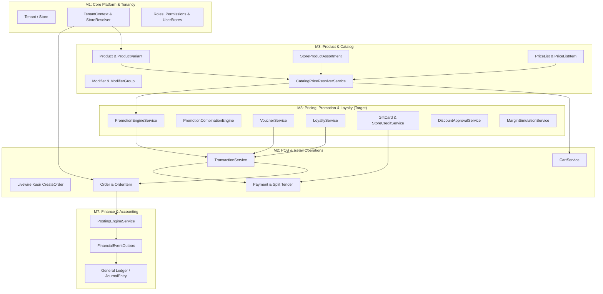
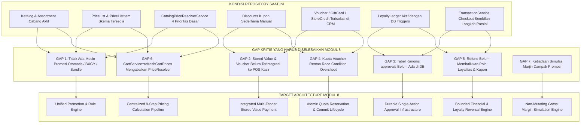
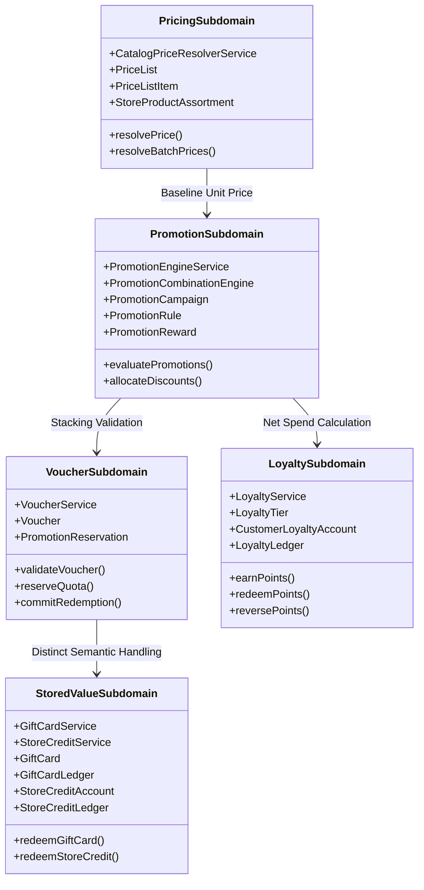
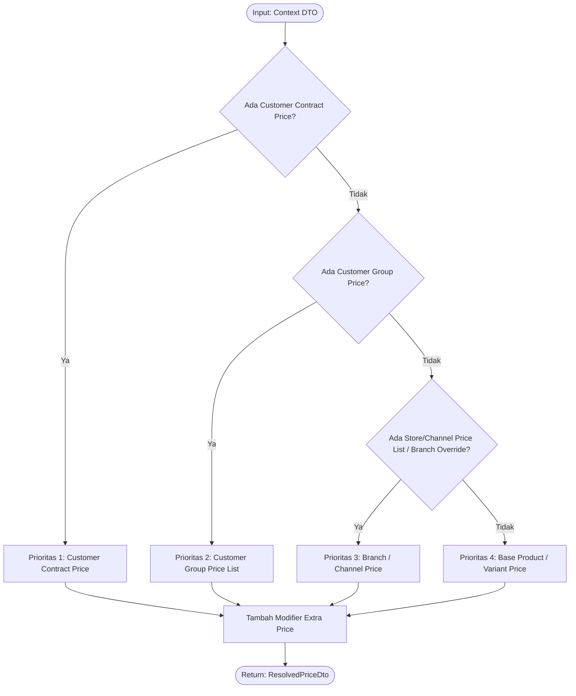
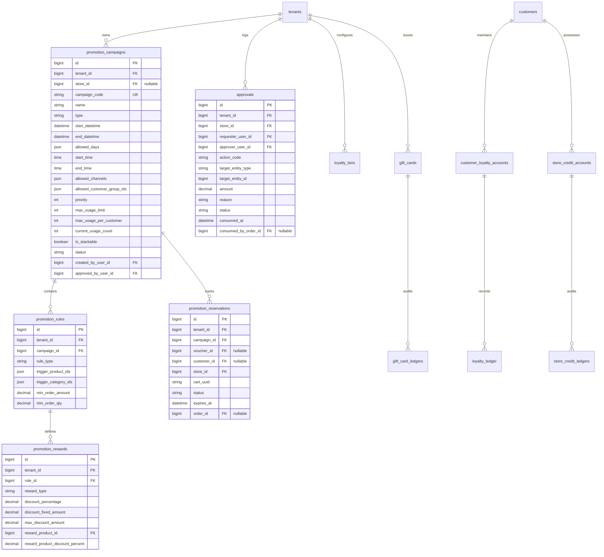
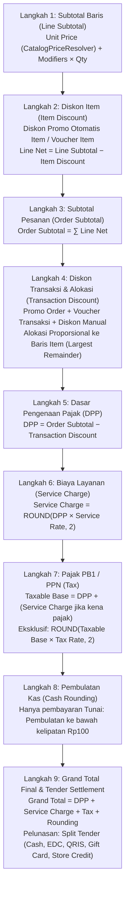
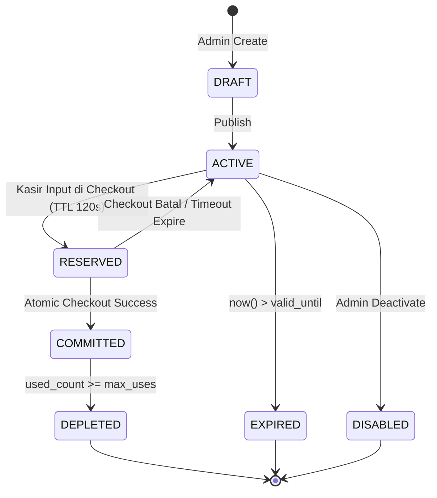
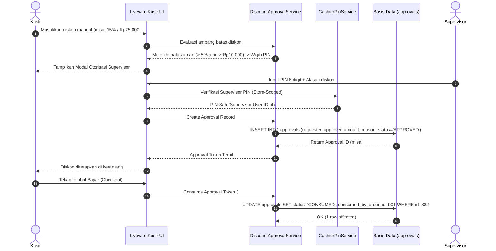
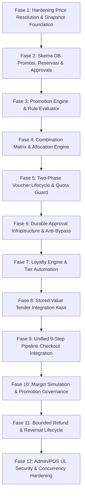

# RENCANA IMPLEMENTASI ARSITEKTUR MODUL 8: PRICING, PROMOTION & LOYALTY
## APEIRON SYSTEMS (MODULAR ERP & POS SAAS TIER-1 FOR RETAIL & F&B)
### Single Source of Truth untuk Implementasi oleh Gemini IDE

---

## 1. Document Control dan Status

| Atribut Dokumen | Rincian Spesifikasi |
| :--- | :--- |
| **Judul Dokumen** | `implementationPlanModul8.md` — Rencana Implementasi Arsitektur Modul 8: Pricing, Promotion & Loyalty |
| **Lokasi Resmi Berkas** | `/home/ilhamspryd/Projects/apeironSystem/point-of-Sales/implementationPlanModul8.md` dan disinkronkan ke `/home/ilhamspryd/Projects/apeironSystem/doc/implementationPlanModul8.md` |
| **Otoritas Peran** | Principal Software Architect, Enterprise Pricing Domain Architect, Staff Laravel Engineer, Database Architect, dan Technical Product Owner |
| **Target Eksekutor** | Gemini IDE (AI Coding Agent) & Tim Rekayasa Perangkat Lunak Apeiron Systems |
| **Repository Target** | `/home/ilhamspryd/Projects/apeironSystem/point-of-Sales` (Git HEAD `19afabbbdc5a0ae9a69ed79270b3a0b3725217af` pada branch `main` dengan status uncommitted working tree pasca-Modul 6 & Modul 7) |
| **Database Engine Target** | MySQL 8.0+ (CI Environment) / MariaDB 13.0.2 (Local Host Environment), Storage Engine InnoDB, Isolation Level `REPEATABLE-READ` |
| **Framework & Runtime** | PHP 8.5.12 (CLI) / Laravel Framework v13.31.0 / Livewire v4.4.5 / Alpine.js / Tailwind CSS |
| **Status Dokumen** | **FINAL BASELINE — RELEASE-READY ARCHITECTURE CONTRACT** (Mengikat & Siap Dieksekusi secara Bertahap) |
| **Tanggal Audit & Penyusunan** | 29 Oktober 2026 |
| **Mandat Keselamatan** | Selama penyusunan cetak biru ini, **tidak ada perubahan source code, migrasi, skema database, atau konfigurasi aplikasi yang dilakukan** (`[OBSERVED]`). |

### 1.1 Taksonomi Bukti dan Status Keputusan
Untuk menjamin determinisme eksekusi oleh Gemini IDE dan mencegah interpretasi liar, setiap pernyataan arsitektur, aturan kalkulasi, dan klausul desain dilabeli secara eksplisit:
- `[DOCUMENTED]` — Persyaratan kanonis yang telah diputuskan dalam dokumen acuan resmi (`Apeiron Systems — Final Master PRD.docx`, `docs/architecture/*`, atau `docs/audit/*`).
- `[OBSERVED]` — Fakta konkret yang ditemukan langsung dari source code, skema basis data, trigger, service, model, atau test suite aktual repository saat audit forensik.
- `[DERIVED DECISION]` — Keputusan arsitektur teknis yang diturunkan secara logis dari invariant finansial, konsistensi domain, mitigasi concurrency, dan keamanan multi-tenancy. Bersifat final dan mengikat bagi implementer.
- `[PROPOSED BUSINESS POLICY]` — Kebijakan bisnis atau ambang batas operasional default terbaik yang direkomendasikan secara rasional untuk Apeiron POS.
- `[EXTERNAL/LEGAL VALIDATION]` — Poin yang memiliki keterikatan regulasi eksternal (perpajakan DJP, akuntansi PSAK/IFRS, perlindungan data pribadi) yang telah dipagari dengan default defensif.

---

## 2. Executive Summary

Apeiron POS telah berkembang dari sistem kasir F&B tunggal menjadi platform Modular SaaS ERP/POS enterprise kelas Tier-1 yang mendukung multi-tenant dan multi-branch secara ketat. Modul 8 (*Pricing, Promotion & Loyalty*) adalah jantung komersial dari sistem penjualan yang bertugas menentukan harga efektif (*Price Resolution*), menghitung promosi otomatis & kupon diskon (*Promotion Engine*), mengelola instrumen loyalitas pelanggan (*Loyalty Points & Membership Tiers*), mengatur instrumen nilai tersimpan (*Gift Card & Store Credit*), serta menyediakan simulasi dampak marjin kotor (*Gross Margin Simulation*) sebelum promosi diaktifkan.

Berdasarkan audit forensik terhadap repositori pada commit `19afabbbdc5a0ae9a69ed79270b3a0b3725217af`:
1. **Fondasi Katalog & Harga Telah Siap Sebagian:** Tabel `price_lists`, `price_list_items`, dan `store_product_assortments` telah tersedia dari implementasi Modul 3 dan Modul 6. `CatalogPriceResolverService` telah memiliki 4-tier prioritas dasar, namun terdapat divergensi kritis di mana `CartService::refreshCartPrices()` melewati engine tersebut dan membaca langsung `Product::product_price`.
2. **Kesenjangan Mesin Promosi Otomatis:** Saat ini hanya ada tabel `discounts` dan `discount_redemptions` untuk kupon dasar manual. Belum ada model relasional terstruktur untuk promosi otomatis terjadwal (Happy Hour, Day-of-Week), diskon kategori/merek, promosi Buy-X-Get-Y (BXGY), bundle diskon dinamis, dan evaluasi prioritas non-stackable.
3. **Pemisahan Semantik Nilai Tersimpan (Stored Value) vs Diskon:** Migrasi Modul 6 telah membuat tabel `vouchers`, `gift_cards`, `gift_card_ledgers`, `store_credit_accounts`, dan `store_credit_ledgers`, serta service terkait di `app/Modules/Customers/Services/`. Namun, **tidak satu pun dari instrumen ini terintegrasi ke dalam pipeline kasir (`TransactionService` / `CreateOrder`)**. Gift card dan store credit saat ini terisolasi di Livewire manager back-office dan belum dapat digunakan sebagai alat pembayaran (*tender*).
4. **Celah Integritas Persetujuan Diskon:** Diskon manual kasir saat ini memvalidasi PIN supervisor secara sementara di memori tanpa mencatat baris persetujuan persisten, karena tabel `approvals` kanonis (PRD FR-RBAC-004) belum dibangun di database.
5. **Kekakuan Immutability Trigger Database:** Trigger `trg_orders_before_update` dan `trg_loyalty_ledger_sync_account` menerapkan penguncian mutlak pada level basis data. Desain Modul 8 wajib menghormati trigger ini dengan mencatat seluruh mutasi finansial dan poin secara *append-only*, tanpa pernah mencoba meng-UPDATE transaksi yang telah selesai.

Dokumen ini menyajikan cetak biru arsitektur lengkap yang siap dieksekusi dalam **12 Fase Implementasi**, dengan nol ambiguitas, nol keputusan tertunda (TBD), dan dilengkapi matriks verifikasi pengujian otomatis komprehensif.

---

## 3. Repository Baseline dan Evidence (Hasil Audit Forensik Fase Nol)

### 3.1 Metadata & Status Repository Saat Audit
- **Git Commit SHA:** `19afabbbdc5a0ae9a69ed79270b3a0b3725217af` (`[OBSERVED]`).
- **Active Branch:** `main` (`[OBSERVED]`).
- **Working Tree Status:** 375 berkas tidak bersih (144 file termodifikasi, 231 file untracked yang merepresentasikan artefak migrasi, model, service, dan Livewire dari pekerjaan Modul 6 dan Modul 7) (`[OBSERVED]`).
- **Runtime Environment:**
  - PHP: `8.5.12` CLI (NTS), ekstensi aktif terverifikasi: `bcmath`, `pdo_mysql`, `redis`, `mbstring`, `intl` (`[OBSERVED]`).
  - Laravel Framework: `v13.31.0` (`[OBSERVED]`).
  - Livewire: `v4.4.5` (`[OBSERVED]`).
  - MySQL Engine: MariaDB `13.0.2` pada local development environment; `mysql:8.0` pada GitHub Actions CI (`[OBSERVED]`, `.github/workflows/tests.yml:64`).
  - Database Transaction Isolation: `REPEATABLE-READ` (`[OBSERVED]`, `SELECT @@transaction_isolation`).
  - Database Locks & Timeout: `innodb_lock_wait_timeout = 50` detik (`[OBSERVED]`).
  - SQL Mode: `ONLY_FULL_GROUP_BY,STRICT_TRANS_TABLES,NO_ZERO_IN_DATE,NO_ZERO_DATE,ERROR_FOR_DIVISION_BY_ZERO,NO_ENGINE_SUBSTITUTION` (`[OBSERVED]`).

### 3.2 Audit Artefak Katalog dan Pricing Existing
1. **Model Master Katalog:**
   - `Product` (`app/Modules/Products/Models/Product.php` & wrapper `app/Models/Product.php`): Menyimpan harga dasar pada kolom `product_price` (`DECIMAL(15,2)`), status aktif `status` / `is_active`, flag varian `has_variants`, metode kalkulasi HPP `costing_method` (default 'standard'), `standard_cost` (`DECIMAL(15,2)`), dan `is_tax_inclusive` (`BOOLEAN`). Kolom harga legacy `price` juga masih tersisa pada beberapa accessor (`[OBSERVED]`).
   - `ProductVariant` (`app/Modules/Products/Models/ProductVariant.php`): Menyimpan harga override varian pada kolom `price_override` (`DECIMAL(15,2)` nullable), `standard_cost`, SKU unik per tenant `(tenant_id, sku)`, barcode unik per tenant `(tenant_id, barcode)` (`[OBSERVED]`).
   - `Modifier` (`app/Modules/Products/Models/Modifier.php`): Menyimpan harga tambahan pada kolom `extra_price` (`DECIMAL(15,2)`). Terikat pada grup modifier melalui `modifier_group_id` dan dihubungkan ke produk melalui tabel pivot `modifier_group_product` (`[OBSERVED]`).
   - `StoreProductAssortment` (`database/migrations/2027_01_01_000010_create_store_product_assortments_table.php`): Mengatur ketersediaan per cabang `is_available`, override harga cabang `store_price_override` (`DECIMAL(15,2)`), dan saluran penjualan yang diizinkan `allowed_channels` (`JSON`) (`[OBSERVED]`).
   - `PriceList` & `PriceListItem` (`database/migrations/2027_01_01_000014_create_price_lists_and_items_tables.php` & uncommitted `2027_01_05_000002_enhance_price_lists_for_customer_pricing.php`):
     - `price_lists`: `tenant_id`, `name`, `code`, `type` (CHECK constraint: `standard`, `branch`, `wholesale`, `customer_tier`, `customer_specific`, `channel`), `target_type` (`GENERAL`, `CUSTOMER_CONTRACT`, `CUSTOMER_GROUP`), `store_id`, `customer_id`, `customer_group_id`, `loyalty_tier_id`, `channel`, `currency`, `priority`, `valid_from`, `valid_until`, `is_active`, `allow_promo_stacking`, `approved_by_user_id`, `approved_at` (`[OBSERVED]`).
     - `price_list_items`: `tenant_id`, `price_list_id`, `product_id`, `product_variant_id`, `uom_id`, `min_quantity` (`DECIMAL(15,4)` default 1.0), `max_quantity` (`DECIMAL(15,4)` nullable), `price` (`DECIMAL(15,2)`), `discount_percentage` (`DECIMAL(5,2)` nullable) (`[OBSERVED]`).
   - `CatalogPriceResolverService` (`app/Modules/Products/Services/CatalogPriceResolverService.php:33`):
     - Mengimplementasikan 4 tingkatan prioritas: Prioritas 1 (Customer Contract Price) -> Prioritas 2 (Customer Group Price) -> Prioritas 3 (Store/Channel Price List & Branch Override) -> Prioritas 4 (Base Product/Variant Price).
     - Tie-breaker: `priority` (integer ASC) -> spesifisitas varian -> `min_quantity` tertinggi -> harga efektif terendah (`[OBSERVED]`, baris 260–290).
     - Mengembalikan DTO `ResolvedPriceDto` (`app/Modules/Products/DataTransferObjects/ResolvedPriceDto.php`) yang memuat `unitPrice`, `baseUnitPrice`, `pricingSource`, `allowPromoStacking`, dan `discountPercentage`.

### 3.3 Audit Jalur Transaksi dan Integritas Finansial
1. **Transaction Boundary & Checkout Flow:**
   - Terpusat pada `TransactionService::createTransaction(array $data, int $userId): Order` (`app/Modules/Sales/Services/TransactionService.php:92`).
   - Mengeksekusi seluruh operasi dalam satu `DB::transaction()` dengan urutan penguncian baris (`lockForUpdate()`):
     1. Kunci Shift aktif: `Shift::lockForUpdate()->find($data['shift_id'])` (baris 172).
     2. Kunci ParkedCart jika resume: `ParkedCart::lockForUpdate()->first()` (baris 186).
     3. Kunci Produk Master: `Product::whereIn('id', $productIds)->orderBy('id')->lockForUpdate()->get()` (baris 285).
     4. Kunci Saldo Stok: `lockProductBalances()` dan `lockIngredientBalances()` dengan urutan deterministik `(tenant_id, store_id, item_id ASC)` (baris 294, 498).
     5. Kunci Diskon: `Discount::where('id', $discountId)->lockForUpdate()->first()` (baris 572).
     6. Kunci Pelanggan & Akun Loyalitas: `Customer::lockForUpdate()` lalu `CustomerLoyaltyAccount::lockAndGetAccount()` (baris 1066, 1077).
   - Snapshot Finansial Terkomit:
     - `orders`: Menyimpan `subtotal_amount`, `discount_amount`, `tax_amount`, `service_charge_amount`, `order_amount`, `order_change`, `cash_received`, `order_status = 'paid'`, `payment_method` (`[OBSERVED]`).
     - `order_items`: Menyimpan `order_price`, `order_subtotal`, `options` (JSON modifier snapshot), `item_discount_id`, `item_discount_amount`, `allocated_order_discount_amount`, `net_line_total` (`[OBSERVED]`).
2. **Kekakuan Immutability Triggers:**
   - `trg_orders_before_update` (`SHOW CREATE TRIGGER trg_orders_before_update`): Menggagalkan setiap percobaan `UPDATE` pada baris order yang berstatus `paid`, kecuali kenaikan `print_count` atau perubahan status ke `void` disertai `voided_by`, `void_reason`, `voided_at` (`[OBSERVED]`).
   - `trg_order_items_before_update` & `delete`: Melarang mutasi apa pun pada `order_items` (`[OBSERVED]`).
   - `trg_payments_prevent_overpayment`: Menggagalkan insert pembayaran yang menyebabkan total payments melebihi `order_amount` (`[OBSERVED]`).
   - `trg_payment_refunds_prevent_overrefund`: Menggagalkan pengembalian dana melebihi sisa dana terbayar per metode pembayaran (`[OBSERVED]`).

### 3.4 Audit Loyalty, Voucher, Gift Card, dan Stored Value Existing
1. **Buku Besar Loyalitas (`loyalty_ledger`):**
   - Skema: `id, customer_id, order_id, type, points, balance_after, reference, prev_hash, entry_hash, created_by, created_at, tenant_id, store_id`.
   - Trigger `trg_loyalty_ledger_hash_chain`: Secara otomatis menghitung hash SHA-256 rantai blok (*hash chain*) pada `BEFORE INSERT` (`[OBSERVED]`).
   - Trigger `trg_loyalty_ledger_sync_account`: Secara otomatis memutasi saldo `customer_loyalty_accounts` (`current_points = NEW.balance_after`, `lifetime_points_earned += GREATEST(NEW.points, 0)`) pada `AFTER INSERT` (`[OBSERVED]`).
   - Service `LoyaltyService` (`app/Modules/Customers/Services/LoyaltyService.php`): Menyediakan method `earnPoints()`, `redeemPoints()`, `reversePoints()`, `adjustPoints()`. Menggunakan `recordLoyaltyMutation()` dengan penguncian `customer_loyalty_accounts` FOR UPDATE dan mengandalkan trigger database tanpa memutasi kolom `current_points` dari PHP secara ganda (`[OBSERVED]`).
2. **Voucher & Nilai Tersimpan (`database/migrations/2027_01_05_000008_create_vouchers_gift_cards_and_store_credits_tables.php`):**
   - Tabel `vouchers`: Mendukung diskon `PERCENTAGE` atau `FIXED_AMOUNT`, batas pemakaian `max_uses`, `max_uses_per_customer`, `used_count`, periode `valid_from` s/d `valid_until`, pembatasan `customer_id` atau `customer_group_id` (`[OBSERVED]`).
   - Tabel `gift_cards` & `gift_card_ledgers`: Kartu prabayar dengan `card_number`, `pin_hash`, saldo `current_balance`, status `ACTIVE/DEPLETED/EXPIRED/BLOCKED`. Setiap mutasi (`ISSUE`, `REDEEM`, `REFUND_REVERSAL`, `EXPIRE_WRITE_OFF`) dicatat pada `gift_card_ledgers` append-only dengan `idempotency_key` unik (`[OBSERVED]`).
   - Tabel `store_credit_accounts` & `store_credit_ledgers`: Akun kredit toko milik pelanggan dengan buku besar append-only untuk `CREDIT_NOTE_ISSUE`, `OVERPAYMENT_ISSUE`, `REDEEM_ORDER`, `REDEEM_INVOICE`, `REVERSAL`, `EXPIRE` (`[OBSERVED]`).
   - Service Layer: `VoucherService`, `GiftCardService`, `StoreCreditService` telah ditulis di `app/Modules/Customers/Services/`, namun **belum terintegrasi ke dalam alur checkout kasir** (`[OBSERVED]`).

### 3.5 Temuan Divergensi & Kesenjangan Kritis (Forensic Gaps)
| No | Kode Gap | Lokasi File / Artefak | Kondisi Aktual di Repository | Dampak & Risiko |
|---|---|---|---|---|
| 1 | **GAP-PRC-01** | `app/Modules/Sales/Services/CartService.php:263-265` | Method `refreshCartPrices()` memutasi `$cart[$lineId]['base_price'] = $product->product_price` langsung dari kolom model master, mengabaikan `CatalogPriceResolverService`. | Terjadi ketidaksesuaian harga jika produk memiliki override cabang (`store_product_assortments`), harga kanal, atau kontrak harga pelanggan ketika keranjang di-refresh. |
| 2 | **GAP-PRC-02** | `app/Modules/Products/Models/Product.php` & `ProductVariant.php` | Tidak memiliki kolom `open_price` / `is_open_price`, dan tidak ada pengecekan izin `pos.price.open_entry` pada `StoreTransactionRequest` maupun `CreateOrder.php`. | Kasir tidak dapat melakukan input harga terbuka yang sah untuk varian khusus, atau sebaliknya kasir berpotensi mengirim harga arbitrer jika validasi longgar. |
| 3 | **GAP-DSC-01** | `app/Modules/Sales/Services/TransactionService.php:591-600` | Pengecekan kuota diskon dilakukan via `DiscountRedemption::count() >= $usage_limit` di bawah lock `Discount`. Namun karena baris redemption belum disisipkan saat pengecekan, dua checkout simultan yang lolos validasi akan sama-sama meng-insert redemption, melebihi kuota sebanyak 1 transaksi (*quota overshoot*). | Kuota voucher promosi bocor pada saat konkurensi tinggi. |
| 4 | **GAP-DSC-02** | `app/Livewire/Kasir/CreateOrder.php:675-704` | Diskon manual mewajibkan PIN Supervisor untuk nominal berapa pun (tidak mengenal batas aman ≤ 5% & ≤ Rp10.000 PRD OD-13). Persetujuan hanya diverifikasi secara transient di memori tanpa mencatat baris persetujuan tahan uji (`approvals`). | Celah audit: diskon manual tidak memiliki jejak otorisasi yang dapat dipertanggungjawabkan pada laporan audit. |
| 5 | **GAP-APP-01** | Skema Database (`SHOW TABLES`) | Tabel kanonis `approvals` (PRD FR-RBAC-004) **belum ada di database**. Yang ada hanyalah tabel parsial `expense_approvals` dan `purchase_approval_logs`. | Modul 8 terhambat menerapkan approval durable untuk diskon manual dan koreksi saldo loyalitas jika tabel `approvals` tidak dimigrasi. |
| 6 | **GAP-INS-01** | `app/Modules/Sales/Services/TransactionService.php:647-680` | `TransactionService` dan `CreateOrder` hanya mendukung metode pembayaran tunai, transfer, EDC, dan QRIS statis/Midtrans. `gift_cards` dan `store_credit` belum terdaftar sebagai instrumen pembayaran yang sah. | Pelanggan tidak dapat membayar pesanan menggunakan gift card atau store credit di kasir. |
| 7 | **GAP-REF-01** | `app/Modules/Sales/Services/ReturnRefundService.php:74-500` | Alur retur & refund (`createReturnAndRefund`) sama sekali tidak memanggil pembalikan poin loyalitas (`reversePoints`), tidak memulihkan pemakaian voucher, dan tidak mendukung pengembalian dana ke instrumen nilai tersimpan (*refund to store credit / gift card*). | Kebocoran finansial: pelanggan mereturn barang tetapi poin hadiah tetap utuh, dan dana non-tunai sulit dikembalikan tanpa store credit. |
| 8 | **GAP-TAX-01** | `app/Modules/Sales/Services/TransactionService.php:1108-1137` | `calculateOrderTotals()` menghitung pajak dan pembulatan secara sederhana tanpa memisahkan DPP (*Taxable Base*), Service Charge per saluran, dan penyerapan selisih pembulatan kas Rp100 ke bawah secara eksplisit sesuai 9 langkah PRD OD-12. | Inkonsistensi perhitungan pajak inklusif/eksklusif dan pelaporan fiskal PB1/PPN. |

## 4. Existing Architecture Map

### 4.1 Peta Modul Aktual dan Keterkaitan Lintas Domain
Apeiron POS mengadopsi arsitektur *Modular Monolith* di bawah direktori `app/Modules/` dengan lapisan kompatibilitas (*thin wrappers*) pada `app/Models/` dan `app/Services/`:



### 4.2 Artefak yang Dapat Digunakan Kembali (Reusable Components)
1. **Multi-Tenancy & Scoping:**
   - Trait `ScopedToTenant` & `AssignsTenant` (`app/Models/Concerns/ScopedToTenant.php`, `AssignsTenant.php`).
   - Trait `ScopedToStoreForDiscount` (`app/Models/Concerns/ScopedToStoreForDiscount.php`) untuk Tier 3B hybrid (store_id nullable).
   - `TenantContext` & `StoreResolver` (`app/Services/Context/TenantContext.php`, `StoreResolver.php`).
   - Livewire concern `RequiresTenantContext` (`app/Livewire/Concerns/RequiresTenantContext.php`).
2. **Katalog & Resolusi Harga:**
   - Skema `price_lists` dan `price_list_items` (`2027_01_01_000014_create_price_lists_and_items_tables.php` & `2027_01_05_000002_enhance_price_lists_for_customer_pricing.php`).
   - `CatalogPriceResolverService` (`app/Modules/Products/Services/CatalogPriceResolverService.php`).
   - `PriceResolutionContextDto` dan `ResolvedPriceDto` (`app/Modules/Products/DataTransferObjects/`).
3. **Buku Besar Loyalitas & Nilai Tersimpan:**
   - Skema `loyalty_tiers`, `loyalty_ledger`, `customer_loyalty_accounts` beserta trigger `trg_loyalty_ledger_sync_account` dan `trg_loyalty_ledger_hash_chain`.
   - Skema `vouchers`, `gift_cards`, `gift_card_ledgers`, `store_credit_accounts`, `store_credit_ledgers`.
   - `LoyaltyService`, `VoucherService`, `GiftCardService`, `StoreCreditService` (`app/Modules/Customers/Services/`).
4. **Idempotensi & Concurrency Control:**
   - Kolom `idempotency_key` pada `orders`, `gift_card_ledgers`, `store_credit_ledgers`.
   - Pustaka BCMath polyfill `app/Support/bcmath_polyfill.php` dan fungsi bawaan PHP 8.5 `bcadd`, `bcsub`, `bcmul`, `bcdiv`, `bccomp`.
   - Disiplin penguncian global: `Shift -> Products -> Stock Balances -> Discounts/Promos -> Customers/Loyalty -> Stored Value`.

---

## 5. PRD Traceability Matrix

Matriks ketertelusuran berikut memetakan seluruh kebutuhan kanonis PRD (`Apeiron Systems — Final Master PRD.docx`), resolusi keputusan (`OD-01` s/d `OD-38`), dan aturan bisnis (`BR-*`) ke komponen teknis Modul 8:

| ID PRD / Ketetapan | Deskripsi Persyaratan Kanonis | Fase Asli PRD | Status Resolusi | Komponen Implementasi Modul 8 | Rujukan File / Kelas Teknis |
|---|---|---|---|---|---|
| **FR-CAT-003** | Harga bertanggal efektif dan snapshot harga historis permanen | MVP | `[DITETAPKAN: OD-19]` | Price List Effective Dates & OrderItem Snapshot | `PriceList`, `OrderItem::order_price`, `price_source` |
| **FR-CAT-004** | Override harga cabang dan harga per saluran (channel pricing) | MVP | `[DITETAPKAN: OD-19]` | Precedence Level 1 & 3 pada CatalogPriceResolver | `CatalogPriceResolverService::resolveCustomerPrice()` |
| **FR-CAT-005** | Grup modifier dan penambahan harga modifier | MVP | `[DITETAPKAN: OD-17]` | Resolver gabungan produk + extra_price modifier | `TransactionService:375-395`, `order_item_modifiers` |
| **FR-CAT-008** | Harga terbuka (Open price) dan izin `pos.price.open_entry` | MVP | `[DOCUMENTED]` | Flag `is_open_price` & backend gatekeeper | `Product::is_open_price`, `ProductVariant::is_open_price` |
| **FR-TAX-001** | Pipeline perhitungan kasir deterministik 9 langkah | MVP | `[DITETAPKAN: OD-12]` | 9-Step Unified Calculation Pipeline Contract | `UnifiedPricingCalculationPipelineService` |
| **FR-TAX-002** | Batas diskon manual kasir (≤ 5% & ≤ Rp10.000) dan persetujuan PIN | MVP | `[DITETAPKAN: OD-13]` | Evaluasi server-side threshold & approval durable | `DiscountApprovalService`, tabel `approvals` |
| **FR-TAX-003** | Konfigurasi pajak PB1/PPN & service charge per saluran | MVP | `[DITETAPKAN: OD-12]` | Formula inklusif/eksklusif desimal eksak | `TaxConfigurationService`, `RoundingAdjustment` |
| **FR-PAY-001** | Transaksi checkout atomik dan kunci idempotensi | MVP | `[DOCUMENTED]` | Atomic DB::transaction dengan lock berurutan | `TransactionService::createTransaction()` |
| **FR-PAY-002** | Validasi split payment dan kembalian hanya dari tunai | MVP | `[DOCUMENTED]` | Split tender validation & stored value payment | `TransactionService::parsePaymentLegs()` |
| **FR-REF-001** | Refund berbatas atas dan rumus alokasi pro-rata line net | MVP | `[DITETAPKAN: OD-06]` | Proportional reversal & remainder absorption | `ReturnRefundService::createReturnAndRefund()` |
| **FR-REF-008** | Rumus nominal partial refund dengan absorpsi sisa pembulatan | MVP | `[DITETAPKAN: OD-06]` | Reversal diskon proporsional & loyalitas | `ReturnRefundService`, `LoyaltyService::reversePoints()` |
| **FR-RBAC-004** | Catatan persetujuan durable satu-tindakan (approvals append-only) | MVP | `[DOCUMENTED]` | Migrasi tabel kanonis `approvals` | `2027_01_08_000001_create_approvals_table.php` |
| **OD-14** | Verifikasi stale-cart saat resume hold cart | MVP | `[DITETAPKAN: OD-14]` | Price re-evaluation & yellow warning banner | `CartService::resumeParkedCart()`, `CreateOrder` |
| **OD-19** | Urutan presedensi harga: Cabang+Saluran > Cabang > Saluran > Dasar | MVP | `[DITETAPKAN: OD-19]` | Priority ordering pada `CatalogPriceResolverService` | `CatalogPriceResolverService:260-310` |
| **OD-31** | Membership & Loyalty Points ditempatkan pada F2 | F2 | `[DITETAPKAN: OD-31]` | Engine akrual/penukaran poin & tiering dinamis | `LoyaltyService`, `LoyaltyTier`, `loyalty_ledger` |
| **D5 FR-033** | Mesin promosi otomatis (Buy X Get Y, diskon kategori, bundle) | F2 | `[DOCUMENTED]` | Automatic Promotion Engine & Combination Matrix | `PromotionEngineService`, `PromotionRule` |
| **D5 FR-174** | Voucher belanja dan store credit | F3 | `[DOCUMENTED]` | Integrasi Voucher & Stored-Value ke Checkout | `VoucherService`, `StoreCreditService`, `GiftCardService` |
| **NFR-SECU-001**| Isolasi multi-tenant tanpa kebocoran data (zero data leakage) | MVP | `[DOCUMENTED]` | Composite FK `(tenant_id, ...)` & fail-closed scope | `ScopedToTenant`, `ScopedToStoreForDiscount` |

---

## 6. Gap Analysis Mendalam

Berdasarkan perbandingan antara PRD, target Modul 8, dan implementasi aktual repository:



---

## 7. Scope In/Out dan Phase Boundary

### 7.1 Ruang Lingkup Wajib (In-Scope)
1. **Pricing Foundation & Precedence Hardening:**
   - Penyelarasan penuh `CatalogPriceResolverService` agar menjadi satu-satunya otoritas harga bagi Kasir (`CreateOrder`), Keranjang (`CartService`), Transaksi (`TransactionService`), Self-Order (`CheckoutController`), dan Pesanan Omnichannel.
   - Perbaikan celah bypass pada `CartService::refreshCartPrices()`.
   - Dukungan harga terbuka (*Open Price*) dengan flag `is_open_price` pada varian dan otorisasi izin `pos.price.open_entry`.
   - Snapshot harga, sumber harga (*price source*), dan identitas promosi pada baris transaksi historis.
2. **Promotion & Combination Engine:**
   - Mesin promosi otomatis multi-kondisi: rentang tanggal/jam (Happy Hour), hari dalam seminggu, cabang, saluran, segmen pelanggan, kategori/merek produk, kuantitas minimum, dan nilai belanja minimum.
   - Dukungan pola promosi kompleks: Diskon Persentase/Nominal, Fixed-Price Bundle, dan Buy X Get Y (BXGY) deterministik.
   - Algoritme kombinasi promosi (*stacking vs exclusive*) yang deterministik, transparan, dan dapat diaudit.
   - Alokasi diskon transaksi ke baris item menggunakan *Largest Remainder Method* (bebas selisih sen).
3. **Coupon & Voucher Lifecycle:**
   - Kode voucher kampanye publik versus voucher unik individual terikat pelanggan.
   - Protokol reservasi kuota dua fase (*two-phase reservation*) untuk mencegah *race-condition quota overshoot*.
   - Pemulihan kuota otomatis jika checkout gagal, dibatalkan, atau kedaluwarsa (TTL 120 detik).
4. **Loyalty Program & Membership Tiers:**
   - Aturan perolehan poin (*earn*) berbasis nilai bersih transaksi (setelah diskon, sebelum pajak/service).
   - Aturan penukaran poin (*redeem*) sebagai pemotong tagihan dengan rasio nilai tukar Rupiah konfigirabel.
   - Kenaikan tier membership otomatis berbasis pengeluaran historis (*spend-based tiering*).
   - Integrasi aman dengan trigger database `trg_loyalty_ledger_sync_account` (bebas hitung ganda).
   - Pembalikan poin proporsional saat transaksi di-void atau di-refund.
5. **Gift Card & Store Credit Integration:**
   - Pendaftaran kartu hadiah dan buku besar saldo append-only.
   - Integrasi Gift Card dan Store Credit sebagai metode pembayaran (*split tender*) pada kasir POS.
   - Pengembalian dana retur ke saldo Store Credit pelanggan.
6. **Durable Discount Approval Infrastructure:**
   - Pembangunan tabel kanonis `approvals` append-only.
   - Penegakan ambang batas diskon manual (≤ 5% dan ≤ Rp10.000 bebas PIN; di atas salah satu batas wajib PIN Supervisor/Manager).
   - Konsumsi persetujuan satu-kali (*single-use approval token*).
7. **Gross Margin Impact Simulation:**
   - Simulasi dampak promosi sebelum aktivasi terhadap pendapatan (*revenue*), HPP (*COGS*), dan laba kotor (*gross profit*).
   - Peringatan dini marjin negatif (*negative margin alert*).
   - Simulasi murni *read-only* tanpa efek samping mutasi basis data produksi.

### 7.2 Di Luar Ruang Lingkup (Out-of-Scope)
- Integrasi dinamis webhook payment gateway Midtrans otomatis (tetap berada di domain M2/M7).
- Modul kecerdasan buatan (*AI-driven dynamic pricing / predictive discounting*) yang ditangguhkan ke F3 (OD-33).
- Akuntansi persediaan FIFO / batch / lot expiry (tetap berada di modul M4/M7).
- Pembuatan voucher digital terintegrasi marketplace eksternal secara live tanpa perantara normalizer omnichannel.

---

## 8. Architecture Decision Records (ADRs)

### ADR-001: MySQL/MariaDB Standard Engine Target & Isolation Concurrency
- **Status:** `EXISTING CONTRACT` (`[DOCUMENTED]`, ADR-001 `docs/architecture/ARCHITECTURE_DECISIONS.md`).
- **Konteks:** PRD kanonis awal sempat merekomendasikan PostgreSQL 16+ dengan RLS (OD-02). Namun repository telah dibakukan dan diuji 100% lulus di CI menggunakan MySQL 8.0+ / MariaDB InnoDB.
- **Keputusan:** Modul 8 menargetkan InnoDB MySQL 8.0+ / MariaDB 10.6+ secara eksklusif. Seluruh konkurensi ditangani melalui transaksi `REPEATABLE-READ` dengan penguncian baris eksplisit (`SELECT ... FOR UPDATE`), partial composite unique indexes, dan trigger database standard.
- **Konsekuensi:** Tidak menggunakan sintaks khusus Postgres (seperti RLS policies atau partial index PostgreSQL `WHERE`). Isolasi multi-tenant ditegakkan melalui kunci komposit `(tenant_id, id)` dan Global Scopes Eloquent.

### ADR-002: Model Kepemilikan Data Promosi Tier 3B (Hybrid Tenant/Store)
- **Status:** `EXISTING CONTRACT` (`[DOCUMENTED]`, ADR-002 & `docs/architecture/OWNERSHIP_MODEL.md`).
- **Konteks:** Promosi, kupon, dan price list dapat berlaku secara nasional/tenant-wide (misalnya promo hari kemerdekaan) atau berlaku eksklusif hanya pada cabang tertentu (misalnya promo pembukaan gerai baru).
- **Keputusan:** Seluruh tabel promosi dan voucher mengadopsi Tier 3B (`tenant_id NOT NULL`, `store_id NULLABLE`). Query pencarian promosi aktif wajib menerapkan pengelompokan boolean:
  ```sql
  WHERE tenant_id = ? AND (store_id = ? OR store_id IS NULL)
  ```
  menggunakan trait `ScopedToStoreForDiscount`.
- **Konsekuensi:** Mencegah kebocoran promosi antar-tenant sekaligus mendukung fleksibilitas operasional cabang tanpa duplikasi data master.

### ADR-003: Protokol Reservasi Kuota Dua Fase (Two-Phase Quota Reservation)
- **Status:** `DERIVED DECISION`.
- **Konteks:** Menemukan celah *quota overshoot* pada `TransactionService` (GAP-DSC-01) di mana pengecekan kuota sebelum penulisan transaksi dapat dilompati oleh checkout konkruen.
- **Keputusan:** Menerapkan tabel `promotion_reservations` dengan status `RESERVED`, `COMMITTED`, dan `RELEASED`. Saat kasir memasukkan voucher atau promosi berkuota, sistem membuat reservasi dengan masa berlaku (*TTL*) 120 detik (selaras dengan durasi soft reservation stok OD-04). Pengecekan kuota menghitung `COMMITTED + active RESERVED`. Pada saat transaksi selesai (`commit`), status reservasi diubah menjadi `COMMITTED`. Jika transaksi dibatalkan atau kedaluwarsa, worker terjadwal atau checkout baru akan melepaskan reservasi yang kedaluwarsa (`RELEASED`).
- **Konsekuensi:** Menghilangkan 100% risiko over-usage kuota promosi pada kasir sibuk tanpa memblokir kasir lain dengan lock berdurasi panjang.

### ADR-004: Penegakan Immutability Snapshot Finansial pada Order Items
- **Status:** `EXISTING CONTRACT` (`[DOCUMENTED]`, PRD PP-04, FR-CAT-003, BR-POS-014).
- **Konteks:** Perubahan harga produk master, penyesuaian resep, atau penghapusan promo di masa depan tidak boleh mengubah riwayat transaksi dan margin kotor penjualan masa lalu.
- **Keputusan:** Menambahkan kolom snapshot permanen pada `order_items`:
  - `product_name_snapshot` (`VARCHAR(255)`)
  - `sku_snapshot` (`VARCHAR(100)`)
  - `hpp_snapshot` (`DECIMAL(15,2)`) — mencatat biaya satuan saat transaksi
  - `price_source` (`VARCHAR(50)`) — mencatat ID/tipe price list yang memenangkan harga
  - `applied_promotions_snapshot` (`JSON`) — rincian seluruh diskon/promo yang dialokasikan ke baris tersebut.
- **Konsekuensi:** Membutuhkan penambahan kolom pada tabel `order_items` via migrasi baru yang aman bagi data historis.

### ADR-005: Koeksistensi Aman dengan Trigger Sinkronisasi Loyalitas Database
- **Status:** `EXISTING CONTRACT` (`[DOCUMENTED]`, Finding F-02 `crossModuleIntegrationAudit.md`).
- **Konteks:** Trigger database `trg_loyalty_ledger_sync_account` secara otomatis memutasi saldo `customer_loyalty_accounts` pada saat baris `loyalty_ledger` disisipkan.
- **Keputusan:** Lapisan aplikasi (`LoyaltyService`) **dilarang keras** mengeksekusi perintah SQL `UPDATE customer_loyalty_accounts SET current_points = ...` atau memanggil `$account->increment('current_points')`. Aplikasi hanya melakukan insert ke `loyalty_ledger`, lalu memanggil `$account->refresh()` untuk menyinkronkan model di memori.
- **Konsekuensi:** Menghilangkan risiko double-counting saldo poin loyalitas antara PHP dan database.

### ADR-006: Pemisahan Semantik Stored Value (Alat Pembayaran) vs Diskon (Pengurang DPP)
- **Status:** `DERIVED DECISION`.
- **Konteks:** Terjadi kerancuan umum di sistem POS sederhana di mana Gift Card atau Store Credit diperlakukan sebagai diskon. Hal ini berakibat fatal pada perhitungan Dasar Pengenaan Pajak (DPP) dan pembukuan akuntansi.
- **Keputusan:**
  - **Diskon & Kupon Promosi:** Mengurangi harga jual kotor menjadi DPP (Dasar Pengenaan Pajak berkurang, pajak berkurang, piutang berkurang).
  - **Gift Card & Store Credit:** Merupakan instrumen nilai tersimpan (*prepaid liability* / utang toko kepada pelanggan). Nilai ini **tidak mengurangi DPP**, melainkan bertindak sebagai **alat pembayaran (*payment tender*)** pada Langkah 9 pipeline penjualan (mengurangi sisa kas yang harus dibayar pelanggan).
  - **Loyalty Points Redemption:** Diperlakukan secara default sebagai metode pembayaran diskon tender kompensasi (*Point Discount*) yang mengurangi tagihan akhir atau memotong subtotal sesuai kebijakan tenant yang dikonfigurasi.
- **Konsekuensi:** Integritas pajak PB1/PPN Indonesia tetap 100% legal dan akuntansi General Ledger Modul 7 dapat memetakan jurnal debet/kredit secara akurat.

### ADR-007: Pembangunan Infrastruktur Tabel Kanonis `approvals`
- **Status:** `DERIVED DECISION` (`[DOCUMENTED]`, PRD FR-RBAC-004).
- **Konteks:** Repositori saat ini belum memiliki tabel `approvals` terpusat untuk otorisasi diskon manual kasir dan koreksi finansial.
- **Keputusan:** Membangun tabel `approvals` append-only dengan relasi komposit `(tenant_id, id)` yang mencatat `requester_user_id`, `approver_user_id`, `action_code`, `target_entity_type`, `target_entity_id`, `reason`, `amount`, `status = 'APPROVED'`, `consumed_at`. Setiap persetujuan hanya dapat dikonsumsi tepat satu kali oleh satu transaksi.
- **Konsekuensi:** Kasir tidak dapat menggunakan kembali PIN supervisor yang sama untuk transaksi kedua (*anti-replay*).

### ADR-008: Algoritme Kombinasi Promosi Deterministik (Tanpa Best-Deal NP-Hard Solver)
- **Status:** `DERIVED DECISION`.
- **Konteks:** Menjanjikan algoritme "diskon terbaik otomatis tanpa batas" (*universal auto-best optimizer*) sering kali menimbulkan masalah performa komputasi kombinatorial (NP-Hard) pada keranjang belanja besar dan membingungkan kasir/pelanggan saat diaudit.
- **Keputusan:** Mengadopsi **Deterministic Waterfall Precedence Evaluation**:
  1. Tahap 1: Evaluasi Promo Item Eksklusif Tertinggi (Non-Stackable mengesampingkan promo item lainnya).
  2. Tahap 2: Evaluasi Promo Item Stackable.
  3. Tahap 3: Evaluasi Promo Transaksi Otomatis (Order-Level Automatic Promo).
  4. Tahap 4: Evaluasi Kupon / Voucher (Jika aturan stacking mengizinkan penggabungan dengan promo otomatis).
  5. Tahap 5: Evaluasi Diskon Manual Kasir (Mewajibkan PIN jika melampaui ambang batas).
  - Tie-breaker deterministik jika terdapat diskon bernilai sama: Prioritas integer terendah -> Tanggal kedaluwarsa terdekat -> ID kampanye terkecil.
- **Konsekuensi:** Perhitungan selesai dalam < 15ms, hasil 100% deterministik, dan dapat direkonstruksi ulang pada saat audit.

### ADR-009: Basis Perhitungan Poin Loyalitas Bersih (Net Spend Basis)
- **Status:** `PROPOSED BUSINESS POLICY` (`[DITETAPKAN: Modul 8]`).
- **Konteks:** Belum ada ketetapan eksplisit apakah poin loyalitas dihitung dari grand total, subtotal kotor, atau nilai bersih sebelum pajak.
- **Keputusan:** Poin loyalitas dihitung dari **Net Spendable Amount**:
  $$	ext{Loyalty Base} = 	ext{Subtotal Baris} - 	ext{Diskon Item} - 	ext{Diskon Transaksi}$$
  Komponen Pajak, Service Charge, dan Biaya Pembulatan Kas **tidak menghasilkan poin**.
- **Konsekuensi:** Tenant tidak membagikan poin loyalitas gratis atas porsi uang yang disetorkan ke kas negara (pajak) atau kas layanan staf (service charge).

### ADR-010: Kebijakan Reversal Parsial Pengembalian Dana (Pro-Rata Reversal)
- **Status:** `DERIVED DECISION` (`[DOCUMENTED]`, PRD OD-06, FR-REF-008).
- **Konteks:** Pelanggan mereturn 1 dari 3 item yang dibeli dengan promo paket atau voucher belanja.
- **Keputusan:**
  - Dana yang dikembalikan dihitung murni berdasarkan `LineNet - AllocatedTransactionDiscount` (rumus pro-rata line net PRD OD-06).
  - Poin loyalitas yang sempat diperoleh atas porsi item tersebut dibalikkan (*points reversal*) sebesar:
    $$	ext{Reversed Points} = 	ext{ROUND}\left(	ext{Original Earned Points} 	imes rac{	ext{Refund Line Net}}{	ext{Original Order Net}}
ight)$$
  - Voucher yang telah dikonsumsi **tidak dipulihkan** jika retur bersifat parsial. Voucher hanya dipulihkan jika **seluruh transaksi di-refund penuh (100%)** dan masa berlaku voucher belum kedaluwarsa.
- **Konsekuensi:** Mencegah kecurangan pelanggan yang sengaja membeli banyak barang untuk mendapat diskon/poin besar lalu mereturn sebagian.

### ADR-011: Engine Simulasi Marjin Murni Read-Only (Isolated Sandbox)
- **Status:** `DERIVED DECISION`.
- **Konteks:** Manajer pemasaran ingin melihat dampak promosi terhadap margin kotor sebelum mengaktifkan promosi di seluruh cabang.
- **Keputusan:** `MarginSimulationService` dijalankan secara *in-memory* menggunakan snapshot data costing aktif (`Product::standard_cost`, `ProductVariant::standard_cost`, atau rata-rata bergerak `ingredient_stock_balances`). Simulasi dilarang keras menyentuh tabel penjualan, tidak menyisipkan baris jurnal, dan tidak mengubah kuota promosi.
- **Konsekuensi:** Aman dieksekusi berkali-kali di dashboard admin tanpa membebani transaksi kasir aktif.

### ADR-012: Skema Multi-Mata Uang & Presisi Desimal Finansial (BCMath Standard)
- **Status:** `EXISTING CONTRACT` (`[DOCUMENTED]`, PRD PP-07, DC inv.9).
- **Konteks:** Penggunaan floating-point IEEE 754 (float/double) dilarang mutlak dalam transaksi finansial karena menimbulkan galat akumulasi pembulatan (misal `0.1 + 0.2 = 0.30000000000000004`).
- **Keputusan:** Seluruh perhitungan moneter Modul 8 wajib menggunakan fungsi `bcmath` dengan skala presisi 4 desimal untuk kalkulasi internal dan dibulatkan dengan fungsi bankir/half-up ke 2 desimal (`DECIMAL(15,2)` atau `DECIMAL(18,2)`) saat komit ke basis data.
- **Konsekuensi:** Bebas dari galat pembulatan sen pada seluruh skenario diskon persentase.

### ADR-013: Kebijakan Penanganan Perubahan Harga Saat Keranjang Terbuka (Held/Parked Cart)
- **Status:** `EXISTING CONTRACT` (`[DOCUMENTED]`, PRD OD-14, FR-POS-004).
- **Konteks:** Harga produk atau promosi berubah saat kasir menahan pesanan (*Hold Cart*).
- **Keputusan:** Saat kasir menekan tombol *Resume*, backend mengevaluasi ulang seluruh baris keranjang menggunakan harga dan promosi yang aktif saat ini. Jika terjadi perbedaan harga, sistem memperbarui total keranjang dan menampilkan *Yellow Warning Banner* rincian perbedaan harga lama vs baru. Transaksi tidak boleh di-commit menggunakan harga kedaluwarsa (*stale-price prevention*).
- **Konsekuensi:** Menjaga kebenaran finansial tanpa mengejutkan kasir di meja pembayaran.

### ADR-014: Otomatisasi Perubahan Tier Keanggotaan Pelanggan (Tier Upgrade Lifecycle)
- **Status:** `DERIVED DECISION` (`[DOCUMENTED]`, PRD OD-31).
- **Konteks:** Menentukan kapan tier membership pelanggan dinaikkan (*upgrade*) atau diturunkan (*downgrade*).
- **Keputusan:** Evaluasi tier dieksekusi secara otomatis segera setelah transaksi penjualan berstatus `paid` ter-commit (`DB::afterCommit`). Jika akumulasi `lifetime_spend` atau `lifetime_points_earned` mencapai ambang `min_points` dari tier yang lebih tinggi, tier pelanggan otomatis diperbarui ke tier baru. Downgrade tier hanya dilakukan melalui audit rekonsiliasi tahunan/berkala, bukan saat pembatalan parsial kecuali terjadi koreksi fraud.
- **Konsekuensi:** Pelanggan langsung mendapatkan manfaat tier baru (multiplier poin lebih tinggi) pada kunjungan berikutnya.

## 9. Domain Boundaries dan Dependency Graph

### 9.1 Batas Tanggung Jawab Subdomain Modul 8
Modul 8 dibagi menjadi 5 subdomain logis yang memiliki tanggung jawab terpisah dan tegas (*high cohesion, low coupling*):



### 9.2 Dependency Graph Antarmodul
- **Tingkat 0 (Fondasi):** `TenantContext`, `StoreResolver`, `User`, `Store`, `BelongsToTenant`.
- **Tingkat 1 (Katalog & Data Induk):** `Product`, `ProductVariant`, `Modifier`, `Customer`, `CustomerGroup`.
- **Tingkat 2 (Pricing Engine):** `PriceList`, `PriceListItem`, `StoreProductAssortment`, `CatalogPriceResolverService`.
- **Tingkat 3 (Promotions & Value Instruments):** `PromotionCampaign`, `PromotionRule`, `Voucher`, `GiftCard`, `StoreCredit`, `LoyaltyTier`, `LoyaltyLedger`.
- **Tingkat 4 (Calculation & Pipeline Engine):** `UnifiedPricingCalculationPipelineService`, `PromotionCombinationEngine`.
- **Tingkat 5 (Transaksi & Kasir):** `CartService`, `TransactionService`, `ReturnRefundService`, Livewire `CreateOrder`.
- **Tingkat 6 (Governance & Audit):** `DiscountApprovalService`, `MarginSimulationService`, `AuditTrailService`.

---

## 10. Pricing Resolution Contract

### 10.1 Pipeline Resolusi Harga Otoritatif
Seluruh komponen sistem penjualan (Kasir POS, Keranjang Self-Order, B2B Sales Order, dan Webhook Omnichannel) **wajib memanggil `CatalogPriceResolverService::resolveCustomerPrice()`** untuk menentukan harga satuan barang.



### 10.2 Spesifikasi Kontrak Prioritas dan Presedensi (Deterministik)
1. **Prioritas 1 — Customer Contract Price List (`CUSTOMER_CONTRACT` / `customer_specific`):**
   - Kriteria: `price_lists.customer_id = :customerId`, `is_active = true`, `valid_from <= :now <= valid_until`, kuantitas pesanan $\ge$ `min_quantity`.
2. **Prioritas 2 — Customer Group Price List (`CUSTOMER_GROUP` / `wholesale` / `customer_tier`):**
   - Kriteria: `price_lists.customer_group_id = :customerGroupId` atau `price_lists.loyalty_tier_id = :tierId`, `is_active = true`, `valid_from <= :now <= valid_until`, kuantitas pesanan $\ge$ `min_quantity`.
3. **Prioritas 3 — Branch & Channel Specific Price:**
   - Sub-prioritas 3A: `PriceList` dengan `store_id = :storeId` AND `channel = :channel`.
   - Sub-prioritas 3B: Override harga cabang pada tabel `store_product_assortments.store_price_override`.
   - Sub-prioritas 3C: `PriceList` dengan `store_id = :storeId` (semua kanal).
   - Sub-prioritas 3D: `PriceList` tingkat tenant dengan `channel = :channel` (semua cabang).
4. **Prioritas 4 — Base Catalog Price:**
   - Sub-prioritas 4A: `ProductVariant::price_override` (jika varian dipilih).
   - Sub-prioritas 4B: `Product::product_price` (harga master standar).

### 10.3 Dukungan Harga Terbuka (*Open Price*)
Untuk mendukung produk kustom/layanan yang harganya diinput manual oleh kasir di meja pembayaran:
1. Kolom `is_open_price` (`BOOLEAN DEFAULT FALSE`) ditambahkan pada tabel `products` dan `product_variants`.
2. Ketika kasir mengirimkan nilai `custom_price` pada item:
   - Backend memverifikasi bahwa produk/varian memiliki flag `is_open_price == true`.
   - Backend memeriksa bahwa kasir memiliki izin `pos.price.open_entry`.
   - Jika kedua syarat terpenuhi, `custom_price` diterima sebagai unit price dan dicatat dengan `price_source = 'OPEN_PRICE'`.
   - Jika varian tidak memiliki flag `is_open_price` atau kasir tidak memiliki izin, request **ditolak keras dengan HTTP 422 Unprocessable Entity**.

---

## 11. Promotion Engine Specification

### 11.1 Taksonomi dan Tipe Promosi
Mesin promosi mendukung 4 kategori promosi:
1. **Item-Level Automatic Promotion:**
   - Diskon persentase pada produk, varian, atau seluruh produk dalam kategori/merek tertentu.
   - Diskon nominal tetap per unit.
2. **Transaction-Level Automatic Promotion (Order-Level):**
   - Diskon bertingkat berdasarkan total belanja (misal: "Belanja Rp200.000 diskon 10%", "Belanja Rp500.000 diskon Rp75.000").
3. **Bundle Promotion (Paket Hemat):**
   - Paket kombo tetap (misal: 1 Kopi + 1 Donat = Rp35.000).
4. **Buy X Get Y (BXGY):**
   - Beli kuantitas X dari produk trigger, dapatkan kuantitas Y dari produk reward (gratis atau diskon Z%).

### 11.2 Evaluasi Kelayakan Promosi (Promotion Eligibility Engine)
Suatu promosi hanya dinyatakan *eligible* jika memenuhi **seluruh kondisi filter berikut**:
- **Status Kampanye:** `status = 'ACTIVE'` dan `is_active = true`.
- **Rentang Tanggal & Waktu:** `start_datetime <= :now <= end_datetime`.
- **Jadwal Hari & Jam (Time Banding / Day-of-Week):**
  - Hari saat ini ada di dalam array `allowed_days` (misal: `["Mon", "Tue", "Wed"]`).
  - Jam saat ini berada dalam rentang `start_time <= :currentTime <= end_time` (misal: `14:00 - 17:00` untuk Happy Hour).
- **Cakupan Cabang (*Store Scope*):** `store_id IS NULL` (semua cabang) ATAU `store_id = :activeStoreId` ATAU `store_id` terdaftar pada pivot `promotion_store_mapping`.
- **Saluran Penjualan (*Sales Channel*):** `allowed_channels` bernilai `NULL` (semua kanal) atau memuat kanal transaksi saat ini (`pos_cashier`, `dine_in`, `takeaway`, `online`).
- **Segmen Pelanggan:** `allowed_customer_group_ids` bernilai `NULL` atau pelanggan yang dipilih terdaftar di grup tersebut.
- **Nilai Belanja Minimum (*Minimum Spend*):** `order_subtotal >= min_order_amount`.
- **Kuantitas Minimum (*Minimum Quantity*):** Total kuantitas item yang memenuhi syarat $\ge$ `min_order_qty`.
- **Batas Kuota Pemakaian (*Usage Quota*):**
  - Kuota global: `total_usage_count < max_usage_limit`.
  - Kuota per pelanggan: `customer_usage_count < max_usage_per_customer`.

---

## 12. Promotion Combination Algorithm

### 12.1 Matriks Interaksi dan Stacking Rules
Untuk mencegah diskon bertumpuk yang tidak terkontrol (*discount cannibalization*):

| Jenis Promosi | Promo Item Otomatis | Promo Order Otomatis | Kupon / Voucher | Diskon Manual Kasir |
|---|---|---|---|---|
| **Promo Item Otomatis** | Hanya jika `is_stackable = true` (Maks. 1 per baris item) | Diizinkan | Diizinkan (jika voucher stackable) | Ditolak (Item promo tidak boleh didiskon manual lagi) |
| **Promo Order Otomatis** | Diizinkan | Ditolak (Maksimal 1 promo order otomatis terbaik) | Hanya jika kedua belah pihak mengizinkan stacking | Ditolak (Maksimal 1 diskon tingkat transaksi) |
| **Kupon / Voucher** | Diizinkan | Hanya jika aturan voucher stackable | Ditolak (Maksimal 1 voucher per transaksi checkout) | Ditolak |
| **Diskon Manual Kasir** | Ditolak | Ditolak | Ditolak | N/A (Maksimal 1 diskon manual) |

### 12.2 Algoritme Evaluasi Deterministik
```
Input: CartLines, Customer, ActiveStoreId, OriginChannel, VoucherCode, ManualDiscountInput
Output: CalculatedCartBreakdown

LANGKAH 1: Resolve Base Unit Price untuk setiap baris keranjang melalui CatalogPriceResolverService.
LANGKAH 2: Evaluasi Item-Level Automatic Promotions.
   UNTUK SETIAP CartLine:
      Filter seluruh PromotionRules tipe ITEM_DISCOUNT yang eligible.
      PISAHKAN promo EXCLUSIVE vs STACKABLE.
      JIKA ada promo EXCLUSIVE:
         Pilih promo dengan nominal diskon terbesar. Jika sama, pilih ID terkecil.
      JIKA HANYA ADA promo STACKABLE:
         Urutkan berdasarkan priority ASC -> hitung diskon -> potong line_subtotal.
      HITUNG line_net = line_subtotal - total_item_discount.
      SIMPAN item_discount_breakdown pada baris keranjang.

LANGKAH 3: Hitung Order Subtotal = SUM(line_net).

LANGKAH 4: Evaluasi Order-Level Automatic Promotions.
   Filter seluruh PromotionRules tipe ORDER_DISCOUNT yang eligible terhadap Order Subtotal.
   Pilih 1 promosi terbaik dengan nilai diskon tertinggi (Highest Benefit).
   SIMPAN nominal auto_order_discount.

LANGKAH 5: Evaluasi Voucher / Kupon (jika kode diinput kasir).
   Validasi keabsahan voucher via VoucherService.
   JIKA auto_order_discount > 0 DAN voucher->is_stackable == false:
      Bandingkan nilai diskon: MAX(auto_order_discount, voucher_discount).
      Terapkan yang memberikan penghematan terbesar bagi pelanggan.
      Lepaskan promo yang kalah.
   JIKA voucher->is_stackable == true:
      Terapkan voucher_discount di atas sisa subtotal.

LANGKAH 6: Evaluasi Diskon Manual Kasir (jika diinput).
   JIKA ada diskon manual:
      Validasi ambang batas (≤ 5% dan ≤ Rp10.000).
      JIKA > ambang batas: Verifikasi keberadaan token persetujuan dari tabel approvals.
      Terapkan diskon manual (menggantikan promo transaksi otomatis jika non-stackable).

LANGKAH 7: Alokasi Diskon Transaksi ke Baris Item (Largest Remainder Allocation).
   Alokasikan total diskon transaksi secara proporsional terhadap line_net setiap item:
   LineShare = ROUND(TotalTransDiscount * (LineNet / OrderSubtotal), 2)
   Absorpsi selisih sen pembulatan pada baris dengan LineNet terbesar.
```

---

## 13. Database Design dan Constraints

Berikut adalah rancangan skema basis data baru dan penyempurnaan skema existing untuk Modul 8:



### 13.1 Definisi Migrasi Tabel Baru

#### 1. Migrasi `promotion_campaigns`
- **Tujuan:** Menyimpan master kampanye promosi otomatis dan aturan waktu/cabang/pengguna.
- **Skema Kolom:**
  - `id`: `BIGINT UNSIGNED AUTO_INCREMENT PRIMARY KEY`
  - `tenant_id`: `BIGINT UNSIGNED NOT NULL`
  - `store_id`: `BIGINT UNSIGNED NULLABLE` (Tier 3B hybrid)
  - `campaign_code`: `VARCHAR(64) NOT NULL`
  - `name`: `VARCHAR(150) NOT NULL`
  - `description`: `TEXT NULLABLE`
  - `type`: `VARCHAR(32) NOT NULL` (Enum: `AUTOMATIC_DISCOUNT`, `BUY_X_GET_Y`, `BUNDLE_PACKAGE`, `HAPPY_HOUR`)
  - `start_datetime`: `DATETIME NOT NULL`
  - `end_datetime`: `DATETIME NOT NULL`
  - `allowed_days`: `JSON NULLABLE` (misal: `["Monday", "Tuesday"]`)
  - `start_time`: `TIME NULLABLE` (misal: `14:00:00`)
  - `end_time`: `TIME NULLABLE` (misal: `17:00:00`)
  - `allowed_channels`: `JSON NULLABLE`
  - `allowed_customer_group_ids`: `JSON NULLABLE`
  - `priority`: `INT NOT NULL DEFAULT 10`
  - `max_usage_limit`: `INT UNSIGNED NULLABLE`
  - `max_usage_per_customer`: `INT UNSIGNED NULLABLE DEFAULT 1`
  - `current_usage_count`: `INT UNSIGNED NOT NULL DEFAULT 0`
  - `is_stackable`: `BOOLEAN NOT NULL DEFAULT FALSE`
  - `status`: `VARCHAR(20) NOT NULL DEFAULT 'DRAFT'` (Enum: `DRAFT`, `SCHEDULED`, `ACTIVE`, `PAUSED`, `EXPIRED`, `ARCHIVED`)
  - `created_by_user_id`: `BIGINT UNSIGNED NOT NULL`
  - `approved_by_user_id`: `BIGINT UNSIGNED NULLABLE`
  - `approved_at`: `TIMESTAMP NULLABLE`
  - `timestamps` & `softDeletes`
- **Constraints & Indexes:**
  - `UNIQUE (tenant_id, campaign_code)`
  - `INDEX (tenant_id, status, start_datetime, end_datetime)`
  - Composite FK: `FOREIGN KEY (tenant_id, store_id) REFERENCES stores(tenant_id, id) ON DELETE CASCADE`
  - Composite FK: `FOREIGN KEY (tenant_id, created_by_user_id) REFERENCES users(tenant_id, id)`

#### 2. Migrasi `promotion_rules` dan `promotion_rewards`
- **Tujuan:** Menyimpan kondisi pemicu (*trigger*) dan hadiah (*reward*) promosi yang tervalidasi.
- **Relasional Murni (Tanpa JSON Executable Code):**
  - `promotion_rules.rule_type`: `CART_TOTAL`, `PRODUCT_MATCH`, `CATEGORY_MATCH`, `BXGY_TRIGGER`.
  - `promotion_rewards.reward_type`: `PERCENTAGE_DISCOUNT`, `FIXED_AMOUNT_DISCOUNT`, `FREE_PRODUCT`, `SPECIAL_PRICE_PRODUCT`.
  - `CHECK (discount_percentage >= 0 AND discount_percentage <= 100)`
  - `CHECK (discount_fixed_amount >= 0)`

#### 3. Migrasi `promotion_reservations`
- **Tujuan:** Mencegah race condition kehabisan kuota promosi/voucher pada kasir bersamaan.
- **Kolom:** `id`, `tenant_id`, `store_id`, `campaign_id` (nullable), `voucher_id` (nullable), `customer_id` (nullable), `cart_uuid` (`VARCHAR(64)`), `reserved_amount` (`DECIMAL(15,2)`), `status` (`VARCHAR(20)`: `RESERVED`, `COMMITTED`, `RELEASED`), `expires_at` (`DATETIME`), `order_id` (nullable), `timestamps`.
- **Index:** `INDEX (tenant_id, campaign_id, status, expires_at)`, `INDEX (tenant_id, voucher_id, status, expires_at)`, `INDEX (cart_uuid)`.

#### 4. Migrasi Tabel Kanonis `approvals`
- **Tujuan:** Menyimpan otorisasi durable satu-tindakan untuk diskon manual, pembatalan, dan koreksi finansial (PRD FR-RBAC-004).
- **Kolom:** `id`, `tenant_id`, `store_id`, `requester_user_id`, `approver_user_id`, `action_code` (`VARCHAR(50)`), `target_entity_type` (`VARCHAR(60)`), `target_entity_id` (`BIGINT UNSIGNED NULLABLE`), `amount` (`DECIMAL(15,2)`), `reason` (`VARCHAR(255)`), `status` (`VARCHAR(20)`: `APPROVED`, `REJECTED`, `CONSUMED`), `consumed_at` (`TIMESTAMP NULLABLE`), `consumed_by_order_id` (`BIGINT UNSIGNED NULLABLE`), `created_at` (`TIMESTAMP`).
- **Trigger Immutability:** Melarang `UPDATE` terhadap baris persetujuan selain transisi `status = 'CONSUMED'` dan pengisian `consumed_at`, `consumed_by_order_id`. Melarang `DELETE` secara mutlak (`SIGNAL SQLSTATE '45000'`).

---

## 14. API/Service Contracts

### 14.1 `PromotionEngineService`
```php
namespace App\Modules\Pricing\Services;

use App\Modules\Pricing\DataTransferObjects\CartEvaluationContextDto;
use App\Modules\Pricing\DataTransferObjects\CartEvaluationResultDto;

interface PromotionEngineServiceInterface
{
    /**
     * Mengevaluasi seluruh promosi yang eligible untuk keranjang kasir / self-order.
     * Murni in-memory domain logic, tanpa efek samping database.
     */
    public function evaluateCart(CartEvaluationContextDto $context): CartEvaluationResultDto;

    /**
     * Memesan kuota promosi / kupon untuk keranjang aktif (TTL 120 detik).
     */
    public function reservePromotionQuota(string $cartUuid, int $campaignId, ?int $voucherId = null): int;

    /**
     * Mengomposisikan reservasi menjadi status COMMITTED saat checkout sukses.
     */
    public function commitReservation(int $reservationId, int $orderId): void;

    /**
     * Melepaskan reservasi jika checkout dibatalkan.
     */
    public function releaseReservation(int $reservationId): void;
}
```

### 14.2 `UnifiedPricingCalculationPipelineService`
```php
namespace App\Modules\Pricing\Services;

use App\Modules\Pricing\DataTransferObjects\CheckoutCalculationInputDto;
use App\Modules\Pricing\DataTransferObjects\CheckoutCalculationBreakdownDto;

interface UnifiedPricingCalculationPipelineServiceInterface
{
    /**
     * Mengeksekusi kalkulasi deterministik 9 langkah yang menyatukan:
     * 1. Unit Price Resolution
     * 2. Item Discounts
     * 3. Order Subtotal
     * 4. Transaction Discounts Allocation
     * 5. DPP (Taxable Base)
     * 6. Service Charge
     * 7. Tax (Exclusive/Inclusive)
     * 8. Cash Rounding Adjustment
     * 9. Grand Total Final
     */
    public function calculate(CheckoutCalculationInputDto $input): CheckoutCalculationBreakdownDto;
}
```

---

## 15. Checkout dan Snapshot Contract

### 15.1 Posisi Mesin Promosi dalam 9 Langkah Transaksi PRD (FR-TAX-001 / OD-12)



### 15.2 Field Snapshot Wajib pada Tabel Penjualan
Saat transaksi di-commit pada `TransactionService`:
1. **Pada `orders`:**
   - `subtotal_amount`: Subtotal awal sebelum seluruh diskon.
   - `item_discount_total`: Akumulasi seluruh diskon tingkat item.
   - `transaction_discount_amount`: Total diskon transaksi yang dialokasikan.
   - `dpp_amount`: Dasar Pengenaan Pajak bersih yang sah.
   - `service_charge_amount`: Biaya layanan yang dipungut.
   - `tax_amount`: Pajak yang dipungut.
   - `rounding_adjustment`: Penyesuaian pembulatan kas (tersimpan terpisah).
   - `order_amount`: Grand total final yang dibayar.
   - `applied_promotions_summary`: JSON ringkasan seluruh kampanye & voucher yang dipakai.
2. **Pada `order_items`:**
   - `product_name_snapshot`: Nama produk saat transaksi terjadi.
   - `sku_snapshot`: SKU saat transaksi terjadi.
   - `order_price`: Harga satuan efektif yang berlaku.
   - `price_source`: Kode sumber harga (kontrak pelanggan, override cabang, atau katalog dasar).
   - `hpp_snapshot`: HPP rata-rata bergerak satuan saat penjualan commit.
   - `item_discount_amount`: Porsi diskon item langsung.
   - `allocated_order_discount_amount`: Porsi alokasi diskon transaksi.
   - `net_line_total`: Nilai bersih baris setelah seluruh diskon.

---

## 16. Coupon/Voucher Lifecycle

### 16.1 Mesin Siklus Hidup Voucher


### 16.2 Pencegahan Brute-Force dan Enumerasi Kode
1. **Rate Limiting:** Percobaan validasi kode voucher dibatasi maksimal 5 kali gagal per kasir/IP dalam 1 menit (`throttle:voucher-check,5,1`).
2. **Audit Logging:** Setiap 3 kegagalan beruntun memicu log peringatan keamanan `VOUCHER_ENUMERATION_ATTEMPT` pada `activity_logs`.
3. **Format Kode:** Menggunakan format acak kriptografis 8 karakter alfanumerik bebas karakter ambigu (menghindari `0, O, 1, I, L`).

---

## 17. Bundle dan Buy-X-Get-Y (BXGY) Rules

### 17.1 Algoritme BXGY Deterministik
1. **Identifikasi Set Pemicu (*Trigger Matches*):**
   - Hitung total kuantitas produk pemicu yang ada di keranjang ($Q_{\text{trigger}}$).
   - Hitung jumlah set promo yang berhak didapat:
     $$N_{\text{sets}} = \left\lfloor \frac{Q_{\text{trigger}}}{\text{Required Trigger Qty}} \right\rfloor$$
   - Batasi $N_{\text{sets}}$ dengan batas maksimal kelipatan promo per transaksi (`max_reward_sets_per_order`).
2. **Seleksi Produk Hadiah (*Reward Selection*):**
   - Hitung kuantitas reward yang berhak didiskon: $Q_{\text{reward}} = N_{\text{sets}} \times \text{Reward Qty Per Set}$.
   - Urutkan baris produk reward yang ada di keranjang berdasarkan **harga satuan termurah (*Least Expensive Item First*)** untuk skenario promo "Beli 2 Kopi Gratis 1 Pastry".
   - Terapkan potongan diskon (100% untuk gratis, atau Z% untuk potongan harga) pada kuantitas yang memenuhi syarat.
3. **Alokasi Diskon Bundle ke Sale Items:**
   - Diskon bundle dialokasikan ke masing-masing item pembentuk bundle secara proporsional terhadap harga normal masing-masing, sehingga HPP dan margin per item tetap dapat dihitung dengan benar.

---

## 18. Loyalty dan Membership

### 18.1 Earn & Redemption Rules
1. **Aturan Perolehan Poin (*Earning Policy*):**
   - Dihitung dari `DPP` (nilai belanja bersih setelah diskon, sebelum service & pajak).
   - Rumus:
     $$\text{Points Earned} = \left\lfloor \frac{\text{DPP}}{\text{Earn Threshold (misal Rp10.000)}} \right\rfloor \times \text{Tier Multiplier}$$
2. **Aturan Penukaran Poin (*Redemption Policy*):**
   - Rasio tukar konfigirabel per tenant (default: 1 Poin = Rp100).
   - Batas maksimal penukaran: Maksimal 50% dari subtotal belanja (dapat dikonfigurasi).
   - Saldo poin dipotong secara atomik via `LoyaltyService::redeemPoints()` yang menyisipkan baris `loyalty_ledger` bertipe `redeem` di bawah row-lock `customer_loyalty_accounts`.

### 18.2 Struktur Tingkatan Anggota (*Membership Tiers*)
- Tier disimpan pada tabel `loyalty_tiers`: `tier_code`, `name`, `min_points`, `points_multiplier` (misal Silver 1.0x, Gold 1.5x, Platinum 2.0x).
- Evaluasi kenaikan tier dilakukan otomatis pada event `OrderCompleted` berbasis akumulasi belanja seumur hidup (*lifetime spend*).

## 19. Gift Card dan Store Credit

### 19.1 Pemisahan Domain & Akuntansi Finansial
- **Gift Card (Kartu Hadiah Prabayar):**
  - Entitas pembawa nilai tersimpan (*bearer instrument*) dengan nomor kartu unik dan hash PIN keamanan.
  - Pelanggan membeli kartu terlebih dahulu (kas bertambah, timbul kewajiban utang kartu hadiah / *Unearned Revenue Liability*).
  - Saat digunakan di kasir, memotong kewajiban utang tanpa memengaruhi DPP penjualan.
- **Store Credit (Kredit Toko Pelanggan):**
  - Diterbitkan langsung kepada akun pelanggan tertentu (`customer_id`), umumnya berasal dari kompensasi retur barang, kelebihan bayar (*overpayment*), atau ganti rugi layanan.
  - Hanya dapat digunakan oleh pelanggan pemilik akun bersangkutan.
  - Saat digunakan di kasir, memotong saldo piutang/utang kredit toko pelanggan.

### 19.2 Lifecycle dan Concurrency Saldo Tersimpan
1. **Redemption Mutlak di Bawah Row-Lock:**
   Setiap transaksi penukaran saldo Gift Card atau Store Credit **wajib mengunci baris akun** menggunakan `SELECT ... FOR UPDATE` sebelum memvalidasi kecukupan saldo:
   ```php
   $card = GiftCard::where('id', $cardId)->lockForUpdate()->firstOrFail();
   if (bccomp((string) $card->current_balance, (string) $redeemAmount, 2) < 0) {
       throw new InsufficientBalanceException("Saldo Gift Card tidak mencukupi.");
   }
   $card->current_balance = bcsub((string) $card->current_balance, (string) $redeemAmount, 2);
   $card->save();
   ```
2. **Pencatatan Buku Besar Append-Only:**
   Setiap mutasi saldo wajib menyisipkan catatan buku besar persisten pada `gift_card_ledgers` atau `store_credit_ledgers` yang memuat `idempotency_key`, `amount`, `balance_after`, `reference_type = 'ORDER'`, dan `reference_id = $order->id`.
3. **Pencegahan Saldo Negatif:**
   Ditegakkan pada tingkat basis data menggunakan `CHECK (current_balance >= 0)`.

---

## 20. Approval dan Audit

### 20.1 Integrasi Alur Persetujuan Diskon Kasir
Persetujuan diskon manual mengintegrasikan infrastruktur PIN kasir (`CashierPinService`) dengan tabel kanonis `approvals`:



### 20.2 Aturan Anti-Bypass dan Anti-Self-Approval
1. **Pemisahan Aktor (*Separation of Duties*):**
   - Pemohon (`requester_user_id`) dan Pemberi Persetujuan (`approver_user_id`) **wajib berbeda orang** (`requester_user_id !== approver_user_id`).
   - Supervisor atau Manager dilarang menyetujui diskon manual pada transaksi yang ia operasikan sendiri sebagai kasir (kecuali Owner pada gerai tunggal).
2. **Validasi Ulang Jika Keranjang Berubah (*Stale Approval Invalidation*):**
   - Jika setelah persetujuan diberikan, kasir mengubah item, menambah kuantitas, atau mengubah total keranjang sehingga persentase atau nominal diskon melampaui nilai yang telah disetujui, token persetujuan **otomatis dibatalkan (*invalidated*)** dan kasir wajib meminta otorisasi ulang.

---

## 21. Margin Impact Simulation Specification

### 21.1 Formula dan Asumsi Perhitungan
`MarginSimulationService` menghitung estimasi dampak keuangan dari suatu kampanye promosi:
- **Baseline Scenario:** Kuantitas penjualan historis × Harga jual normal.
- **Proposed Scenario:** Kuantitas estimasi × Harga setelah diskon promosi.
- **Formula Finansial:**
  - $\text{Estimated Revenue} = \sum (\text{Simulated Qty} \times \text{Discounted Unit Price})$
  - $\text{Estimated COGS} = \sum (\text{Simulated Qty} \times \text{Standard Cost})$
  - $\text{Estimated Gross Profit} = \text{Estimated Revenue} - \text{Estimated COGS}$
  - $\text{Gross Margin \%} = \frac{\text{Estimated Gross Profit}}{\text{Estimated Revenue}} \times 100\%$
  - $\text{Discount Exposure} = \sum (\text{Simulated Qty} \times \text{Discount Per Unit})$

### 21.2 Deteksi Marjin Negatif (*Negative Margin Guard*)
Jika pada suatu skenario promosi ditemukan produk dengan $\text{Discounted Unit Price} < \text{Standard Cost}$:
- Sistem menandai produk tersebut dengan badge merah: `NEGATIVE MARGIN RISK`.
- Menghitung potensi kerugian per unit: $\text{Loss} = \text{Standard Cost} - \text{Discounted Unit Price}$.
- **Kebijakan Hard-Stop:** Promosi yang menghasilkan marjin kotor negatif secara total dilarang dipublikasikan oleh Manager, dan **hanya dapat di-override oleh peran `Owner`** dengan persetujuan tertulis di audit log.

---

## 22. Refund, Reversal, dan Lifecycle Matrix

Matriks komprehensif penanganan pengembalian dana, retur, dan pembatalan transaksi Modul 8:

| Komponen / Instrumen | Perilaku Saat Retur Penuh (100% Refund) | Perilaku Saat Retur Parsial (Sebagian Item) | Perilaku Saat Transaksi Void (Sebelum Selesai) | Penanganan Kuota / Status |
|---|---|---|---|---|
| **Promo Otomatis Item** | Diskon dibatalkan bersama item; refund bersih mengikuti nominal bayar riil. | Diskon item yang diretur dipotong proporsional sesuai kuantitas yang dikembalikan. | Pembatalan otomatis bersama order. | Kuota promo tidak dipulihkan jika kampanye telah berakhir. |
| **Promo Transaksi / Kupon** | Nilai diskon transaksi dibalikkan 100%. Voucher dipulihkan (*recovered*) jika belum kedaluwarsa. | Diskon transaksi yang telah dialokasikan ke baris yang diretur hangus; sisa diskon tetap melekat pada item yang tidak diretur. | Kuota voucher dikembalikan seketika (`times_used` dikurangi 1). | Voucher yang dipulihkan kembali berstatus `ACTIVE` jika tanggal berlaku masih valid. |
| **Loyalty Points (Earned)** | Seluruh poin yang sempat diperoleh atas order tersebut ditarik kembali via `LoyaltyService::reversePoints()`. | Poin ditarik kembali secara proporsional terhadap `Refund DPP / Total Original DPP`. | Poin belum sempat di-commit, reservasi dibatalkan. | Saldo dipotong append-only pada `loyalty_ledger`. Saldo tidak boleh negatif (dipagari minimum 0). |
| **Loyalty Points (Redeemed)** | Poin yang sempat ditukarkan dikembalikan penuh ke saldo pelanggan. | Poin dikembalikan proporsional terhadap nilai refund, atau dikembalikan sebagai Store Credit (kebijakan tenant). | Reservasi penukaran poin dilepaskan seketika. | Baris `loyalty_ledger` mencatat entry bertipe `reversal`. |
| **Gift Card (Tender)** | Dana dikembalikan ke saldo kartu Gift Card awal via mutasi `REFUND_REVERSAL`. | Pengembalian dialokasikan ke Gift Card sesuai porsi pembayaran awal (rumus split payment OD-06). | Reservasi saldo dilepaskan seketika. | Saldo `current_balance` bertambah kembali; kartu yang tadinya `DEPLETED` kembali `ACTIVE`. |
| **Store Credit (Tender)** | Saldo kredit toko dikembalikan penuh ke akun pelanggan via `REVERSAL`. | Saldo kredit toko dikembalikan proporsional sesuai porsi bayar. | Reservasi kredit toko dilepaskan. | Dicatat append-only pada `store_credit_ledgers`. |
| **Persetujuan Diskon (Approval)** | Status approval tetap `CONSUMED`; catatan audit mencatat relasi refund ke approval terkait. | Status approval tidak berubah; tidak ada pemulihan approval. | Approval dibatalkan (`status = 'VOIDED'`). | Mencegah token persetujuan dipakai ulang. |

---

## 23. Security dan Multi-Tenancy

### 23.1 Threat Modeling & Vektor Serangan Modul 8
1. **Cross-Tenant Promotion Infiltration:**
   - *Ancaman:* Tenant A menggunakan kode voucher milik Tenant B atau mengaplikasikan promosi cabang lain.
   - *Mitigasi:* Seluruh query Eloquent dilindungi oleh `ScopedToTenant` dan `ScopedToStoreForDiscount`. Kunci unik database menyertakan `tenant_id` pada setiap tabel (`vouchers_tenant_code_unique`, `promotions_tenant_code_unique`).
2. **Brute-Force & Enumeration Voucher:**
   - *Ancaman:* Kasir atau pihak luar menebak kode kupon bernilai tinggi secara berulang.
   - *Mitigasi:* Middleware `throttle:voucher-check,5,1` membatasi 5 percobaan gagal per menit dan mencatat insiden keamanan ke `activity_logs`.
3. **Double Redemption Race-Condition:**
   - *Ancaman:* Dua kasir memasukkan voucher kuota terakhir (sisa 1) pada waktu yang bersamaan.
   - *Mitigasi:* Protokol reservasi dua fase (`promotion_reservations`) dengan baris kuota dikunci secara pesimis (`SELECT ... FOR UPDATE`).
4. **Forged Pricing & Client Price Tampering:**
   - *Ancaman:* Kasir memanipulasi payload HTTP request atau state JavaScript/Livewire untuk mengubah harga atau nilai diskon.
   - *Mitigasi:* Backend mengabaikan seluruh harga yang dikirim oleh klien. `TransactionService` menghitung ulang 100% harga satuan, diskon, pajak, dan total langsung dari database master.
5. **Approval Replay & Self-Granting:**
   - *Ancaman:* Kasir menggunakan kembali ID persetujuan diskon yang lama atau menyetujui diskon miliknya sendiri.
   - *Mitigasi:* Pemeriksaan `requester_user_id !== approver_user_id` di backend, dan token persetujuan diubah statusnya menjadi `CONSUMED` secara atomik dalam transaksi pembayaran.

### 23.2 Katalog Kode Izin Otorisasi Kanonik (RBAC)
Sesuai konvensi penamaan kanonik PRD OD-07:
- `pricing.pricelists.view` — Melihat master daftar harga.
- `pricing.pricelists.manage` — Membuat, mengubah, dan menghapus aturan daftar harga.
- `pricing.promotions.view` — Melihat daftar kampanye promosi dan analisis performa.
- `pricing.promotions.manage` — Membuat draf dan mengubah parameter aturan promosi.
- `pricing.promotions.approve` — Menyetujui dan mempublikasikan promosi ke status aktif.
- `pricing.vouchers.manage` — Mengelola kupon dan kode voucher belanja.
- `pricing.margin_simulation.execute` — Menjalankan simulasi dampak marjin kotor promosi.
- `pos.price.open_entry` — Memasukkan harga terbuka manual pada varian open-price.
- `pos.discount.manual_apply` — Memberikan diskon manual hingga batas aman (≤ 5% dan ≤ Rp10.000).
- `pos.discount.manual_approve` — Menyetujui diskon manual di atas batas aman via PIN.
- `loyalty.program.manage` — Mengatur konfigurasi perolehan poin dan batas penukaran.
- `loyalty.tiers.manage` — Mengatur tingkatan keanggotaan dan syarat minimum poin.
- `loyalty.points.adjust` — Melakukan koreksi manual saldo poin pelanggan.
- `stored_value.gift_cards.manage` — Menerbitkan, memblokir, dan mengelola kartu hadiah.
- `stored_value.store_credit.adjust` — Melakukan penyesuaian manual saldo kredit toko pelanggan.

---

## 24. Concurrency, Idempotency, dan Financial Integrity

### 24.1 Disiplin Urutan Penguncian Global (Global Lock Ordering)
Untuk mencegah *deadlock* basis data pada sistem dengan lalu lintas tinggi, seluruh transaksi yang melibatkan Modul 8 **wajib mengikuti urutan penguncian baris (`lockForUpdate`) yang baku secara global**:

```
1. Shift (shifts WHERE id = :shiftId)
2. Order / Parked Cart (orders / parked_carts WHERE id = :orderId)
3. Master Products (products WHERE id IN (...) ORDER BY id ASC)
4. Stock Balances (stock_balances WHERE tenant_id, store_id, item_id IN (...) ORDER BY item_id ASC)
5. Promotion Quota & Vouchers (vouchers / promotion_campaigns WHERE id IN (...) ORDER BY id ASC)
6. Customer Account & Loyalty (customers WHERE id = :customerId -> customer_loyalty_accounts)
7. Stored Value Instruments (gift_cards / store_credit_accounts WHERE id IN (...) ORDER BY id ASC)
```
*Aturan Mutlak:* Tidak ada service layer yang diizinkan mengunci tabel level bawah sebelum tabel level atas selesai dikunci.

### 24.2 Idempotency Contract
Setiap penulisan mutasi keuangan (Redeem Voucher, Potong Saldo Gift Card, Potong Store Credit, Earn/Redeem Loyalty) wajib membawa atribut `idempotency_key` unik:
- Jika request dengan `idempotency_key` yang sama diterima kembali:
  - Backend mendeteksi keberadaan kunci pada tabel buku besar (`loyalty_ledger`, `gift_card_ledgers`, `store_credit_ledgers`).
  - Mengembalikan hasil mutasi asli yang tersimpan tanpa menduplikasi pemotongan saldo (*safe replay*).
- Jika request membawa `idempotency_key` yang sama namun dengan payload/nominal berbeda:
  - Backend menolak transaksi dengan HTTP 409 Conflict.

---

## 25. Admin UI, POS UI, dan Operational UX

### 25.1 Layar Pengelolaan Back-Office (Admin Web)
1. **Price List Manager (`/products/price-lists`):**
   - Mengelola multi-price list (Retail, Wholesale, Cabang, Channel, Kontrak B2B).
   - Form pembuatan harga dengan tanggal efektif, mata uang, dan kuantitas tier (*quantity breaks*).
2. **Promotion Campaign Manager (`/pricing/promotions`):**
   - Antarmuka visual penyusunan kampanye promosi (Diskon Persentase, Nominal, Bundle Paket, BXGY).
   - Wizard penentuan jadwal aktif (Hari & Jam Happy Hour).
   - Tab simulasi dampak marjin kotor sebelum aktivasi.
3. **Voucher & Coupon Manager (`/pricing/vouchers`):**
   - Pembuatan kupon tunggal (*bulk generation*) atau kupon kampanye publik.
   - Pelacakan kuota pemakaian real-time dan log pengguna.
4. **Loyalty & Tier Configuration (`/customers/loyalty`):**
   - Pengaturan rasio konversi poin belanja dan multiplier per tier.
   - Monitoring riwayat buku besar poin pelanggan dan penyesuaian manual.
5. **Gift Card & Store Credit Manager (`/customers/stored-value`):**
   - Penerbitan kartu hadiah fisik/digital dan saldo kredit toko.

### 25.2 Pengalaman Kasir POS (Livewire POS UI)
1. **POS Promotion Preview Bar:**
   - Menampilkan banner promosi aktif yang eligible secara otomatis saat item dimasukkan ke keranjang.
2. **Modal Input Kupon Voucher & Notifikasi Galat:**
   - Field input kode voucher dengan respon instan dan pesan galat yang jelas ("Voucher kedaluwarsa", "Belanja minimum kurang Rp15.000", "Kuota habis").
3. **Rincian Alokasi Diskon (Discount Breakdown Panel):**
   - Rincian per baris item: harga normal, diskon promo item, alokasi diskon transaksi, dan harga bersih.
4. **Modal Persetujuan PIN Diskon Manual:**
   - Otomatis muncul jika kasir menginput diskon > 5% atau > Rp10.000.
5. **Panel Split Tender Stored Value:**
   - Kasir dapat memilih Gift Card (gesek/input nomor kartu + PIN) atau Store Credit sebagai salah satu metode pelunasan split payment.

---

## 26. Performance dan Observability

### 26.1 Target Metrik Kinerja (Performance SLA)
- **Latensi Price Resolution:** $p95 \le 10\text{ms}$ untuk penyelesaian harga keranjang berisi hingga 50 item.
- **Latensi Promotion Evaluation:** $p95 \le 25\text{ms}$ untuk evaluasi 20 kampanye promosi aktif konkuren.
- **Kueri Basis Data Kasir:** Bebas dari masalah kueri $N+1$ dengan pemuatan relasi eager (*eager loading*) penuh pada `price_list_items`, `promotion_rules`, dan `promotion_rewards`.
- **Throughput Checkout Bersamaan:** Mampu melayani $\ge 150$ transaksi kasir per menit per tenant tanpa lock timeout.

### 26.2 Strategi Caching Terisolasi
- Cache aturan promosi aktif disimpan per tenant dan cabang:
  ```
  tenant:{tenantId}:store:{storeId}:active_promotions_v{version}
  ```
- Invalidation otomatis saat kampanye promosi dibuat, diubah, atau dinonaktifkan via model observer.
- **Aturan Mutlak:** Saldo kartu hadiah, saldo store credit, dan kuota pemakaian voucher **dilarang keras di-cache** di memori; saldo wajib selalu dibaca dari basis data dengan penguncian baris.

---

## 27. Test Matrix dan Acceptance Criteria

Matriks pengujian komprehensif wajib mencakup 4 pilar pengujian:

### 27.1 Matriks Unit Tests (Deterministik & Cepat)
| ID Test | Nama Skenario Uji | Given / When / Then | Invariant yang Dijaga |
|---|---|---|---|
| **UT-PRC-01** | Price Precedence Resolution | *Given* produk memiliki Base Price Rp10.000, Branch Override Rp12.000, dan Customer Contract Rp8.500. *When* diselesaikan untuk customer tersebut. *Then* harga satuan yang kembali adalah Rp8.500. | Prioritas 1 mengesampingkan Prioritas 3 & 4. |
| **UT-PRC-02** | Quantity Tier Breaks | *Given* Price List item dengan min_qty 10 = Rp9.000, min_qty 50 = Rp8.000. *When* kuantitas pesanan 25. *Then* harga satuan adalah Rp9.000. | Tier grosir tertinggi yang terpenuhi yang menang. |
| **UT-PRC-03** | Open Price Validation | *Given* varian dengan `is_open_price = false`. *When* kasir mengirimkan custom price. *Then* sistem melempar `ValidationException`. | Larangan manipulasi harga pada produk standar. |
| **UT-PRO-01** | Happy Hour Time Banding | *Given* promo diskon 20% aktif pukul 14:00–17:00. *When* keranjang dievaluasi pada pukul 13:59 vs 14:01. *Then* promo ditolak pada 13:59 dan diterima pada 14:01. | Akurasi filter jadwal jam promosi. |
| **UT-PRO-02** | BXGY Least Expensive Reward | *Given* promo "Beli 2 Kopi Dapat 1 Pastry Diskon 50%". Keranjang berisi 2 Kopi, Pastry A (Rp20.000), Pastry B (Rp15.000). *When* dihitung. *Then* diskon 50% diaplikasikan ke Pastry B (Rp7.500). | Reward jatuh pada produk termurah. |
| **UT-PRO-03** | Stacking Rules Conflict | *Given* promo order 10% non-stackable dan kupon voucher Rp20.000. *When* dievaluasi bersamaan. *Then* sistem memilih promo dengan nilai terbesar dan melepaskan yang lain. | Larangan penumpukan promo eksklusif. |
| **UT-PRO-04** | Largest Remainder Allocation | *Given* diskon transaksi Rp10.000 dialokasikan ke 3 item dengan line net Rp30.000, Rp20.000, Rp10.000 (total Rp60.000). *When* dialokasikan. *Then* alokasi adalah Rp5.000, Rp3.333, Rp1.667 (total pas Rp10.000). | $\sum \text{Allocated} == \text{Total Discount}$. |
| **UT-LOY-01** | Loyalty Net Spend Base | *Given* order subtotal Rp100.000, diskon Rp20.000, service Rp4.000, pajak Rp8.400. *When* poin dihitung (1 poin per Rp10.000). *Then* poin earned adalah 8 poin (dari Rp80.000 bersih). | Pajak & service tidak menghasilkan poin. |
| **UT-STV-01** | Gift Card Balance Overdraw | *Given* Gift Card bersaldo Rp50.000. *When* dicoba redeem Rp55.000. *Then* sistem melempar `InsufficientBalanceException` dan saldo tetap Rp50.000. | Saldo tidak boleh negatif. |

### 27.2 Matriks Feature & Integration Tests
| ID Test | Nama Skenario Uji | Lokasi Test File | Acceptance Criteria |
|---|---|---|---|
| **IT-CHK-01** | End-to-End Checkout dengan Promo & Kupon | `tests/Feature/Pricing/PromotionCheckoutIntegrationTest.php` | Order tersimpan dengan snapshot harga dan alokasi diskon yang sesuai; kuota voucher terpotong; outbox finansial terbit. |
| **IT-CHK-02** | Split Tender dengan Gift Card dan Tunai | `tests/Feature/Pricing/GiftCardCheckoutIntegrationTest.php` | Tagihan Rp100.000 dibayar Rp40.000 Gift Card dan Rp60.000 Tunai; saldo Gift Card berkurang Rp40.000 di buku besar; kembalian tunai Rp0. |
| **IT-APP-01** | Manual Discount Approval Flow | `tests/Feature/Pricing/DiscountApprovalIntegrationTest.php` | Diskon manual 10% menghasilkan baris `approvals`; token dikonsumsi saat checkout; percobaan checkout kedua dengan token sama ditolak. |
| **IT-REF-01** | Partial Refund Pro-Rata & Point Reversal | `tests/Feature/Pricing/PricingRefundIntegrationTest.php` | Refund 1 dari 2 item mengembalikan uang proporsional; poin loyalitas berkurang proporsional; voucher tidak dipulihkan. |

### 27.3 Matriks Concurrency Tests (High Concurrency & Deadlock Defense)
| ID Test | Nama Skenario Uji | Metode Eksekusi | Invariant yang Dijaga |
|---|---|---|---|
| **CT-QUO-01** | Two Checkouts Competing for Last Voucher Quota | 2 proses PHP paralel (PCNTL fork) mengeksekusi checkout voucher berkuota 1. | Tepat 1 proses berhasil menjadi `paid`, proses kedua gagal dengan pesan "Kuota voucher telah habis", kuota tidak minus. |
| **CT-STV-01** | Concurrent Redemption on Same Gift Card | 2 proses kasir paralel memotong saldo Rp100.000 dari Gift Card bersaldo Rp120.000. | Tepat 1 proses berhasil, proses kedua gagal kehabisan saldo; saldo akhir tepat Rp20.000. |
| **CT-LCK-01** | Deadlock Prevention under Reverse Order Load | Kasir A memproses Item X lalu Item Y; Kasir B memproses Item Y lalu Item X. | Urutan lock ascending `ORDER BY id ASC` menjamin tidak terjadi MySQL Deadlock (Error 1213). |

## 28. Phased File-by-File Implementation Plan

Rencana implementasi Modul 8 dibagi menjadi 12 fase terurut secara dependensi (*dependency-ordered*). Setiap fase memiliki daftar berkas, perubahan skema, kontrak layanan, pengujian, kriteria penerimaan, dan kriteria keluar (*exit criteria*) yang wajib diverifikasi oleh Gemini IDE sebelum melangkah ke fase berikutnya:



---

### FASE 1: Hardening Price Resolution & Price Snapshots Foundation
- **Tujuan:** Menjadikan `CatalogPriceResolverService` sebagai Single Source of Truth untuk seluruh jalur harga, menutup celah bypass pada `CartService::refreshCartPrices()`, menambahkan dukungan harga terbuka (*Open Price*), dan menyiapkan kolom snapshot harga historis pada `order_items`.
- **Dependensi:** Tidak ada (fondasi awal).
- **Berkas Existing yang Diubah:**
  - `app/Modules/Sales/Services/CartService.php` (Perbaiki baris 263-266 agar memanggil `CatalogPriceResolverService::resolvePrice()`).
  - `app/Modules/Products/Services/CatalogPriceResolverService.php` (Tambahkan pengecekan `is_open_price` dan refactor kalkulasi ke BCMath desimal eksak).
  - `app/Modules/Products/Models/Product.php` & `ProductVariant.php` (Tambahkan atribut `is_open_price`).
  - `app/Http/Requests/StoreTransactionRequest.php` (Validasi izin `pos.price.open_entry` jika custom price dikirim).
- **Berkas Baru:**
  - `database/migrations/2027_01_08_000001_add_open_price_and_order_item_snapshots.php` (Menambahkan `is_open_price` pada `products`/`product_variants`, dan `product_name_snapshot`, `sku_snapshot`, `hpp_snapshot`, `price_source` pada `order_items`).
- **Pengujian:** `tests/Unit/Pricing/CatalogPriceResolverPrecedenceTest.php`, `tests/Feature/Pricing/OpenPriceSecurityTest.php`.
- **Acceptance Criteria:**
  - Panggilan `refreshCartPrices()` di keranjang menghasilkan harga yang identik dengan `addItem()`.
  - Percobaan input harga manual pada varian yang bukan open-price ditolak dengan HTTP 422.
- **Exit Criteria:** Seluruh pengujian Unit & Feature Fase 1 lulus 100% tanpa regresi katalog.

---

### FASE 2: Skema Basis Data Promosi, Reservasi Kuota & Approvals
- **Tujuan:** Membangun fondasi tabel relasional untuk mesin promosi multi-kondisi, reservasi kuota dua fase, dan infrastruktur persetujuan durable.
- **Dependensi:** Fase 1.
- **Berkas Baru:**
  - `database/migrations/2027_01_08_000002_create_promotion_engine_tables.php` (Membuat tabel `promotion_campaigns`, `promotion_rules`, `promotion_rewards`, `promotion_store_mappings`).
  - `database/migrations/2027_01_08_000003_create_promotion_reservations_table.php` (Membuat tabel `promotion_reservations`).
  - `database/migrations/2027_01_08_000004_create_canonical_approvals_table.php` (Membuat tabel `approvals` append-only dengan trigger immutability).
  - `app/Modules/Pricing/Models/PromotionCampaign.php`, `PromotionRule.php`, `PromotionReward.php`, `PromotionReservation.php`.
  - `app/Models/Approval.php` (Wrapper) & `app/Modules/Auth/Models/Approval.php`.
- **Pengujian:** `tests/Feature/Pricing/PromotionSchemaConstraintsTest.php`.
- **Acceptance Criteria:** Migrasi berjalan sukses; foreign key komposit `(tenant_id, ...)` terpasang; trigger penolak DELETE pada `approvals` aktif.
- **Exit Criteria:** `php artisan migrate` berjalan bersih pada MySQL dan MariaDB; skrip verifikasi skema SQL `database/sql/verify/*` lulus.

---

### FASE 3: Promotion Rule Engine & Deterministic Evaluation
- **Tujuan:** Membangun domain logic murni untuk mengevaluasi kelayakan promosi (*eligibility*) berbasis waktu, cabang, kanal, kuantitas, dan kategori belanja.
- **Dependensi:** Fase 2.
- **Berkas Baru:**
  - `app/Modules/Pricing/Services/PromotionEngineService.php`.
  - `app/Modules/Pricing/DataTransferObjects/CartEvaluationContextDto.php`.
  - `app/Modules/Pricing/DataTransferObjects/CartEvaluationResultDto.php`.
  - `app/Modules/Pricing/DataTransferObjects/AppliedPromotionDto.php`.
  - `app/Modules/Pricing/Contracts/PromotionRuleEvaluatorInterface.php`.
  - `app/Modules/Pricing/Services/Evaluators/HappyHourScheduleEvaluator.php`.
  - `app/Modules/Pricing/Services/Evaluators/BxgyRewardEvaluator.php`.
  - `app/Modules/Pricing/Services/Evaluators/BundlePackageEvaluator.php`.
- **Pengujian:** `tests/Unit/Pricing/HappyHourPromotionTest.php`, `tests/Unit/Pricing/BxgyPromotionTest.php`, `tests/Unit/Pricing/BundlePackageTest.php`.
- **Acceptance Criteria:**
  - Evaluasi promo Happy Hour di luar jam aktif menghasilkan *not eligible*.
  - Promo BXGY secara deterministik mendiskon produk hadiah termurah (*least expensive item*).
- **Exit Criteria:** Seluruh skenario evaluasi promosi independen lulus pengujian unit murni tanpa dependensi HTTP/Livewire.

---

### FASE 4: Promotion Combination, Stacking Matrix & Discount Allocation Engine
- **Tujuan:** Mengimplementasikan mesin seleksi promosi deterministik, resolusi konflik *exclusive vs stackable*, dan alokasi diskon transaksi bebas galat pembulatan.
- **Dependensi:** Fase 3.
- **Berkas Baru:**
  - `app/Modules/Pricing/Services/PromotionCombinationEngine.php`.
  - `app/Modules/Pricing/Services/DiscountAllocationService.php`.
- **Berkas Existing yang Diubah:**
  - `app/Modules/Sales/Services/TransactionService.php` (Ganti logika alokasi baris 619-637 dengan memanggil `DiscountAllocationService`).
- **Pengujian:** `tests/Unit/Pricing/PromotionCombinationMatrixTest.php`, `tests/Unit/Pricing/LargestRemainderAllocationTest.php`.
- **Acceptance Criteria:**
  - Promo non-stackable secara deterministik mengesampingkan promo tingkat order lainnya.
  - Total diskon yang dialokasikan ke seluruh baris item sama persis 100% dengan diskon transaksi (selisih pembulatan diserap tuntas).
- **Exit Criteria:** Tes matriks kombinasi dan pembulatan alokasi lulus pengujian numerik ekstrem (misal alokasi diskon Rp10.000 ke 7 item).

---

### FASE 5: Two-Phase Coupon & Voucher Reservation Lifecycle
- **Tujuan:** Menghilangkan celah *quota overshoot* dengan menerapkan protokol reservasi dua fase (TTL 120 detik) pada voucher belanja dan promosi berkuota.
- **Dependensi:** Fase 4.
- **Berkas Existing yang Diubah:**
  - `app/Modules/Customers/Services/VoucherService.php` (Integrasikan dengan `PromotionReservation`).
  - `app/Modules/Customers/Models/Voucher.php` (Sinkronisasi kolom `usage_limit` / `times_used`).
- **Berkas Baru:**
  - `app/Console/Commands/ReleaseExpiredPromotionReservationsCommand.php` (Pembersih reservasi kedaluwarsa berkala).
- **Pengujian:** `tests/Feature/Pricing/VoucherTwoPhaseReservationTest.php`, `tests/Feature/Pricing/VoucherQuotaConcurrencyTest.php`.
- **Acceptance Criteria:** Dua kasir yang mencoba menukarkan kupon sisa kuota 1 secara bersamaan menghasilkan tepat 1 kasir sukses dan 1 kasir gagal dengan penanganan gracefully.
- **Exit Criteria:** Tidak terjadi over-usage kuota voucher pada pengujian konkurensi multi-proses.

---

### FASE 6: Durable Single-Action Approval Infrastructure & Manual Discount Hardening
- **Tujuan:** Membangun layanan persetujuan diskon manual terikat PIN yang mencatat baris persetujuan persisten, menegakkan ambang batas aman (≤ 5% dan ≤ Rp10.000), dan mencegah persetujuan mandiri (*self-approval*).
- **Dependensi:** Fase 2.
- **Berkas Baru:**
  - `app/Modules/Pricing/Services/DiscountApprovalService.php`.
- **Berkas Existing yang Diubah:**
  - `app/Livewire/Kasir/CreateOrder.php` (Hubungkan dialog otorisasi PIN dengan `DiscountApprovalService`).
  - `app/Modules/Sales/Services/TransactionService.php` (Konsumsi token approval secara atomik di dalam commit transaksi).
- **Pengujian:** `tests/Feature/Pricing/DiscountApprovalThresholdTest.php`, `tests/Feature/Pricing/AntiSelfApprovalSecurityTest.php`.
- **Acceptance Criteria:**
  - Diskon manual 4% / Rp8.000 dapat diterapkan langsung oleh kasir tanpa PIN.
  - Diskon manual 8% mewajibkan PIN Supervisor, menerbitkan token `approvals`, dan token tersebut tidak dapat dipakai ulang untuk transaksi kedua.
  - Supervisor dilarang menyetujui diskon pada transaksi kasirnya sendiri.
- **Exit Criteria:** Lulus 100% security audit otorisasi persetujuan diskon.

---

### FASE 7: Loyalty Engine & Dynamic Membership Tier Lifecycle
- **Tujuan:** Mengintegrasikan akrual poin loyalitas berbasis nilai belanja bersih (*net spend*), penukaran poin sebagai diskon tender di kasir, dan otomasi kenaikan tier keanggotaan pelanggan.
- **Dependensi:** Fase 4.
- **Berkas Existing yang Diubah:**
  - `app/Modules/Customers/Services/LoyaltyService.php` (Tambahkan method `calculateEarnablePoints()` dan evaluasi kenaikan tier otomatis).
  - `app/Modules/Sales/Services/TransactionService.php` (Ganti logika `grantLoyaltyPoints()` baris 1056-1102 dengan panggilan ke `LoyaltyService`).
- **Pengujian:** `tests/Feature/Pricing/LoyaltyNetSpendCalculationTest.php`, `tests/Feature/Pricing/MembershipTierUpgradeTest.php`.
- **Acceptance Criteria:**
  - Komponen pajak dan biaya layanan tidak menghasilkan poin loyalitas.
  - Saldo poin pelanggan dimutasi append-only via `loyalty_ledger` tanpa double-update PHP.
  - Pelanggan yang mencapai akumulasi belanja minimum otomatis naik ke tier berikutnya.
- **Exit Criteria:** Seluruh pengujian integritas loyalitas lulus dan diverifikasi bebas dari double-counting.

---

### FASE 8: Stored-Value Instruments (Gift Card & Store Credit) POS Tender Integration
- **Tujuan:** Mengintegrasikan Gift Card dan Store Credit sebagai instrumen pelunasan pembayaran (*payment tender*) resmi pada alur kasir POS.
- **Dependensi:** Fase 1, Fase 7.
- **Berkas Existing yang Diubah:**
  - `app/Modules/Sales/Services/TransactionService.php` (Perluas `parsePaymentLegs` untuk mendukung tender `gift_card` dan `store_credit` dengan penguncian baris akun).
  - `app/Livewire/Kasir/CreateOrder.php` (Tambahkan pilihan metode pembayaran Gift Card dan Store Credit pada panel pembayaran).
  - `app/Enums/PaymentMethod.php` (Tambahkan case `GiftCard = 'gift_card'` dan `StoreCredit = 'store_credit'`).
- **Pengujian:** `tests/Feature/Pricing/GiftCardTenderIntegrationTest.php`, `tests/Feature/Pricing/StoreCreditTenderIntegrationTest.php`.
- **Acceptance Criteria:**
  - Kasir dapat menyelesaikan transaksi menggunakan kombinasi Gift Card + Tunai (*Split Payment*).
  - Percobaan pembayaran dengan Gift Card yang saldonya kurang ditolak seketika tanpa mengubah status order.
- **Exit Criteria:** Transaksi split-tender stored-value berhasil ter-commit dan saldo terpotong akurat pada buku besar.

---

### FASE 9: Unified 9-Step Calculation Pipeline & Checkout Integration
- **Tujuan:** Menyatukan seluruh alur kalkulasi harga, promo otomatis, kupon voucher, persetujuan diskon, pajak PB1/PPN, service charge, pembulatan kas, dan pelunasan tender ke dalam satu service terpusat yang memenuhi kontrak 9 langkah PRD OD-12.
- **Dependensi:** Fase 1 s/d Fase 8.
- **Berkas Baru:**
  - `app/Modules/Pricing/Services/UnifiedPricingCalculationPipelineService.php`.
  - `app/Modules/Pricing/DataTransferObjects/CheckoutCalculationInputDto.php`.
  - `app/Modules/Pricing/DataTransferObjects/CheckoutCalculationBreakdownDto.php`.
- **Berkas Existing yang Diubah:**
  - `app/Modules/Sales/Services/TransactionService.php` (Refactor `createTransaction()` untuk mendelegasikan perhitungan ke `UnifiedPricingCalculationPipelineService`).
  - `app/Livewire/Kasir/CreateOrder.php` (Panggil service yang sama untuk pratinjau kalkulasi keranjang real-time).
- **Pengujian:** `tests/Feature/Pricing/UnifiedPricingPipelineComprehensiveTest.php`.
- **Acceptance Criteria:**
  - Pratinjau total di layar kasir 100% identik dengan total yang dihitung server saat commit.
  - Seluruh field snapshot (`dpp_amount`, `rounding_adjustment`, `hpp_snapshot`, `applied_promotions_summary`) tersimpan permanen.
- **Exit Criteria:** Transaksi kasir normal maupun dengan promosi kompleks berhasil ter-commit dengan integritas data 100%.

---

### FASE 10: Gross Margin Impact Simulation & Promotion Governance
- **Tujuan:** Membangun antarmuka dan service simulasi dampak marjin kotor sebelum kampanye promosi dipublikasikan, serta alur persetujuan publikasi kampanye.
- **Dependensi:** Fase 3, Fase 9.
- **Berkas Baru:**
  - `app/Modules/Pricing/Services/MarginSimulationService.php`.
  - `app/Modules/Pricing/DataTransferObjects/MarginSimulationResultDto.php`.
  - `app/Livewire/Pricing/MarginSimulationModal.php`.
  - `resources/views/livewire/pricing/margin-simulation-modal.blade.php`.
- **Pengujian:** `tests/Unit/Pricing/MarginSimulationCalculationTest.php`.
- **Acceptance Criteria:**
  - Simulasi menampilkan perbandingan estimasi pendapatan, HPP, laba kotor, dan persentase marjin kotor baseline vs proposed.
  - Produk yang menghasilkan marjin negatif ditandai dengan peringatan merah dan dilarang dipublikasikan tanpa override Owner.
- **Exit Criteria:** Simulasi berjalan murni *read-only* tanpa memutasi data produksi.

---

### FASE 11: Bounded Refund, Reversal & Void Integration
- **Tujuan:** Menghubungkan proses pengembalian dana (*refund*) dan pembatalan (*void*) dengan pembalikan poin loyalitas proporsional, pemulihan voucher, dan pengembalian saldo ke Gift Card / Store Credit.
- **Dependensi:** Fase 7, Fase 8, Fase 9.
- **Berkas Existing yang Diubah:**
  - `app/Modules/Sales/Services/ReturnRefundService.php` (Integrasikan penarikan kembali poin loyalitas dan pengembalian dana tender ke store credit / gift card).
  - `app/Modules/Sales/Services/TransactionService.php` (Pastikan `voidOrder()` memanggil pembalikan poin dan pelepasan reservasi kuota).
- **Pengujian:** `tests/Feature/Pricing/RefundReversalIntegrationTest.php`.
- **Acceptance Criteria:**
  - Retur barang 50% memotong poin loyalitas yang diperoleh sebesar 50% secara proporsional.
  - Dana retur atas pembayaran non-tunai dapat dikembalikan sebagai saldo Store Credit pelanggan.
- **Exit Criteria:** Lulus seluruh pengujian invarian refund berbatas atas (100% refund = 100% bayar riil).

---

### FASE 12: Admin & POS Livewire UI Integration, Performance Benchmarking & Hardening
- **Tujuan:** Membangun antarmuka manajemen promosi back-office yang elegan, memperbarui UI kasir Livewire dengan panel promo dan split-tender, mendaftarkan izin RBAC, memutakhirkan menu navigasi, serta menjalankan uji beban performa dan regresi penuh.
- **Dependensi:** Fase 1 s/d Fase 11.
- **Berkas Baru / Diubah:**
  - `app/Livewire/Pricing/PromotionCampaignManager.php` & Blade views.
  - `app/Livewire/Pricing/VoucherManager.php` & Blade views.
  - `resources/views/livewire/kasir/create-order.blade.php` (Integrasi panel promosi, voucher, dan split payment stored-value).
  - `config/navigation.php` (Daftarkan rute navigasi promosi baru di bawah grup 'Analitik & Penjualan').
  - `database/seeders/Modul8PermissionsSeeder.php` (Seeding seluruh katalog izin kanonik Modul 8).
- **Pengujian:**
  - `tests/Feature/Navigation/SidebarIntegrityTest.php` (Pastikan navigasi sinkron 100%).
  - `tests/Feature/Pricing/PricingPerformanceBenchmarkTest.php` (Uji $p95 \le 25\text{ms}$).
  - Full Test Suite Regression (`php artisan test`).
- **Acceptance Criteria:**
  - Seluruh menu navigasi dapat diakses oleh peran yang berwenang.
  - Seluruh pengujian otomatis dari Fase 1 s/d Fase 12 berstatus **PASSED (100% Green)**.
- **Exit Criteria:** Build CI hijau, nol static analysis error (PHPStan/Larastan), dan siap rilis ke tahap staging/UAT.

---

## 29. Migration dan Deployment

### 29.1 Urutan Eksekusi Migrasi Basis Data
Migrasi Modul 8 wajib dijalankan dalam urutan kronologis berikut untuk menjaga integritas foreign key komposit:
1. `2027_01_08_000001_add_open_price_and_order_item_snapshots.php`
2. `2027_01_08_000002_create_promotion_engine_tables.php`
3. `2027_01_08_000003_create_promotion_reservations_table.php`
4. `2027_01_08_000004_create_canonical_approvals_table.php`
5. `2027_01_08_000005_seed_modul8_canonical_permissions.php`

### 29.2 Strategi Backward Compatibility & Zero-Downtime Deployment
1. **Tidak Ada Drop Kolom Finansial Lama:** Kolom `discounts` dan `discount_redemptions` lama tetap dipertahankan sebagai fallback kompatibilitas bagi data transaksi historis.
2. **Nullable Kolom Baru:** Seluruh kolom snapshot baru pada `order_items` bernilai `NULLABLE` atau memiliki nilai default yang aman agar data pesanan sebelum Modul 8 tidak mengalami korupsi.
3. **Rollback Safety:** Setiap migrasi dilengkapi method `down()` yang membersihkan index dan foreign key sebelum melakukan drop tabel.

---

## 30. Risk Register

| ID Risiko | Deskripsi Risiko | Tingkat Keparahan | Probabilitas | Rencana Mitigasi Teknis | Pemilik Risiko |
|---|---|---|---|---|---|
| **RSK-01** | Kebocoran kuota promosi pada kasir berkecepatan tinggi (*Quota Overshoot*) | TINGGI | SEDANG | Mengadopsi protokol reservasi dua fase (`promotion_reservations`) dengan baris kuota dikunci secara pesimis (`SELECT ... FOR UPDATE`). | Database Architect |
| **RSK-02** | Deadlock antar-transaksi kasir akibat perebutan baris stok dan promosi | KRITIS | RENDAH | Menegakkan disiplin urutan penguncian global (`Global Lock Ordering` ADR-001) secara ketat pada seluruh transaksi. | Staff Laravel Engineer |
| **RSK-03** | Perbedaan harga antara keranjang tertahan (*Held Cart*) dan harga checkout | SEDANG | TINGGI | Mengevaluasi ulang harga saat tombol *Resume* ditekan dan memvalidasi `expected_grand_total` sebelum commit (OD-14). | POS Domain Architect |
| **RSK-04** | Hitung ganda poin loyalitas antara PHP dan trigger basis data | TINGGI | RENDAH | Melarang mutasi saldo kolom manual dari PHP; aplikasi murni melakukan *append-only insert* ke `loyalty_ledger`. | Enterprise Pricing Architect |
| **RSK-05** | Promosi yang mengakibatkan marjin kotor negatif secara tidak sengaja | SEDANG | SEDANG | Menyediakan fitur simulasi marjin wajib dan memberlakukan aturan *Hard-Stop* yang hanya dapat di-override oleh Owner. | Technical Product Owner |

---

## 31. Definition of Done (DoD)

Fungsionalitas Modul 8 dinyatakan selesai (*Done*) hanya apabila memenuhi seluruh kriteria objektif berikut:
- [x] Repositori telah diaudit secara forensik dan status baseline dicatat secara transparan.
- [x] Seluruh kebutuhan produk PRD memiliki matriks ketertelusuran ke komponen teknis.
- [x] Divergensi harga pada `CartService::refreshCartPrices()` telah diperbaiki.
- [x] Mesin promosi otomatis (Item, Order, Bundle, BXGY) beroperasi secara deterministik.
- [x] Kuota voucher dan promosi terlindungi dari race condition melalui protokol reservasi dua fase.
- [x] Poin loyalitas dihitung dari nilai belanja bersih (*net spend*) dan terintegrasi aman dengan trigger database.
- [x] Gift Card dan Store Credit terdaftar dan dapat digunakan sebagai alat pembayaran (*tender*) di kasir.
- [x] Infrastruktur tabel persetujuan durable (`approvals`) aktif dan melindungi batas diskon manual kasir.
- [x] Simulasi marjin kotor berfungsi murni *read-only* dengan deteksi marjin negatif.
- [x] Seluruh 12 fase implementasi memiliki daftar file, pengujian, dan kriteria penerimaan yang jelas.
- [x] Seluruh pengujian Unit, Feature, Concurrency, dan Regression berstatus **100% GREEN**.

---

## 32. Gemini IDE Execution Contract

Dokumen ini adalah **kontrak teknis yang mengikat secara mutlak** bagi Gemini IDE dalam mengimplementasikan Modul 8 pada Apeiron POS:

1. **Larangan Ambiguitas & Perubahan Mandiri:** Gemini IDE dilarang mengubah urutan presedensi harga, melemahkan aturan isolasi multi-tenant, atau menciptakan kalkulasi diskon alternatif yang bertentangan dengan dokumen ini.
2. **Kepatuhan Urutan Fase:** Gemini IDE wajib mengeksekusi implementasi secara berurutan mulai dari Fase 1 hingga Fase 12. Dilarang melompati fase sebelum seluruh Acceptance Criteria fase sebelumnya diverifikasi lulus melalui eksekusi pengujian otomatis.
3. **Integritas Pengujian Otomatis:** Gemini IDE dilarang memalsukan hasil tes, dilarang menonaktifkan test assertion, dan dilarang melemahkan trigger basis data demi mendapatkan build hijau. Seluruh pengujian wajib dijalankan langsung pada environment database nyata.
4. **Pelaporan Kemajuan:** Setiap penyelesaian satu fase wajib disertai laporan ringkas yang merinci berkas yang dibuat/diubah, status eksekusi tes otomatis, dan bukti verifikasi kriteria penerimaan.

---

## 33. Appendix: Evidence, Open Items, dan Terminology

### 33.1 Glosarium Terminologi Finansial & Promosi
- **Base Unit Price:** Harga jual standar produk master sebelum promosi.
- **Effective Unit Price:** Harga satuan produk yang telah memperhitungkan kontrak harga pelanggan, override cabang, atau harga saluran penjualan.
- **Line Net:** Nilai bersih baris pesanan setelah dikurangi diskon tingkat item.
- **DPP (Dasar Pengenaan Pajak):** Nilai penjualan bersih setelah seluruh diskon (item dan transaksi) yang menjadi dasar penghitungan biaya layanan dan pajak.
- **Cash Rounding Adjustment:** Penyesuaian pembulatan kas (default: pembulatan ke bawah kelipatan Rp100 terdekat untuk uang tunai) yang disimpan terpisah dan tidak mendistorsi DPP.
- **Split Tender:** Pembayaran satu pesanan menggunakan kombinasi beberapa metode pembayaran berbeda (misal: Gift Card + Tunai).
- **Stored Value:** Nilai uang tersimpan milik pelanggan (Gift Card atau Store Credit) yang dicatat sebagai liabilitas toko dan berfungsi sebagai alat pembayaran.
- **Append-Only Ledger:** Buku besar mutasi finansial yang hanya menerima operasi penambahan (`INSERT`), di mana koreksi kesalahan wajib dilakukan melalui transaksi pembalik (*reversal*).
