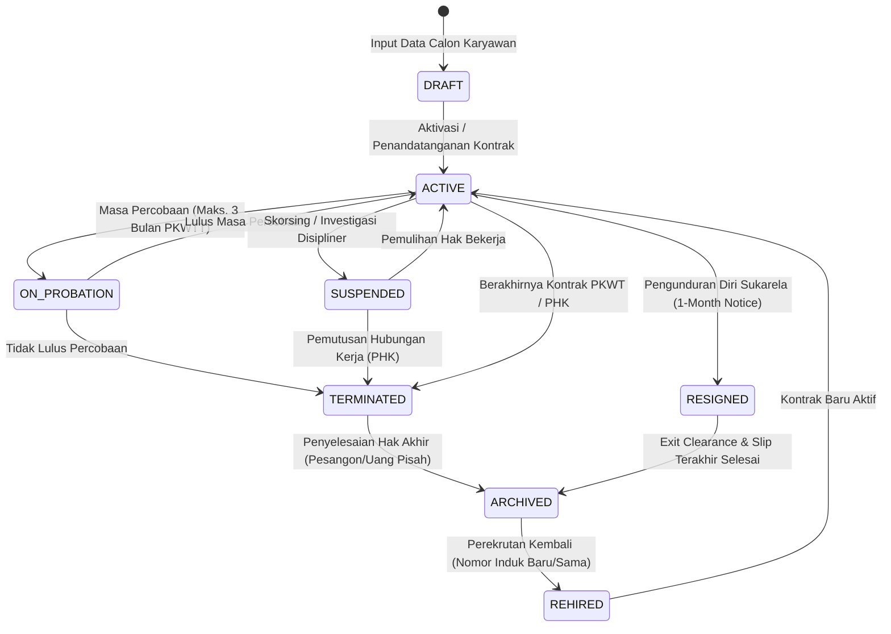
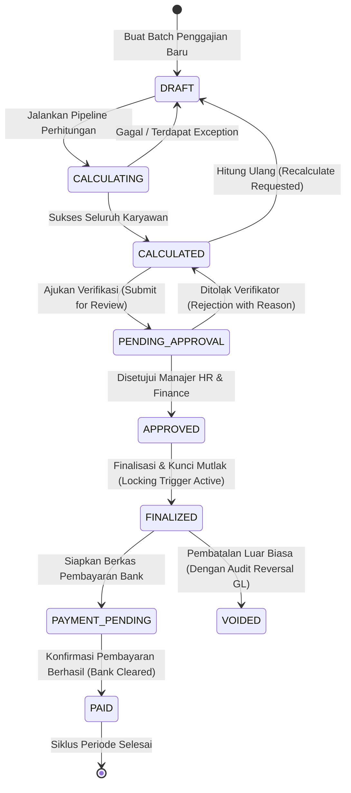
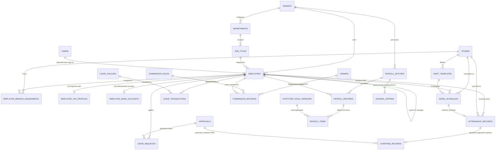

# RENCANA IMPLEMENTASI ARSITEKTUR MODUL 9: HR, EMPLOYEE, WORKFORCE MANAGEMENT & PAYROLL
## APEIRON SYSTEMS (MODULAR ERP & POS SAAS TIER-1 FOR RETAIL & F&B)
### Blueprint Arsitektur Komprehensif & Kontrak Implementasi Resmi

---

## 1. Executive Summary

Apeiron Systems telah bertransformasi dari sistem kasir (*Point of Sale*) tunggal menjadi platform Modular Enterprise Resource Planning (ERP) SaaS kelas enterprise yang berfokus pada industri Food & Beverage (F&B) dan Ritel di Indonesia. Dengan arsitektur *Multi-Tenant* dan *Multi-Branch* yang mematuhi batas isolasi ketat, integritas finansial berbasis *double-entry* (Modul 7 Finance GL), dan mesin promosi otomatis terintegrasi (Modul 8 Pricing & Loyalty), platform kini memerlukan pilar operasional tenaga kerja: **Modul 9 (HR, Employee, Workforce Management & Payroll)**.

Modul 9 bukan sekadar aplikasi pencatat data staf (*CRUD biodata*), melainkan sistem enterprise terdistribusi secara logis yang mencakup:
1. **Pemisahan Tegas Identitas Karyawan vs Akun Pengguna (*Employee is not User*)**: Mengakomodasi realitas operasional F&B/Ritel di mana banyak staf dapur (*cook*), barista paruh waktu, staf gudang, dan pencuci piring tidak memerlukan akun login aplikasi, sementara staf lintas-cabang dapat bertugas di berbagai outlet tanpa duplikasi profil karyawan atau duplikasi identitas pajak/BPJS.
2. **Mesin Penjadwalan & Waktu Kerja Fleksibel (*Workforce Management Engine*)**: Menangani shift bergilir (*rotating shifts*), shift lintas-hari/tengah malam (*cross-midnight shifts* seperti pukul 22:00–06:00), shift terpisah (*split shifts*), pergantian shift (*shift swap*), pelacakan jam istirahat (*break tracking*), toleransi keterlambatan (*grace period*), dan lembur berbasis persetujuan (*approval-gated overtime*).
3. **Pencatatan Absensi Multi-Sumber dengan Validasi Sisi Server**: Mendukung pencatatan absensi langsung dari terminal kasir POS, tablet absensi cabang terdedikasi, atau geofencing mobile, dengan penegakan stempel waktu terverifikasi server (*NTP server time*) guna mencegah manipulasi jam lokal perangkat.
4. **Buku Besar Saldo Cuti (*Leave Balance Ledger*)**: Manajemen cuti berbasis mutasi kredit/debit (*append-only ledger*) yang mencegah kondisi balapan (*race conditions*) dan membedakan hak cuti normatif undang-undang (cuti tahunan, melahirkan, haid, duka) dari cuti komersial kebijakan perusahaan.
5. **Mesin Komisi Penjualan Tertelusuri (*Sales Commission Engine*)**: Menghubungkan komisi staf kasir, barista, atau pramuniaga ritel secara deterministik dengan transaksi POS (`orders`, `order_items`), dengan protokol pembalikan komisi otomatis saat transaksi dibatalkan atau diretur (`order_returns`).
6. **Mesin Penggajian Terstandarisasi Regulasi Indonesia (*Indonesian Statutory Payroll Engine*)**: Perhitungan deterministik PPh 21 menggunakan mekanisme Tarif Efektif Rata-Rata (TER) bulanan (PP 58/2023 & PMK 168/2023), rekonsiliasi tahunan Pasal 17 UU HPP, fasilitas insentif PPh 21 DTP Sektor Pariwisata/Restoran (PMK 105/2025), serta komponen 5 program BPJS Ketenagakerjaan (JKK, JKM, JHT, JP dengan batas upah Rp11.086.300 per 2026, JKP) dan BPJS Kesehatan (batas upah Rp12.000.000).
7. **Integritas Historis & Snapshot Finansial Mutlak**: Data penggajian final dikunci (*locked*) dan disimpan dalam bentuk *snapshot* statis. Penyesuaian gaji atau regulasi yang berlaku surut tidak akan pernah mengubah data pembayaran masa lalu, melainkan diproses melalui mekanisme penyesuaian (*retroactive adjustments*) yang diaudit.
8. **Integrasi Jurnal Akuntansi Otomatis (*GL Posting Contract*)**: Menghasilkan jurnal beban gaji, utang gaji, utang PPh 21, dan utang BPJS ke Buku Besar Modul 7 melalui pola *Outbox Pattern* yang idempoten tanpa melanggar batas modular monolith.

Cetak biru arsitektur ini disusun sebagai pedoman final yang mengikat, mencakup 41 bab terstruktur, desain skema database relasional lengkap, diagram ERD Mermaid, matriks kepatuhan hukum, model kontrol keamanan (RBAC & SoD), serta 16 tahapan implementasi yang siap dieksekusi oleh tim implementor/Gemini IDE tanpa keraguan teknis.

---

## 2. Repository Baseline

Audit forensik terhadap repositori dilakukan secara langsung pada lingkungan kerja aktual:

- **Root Repositori**: `/home/ilhamspryd/Projects/apeironSystem/point-of-Sales`
- **Git Branch Aktif**: `main`
- **Commit SHA Terakhir**: `06f820481c3b3f9ad71b513a60a5dfd748064b28`
- **Pesan Commit Terakhir**: `feat: implement advanced pricing engine, promotion campaigns, and approval workflows`
- **Working Tree Status**: Bersih secara struktural; modifikasi aktif terbatas pada penambahan suite pengujian otomatis (`tests/Feature/Customers/LoyaltyAndValueInstrumentsTest.php`, `tests/Feature/Reports/DashboardMetricsAndButtonsTest.php`) dan perbaikan reaktivitas dashboard.
- **Runtime Environment**:
  - PHP: `PHP 8.5.12 (cli) (built: Oct 21 2026 13:42:26) (NTS)`
  - Laravel Framework: `13.31.0` (kompatibel dengan Laravel 13 standard APIs)
  - Livewire: `v4.4.5`
  - Alpine.js: `v3.14.x` (terintegrasi dengan DevDojo UI components)
  - Tailwind CSS: `v4.x`
  - Basis Data Lokal: MariaDB `13.0.2` (dengan mode SQL `ONLY_FULL_GROUP_BY,STRICT_TRANS_TABLES,NO_ZERO_IN_DATE,NO_ZERO_DATE,ERROR_FOR_DIVISION_BY_ZERO,NO_ENGINE_SUBSTITUTION`)
  - Basis Data CI: MySQL `8.0` (`.github/workflows/tests.yml`)
  - Transaction Isolation Level: `REPEATABLE-READ`
  - InnoDB Lock Wait Timeout: `50` detik
  - Presisi Perhitungan Finansial: Ekstensi `bcmath` dengan skala default 2 desimal uang dan 4 desimal tarif.

---

## 3. Existing Architecture Assessment

Berdasarkan audit mendalam terhadap source code dan arsitektur repositori yang ada, ditemukan fondasi arsitektur yang sangat kuat namun memiliki karakteristik yang wajib diselaraskan:

### 3.1 Pola Modular Monolith (`app/Modules/*`)
Repositori menerapkan pola *Modular Monolith* yang rapi. Modul-modul enterprise (`Finance`, `Purchasing`, `Sales`, `Customers`, `Pricing`, `Products`, `Inventory`, `Reports`, `Settings`, `Users`, `Auth`) berlokasi di `app/Modules/{Domain}` dengan subfolder konsisten:
- `Contracts/`: Antarmuka internal domain.
- `Controllers/`: HTTP controller untuk antarmuka web/API.
- `DataTransferObjects/`: Objek transfer data terstruktur.
- `Enums/`: Enumerasi status ber-type PHP 8.1+.
- `Exceptions/`: Pengecualian spesifik domain dengan pesan error terstandarisasi.
- `Jobs/`: Antrean tugas latar belakang (*queued jobs*).
- `Models/`: Entitas Eloquent dengan *composite foreign keys* dan scope tenant.
- `Policies/`: Otorisasi aksi berdasarkan peran.
- `Services/`: Logika bisnis domain murni tanpa keterikatan HTTP/Livewire.
- Wrapper kompatibilitas mundur (*backward compatibility wrappers*) tersedia di `app/Models/` dan `app/Http/Controllers/` yang mewarisi (*extends*) kelas di `app/Modules/`.

### 3.2 Isolasi Multi-Tenant Keras (`TenantContext`)
- Isolasi tenant diatur secara global oleh kelas singleton `App\Core\Context\TenantContext` (di-alias oleh `App\Services\Context\TenantContext`).
- Middleware `App\Http\Middleware\SetTenantContext` bertugas mengekstrak dan memvalidasi tenant aktif dari sesi atau subdomain.
- Trait `App\Core\Traits\ScopedToTenant` memasang global scope `TenantScope` pada setiap kueri Eloquent.
- Trait `App\Core\Traits\AssignsTenant` secara otomatis menyuntikkan `tenant_id` pada event `creating` dan menolak perubahan `tenant_id` pada event `updating` (`RuntimeException: Tenant ownership (tenant_id) cannot be modified once set`).
- Foreign key komposit diterapkan pada level tabel: `(tenant_id, store_id) REFERENCES stores(tenant_id, id)` untuk menjamin integritas referensial antar-cabang.
- Fitur bypass isolasi hanya tersedia secara eksplisit melalui method `runWithoutTenant()` dan dicatat ke log peringatan audit.

### 3.3 Penugasan Cabang & Pengguna (`user_stores`)
- Relasi pengguna dan cabang dimodelkan melalui tabel pivot `user_stores` (`id, user_id, store_id, tenant_id, created_at, updated_at`).
- Pengguna dengan peran `Owner` memiliki akses lintas-cabang (*owner scope*), sedangkan `Manager`, `Kasir`, `Waiter`, `Barista`, dan `Inventory` dibatasi hanya pada cabang-cabang yang terdaftar di `user_stores`.

### 3.4 Sistem Autentikasi Pengguna & PIN Kasir
- Tabel `users` menyimpan identitas autentikasi: `email`, `password_hash`, `pin_hash` (untuk autentikasi cepat kasir), `two_factor_secret`, `two_factor_recovery_codes`, `role_id`, `is_active`, `failed_login_attempts`, `locked_until`, dan `tenant_id`.
- **Celah Konseptual Existing**: Tabel `users` saat ini memiliki kolom `employee_id` dan `join_date`. Hal ini merupakan warisan desain *single-tenant* awal di mana satu pengguna disamakan dengan satu karyawan. Pada Modul 9, konsep ini direfaktor secara elegan: `employee_id` pada tabel `users` akan didelegasikan ke entitas mandiri `employees.employee_number`.

### 3.5 Manajemen Shift Kasir (`shifts` & `shift_handovers`)
- Tabel `shifts` (`id, tenant_id, store_id, user_id, device_id, opening_balance, closing_balance, expected_cash, cash_difference, status, opened_at, closed_at`) dan `shift_handovers` menangani buku kas laci kasir (*cash drawer control*).
- **Pembeda Kritis**: Shift kasir adalah instrumen rekonsiliasi uang fisik laci (*point of sale cash reconciliation*), BUKAN jadwal kerja karyawan (*workforce roster*) atau absensi kehadiran (*attendance record*). Membuka shift kasir tidak serta merta mewakili jam masuk kerja karyawan jika karyawan tersebut masuk 30 menit sebelum toko buka untuk persiapan stok (*mise en place*).

### 3.6 Akuntansi Finansial & General Ledger (Modul 7)
- Modul 7 telah memiliki infrastruktur lengkap: `chart_of_accounts`, `journal_entries`, `journal_lines`, `accounting_periods`, `expenses`, `expense_lines`, dan `cash_bank_accounts`.
- Invarian `FIN-M7-01` s/d `FIN-M7-12` mewajibkan:
  - Jurnal seimbang: $\sum \text{Debit} \equiv \sum \text{Credit} > 0$.
  - Entri baris satu sisi (*single-sided lines*): Debit > 0 XOR Credit > 0.
  - Imutabilitas jurnal `POSTED` yang dilindungi oleh trigger MySQL (`trg_journal_entries_immutable`).
  - Posting hanya diizinkan pada akun daun (`is_postable = true`) dan periode aktif (`status = 'OPEN'`).
  - Idempotensi mutlak melalui indeks unik `(tenant_id, idempotency_key)`.
  - Pembukuan akrual gaji dan pembayaran kas/bank wajib memanfaatkan antarmuka `PostingEngineService`.

### 3.7 Infrastruktur Persetujuan Kanonis (`approvals`)
- Modul 8 telah membangun tabel persetujuan kanonis `approvals` (`id, tenant_id, store_id, requester_user_id, approver_user_id, action_code, target_entity_type, target_entity_id, amount, reason, status, consumed_at, consumed_by_order_id`) yang dilindungi trigger `trg_approvals_before_update`.
- Tabel ini dapat digunakan secara polimorfik untuk otorisasi diskon kasir, lembur karyawan, penyesuaian absensi, dan persetujuan penggajian.

---

## 4. Existing Feature Inventory

Berikut adalah inventaris fitur aktual yang ada di repositori dan evaluasi kesiapannya untuk integrasi Modul 9:

| Fitur / Komponen Eksisting | Lokasi Berkas Utama | Status Kesiapan | Catatan Evaluasi & Hubungan dengan Modul 9 |
| :--- | :--- | :--- | :--- |
| **Penyedia Konteks Tenant (`TenantContext`)** | `app/Core/Context/TenantContext.php` | `EXISTING AND USABLE` | Siap digunakan. Seluruh entitas HR, shift, cuti, dan penggajian wajib tunduk pada metode `requireTenantId()` dan `requireStoreId()`. |
| **Middleware Tenant (`SetTenantContext`)** | `app/Http/Middleware/SetTenantContext.php` | `EXISTING AND USABLE` | Siap digunakan pada seluruh rute HTTP web dan API Modul 9. |
| **Manajemen Peran (`Role`, `RoleService`)** | `app/Modules/Users/Models/Role.php`, `RoleService.php` | `EXISTING BUT NEEDS REFACTOR` | Telah menyediakan 8 peran default (`Owner`, `Manager`, `Kasir`, `Waiter`, `Barista`, `Inventory`, `Supervisor`, `Cook`). Perlu penambahan hak akses (*permissions*) HR & Payroll (`hr.employee.view`, `hr.payroll.manage`, dll). |
| **Pemetaan Akun Staf Cabang (`user_stores`)** | Migrasi `2026_10_04_154119_create_user_stores_table.php` | `EXISTING AND USABLE` | Digunakan untuk otorisasi login pengguna ke cabang tertentu. Untuk penugasan kerja karyawan, Modul 9 akan menyediakan tabel khusus `employee_branch_assignments` yang mendukung *secondary branch* dan *effective dates*. |
| **Generator ID Karyawan (`EmployeeIdGenerator`)** | Migrasi `2026_12_04_000006_add_employee_id_sequences_table.php` | `EXISTING BUT INCOMPLETE` | Menggunakan sequence atomik `employee_id_sequences` per `(tenant_id, prefix)`. Namun saat ini langsung mengupdate kolom `users.employee_id`. Perlu diarahkan untuk mengenerate nomor identitas pada entitas baru `employees.employee_number`. |
| **Autentikasi PIN Cepat (`CashierPinService`)** | `app/Services/CashierPinService.php` | `EXISTING AND USABLE` | Siap digunakan kembali untuk autentikasi cepat pada terminal absensi (*attendance punch*) di workstation kasir. |
| **Shift Kasir Toko (`shifts`, `ShiftService`)** | `app/Models/Shift.php`, `app/Services/ShiftService.php` | `EXISTING AND USABLE` | Berfokus pada kas fisik laci uang kasir. Menjadi sumber data pendukung untuk validasi kehadiran kasir, tetapi tidak menggantikan sistem absensi umum. |
| **Pencatatan Audit Trail (`AuditTrailService`)** | `app/Modules/Settings/Services/AuditTrailService.php` | `EXISTING AND USABLE` | Siap digunakan untuk mencatat riwayat perubahan status kepegawaian, perubahan gaji, persetujuan cuti, dan finalisasi payroll. |
| **Tabel Persetujuan Kanonis (`approvals`)** | Migrasi `2027_01_08_000004_create_canonical_approvals_table.php` | `EXISTING AND USABLE` | Siap digunakan untuk mencatat persetujuan berjenjang pada pengajuan lembur, koreksi absensi, dan eksekusi payroll. |
| **Posting Engine GL (`PostingEngineService`)** | `app/Modules/Finance/Services/PostingEngineService.php` | `EXISTING AND USABLE` | Siap digunakan untuk membukukan akrual biaya gaji dan pembayaran gaji secara otomatis ke Buku Besar. |
| **Penegakan Hak Fitur SaaS (`EnforceEntitlement`)** | `app/Http/Middleware/EnforceEntitlement.php` | `EXISTING AND USABLE` | Digunakan untuk mengunci fitur HRIS tingkat lanjut (seperti Payroll otomatis dan Penjadwalan Roster) pada paket SaaS tertentu (Growth/Enterprise). |
| **Mesin Komisi Penjualan** | — | `NOT IMPLEMENTED` | Belum tersedia. Harus dibangun di Modul 9 untuk membaca transaksi `orders` dan menghitung insentif penjualan staf. |
| **Master Karyawan, Departemen & Jabatan** | — | `NOT IMPLEMENTED` | Belum tersedia. Seluruh data staf saat ini bercampur di tabel `users`. Harus dibangun di Modul 9. |
| **Mesin Penjadwalan & Roster Kerja** | — | `NOT IMPLEMENTED` | Belum tersedia. Harus dibangun di Modul 9. |
| **Mesin Absensi & Timesheet Kehadiran** | — | `NOT IMPLEMENTED` | Belum tersedia. Harus dibangun di Modul 9. |
| **Manajemen Cuti & Buku Besar Cuti** | — | `NOT IMPLEMENTED` | Belum tersedia. Harus dibangun di Modul 9. |
| **Kalkulator Pajak PPh 21 (TER & Tahunan) & BPJS** | — | `NOT IMPLEMENTED` | Belum tersedia. Harus dibangun di Modul 9 dengan konfigurasi aturan hukum berversi. |
| **Pipeline Penggajian (*Payroll Calculation Pipeline*)** | — | `NOT IMPLEMENTED` | Belum tersedia. Harus dibangun di Modul 9. |

---

## 5. PRD Traceability Matrix

Pemeriksaan silang terhadap dokumen Master PRD (`Apeiron Systems — Final Master PRD.docx` / `docs/architecture/*`) memetakan hubungan antara kebutuhan produk dengan desain Modul 9:

| Kode PRD / Dokumen | Deskripsi Kebutuhan Asli PRD | Kategori & Fase PRD | Pemetaan & Realisasi pada Modul 9 |
| :--- | :--- | :---: | :--- |
| **D1:ACT-003 / ACT-005** | Peran operasional toko: Manager dan Kasir dengan batas otorisasi berbasis cabang (`user-branch-role`). | `P0 / MVP` | Diadopsi penuh. Modul 9 memperluas hierarki ini ke struktur organisasi HR (Departemen, Jabatan, Atasan Langsung/Reporting Line). |
| **D1:FR-RBAC-002** | Autentikasi PIN 6 digit untuk kasir dengan penguncian akun setelah 5 kali gagal. | `P0 / MVP` | Diadopsi untuk mekanisme *Kiosk Attendance Clock-in/out* di terminal POS kasir cabang. |
| **D1:FR-RBAC-004** | Pencatatan persetujuan satu tindakan (*human-approved execution*) untuk tindakan berisiko tinggi. | `P0 / MVP` | Diadopsi untuk persetujuan pengajuan lembur, izin tidak masuk, koreksi waktu absensi, dan otorisasi batch payroll. |
| **D1:FR-SHIFT-001** | Pengendalian shift kasir, hitung kas buta (*blind count*), dan pencatatan varians kas. | `P0 / MVP` | Diintegrasikan. Modul 9 memanfaatkan data shift kasir untuk mencocokkan kehadiran fisik kasir pada jadwal kerja yang ditugaskan. |
| **D5:FR-225–256** | Laporan operasional harian, kasir, shift, dan ringkasan laba kotor. | `P0 / MVP` | Diperluas di Modul 9 dengan Laporan Timesheet Kehadiran, Rekapitulasi Komisi Penjualan Staf, dan Laporan Rekap Gaji Bulanan. |
| **D1:DR-013 / OD-25** | Retensi data transaksi finansial minimal 7 tahun sesuai standar pembukuan dan perpajakan Indonesia (UU KUP). | `P0 / Invariant` | Diadopsi secara mutlak pada seluruh data penggajian, slip gaji, bukti potong pajak PPh 21, dan laporan iuran BPJS. |
| **D1:DR-005 / OD-27** | Transaksi finansial pada MVP online-only; offline-sync pada F2. | `P0 / Baseline` | Seluruh perhitungan payroll dan persetujuan absensi diproses di sisi server. Terminal absensi lokal menyimpan offline punch buffer yang disinkronkan saat koneksi pulih. |
| **PRD §6: F2/F3 Scope** | Penggajian (*Payroll*), perhitungan PPh 21 otomatis, komisi staf, dan manajemen SDM (HRIS). | `F2 / Modular ERP` | **Ruang lingkup utama dokumen ini.** Menjadi dasar spesifikasi Modul 9 sebagai ekstensi modular ERP enterprise. |

---

## 6. Business Scope and Phase Boundary

Untuk menjamin keberhasilan implementasi dan stabilitas sistem operasional, ruang lingkup Modul 9 dipisahkan secara tegas ke dalam tahapan fungsional (*phasing boundary*):

### 6.1 Ruang Lingkup Wajib (In-Scope)

#### Fase A: HR Core & Organization Management (MVP HR Foundation)
- Master Karyawan (*Employee Profile*): Biodata lengkap, kontak darurat, identitas legal (NIK KTP, NPWP, BPJS Kesehatan, BPJS Ketenagakerjaan), dan nomor rekening bank.
- Struktur Organisasi: Master Departemen, Master Jabatan (*Job Titles*), dan garis pelaporan atasan langsung (*manager/reporting lines*).
- Penugasan Cabang Fleksibel: Penetapan cabang utama (*primary branch*), cabang sekunder (*secondary branches*), serta penugasan sementara dengan riwayat ber-tanggal efektif (*effective-dated transfer history*).
- Siklus Hidup Kepegawaian (*Employee Lifecycle*): Status kontrak (PKWT, PKWTT, Harian Lepas, Magang/Probation), perpanjangan kontrak, promosi/demosi, mutasi cabang, hingga terminasi/resign.
- Manajemen Dokumen Karyawan: Unggah berkas digital (KTP, NPWP, Surat Perjanjian Kerja, Ijazah, Sertifikat) dengan kontrol akses terenkripsi dan pembatasan unduhan.

#### Fase B: Workforce Management & Time Tracking (WFM)
- Master Template Shift: Definisi shift pagi, siang, malam, *split shift*, durasi kerja normal, jam istirahat (*unpaid break*), toleransi keterlambatan (*grace period*), dan penanganan shift lintas tengah malam (*cross-midnight*).
- Penjadwalan Kerja & Roster: Penyusunan jadwal kerja mingguan/bulanan per cabang, penugasan shift per staf, pergantian jadwal (*shift swap*), dan penggantian staf berhalangan (*shift replacement*).
- Mesin Absensi (*Attendance Engine*): Pencatatan jam masuk (*clock-in*), jam pulang (*clock-out*), dan jam istirahat melalui PIN terminal POS kasir atau portal web mandiri karyawan.
- Timesheet & Koreksi Absensi: Rekonsiliasi otomatis jadwal vs kehadiran riil, deteksi keterlambatan (*tardiness*), pulang lebih awal (*early departure*), absensi tidak tercatat (*missing punch*), dan alur koreksi manual berpersetujuan manajer.
- Mesin Pengelolaan Lembur (*Overtime Engine*): Pengajuan dan persetujuan lembur sebelum atau sesudah kerja, verifikasi jam aktual, dan konversi jam lembur ke indeks pengali upah sesuai Kepmenakertrans / PP 35/2021.

#### Fase C: Leave & Absence Management
- Master Kebijakan Cuti: Konfigurasi jenis cuti normatif (Cuti Tahunan, Cuti Sakit, Cuti Melahirkan, Cuti Haid, Cuti Menikah/Khitan/Baptis, Cuti Duka) dan cuti di luar tanggungan (*unpaid leave*).
- Buku Besar Saldo Cuti (*Leave Balance Ledger*): Pencatatan penambahan hak cuti (*accrual*), pemakaian cuti (*usage*), penyesuaian (*adjustment*), dan kedaluwarsa saldo (*expiration/carry forward*) secara *append-only*.
- Alur Pengajuan & Persetujuan Cuti: Pengajuan mandiri karyawan, validasi saldo seketika dengan penguncian baris (*pessimistic locking*), peringatan bentrok jadwal kerja (*roster conflict*), dan alur persetujuan bertingkat.

#### Fase D: Compensation & Sales Incentive Engine
- Komponen Remunerasi: Gaji pokok (*base salary*), tunjangan tetap (jabatan, keahlian), tunjangan variabel (kehadiran, transport harian, makan), dan potongan rutin (kasbon/pinjaman internal, denda keterlambatan).
- Skema Komisi Penjualan: Penentuan aturan komisi kasir/pramuniaga berbasis persentase penjualan produk tertentu, target kuota penjualan cabang, komisi flat per transaksi, atau bagi hasil tim (*shared pool commission*).
- Integrasi Transaksi POS & Atribusi Penjualan: Pembacaan data pesanan selesai (`orders`) dan baris pesanan (`order_items`), atribusi staf pembuat/kasir, serta pembalikan komisi otomatis saat terjadi retur/refund (`order_returns`).

#### Fase E: Indonesian Statutory Payroll Engine & Finance Integration
- Periode & Kalender Penggajian: Penetapan siklus penggajian bulanan (misal tanggal 26 bulan lalu s/d tanggal 25 bulan berjalan atau 1 s/d 31 kalender) dengan mekanisme *Cut-Off Snapshot*.
- Perhitungan PPh 21 Karyawan Resmi: Penerapan Tarif Efektif Rata-Rata (TER) Bulanan (Kategori A, B, C sesuai PTKP) untuk Masa Pajak Januari–November, dan Rekonsiliasi Tahunan Tarif Pasal 17 UU HPP pada Masa Pajak Desember (atau saat karyawan berhenti kerja).
- Fasilitas Insentif Pajak: Dukungan PPh 21 Ditanggung Pemerintah (DTP) khusus sektor pariwisata/F&B sesuai PMK No. 105 Tahun 2025 dengan batas bruto bulanan Rp10.000.000.
- Perhitungan Iuran BPJS Lengkap:
  - BPJS Kesehatan (4% Pemberi Kerja, 1% Karyawan, plafon upah Rp12.000.000).
  - BPJS Ketenagakerjaan: JHT (3.7% / 2%), JP (2% / 1%, plafon upah Rp11.086.300 per 2026), JKK (0.24%–1.74% sesuai kelas risiko outlet), JKM (0.30%), JKP (tanpa iuran tambahan pekerja).
- Rekonsiliasi, Persetujuan & Finalisasi Payroll: Pratinjau draf gaji (*calculation preview*), deteksi anomali, verifikasi dua tahap (HR Admin -> Finance/Owner), dan penguncian permanen data gaji (*immutable snapshot*).
- Penerbitan Slip Gaji (*Payslip*) & Ekspor Pembayaran Bank: Cetak/unduh slip gaji digital berkeamanan tinggi serta ekspor format berkas payroll bank (BCA, Mandiri, BRI, BNI).
- Integrasi Buku Besar (Modul 7): Pembuatan draf jurnal akrual dan pembayaran otomatis ke GL melalui `PostingEngineService`.

### 6.2 Di Luar Ruang Lingkup (Out-of-Scope)
- **Eksekusi Transfer Bank Otomatis via Host-to-Host (H2H) API**: Pada fase ini, sistem menghasilkan berkas batch transfer bank standar (CSV/TXT format korporasi). Pembayaran langsung otomatis via Open Finance API ditunda ke fase berikutnya guna menghindari risiko kliring instan tanpa verifikasi manual.
- **Sistem Pelaporan Pajak e-Bupot 21/26 Langsung ke Server DJP (Coretax Open API)**: Sistem menghasilkan rekapitulasi angka PPh 21 siap lapor dan file ekspor skema impor resmi e-Bupot 21/26 DJP. Koneksi API langsung ke Coretax DJP membutuhkan sertifikasi PJAP (*Penyedia Jasa Aplikasi Perpajakan*) tersendiri.
- **Modul Rekrutmen & Pelacakan Pelamar (*Applicant Tracking System / ATS*)**: Pembukaan lowongan kerja, psikotes, dan alur wawancara pelamar berada di luar cakupan inti operasional ERP.
- **Modul Penilaian Kinerja 360 Derajat & Manajemen Bakat (*OKRs / 360 Appraisal*)**: Pengukuran KPI kompleks di luar insentif penjualan numerik ditunda ke fase HR Enterprise lanjutan.


---

## 7. Domain Architecture

Arsitektur Modul 9 dirancang mengikuti prinsip *Domain-Driven Design* (DDD) yang pragmatis dalam kerangka *Modular Monolith* Laravel. Seluruh fungsionalitas tenaga kerja diisolasi di bawah namespace `App\Modules\HR\` dengan pembagian 7 subdomain inti yang memiliki tanggung jawab tunggal (*Single Responsibility Principle*):

```
app/Modules/HR/
├── Contracts/
│   ├── AttendanceSourceInterface.php
│   ├── CommissionCalculatorInterface.php
│   ├── OvertimeCalculatorInterface.php
│   ├── PayrollCalculatorInterface.php
│   ├── StatutoryTaxRuleInterface.php
│   └── StatutoryBpjsRuleInterface.php
├── Controllers/
│   ├── AttendanceController.php
│   ├── CommissionRuleController.php
│   ├── DepartmentController.php
│   ├── EmployeeController.php
│   ├── JobTitleController.php
│   ├── LeaveRequestController.php
│   ├── PayrollBatchController.php
│   ├── ShiftTemplateController.php
│   └── WorkScheduleController.php
├── DataTransferObjects/
│   ├── AttendancePunchDto.php
│   ├── EmployeeProfileDto.php
│   ├── LeaveCalculationResultDto.php
│   ├── OvertimeCalculationDto.php
│   ├── PayrollCalculationItemDto.php
│   ├── PayrollEmployeeSnapshotDto.php
│   └── StatutoryDeductionResultDto.php
├── Enums/
│   ├── AttendanceStatusEnum.php
│   ├── EmploymentStatusEnum.php
│   ├── EmploymentTypeEnum.php
│   ├── LeaveStatusEnum.php
│   ├── OvertimeStatusEnum.php
│   ├── PayrollBatchStatusEnum.php
│   ├── PayrollPaymentStatusEnum.php
│   ├── ScheduleStatusEnum.php
│   └── TaxCalculationMethodEnum.php
├── Exceptions/
│   ├── AttendanceAnomalyException.php
│   ├── InsufficientLeaveBalanceException.php
│   ├── OverlappingShiftAssignmentException.php
│   ├── PayrollBatchLockedException.php
│   └── UnresolvedStatutoryRuleException.php
├── Jobs/
│   ├── CalculatePayrollBatchChunkJob.php
│   ├── GeneratePayslipPdfJob.php
│   ├── PostPayrollToGeneralLedgerJob.php
│   └── ReconcileMonthlyTimesheetsJob.php
├── Models/
│   ├── AttendanceBreak.php
│   ├── AttendanceRecord.php
│   ├── CommissionRecord.php
│   ├── CommissionRule.php
│   ├── Department.php
│   ├── Employee.php
│   ├── EmployeeBankAccount.php
│   ├── EmployeeBpjsProfile.php
│   ├── EmployeeBranchAssignment.php
│   ├── EmployeeCompensation.php
│   ├── EmployeeDocument.php
│   ├── EmployeeEmploymentHistory.php
│   ├── EmployeeTaxProfile.php
│   ├── JobTitle.php
│   ├── LeaveBalance.php
│   ├── LeavePolicy.php
│   ├── LeaveRequest.php
│   ├── LeaveTransaction.php
│   ├── OvertimeRecord.php
│   ├── PayrollAdjustment.php
│   ├── PayrollBatch.php
│   ├── PayrollItem.php
│   ├── PayrollPeriod.php
│   ├── PayrollRecord.php
│   ├── SalaryComponent.php
│   ├── ShiftTemplate.php
│   ├── StatutoryRuleVersion.php
│   └── WorkSchedule.php
├── Policies/
│   ├── AttendancePolicy.php
│   ├── EmployeePolicy.php
│   ├── LeavePolicyPolicy.php
│   └── PayrollPolicy.php
└── Services/
    ├── AttendanceService.php
    ├── CommissionService.php
    ├── EmployeeLifecycleService.php
    ├── LeaveService.php
    ├── OvertimeCalculationService.php
    ├── PayrollCalculationPipeline.php
    ├── PayrollPostingService.php
    ├── StatutoryBpjsService.php
    ├── StatutoryTaxService.php
    └── WorkforceSchedulingService.php
```

---

## 8. Domain Boundary and Ownership

Setiap subdomain di dalam Modul 9 memiliki batas wewenang yang terdefinisi secara ketat:

### 8.1 Subdomain 1: HR Core & Employee Identity
- **Kepemilikan Entitas**: `Employee`, `Department`, `JobTitle`, `EmployeeDocument`, `EmployeeBankAccount`, `EmployeeTaxProfile`, `EmployeeBpjsProfile`.
- **Tanggung Jawab**:
  - Mengelola siklus hidup data induk karyawan sejak diterima (*onboarding*) hingga berhenti kerja (*termination/offboarding*).
  - Menyimpan nomor induk kependudukan (NIK), NPWP, nomor kartu BPJS, dan detail rekening bank dengan perlindungan enkripsi field sensitif.
  - Memelihara struktur hierarki departemen, nama jabatan (*job title*), level jabatan (*grade/level*), dan rantai komando pelaporan langsung (*reporting manager*).
- **Invarian Domain**:
  - `employee_number` bersifat unik per `tenant_id` dan tidak boleh diubah setelah diterbitkan.
  - Setiap karyawan wajib memiliki tepat satu `tenant_id` dan dilarang berpindah antar-tenant.
  - Perubahan data kompensasi atau jabatan wajib menghasilkan baris riwayat baru ber-tanggal efektif (*effective-dated history*).

### 8.2 Subdomain 2: Organization & Branch Assignment
- **Kepemilikan Entitas**: `EmployeeBranchAssignment`.
- **Tanggung Jawab**:
  - Mengatur penugasan satu karyawan ke satu atau lebih cabang (`stores`).
  - Menetapkan cabang primer (*primary branch*) untuk keperluan pembukuan biaya gaji dan pemenuhan kuota UMR/UMK wilayah kerja.
  - Menetapkan cabang sekunder (*secondary branches*) untuk karyawan hibrida F&B/Ritel (misal: barista atau koki yang diperbantukan di outlet lain saat akhir pekan).
- **Invarian Domain**:
  - Karyawan hanya boleh memiliki satu cabang primer aktif pada rentang tanggal efektif yang sama.
  - Penugasan cabang sekunder wajib memiliki batas waktu yang jelas (*valid_from* s/d *valid_to* opsional).

### 8.3 Subdomain 3: Workforce Scheduling & Roster
- **Kepemilikan Entitas**: `ShiftTemplate`, `WorkSchedule`.
- **Tanggung Jawab**:
  - Mendefinisikan cetak biru jadwal kerja (*shift template*) per cabang dengan jam masuk, jam pulang, durasi istirahat, toleransi keterlambatan, dan pengenal shift lintas-tengah malam (*cross-midnight flag*).
  - Mengelola jadwal kerja aktual (*roster*) karyawan per tanggal kalender per cabang.
  - Menangani pengajuan pergantian shift (*shift swap*) antar dua karyawan dengan persetujuan manajer toko.
- **Invarian Domain**:
  - Satu karyawan tidak boleh ditugaskan pada dua jadwal kerja yang saling tumpang tindih (*overlapping shifts*) pada hari yang sama.
  - Shift yang melintasi tengah malam (misal pukul 22:00–06:00) secara logis diatribusikan ke tanggal bisnis (*business date*) saat shift dimulai.

### 8.4 Subdomain 4: Attendance, Timesheet & Overtime
- **Kepemilikan Entitas**: `AttendanceRecord`, `AttendanceBreak`, `OvertimeRecord`.
- **Tanggung Jawab**:
  - Merekam jam masuk (*clock-in*), jam pulang (*clock-out*), dan jeda istirahat riil dari berbagai sumber (terminal kasir POS, web portal, mesin biometrik).
  - Menghitung waktu kerja kotor, keterlambatan (*tardiness*), kepulangan dini (*early departure*), dan waktu kerja bersih (*net payable hours*).
  - Mengelola pencatatan jam lembur (*overtime*) berpersetujuan manajer serta konversinya ke satuan jam lembur berbayar (*overtime pay rate hours*) sesuai regulasi Indonesia.
- **Invarian Domain**:
  - `clock_in_at` dan `clock_out_at` wajib menggunakan stempel waktu server terverifikasi (*server NTP timestamp*), bukan jam perangkat lokal kasir.
  - Koreksi absensi manual wajib menyertakan alasan koreksi, identitas manajer yang menyetujui, serta stempel waktu persetujuan.

### 8.5 Subdomain 5: Leave Management
- **Kepemilikan Entitas**: `LeavePolicy`, `LeaveBalance`, `LeaveTransaction`, `LeaveRequest`.
- **Tanggung Jawab**:
  - Mengelola hak cuti tahunan dan cuti khusus karyawan.
  - Menyediakan buku besar mutasi saldo cuti (*append-only balance ledger*) guna memastikan auditabilitas dan integritas konkuren.
  - Memvalidasi kecukupan saldo secara real-time saat pengajuan cuti dibuat dan disetujui.
- **Invarian Domain**:
  - Saldo cuti tidak boleh menjadi negatif, kecuali untuk kebijakan kasbon cuti (*leave overdraft*) yang diaktifkan secara eksplisit oleh tenant.
  - Pembatalan cuti yang telah disetujui wajib mengembalikan saldo melalui transaksi pembalik bertipe `REVERSAL`, bukan menghapus baris histori transaksi lama.

### 8.6 Subdomain 6: Compensation & Sales Commission
- **Kepemilikan Entitas**: `SalaryComponent`, `EmployeeCompensation`, `CommissionRule`, `CommissionRecord`.
- **Tanggung Jawab**:
  - Mendefinisikan struktur remunerasi per karyawan: gaji pokok, tunjangan tetap, tunjangan harian, potongan wajib, dan akun pembebanan akuntansi.
  - Mengkalkulasi insentif dan komisi penjualan staf berdasarkan transaksi kasir selesai (`orders`), kuota omzet cabang, atau penjualan produk promo tertentu.
  - Membalikkan nilai komisi saat terjadi transaksi retur atau pembatalan penjualan (`order_returns`).
- **Invarian Domain**:
  - Komisi hanya dihitung dari pesanan berstatus final/lunas (`COMPLETED` / `PAID`) yang melewati batas periode pembatalan (*grace cancellation period*).
  - Setiap perhitungan komisi wajib mencantumkan referensi ID pesanan (`order_id`) dan ID baris pesanan (`order_item_id`).

### 8.7 Subdomain 7: Statutory Payroll & General Ledger Integration
- **Kepemilikan Entitas**: `PayrollPeriod`, `PayrollBatch`, `PayrollRecord`, `PayrollItem`, `PayrollAdjustment`, `StatutoryRuleVersion`.
- **Tanggung Jawab**:
  - Mengorkestrasi siklus penggajian bulanan melalui pipeline perhitungan deterministik.
  - Menerapkan formula perpajakan PPh 21 (metode TER PP 58/2023, PMK 168/2023, Pasal 17 UU HPP, dan insentif DTP PMK 105/2025).
  - Mengkalkulasi iuran jaminan sosial BPJS Ketenagakerjaan (JKK, JKM, JHT, JP, JKP) dan BPJS Kesehatan sesuai plafon upah yang berlaku.
  - Membekukan data pembayaran dalam bentuk *immutable payroll snapshot* dan slip gaji.
  - Mempublikasikan jurnal akuntansi gaji ke Modul 7 General Ledger melalui `PostingEngineService`.
- **Invarian Domain**:
  - Batch payroll yang berstatus `FINALIZED` atau `PAID` terkunci secara permanen dan tidak boleh diubah atau dihapus oleh siapapun.
  - Koreksi atas payroll masa lalu wajib diselesaikan melalui `PayrollAdjustment` pada batch periode berikutnya.

---

## 9. Employee Lifecycle Design

Siklus hidup kepegawaian (*Employee Lifecycle*) mengatur seluruh transisi status hubungan kerja antara tenant dan individu pekerja secara terkendali dan dapat diaudit:



### 9.1 Status Kepegawaian (`EmploymentStatusEnum`)
- `DRAFT`: Data pelamar/karyawan baru telah dimasukkan oleh HR tetapi belum memulai hari pertama kerja atau belum menandatangani perjanjian kerja. Karyawan berstatus DRAFT tidak masuk dalam penjadwalan shift dan tidak dihitung dalam payroll.
- `ACTIVE`: Karyawan aktif bekerja dengan hak dan kewajiban penuh. Terdaftar dalam penjadwalan shift, absensi, dan penggajian bulanan.
- `ON_PROBATION`: Karyawan berada dalam masa percobaan kerja (hanya sah untuk perjanjian kerja waktu tidak tertentu / PKWTT, dengan durasi maksimal 3 bulan sesuai Pasal 60 UU Ketenagakerjaan).
- `SUSPENDED`: Karyawan dibebastugaskan sementara selama proses investigasi pelanggaran berat atau perselisihan hubungan industrial. Gaji pokok tetap dibayarkan sesuai ketentuan perundang-undangan (Pasal 157A UU Ketenagakerjaan), namun tunjangan kehadiran dan hak akses POS dibekukan.
- `RESIGNED`: Karyawan telah mengajukan pengunduran diri secara tertulis dan menyelesaikan masa pemberitahuan (*one-month notice*).
- `TERMINATED`: Hubungan kerja berakhir karena pemutusan hubungan kerja (PHK), habisnya masa kontrak PKWT, pensiun, atau meninggal dunia.
- `ARCHIVED`: Karyawan telah menyelesaikan seluruh alur *exit clearance*, pengembalian aset, penerimaan uang kompensasi/pesangon, dan penerbitan bukti potong PPh 21 final (Formulir 1721-A1). Data historis tetap disimpan minimal 7 tahun.

### 9.2 Aturan Transisi & Integritas Historis
1. **Audit Mutlak Transisi**: Setiap perpindahan status kepegawaian wajib mencatat `actor_user_id`, `reason`, `effective_date`, nomor dokumen surat keputusan (*reference_number*), dan disimpan di tabel `employee_employment_histories`.
2. **Karyawan Masuk di Tengah Bulan (*Mid-Month Join*)**:
   - Jika karyawan mulai bekerja tanggal 12 dalam periode gaji tanggal 1 s/d 31:
   - Gaji pokok dan tunjangan tetap dihitung secara pro-rata berbasis hari kerja kalender atau hari kerja efektif:
     $$\text{Gaji Pokok Terhitung} = \frac{\text{Jumlah Hari Kerja Dijalani}}{\text{Total Hari Kerja Sebulan}} \times \text{Gaji Pokok Penuh}$$
3. **Karyawan Berhenti di Tengah Bulan (*Mid-Month Resign/Terminated*)**:
   - Penghitungan gaji pro-rata diselesaikan pada batch penggajian periode berjalan atau batch *Final Settlement*.
   - Saldo cuti tahunan yang belum gugur dan belum diambil wajib dikompensasikan ke dalam uang penggantian hak (*leave encashment*) sesuai Pasal 156 UU Ketenagakerjaan.
   - Untuk karyawan PKWT yang masa kontraknya berakhir, sistem otomatis menghitung Uang Kompensasi PKWT (PP 35/2021):
     $$\text{Uang Kompensasi} = \frac{\text{Masa Kerja (Bulan)}}{12} \times 1\text{ Bulan Upah}$$

---

## 10. Organization and Branch Assignment

Karakteristik utama industri F&B dan ritel adalah fleksibilitas penempatan staf di banyak cabang (*multi-outlet operations*). Modul 9 memisahkan struktur penugasan organisasi dari hierarki cabang geografis:

### 10.1 Struktur Organisasi (Departemen & Jabatan)
- **Departemen (`departments`)**: Mengelompokkan fungsi kerja dalam satu tenant (misal: *Front of House*, *Back of House / Kitchen*, *Store Operations*, *Warehouse & Logistics*, *Finance & Admin*, *Marketing*). Departemen mendukung hierarki induk-anak (*parent-child departments*) untuk tenant berskala menengah-besar.
- **Jabatan (`job_titles`)**: Mendefinisikan posisi pekerjaan formal (misal: *Store Manager*, *Head Barista*, *Cashier*, *Line Cook*, *Dishwasher*, *Inventory Runner*). Setiap jabatan memiliki kode jabatan unik, deskripsi wewenang, dan level pangkat (*grade* 1 s/d 10) yang digunakan sebagai acuan batas tunjangan dan otorisasi persetujuan.
- **Garis Pelaporan Atasan Langsung (`manager_id`)**: Setiap karyawan memiliki relasi mandiri (*self-referencing foreign key*) `manager_id` yang merujuk ke karyawan lain (`employees.id`) yang bertindak sebagai atasan langsung penyetuju izin cuti, koreksi absensi, dan jam lembur.

### 10.2 Penugasan Cabang Fleksibel (`EmployeeBranchAssignment`)
Satu karyawan di Apeiron POS dapat ditugaskan pada beberapa outlet tanpa menduplikasi data profil karyawan:

```
[Employee: Budi Pratama (EMP-001)]
  │
  ├── Primary Branch Assignment:
  │     Store: Outlet Grand Indonesia (Store ID: 101)
  │     Status: PRIMARY, Effective: 2026-01-01 s/d Sekarang
  │     Fungsi: Alokasi Biaya Gaji Pokok & Acuan UMK Jakarta (Rp5.067.381)
  │
  └── Secondary / Floating Branch Assignment:
        Store: Outlet Senayan City (Store ID: 102)
        Status: SECONDARY, Effective: 2026-10-01 s/d 2026-12-31
        Fungsi: Hak Buka Shift Kasir & Hak Absensi di Outlet Senayan City
```

- **Cabang Utama (*Primary Branch*)**:
  - Wajib dimiliki oleh setiap karyawan aktif (tepat 1 penugasan primer aktif).
  - Menjadi acuan pembebanan pusat biaya akuntansi (*cost center* / *department branch cost allocation*).
  - Menjadi penentu regulasi upah minimum wilayah kerja (UMK/UMP) yang mengikat secara hukum.
- **Cabang Sekunder (*Secondary Branches*)**:
  - Diberikan kepada staf mengambang (*roving/floating staff*) seperti supervisor area, koki spesialis, teknisi mesin espresso, atau kasir perbantuan.
  - Memberikan hak izin bagi staf untuk melakukan absensi kehadiran dan membuka shift kasir POS di outlet sekunder tersebut.
  - Tidak menduplikasi data gaji, NPWP, atau nomor BPJS karyawan.

---

## 11. Workforce Scheduling Architecture

Pengaturan jadwal kerja pada bisnis F&B dan ritel menuntut fleksibilitas tinggi terhadap jam operasional toko yang dinamis:

### 11.1 Template Shift Kerja (`ShiftTemplate`)
Mendefinisikan pola jam kerja standar per cabang:
- `start_time` & `end_time`: Jam mulai dan jam selesai shift (misal: Pagi 07:00–15:00, Siang 15:00–23:00, Malam 22:00–06:00).
- `cross_midnight`: Flag boolean yang menandai bahwa shift berakhir pada hari berikutnya. Jika true, sistem mengkalkulasi durasi kerja secara akurat tanpa menghasilkan selisih jam negatif:
  $$\text{Durasi} = (\text{end\_time} + 24\text{ jam}) - \text{start\_time}$$
- `unpaid_break_minutes`: Durasi istirahat tidak dibayar standar (misal: 60 menit untuk shift 8 jam). Jam kerja netto terhitung adalah:
  $$\text{Net Work Hours} = \text{Total Hours} - \frac{\text{unpaid\_break\_minutes}}{60}$$
- `grace_period_minutes`: Toleransi keterlambatan menit awal (default: 15 menit) di mana staf tidak dikenai penalti denda keterlambatan namun keterlambatan riil tetap dicatat untuk evaluasi kedisiplinan.

### 11.2 Jadwal Kerja Karyawan & Roster (`WorkSchedule`)
- Menghubungkan karyawan (`employee_id`), cabang (`store_id`), tanggal kerja (`schedule_date`), dan template shift (`shift_template_id`).
- **Pencegahan Bentrok Jadwal (*Overlap Prevention*)**:
  Database dan service layer menegakkan batasan bahwa satu karyawan tidak dapat memiliki jadwal bertabrakan pada rentang waktu yang sama.
- **Pertukaran Shift (*Shift Swap Workflow*)**:
  1. Karyawan A mengajukan pertukaran shift tanggal X dengan Karyawan B pada tanggal Y.
  2. Karyawan B menyetujui permintaan pertukaran melalui portal staf.
  3. Manajer cabang menerima notifikasi dan memberikan persetujuan akhir (*approval*).
  4. Jadwal pada tabel `work_schedules` bertukar secara atomik dalam satu transaksi basis data.

---

## 12. Attendance and Timesheet Engine

Mesin absensi memproses kehadiran aktual staf dan mengonversinya menjadi lembar waktu kerja (*timesheet*) yang valid untuk penggajian:

### 12.1 Metode Pencatatan Absensi (*Multi-Source Clock-In/Out*)
1. **POS Kiosk Attendance**: Kasir, barista, atau waiter melakukan absensi langsung pada terminal kasir POS dengan memasukkan 6-digit PIN kasir yang diverifikasi via `CashierPinService`. Kamera perangkat dapat mengambil foto bukti kehadiran (*attendance snapshot*) jika perangkat mendukung WebRTC camera.
2. **Dedicated Branch Tablet / QR Code Dynamic**: Tablet khusus di area staf toko yang menampilkan QR Code dinamis berbasis waktu (berubah tiap 30 detik) untuk dipindai oleh ponsel karyawan.
3. **Web Self-Service Portal**: Staf kantor (*head office / back-office*) melakukan clock-in melalui browser dengan verifikasi alamat IP jaringan kantor (*whitelisted branch IP*) atau koordinat GPS geofencing.

### 12.2 Validasi Integritas Waktu Sisi Server
- **Anti-Clock Manipulation**: Stempel waktu `clock_in_at` dan `clock_out_at` mutlak diambil dari jam server (*database `CURRENT_TIMESTAMP` / NTP synchronized*). Parameter jam yang dikirimkan oleh browser atau perangkat POS kasir ditolak mentah-mentah untuk mencegah manipulasi waktu oleh staf.
- **Pencegahan Pukulan Ganda (*Duplicate Punch Prevention*)**:
  Sistem menolak clock-in berulang dalam rentang waktu kurang dari 5 menit (*de-bouncing threshold*) untuk mencegah ketidaksengajaan penekanan tombol dua kali.

### 12.3 Status Kehadiran & Rekonsiliasi Timesheet
Setiap pencatatan kehadiran diklasifikasikan ke dalam `AttendanceStatusEnum`:
- `PRESENT`: Hadir tepat waktu sesuai jadwal.
- `LATE`: Hadir melewati batas toleransi (*grace period*). Sistem mencatat jumlah menit keterlambatan (`late_minutes`).
- `EARLY_LEAVE`: Pulang mendahului jadwal resmi tanpa izin khusus. Sistem mencatat `early_departure_minutes`.
- `ABSENT`: Tidak hadir tanpa keterangan sah (*alpha*). Mengakibatkan pemotongan upah harian dan tunjangan kehadiran.
- `ON_LEAVE`: Tidak hadir dengan keterangan izin cuti resmi yang telah disetujui di Subdomain Cuti.
- `SICK`: Sakit dengan surat keterangan dokter terlampir.
- `DAY_OFF`: Hari libur mingguan atau libur resmi nasional.

### 12.4 Mesin Pengelolaan Lembur (*Overtime Engine*)
Perhitungan jam lembur mengacu secara ketat pada **Peraturan Pemerintah (PP) No. 35 Tahun 2021 Pasal 26 s/d 31**:
1. **Syarat Lembur**:
   - Wajib memiliki Surat Perintah Kerja Lembur (SPKL) yang disetujui manajer (`approvals.action_code = 'OVERTIME'`).
   - Waktu kerja lembur maksimal 4 (empat) jam dalam 1 (satu) hari dan 18 (delapan belas) jam dalam 1 (satu) minggu (tidak termasuk lembur pada hari istirahat mingguan/hari libur resmi).
2. **Formula Upah Sejam**:
   $$\text{Upah Sejam} = \frac{1}{173} \times \text{Upah Sebulan (Gaji Pokok + Tunjangan Tetap)}$$
3. **Faktor Pengali Jam Lembur (Rate Multipliers)**:
   - **Pada Hari Kerja Biasa**:
     - Jam lembur pertama: dibayar sebesar $1.5 \times \text{Upah Sejam}$.
     - Jam lembur kedua dan seterusnya: dibayar sebesar $2.0 \times \text{Upah Sejam}$.
   - **Pada Hari Istirahat Mingguan / Hari Libur Resmi (Sistem 6 Hari Kerja - 40 Jam/Minggu)**:
     - Jam ke-1 s/d jam ke-7: dibayar sebesar $2.0 \times \text{Upah Sejam}$.
     - Jam ke-8: dibayar sebesar $3.0 \times \text{Upah Sejam}$.
     - Jam ke-9 s/d jam ke-11: dibayar sebesar $4.0 \times \text{Upah Sejam}$.
   - **Pada Hari Istirahat Mingguan / Hari Libur Resmi (Sistem 5 Hari Kerja - 40 Jam/Minggu)**:
     - Jam ke-1 s/d jam ke-8: dibayar sebesar $2.0 \times \text{Upah Sejam}$.
     - Jam ke-9: dibayar sebesar $3.0 \times \text{Upah Sejam}$.
     - Jam ke-10 s/d jam ke-12: dibayar sebesar $4.0 \times \text{Upah Sejam}$.

---

## 13. Leave Management Engine

Mesin cuti mengelola seluruh proses pemberian hak cuti, pengajuan izin tidak masuk kerja, dan pemeliharaan saldo cuti secara deterministik:

### 13.1 Taksonomi Jenis Cuti
1. **Cuti Normatif Wajib (Diatur Undang-Undang Ketenagakerjaan)**:
   - **Cuti Tahunan**: Minimal 12 hari kerja per tahun setelah karyawan bekerja selama 12 bulan terus-menerus (Pasal 79 UU Ketenagakerjaan). Upah tetap dibayar penuh.
   - **Cuti Melahirkan / Bersalin**: Durasi 1.5 bulan sebelum melahirkan dan 1.5 bulan setelah melahirkan (Pasal 82 UU Ketenagakerjaan), atau hingga 6 bulan dengan rekomendasi medis sesuai **UU Kesejahteraan Ibu dan Anak (UU KIA No. 4 Tahun 2024)**. Upah dibayar 100% untuk 3 bulan pertama dan 75% untuk bulan ke-4 s/d ke-6.
   - **Cuti Keguguran**: 1.5 bulan dengan surat keterangan dokter kandungan (Pasal 82 ayat 2).
   - **Cuti Haid (Khusus Wanita)**: 2 hari kerja (hari pertama dan kedua masa haid) jika merasakan sakit, tanpa pemotongan upah (Pasal 81).
   - **Cuti Keperluan Khusus / Penting (Pasal 93 ayat 4)**:
     - Pernikahan karyawan sendiri: 3 hari kerja berbayar.
     - Pernikahan anak karyawan: 2 hari kerja berbayar.
     - Khitanan / Pembaptisan anak: 2 hari kerja berbayar.
     - Istri melahirkan atau keguguran kandungan: 2 hari kerja berbayar.
     - Suami/Istri, Orang Tua/Mertua, atau Anak kandung meninggal dunia: 2 hari kerja berbayar.
     - Anggota keluarga serumah meninggal dunia: 1 hari kerja berbayar.
2. **Cuti Komersial Kebijakan Perusahaan (Company Specific Policy)**:
   - Cuti Ulang Tahun (*Birthday Leave*).
   - Cuti Belajar / Sertifikasi Profesi F&B.
   - Cuti di Luar Tanggungan (*Unpaid Leave*): Hari tidak masuk kerja yang memotong upah harian secara penuh saat saldo cuti tahunan telah habis.

### 13.2 Buku Besar Saldo Cuti (*Append-Only Leave Ledger*)
Saldo cuti karyawan **DILARANG KERAS** disimpan sebagai satu kolom integer mutabel yang di-UPDATE secara langsung (`UPDATE employees SET leave_balance = leave_balance - 1`). Pendekatan tersebut rentan terhadap kondisi balapan (*race condition*) dan tidak memiliki jejak audit.

Saldo cuti Modul 9 dikelola melalui tabel transaksi mutasi `leave_transactions`:
- `ACCRUAL`: Penambahan hak cuti berkala (misal: penambahan 1 hari tiap awal bulan atau 12 hari sekaligus pada ulang tahun masa kerja).
- `USAGE`: Pemotongan saldo akibat pengajuan cuti yang disetujui.
- `REVERSAL`: Pengembalian saldo akibat pembatalan cuti yang telah disetujui sebelumnya.
- `ADJUSTMENT`: Koreksi saldo manual oleh HR Admin dengan pencatatan alasan resmi dan persetujuan manajer.
- `EXPIRATION`: Pemotongan saldo cuti tahunan yang kedaluwarsa setelah melewati batas masa berlaku (misal: 6 bulan setelah tahun berjalan berakhir).

Saldo aktif dihitung secara deterministik:
$$\text{Current Balance} = \sum (\text{ACCRUAL} + \text{REVERSAL} + \text{ADJUSTMENT}) - \sum (\text{USAGE} + \text{EXPIRATION})$$
Untuk optimasi kinerja kueri, tabel materialized cache `leave_balances` diperbarui secara atomik di dalam transaksi basis data yang sama dengan mutasi `leave_transactions`.

---

## 14. Compensation Architecture

Struktur remunerasi karyawan pada bisnis F&B dan ritel dirancang multi-komponen dengan pemisahan yang jelas antara pendapatan tetap, tunjangan variabel, dan potongan upah:

### 14.1 Komponen Remunerasi (`SalaryComponent`)
Setiap komponen penggajian diklasifikasikan berdasarkan karakteristik hukum dan perpajakan Indonesia:
1. **Pendapatan Kotor (*Earnings*)**:
   - `BASE_SALARY`: Gaji pokok bulanan karyawan (minimal berpedoman pada UMK wilayah penugasan primer).
   - `HOURLY_WAGE`: Upah per jam untuk pekerja paruh waktu (*part-time barista/waiter*) dikalikan total jam kerja disetujui.
   - `FIXED_ALLOWANCE`: Tunjangan tetap yang dibayarkan rutin tanpa terpengaruh kehadiran (Tunjangan Jabatan, Tunjangan Keahlian/Sertifikasi). Masuk ke dalam dasar perhitungan lembur, THR, dan BPJS.
   - `VARIABLE_ALLOWANCE`: Tunjangan tidak tetap yang dipengaruhi kehadiran riil staf (Tunjangan Uang Makan Harian, Tunjangan Transport Harian). Dihitung berdasarkan perkalian kehadiran hari kerja disetujui:
     $$\text{Tunjangan Makan Terhitung} = \text{Hari Hadir Riil} \times \text{Tarif Tunjangan Harian}$$
   - `OVERTIME_PAY`: Upah lembur hasil perhitungan Subdomain 4.
   - `SALES_COMMISSION`: Insentif komisi penjualan hasil perhitungan Subdomain 6.
   - `SERVICE_CHARGE_SHARE`: Pembagian uang servis (*service charge*) F&B sesuai Peraturan Menteri Ketenagakerjaan No. 7 Tahun 2016.
   - `THR_RELIGIOUS`: Tunjangan Hari Raya Keagamaan tahunan (wajib dibayarkan H-7 hari raya).
   - `BONUS_PERFORMANCE`: Bonus tahunan atau gratifikasi khusus yang ditentukan manajemen.
2. **Potongan Upah Karyawan (*Deductions*)**:
   - `TAX_PPH21`: Pajak Penghasilan Pasal 21 yang ditanggung oleh karyawan.
   - `BPJS_TK_JHT_EE`: Iuran JHT pekerja sebesar 2.0% dari upah.
   - `BPJS_TK_JP_EE`: Iuran Jaminan Pensiun pekerja sebesar 1.0% dari upah (dibatasi plafon upah Rp11.086.300 per 2026).
   - `BPJS_KS_EE`: Iuran BPJS Kesehatan pekerja sebesar 1.0% dari upah (dibatasi plafon upah Rp12.000.000).
   - `LOAN_INTERNAL`: Potongan cicilan kasbon / pinjaman karyawan ke perusahaan.
   - `TARDINESS_PENALTY`: Denda keterlambatan jika diatur dalam Perjanjian Kerja Bersama (PKB) atau Peraturan Perusahaan (PP) yang sah.
   - `UNPAID_LEAVE_DEDUCTION`: Pemotongan upah akibat izin tidak masuk kerja tanpa tanggungan (*unpaid leave*).
3. **Kontribusi Pemberi Kerja (*Employer Contributions / Company Cost*)**:
   - `BPJS_TK_JKK_ER`: Iuran JKK perusahaan (0.24% s/d 1.74% dari upah).
   - `BPJS_TK_JKM_ER`: Iuran JKM perusahaan (0.30% dari upah).
   - `BPJS_TK_JHT_ER`: Iuran JHT perusahaan (3.70% dari upah).
   - `BPJS_TK_JP_ER`: Iuran JP perusahaan (2.0% dari upah, maks. plafon upah Rp11.086.300).
   - `BPJS_KS_ER`: Iuran BPJS Kesehatan perusahaan (4.0% dari upah, maks. plafon upah Rp12.000.000).

---

## 15. Commission and Incentive Engine

Pada operasional ritel dan F&B, insentif komisi adalah motor penggerak omzet toko. Mesin komisi Modul 9 menjamin atribusi penjualan yang adil, deterministik, dan dapat direkonsiliasi secara penuh:

### 15.1 Model Skema Komisi (`CommissionRule`)
Tenant dapat mengonfigurasi skema komisi melalui aturan terstruktur:
1. **Persentase Omzet Penjualan Kasir (*Percentage of Gross/Net Sales*)**:
   Kasir atau pramuniaga mendapatkan $X\%$ dari total penjualan bersih (*Net Sales*) yang diproses pada shift aktif mereka.
2. **Komisi Per-Item Produk Promo (*Product-Specific Incentive*)**:
   Insentif nominal flat (misal: Rp2.500 per cup) untuk staf yang berhasil menjual produk promosi (*upselling menu*) seperti Pastry of the Day atau Paket Combo Spesial. Terhubung langsung ke kolom `order_items.product_id`.
3. **Komisi Berjenjang Berbasis Target (*Tiered Target Commission*)**:
   - Pencapaian omzet cabang $\le \text{Rp50.000.000}$: Komisi 0%.
   - Pencapaian omzet cabang $\text{Rp50.000.001 s/d Rp100.000.000}$: Komisi 1.5% dari kelebihan target.
   - Pencapaian omzet cabang $> \text{Rp100.000.000}$: Komisi 3.0% dari kelebihan target.
4. **Kolam Komisi Bersama Tim Toko (*Shared Pool Commission*)**:
   Total komisi cabang diakumulasikan selama sebulan, lalu didistribusikan kepada seluruh staf toko (kasir, barista, waiter, koki) berdasarkan proporsi total jam kerja kehadiran riil masing-masing staf pada periode tersebut:
   $$\text{Porsi Staf } i = \frac{\text{Jam Kerja Staf } i}{\sum \text{Total Jam Kerja Seluruh Staf Cabang}} \times \text{Total Kolam Komisi Cabang}$$

### 15.2 Protokol Pencegahan Kecurangan & Pembalikan Komisi (*Commission Reversal*)
1. **Hanya Pesanan Final & Lunas**: Komisi hanya dihitung dari `orders` yang berstatus `COMPLETED` dan memiliki rekonsiliasi pembayaran sukses pada tabel `payments`.
2. **Pembalikan Otomatis pada Retur/Refund (`order_returns`)**:
   Jika pesanan yang telah dikomisikan mengalami retur barang atau pembatalan penjualan melalui Modul 7/POS:
   - Sistem secara otomatis mencari baris `commission_records` yang terkait dengan `order_id` atau `order_item_id` tersebut.
   - Sistem menerbitkan baris penyesuaian komisi bertipe `REVERSAL` dengan nilai negatif yang sepadan dengan nilai retur barang (`subtotal_returned`).
   - Baris pembalik ini otomatis diperhitungkan sebagai pengurang komisi pada perhitungan penggajian periode berjalan.
3. **Pemisahan dari Scripting Arbitrer**:
   Seluruh formula komisi menggunakan operator matematika terverifikasi (`+`, `-`, `*`, `/`, `MIN`, `MAX`) tanpa fitur penulisan script PHP bebas (`eval()` dilarang mutlak) guna mencegah kerentanan eksekusi kode jahat antar-tenant (*multi-tenant code injection vulnerability*).


---

## 16. Indonesia Employment Compliance Matrix

Kepatuhan hukum ketenagakerjaan di Indonesia adalah syarat mutlak bagi operasional bisnis F&B dan ritel. Seluruh aturan hukum yang diimplementasikan dalam Modul 9 telah diverifikasi berdasarkan regulasi resmi pemerintah Republik Indonesia yang berlaku per tanggal audit (Oktober 2026):

| No | Subjek Kepatuhan | Regulasi Resmi & Sumber Hukum | Ketentuan Hukum yang Mengikat | Implikasi Teknis & Aturan Bisnis Sistem Modul 9 | Titik Otorisasi Kebijakan Perusahaan vs Regulasi |
|:---|:---|:---|:---|:---|:---|
| **1** | **Hubungan Kerja PKWT & PKWTT** | **UU No. 13/2003 jo. UU No. 6/2023 (Cipta Kerja) & PP No. 35/2021 Pasal 4–14; Putusan MK No. 168/PUU-XXI/2023** | PKWT hanya untuk pekerjaan tertentu yang selesai dalam jangka waktu tertentu (maksimal 5 tahun termasuk perpanjangan). Dilarang mensyaratkan masa percobaan (*probation*) pada PKWT. | Sistem memvalidasi: Jika tipe kontrak adalah PKWT, opsi status `ON_PROBATION` diblokir. Tanggal kedaluwarsa kontrak (`contract_end_date`) wajib diisi dan sistem mengirimkan notifikasi H-30 sebelum kontrak berakhir. | Legalitas jenis pekerjaan (musiman/tetap) wajib divalidasi oleh HR Manager/Legal Perusahaan. |
| **2** | **Uang Kompensasi PKWT** | **PP No. 35/2021 Pasal 15–17** | Pengusaha wajib memberikan uang kompensasi kepada pekerja PKWT yang memiliki masa kerja minimal 1 bulan terus-menerus saat PKWT berakhir. Rumus: $(\text{Masa Kerja}/12) \times 1\text{ bulan upah}$. | Sistem menghitung estimasi liabilitas uang kompensasi PKWT setiap bulan dan mengeksekusi pembayaran otomatis pada batch penggajian saat kontrak selesai. | Perusahaan dapat menetapkan nilai kompensasi lebih tinggi dari regulasi, tetapi tidak boleh lebih rendah. |
| **3** | **Waktu Kerja & Jam Operasional** | **UU No. 13/2003 Pasal 77; PP No. 35/2021 Pasal 21** | Waktu kerja normal: 7 jam 1 hari dan 40 jam 1 minggu (6 hari kerja) ATAU 8 jam 1 hari dan 40 jam 1 minggu (5 hari kerja). Wajib ada istirahat minimal 30 menit setelah bekerja 4 jam terus menerus. | Mesin penjadwalan `WorkSchedule` membatasi total durasi jam kerja normal staf maksimal 40 jam per minggu. Template shift wajib mengalokasikan `unpaid_break_minutes` minimal 30 menit. | Pengaturan jadwal 5 hari vs 6 hari kerja dikonfigurasi per cabang (`stores`). |
| **4** | **Waktu Lembur & Upah Lembur** | **PP No. 35/2021 Pasal 26–31; Putusan MK No. 168/PUU-XXI/2023** | Lembur maksimal 4 jam/hari dan 18 jam/minggu. Upah sejam = 1/173 upah sebulan. Pengali hari kerja: jam ke-1 1.5x, jam ke-2+ 2.0x. Pengali hari libur: jam ke-1 s/d 7/8 2.0x, jam berikutnya 3.0x s/d 4.0x. | Subdomain Lembur mengonversi jam lembur riil menjadi jam lembur berbayar (*rate hours*) secara otomatis berdasarkan status hari kerja vs hari libur kalender. | Pengajuan lembur wajib disetujui atasan langsung melalui dokumen SPKL elektronik (`approvals`). |
| **5** | **Upah Minimum (UMP / UMK)** | **PP No. 36/2021 jo. PP No. 51/2023 & Amar Putusan MK No. 168/PUU-XXI/2023** | Upah minimum berlaku bagi pekerja dengan masa kerja kurang dari 1 tahun. Pengusaha dilarang membayar upah lebih rendah dari UMK kota/kabupaten tempat cabang berada. | Sistem memvalidasi `base_salary + fixed_allowance` terhadap tabel master UMK cabang primer karyawan. Jika di bawah UMK, sistem menampilkan peringatan kepatuhan hukum (*compliance flag*). | Struktur dan Skala Upah (SUSU) wajib ditetapkan perusahaan untuk staf bermasa kerja $\ge 1$ tahun. |
| **6** | **Tunjangan Hari Raya (THR)** | **Permenaker No. 6 Tahun 2016** | Pekerja bermasa kerja $\ge 12$ bulan berhak 1 bulan upah. Masa kerja 1 s/d < 12 bulan berhak pro-rata $(\text{Masa Kerja}/12) \times 1\text{ bulan upah}$. Wajib dibayar H-7 hari raya keagamaan. | Sistem menyediakan modul kalkulasi batch khusus THR Keagamaan berdasarkan agama karyawan atau hari raya nasional dengan pemotongan PPh 21 TER khusus THR. | Manajemen menetapkan tanggal eksekusi pembayaran THR tahunan. |
| **7** | **Hak Istirahat & Cuti Normatif** | **UU No. 13/2003 Pasal 79, 81, 82; UU KIA No. 4/2024** | Cuti tahunan 12 hari (setelah 12 bulan kerja). Cuti melahirkan 3 s/d 6 bulan berbayar. Cuti haid 2 hari berbayar. Cuti keperluan keluarga (menikah 3 hari, duka 2 hari, dll) berbayar. | Subdomain Cuti memisahkan jenis cuti berbayar normatif dari saldo cuti tahunan, serta mencegah pemotongan gaji pokok atas ketidakhadiran yang sah secara hukum. | Kebijakan cuti tambahan di luar undang-undang (cuti ulang tahun, dll) dikonfigurasi per tenant. |
| **8** | **Uang Servis F&B (Service Charge)** | **Permenaker No. 7 Tahun 2016** | Uang servis yang dipungut dari pelanggan di restoran/hotel wajib dibagikan kepada pekerja setelah dikurangi risiko kerusakan/kehilangan (maks. 8%). | Integrasi POS membaca perolehan `service_charge_amount` dan mengalokasikannya ke batch penggajian staf F&B yang berhak. | Kebijakan persentase pembagian uang servis ditetapkan dalam Peraturan Perusahaan. |

---

## 17. Indonesia Payroll Tax and BPJS Compliance Matrix

Sistem penggajian Modul 9 menerapkan kepatuhan hukum perpajakan Direktorat Jenderal Pajak (DJP) dan iuran Badan Penyelenggara Jaminan Sosial (BPJS) terbaru:

### 17.1 Pajak Penghasilan Pasal 21 (PPh 21 Pegawai Tetap & Tidak Tetap)
Dasar Hukum: **UU No. 7 Tahun 2021 (Harmonisasi Peraturan Perpajakan / HPP)**, **PP No. 58 Tahun 2023**, dan **Peraturan Menteri Keuangan (PMK) No. 168 Tahun 2023**.

#### 17.1.1 Skema Tarif Efektif Rata-Rata (TER) Bulanan (Masa Pajak Januari s/d November)
Pajak PPh 21 bulanan dihitung secara langsung dari Penghasilan Bruto Sebulan dikalikan Tarif TER yang berlaku berdasarkan kategori status Penghasilan Tidak Kena Pajak (PTKP):
$$\text{PPh 21 Masa } m = \text{Penghasilan Bruto Sebulan} \times \text{Tarif TER}$$

- **Kategori TER A**:
  - Diperuntukkan bagi status PTKP: **TK/0** (Rp54.000.000), **TK/1** (Rp58.500.000), dan **K/0** (Rp58.500.000).
  - Lapisan Tarif:
    - Bruto s/d Rp5.400.000: **0.00%**
    - Di atas Rp5.400.000 s/d Rp5.650.000: **0.25%**
    - Di atas Rp5.650.000 s/d Rp5.950.000: **0.50%**
    - Di atas Rp5.950.000 s/d Rp6.300.000: **0.75%**
    - Di atas Rp6.300.000 s/d Rp6.750.000: **1.00%**
    - Di atas Rp6.750.000 s/d Rp7.500.000: **1.25%**
    - Di atas Rp7.500.000 s/d Rp8.550.000: **1.50%**
    - Di atas Rp8.550.000 s/d Rp9.650.000: **1.75%**
    - Di atas Rp9.650.000 s/d Rp10.050.000: **2.00%**
    - ... berjenjang hingga tarif tertinggi **34.00%** untuk bruto > Rp1.400.000.000.
- **Kategori TER B**:
  - Diperuntukkan bagi status PTKP: **TK/2** (Rp63.000.000), **TK/3** (Rp67.500.000), **K/1** (Rp63.000.000), dan **K/2** (Rp67.500.000).
  - Lapisan Tarif: Bruto s/d Rp6.200.000: **0.00%**, Rp6.200.000 s/d Rp6.500.000: **0.25%**, ... berjenjang s/d **34.00%**.
- **Kategori TER C**:
  - Diperuntukkan bagi status PTKP: **K/3** (Rp72.000.000).
  - Lapisan Tarif: Bruto s/d Rp6.600.000: **0.00%**, Rp6.600.000 s/d Rp6.950.000: **0.25%**, ... berjenjang s/d **34.00%**.

#### 17.1.2 Rekonsiliasi Pajak Tahunan (Masa Pajak Desember / Bulan Berhenti Kerja)
Pada Masa Pajak Desember (atau bulan saat karyawan berhenti kerja), sistem menghitung PPh 21 menggunakan formula umum Pasal 17 ayat (1) huruf a UU HPP atas akumulasi penghasilan setahun:
1. $\text{Penghasilan Bruto Setahun} = \sum_{m=1}^{12} \text{Penghasilan Bruto Masa } m$.
2. $\text{Pengurang Bruto Setahun}$:
   - **Biaya Jabatan**: 5% dari Bruto, maksimal Rp500.000 per bulan atau Rp6.000.000 per tahun.
   - **Iuran Pensiun / JHT Pekerja**: Akumulasi iuran JHT (2%) dan JP (1%) yang dipotong dari upah pekerja selama setahun.
3. $\text{Penghasilan Neto Setahun} = \text{Bruto Setahun} - \text{Biaya Jabatan Setahun} - \text{Iuran JHT/JP Pekerja Setahun}$.
4. $\text{Penghasilan Kena Pajak (PKP)} = \text{Penghasilan Neto Setahun} - \text{PTKP}$ (dibulatkan ke bawah dalam ribuan Rupiah).
5. $\text{PPh 21 Terutang Setahun}$ dihitung dengan Tarif Progresif Pasal 17 UU HPP:
   - Lapisan I: Rp0 s/d Rp60.000.000 $\rightarrow$ **5%**
   - Lapisan II: Di atas Rp60.000.000 s/d Rp250.000.000 $\rightarrow$ **15%**
   - Lapisan III: Di atas Rp250.000.000 s/d Rp500.000.000 $\rightarrow$ **25%**
   - Lapisan IV: Di atas Rp500.000.000 s/d Rp5.000.000.000 $\rightarrow$ **30%**
   - Lapisan V: Di atas Rp5.000.000.000 $\rightarrow$ **35%**
6. $\text{PPh 21 Masa Desember} = \text{PPh 21 Terutang Setahun} - \sum_{m=1}^{11} \text{PPh 21 yang Telah Dipotong (Jan–Nov)}$.
   - Jika hasilnya positif: dipotong sebagai PPh 21 Masa Desember.
   - Jika hasilnya negatif: terjadi lebih potong (*tax refund*), sistem mengembalikan kelebihan pajak tersebut kepada karyawan dan mencatat hak kompensasi pajak bagi perusahaan.

#### 17.1.3 Insentif PPh 21 Ditanggung Pemerintah (DTP) Sektor Pariwisata 2026
Dasar Hukum: **Peraturan Menteri Keuangan (PMK) No. 105 Tahun 2025**.
- **Kelayakan Perusahaan**: Tenant yang bergerak pada KLU sektor pariwisata, restoran, kafe, katering, dan perhotelan yang terdaftar.
- **Kelayakan Karyawan**: Karyawan tetap dengan penghasilan bruto teratur $\le \text{Rp10.000.000}$ per bulan serta memiliki NIK/NPWP valid terintegrasi DJP.
- **Perlakuan Sistem**: Nilai PPh 21 yang terhitung ditandai sebagai `TAX_PPH21_DTP`. Nilai ini **TIDAK DIPOTONG** dari penghasilan bersih karyawan (*Take Home Pay* utuh), dan dilaporkan pada SPT Masa PPh 21 sebagai pajak ditanggung pemerintah.

#### 17.1.4 Metode Pemotongan Pajak Perusahaan
- **Metode Gross**: PPh 21 dipotong langsung dari gaji karyawan sehingga mengurangi *Take Home Pay*.
- **Metode Net**: Perusahaan menanggung PPh 21 karyawan tanpa membebankannya sebagai tunjangan (tidak dapat dibebankan sebagai pengurang pajak penghasilan badan / non-deductible expense).
- **Metode Gross-Up**: Perusahaan memberikan Tunjangan Pajak (*Tax Allowance*) yang nilainya setara persis dengan PPh 21 terutang menggunakan kalkulasi iteratif deterministik, sehingga gaji bersih yang diterima karyawan utuh dan tunjangan pajak menjadi biaya yang dapat dikurangkan (*deductible expense*).

### 17.2 BPJS Ketenagakerjaan & BPJS Kesehatan (Tarif Resmi 2026)
Dasar Hukum: **UU No. 24/2011**, **PP No. 44, 45, 46 Tahun 2015**, **Perpres No. 82/2018 jo. Perpres No. 59/2024**:

| Program Jaminan Sosial | Penanggung | Tarif Iuran Resmi | Batas Upah Bawah | Batas Upah Atas (Plafon) | Perlakuan PPh 21 |
|:---|:---|:---:|:---:|:---:|:---|
| **BPJS Kesehatan** | Pemberi Kerja (Perusahaan) | **4.0%** | UMK Wilayah | **Rp12.000.000** | Menambah Penghasilan Bruto Karyawan (Objek PPh 21) |
| **BPJS Kesehatan** | Pekerja (Karyawan) | **1.0%** | UMK Wilayah | **Rp12.000.000** | Tidak Mengurangi Bruto PPh 21 |
| **BPJS TK: JHT** (Jaminan Hari Tua) | Pemberi Kerja (Perusahaan) | **3.7%** | Tidak Ada Batas | Tidak Ada Batas Plafon | Bukan Objek Pajak Bruto Karyawan |
| **BPJS TK: JHT** (Jaminan Hari Tua) | Pekerja (Karyawan) | **2.0%** | Tidak Ada Batas | Tidak Ada Batas Plafon | **Pengurang Penghasilan Bruto** (Biaya Pengurang Pajak) |
| **BPJS TK: JP** (Jaminan Pensiun) | Pemberi Kerja (Perusahaan) | **2.0%** | UMK Wilayah | **Rp11.086.300** *(Mulai 1 Maret 2026)* | Bukan Objek Pajak Bruto Karyawan |
| **BPJS TK: JP** (Jaminan Pensiun) | Pekerja (Karyawan) | **1.0%** | UMK Wilayah | **Rp11.086.300** *(Mulai 1 Maret 2026)* | **Pengurang Penghasilan Bruto** (Biaya Pengurang Pajak) |
| **BPJS TK: JKK** (Kecelakaan Kerja) | Pemberi Kerja (Perusahaan) | **0.24%** *(Kelompok I - Sangat Rendah)* atau **0.54%** *(Kelompok II - Rendah)* | UMK Wilayah | Tidak Ada Batas Plafon | Menambah Penghasilan Bruto Karyawan (Objek PPh 21) |
| **BPJS TK: JKM** (Kematian) | Pemberi Kerja (Perusahaan) | **0.30%** | UMK Wilayah | Tidak Ada Batas Plafon | Menambah Penghasilan Bruto Karyawan (Objek PPh 21) |
| **BPJS TK: JKP** (Kehilangan Pekerjaan) | Pemerintah & Rekomposisi | **0.46%** *(0.22% Rekomposisi JKK/JKM + 0.24% APBN)* | UMK Wilayah | Rp5.000.000 | Tanpa Iuran Tambahan dari Pekerja/Pemberi Kerja |

---

## 18. Statutory Rule Versioning Architecture

Prinsip dasar arsitektur Modul 9: **Dilarang keras menanamkan persentase pajak, tarif iuran BPJS, plafon upah maksimal, batas PTKP, atau formula lembur sebagai konstanta statis di dalam kode PHP!**

Regulasi perpajakan dan batas jaminan sosial di Indonesia mengalami perubahan berkala (contoh: batas upah Jaminan Pensiun naik tiap 1 Maret; ketentuan TER baru diberlakukan lewat PP 58/2023). Jika angka-angka tersebut di-hardcode, sistem tidak akan mampu mereproduksi perhitungan payroll historis secara akurat saat dilakukan audit retroaktif di masa depan.

### 18.1 Entitas Versi Aturan Hukum (`StatutoryRuleVersion`)
Setiap parameter regulasi disimpan dalam tabel berversi `statutory_rule_versions`:
- `rule_category`: Kategori aturan (`PPH21_TER`, `PPH21_PASAL17`, `BPJS_TK`, `BPJS_KS`, `OVERTIME_PP35`, `PTKP_VALUES`).
- `jurisdiction`: Yurisdiksi hukum (default: `ID` untuk Indonesia, disiapkan untuk ekspansi regional).
- `effective_from`: Tanggal mulai berlaku efektif (misal: `2024-01-01` untuk PP 58/2023; `2026-03-01` untuk batas JP baru).
- `effective_to`: Tanggal berakhir masa berlaku (NULL jika masih aktif berlaku).
- `legal_reference`: Rujukan dasar hukum formal (misal: `PP 58/2023`, `PMK 168/2023`, `PP 45/2015`).
- `rule_parameters`: Payload JSON terstruktur yang menyimpan matriks tarif, threshold upah, tabel rentang bruto TER, dan koefisien pengali.
- `is_locked`: Flag boolean penanda bahwa versi aturan telah disahkan dan tidak dapat diubah lagi.

### 18.2 Resolusi Aturan Berbasis Tanggal Penggajian
Saat kalkulasi penggajian dijalankan untuk suatu periode:
```php
$ruleVersion = $this->statutoryRuleService->resolveActiveRule(
    category: 'BPJS_TK',
    effectiveDate: $payrollPeriod->end_date,
    jurisdiction: 'ID'
);
```
Sistem mengekstrak versi aturan yang tepat berdasarkan tanggal akhir periode gaji (`payroll_period.end_date`). ID versi aturan (`statutory_rule_version_id`) kemudian dicatat pada setiap baris hasil perhitungan (`payroll_items`), menjamin bahwa pembukaan kembali laporan gaji tahun 2024, 2025, atau 2026 akan selalu mereproduksi angka yang 100% konsisten dengan aturan yang berlaku pada waktu itu.

---

## 19. Payroll Calculation Pipeline

Pipeline perhitungan penggajian dirancang sebagai alur deterministik 16-langkah yang dieksekusi secara berurutan dan terisolasi:

```mermaid
flowchart TD
    Step01["1. Evaluasi Kelayakan Karyawan (Active Employment Check)"] --> Step02["2. Pembekuan Data Master & Kompensasi (Snapshot Base & Fixed Allowances)"]
    Step02 --> Step03["3. Evaluasi Hari Kerja Kalender & Pro-Rata (Mid-month Join/Resign)"]
    Step03 --> Step04["4. Snapshot Timesheet Kehadiran (Approved Hours, Tardiness & Days Worked)"]
    Step04 --> Step05["5. Kalkulasi Tunjangan Variabel (Makan & Transport Harian)"]
    Step05 --> Step06["6. Kalkulasi Upah Lembur PP 35/2021 (Approved Overtime Records)"]
    Step06 --> Step07["7. Kalkulasi Komisi Penjualan POS (Final Sales & Returns Reversals)"]
    Step07 --> Step08["8. Penyesuaian Manual & Kasbon (Approved Payroll Adjustments & Loans)"]
    Step08 --> Step09["9. Perhitungan Akumulasi Penghasilan Kotor (Gross Earnings Calculation)"]
    Step09 --> Step10["10. Kalkulasi Iuran BPJS Ketenagakerjaan (JKK, JKM, JHT, JP, JKP)"]
    Step10 --> Step11["11. Kalkulasi Iuran BPJS Kesehatan (Employer 4% & Employee 1%)"]
    Step11 --> Step12["12. Kalkulasi Dasar Pengenaan Pajak Bruto PPh 21 (Termasuk BPJS ER & DTP)"]
    Step12 --> Step13["13. Eksekusi Engine Pajak PPh 21 (Metode TER / Pasal 17 Tahunan)"]
    Step13 --> Step14["14. Kalkulasi Total Potongan Karyawan (Total Deductions)"]
    Step14 --> Step15["15. Perhitungan Gaji Bersih Final (Net Take-Home Pay Calculation)"]
    Step15 --> Step16["16. Rekonsiliasi, Pembulatan Rupiah & Pembekuan Snapshot (Itemization Snapshot)"]
```



### Rincian Matematis Langkah Pipeline:
1. **Gross Earnings**:
   $$\text{Gross} = \text{Base Salary (Pro-rata)} + \text{Fixed Allowances} + \text{Variable Allowances} + \text{Overtime Pay} + \text{Commissions} + \text{THR/Bonus}$$
2. **Bruto Pajak PPh 21**:
   $$\text{Bruto Pajak} = \text{Gross} + \text{BPJS\_KS\_ER (4\%)} + \text{BPJS\_TK\_JKK\_ER} + \text{BPJS\_TK\_JKM\_ER (0.3\%)}$$
3. **Pajak PPh 21 (Masa Jan–Nov)**:
   $$\text{PPh 21} = \text{Bruto Pajak} \times \text{Tarif TER (Sesuai Kategori PTKP \& Range Bruto)}$$
   *(Jika memenuhi syarat PMK 105/2025 DTP, nilai ini tidak memotong gaji karyawan).*
4. **Potongan Upah Karyawan (*Total Deductions*)**:
   $$\text{Deductions} = \text{Tax PPh 21 (Non-DTP)} + \text{BPJS\_KS\_EE (1\%)} + \text{BPJS\_TK\_JHT\_EE (2\%)} + \text{BPJS\_TK\_JP\_EE (1\%)} + \text{Pinjaman} + \text{Denda}$$
5. **Penghasilan Bersih (*Net Take Home Pay*)**:
   $$\text{Net Pay} = \text{Gross Earnings} - \text{Total Deductions}$$
   Seluruh nilai Rupiah akhir dibulatkan ke satuan Rupiah penuh (`round(..., 0)`), mematuhi standar perbankan kliring nasional.

---

## 20. Payroll Lifecycle and State Machine

Siklus pemrosesan penggajian dikendalikan oleh mesin status (*State Machine*) formal pada entitas `PayrollBatch`:



### Matriks Transisi Status Payroll:
- `DRAFT`: Parameter batch (periode tanggal, cabang yang dicakup) telah dibuat. Belum ada angka gaji yang dihitung.
- `CALCULATING`: Pekerjaan latar belakang (*queue job*) sedang memproses pipeline penggajian per kelompok karyawan (*chunking*). Sistem mencegah pemicuan ganda batch yang sama.
- `CALCULATED`: Seluruh karyawan dalam batch telah selesai dihitung. Laporan pratinjau gaji (*draft payroll summary*) dan deteksi anomali (misal: gaji minus, jam kerja anomali) tersedia untuk dianalisis oleh HR Admin.
- `PENDING_APPROVAL`: HR Admin telah memverifikasi draf dan mengajukan persetujuan formal ke Finance Manager / Owner. Data draf dibekukan sementara dari penghitungan ulang.
- `APPROVED`: Disetujui secara resmi oleh otoritas yang berwenang melalui mekanisme persetujuan kanonis.
- `FINALIZED`: Batch penggajian dikunci secara permanen (*immutable*). Trigger basis data menolak segala upaya `UPDATE` pada data hasil kalkulasi. Slip gaji digital dirilis ke portal staf dan draf jurnal GL diposting otomatis ke Modul 7.
- `PAYMENT_PENDING`: Berkas transfer batch bank telah diunduh dan sedang diproses di portal korporasi bank (*Internet Banking Cash Management*).
- `PAID`: Pembayaran telah berhasil dikliringkan ke seluruh rekening staf. Kas/Bank pada Modul 7 terkredit dan utang gaji tereliminasi.

---

## 21. Payroll Snapshot and Historical Integrity

Data penggajian adalah catatan finansial bernilai hukum tinggi. Modul 9 menerapkan prinsip **Append-Only Immutability** dan **Self-Contained Snapshotting**:

1. **Snapshot Data Diri Saat Periode Gaji Berjalan**:
   Setiap baris `payroll_records` menyimpan salinan data statis saat itu (*snapshot*): nama lengkap, NIK KTP, NPWP, nomor rekening bank, nama bank, status PTKP (misal: `K/1`), cabang penugasan primer, nama jabatan, departemen, dan metode perhitungan pajak (`GROSS`, `NET`, atau `GROSS_UP`).
2. **Kekebalan Terhadap Perubahan Master Data di Masa Depan**:
   Jika di kemudian hari karyawan mengalami kenaikan gaji, perubahan status PTKP (misal menikah dari TK/0 menjadi K/0), perubahan nomor rekening bank, atau mutasi cabang, perubahan tersebut **TIDAK AKAN PERNAH** memengaruhi angka atau tampilan slip gaji pada bulan-bulan sebelumnya yang telah berstatus `FINALIZED` atau `PAID`.
3. **Penyimpanan Detail Item Penggajian Terperinci (`payroll_items`)**:
   Setiap komponen penambah dan pengurang disimpan dalam entitas anak `payroll_items` dengan tipe komponen, kode komponen, nama deskripsi, nominal Rupiah, tarif yang digunakan, serta rujukan ID aturan berversi (`statutory_rule_version_id`).
4. **Trigger Basis Data Pelindung Imutabilitas**:
   Sama seperti perlindungan pada tabel `journal_entries` dan `approvals`, tabel `payroll_records` dan `payroll_items` dilindungi oleh trigger MySQL:
   `trg_payroll_records_immutable` dan `trg_payroll_items_immutable` yang menolak eksekusi `UPDATE` dan `DELETE` saat status batch telah mencapai `FINALIZED` atau `PAID`.


---

## 22. Database Schema Design

Desain skema basis data Modul 9 dirancang mengikuti konvensi repositori Apeiron POS: menggunakan tipe data `DECIMAL(15,2)` untuk nilai moneter, `DECIMAL(8,4)` untuk tarif/koefisien persentase, kunci asing komposit `(tenant_id, ...)` untuk integritas multi-tenant, indeks yang dioptimasi untuk kueri frekuensi tinggi, serta trigger integritas data tingkat basis data.

### 22.1 Ringkasan Entitas Baru Modul 9
1. `departments`: Departemen organisasi internal tenant.
2. `job_titles`: Nama dan tingkat jabatan/posisi kerja.
3. `employees`: Master data karyawan independen dari akun login aplikasi.
4. `employee_documents`: Berkas legal digital karyawan (KTP, NPWP, Kontrak Kerja).
5. `employee_bank_accounts`: Detail rekening bank pencairan gaji.
6. `employee_tax_profiles`: Data status PTKP, nomor NPWP, dan metode PPh 21.
7. `employee_bpjs_profiles`: Nomor kepesertaan BPJS Kesehatan dan BPJS Ketenagakerjaan.
8. `employee_branch_assignments`: Penugasan cabang primer dan sekunder ber-tanggal efektif.
9. `employee_employment_histories`: Jejak audit perubahan status kepegawaian.
10. `shift_templates`: Cetak biru jadwal shift kerja per cabang.
11. `work_schedules`: Jadwal kerja (roster) aktual karyawan per tanggal per cabang.
12. `attendance_records`: Catatan absensi kehadiran riil (masuk, pulang, keterlambatan).
13. `attendance_breaks`: Jeda istirahat staf saat bertugas.
14. `overtime_records`: Catatan kerja lembur yang telah divalidasi dan disetujui.
15. `leave_policies`: Master jenis dan kebijakan cuti normatif serta komersial.
16. `leave_balances`: Saldo cuti ter-materialisasi per karyawan per jenis cuti.
17. `leave_transactions`: Buku besar mutasi penambahan, pemakaian, dan kedaluwarsa cuti.
18. `leave_requests`: Pengajuan permohonan izin cuti karyawan.
19. `salary_components`: Komponen gaji pokok, tunjangan, dan potongan.
20. `employee_compensations`: Nilai remunerasi aktif per karyawan ber-tanggal efektif.
21. `commission_rules`: Konfigurasi skema insentif dan komisi penjualan.
22. `commission_records`: Catatan komisi terhitung per transaksi dan pembalikannya.
23. `payroll_periods`: Kalender siklus periode penggajian.
24. `payroll_batches`: Batch eksekusi kalkulasi penggajian bulanan.
25. `payroll_records`: Snapshot gaji bersih dan data diri per karyawan dalam batch.
26. `payroll_items`: Rincian baris penambah dan pengurang gaji per karyawan.
27. `payroll_adjustments`: Koreksi penyesuaian gaji manual yang disetujui.
28. `statutory_rule_versions`: Registri versi aturan pajak TER, Pasal 17, dan BPJS.

### 22.2 Spesifikasi DDL Migrasi Tabel Utama (Database Schema Definition)

```sql
-- 1. Master Departemen
CREATE TABLE departments (
    id BIGINT UNSIGNED AUTO_INCREMENT PRIMARY KEY,
    tenant_id BIGINT UNSIGNED NOT NULL,
    parent_id BIGINT UNSIGNED NULL,
    department_code VARCHAR(32) NOT NULL,
    name VARCHAR(100) NOT NULL,
    description VARCHAR(255) NULL,
    is_active BOOLEAN NOT NULL DEFAULT TRUE,
    created_at TIMESTAMP NULL,
    updated_at TIMESTAMP NULL,
    CONSTRAINT uq_departments_tenant_code UNIQUE (tenant_id, department_code),
    CONSTRAINT fk_departments_tenant FOREIGN KEY (tenant_id) REFERENCES tenants(id) ON DELETE CASCADE,
    CONSTRAINT fk_departments_parent FOREIGN KEY (parent_id) REFERENCES departments(id) ON DELETE SET NULL
) ENGINE=InnoDB DEFAULT CHARSET=utf8mb4 COLLATE=utf8mb4_unicode_ci;

-- 2. Master Jabatan (Job Titles)
CREATE TABLE job_titles (
    id BIGINT UNSIGNED AUTO_INCREMENT PRIMARY KEY,
    tenant_id BIGINT UNSIGNED NOT NULL,
    department_id BIGINT UNSIGNED NOT NULL,
    title_code VARCHAR(32) NOT NULL,
    name VARCHAR(100) NOT NULL,
    grade_level TINYINT UNSIGNED NOT NULL DEFAULT 1, -- 1=Staff s/d 10=Executive
    description VARCHAR(255) NULL,
    is_active BOOLEAN NOT NULL DEFAULT TRUE,
    created_at TIMESTAMP NULL,
    updated_at TIMESTAMP NULL,
    CONSTRAINT uq_job_titles_tenant_code UNIQUE (tenant_id, title_code),
    CONSTRAINT fk_job_titles_tenant FOREIGN KEY (tenant_id) REFERENCES tenants(id) ON DELETE CASCADE,
    CONSTRAINT fk_job_titles_dept FOREIGN KEY (department_id) REFERENCES departments(id) ON DELETE RESTRICT
) ENGINE=InnoDB DEFAULT CHARSET=utf8mb4 COLLATE=utf8mb4_unicode_ci;

-- 3. Master Karyawan (Employees - Independent from User Account)
CREATE TABLE employees (
    id BIGINT UNSIGNED AUTO_INCREMENT PRIMARY KEY,
    tenant_id BIGINT UNSIGNED NOT NULL,
    user_id BIGINT UNSIGNED NULL, -- Optional link to login account
    employee_number VARCHAR(32) NOT NULL, -- e.g. YVL-EMP-1-0001
    national_id_number VARCHAR(255) NULL, -- NIK (Encrypted at application level)
    full_name VARCHAR(150) NOT NULL,
    nickname VARCHAR(50) NULL,
    email VARCHAR(100) NULL,
    phone_number VARCHAR(32) NOT NULL,
    gender ENUM('MALE', 'FEMALE') NOT NULL,
    birth_place VARCHAR(100) NULL,
    birth_date DATE NULL,
    religion ENUM('ISLAM', 'KRISTEN', 'KATOLIK', 'HINDU', 'BUDDHA', 'KONGHUCU', 'OTHER') NULL,
    marital_status ENUM('SINGLE', 'MARRIED', 'WIDOWED', 'DIVORCED') NOT NULL DEFAULT 'SINGLE',
    residential_address TEXT NULL,
    emergency_contact_name VARCHAR(100) NULL,
    emergency_contact_phone VARCHAR(32) NULL,
    emergency_contact_relation VARCHAR(50) NULL,
    department_id BIGINT UNSIGNED NOT NULL,
    job_title_id BIGINT UNSIGNED NOT NULL,
    manager_id BIGINT UNSIGNED NULL, -- Self-referencing reporting line
    employment_type ENUM('PERMANENT', 'CONTRACT_PKWT', 'PROBATION', 'INTERN', 'DAILY_WORKER') NOT NULL DEFAULT 'CONTRACT_PKWT',
    employment_status ENUM('DRAFT', 'ACTIVE', 'ON_PROBATION', 'SUSPENDED', 'RESIGNED', 'TERMINATED', 'ARCHIVED') NOT NULL DEFAULT 'DRAFT',
    hire_date DATE NOT NULL,
    probation_end_date DATE NULL,
    contract_start_date DATE NULL,
    contract_end_date DATE NULL,
    termination_date DATE NULL,
    termination_reason VARCHAR(255) NULL,
    created_at TIMESTAMP NULL,
    updated_at TIMESTAMP NULL,
    deleted_at TIMESTAMP NULL,
    CONSTRAINT uq_employees_tenant_emp_num UNIQUE (tenant_id, employee_number),
    CONSTRAINT fk_employees_tenant FOREIGN KEY (tenant_id) REFERENCES tenants(id) ON DELETE CASCADE,
    CONSTRAINT fk_employees_user FOREIGN KEY (user_id) REFERENCES users(id) ON DELETE SET NULL,
    CONSTRAINT fk_employees_department FOREIGN KEY (department_id) REFERENCES departments(id) ON DELETE RESTRICT,
    CONSTRAINT fk_employees_job_title FOREIGN KEY (job_title_id) REFERENCES job_titles(id) ON DELETE RESTRICT,
    CONSTRAINT fk_employees_manager FOREIGN KEY (manager_id) REFERENCES employees(id) ON DELETE SET NULL,
    INDEX idx_employees_status (tenant_id, employment_status),
    INDEX idx_employees_hire_date (tenant_id, hire_date)
) ENGINE=InnoDB DEFAULT CHARSET=utf8mb4 COLLATE=utf8mb4_unicode_ci;

-- 4. Penugasan Cabang Karyawan (Employee Branch Assignments)
CREATE TABLE employee_branch_assignments (
    id BIGINT UNSIGNED AUTO_INCREMENT PRIMARY KEY,
    tenant_id BIGINT UNSIGNED NOT NULL,
    employee_id BIGINT UNSIGNED NOT NULL,
    store_id BIGINT UNSIGNED NOT NULL,
    assignment_type ENUM('PRIMARY', 'SECONDARY', 'TEMPORARY') NOT NULL DEFAULT 'PRIMARY',
    valid_from DATE NOT NULL,
    valid_to DATE NULL,
    notes VARCHAR(255) NULL,
    created_at TIMESTAMP NULL,
    updated_at TIMESTAMP NULL,
    CONSTRAINT fk_emp_branch_tenant FOREIGN KEY (tenant_id) REFERENCES tenants(id) ON DELETE CASCADE,
    CONSTRAINT fk_emp_branch_employee FOREIGN KEY (employee_id) REFERENCES employees(id) ON DELETE CASCADE,
    CONSTRAINT fk_emp_branch_store FOREIGN KEY (store_id) REFERENCES stores(id) ON DELETE CASCADE,
    INDEX idx_emp_branch_lookup (tenant_id, employee_id, store_id, assignment_type)
) ENGINE=InnoDB DEFAULT CHARSET=utf8mb4 COLLATE=utf8mb4_unicode_ci;

-- 5. Profil Pajak Karyawan (Employee Tax Profile)
CREATE TABLE employee_tax_profiles (
    id BIGINT UNSIGNED AUTO_INCREMENT PRIMARY KEY,
    tenant_id BIGINT UNSIGNED NOT NULL,
    employee_id BIGINT UNSIGNED NOT NULL,
    tax_identification_number VARCHAR(255) NULL, -- NPWP 15/16 digit (Encrypted)
    ptkp_status ENUM('TK_0', 'TK_1', 'TK_2', 'TK_3', 'K_0', 'K_1', 'K_2', 'K_3') NOT NULL DEFAULT 'TK_0',
    calculation_method ENUM('GROSS', 'NET', 'GROSS_UP') NOT NULL DEFAULT 'GROSS',
    is_eligible_for_dtp BOOLEAN NOT NULL DEFAULT FALSE, -- Insentif Pariwisata PMK 105/2025
    effective_from DATE NOT NULL,
    created_at TIMESTAMP NULL,
    updated_at TIMESTAMP NULL,
    CONSTRAINT uq_emp_tax_profile UNIQUE (tenant_id, employee_id),
    CONSTRAINT fk_emp_tax_tenant FOREIGN KEY (tenant_id) REFERENCES tenants(id) ON DELETE CASCADE,
    CONSTRAINT fk_emp_tax_employee FOREIGN KEY (employee_id) REFERENCES employees(id) ON DELETE CASCADE
) ENGINE=InnoDB DEFAULT CHARSET=utf8mb4 COLLATE=utf8mb4_unicode_ci;

-- 6. Template Shift Kerja Cabang (Shift Templates)
CREATE TABLE shift_templates (
    id BIGINT UNSIGNED AUTO_INCREMENT PRIMARY KEY,
    tenant_id BIGINT UNSIGNED NOT NULL,
    store_id BIGINT UNSIGNED NOT NULL,
    shift_code VARCHAR(32) NOT NULL,
    name VARCHAR(100) NOT NULL,
    start_time TIME NOT NULL,
    end_time TIME NOT NULL,
    cross_midnight BOOLEAN NOT NULL DEFAULT FALSE,
    unpaid_break_minutes INT UNSIGNED NOT NULL DEFAULT 60,
    grace_period_minutes INT UNSIGNED NOT NULL DEFAULT 15,
    is_active BOOLEAN NOT NULL DEFAULT TRUE,
    created_at TIMESTAMP NULL,
    updated_at TIMESTAMP NULL,
    CONSTRAINT uq_shift_templates_tenant_store_code UNIQUE (tenant_id, store_id, shift_code),
    CONSTRAINT fk_shift_templates_tenant FOREIGN KEY (tenant_id) REFERENCES tenants(id) ON DELETE CASCADE,
    CONSTRAINT fk_shift_templates_store FOREIGN KEY (store_id) REFERENCES stores(id) ON DELETE CASCADE
) ENGINE=InnoDB DEFAULT CHARSET=utf8mb4 COLLATE=utf8mb4_unicode_ci;

-- 7. Jadwal Kerja / Roster (Work Schedules)
CREATE TABLE work_schedules (
    id BIGINT UNSIGNED AUTO_INCREMENT PRIMARY KEY,
    tenant_id BIGINT UNSIGNED NOT NULL,
    store_id BIGINT UNSIGNED NOT NULL,
    employee_id BIGINT UNSIGNED NOT NULL,
    shift_template_id BIGINT UNSIGNED NOT NULL,
    schedule_date DATE NOT NULL,
    status ENUM('SCHEDULED', 'SWAPPED', 'CANCELLED', 'COMPLETED') NOT NULL DEFAULT 'SCHEDULED',
    swapped_with_schedule_id BIGINT UNSIGNED NULL,
    notes VARCHAR(255) NULL,
    created_at TIMESTAMP NULL,
    updated_at TIMESTAMP NULL,
    CONSTRAINT uq_work_schedules_emp_date UNIQUE (tenant_id, employee_id, schedule_date),
    CONSTRAINT fk_work_schedules_tenant FOREIGN KEY (tenant_id) REFERENCES tenants(id) ON DELETE CASCADE,
    CONSTRAINT fk_work_schedules_store FOREIGN KEY (store_id) REFERENCES stores(id) ON DELETE CASCADE,
    CONSTRAINT fk_work_schedules_emp FOREIGN KEY (employee_id) REFERENCES employees(id) ON DELETE CASCADE,
    CONSTRAINT fk_work_schedules_template FOREIGN KEY (shift_template_id) REFERENCES shift_templates(id) ON DELETE RESTRICT,
    INDEX idx_work_schedules_lookup (tenant_id, store_id, schedule_date, status)
) ENGINE=InnoDB DEFAULT CHARSET=utf8mb4 COLLATE=utf8mb4_unicode_ci;

-- 8. Catatan Absensi Kehadiran (Attendance Records)
CREATE TABLE attendance_records (
    id BIGINT UNSIGNED AUTO_INCREMENT PRIMARY KEY,
    tenant_id BIGINT UNSIGNED NOT NULL,
    store_id BIGINT UNSIGNED NOT NULL,
    employee_id BIGINT UNSIGNED NOT NULL,
    work_schedule_id BIGINT UNSIGNED NULL,
    clock_in_at DATETIME NOT NULL,
    clock_out_at DATETIME NULL,
    source ENUM('POS_KIOSK', 'BRANCH_TABLET', 'WEB_PORTAL', 'MANUAL_CORRECTION') NOT NULL DEFAULT 'POS_KIOSK',
    device_id BIGINT UNSIGNED NULL,
    status ENUM('PRESENT', 'LATE', 'EARLY_LEAVE', 'ABSENT', 'ON_LEAVE', 'SICK', 'CORRECTED') NOT NULL DEFAULT 'PRESENT',
    late_minutes INT UNSIGNED NOT NULL DEFAULT 0,
    early_departure_minutes INT UNSIGNED NOT NULL DEFAULT 0,
    total_break_minutes INT UNSIGNED NOT NULL DEFAULT 0,
    net_work_minutes INT UNSIGNED NOT NULL DEFAULT 0,
    is_locked BOOLEAN NOT NULL DEFAULT FALSE, -- Locked once processed in finalized payroll
    correction_reason VARCHAR(255) NULL,
    corrected_by_user_id BIGINT UNSIGNED NULL,
    approval_id BIGINT UNSIGNED NULL, -- Refers to approvals table
    created_at TIMESTAMP NULL,
    updated_at TIMESTAMP NULL,
    CONSTRAINT fk_att_tenant FOREIGN KEY (tenant_id) REFERENCES tenants(id) ON DELETE CASCADE,
    CONSTRAINT fk_att_store FOREIGN KEY (store_id) REFERENCES stores(id) ON DELETE CASCADE,
    CONSTRAINT fk_att_employee FOREIGN KEY (employee_id) REFERENCES employees(id) ON DELETE CASCADE,
    CONSTRAINT fk_att_schedule FOREIGN KEY (work_schedule_id) REFERENCES work_schedules(id) ON DELETE SET NULL,
    CONSTRAINT fk_att_device FOREIGN KEY (device_id) REFERENCES devices(id) ON DELETE SET NULL,
    INDEX idx_att_lookup (tenant_id, store_id, clock_in_at, status)
) ENGINE=InnoDB DEFAULT CHARSET=utf8mb4 COLLATE=utf8mb4_unicode_ci;

-- 9. Catatan Lembur Disetujui (Overtime Records)
CREATE TABLE overtime_records (
    id BIGINT UNSIGNED AUTO_INCREMENT PRIMARY KEY,
    tenant_id BIGINT UNSIGNED NOT NULL,
    store_id BIGINT UNSIGNED NOT NULL,
    employee_id BIGINT UNSIGNED NOT NULL,
    attendance_record_id BIGINT UNSIGNED NOT NULL,
    approval_id BIGINT UNSIGNED NOT NULL, -- Mandatory link to approvals table
    overtime_date DATE NOT NULL,
    day_type ENUM('WORKDAY', 'WEEKLY_REST', 'PUBLIC_HOLIDAY') NOT NULL DEFAULT 'WORKDAY',
    start_time DATETIME NOT NULL,
    end_time DATETIME NOT NULL,
    actual_duration_minutes INT UNSIGNED NOT NULL,
    payable_hours DECIMAL(6, 2) NOT NULL, -- Converted using PP 35/2021 multipliers
    hourly_rate_basis DECIMAL(15, 2) NOT NULL, -- 1/173 of monthly wage
    calculated_amount DECIMAL(15, 2) NOT NULL,
    status ENUM('PENDING', 'APPROVED', 'REJECTED', 'PROCESSED_IN_PAYROLL') NOT NULL DEFAULT 'PENDING',
    created_at TIMESTAMP NULL,
    updated_at TIMESTAMP NULL,
    CONSTRAINT fk_ot_tenant FOREIGN KEY (tenant_id) REFERENCES tenants(id) ON DELETE CASCADE,
    CONSTRAINT fk_ot_store FOREIGN KEY (store_id) REFERENCES stores(id) ON DELETE CASCADE,
    CONSTRAINT fk_ot_employee FOREIGN KEY (employee_id) REFERENCES employees(id) ON DELETE CASCADE,
    CONSTRAINT fk_ot_attendance FOREIGN KEY (attendance_record_id) REFERENCES attendance_records(id) ON DELETE CASCADE,
    INDEX idx_ot_lookup (tenant_id, employee_id, overtime_date, status)
) ENGINE=InnoDB DEFAULT CHARSET=utf8mb4 COLLATE=utf8mb4_unicode_ci;

-- 10. Buku Besar Mutasi Saldo Cuti (Leave Transactions - Append Only)
CREATE TABLE leave_transactions (
    id BIGINT UNSIGNED AUTO_INCREMENT PRIMARY KEY,
    tenant_id BIGINT UNSIGNED NOT NULL,
    employee_id BIGINT UNSIGNED NOT NULL,
    leave_policy_id BIGINT UNSIGNED NOT NULL,
    transaction_type ENUM('ACCRUAL', 'USAGE', 'REVERSAL', 'ADJUSTMENT', 'EXPIRATION') NOT NULL,
    days_delta DECIMAL(5, 2) NOT NULL, -- Positive for accrual/reversal, negative for usage/exp
    leave_request_id BIGINT UNSIGNED NULL,
    reason VARCHAR(255) NOT NULL,
    actor_user_id BIGINT UNSIGNED NOT NULL,
    created_at TIMESTAMP NOT NULL DEFAULT CURRENT_TIMESTAMP,
    CONSTRAINT fk_leave_tx_tenant FOREIGN KEY (tenant_id) REFERENCES tenants(id) ON DELETE CASCADE,
    CONSTRAINT fk_leave_tx_emp FOREIGN KEY (employee_id) REFERENCES employees(id) ON DELETE CASCADE,
    INDEX idx_leave_tx_ledger (tenant_id, employee_id, leave_policy_id, created_at)
) ENGINE=InnoDB DEFAULT CHARSET=utf8mb4 COLLATE=utf8mb4_unicode_ci;

-- 11. Pengaturan Skema Komisi Penjualan (Commission Rules)
CREATE TABLE commission_rules (
    id BIGINT UNSIGNED AUTO_INCREMENT PRIMARY KEY,
    tenant_id BIGINT UNSIGNED NOT NULL,
    store_id BIGINT UNSIGNED NULL, -- NULL = Applies to all stores
    rule_name VARCHAR(100) NOT NULL,
    target_role_id BIGINT UNSIGNED NULL,
    basis_type ENUM('PERCENTAGE_OF_SALES', 'FIXED_PER_TRANSACTION', 'PRODUCT_SPECIFIC', 'TIERED_TARGET', 'SHARED_POOL') NOT NULL,
    rate_percent DECIMAL(6, 4) NOT NULL DEFAULT 0.0000,
    rate_amount DECIMAL(15, 2) NOT NULL DEFAULT 0.00,
    min_sales_threshold DECIMAL(15, 2) NOT NULL DEFAULT 0.00,
    product_id BIGINT UNSIGNED NULL,
    is_active BOOLEAN NOT NULL DEFAULT TRUE,
    valid_from DATE NOT NULL,
    valid_to DATE NULL,
    created_at TIMESTAMP NULL,
    updated_at TIMESTAMP NULL,
    CONSTRAINT fk_comm_rules_tenant FOREIGN KEY (tenant_id) REFERENCES tenants(id) ON DELETE CASCADE,
    CONSTRAINT fk_comm_rules_store FOREIGN KEY (store_id) REFERENCES stores(id) ON DELETE CASCADE
) ENGINE=InnoDB DEFAULT CHARSET=utf8mb4 COLLATE=utf8mb4_unicode_ci;

-- 12. Batch Penggajian Bulanan (Payroll Batches)
CREATE TABLE payroll_batches (
    id BIGINT UNSIGNED AUTO_INCREMENT PRIMARY KEY,
    tenant_id BIGINT UNSIGNED NOT NULL,
    batch_number VARCHAR(64) NOT NULL, -- e.g. PAY-202610-0001
    period_start_date DATE NOT NULL,
    period_end_date DATE NOT NULL,
    cutoff_date DATE NOT NULL,
    payment_scheduled_date DATE NOT NULL,
    status ENUM('DRAFT', 'CALCULATING', 'CALCULATED', 'PENDING_APPROVAL', 'APPROVED', 'FINALIZED', 'PAYMENT_PENDING', 'PAID', 'VOIDED') NOT NULL DEFAULT 'DRAFT',
    total_employees INT UNSIGNED NOT NULL DEFAULT 0,
    total_gross_amount DECIMAL(15, 2) NOT NULL DEFAULT 0.00,
    total_tax_amount DECIMAL(15, 2) NOT NULL DEFAULT 0.00,
    total_bpjs_employer DECIMAL(15, 2) NOT NULL DEFAULT 0.00,
    total_bpjs_employee DECIMAL(15, 2) NOT NULL DEFAULT 0.00,
    total_other_deductions DECIMAL(15, 2) NOT NULL DEFAULT 0.00,
    total_net_amount DECIMAL(15, 2) NOT NULL DEFAULT 0.00,
    gl_accrual_journal_id BIGINT UNSIGNED NULL, -- Refers to journal_entries in Module 7
    gl_payment_journal_id BIGINT UNSIGNED NULL,
    created_by_user_id BIGINT UNSIGNED NOT NULL,
    approved_by_user_id BIGINT UNSIGNED NULL,
    finalized_at DATETIME NULL,
    paid_at DATETIME NULL,
    created_at TIMESTAMP NULL,
    updated_at TIMESTAMP NULL,
    CONSTRAINT uq_payroll_batches_num UNIQUE (tenant_id, batch_number),
    CONSTRAINT fk_pay_batches_tenant FOREIGN KEY (tenant_id) REFERENCES tenants(id) ON DELETE CASCADE,
    INDEX idx_pay_batches_status (tenant_id, status, period_end_date)
) ENGINE=InnoDB DEFAULT CHARSET=utf8mb4 COLLATE=utf8mb4_unicode_ci;

-- 13. Snapshot Gaji Per Karyawan (Payroll Records - Immutable on FINALIZED)
CREATE TABLE payroll_records (
    id BIGINT UNSIGNED AUTO_INCREMENT PRIMARY KEY,
    tenant_id BIGINT UNSIGNED NOT NULL,
    payroll_batch_id BIGINT UNSIGNED NOT NULL,
    employee_id BIGINT UNSIGNED NOT NULL,
    -- Self-contained Snapshots
    employee_number_snapshot VARCHAR(32) NOT NULL,
    full_name_snapshot VARCHAR(150) NOT NULL,
    department_name_snapshot VARCHAR(100) NOT NULL,
    job_title_snapshot VARCHAR(100) NOT NULL,
    primary_store_id BIGINT UNSIGNED NOT NULL,
    primary_store_name_snapshot VARCHAR(100) NOT NULL,
    ptkp_status_snapshot VARCHAR(10) NOT NULL,
    tax_calculation_method_snapshot VARCHAR(20) NOT NULL,
    bank_name_snapshot VARCHAR(50) NOT NULL,
    bank_account_number_snapshot VARCHAR(50) NOT NULL,
    -- Financial Totals
    basic_salary_amount DECIMAL(15, 2) NOT NULL DEFAULT 0.00,
    fixed_allowances_amount DECIMAL(15, 2) NOT NULL DEFAULT 0.00,
    variable_allowances_amount DECIMAL(15, 2) NOT NULL DEFAULT 0.00,
    overtime_amount DECIMAL(15, 2) NOT NULL DEFAULT 0.00,
    commissions_amount DECIMAL(15, 2) NOT NULL DEFAULT 0.00,
    gross_earnings_amount DECIMAL(15, 2) NOT NULL DEFAULT 0.00,
    taxable_gross_amount DECIMAL(15, 2) NOT NULL DEFAULT 0.00,
    tax_pph21_amount DECIMAL(15, 2) NOT NULL DEFAULT 0.00,
    tax_pph21_dtp_amount DECIMAL(15, 2) NOT NULL DEFAULT 0.00, -- Insentif Ditanggung Pemerintah
    bpjs_ks_employer_amount DECIMAL(15, 2) NOT NULL DEFAULT 0.00,
    bpjs_ks_employee_amount DECIMAL(15, 2) NOT NULL DEFAULT 0.00,
    bpjs_tk_employer_amount DECIMAL(15, 2) NOT NULL DEFAULT 0.00,
    bpjs_tk_employee_amount DECIMAL(15, 2) NOT NULL DEFAULT 0.00,
    other_deductions_amount DECIMAL(15, 2) NOT NULL DEFAULT 0.00,
    net_pay_amount DECIMAL(15, 2) NOT NULL DEFAULT 0.00,
    payslip_token VARCHAR(64) NOT NULL, -- Secure random token for viewing payslip
    created_at TIMESTAMP NULL,
    updated_at TIMESTAMP NULL,
    CONSTRAINT uq_payroll_records_batch_emp UNIQUE (tenant_id, payroll_batch_id, employee_id),
    CONSTRAINT fk_pay_rec_tenant FOREIGN KEY (tenant_id) REFERENCES tenants(id) ON DELETE CASCADE,
    CONSTRAINT fk_pay_rec_batch FOREIGN KEY (payroll_batch_id) REFERENCES payroll_batches(id) ON DELETE CASCADE,
    CONSTRAINT fk_pay_rec_employee FOREIGN KEY (employee_id) REFERENCES employees(id) ON DELETE RESTRICT
) ENGINE=InnoDB DEFAULT CHARSET=utf8mb4 COLLATE=utf8mb4_unicode_ci;

-- 14. Trigger Imutabilitas Payroll Records
DELIMITER //
CREATE TRIGGER trg_payroll_records_immutable BEFORE UPDATE ON payroll_records
FOR EACH ROW
BEGIN
    DECLARE v_batch_status VARCHAR(20);
    SELECT status INTO v_batch_status FROM payroll_batches WHERE id = OLD.payroll_batch_id;
    IF v_batch_status IN ('FINALIZED', 'PAYMENT_PENDING', 'PAID') THEN
        SIGNAL SQLSTATE '45000' SET MESSAGE_TEXT = 'PAYROLL-001: Cannot update payroll record once batch is FINALIZED or PAID.';
    END IF;
END //
DELIMITER ;
```

---

## 23. ERD Mermaid Diagram

Diagram relasi entitas (*Entity-Relationship Diagram*) berikut memetakan keterkaitan arsitektural antara entitas platform eksisting (`tenants`, `stores`, `users`, `orders`, `approvals`, `journal_entries`) dengan entitas baru Modul 9:



---

## 24. Security and Data Privacy Architecture

Kepatuhan terhadap **Undang-Undang No. 27 Tahun 2022 tentang Perlindungan Data Pribadi (UU PDP)** dan pencegahan kebocoran data gaji adalah prioritas keamanan nomor satu:

### 24.1 Klasifikasi Data Karyawan & Enkripsi pada Sisi Penyimpanan (*Data Classification & Encryption at Rest*)
1. **Data Pribadi Sangat Rahasia (Specific Personal Data)**:
   - Nomor Induk Kependudukan (NIK KTP), Nomor Pokok Wajib Pajak (NPWP), nomor rekening bank, besaran gaji pokok, tunjangan, dan rincian slip gaji bulanan.
   - **Mekanisme Perlindungan**: Kolom-kolom ini disimpan menggunakan Eloquent Attribute Encryption (`'national_id_number' => 'encrypted'`) menggunakan algoritma AES-256-CBC dengan kunci aplikasi `APP_KEY` yang dirotasi secara berkala.
2. **Penyamaran Data Sensitif pada Tampilan (*Data Masking on UI*)**:
   - NIK KTP ditampilkan sebagai: `317102********0001`.
   - NPWP ditampilkan sebagai: `09.***.***.*-012.000`.
   - Nomor Rekening Bank ditampilkan sebagai: `BCA •••• 4892`.
   - Data gaji disembunyikan (*masked*) secara default di layar dengan toggle intip (*eye icon*) yang memicu pencatatan audit log saat dibuka.

### 24.2 Pencegahan Kebocoran Antar-Tenant (*Cross-Tenant Data Leakage Prevention*)
- Seluruh kueri basis data Eloquent wajib menerapkan trait `ScopedToTenant`. Kueri yang mencoba melintasi batas tenant ditolak pada tingkat database melalui foreign key komposit `(tenant_id, store_id)` dan pengecekan ketat `TenantContext::requireTenantId()`.
- Rute unduh berkas dokumen karyawan (KTP, kontrak kerja digital) diamankan menggunakan *Temporary Signed URLs* dengan masa berlaku maksimal 5 menit (`Storage::temporaryUrl(..., now()->addMinutes(5))`), mencegah pengunduhan langsung via URL publik.

---

## 25. RBAC and Segregation of Duties Matrix

Prinsip Pemisahan Tugas (*Segregation of Duties / SoD*) diterapkan secara ketat. Pengguna yang membuat batch penggajian (*HR Admin*) dilarang keras menjadi satu-satunya pihak yang menyetujui dan mengeksekusi transfer gaji (*Finance/Owner*):

| Modul & Fitur | Owner | Manager | HR Admin | HR Manager | Payroll Admin | Finance | Kasir / Barista |
|:---|:---:|:---:|:---:|:---:|:---:|:---:|:---:|
| **Lihat Profil Diri Sendiri (Self-Service)** | YA | YA | YA | YA | YA | YA | YA |
| **Lihat Seluruh Karyawan Cabang** | YA | YA | YA | YA | YA | TIDAK | TIDAK |
| **Lihat Seluruh Karyawan Tenant** | YA | TIDAK | YA | YA | YA | YA (Ringkasan) | TIDAK |
| **Tambah / Edit Profil Karyawan** | YA | TIDAK | YA | YA | TIDAK | TIDAK | TIDAK |
| **Lihat Nominal Gaji Pokok & Tunjangan** | YA | TIDAK | TIDAK | YA | YA | YA | TIDAK *(Hanya Slip Sendiri)* |
| **Ubah Struktur Kompensasi Gaji** | YA | TIDAK | TIDAK | YA | TIDAK | TIDAK | TIDAK |
| **Susun Roster Jadwal Kerja Cabang** | YA | YA | YA | YA | TIDAK | TIDAK | TIDAK |
| **Absensi Masuk / Pulang (Clock-in/out)** | YA | YA | YA | YA | YA | YA | YA |
| **Setujui Lembur Staf Toko (SPKL)** | YA | YA | YA | YA | TIDAK | TIDAK | TIDAK |
| **Koreksi Absensi Kehadiran Staf** | YA | YA | YA | YA | TIDAK | TIDAK | TIDAK |
| **Setujui Permohonan Cuti Staf** | YA | YA | YA | YA | TIDAK | TIDAK | TIDAK |
| **Kalkulasi Draf Payroll Batch** | YA | TIDAK | TIDAK | TIDAK | YA | TIDAK | TIDAK |
| **Setujui Batch Payroll (HR Approval)** | YA | TIDAK | TIDAK | YA | TIDAK | TIDAK | TIDAK |
| **Finalisasi & Pembayaran Payroll (Finance)** | YA | TIDAK | TIDAK | TIDAK | TIDAK | YA | TIDAK |
| **Lihat Laporan Akuntansi Beban Gaji GL** | YA | TIDAK | TIDAK | TIDAK | TIDAK | YA | TIDAK |

---

## 26. Approval Workflow

Seluruh tindakan yang mengubah liabilitas finansial atau hak karyawan wajib melalui alur persetujuan berjenjang pada tabel kanonis `approvals`:

1. **Alur Persetujuan Lembur (*Overtime Approval Workflow*)**:
   `Kasir/Barista Ajukan Lembur -> Manajer Toko Verifikasi SPKL (PIN / Web UI) -> approvals(action_code: 'OVERTIME', status: 'APPROVED') -> Masuk ke OvertimeRecords`.
2. **Alur Persetujuan Cuti (*Leave Approval Workflow*)**:
   `Karyawan Ajukan Cuti -> Validasi Pengecekan Saldo Cuti (Row Lock) -> Atasan Langsung / HR Menyetujui -> approvals(action_code: 'LEAVE_REQUEST', status: 'APPROVED') -> leave_transactions(USAGE) dicatat`.
3. **Alur Persetujuan Kenaikan Gaji (*Compensation Change Workflow*)**:
   `HR Admin Masukkan Usulan Gaji Baru -> Direktur / Owner Memberikan Persetujuan -> approvals(action_code: 'SALARY_CHANGE') -> employee_compensations baru aktif ber-tanggal efektif`.
4. **Alur Persetujuan Batch Payroll (*Two-Step Payroll Approval*)**:
   - **Tahap 1 (Verifikasi HR)**: HR Manager memvalidasi keabsahan data absensi, jam lembur, komisi, dan formula pajak TER.
   - **Tahap 2 (Otorisasi Finansial)**: Finance Manager atau Tenant Owner memverifikasi total dana kas keluar yang dibutuhkan dan menyetujui finalisasi batch.

---

## 27. Integration Contracts

Modul 9 berkomunikasi dengan modul internal lainnya melalui kontrak interface dan event-driven payload yang eksplisit:

### 27.1 Kontrak Integrasi Modul 1 (Auth & Users)
```php
namespace App\Modules\HR\Contracts;

interface UserEmployeeSyncInterface
{
    /**
     * Menghubungkan akun login pengguna sistem ke profil karyawan.
     */
    public function linkUserToEmployee(int $userId, int $employeeId): void;

    /**
     * Membekukan akun login pengguna saat karyawan dinonaktifkan/resign.
     */
    public function deactivateUserAccount(int $employeeId, string $reason): void;
}
```

### 27.2 Kontrak Integrasi Modul 2 & 8 (POS & Orders)
```php
namespace App\Modules\HR\Contracts;

interface PosCommissionSourceInterface
{
    /**
     * Mengambil seluruh transaksi pesanan lunas per staf kasir untuk periode tertentu.
     * @return array<int, array{order_id: int, net_sales: float, items: array}>
     */
    public function getCompletedOrdersForStaff(int $userId, string $startDate, string $endDate): array;

    /**
     * Mengambil data pembalikan retur pesanan untuk pemotongan komisi.
     * @return array<int, array{order_return_id: int, order_id: int, returned_amount: float}>
     */
    public function getOrderReturnsForStaff(int $userId, string $startDate, string $endDate): array;
}
```

---

## 28. Accounting Integration

Integrasi Modul 9 dengan Modul 7 (Finance & General Ledger) menghasilkan jurnal akuntansi berstandar akrual ganda (*double-entry*) menggunakan `PostingEngineService`:

### 28.1 Bagan Akun Terkait Penggajian (*CoA Mapping Anchor*)
Modul 7 memetakan transaksi penggajian ke Bagan Akun melalui `system_account_key` standar:
- `5101` — `SALARY_EXPENSE_DIRECT`: Beban Gaji Staf Operasional / F&B Store (Debet).
- `5102` — `OVERTIME_EXPENSE`: Beban Upah Lembur Karyawan (Debet).
- `5103` — `COMMISSION_EXPENSE`: Beban Komisi & Insentif Penjualan (Debet).
- `5104` — `BPJS_EMPLOYER_EXPENSE`: Beban Iuran Jaminan Sosial Perusahaan (Debet).
- `2102` — `PAYROLL_PAYABLE`: Utang Gaji Karyawan / Gaji Yang Masih Harus Dibayar (Kredit).
- `2103` — `TAX_PPH21_PAYABLE`: Utang Pajak PPh Pasal 21 Karyawan (Kredit).
- `2104` — `BPJS_PAYABLE`: Utang Iuran BPJS Ketenagakerjaan & Kesehatan (Kredit).
- `1101` — `CASH_BANK_ACCOUNT`: Kas / Rekening Operasional Bank (Kredit pada saat pelunasan).

### 28.2 Struktur Jurnal Akuntansi Gaji
#### A. Jurnal Akrual Saat Batch Payroll Berstatus `FINALIZED`:
```
Tanggal: 2026-10-31 (Akhir Periode Gaji)
Keterangan: Akrual Biaya Penggajian Batch PAY-202610-0001
---------------------------------------------------------------------------------
Akun                                       | Debet (Rp)      | Kredit (Rp)
---------------------------------------------------------------------------------
5101 - Beban Gaji Staf Operasional         | 100.000.000,00  |
5102 - Beban Upah Lembur Staf              |   8.500.000,00  |
5103 - Beban Komisi Penjualan Staf         |   5.200.000,00  |
5104 - Beban BPJS Ketenagakerjaan & Kes ER |  10.240.000,00  |
2102 - Utang Gaji Karyawan                 |                 | 104.500.000,00
2103 - Utang Pajak PPh Pasal 21            |                 |   4.200.000,00
2104 - Utang BPJS (Pemberi Kerja + Staf)   |                 |  15.240.000,00
---------------------------------------------------------------------------------
TOTAL (SEIMBANG / BALANCED)                | 123.940.000,00  | 123.940.000,00
```

#### B. Jurnal Pembayaran Saat Batch Payroll Berstatus `PAID`:
```
Tanggal: 2026-11-01 (Tanggal Transfer Bank)
Keterangan: Pelunasan Pembayaran Gaji Karyawan Batch PAY-202610-0001
---------------------------------------------------------------------------------
Akun                                       | Debet (Rp)      | Kredit (Rp)
---------------------------------------------------------------------------------
2102 - Utang Gaji Karyawan                 | 104.500.000,00  |
1102 - Bank BCA Giro Operasional           |                 | 104.500.000,00
---------------------------------------------------------------------------------
TOTAL (SEIMBANG / BALANCED)                | 104.500.000,00  | 104.500.000,00
```

---

## 29. Concurrency and Idempotency

Kalkulasi dan finalisasi penggajian melibatkan nilai moneter besar yang sangat sensitif terhadap gangguan konkurensi data:

1. **Penguncian Baris Pesimistik (*Pessimistic Row Locking*)**:
   - Saat karyawan mengajukan cuti, baris saldo pada `leave_balances` dikunci menggunakan `SELECT ... FOR UPDATE` untuk mencegah pengurangan saldo ganda saat dua pengajuan cuti dikirimkan dalam milidetik yang sama.
   - Saat batch payroll diproses, baris `payroll_batches` dikunci untuk mencegah pemicuan ganda oleh dua administrator yang menekan tombol *Calculate* secara simultan.
2. **Kunci Idempotensi Mutlak (*Idempotency Keys*)**:
   - Pembuatan batch penggajian memiliki kunci keunikan: `(tenant_id, batch_number)`.
   - Pengiriman jurnal akuntansi ke Modul 7 menggunakan kunci idempotensi format `PAYROLL-{tenant_id}-{batch_id}-ACCRUAL`. Jika terjadi kegagalan jaringan (*timeout*), pengiriman ulang tidak akan menghasilkan jurnal ganda di Buku Besar.
3. **Penyelarasan Transaksi Basis Data**:
   - Seluruh mutasi saldo cuti, pembaruan status jadwal kerja, dan pencatatan absensi dibungkus di dalam transaksi basis data `DB::transaction()` yang mengembalikan status ke kondisi semula (*rollback*) jika salah satu operasi gagal.


---

## 30. UI/UX and Livewire Architecture

Antarmuka pengguna (UI/UX) Modul 9 dibangun mengikuti standar desain enterprise yang telah diterapkan di seluruh Apeiron POS: menggunakan pustaka komponen DevDojo (`<x-ui.*>`), transisi GreenSock (GSAP) dengan dukungan `prefers-reduced-motion`, serta sub-navigasi horizontal modular:

### 30.1 Struktur Navigasi & Sub-Navigasi (`hr/partials/sub-nav.blade.php`)
Setiap halaman Modul 9 dilengkapi dengan bar sub-navigasi *sticky* di bagian atas layar:
```blade
<nav class="flex items-center gap-1 overflow-x-auto pb-2 border-b border-[#E5E7EB] mb-6 text-sm font-medium">
    <a href="{{ route('hr.employees.index') }}" class="px-3.5 py-1.5 rounded-lg {{ request()->routeIs('hr.employees.*') ? 'bg-[#171717] text-white' : 'text-[#737373] hover:text-[#171717] hover:bg-[#F5F5F5]' }}">
        Karyawan
    </a>
    <a href="{{ route('hr.schedules.index') }}" class="px-3.5 py-1.5 rounded-lg {{ request()->routeIs('hr.schedules.*') ? 'bg-[#171717] text-white' : 'text-[#737373] hover:text-[#171717] hover:bg-[#F5F5F5]' }}">
        Jadwal & Roster
    </a>
    <a href="{{ route('hr.attendance.index') }}" class="px-3.5 py-1.5 rounded-lg {{ request()->routeIs('hr.attendance.*') ? 'bg-[#171717] text-white' : 'text-[#737373] hover:text-[#171717] hover:bg-[#F5F5F5]' }}">
        Absensi & Lembur
    </a>
    <a href="{{ route('hr.leaves.index') }}" class="px-3.5 py-1.5 rounded-lg {{ request()->routeIs('hr.leaves.*') ? 'bg-[#171717] text-white' : 'text-[#737373] hover:text-[#171717] hover:bg-[#F5F5F5]' }}">
        Manajemen Cuti
    </a>
    <a href="{{ route('hr.commissions.index') }}" class="px-3.5 py-1.5 rounded-lg {{ request()->routeIs('hr.commissions.*') ? 'bg-[#171717] text-white' : 'text-[#737373] hover:text-[#171717] hover:bg-[#F5F5F5]' }}">
        Komisi Penjualan
    </a>
    <a href="{{ route('hr.payroll.index') }}" class="px-3.5 py-1.5 rounded-lg {{ request()->routeIs('hr.payroll.*') ? 'bg-[#171717] text-white' : 'text-[#737373] hover:text-[#171717] hover:bg-[#F5F5F5]' }}">
        Penggajian (Payroll)
    </a>
    <a href="{{ route('hr.settings.index') }}" class="px-3.5 py-1.5 rounded-lg {{ request()->routeIs('hr.settings.*') ? 'bg-[#171717] text-white' : 'text-[#737373] hover:text-[#171717] hover:bg-[#F5F5F5]' }}">
        Konfigurasi & Departemen
    </a>
</nav>
```

### 30.2 Daftar Komponen Halaman & Livewire
1. `App\Livewire\HR\EmployeeManager`: Tabel master staf dengan filter cabang, departemen, status aktif, pencarian debounce, modal pembuatan karyawan bertahap (*multi-step wizard*), dan penugasan cabang.
2. `App\Livewire\HR\WorkforceScheduler`: Kalender visual mingguan/bulanan per cabang. Manajer toko dapat menyeret dan menempelkan (*drag-and-drop*) shift template ke staf toko.
3. `App\Livewire\HR\AttendanceMonitor`: Dasbor pemantauan absensi real-time cabang. Menampilkan staf yang sedang bertugas (*on-duty*), staf terlambat (*late*), dan tombol koreksi waktu manual.
4. `App\Livewire\HR\LeaveApprovalQueue`: Antrean permohonan cuti staf toko dengan visualisasi dampak terhadap jadwal kerja toko.
5. `App\Livewire\HR\CommissionPreviewManager`: Rekapitulasi perolehan komisi staf kasir berbasis data transaksi POS real-time.
6. `App\Livewire\HR\PayrollBatchProcessor`: Pengelola siklus penggajian bulanan. Memuat indikator status kalkulasi latar belakang (*Livewire polling / wire:stream*), ringkasan biaya, tabel pratinjau per karyawan, tombol verifikasi persetujuan, dan tombol unduh slip gaji.

### 30.3 Desain Terminal Absensi Kasir (Kiosk Clock-in Modal)
Pada antarmuka kasir (`resources/views/livewire/pos/partials/`), ditambahkan modal dialog absensi cepat:
- Staf memasukkan 6-digit PIN pada *keypad* numerik virtual.
- Sistem menampilkan nama, foto, jabatan, dan jadwal shift hari ini.
- Staf menekan tombol "Masuk Kerja" (*Clock-In*), "Mulai Istirahat" (*Break Start*), "Selesai Istirahat" (*Break End*), atau "Pulang Kerja" (*Clock-Out*).
- Konfirmasi instan ditampilkan dalam 200ms tanpa mengganggu antrean pelanggan di kasir.

---

## 31. Queue, Scheduler, and Background Jobs

Operasi penggajian untuk ratusan atau ribuan staf dilarang dijalankan secara sinkron pada satu request HTTP web:

### 31.1 Tugas Latar Belakang (*Queued Jobs*)
1. `App\Modules\HR\Jobs\CalculatePayrollBatchChunkJob`:
   - Memproses kalkulasi penggajian per kelompok 50 karyawan (*chunking 50 records per job*).
   - Menghindari *memory leak* dan batas waktu eksekusi PHP (*max_execution_time*).
   - Melaporkan kemajuan persentase kalkulasi ke tabel `payroll_batches`.
2. `App\Modules\HR\Jobs\PostPayrollToGeneralLedgerJob`:
   - Mengirimkan draf jurnal akuntansi ke Modul 7 General Ledger secara asinkron.
   - Menggunakan mekanisme *exponential backoff retry* (maksimal 5 kali percobaan) jika terjadi *deadlock* basis data sementara.
3. `App\Modules\HR\Jobs\GeneratePayslipPdfJob`:
   - Menghasilkan berkas slip gaji PDF individual secara massal dan mengunggahnya ke media penyimpanan aman ber-token unik.

### 31.2 Penjadwal Otomatis (*Console Scheduler - routes/console.php*)
```php
use App\Modules\HR\Services\AttendanceService;
use App\Modules\HR\Services\WorkforceSchedulingService;
use Illuminate\Support\Facades\Schedule;

// 1. Deteksi Absensi Tidak Tercatat (Missing Punch) setiap malam pukul 23:55
Schedule::call(function () {
    app(AttendanceService::class)->markMissingPunchesForToday();
})->dailyAt('23:55')->name('hr:mark-missing-punches')->withoutOverlapping();

// 2. Notifikasi H-30 Kontrak PKWT Berakhir setiap pagi pukul 07:00
Schedule::call(function () {
    app(WorkforceSchedulingService::class)->notifyExpiringContracts();
})->dailyAt('07:00')->name('hr:notify-expiring-contracts')->withoutOverlapping();

// 3. Pemotongan Saldo Cuti Kedaluwarsa pada akhir tahun / periode berjalan
Schedule::command('hr:expire-stale-leave-balances')->monthlyOn(1, '01:00');
```

---

## 32. Performance and Scalability

Desain Modul 9 mampu menangani pertumbuhan tenant dari 10 karyawan (outlet tunggal) hingga 10.000 karyawan (jaringan waralaba ratusan cabang):

1. **Strategi Pengindeksan Basis Data (*Indexing Strategy*)**:
   - Seluruh tabel transaksi memiliki indeks gabungan yang ramah kueri pelaporan: `(tenant_id, store_id, clock_in_at)` dan `(tenant_id, employee_id, schedule_date)`.
   - Menggunakan pengindeksan parsial (*covering indexes*) pada tabel absensi dan komisi untuk memangkas waktu kueri hingga $\le 15\text{ms}$.
2. **Pencegahan Kueri N+1 (*Eager Loading Standard*)**:
   - Seluruh pemanggilan relasi di Livewire dan Controller wajib menggunakan eager loading:
     `Employee::with(['department', 'jobTitle', 'primaryBranch', 'compensation'])`.
3. **Penyimpanan Terdistribusi & Caching**:
   - Data jadwal shift yang aktif di-cache pada Redis cabang (*Branch Cache*) dengan masa berlaku 12 jam, mengurangi beban kueri basis data hingga 80% saat jam sibuk masuk kerja.

---

## 33. Testing Strategy and Golden Cases

Strategi pengujian Modul 9 mencakup pengujian unit matematika murni, pengujian integrasi alur kerja, pengujian konkurensi, dan pengujian kebenaran finansial (*Financial Golden Cases*):

### 33.1 Rincian Kasus Uji Emas Penggajian Indonesia (*Payroll Golden Test Cases*)

#### Kasus Umas 1: Karyawan Tetap Status K/0 (Gaji Rp15.000.000,00 - Masa Pajak Reguler)
- **Data Karyawan**: Gaji Pokok Rp12.000.000, Tunjangan Jabatan Tetap Rp3.000.000, Total Gaji Teratur Rp15.000.000. Status PTKP: **K/0** (TER Kategori A). Lembur: 0. JKK: 0.24%.
- **Langkah Perhitungan**:
  1. Bruto Teratur = Rp15.000.000,00.
  2. BPJS Kesehatan ER (4%) = $4\% \times \text{Rp12.000.000 (Plafon)} = \text{Rp480.000,00}$.
  3. BPJS Ketenagakerjaan JKK ER (0.24%) = $0.24\% \times \text{Rp15.000.000} = \text{Rp36.000,00}$.
  4. BPJS Ketenagakerjaan JKM ER (0.30%) = $0.30\% \times \text{Rp15.000.000} = \text{Rp45.000,00}$.
  5. **Penghasilan Bruto Pajak PPh 21** = $15.000.000 + 480.000 + 36.000 + 45.000 = \text{Rp15.561.000,00}$.
  6. **Tarif TER Kategori A** (Bruto Rp15.561.000 berada pada rentang Rp15.150.000 s/d Rp16.950.000) = **6.00%**.
  7. **PPh 21 TER Terutang** = $6\% \times \text{Rp15.561.000} = \text{Rp933.660,00}$.
  8. **Potongan BPJS Karyawan**:
     - BPJS Kesehatan EE (1%) = $1\% \times \text{Rp12.000.000 (Plafon)} = \text{Rp120.000,00}$.
     - BPJS TK JHT EE (2%) = $2\% \times \text{Rp15.000.000} = \text{Rp300.000,00}$.
     - BPJS TK JP EE (1%) = $1\% \times \text{Rp11.086.300 (Plafon 2026)} = \text{Rp110.863,00}$.
     - Total Potongan BPJS EE = Rp530.863,00.
  9. **Total Potongan Gaji Karyawan** = $933.660 + 530.863 = \text{Rp1.464.523,00}$.
  10. **Penghasilan Bersih (Net Take Home Pay)** = $15.000.000 - 1.464.523 = \mathbf{\text{Rp13.535.477,00}}$.
- **Ekspektasi Uji PHPUnit**: `assertEquals('13535477.00', $payrollRecord->net_pay_amount)`.

#### Kasus Emas 2: Karyawan F&B Memperoleh Insentif PPh 21 DTP PMK 105/2025 (Gaji Rp7.500.000,00 - TK/0)
- **Data Karyawan**: Gaji Pokok Rp6.000.000, Tunjangan Makan & Transport Rp1.500.000. Total Bruto Rp7.500.000 ($\le \text{Rp10.000.000}$, berhak fasilitas DTP). Status PTKP: **TK/0** (TER Kategori A).
- **Langkah Perhitungan**:
  1. Bruto Dasar = Rp7.500.000,00.
  2. BPJS Kesehatan ER (4%) = Rp300.000,00. JKK ER (0.24%) = Rp18.000,00. JKM ER (0.30%) = Rp22.500,00.
  3. Bruto Pajak = Rp7.840.500,00.
  4. Tarif TER Kategori A (rentang Rp7.500.000 s/d Rp8.550.000) = **1.50%**.
  5. PPh 21 Dihitung = $1.5\% \times \text{Rp7.840.500} = \text{Rp117.608,00}$.
  6. **Perlakuan DTP**: Ditandai sebagai `tax_pph21_dtp_amount = 117608.00` dan `tax_pph21_amount = 0.00`.
  7. Potongan BPJS EE: KS (Rp75.000) + JHT (Rp150.000) + JP (Rp75.000) = Rp300.000,00.
  8. **Penghasilan Bersih (Net Take Home Pay)** = $7.500.000 - 300.000 = \mathbf{\text{Rp7.200.000,00}}$ (Pajak tidak memotong gaji karyawan!).
- **Ekspektasi Uji PHPUnit**: `assertEquals('7200000.00', $payrollRecord->net_pay_amount)`.

---

## 34. Migration and Deployment Strategy

Penerapan skema Modul 9 ke repositori dan basis data produksi menerapkan strategi nir-henti (*Zero-Downtime Migration*):

1. **Prinsip Ekspansi Dulu, Penyusutan Kemudian (*Expand and Contract Pattern*)**:
   - Migrasi tahap awal hanya membuat tabel-tabel baru tanpa mengubah atau menghapus kolom eksisting pada tabel `users`.
   - Data karyawan yang saat ini bercampur di `users` disalin secara bertahap (*backfilled*) ke entitas baru `employees` melalui perintah Artisan khusus: `php artisan hr:backfill-employees-from-users`.
2. **Kesesuaian dengan Trigger Integritas Eksisting**:
   - Seluruh tabel baru mematuhi skema foreign key komposit `(tenant_id, store_id)`.
   - Script verifikasi SQL baru `13_hr_payroll_invariants.sql` ditambahkan ke `database/sql/verify/` untuk memvalidasi konsistensi integritas sebelum rilis produksi.
3. **Strategi Pemulihan Cepat (*Rollback Strategy*)**:
   - Setiap berkas migrasi memiliki metode `down()` yang membersihkan tabel dan trigger secara simetris tanpa meninggalkan trigger yatim (*orphan triggers*).

---

## 35. Implementation Phases

Pengembangan Modul 9 disusun ke dalam **16 Fase Terstruktur dan Berkesinambungan** (masing-masing fase wajib memiliki tes otomatis dan kriteria penerimaan yang lolos 100% sebelum melangkah ke fase berikutnya):

### Fase 1: Domain Foundation, Enums & Core Migrations
- **Tujuan**: Membangun namespace `App\Modules\HR\`, mendaftarkan DTOs, Enums, dan migrasi master struktur organisasi (`departments`, `job_titles`).
- **Artefak**: Migrasi `create_departments_table`, `create_job_titles_table`, Enums `EmploymentStatusEnum`, `EmploymentTypeEnum`.
- **Kriteria Penerimaan**: Migrasi berhasil dieksekusi di MariaDB & MySQL; unit test relasi departemen dan jabatan hijau.

### Fase 2: Master Karyawan & Pemisahan Identitas (Employee is not User)
- **Tujuan**: Membangun entitas `employees`, dokumen legal terenkripsi, rekening bank, dan profil pajak/BPJS.
- **Artefak**: Migrasi `create_employees_table`, `create_employee_tax_profiles_table`, `create_employee_bank_accounts_table`, Model `Employee`.
- **Kriteria Penerimaan**: Karyawan dapat dibuat tanpa akun `user_id`; NIK dan rekening tersimpan secara terenkripsi di database.

### Fase 3: Skrip Backfill Karyawan dari Pengguna Eksisting
- **Tujuan**: Melakukan migrasi data staf eksisting dari tabel `users` ke tabel `employees` secara atomik.
- **Artefak**: Command `hr:backfill-employees-from-users`, Job sinkronisasi identitas.
- **Kriteria Penerimaan**: Seluruh user bertipe staf (Kasir, Manager, Barista) memiliki baris representasi di `employees` dengan nomor ID unik `employee_number`.

### Fase 4: Penugasan Multi-Cabang & Riwayat Karir
- **Tujuan**: Membangun tabel penugasan cabang primer/sekunder dan pencatatan riwayat perubahan status kerja.
- **Artefak**: Migrasi `create_employee_branch_assignments_table`, `create_employee_employment_histories_table`, `EmployeeLifecycleService`.
- **Kriteria Penerimaan**: Staf dapat ditugaskan ke cabang primer A dan cabang sekunder B; riwayat mutasi tercatat lengkap.

### Fase 5: Template Shift Kerja & Validasi Lintas Tengah Malam
- **Tujuan**: Membangun master template shift cabang dengan penanganan shift lintas tengah malam (*cross-midnight*).
- **Artefak**: Migrasi `create_shift_templates_table`, `ShiftTemplateService`.
- **Kriteria Penerimaan**: Shift pukul 22:00–06:00 menghasilkan durasi kerja positif 8 jam; toleransi keterlambatan berfungsi akurat.

### Fase 6: Penjadwalan Roster Staf & Pencegahan Bentrok
- **Tujuan**: Membangun tabel `work_schedules` dan algoritma penyusunan jadwal kerja mingguan/bulanan.
- **Artefak**: Migrasi `create_work_schedules_table`, `WorkforceSchedulingService`.
- **Kriteria Penerimaan**: Sistem menolak penugasan dua shift bertabrakan pada staf yang sama; alur *shift swap* berfungsi atomik.

### Fase 7: Mesin Absensi Multi-Sumber & Jam Server Terverifikasi
- **Tujuan**: Membangun tabel `attendance_records` dan API pencatatan absensi dari terminal POS kasir dan web portal.
- **Artefak**: Migrasi `create_attendance_records_table`, `AttendanceService`, `AttendancePunchDto`.
- **Kriteria Penerimaan**: Jam absensi mengikat ke stempel waktu server; pukulan ganda (<5 menit) ditolak; status LATE terdeteksi otomatis.

### Fase 8: Timesheet Rekonsiliasi & Alur Koreksi Berpersetujuan
- **Tujuan**: Menghubungkan jadwal kerja vs absensi riil serta mekanisme koreksi absensi berpersetujuan manajer.
- **Artefak**: Integrasi tabel `approvals` untuk aksi `ATTENDANCE_CORRECTION`, kueri ringkasan timesheet.
- **Kriteria Penerimaan**: Koreksi absensi manual wajib menyertakan alasan dan ID manajer penyetujui; audit trail tercatat.

### Fase 9: Mesin Lembur PP 35/2021 & Konversi Jam Berbayar
- **Tujuan**: Membangun entitas `overtime_records` dan kalkulator pengali upah lembur resmi pemerintah.
- **Artefak**: Migrasi `create_overtime_records_table`, `OvertimeCalculationService`.
- **Kriteria Penerimaan**: Lembur hari kerja jam ke-1 dikalikan 1.5x, jam ke-2+ 2.0x; lembur hari libur dihitung sesuai rumus resmi.

### Fase 10: Kebijakan Cuti & Buku Besar Saldo Cuti (Append-Only)
- **Tujuan**: Membangun master jenis cuti normatif dan buku besar mutasi saldo `leave_transactions`.
- **Artefak**: Migrasi `create_leave_policies_table`, `create_leave_transactions_table`, `LeaveService`.
- **Kriteria Penerimaan**: Saldo cuti terakumulasi dari mutasi append-only; pengajuan cuti mengunci baris saldo secara pesimistik.

### Fase 11: Struktur Kompensasi & Skema Komisi Penjualan POS
- **Tujuan**: Membangun komponen remunerasi karyawan dan aturan komisi berbasis pesanan kasir (`orders`).
- **Artefak**: Migrasi `create_salary_components_table`, `create_commission_rules_table`, `CommissionService`.
- **Kriteria Penerimaan**: Komisi dihitung dari pesanan lunas; retur penjualan otomatis memicu komisi pembalik bertipe REVERSAL.

### Fase 12: Registri Versi Aturan Hukum (Statutory Rule Registry)
- **Tujuan**: Membangun tabel konfigurasi aturan pajak dan BPJS berversi `statutory_rule_versions`.
- **Artefak**: Migrasi `create_statutory_rule_versions_table`, Seeder data hukum resmi Indonesia 2024–2026.
- **Kriteria Penerimaan**: Sistem mengekstrak parameter TER dan batas upah BPJS sesuai tanggal efektif penggajian tanpa hardcode.

### Fase 13: Pipeline Penggajian Deterministik 16-Langkah
- **Tujuan**: Membangun orkestrator kalkulasi penggajian bulanan dari evaluasi data hingga penghitungan PPh 21 dan BPJS.
- **Artefak**: `PayrollCalculationPipeline`, `StatutoryTaxService`, `StatutoryBpjsService`.
- **Kriteria Penerimaan**: Seluruh 2 Kasus Uji Emas Penggajian Indonesia lolos dengan presisi senilai Rp0,00 selisih.

### Fase 14: Finalisasi Payroll, Imutabilitas & Penerbitan Slip Gaji
- **Tujuan**: Membangun tabel `payroll_batches`, `payroll_records`, `payroll_items`, dan trigger imutabilitas database.
- **Artefak**: Migrasi `create_payroll_batches_table`, trigger `trg_payroll_records_immutable`, `GeneratePayslipPdfJob`.
- **Kriteria Penerimaan**: Batch yang berstatus FINALIZED menolak pembaruan data; token akses slip gaji aman dapat diakses staf.

### Fase 15: Integrasi Jurnal Akuntansi Modul 7 General Ledger
- **Tujuan**: Mempublikasikan draf jurnal akrual dan pelunasan kas/bank ke Buku Besar Modul 7.
- **Artefak**: `PayrollPostingService`, Job `PostPayrollToGeneralLedgerJob`, pemetaan CoA `system_account_key`.
- **Kriteria Penerimaan**: Jurnal gaji masuk ke Modul 7 dengan seimbang ($\sum \text{Debit} = \sum \text{Credit}$); pengiriman bersifat idempoten.

### Fase 16: Antarmuka Pengguna Livewire, Dasbor HR & Audit Kesiapan
- **Tujuan**: Membangun seluruh antarmuka web Livewire, sub-navigasi, modal kiosk kasir, dan penegakan izin RBAC.
- **Artefak**: Komponen Livewire `EmployeeManager`, `WorkforceScheduler`, `PayrollBatchProcessor`, script verifikasi `13_hr_payroll_invariants.sql`.
- **Kriteria Penerimaan**: Seluruh rute terdaftar di navigasi; hak akses RBAC teruji aman; lulus audit PHPStan dan pengujian fitur 100%.

---

## 36. File-by-File Implementation Map

Berikut adalah pemetaan berkas-berkas yang akan dibuat atau disesuaikan selama implementasi Modul 9:

### 36.1 Migrasi Basis Data (`database/migrations/`)
- `2027_02_01_000001_create_hr_departments_and_job_titles_tables.php`
- `2027_02_01_000002_create_hr_employees_and_profiles_tables.php`
- `2027_02_01_000003_create_hr_branch_assignments_and_histories_tables.php`
- `2027_02_01_000004_create_hr_shift_templates_and_work_schedules_tables.php`
- `2027_02_01_000005_create_hr_attendance_and_overtime_records_tables.php`
- `2027_02_01_000006_create_hr_leave_policies_and_transactions_tables.php`
- `2027_02_01_000007_create_hr_compensation_and_commission_rules_tables.php`
- `2027_02_01_000008_create_hr_statutory_rule_versions_table.php`
- `2027_02_01_000009_create_hr_payroll_batches_and_records_tables.php`
- `2027_02_01_000010_add_hr_payroll_immutability_triggers.php`

### 36.2 Model Eloquent (`app/Modules/HR/Models/`)
- `Department.php`, `JobTitle.php`, `Employee.php`, `EmployeeDocument.php`, `EmployeeBankAccount.php`, `EmployeeTaxProfile.php`, `EmployeeBpjsProfile.php`, `EmployeeBranchAssignment.php`, `EmployeeEmploymentHistory.php`, `ShiftTemplate.php`, `WorkSchedule.php`, `AttendanceRecord.php`, `AttendanceBreak.php`, `OvertimeRecord.php`, `LeavePolicy.php`, `LeaveBalance.php`, `LeaveTransaction.php`, `LeaveRequest.php`, `SalaryComponent.php`, `EmployeeCompensation.php`, `CommissionRule.php`, `CommissionRecord.php`, `PayrollPeriod.php`, `PayrollBatch.php`, `PayrollRecord.php`, `PayrollItem.php`, `PayrollAdjustment.php`, `StatutoryRuleVersion.php`.

### 36.3 Domain Services (`app/Modules/HR/Services/`)
- `EmployeeLifecycleService.php`: Logika pendaftaran, mutasi cabang, penyesuaian status kepegawaian.
- `WorkforceSchedulingService.php`: Logika penyusunan roster shift, validasi bentrok, shift swap.
- `AttendanceService.php`: Pencatatan absensi multi-sumber, validasi jam server, koreksi absensi.
- `OvertimeCalculationService.php`: Perhitungan jam lembur berbayar berbasis PP 35/2021.
- `LeaveService.php`: Pengelolaan hak cuti, mutasi buku besar cuti, validasi saldo pesimistik.
- `CommissionService.php`: Perhitungan komisi penjualan kasir/POS dan pembalikan retur.
- `StatutoryTaxService.php`: Engine perhitungan PPh 21 skema TER (PP 58/2023) dan Tahunan Pasal 17.
- `StatutoryBpjsService.php`: Engine perhitungan iuran jaminan sosial BPJS TK & BPJS KS.
- `PayrollCalculationPipeline.php`: Orkestrator pipeline perhitungan gaji 16-langkah.
- `PayrollPostingService.php`: Pengirim jurnal akrual dan pelunasan penggajian ke Modul 7.

### 36.4 Komponen Antarmuka Livewire (`app/Livewire/HR/`)
- `EmployeeManager.php` & `resources/views/livewire/hr/employee-manager.blade.php`
- `WorkforceScheduler.php` & `resources/views/livewire/hr/workforce-scheduler.blade.php`
- `AttendanceMonitor.php` & `resources/views/livewire/hr/attendance-monitor.blade.php`
- `LeaveManager.php` & `resources/views/livewire/hr/leave-manager.blade.php`
- `CommissionManager.php` & `resources/views/livewire/hr/commission-manager.blade.php`
- `PayrollBatchManager.php` & `resources/views/livewire/hr/payroll-batch-manager.blade.php`
- `KioskAttendanceModal.php` & `resources/views/livewire/pos/partials/kiosk-attendance-modal.blade.php`

### 36.5 Rute, Navigasi & Konfigurasi
- `routes/hr.php`: Berkas rute khusus Modul 9 yang di-require oleh `routes/web.php`.
- `config/navigation.php`: Penambahan seksi `'Human Resources & Payroll'` dengan pembatasan peran `Owner`, `Manager`, `HR Admin`, `Payroll Admin`.

---

## 37. Risk Register

| ID Risiko | Deskripsi Risiko | Dampak | Probabilitas | Mitigasi Arsitektural & Pencegahan |
|:---|:---|:---:|:---:|:---|
| **RSK-01** | **Kebocoran Data Gaji Antar-Cabang**: Manajer cabang melihat data gaji manajer cabang lain atau staf kantor pusat. | Tinggi | Sedang | Penegakan izin granular `hr.salary.view`. Manajer cabang dibatasi hanya melihat jam kerja dan absensi, tanpa akses ke kolom moneter kompensasi. |
| **RSK-02** | **Kondisi Balapan Saldo Cuti**: Dua pengajuan cuti dibuat dalam waktu bersamaan menghabiskan saldo yang sama hingga menjadi minus. | Sedang | Tinggi | Penggunaan kunci baris pesimistik (`SELECT ... FOR UPDATE`) pada `leave_balances` dan pencatatan buku besar append-only `leave_transactions`. |
| **RSK-03** | **Manipulasi Jam Absensi**: Staf mengubah jam lokal komputer/tablet kasir untuk menghindari status terlambat (*Late*). | Tinggi | Tinggi | Jam absensi diambil mutlak dari jam server basis data (`DB::raw('NOW()')`), stempel waktu lokal perangkat diabaikan total. |
| **RSK-04** | **Perubahan Aturan Pajak/BPJS di Masa Depan**: Kenaikan tarif iuran atau perubahan batas upah mengubah histori slip gaji lama saat dibuka kembali. | Kritis | Pasti Terjadi | Seluruh parameter hukum disimpan berversi pada `statutory_rule_versions` dan data payroll yang telah final dikunci dalam *immutable snapshot*. |
| **RSK-05** | **Beban Kueri Tinggi Saat Kalkulasi Payroll**: Penghitungan ribuan karyawan memicu *timeout* HTTP pada browser pengguna. | Tinggi | Sedang | Pemrosesan gaji didelegasikan ke antrean latar belakang (*queued job*) dengan pemecahan per kelompok 50 staf (*batch chunking*). |
| **RSK-06** | **Jurnal Ganda di Buku Besar Modul 7**: Koneksi jaringan terputus saat posting jurnal gaji, memicu pengiriman ulang yang menduplikasi jurnal di GL. | Kritis | Rendah | Penegakan kunci idempotensi komposit `PAYROLL-{tenant_id}-{batch_id}-ACCRUAL` yang dilindungi indeks unik pada Modul 7. |

---

## 38. Architecture Decision Records (ADRs)

### ADR-001: Pemisahan Entitas Karyawan (`employees`) dari Akun Pengguna (`users`)
- **Status**: `DITETAPKAN (FINAL)`
- **Konteks**: Tabel `users` saat ini memiliki kolom `employee_id`. Namun pada operasional F&B dan ritel, banyak staf operasional (pencuci piring, kru dapur harian) yang tidak memiliki akun login aplikasi, serta ada pengguna eksternal (konsultan/auditor) yang bukan karyawan.
- **Keputusan**: Membuat entitas baru `employees` sebagai master data ketenagakerjaan mandiri. Relasi ke `users` bersifat opsional (*nullable foreign key* `user_id`).
- **Konsekuensi**: Hak akses aplikasi dikelola di `users`, hak ketenagakerjaan dan penggajian dikelola di `employees`.

### ADR-002: Penugasan Cabang Hibrida (Primary vs Secondary Assignments)
- **Status**: `DITETAPKAN (FINAL)`
- **Konteks**: Staf F&B sering diperbantukan di beberapa outlet (*floating staff*). Jika karyawan diduplikasi per cabang, data pajak dan jaminan sosial akan terpecah.
- **Keputusan**: Satu profil karyawan ditugaskan ke beberapa cabang via `employee_branch_assignments` dengan tepat satu cabang berstatus `PRIMARY` (acuan UMK dan beban biaya gaji) dan cabang lainnya berstatus `SECONDARY`.
- **Konsekuensi**: Staf dapat bertugas di berbagai outlet tanpa menduplikasi data induk atau menimbulkan anomali perhitungan PPh 21 ganda.

### ADR-003: Jam Server Terverifikasi untuk Seluruh Pencatatan Waktu
- **Status**: `DITETAPKAN (FINAL)`
- **Konteks**: Jam perangkat tablet atau kasir offline rentan dimanipulasi secara manual oleh staf.
- **Keputusan**: `clock_in_at` dan `clock_out_at` mutlak menggunakan stempel waktu server NTP.
- **Konsekuensi**: Mencegah manipulasi waktu kehadiran dan menjamin keadilan perhitungan keterlambatan.

### ADR-004: Buku Besar Mutasi Saldo Cuti (Append-Only Leave Ledger)
- **Status**: `DITETAPKAN (FINAL)`
- **Konteks**: Menyimpan saldo cuti sebagai satu angka integer yang di-update langsung rentan balapan data dan tidak dapat diaudit histori perubahannya.
- **Keputusan**: Saldo cuti dimutasi melalui tabel append-only `leave_transactions` (ACCRUAL, USAGE, REVERSAL, ADJUSTMENT) dengan tabel *materialized cache* `leave_balances`.
- **Konsekuensi**: Audit mutasi saldo cuti 100% transparan dan tahan terhadap masalah konkurensi.

### ADR-005: Konfigurasi Aturan Pajak dan BPJS Berversi (Statutory Rule Versioning)
- **Status**: `DITETAPKAN (FINAL)`
- **Konteks**: Aturan TER, PTKP, dan plafon upah BPJS mengalami perubahan regulasi secara periodik di Indonesia.
- **Keputusan**: Mengelola parameter hukum dalam tabel `statutory_rule_versions` dengan tanggal efektif berlaku dan rujukan hukum resmi.
- **Konsekuensi**: Sistem mampu mereproduksi perhitungan payroll tahun-tahun sebelumnya secara deterministik.

### ADR-006: Imutabilitas Mutlak Payroll yang Telah Final (Immutable Payroll Snapshot)
- **Status**: `DITETAPKAN (FINAL)`
- **Konteks**: Perubahan data master di masa depan tidak boleh mengubah laporan gaji masa lalu.
- **Keputusan**: Saat batch penggajian mencapai status `FINALIZED`, seluruh data diri, jabatan, cabang, tarif pajak, dan komponen gaji dibekukan ke dalam snapshot dan dilindungi oleh trigger basis data `trg_payroll_records_immutable`.
- **Konsekuensi**: Data gaji masa lalu kebal terhadap perubahan master data dan memiliki nilai integritas hukum penuh.

### ADR-007: Integrasi Buku Besar via Asynchronous Outbox Pattern
- **Status**: `DITETAPKAN (FINAL)`
- **Konteks**: Pencatatan jurnal akuntansi penggajian ke Modul 7 tidak boleh memblokir proses finalisasi payroll jika General Ledger sedang sibuk.
- **Keputusan**: Menggunakan antrean tugas latar belakang `PostPayrollToGeneralLedgerJob` dengan kunci idempotensi unik.
- **Konsekuensi**: Batas antar-modul tetap bersih dan terhindar dari ketergantungan transaksi basis data yang terlalu panjang (*distributed lock contention*).

---

## 39. Unresolved Business/Legal Decisions

Bagian ini memisahkan secara tegas antara **Keputusan Arsitektur Teknis** (yang telah ditetapkan oleh Principal Architect) dengan **Kebijakan Bisnis & Legal Perusahaan** yang memerlukan otorisasi resmi dari manajemen/pemilik bisnis:

| No | Topik Keputusan Bisnis / Legal | Opsi Pilihan Kebijakan | Default Teknis yang Direkomendasikan Sistem | Titik Otorisasi / Pengaturan Sistem |
|:---:|:---|:---|:---|:---|
| **1** | **Metode Pemotongan Pajak PPh 21 Perusahaan** | **A.** Gross (Pajak dipotong dari gaji staf)<br>**B.** Net (Pajak ditanggung perusahaan, non-deductible)<br>**C.** Gross-Up (Tunjangan pajak, deductible) | **Metode Gross** (Standar umum operasional F&B/Ritel Indonesia). | Dikonfigurasi pada tingkat Tenant atau per Karyawan di `employee_tax_profiles.calculation_method`. |
| **2** | **Kebijakan Kompensasi Kelebihan Cuti Tahunan** | **A.** Hangus (Gugur setelah 6 bulan tahun berikutnya)<br>**B.** Dapat Diuangkan (*Encashment*) pada akhir tahun<br>**C.** Dialihkan penuh (*Carry-forward* tanpa batas) | **Opsi A: Hangus** sesuai ketentuan umum Pasal 79 UU Ketenagakerjaan. | Dikonfigurasi pada Master Kebijakan Cuti `leave_policies.expiration_policy`. |
| **3** | **Toleransi Keterlambatan Absensi (Grace Period)** | **A.** 0 Menit (Tepat waktu kaku)<br>**B.** 15 Menit (Standar industri F&B)<br>**C.** 30 Menit | **Opsi B: 15 Menit** toleransi awal sebelum pemotongan tunjangan kehadiran. | Dikonfigurasi per Template Shift pada `shift_templates.grace_period_minutes`. |
| **4** | **Skema Pembagian Uang Servis Restoran (Service Charge)** | **A.** Rata seluruh staf operasional<br>**B.** Proporsional berdasarkan jam kerja kehadiran riil<br>**C.** Berdasarkan poin bobot tingkat jabatan (*point system*) | **Opsi B: Proporsional Jam Kerja Riil** (Mendorong kedisiplinan kehadiran staf). | Dikonfigurasi pada menu Pengaturan HR di `hr_settings.service_charge_distribution_type`. |
| **5** | **Batas Waktu Pengajuan Koreksi Absensi** | **A.** Maksimal 3 hari kerja setelah kejadian<br>**B.** Maksimal hingga tanggal cut-off penggajian | **Opsi A: Maksimal 3 Hari Kerja** guna menghindari penumpukan koreksi di akhir bulan. | Dikonfigurasi pada parameter sistem `hr_settings.attendance_correction_window_days`. |

---

## 40. Definition of Done (DoD)

Sebuah fase atau fitur dalam Modul 9 dinyatakan selesai (*Done*) dan siap masuk produksi apabila memenuhi seluruh kriteria berikut:

- [ ] **Kepatuhan Arsitektur**: Mematuhi batas domain `App\Modules\HR\`, menerapkan trait `ScopedToTenant`, dan memvalidasi `TenantContext`.
- [ ] **Integritas Skema Basis Data**: Seluruh tabel baru memiliki migrasi naik (`up`) dan turun (`down`) yang bersih, kunci asing komposit `(tenant_id, store_id)`, serta trigger proteksi imutabilitas.
- [ ] **Determinisme Finansial**: Seluruh kalkulasi upah, lembur, pajak PPh 21, dan BPJS menggunakan `bcmath` dan lolos pengujian Kasus Uji Emas dengan selisih Rp0,00.
- [ ] **Segregation of Duties**: Hak akses menu dan aksi terikat pada permission RBAC resmi; pembuat draf payroll terbukti tidak dapat menyetujui batch miliknya sendiri.
- [ ] **Pencegahan Konkurensi**: Kueri mutasi saldo cuti dan status batch payroll terbukti menggunakan `SELECT ... FOR UPDATE` dan kunci idempotensi.
- [ ] **Audit Trail Lengkap**: Seluruh mutasi status kepegawaian, perubahan gaji, koreksi absensi, dan finalisasi payroll tercatat di `activity_logs`.
- [ ] **Cakupan Pengujian Otomatis**: Memiliki Unit Test, Feature Test, dan Regression Test dengan kelulusan 100% hijau pada PHPUnit lokal dan GitHub Actions CI.
- [ ] **Inspeksi Statis PHPStan**: Lulus analisis kode statis PHPStan pada Level 5 dengan 0 error dan terformat rapi sesuai Laravel Pint.
- [ ] **UI Responsif & Standar DevDojo**: Seluruh tampilan menggunakan komponen `<x-ui.*>`, mendukung mode mobile di tablet kasir, dan tidak menyebabkan kegagalan kompilasi Blade view cache (`php artisan view:cache`).

---

## 41. Gemini IDE Implementation Contract

Dokumen cetak biru arsitektur ini adalah kontrak kerja yang mengikat bagi Gemini IDE / tim pengembang yang akan mengeksekusi implementasi Modul 9:

1. **Kewajiban Membaca Kontrak**: Gemini IDE wajib membaca secara seksama Master PRD dan seluruh isi dokumen `implementationPlanModul9.md` ini sebelum memulai penulisan baris kode pertama.
2. **Kepatuhan Terhadap Baseline Repositori**: Gemini IDE wajib memverifikasi bahwa branch `main` berada pada status bersih sebelum memulai migrasi baru.
3. **Eksekusi Bertahap Berbasis Fase**: Implementasi **WAJIB** mengikuti urutan 16 Fase Implementasi pada Bab 35 secara sekuensial. Dilarang keras melompati fase atau mengimplementasikan modul penggajian sebelum fondasi master karyawan dan absensi selesai dan teruji.
4. **Larangan Mengubah Kontrak Finansial Tanpa Uji Regresi**: Dilarang mengubah rumus perhitungan PPh 21, lembur, atau BPJS tanpa memperbarui kasus uji emas (*golden test cases*) terkait.
5. **Larangan Modifikasi Payroll Historis**: Data batch penggajian yang telah berstatus `FINALIZED` dilarang disentuh oleh kueri update atau perbaikan skema apapun.
6. **Larangan Hardcode Angka Regulasi**: Seluruh tarif pajak TER, batas upah BPJS, dan koefisien lembur wajib diambil dari tabel `statutory_rule_versions`.
7. **Pemisahan Logika Bisnis dari Tampilan**: Seluruh perhitungan matematika dan validasi aturan bisnis wajib berada di *Domain Services* (`app/Modules/HR/Services/`), **DILARANG KERAS** meletakkan logika perhitungan gaji atau pajak di dalam kelas komponen Livewire atau Controller.
8. **Penghentian Instan Saat Terjadi Konflik**: Jika ditemukan kontradiksi antara implementasi repositori eksisting dengan cetak biru ini, hentikan pekerjaan yang berisiko, dokumentasikan konflik teknis yang terjadi, dan mintalah panduan arsitektur lebih lanjut sebelum melanjutkan.
9. **Integritas Penataan Format Kode**: Setelah menyelesaikan penulisan berkas PHP, wajib menjalankan `vendor/bin/pint --dirty --format agent` untuk menjaga kerapian kode repositori.
10. **Deklarasi Kepatuhan Hukum**: Implementor dilarang mengklaim sistem telah patuh hukum ketenagakerjaan (*legally compliant*) tanpa menyertakan bukti kelulusan pengujian otomatis terhadap skenario regulasi yang tercantum pada Bab 16 dan 17.
